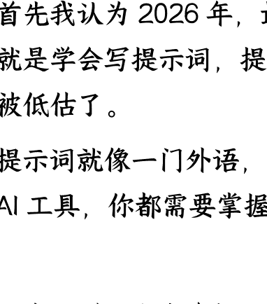
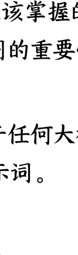
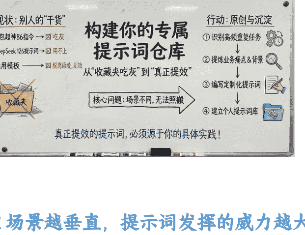
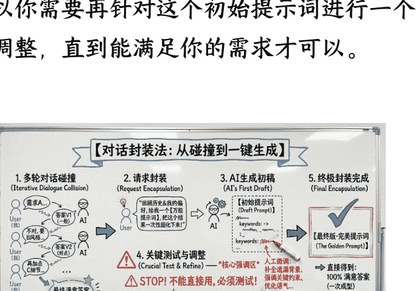
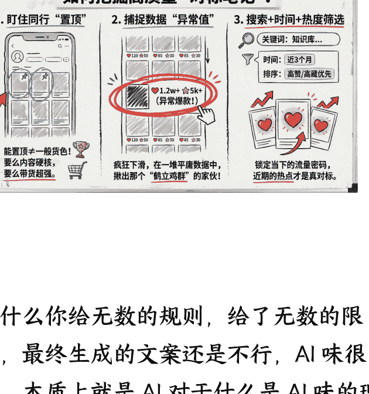
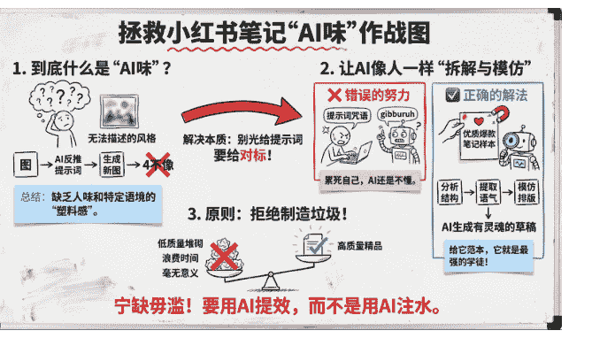
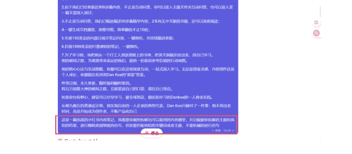
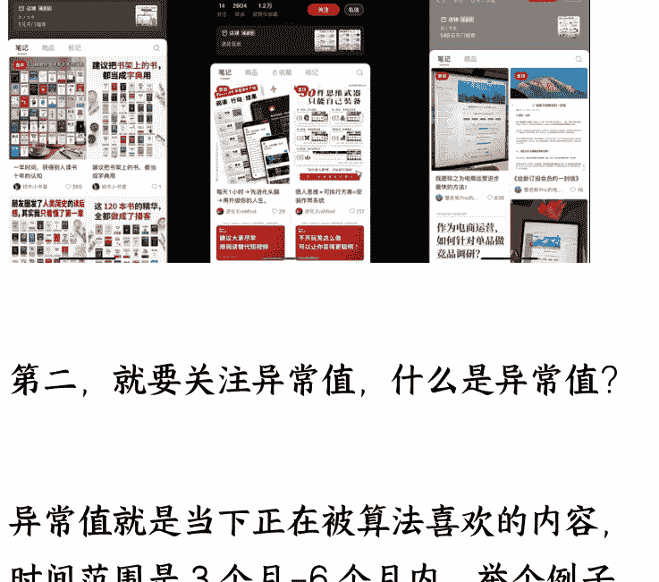

# 从实战里提炼出的指令使用打法，
作者：龙哥

## 一万字拆解 | 附带常用的生产力模板

## 260415 私域副业精华

绝大多数人其实不会写好指令。今天这篇就把怎么把指令用明白讲清楚。

我认为 2026 年最值得押注的能力，就是学会写指令。它的价值被严重低估了。

对任何大模型和 AI 工具来说，指令都相当于一门通用语言，不学会就没法真正驾驭工具。

网上教程不少，每次模型迭代或新工具上线，都会跟着出现一批华丽的指令，甚至有人靠售卖指令赚钱。

传播最广的那些指令，看起来都很精美，篇幅很长，第一眼就让人畏难，觉得写指令很玄学。过去的我也一度这么想。

觉得写指令很难，所以一直抗拒。后来才发现想多了。

指令充其量只能换来一个看似还行的初版答案，而这个初版十有八九不达标。你最后还是得用自己的逻辑去追问、去修正。照搬别人的模板，实战效果往往大打折扣。

再加上很多爆款指令都是为极度细分场景定制的，脱离你的语境基本用不上。所以别人的模板对你的帮助真的很有限。

## 01 为什么原创指令能力是 AI 时代的入场券

AI 时代必须具备自主写指令的能力，这是进入生产力时代的基本门票。原因很简单，每个人的使用场景都不一样，网上不可能有完全贴合你需求的现成词。一旦你学会了原创指令，等于解决了你和模型沟通的效率问题，能用专业的词把工作提速。

### 1.1 需求千人千面，现成词用不走量

回想一下，你的收藏夹里是不是躺着一堆神级指令：豆包的 86 条指令、DeepSeek 的 126 条好用词，当时觉得很干货，放进去后基本就石沉大海了。

因为你会发现，绝大部分词根本不适合你的任务。每个人的工作流、业务背景、输出标准完全不同，照搬别人的长词，出来的还是别人的痛点。

脱离具体语境的通用模板，产出永远差口气。真正能提效的词，只能自己造。

所以要建立自己的词库。尤其是每天在做高频重复的工作时，一定要把这些重复动作沉淀成可复用的指令。

### 1.2 越垂直，威力越大

这是我反复验证的结论：指令在垂直场景里最强。很多人用不好词，就是因为把指令当成万能解法。

比如让模型写小红书，很多人会说：你是爆文专家，帮我写一篇美妆主题的爆文，要无 AI 感…

模型会给你一篇笔记，你大概也不会满意。开头套路、标题平庸、全文 AI 感。于是开始在词里堆限制，越堆越糟。

问题不在词不够详细，而在于你让模型一次干了太多性质不同的活。

一篇笔记拆开看是三件事：写标题、写正文、定封面。

正确做法是把工作流拆到最小单元，每个单元配一个词。

做小红书创作，我会分三套词各司其职：

- **标题词只负责标题，紧贴爆款标题的结构规律；**

- **正文词只负责写正文，基于我提供的素材和对标样本展开；**

- **封面词只负责提炼封面文案。**

三套垂直词配合完成一篇笔记，每部分的完成度都远高于让模型一条龙。

所以在写指令前先做工作流规划，明确每个词的边界，**一个词只干一件事**。先画出你的工作流，找到可拆分的最小单元，一个单元对应一个词。场景越垂直，模型注意力越集中，输出越稳定。

## 02 我在用的生产力指令全拆解

### 2.1 生产力指令是什么

我日常内容创作量很大，为了承接这些产出，我做了很多专属词。这些词都基于我的创作与学习场景长出来。

先给它一个定义：

**生产力指令：能直接落到真实工作场景里，稳定产出高质量结果且可重复复用的指令。**

它有两大特征：

- **1. 是工作流程里的工具，不是玩具：** 不是用来尝鲜玩一下的，而是嵌入你的标准流程，成为像扳手一样趁手的工具。

- **2. 稳定且跨平台复用：** 一旦总结出来，比如我的标题词，丢到任何一个模型都能立刻开工，不需要重新对齐信息差，拿来即用。

### 2.2 我开源的几套核心词与思路

下面这几套词都是从真实场景和重复任务里长出来的，每个都有诞生背景。

**第一个，朋友圈创作词**

我习惯一鱼多吃。写完一篇长文，要把它拆成多个独立主题做二次创作，避免 AI 感。所以我做了一个朋友圈专用的词。它能把我的原文切分成主题清晰、有干货的短内容，非常适合私域运营，而且语料是我的，所以没有 AI 感。

**第二个，逐字稿清洗词**

我经常做直播和线下分享。想把语料用起来，就必须把录音逐字稿整理成可读的文章或教程。这个词能直接把口语稿清洗成结构清晰、易读的内容，发在专栏公众号，再用朋友圈词二次分发。

这套流里我没用复杂的技巧或智能体，就是多个词协同作战。核心是先梳理清楚自己的场景。

**第三个，爆文分析词**

我需要搞懂为什么某些笔记能拿到流量。这个词可以多维度拆解笔记的爆火原因，归纳出爆文模型和可复用的写作技巧。我也用来分析自己的笔记，模型给出的视角经常能补上我忽略的点。

**第四个，标题创作词**

小红书标题只有 20 字，信息密度要求极高，是数据好坏的关键。我围绕它做了两套词：

第一套是爆款标题仿写词，核心是先拆解爆款标题结构，再按关键词仿写。好处是 AI 感大幅下降，因为你给了它明确的模仿标准，还能批量生成 20 个、50 个。标题本质是选题，这也解决了选题焦虑。

第二套是虚拟产品专用的爆款标题生成器。我先收集了 50 条市场验证过的热销标题，让模型总结结构，再直接按主题仿写，不用再喂样本。

**第五个，笔记爆文词**

小红书爆文有周期性，给模型参考很关键。不给参考，模型开头永远是宝子们、家人们、谁懂啊。这种已经被淘汰了。

两条路：一种是仿写当下算法在推的爆文；另一种是先原创出一个爆款模型，再批量复制。

我认为模型的价值是帮你更好创作，而不是替代你。所以要有原创爆文能力。等你有了自己的爆款，再让模型提炼内容模型并批量仿写，效率会非常高。

**第六个，YouTube 学习词**

好内容很多在 YouTube，但看视频太慢。直接下载字幕可读性又差。我的做法是让模型把字幕重构成一份高质量的学习指南。模型在信息重组上的优势就是上帝视角。

## 03 原创生产力指令的方法论

上面是我怎么造词的思路。那怎么造？指令不是闭门造车，也不是完全让模型生成，是人与模型的共创。

### 3.1 对话封装法

我会和模型多轮对话碰撞，直到拿到满意结果，然后让模型回顾我们的对话、我的偏好，帮我封装成一个指令，一次性复现最终版结果。

例如你可以说：基于我们之前的对话和我的品味，帮我总结一个指令，下次直接给出最终版答案。

拿到初版词后一定要测试，往往只有 70%-80% 的达成度，需要再迭代微调，直到完全满足需求。

很多人问，为什么要这么麻烦一定要自建词库？因为对话封装法沉淀出来的词，稳定性强，拿来即用，适合重复性工作。一次内容产出，往往需要多套词协同。

注意，对话封装不是求一次完美，而是持续迭代。你可以在对话开头只抛问题，模型给初版，你不满意再调，比一次性塞满信息更有效。

这个方法最适合文案、笔记、宣传稿、日报等创作类场景。

### 3.2 反向提示法

也叫反推法。看到优质内容时，让模型反推出能生成它的指令。

比如我看到一个面试题回答结构很好，就让 Claude 反推：如果要一次性生成这种内容，指令该怎么写。

模型给出的词不是终版，还要调试。后期我会限制字数、要求根据问题背景调整，避免生搬硬套。几轮调试后就稳定了。

### 3.3 少样本提示法

这是解决内容工业化与 AI 感问题的核心。少样本就是给模型高质量的对标样本，而不是一堆干巴巴的指令。

很多人用一堆规则去要求不要 AI 感，结果越要求越像 AI。因为模型和每个人对 AI 感的理解根本不一致，尤其是长文本。

所以最好的解法是少样本。给它看它该模仿的样子。

怎么找高质量样本。以小红书为例：

想做虚拟产品，先看同行置顶笔记。置顶基本都是出单最多的，能作为高质量对标。

再看异常值，即 3-6 个月内被算法偏爱的笔记。搜关键词看首页，结合你的审美去挑，越是既在首页又戳中你，越有价值。

例如：

- **2026 年，用播客轻听完 100 本人生必读**

- **2026 年用播客轻松听完 100 本人生必读**

- **大量阅读不同领域的书，你的思维真的会变**

- **帮你省下 1000 小时的读书时间**

- **这 100+ 本书的精华帮你省下超过 1000 小时**

- **跨越领域阅读，你的思维真的会变**

- **告别低效阅读直接看 100 本书的精华解析**

- **停止低效划线，直接获取 100 本书的核心**

有人会问，模型现在这么强，直接批量爬爆文不就行了？不严谨。模型无法替代你的品味、审美和判断力，这三样才是 AI 时代的护城河。

让你模型提取 500 篇爆文但一篇没看过，等于没有标准，只是自嗨的效率表演。

模型可以提效、处理脏活，但真功夫要自己下。高质量语料的积累是拉开差距的关键，而且必须成为日常。

## 04 上下文工程被严重低估了

原创指令的本质是不断对话、迭代，直到模型的输出稳定满足你，再让模型总结上下文生成最终词。

所以好的生产力词一定是基于你对业务、内容和模型的理解千人千面。

用好模型还有一个被忽略的关键：上下文工程。很多人以为上下文工程只做智能体才需要，其实只要和模型交流就需要管理上下文。

把上下文比作食材，上下文工程就是烹饪技巧。定义是：对输入模型的信息进行合理搭配、控制顺序与深度的技术。

再好的食材，手法不对也做不出好菜。

最核心的一个思维是避免上下文污染。不要在一个对话窗口里让模型同时处理多项复杂任务，要拆分、垂直隔离。

就像切菜不能串味，用过生肉和大蒜的刀不能直接切西瓜，否则全是蒜味。任务混在一起，输出就会浑浊。

你有没有过这种经历？

好不容易让 AI 帮你写一篇小红书笔记，你一口气把所有任务都塞进同一个对话框：标题、正文、评论区、甚至封面文案……结果出来的东西四不像，语气忽高忽低，内容前后矛盾，读起来像精神分裂患者写的流水账。

问题出在哪？不是你不够会写提示词，而是你无意间让大模型“串味”了。

我把这叫作上下文污染。

什么意思呢？简单来说，一个窗口承载了过多的任务，AI 的大脑就会一团糊。就像一个厨师，你既要他切菜、又要他炒菜、还要他顺便洗碗，最终可能菜没切好，锅也烧糊了。不是 AI 不行，而是你让它太累了。

所以我现在给自己定了一个死规矩：**一个窗口只让 AI 做一件事。** 写标题就只写标题，写正文就另开窗口写正文，各司其职，互不干扰。用切水果的刀切水果，用切大蒜的刀切大蒜，就这么简单。

这是不是听起来太基础了？但正是这个基础原则，能让你对 AI 生成的结果拥有近乎变态的把控力。

再教你一个我最近反复在用的技巧，本质也是“避免上下文污染”——用 NotebookLM 榨干一个超长视频的全部价值。

说实话，NotebookLM 是个好东西，但它有个明显的短板：一次生成太多内容就会罢工，最多给你憋出一万字。可是你喜欢的 YouTube 视频动不动就三个小时，一万字的解读根本装不下那么大的信息量，大量精华就白白流失了。

那怎么办？

你只需要明白一件事：**AI 对信息有重新组织权。** 就好比你拿到一堆乐高积木，可以打散了，再按照自己的逻辑重新搭起来。既然 AI 一次只能吃半碗饭，你就分六次喂它，每次五千字，六次就是三万。

具体怎么做？跟以前写作文一个套路——先列大纲，再逐章填充。

第一步，先拆结构。把视频扔给 NotebookLM，让它深度分析后分成 3 到 5 个章节。记住，最多 5 章，不然每章内容就太薄了，讲不透。

第二步，设定关键词。让 AI 给每个章节列出 8 到 12 个关键词或子话题。这就像是在每个章节下面提前打好了桩，保证后面填内容的时候不会跑偏，也不会虚。

第三步，逐章生成。章节大纲一出来，就一章节一章节地让 AI 写。每章只围绕这一章的内容写 6000 字左右。写完第一章，复制同样的指令，让它续写下一章。你会发现，每次只让它干一件明确的活儿，它输出的质量远高于一次性写完。

我给你举个例子。

有一期《acquired》播客节目，花了好几个小时把爱马仕从 0 到 1 的品牌历程拆得极其细致。我特别想把这一期的内容完整消化掉，但靠听根本记不住，让 NotebookLM 一次生成又不可能。

于是我就按照上面说的三步走：

第一步，发了一段提示词，大意是：“请深度分析这个视频的完整内容，把整个指南划分为 3 至 5 个章节，最多 5 章，每个章节列出 8 至 12 个关键词，确保这些关键词能支撑 6000 字的深度内容。” NotebookLM 很快就输出了一个 4 章结构的完整大纲。

第二步，针对第一章，我要求它严格输出约 6000 字。最终它给了我一篇 6163 字的深度解析，逻辑完整，信息密度极高。

第三步，照着同样的方法继续生成第二章、第三章、第四章。每一章都保持了同等的质量和深度。

就这么三步，整个视频的信息量被我彻底榨干了——大概能拼出 2 万到 4 万字的高质量长文。坐高铁、坐飞机的时候，我随手就能翻出来温习，还顺手发给了我社群里的朋友，他们都觉得捡到宝了。

你可能会问，这种操作方式是不是只能用在 NotebookLM 上？不是的。任何能处理长文本的大模型，都能用这个逻辑去压榨。你只需要理解背后的原理：**不要让 AI 一次性背负太多期望，把庞大的任务拆解成一个个“小小”的子任务，分步去完成。**

再跟你分享几个我经常用到的提示词框架。

比如，让 NotebookLM 拆解章节时，可以这样写：“请深度分析这个视频的完整内容，设计一个学习指南的章节结构。重要约束：整个指南划分为 3-5 个章节（最多 5 章）。识别视频的核心主题模块，合并相关内容，形成 3-5 个大章节。每章必须是一个完整的主题单元，避免过度细分。为每章提供标题、200 字简介、8-12 个关键子话题，并标注重要性等级。确认每章的内容量足够丰富，能够深度展开到 6000 字。”

生成单章内容时，可以设置四个板块：“核心概念与原理”约 1500 字，“方法与实操”约 2000 字，“案例与实践”约 1500 字，“深化理解”约 1000 字。要求像写教材一样连贯，不能写成笔记摘要，每个要点都充分展开，信息密度高但可读性强，最后让 AI 自查有没有遗漏并报告实际字数。

这些提示词的核心逻辑其实就一条：**给 AI 划定清晰的边界，每个窗口专注干好一件事。**

顺便说一句，还有一个写爆款标题的小技巧也可以用这个思路——把你想要模仿的对标标题提供给 AI，让它分析出爆款基因（情感触发词、身份代入点、权威背书、价值承诺），然后结合新主题生成一批仿写标题。比如你可以准备一组“对标标题”：“身边没有高人指点，一定要去看这个知识库！”“我发现优秀的运营都偷偷地建立自己的知识库”“这个知识库我愿意称为年度最伟大发现”，然后让 AI 基于这些标题的模式，给你的新主题写 8 到 10 个角度各异的标题——情感冲击型、建议推荐型、成就展示型、权威背书型、实用价值型，每个标题不超过 20 字。

说真的，看完这篇文章，你可能会觉得自己懂了。

但我不妨提醒你一句，工具和教程只是最低级的门槛，真正的壁垒是立刻动手，把方法变成自己的肌肉记忆。去试试吧，用这个方法重新认识你手头的 AI，你会发现它的潜力远超你的想象。