# 从微信聊天记录到 Codex 串起 IMA、Obsidian、飞书的内容流转系统

260804 副业SC 精华

这不是一份单纯的工具安装清单。

我会以自己的真实业务为脉络，从手机随手存、电脑网页、微信历史以及已有的文档切入，借助 Codex 将 IMA、Obsidian、飞书连成一体，再把微信、网站、公众号等来源沉淀为知识库，生成网站内容，并产出可直接使用的公众号稿、短视频脚本、朋友圈素材和方案材料。

更关键的是，我会把跑通过程、踩过的坑和新手可照着做的最小行动步骤讲清楚。

本期有两种呈现形式，一种是本文档，另一种是分层目录的【知识库版本】，可自由组合使用。

知识库版：

https://my.feishu.cn/wiki/space/7668857880593829100?ccm_open_type=lark_wiki_spaceLink&open_tab_from=wiki_home

⬇⬇先看几个阅览图，更有感觉知道接下来要说什么、做什么！


社群对应的官网

内容工作台

航海家圈友参照做的“作业”

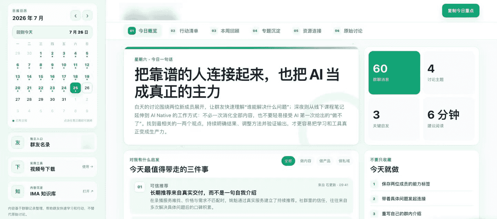

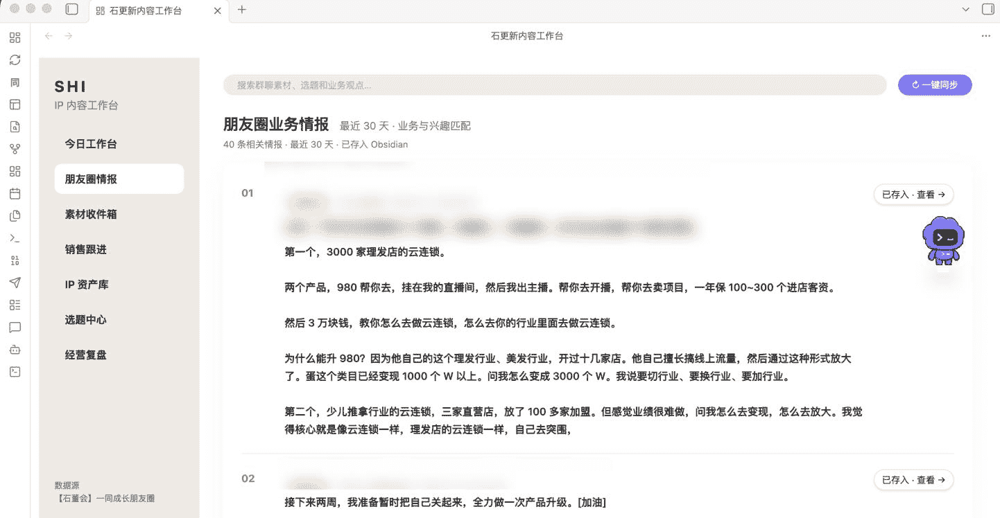

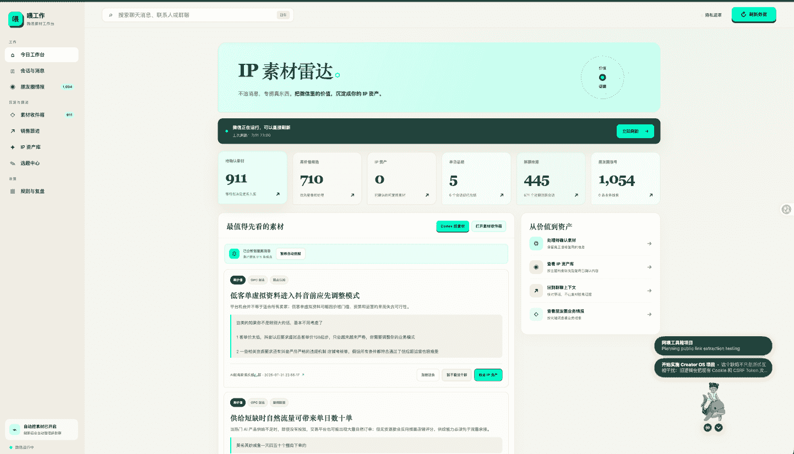

随时跟微信机器人对话，读取微信聊天记录，然后帮我找到适合我的选题。

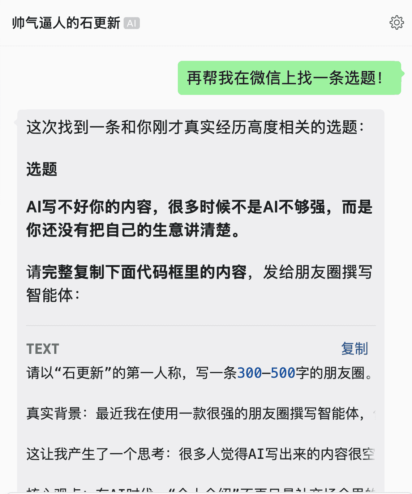

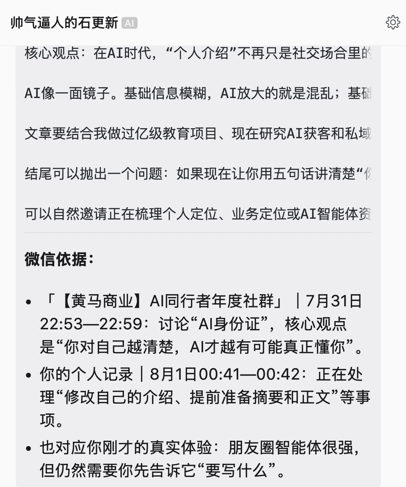

一条文章生成许多个「语料块」

反向链接关联

AI 一键生成高质量「公众号」，并且做自动排版，并且推送到「公众号草稿箱」，直接手动编辑下发布即可。

正式开始。

## 一、起点是一次我觉得不够亮眼的分享

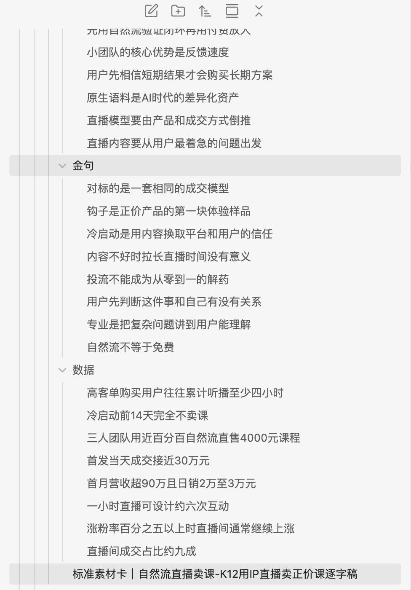

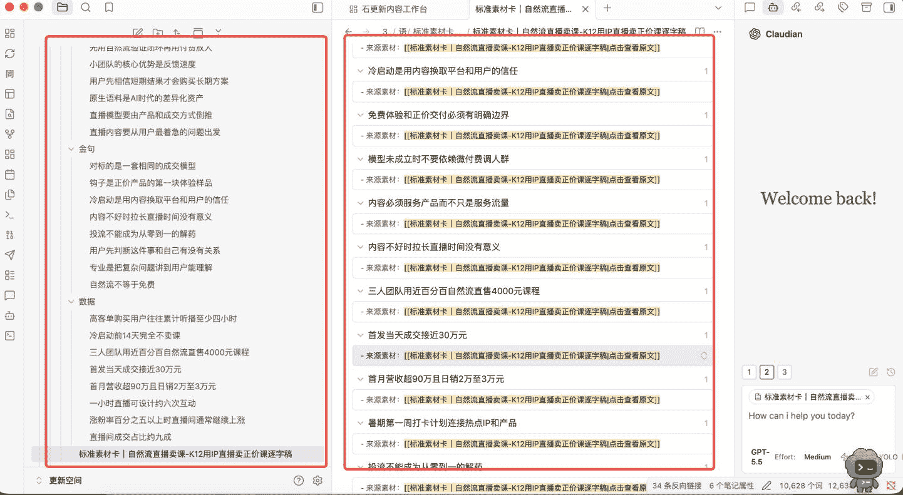

7 月 26 日，我在龙哥盟航海家线下大会上，分享了自己在用的工作流：怎样把电脑微信的历史翻出来，怎样把手机和网页内容归入知识库，再让 AI 整理调用。

轮到我时，现场只剩少量听众。我心里很忐忑：这套东西没有炫酷演示，也不属于“一句话就变现”的类型，会不会只有我自己觉得好用？

结束后，有人告诉我：“石老师，你讲得很扎实。”也有人说：“值了。”


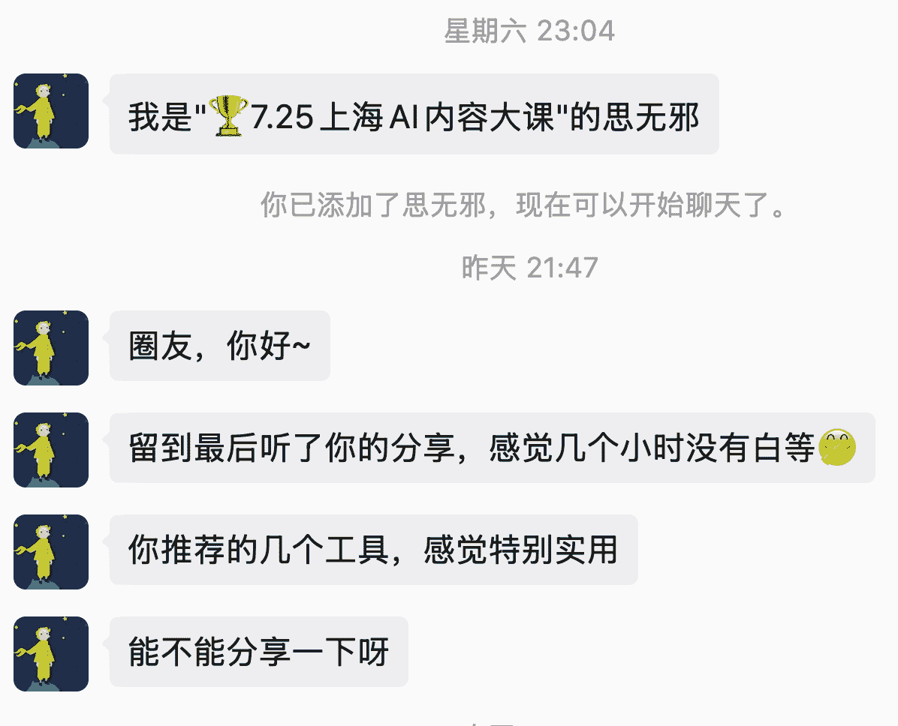

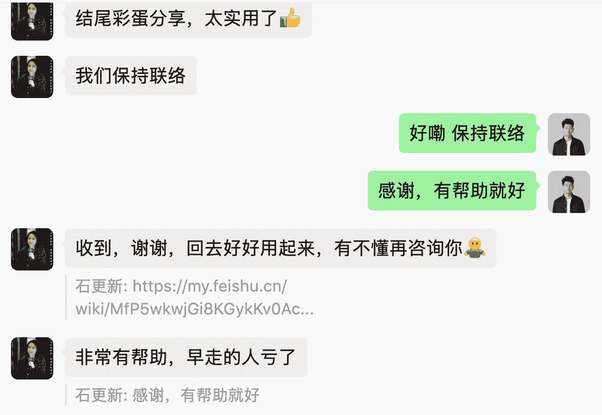

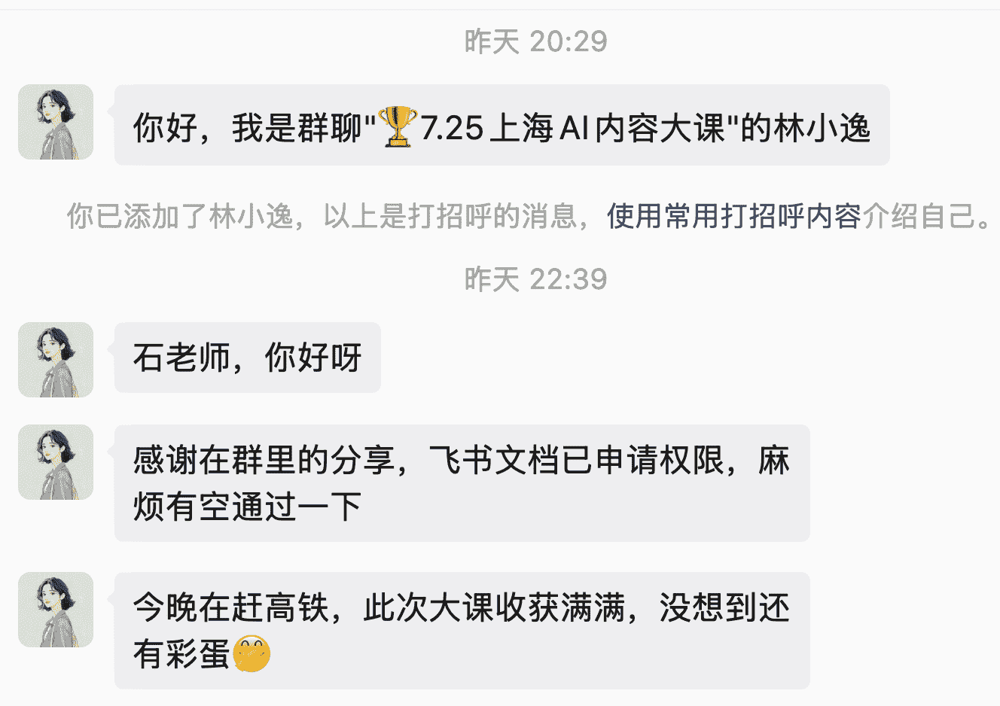

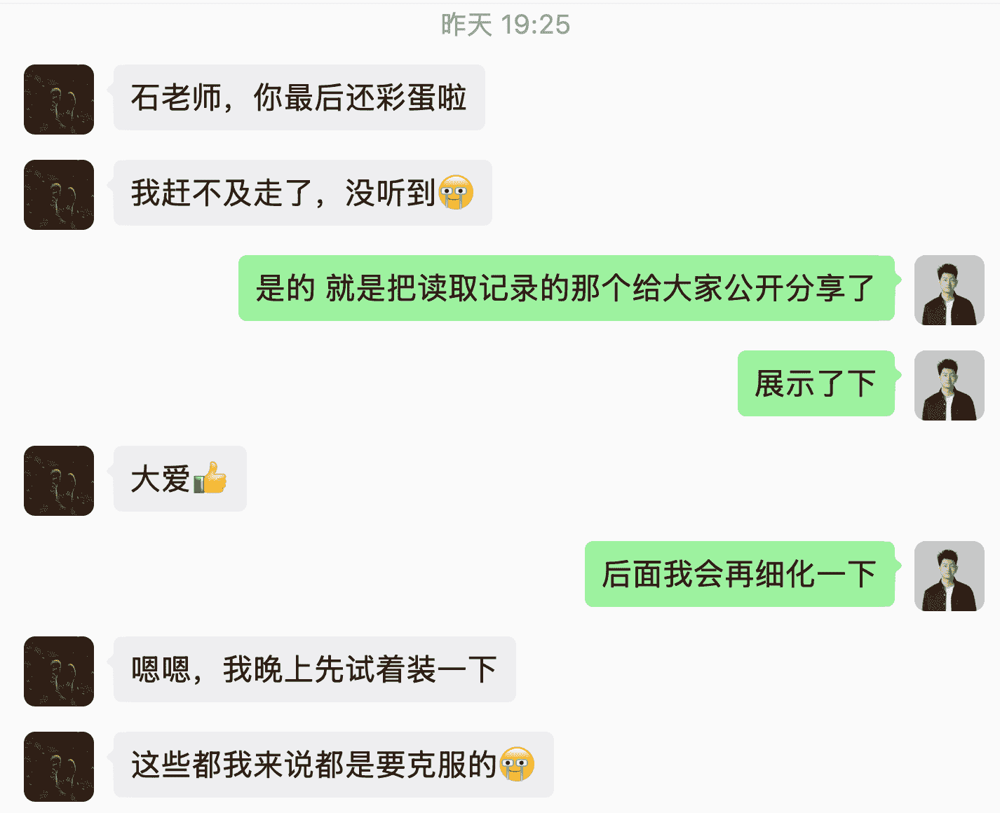

那一刻我才确认，这份内容是有价值的，并没有我想的那样平平无奇。

多亏大家的反馈，我才更有决心把更完整的版本写出来。

很多人不缺工具，缺的是一条能长期运转的路径：

今天收藏的东西明天还能检索到；检索到后能转化为自己的观点；写公众号、做短视频、发朋友圈、做方案时，还能被再次调用。

我过去的状态也很典型：客户问题在微信，文章收藏在手机，网页在浏览器，长文在飞书，零碎笔记散在各处。每个平台都有信息，但动笔时我仍然要重新梳理。

所以我搭这套体系，不是为了堆砌软件，而是想解决三个朴素需求：

1. 好内容能不能以最短路径先收进来？

2. 收进来后能不能被加工，而不是沉在收藏夹？

3. 加工后的知识能不能顺利进入发布和交付环节？

## 二、一句话说清分工：IMA 负责收、Obsidian 负责炼、飞书负责用、Codex 负责调度

| 工具 | 只做一件事 | 使用时机 |

| IMA | 采集 | 手机临时保存文章、网页，基于已入库内容提问 |

| Obsidian | 提炼 | 本地 Markdown 保存、拆解观点、建立关联、沉淀主版本 |

| 飞书 | 展示 | 排版、评论、协作、交付或给他人阅读时 |

| Codex | 调度 | 读取、整理、拆分、写入、同步，并在目标端验证 |

我给四款工具划定了清晰边界。

IMA 做收集。它依托手机和微信使用场景，适合看到内容时即时保存，也方便对已入库内容进行问答。

Obsidian 做加工。它本质是电脑里的 Markdown 文件夹，适合长期留存、拆改、双链和沉淀方法论。

飞书做分发。需要排版、协作、评论、交付或对外呈现时，我会把成品放进飞书。

Codex 做联动。它连接各入口和仓库，完成读取、整理、拆分、写入、同步和验收。

只记一条总线即可：

手机文章、微信记录、电脑网页、已有文档 → IMA 或 Obsidian 收件箱 → Codex 读取拆分 → Obsidian 笔记/归档 → IMA、飞书 → 公众号、短视频、朋友圈、课程或方案。

四者并非必须全用。首次搭建时，有一个入口、一个加工区、一个出口就能启动。

## 三、别先造大系统，先跑通一条内容

这是我最想提醒新手的：先手工跑通一条，再谈自动化。第一次验证我只挑一篇：

1. 手机把文章分享到 IMA。

2. 回到 IMA 确认全文可打开。

3. 让 Codex 读取并写入 Obsidian。

4. 在 Obsidian 检查标题、正文起止、来源链接、图片说明。

5. 让 Codex 从原文拆出一则可独立使用的观点。

6. 用该观点写一条朋友圈或短视频开场。

7. 成品放飞书，再打开复核。

走完这七步，才算这条链路打通。

过去我容易把“接口返回成功”当成完成。后来发现，创建成功可能只是生成了一份云文档，并未进入目标库；同步成功可能是个需登录的空链接；文件虽在 Obsidian，正文也可能缺一半。

现在我的验收标准很笨但有效：回到目标端重新检索、打开、通读。写进去和能用是两回事，能检索到、能打开、内容完整才算数。

不要追求全自动。

## 四、不同来源的接入方式

| 来源 | 首入口 | 加工区 | 常见出口 |

| 手机文章、即兴灵感 | IMA | Codex 拉到 Obsidian 收件箱 | 朋友圈、短视频、文章 |

| 电脑网页、公众号 | Web Clipper、飞书剪藏或 IMA | 完整性核查后进 Obsidian | 选题、文章、项目资料 |

| 微信历史记录 | yichen-wechat-local-vault | Codex 按对象、时间、关键词归类 | 复盘、案例、客户问题、选题 |

| 已写文档 | 直接放入 Obsidian | 统一格式、拆分、分类 | 飞书交付、IMA 检索 |

### 1. 手机内容：先进 IMA

【视频演示】手机浏览器内容如何保存到 IMA（25 秒）

手机场景讲求速度。看到文章想着“回电脑再整理”，大概率就没了。

我的做法是点分享选 IMA，放入固定库如“待整理”。保存后在 IMA 打开确认可读才算收下。

IMA 只是第一站，后续手工或 Codex 批量拉到 Obsidian，原始和加工结果分开存放。

### 2. 电脑网页与公众号：按完整度选工具

普通网页我先用 Obsidian Web Clipper。官方浏览器插件可把网页存成本地 Vault。

但生成 Markdown 不等于完整。懒加载图片、复杂表格、轮播内容易丢失。我会先滚动到底再剪藏，检查首尾、图片、原链接，仍偶有缺失。

公众号长文若 Web Clipper 不全，我会删掉改用飞书剪藏再试。飞书更适合保留排版和后续协作。

选型标准不是谁更高级，而是谁能完整留存。

长期使用后我发现 IMA 更稳，因它存的是链接而非剪藏，不易丢内容。

若要长期监控固定公众号更新，才上自动化：WeRSS 提供来源，本地脚本负责检查去重，飞书负责提醒和表格记录，Obsidian 保存正文并保留日志和授权失效提醒。起步不要监控几十个号，先测 1-3 个。

详细操作见：【取公众号】公众号文章监控工作流教程：可复刻执行版

### 3. 历史微信记录：读取本地 Vault

这是很多人刚需。

【视频演示】手机微信发指令，Hermes 调用本机 Vault，再由 Codex 整理。

电脑端读取微信 Mac 4.x 历史，我使用 yichen-wechat-local-vault。

它维护已解密的本地 Vault，Codex 再按群聊、联系人、关键词、时间范围查询。

对比旧版 wechat-cli，它可读语音、朋友圈，无需降版微信，也不用重签名版。

电脑链路：微信本地数据 → yichen-wechat-local-vault → Codex → Obsidian 或飞书。

想手机远程下指令时才加 Hermes：手机微信指令 → Hermes → 本地 Vault → Codex → 返回结果。

Hermes 是入口和调度层，不是数据库。Codex 是理解执行的大脑，不会凭空拥有微信记录。厘清三层后排错更简单。

基于本机微信聊天记录还能生成「社群活跃统计罗盘」。

手机端如何与微信机器人对话读取聊天记录，后面有实操讲安装配置。

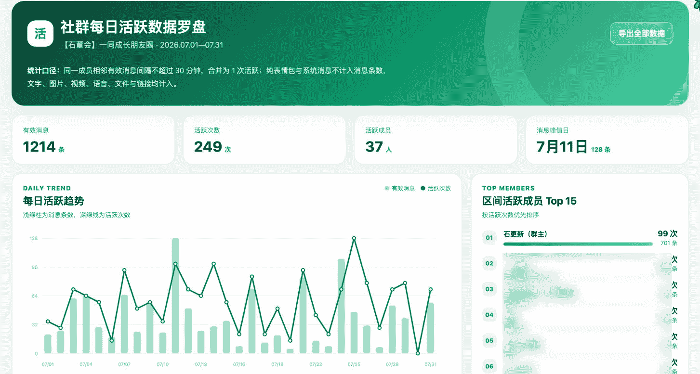

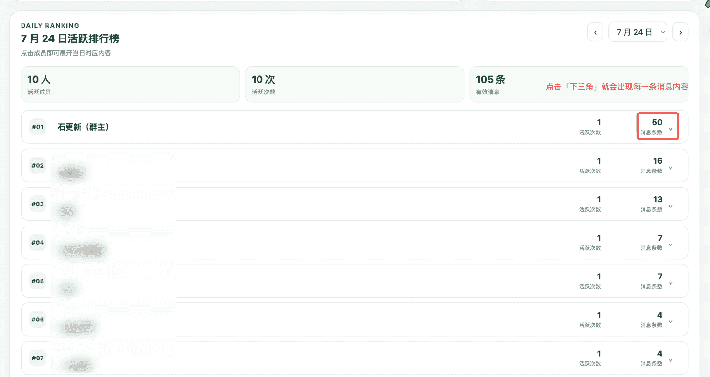

### 4. 已有文档：直进 Obsidian 再分发

Word、Markdown、飞书旧文档、过往文章，无需再收藏一遍。

我先确定原稿，放进 Obsidian 对应目录，保留来源和日期，再让 Codex 做格式统一、拆分、归类。

Codex 能理解 Obsidian 的 Markdown、双链、标签、frontmatter。

## 实操手册｜在自己电脑上跑起来

本节不是一次性装齐所有。先选一条路线，把一篇真实内容从源头送到出口；电脑端微信可查后再加 Hermes。每步都要回目标端重搜读取。

### 1. 先收藏官方入口表

工具更新快，第三方教程的安装包和命令易过期。下面尽量只放官网、官方仓库或我实测的 Skill。

| 工具 | 入口 | 何时需要 |

| ChatGPT 桌面端含 Codex | OpenAI 官方桌面端下载 | Codex 在本机读取整理同步，是流程调度中心 |

| Codex CLI 选装 | OpenAI Codex 官方仓库 | 习惯终端或脚本化时装；只用桌面端可暂不装 |

| Obsidian | Obsidian 官方下载 | 本地加工仓，保存 Markdown、管理成品 |

| Obsidian Web Clipper | Chrome 官方扩展页 | 网页直收 Obsidian，保存后需检查完整度 |

| IMA | IMA 官网 · IMA OpenAPI 凭证页 | 手机网页快捷入口；Codex 读写 IMA 才需凭证 |

| IMA 浏览器扩展 | Chrome 官方扩展页 | 网页图文复杂、想保留到 IMA 并 AI 检索时用 |

| 飞书与飞书剪藏 | 飞书客户端下载 · 飞书剪藏官方说明 | 协作、评论、排版、交付或高保真剪藏时用 |

| 飞书开放平台与 lark-cli | 飞书开放平台 · lark-cli 官方仓库 | Codex 搜索读取创建移动飞书文档与知识库节点时用 |

| yichen-wechat-local-vault | 一尘 Skill 项目页 | macOS 上读取微信 Mac 4.x 本地历史，替代旧 WeChat CLI |

| Hermes 进阶 | Hermes 官方 Quickstart · Hermes Weixin 配置 | 仅想手机微信远程下指令时需要；电脑直查不需要 |

| Node.js | Node.js 官方下载 | 装 IMA Skill、lark-cli 等 Node 工具时用；先让 Codex 检查版本 |

| Obsidian MCP 选装 | 知识库安装说明 | 高频检索批量维护时增强；Codex 直读写 Vault 不依赖 |

### 2. 安装顺序：先基础链路，再加入口

1. 先装 Codex 与 Obsidian。让 Codex 能看到明确 Vault 路径，先写后读一篇测试笔记。

2. 再选内容入口。手机用 IMA；电脑网页可同时试 Web Clipper、IMA、飞书剪藏，对比感受。

3. 需电脑微信历史时装一尘 Skill。先验证本地 Vault，再做限定查询。

4. 需手机微信远程指挥才加 Hermes。先完成普通对话和 PONG，再调一尘 Skill。

### 3. 第一步：Codex 连接 Obsidian

Codex 不必经 Obsidian MCP 才能读写。Vault 就是本地文件夹。先加入工作目录，再用提示词：

这是我的 Obsidian Vault 路径：【粘贴绝对路径】。请先只读检查路径正确，不扫描其他目录。确认后：

1. 保留现有结构，不覆盖旧文件；

2. 缺失则创建 Inbox、Notes、Archive、Outputs 四个文件夹；

3. 在 Inbox 新建“工作流验收测试”Markdown；

4. 写入标题、创建时间、来源、一句测试正文；

5. 重新读取文件，告诉我标题、路径、正文首尾；

6. 不装 Obsidian MCP，不删移批量改写旧笔记。写入后重读完整才算成功。

验收要看到：文件在正确 Vault，Obsidian 可打开，Codex 读回标题正文一致。详见《如何创建 Obsidian：从安装到第一个知识库》。

## 4. 手机内容进 IMA，再让 Codex 读取

先到 IMA Agent Interface 手动申请 Client ID 与 API Key。然后发给 Codex：

请安装并检查最新版 ima-skill，先确认 Node.js 版本达标。我会按提示在本机输入 IMA Client ID 与 API Key。请把凭证安全存本机私有配置目录：

- 目录权限 700；

- 凭证文件权限 600；

- 不在输出、日志、截图或 Git 显示密钥。

配置后调用 IMA OpenAPI 的 list_note 做一次 limit=1 只读鉴权验证。然后列出可访问的 IMA 知识库名称，不写入。最后告知：Skill 是否装成；鉴权是否成功；能否列出库；失败在哪一步。

能列出库后，再测一篇真实内容：

请在 IMA 按完整标题搜索【笔记标题】，只处理这一篇。读取正文后：

1. 保存原文到 Obsidian Inbox；

2. 保留原标题、来源链接、IMA 笔记 ID、同步时间；

3. 检查首尾、链接、图片说明；

4. 写入后重读 Obsidian 文件；

5. 告知 IMA 命中数、Obsidian 文件路径、读回结果。

勿批量同步，不覆盖同名文件；同名先停并告知我。

完整版参考：《IMA 知识库与 Codex 打通教程》。

## 5. 把飞书接到 Codex

先在飞书开放平台创建企业自建应用，开通云文档和知识库权限并发布。拿到 App ID 与 App Secret 后，不要写入公共提示词。

请按 lark-cli 当前版本的内置 Skill 与 --help 完成飞书接入，不要照抄旧命令。要求：

1. 从官方仓库安装或更新 lark-cli；

2. 引导我在本机完成应用配置，不在输出中显示 App Secret 或 token；

3. 发起 docs、drive、wiki 范围的用户授权；

4. 注意 auth login 本身不加 --as user，后续读写 API 时才用 --as user；

5. 验证用户授权状态；

6. 只读列出可访问的飞书知识库。

到此内容流水线已连通。接下来不是堆工具，而是拿一篇真实内容从入口走到出口，反复核验。先跑通一次，再逐步扩大边界。

7. 指定飞书文档仅作为只读核验对象；

8. 严禁新增、迁移或删除任何资料。

请反馈：lark-cli 当前版本、登录身份是否可用、知识库目录可否访问、指定文档是否完整读回。

只读验收通过后，再单独进行写入测试：

请将【本地 Markdown 路径】创建为新的飞书云文档，并归入知识库【知识库名称】的【目标节点】。要求：

1. 先核实目标知识库与节点唯一存在；

2. 创建前检索同名文档，若存在则终止；

3. 保留标题、层级结构、列表、表格与超链接；

4. 创建后确认文档已真正进入知识库，而非仅停留在云盘；

5. 返回知识库重新检索并读取新文档；

6. 回报文档链接、目标节点及读回结果。

禁止覆盖、删除或移动其他文档。

完整版参考：《飞书知识库与 Codex 打通教程》。

## 6. 电脑端读取微信：部署一尘 Skill

该路径仅适用于 **macOS + 微信 Mac 4.x**。

先确认本机已拥有所需的本地微信记录。新设备若缺少历史数据，需先用微信官方迁移工具同步；Codex 与一尘 Skill 无法凭空恢复本机不存在的数据。

电脑端链路：微信本地数据 → yichen-wechat-local-vault → Codex → Obsidian 或飞书。

请在我的 Mac 上安装并验收 yichen-wechat-local-vault。项目地址：

https://github.com/mcncarl/yichen-skills/tree/main/yichen-wechat-local-vault

目标：

1. 安装到 Codex Skills 目录，并使用 Skill 自带的隔离环境，避免污染系统 Python；


2. 审计现有安装与 Vault 状态，已有组件直接复用；

3. 若已有可用 Vault，先执行只读 status；若无则按 Skill 说明初始化；

4. 首次全量解密、需要 macOS 授权或需我手动操作微信时，暂停并明确告知；

5. 完成后仅只读列出最近会话；

6. 由我指定联系人或群聊、关键词及时间区间，再读取少量记录做验收；

7. 告知本次查询可覆盖的时间区间、记录数及缺失项。

安全边界：

- 不发送、不修改、不删除任何微信消息；

- 不上传、不迁移、不复制明文 Vault；

- 不输出 key、salt、token、wxid、数据库路径或整库原文；

- 不做无限范围导出；

- 不承诺零风险。

安装后，Codex 应先执行只读状态自检，再按需进行日常增量刷新。下方第一条命令为只读状态检查，第二条会写入本地私有 Vault；若实际路径不同，让 Codex 自动定位 Skill 目录：

```bash
~/.codex/skills/yichen-wechat-local-vault/.venv/bin/python \
~/.codex/skills/yichen-wechat-local-vault/scripts/vault_cli.py status --format text
~/.codex/skills/yichen-wechat-local-vault/.venv/bin/python \
~/.codex/skills/yichen-wechat-local-vault/scripts/decrypt_all_dbs.py --mode incremental
```

状态正常后，再下发明确范围的查询：

请先增量刷新本地微信 Vault；此操作会写入本地私有 Vault，但不会改动微信源库或发送消息。查找【联系人或群名】最近【7 天】提到【关键词】的记录，最多【20 条】。先确认目标会话唯一，再开始查询。输出要求：

1. 先给结论；

2. 仅引用必要短句；

3. 注明时间区间、命中数及可能缺失项；

4. 不展示路径、wxid、密钥或完整聊天原文；

5. 不发送、不修改、不删除微信消息。

完整版参考：《用 yichen-wechat-local-vault + Codex 读取微信数据》。

## 7. 手机微信远程下指令：引入 Hermes

前提：上一节的本地 Vault 已可在电脑端查询。Hermes 仅作为微信内的指令入口与调度层，不负责解密历史数据库。

手机端链路：微信新指令 → Hermes → 同一 yichen-wechat-local-vault → Codex → 微信回复。

请在我的 Mac 上搭建并验收：微信 → Hermes → yichen-wechat-local-vault → OpenAI Codex。要求：

1. 优先复用已有组件，缺少再安装；Hermes 使用官方安装方式；

2. 先验证 yichen-wechat-local-vault 的只读 status，为 Hermes 构建可调用的兼容层，不复制明文 Vault；

3. 通过 hermes model 选择当前账号可用的 OpenAI Codex 模型，并完成一次普通对话；

4. 配置 Hermes 原生 Weixin：私聊仅限本人，群聊关闭，禁止公开访问；

5. 微信消息不得触发密钥提取、全量解密或无限导出；

6. 禁止输出密钥、salt、wxid、数据库路径及整库原文；

7. 关闭工具进度与中间回复，仅返回最终结果；

8. 按序验收：Skill status、网关在线、微信 PONG、终端重启网关、重启后再次 PONG、一次限定范围的历史查询。

任一步失败均不得声称安装完成，需明确指出失败环节。需我登录、扫码或授权系统权限时暂停，等待本人操作。

验收顺序不可颠倒：先执行 hermes doctor，再确认 hermes gateway status；微信发送“只回复 PONG”并收到回复后，在电脑执行 hermes gateway restart，恢复后再测试 PONG。两次均成功后，才进行历史查询测试。

请使用 yichen-wechat-local-vault，只读查询【联系人或群名】最近 7 天提到【关键词】的记录，最多 20 条。先给结论，只引用必要短句，不显示路径、wxid、密钥或完整聊天原文。若本地 Vault 未做到最新，请告知需在电脑端增量刷新，切勿通过微信触发首次全量解密。

完整版参考：《微信 + Hermes + Codex：在手机上查询本机微信记录》。

## 8. 最后用一篇真实内容跑通整条链路

各工具单独验收通过后，再用下面片段把“取料、入库、加工、分发”串起来。首次仅处理一篇，不开定时任务。

请帮我手动跑通一条内容工作流，只处理一篇，不做定时任务。

来源：

- 平台：【IMA / 微信本地 Vault / 网页】

- 内容标题或对象：【填写】

- 时间范围或来源链接：【填写】

目标：

1. 将原始内容保存至 Obsidian 的 Inbox，保留来源、日期与源 ID；

2. 检查正文首尾、链接、图片或附件说明；

3. 从原文提取 3 条候选语料，每条仅保留单一观点、案例或数据；

4. 经我确认后，仅将选中 1 条写入 Notes；

5. 基于该笔记生成一份【朋友圈 / 短视频开头 / 公众号段落】草稿，保存至 Outputs；

6. 如需分享，再创建飞书云文档并放入【知识库名称 / 目标节点】；

7. 分别在源端、Obsidian 与飞书重新检索、打开并读回。

安全与版本规则：

- 发现同名内容立即停止，不覆盖；

- 不删除、不批量搬移、不自动发布；

- 接口返回成功不代表完成；

- 最后提供验收表：来源、目标、路径或链接、读回结果、缺失项。

## 9. 怎样才算真正打通

| 检查点 | 必须看到的结果 | 不能视为成功的情况 |

| Obsidian | 目标文件位于正确 Vault 与目录，标题、正文首尾、来源均可读回。 | 仅生成了文件名。 |

| IMA | 按标题检索可打开正文；关联知识库与目标位置正确。 | 仅接口返回成功。 |

| 飞书 | 目标知识库可检索到文档，打开后层级、列表、表格与链接完整。 | 文档仅存在于云盘，未进入知识库。 |

| 微信本地 Vault | 目标会话唯一，时间区间与命中数明确，抽样结果可对应原记录。 | 使用旧快照或同名群聊结果冒充最新答案。 |

| Hermes | 普通对话、首次 PONG、重启后二次 PONG、限定历史查询依次成功。 | 网关已启动但微信收不到回复。 |

五、内容入库后，如何避免沦为电子仓库

| 目录 / 状态 | 存放内容 | 下一步动作 |

| Inbox | 刚进入系统、尚未判断的原材料 | 删除、提炼或转入 Archive |

| Notes | 已提炼、可复用的观点、案例与数据 | 建立关联，等待真实调用 |

| Archive | 已处理但暂不使用的原文 | 保留来源，不再反复进入 Inbox |

| Outputs | 准备发布或交付的最终成果 | 发布、协作并记录最终版本 |

收藏不等于知识库。收藏只是把“以后也许有用”换了个地方堆放。

我在 Obsidian 中将内容至少划分为四种状态：

- Inbox：刚进来的原料，未经判断。

- Notes：已提炼、未来可复用的笔记。

- Archive：已处理但暂时不用用的原文。

- Outputs：已准备发布或交付的成品。

真正决定知识库价值的，是 Inbox 能否持续流向 Notes 与 Outputs。

我的基本加工单元不是“一篇收藏”，而是一条语料块。一条语料块只保留一个可独立使用的观点、案例或数据，同时写清来源、适用场景与个人判断。

一篇文章若含八个观点，我不会把整篇原文直接当知识搬入。

我会让 Codex 先拆出候选块，再由我确认哪些值得保留。最终留下的可能只有三条：

- 一条可放入公众号正文的观点；

- 一条可讲给客户听的案例；

- 一组需保留出处的统计数据。

清洗后，我会立刻挑选一条使用。它可以是一条朋友圈、一个短视频开头、公众号的一段正文，或方案中的一页。只有内容真正进入作品或工作，我才认为完成了一次流转。

实战案例｜一篇 IMA 原文如何经清洗、调用后成材

前面是方法，下面补充一段真实跑通的过程。它不是事先画好的流程图，而是 Codex 与 Obsidian 协作下，一篇真实 IMA 原文最终变成公众号草稿与朋友圈文案的完整记录。

此次验证的重点，不是“AI 能否写文章”，而是原料能否被清洗、按目标调用，并针对不同平台长成不同成品。


一条文章生成「语料块」

反向链接关联

内容工作流设计流程

内容工作流实际测试

### 1. 原料：从 IMA 精准同步一篇真实文章

本次原文为《8 月 AI 一人公司实战营｜手把手教你搭建 Agent 内容获客系统，从流量到变现（陪跑 2 个月）》。Codex 通过 IMA API 在“石更新的知识库”中精确定位同名内容，再同步至 Obsidian。同步后重新读取目标文件，确认标题、元信息与正文完整。

至此仅完成取料与入库。文档虽已进入 Obsidian，却尚无法直接支撑写作。

### 2. 清洗：把一篇招生文章转化为 15 个可追溯语料块

原文混合了观点、工具案例、课程安排、销售话术与作者自述成绩。若仅做摘要，仍是一篇缩短的招生文。真正的清洗，是先完整保存标准素材卡，再只拆出未来可能使用的部分。

| 类型 | 数量 | 保留内容 |

| 观点 | 6 | AI 产出与商业价值、工具能力与商业系统、Agent 工作流等 |

| 案例 | 4 | 信息日报、选题安排、录音转存与多平台内容管理 |

| 数据 | 2 | 仅保留可明确说明当期产品交付设计的信息 |

| 金句 | 3 | 一人公司、商业系统与持续经营相关表达 |

每个语料块均双链回标准素材卡。原文中缺乏独立证据的收入、销量、学员数量与效果数字，未被包装为可信数据；需保留的课程信息也增加了使用边界。

清洗不是全盘保留，而是判定什么值得留下、属于哪类、能在何种边界内使用。

### 3. 调用：先生成选题，再由人决定写作方向

语料准备好后，Codex 并未直接写正文，而是先读取账号定位卡、目标用户痛点库、发布目的清单，以及公众号与朋友圈的平台规则。

当系统发现账号定位卡与痛点库仍为空模板时，未假装完成个性化匹配，而是明确标注此限制。随后基于现有语料生成 5 个候选选题，每个均含核心观点、支撑语料双链、适用用户与推荐理由。

我最终选择：《会用 AI 为什么还赚不到钱？问题不在工具，在商业系统》。

选题确认后，案例、数据与金句才围绕同一核心观点重组。与主题无关的课程价格、报名方式与成绩数字全部剔除。

### 4. 成材：同一选题分别长成公众号与朋友圈

公众号版本负责讲透问题：AI 生产能力提升不等同于自然获得流量与收入；从“我是谁”到“如何持续做下去”，中间缺失的商业环节。文末列出实际调用的 7 个语料块，便于回溯。

朋友圈版本未对公众号长文做机械压缩，而是从当下真实过程切入，仅保留一个判断、一项支撑与一个提问。核心表达为：

会用 AI 写文章，不等于具备内容获客能力；会用 AI 做产品，也不等于懂得定价与销售。中间缺失的不是工具，而是商业系统。

此次后，我对“成材”的理解更清晰：不是把 Markdown 复制到发布平台，而是依据平台、用户与发布目的，让同一组原料长成不同形态。

完整复盘：《一次真实的五环实战：从 IMA 原文到公众号与朋友圈》

IMA 原文 → Obsidian 标准素材卡 → 15 个可追溯语料块 → 5 个候选选题 → 人工选择 → 公众号草稿＋朋友圈文案

## 六、第一次建知识库，小白可如何起步

若让我从零开始，我不会先研究标签体系，也不会先装一堆插件。

第一步，只选一个真实问题。例如：“我想把每天看到的公众号文章保存下来，并在写朋友圈时找得到。”问题越具体，首套


目录越简洁。

第二步，只挑近期会立即使用的内容。不要一次性导入数千篇历史收藏。先放十篇以内，优先未来两周内准备写作、讲解或交付的材料。

第三步，只建四个目录：Inbox、Notes、Archive、Outputs。主题标签待内容增多后再增。

第四步，手动跑通一条流程。收一篇、读回一篇、拆一条、写一个成品。此过程可暴露权限、路径、格式与账号问题，也能明确自身真正需要的工具。

第五步，移除暂时不需要的安装项。初期可不装 Obsidian MCP、不装 Hermes、不做定时任务，也无需同时打通三个知识库。手机先用 IMA，电脑加工用 Obsidian，需分享时再用飞书，已足够。

新手最易卡住的，往往不是写代码，而是未说清“从哪里来、到哪里去、成功是什么”。

给 Codex 下指令时，把源头、目标库、目标路径与验收方式讲清，问题会大幅减少。

七、内容增多后，如何升级为大型知识库

| 机制 | 解决的问题 | 最低验收标准 |

| 去重 | 避免同一内容重复入库 | 重复执行一次，不新增副本 |

| 日志 | 追踪每次同步的操作 | 可查看来源、目标、时间、状态与错误 |

| 失败重试 | 应对临时网络或接口异常 | 有限次重试，连续失败时提醒人工 |

| 定时检测 | 减少手工检查频率 | 先手动跑通，再从低频起步 |

| 写后验收 | 避免仅看接口成功 | 目标端可检索、打开并读到完整内容 |

当 Inbox 长期积压、同类内容频繁重复、单一目录难以检索，或同一内容需服务不同项目时，即可升级。

我会从三方面增强结构。

第一是分层。原始素材、精炼笔记与最终成品必须分离。原文保留出处，Notes 书写个人判断，Outputs 记录最终发布版本，三者不互相覆盖。

第二是加状态，而非堆标签。除 Inbox、Notes、Archive、Outputs 外，还可增加“待核实”“待发布”“已发布”。状态回答的是“下一步做什么”，比几十个模糊标签更有用。

第三是确定主仓。何处保存原始来源、何处负责加工、何处负责交付，需提前明确。我的默认是：IMA 与网页剪藏负责进料，Obsidian 为加工主仓，飞书为协作交付端。若某篇内容原在飞书完成，也可从飞书出发，但加工后的主版本仍需明确，当前明确终点即 Obsidian。

分库也不要只看文件数。当不同内容的使用人群、权限范围或生命周期明显不同，如个人素材、团队项目、对外付费交付需不同成员访问时，再拆分为独立知识库。

标签适合处理跨目录、反复出现的主题；当一主题持续出现、确实需要横向检索时再添加，无需首日就设计庞大标签树。

八、我实际踩过的几个坑

坑一：工具升级了，教程仍停留在旧版本

曾以为，只要一条旧命令跑过一次，就可长期写入教程。后来微信读取方案、飞书 CLI 参数均已升级，知识库各页面却仍保留旧说法，读者照做必然卡住。

后来我将电脑端微信方案统一为 yichen-wechat-local-vault，并重新核对 lark-cli 当前帮助。对新手的建议是：教程中的命令仅代表当时版本，真正执行前请让 Agent 检查本机版本与官方说明。

坑二：未先定主仓，内容在多平台重复

起初认为多存一份更安心、更踏实。等 IMA、Obsidian、飞书均出现同名内容后，反而不知哪份最新，也不敢修改。

后我规定 Obsidian 保存加工主版本，飞书保存协作或交付版本，IMA 更偏向入口取料与 AI 对话；同步时携带来源与状态。对新手的建议是：备份可多份，主版本只能有一个。

坑三：一开始就想把所有环节自动化

当时设想每 30 分钟自动检查、自动清洗、自动分发。真正遇到错误时，却不知问题出在取料、权限、去重还是写入。

我在实操里踩过的坑，其实都指向同一个结论：先把手工跑通，再考虑让机器接力。

我现在的自动化分了三层。第一层是人为点一下触发，第二层是增量补齐，第三层才是完全定时跑。给刚入门的朋友一句话：自动化不是起步位，它只是把已经可控的人工流程放大放快。

### 坑四：以为装了 MCP 才能读懂 Obsidian

我最早写过一篇 Codex 装 Obsidian MCP 的教程，里面说直接读文件就“看不懂双链、标签和 frontmatter”。回头看这说法不准确。Codex 本身就能解析 Markdown 的双向链接、标签和文件头，MCP 的价值是把常用的操作包成更顺手的快捷键。

现在我把 MCP 设为可选项。新手更稳妥的做法是先走最短路径把问题解了，等到检索频率变高、批量维护需求上来，再决定要不要装。

### 坑五：忘了查会员、授权和账号边界

工具装好不等于就能用。举几个例子，得到大脑官方的 MCP 和 OpenAPI 现在都明确要求会员身份；飞书这边则要逐项核对应用权限、文档权限、知识库成员范围。

得到官方的使用说明和开放平台文档里都写清了会员前置。建议在动手前先列一张前置清单：会员是否满足、授权是否通过、操作账号是否有权进入目标空间。

### 坑六：同名文件夹不是同一个库

我曾同时存在两个同名 Obsidian 知识库，路径却不一样。一个只暴露部分目录，另一个才是全量内容。光看文件夹名称很容易把 Agent 指向错地方。

后来我改成先核对绝对路径，再把 Skill、Agent 和自动化里的引用全部统一，最后全局搜一遍旧路径有没有残留引用。给新手的提醒是：路径一旦迁移，别只搬文件，所有依赖该路径的流程都要一起复核。

## 九、能交给机器的，和必须人把关的

可以放手的，是规则明确、可重复、出错能回滚的操作：新内容巡检、按固定目录写入、生成初稿摘要、拆分候选语料块、更新索引、写日志、失败时报警。

必须留给人的，是涉及判断和风险的环节：这条信息值不值得留、AI 总结有没有跑偏、聊天记录能不能被引用、哪一版可以对外发布，以及删除、覆盖、批量搬移、对外推送。

总结我的使用感：AI 很擅长搬运、拆分、检索、核对、记录，而内容立场、隐私红线和最终发布权，始终要握在人手里。

## 十、第一次上手就能跑通的最小清单

别等环境完美，直接拿手边一篇现成文章开干。

- 选定一个统一入口，无论手机端还是电脑端都走 IMA。

- 新建一个专用的 Obsidian Vault，内部只保留 Inbox、Notes、Archive、Outputs 四个文件夹。

- 用 Codex 调用 IMA Skill，把这篇文章丢进 Obsidian 的 Inbox。

- 让 Codex 拆出三条候选语料块，你自己挑最有价值的一条。拆分思路可参考《在 Obsidian 里如何做内容清洗和调用》。

- 把这条语料改写成一条朋友圈、一条短视频脚本或一篇公众号短文。

- 最后通过 Codex 把成果回传给 IMA 和飞书。只做存档可以不回传，需要在 IMA 或飞书里直接用就必须回传。

## 结尾

折腾到现在我更坚定一件事：工具只是起点，关键是把工具特性跟业务需求接起来，让内容真正流动起来。

躺在收藏夹里它只是原材料；一旦变成你的观点、作品、方案，或者帮你解决一个真实问题，它才算成为你的知识。

我现在追求的已经不只是效率更高的内容系统，而是能贯穿产品和变现的业务系统。

以产品和变现为终点，反推内容系统的设计。

希望这点踩坑经验对你有用，哪怕一点点，祝我们都越做越顺！

下面是「知识库版本」，信息更全、更细。

知识库版：

https://my.feishu.cn/wiki/space/7668857880593829100?ccm_open_type=lark_wiki_spaceLink&open_tab_from=wiki_home

————分割线————

看完 SOP，很多人会觉得懂了，实操第一步就卡住。90% 的人都是这样。

工具和教程是最基础的门槛，真正拉开差距的是“立刻开干”和“圈层信息差”。

我们只拆商业闭环，只压榨 AI 效率。系统里已沉淀 1000+ 跑通的套利实战案例。

⬇ 查看圈子数字资产和加入门槛：

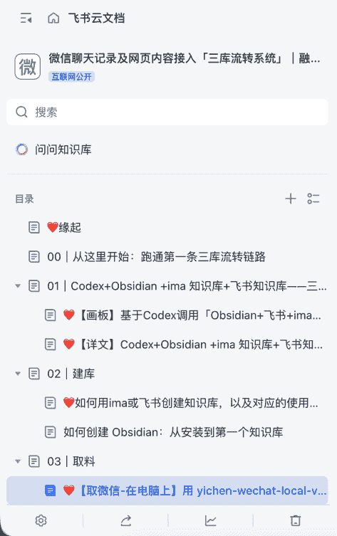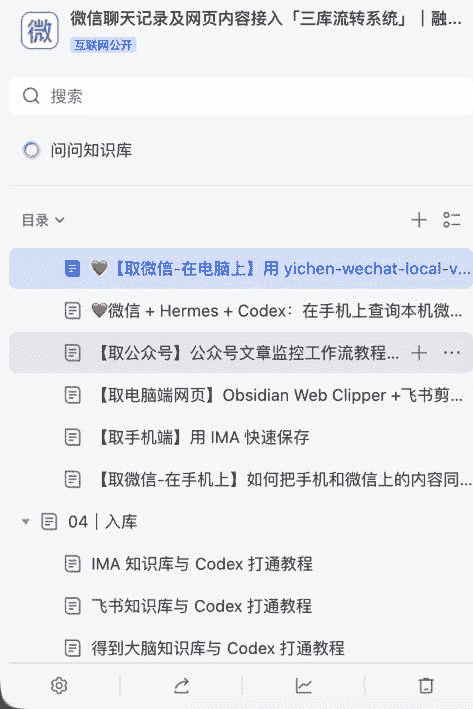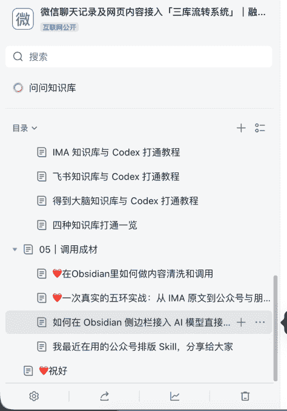

