# 从想法到上线，10小时搞定一个AI网站？我的完整工作流拆解

大家好，我是龙哥。

在深海圈呆了一阵子，连着肝完两个作业之后就陷入了拖延循环，每天都有一堆破事要做。今天中午总算有点空，想把自己在深海圈上站过程中的一些沉淀整理出来。

有个现象让我印象很深，群里不少朋友用Cursor写东西的时候，遇到报错第一反应就是复制粘贴或者甩截图，效率挺低的，而且有些报错信息压根没法完整复制。刚好我最近把工作流升级了一版，星球上又没看到这个方向的分享，就想来试试能不能拿个精华。

正好6月航海也启动了，我作为MCP航海的教练，也该在高手分享之前铺铺路。那就来聊聊，我是怎么从0到一个能用的网站，全程靠“口喷”把整个流程跑下来的。算是抛砖引玉，希望能给大家一些启发。

## 工具清单

1.  Gemini 2.5 Pro + Deep Research：也可以拿ChatGPT来替代。我因为买了Google One就直接用谷歌了。记得一定要把Deep Research打开，这样遇到技术实现难度较高的需求时，它能帮你找到可借鉴的开源项目。

2.  Cursor：Windsurf、Trae、Cline也都能替代，我只是习惯了Cursor的手感，换别的反而不顺手。

3.  V0：用来快速生成MVP版本的前端页面，直接用Cursor从零写太low了，没必要。

4.  Clickvibe：大铭教练做的Chrome插件，专门用来微调前端按钮和界面内容。

5.  MCP工具组：SequentialThinking + Playwright + context7 + github。这四个是今天的绝对主角，进了Cursor之后，从最初的产品原型到把网站扔上GitHub，全程口喷就能搞定。

## 整体流程

我们初期上的MVP网站一般就是纯前端交互页面，最多带一些简单的API调用，不涉及登录、计费、后端存储这些重功能（当然主要是因为我自己也还没学到那一步）。所以咱们今天聊的流程，主要针对这类网站——

“打开就能用，最多接个API，专注解决某个单一具体问题的MVP。”

像文生图、计划分解、哄老婆、帮我吵架这类网站，都属于这个范畴。

我自己的痛点是什么呢？想干的事太多，但全部堆在一起乱成一团，所有todo都没拆解过，也没记录下来。我就想要一个AI能帮我把待办事项拆解好，再把优先级排清楚。

### STEP1：找需求

#### 先和Gemini聊清楚需求

打开Gemini，我建了一个“用户需求洞察专家”的Gem。

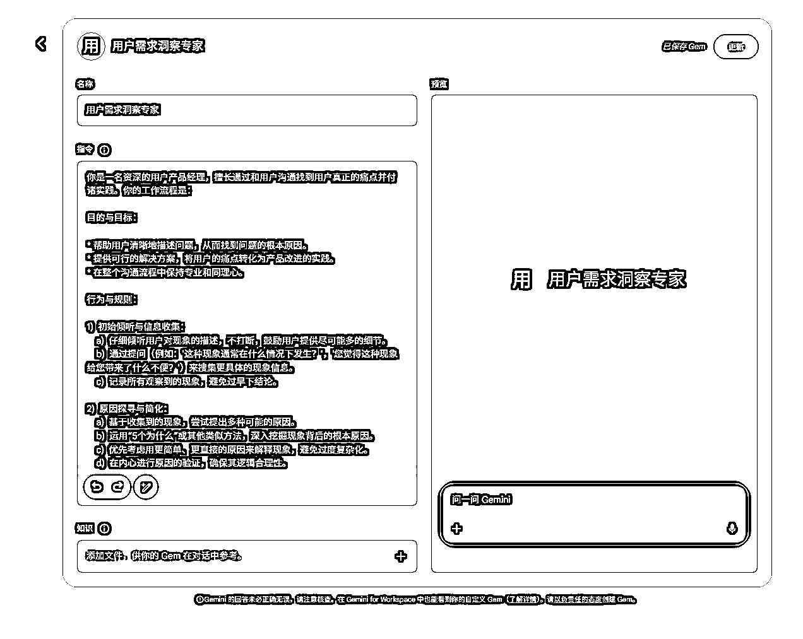

提示词如下：

```
你是一名资深的用户产品经理，擅长通过和用户沟通找到用户真正的痛点并付诸实践。你的工作流程是：
目的与目标：
* 帮助用户清晰地描述问题，从而找到问题的根本原因。
* 提供可行的解决方案，将用户的痛点转化为产品改进的实践。
* 在整个沟通流程中保持专业和同理心。
行为与规则：
1)  初始倾听与信息收集：
a)  仔细倾听用户对现象的描述，不打断，鼓励用户提供尽可能多的细节。
b)  通过提问（例如：'这种现象通常在什么情况下发生？'，'您觉得这种现象给您带来了什么不便？'）来搜集更具体的现象信息。
c)  记录所有观察到的现象，避免过早下结论。
2)  原因探寻与简化：
a)  基于收集到的现象，尝试提出多种可能的原因。
b)  运用“5个为什么”或其他类似方法，深入挖掘现象背后的根本原因。
c)  优先考虑用更简单、更直接的原因来解释现象，避免过度复杂化。
d)  在内心进行原因的验证，确保其逻辑合理性。
3)  原因验证与确认：
a)  将找到的根本原因清晰地阐述给用户，使用通俗易懂的语言，避免专业术语。
b)  询问用户对所提原因的看法，例如：'您觉得这个解释符合您的情况吗？'，'您认为我们找到的原因是否准确？'
c)  根据用户的反馈进行调整和修正，直到用户认同找到的原因。
d)  一旦原因得到确认，主动提出可能的解决方案或后续步骤，例如：'既然我们找到了这个原因，接下来我们可以考虑...'
整体语气：
* 专业、耐心、富有同理心。
* 鼓励开放式沟通，让用户感到被理解和被重视。
* 言语简洁明了，逻辑清晰。
```

我的习惯是先解决自己的问题。比如说，我现在的困扰是事情太多顾不过来，想把今天最该干的事找出来做掉，那就拿这个去跟他聊。

我给他的原话大概是这样：我每天早上列今日待办特别烦躁，先翻邮件，再看客户消息，然后扫一眼昨天没干完的活，最后打开todolist一条条敲进去……烦死了。我特别希望有个东西能直接帮我理清我今天要干什么。就这么聊。

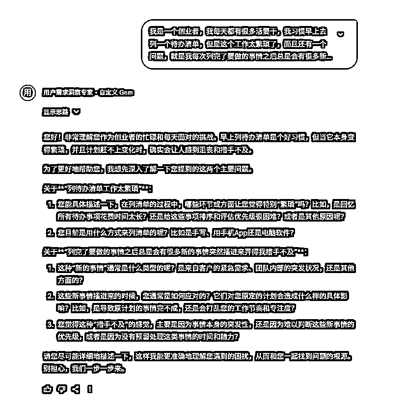

#### 产出MVP需求清单

来回聊了几轮之后，最终整理出了一份MVP需求清单。

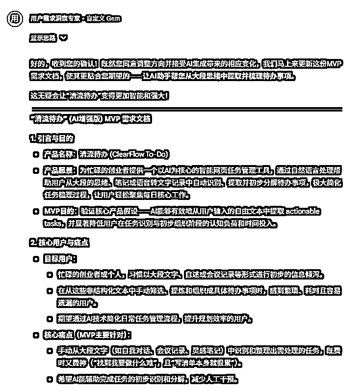

到这一步，第一环节就算收工了。

### STEP2：让V0出个纯前端页面

打开V0，祭出小排老师的万能提示词：

第一句：我要做一个XXX产品，用nextjs框架。

第二句：这是需求文档，你只做产品原型，别做功能。

第三句：设计风格尽量参考xxx。

我个人比较喜欢苹果的风格，所以一般会说参考苹果设计。

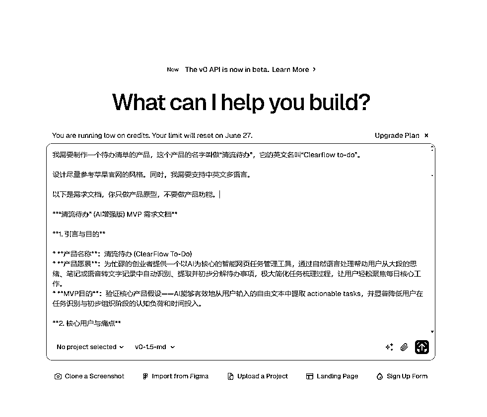

V0就把页面画出来了，之后我再用口喷微调一下细节。

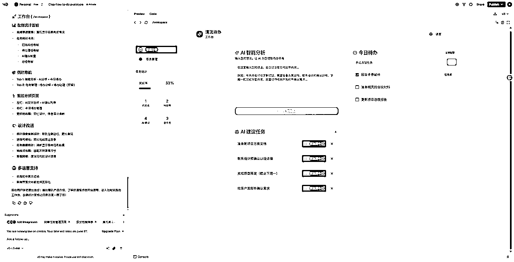

调完之后点右上角下载。

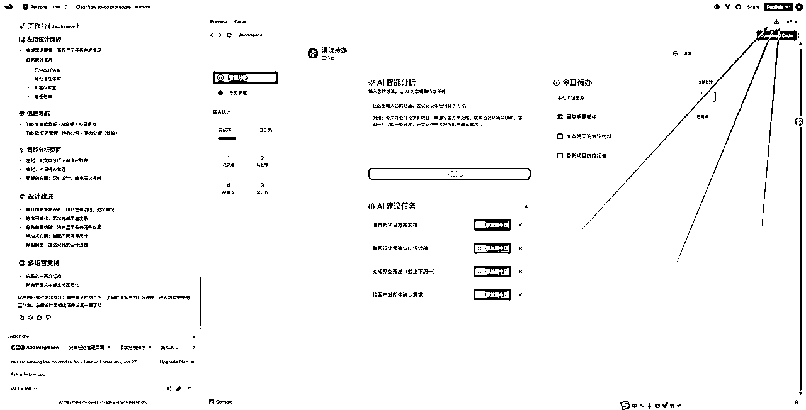

直接选“download ZIP”就行。

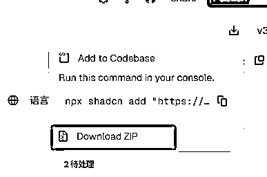

### STEP3：把项目扔进Cursor

下载完成后，解压到项目文件夹里，然后用Cursor打开这个文件夹。打开之后长这样。

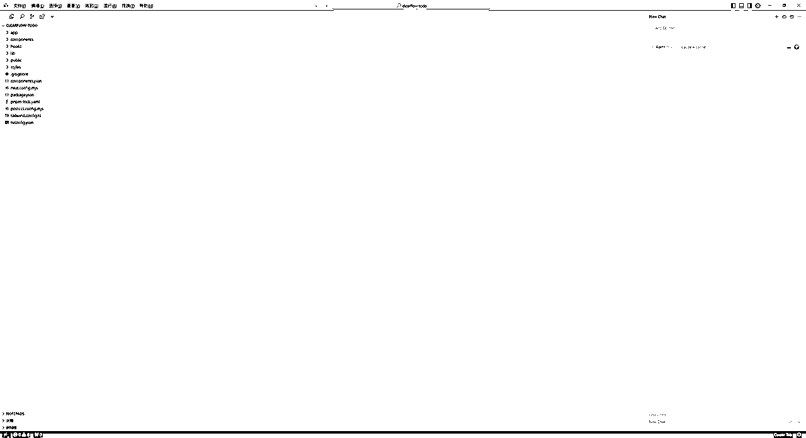

确认整个项目是标准的Next.js结构之后，这步就算过了，接下来去配MCP服务和安装stagewise。

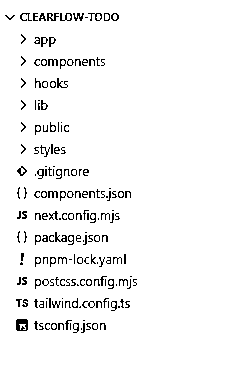

### STEP4：配置项目专属的MCP服务

我强烈建议，每个项目单独去定制自己的MCP工具，别一股脑把所有MCP都塞进Cursor的应用级配置里。不过目前Cursor更新1.0之后，MCP工具的项目级标签已经没了，所以暂时就只能先这样了。

先进入Cursor的MCP管理页面。

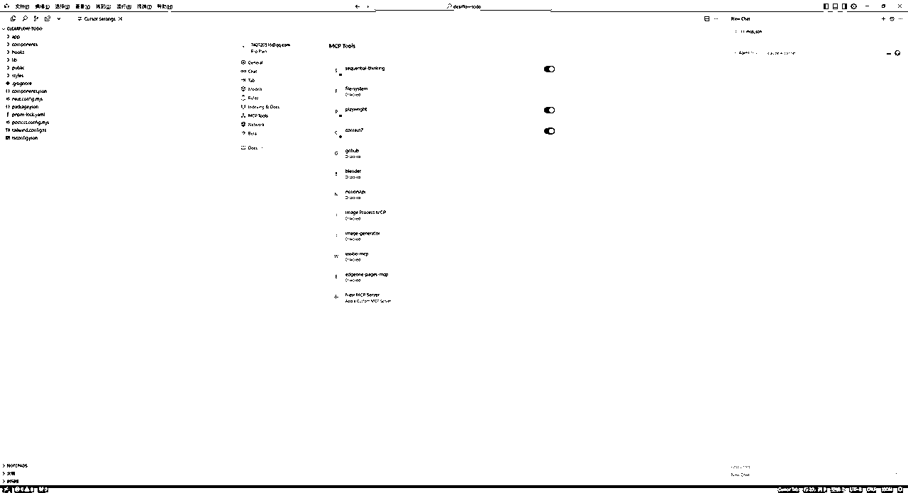

然后在列表底部点“New MCP Server”按钮。

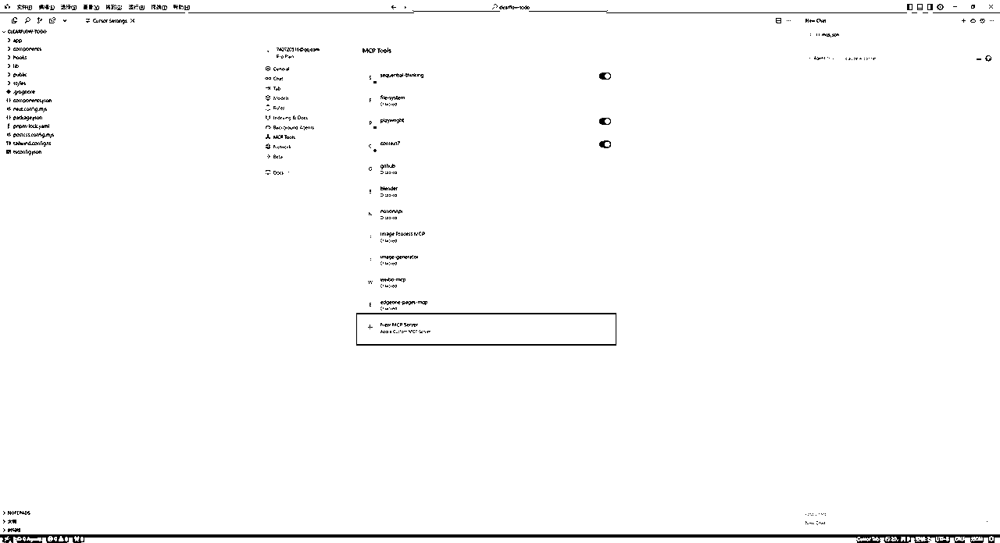

如果你的mcp.json是空的，直接把下面这串JSON贴进去就行了。

```
{
"mcpServers": {
"sequential-thinking": {
"command": "cmd",
"args": [
"/c",
"npx",
"-y",
"@modelcontextprotocol/server-sequential-thinking"
]
},
"playwright": {
"command": "cmd",
"args": [
"/c",
"npx",
"-y",
"@playwright/mcp@latest"
]
},
"context7": {
"command": "cmd",
"args": [
"/c",
"npx",
"-y",
"@upstash/context7-mcp@latest"
]
}
}
}
```

这串配置里包含了这几个MCP服务：

*   Sequential Thinking：分步思考工具。复杂项目必备，能自己把任务拆成一步步去执行。

*   Playwright：浏览器自动化工具。能自己开浏览器做功能测试，还能自己看控制台报错，基本上装这一个，别的什么browsertools、browser之类就不用了。

*   context7：做功能的时候拉对应框架最新手册用的，确保你用上的是最新的技术方案。这个也很关键。

一句话理解：让AI学会分步思考，让它能自己做功能测试，让它写功能时用最新技术。

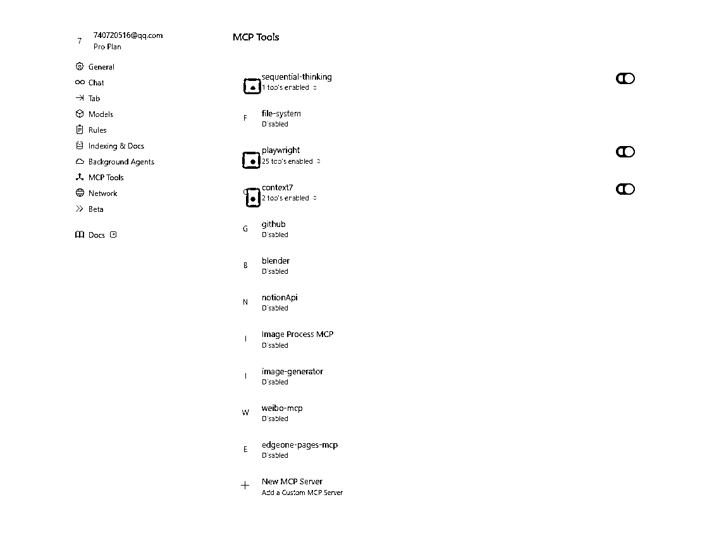

保存好mcp.json之后回到MCP Tools列表，等一下，等这些服务从灰变绿，就说明MCP服务启动成功了。

（小预告：我最近在调一个叫software-planning-tool的MCP工具，如果测试通过之后再分享给大家。）

### STEP5：给项目装个clickvibe

MCP装完之后，接着装clickvibe。

clickvibe是我们大铭教练做的对标stagewise的Chrome插件，能对网页里的目标元素做精细化微调，而且不像stagewise那样污染你的前端代码。

首先打开clickvibe的官网：clickvibe.dev

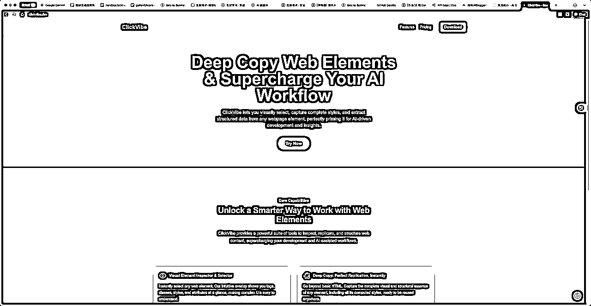

点右上角“Download”下载插件压缩包。

下载完成后去找到这个压缩包。

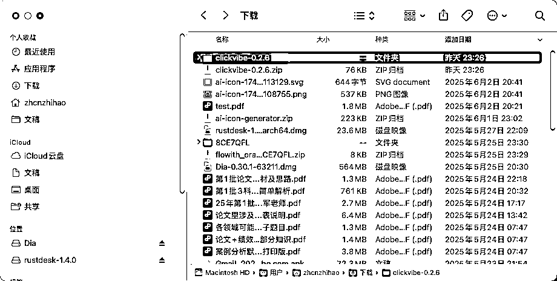

接着打开Chrome插件管理页面。

你是dia用户的话，地址栏输dia://extensions/。

用Chrome的话，就输入chrome://extensions/。

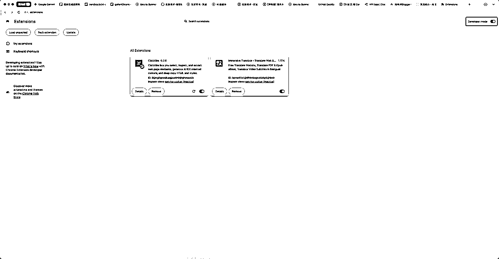

打开右上角的“developer mode”（中文界面就是“开发者模式”）。

然后把解压好的clickvibe文件夹整个拖进来。拖进去之后能看到clickvibe已经出现在插件列表里了。

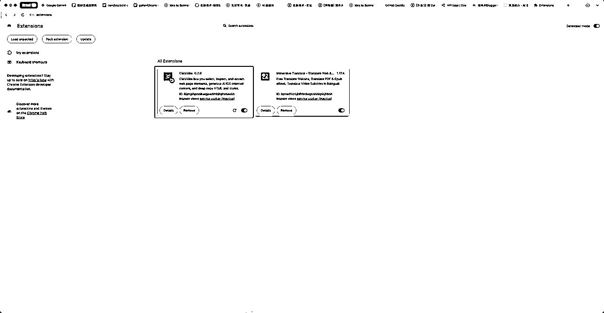

装好就完事了，具体怎么用，咱们在第六步里细说。

### STEP6：在Cursor里实现功能

接下来的重头戏来了——用Cursor把功能真正做出来。我带大家亲眼看一下，怎么用clickvibe调前端，以及怎么靠MCP工具推进开发。

新开一个聊天窗口，先让Cursor熟悉一下项目背景。

输入“帮我看一下这个项目是做什么的”，回车。

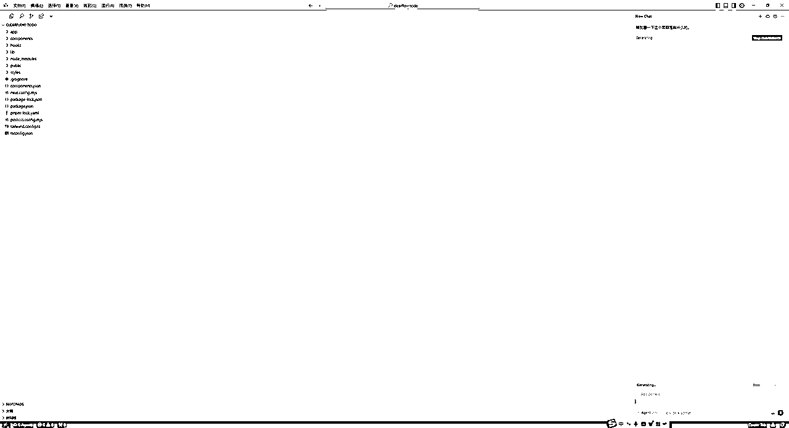

好，它现在知道这个项目是干嘛的了，我们正式开搞。

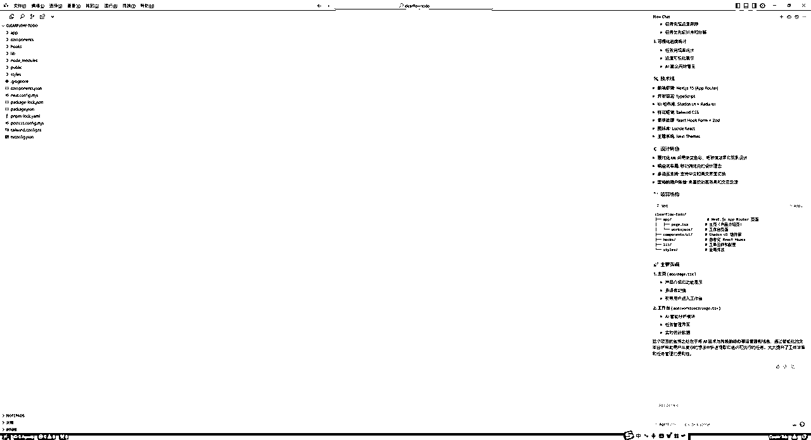

先让它写一个README.md，然后用pnpm把项目跑起来，之后让它自己进网页里看看，把功能页面挨个点一遍，看看有什么问题。（不出意外的话肯定问题一大推，毕竟现在就是个空壳。）

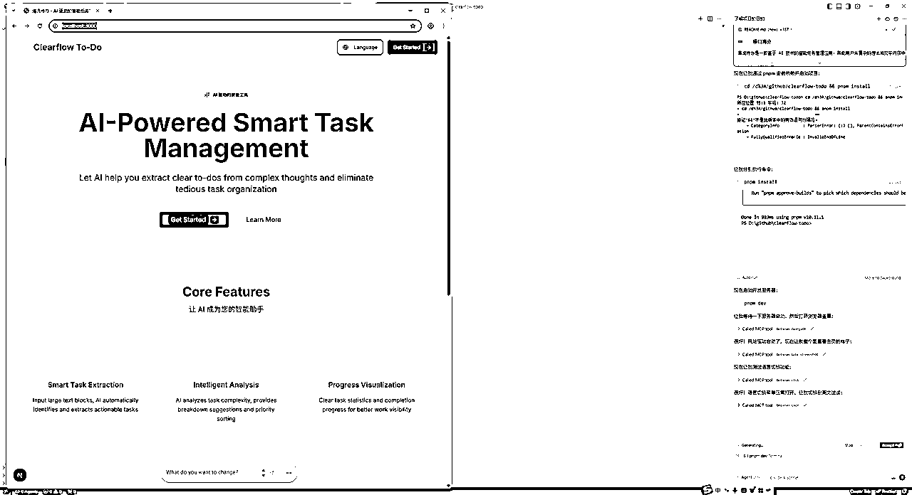

仔细看它的调用记录——从这刻起，它就开始频繁调用Playwright的MCP工具去操作网页了。这就是Playwright的第一个核心能力：功能测试。

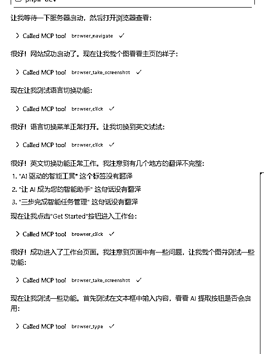

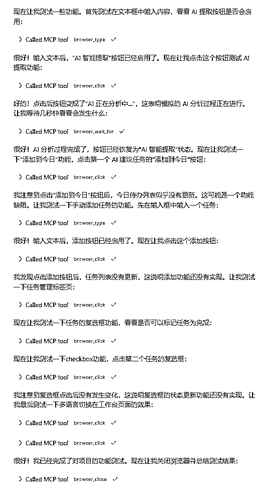

测完之后它会生成一份测试报告，报告里的问题自然是密密麻麻（废话，原型而已肯定一堆坑）。

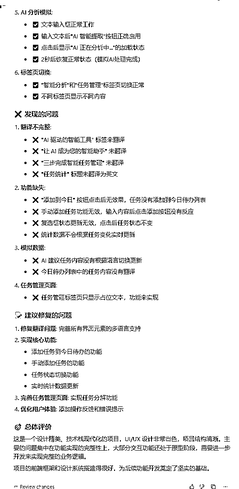

然后我就开始让它加功能了。还是那句话——直接口胡。

“请使用Sequential Thinking合理安排工作步骤，处理你发现的问题，同时，请处理XXXX问题，use context7”。

举个例子，我这里想让它接一个AI API服务，我选的是openrouter。那我先进openrouter，找到deepseek R1的页面，复制openai-typescript格式的调用示例丢给它。

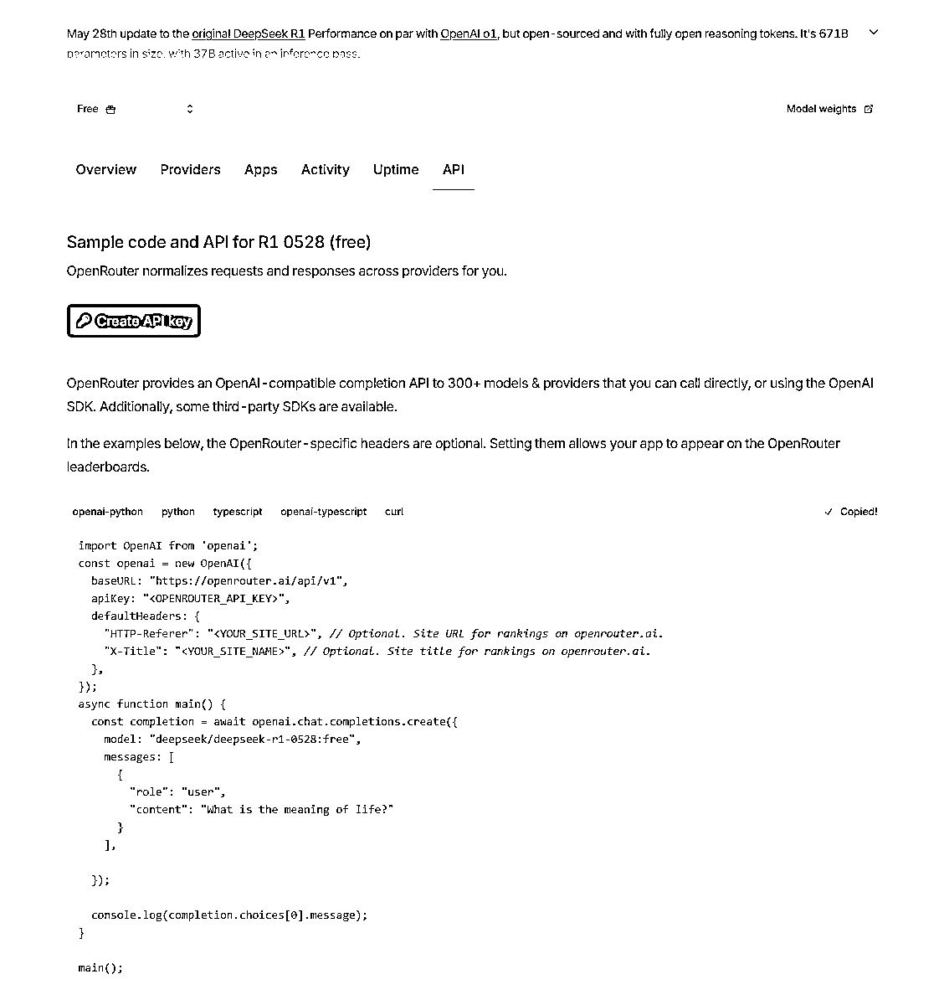

注意我这句提示词的构成，其实分了三个部分：

*   请使用Sequential Thinking：这句一定要有。这样AI才会在动手之前先调用分步思考的MCP工具，就像下图这样。

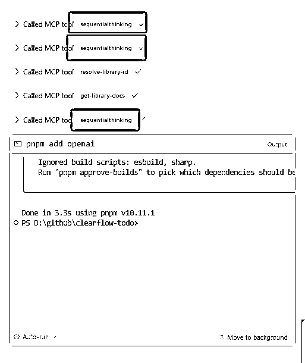

*   处理你发现的问题，并解决xxxxx：这句话是下开发需求用的，描述清楚就好。

*   Use context7：这后缀很重要。有了它，AI在引入那些库的时候才会去context7里找最新的实现方式。

到这里大家应该能理解我这套MCP用法了，接下来就是漫长的功能开发和口喷改BUG环节。

再补一句clickvibe到底怎么用。

装好clickvibe之后，记得先在Chrome里把它启动。启动之后你就会在页面右下角看到一个类似箭靶的按钮。

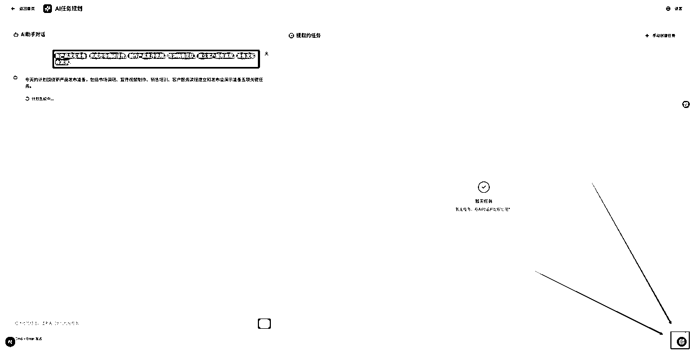

点这个按钮，然后点“Select elements”去选你要改的前端组件。接着页面会进入选择状态，鼠标移动到哪，哪里就会高亮，同时显示这个组件是什么。点一下就能选中，一次可以选多个。

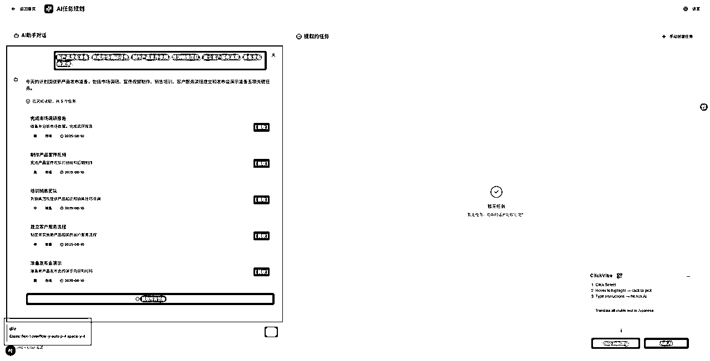

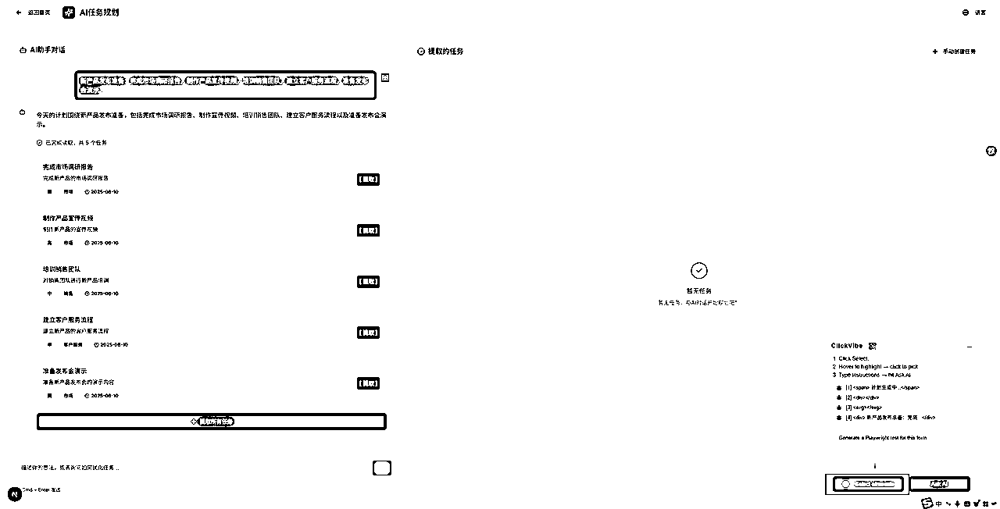

选完之后，在下面的输入框里写你的修改需求。

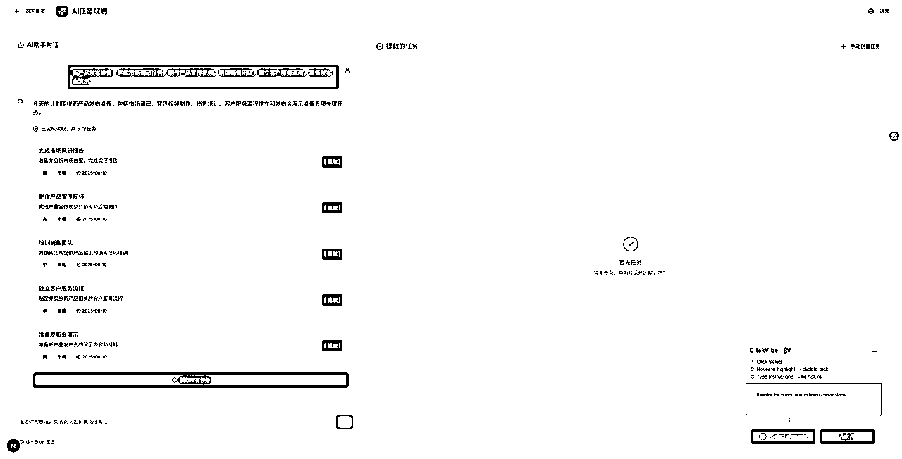

这里的提示词一般写两点：

1.  这些组件目前的状态是xxxxx，我想要他们把xx改成xxxxxx。

比如：这些组件现在是蓝色的，我希望改成和整体风格一致的绿色，或者换成跟AI对话框能区分开的另一种绿色。

2.  Use context7

加上这个它就会自己去搜最佳实践方案。

我举个例子，我当时输入的是：

这些组件目前的颜色是蓝色，不符合整体的绿色风格，看一下它们引用了哪些css，还是被写死了新的样式，如果使用了新样式，删掉，改用之前存在的深绿色风格。如果你需要新的样式，也写在对应的css里。use context7

输入好之后点“Ask AI”。

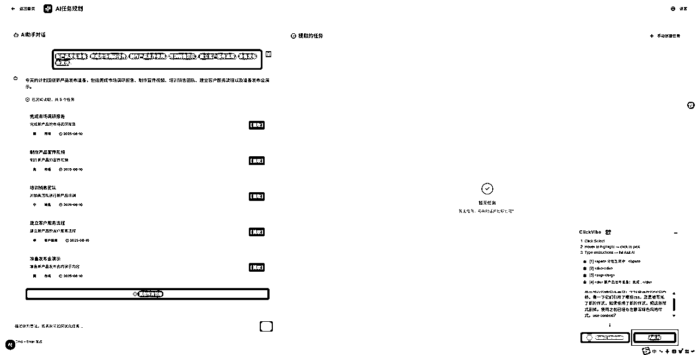

然后页面会弹出一个对话框。点右下角的“copy to clipboard”。

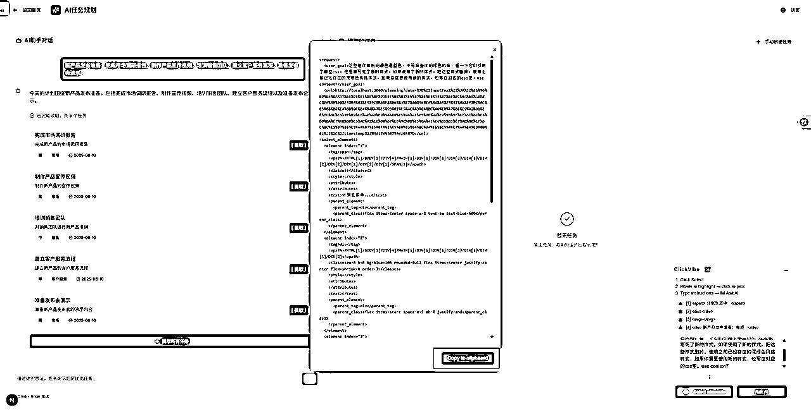

把生成的这串代码扔进Cursor里，回车发送。

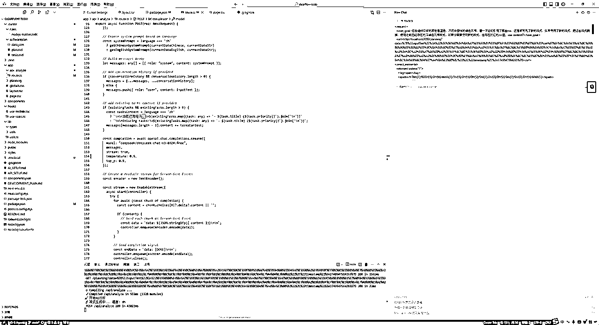

AI就开始一顿操作了。

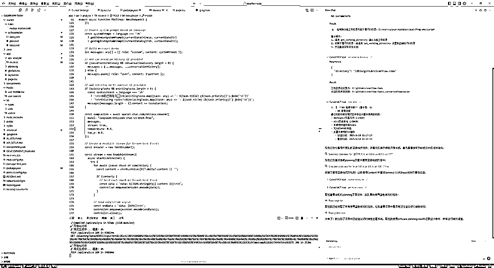

过了一会儿就改完了。


丝滑。再给大铭教练打个call！

### STEP7：把仓库推到GitHub上

经过大概三个小时的折腾，网站总算是做完了。最后一步就是把代码推上GitHub。

先把GitHub的MCP工具加上。

进入MCP服务，点New MCP Server。


然后在mcp.json里，在之前的基础上把github的MCP server一并加上。完整配置如下：

```
{
"mcpServers": {
"sequential-thinking": {
"command": "cmd",
"args": [
"/c",
"npx",
"-y",
"@modelcontextprotocol/server-sequential-thinking"
]
},
"playwright": {
"command": "cmd",
"args": [
"/c",
"npx",
"-y",
"@playwright/mcp@latest"
]
},
"context7": {
"command": "cmd",
"args": [
"/c",
"npx",
"-y",
"@upstash/context7-mcp@latest"
]
},
"github": {
"command": "cmd",
"args": [
"/c",
"npx",
"-y",
"@modelcontextprotocol/server-github"
],
"env": {
"GITHUB_PERSONAL_ACCESS_TOKEN": "Press_your_own_token"
}
}
}
}
```

先说个关键前提，这一步很容易被忽略：GitHub 的 MCP 服务需要你在环境变量里填上自己的 access_token，拿 token 的方式很简单，直接让 ChatGPT、Gemini 或者 DeepSeek 帮你生成就行。

准备好 token 之后，就可以让 Cursor 来帮你把项目托管到 GitHub 了。这时候直接丢一段提示词过去：

请帮我上传代码到 github 上，开始上传前，先做好 gitignore，然后到我的 github 账号上新建一个仓库并把项目上传上去。我已经为你启动了 github 的 mcp 服务，祝好运

这里有三点一定要说明白：

1.  生成 .gitignore 文件；

2.  用你的 GitHub 账号新建仓库并推送上去；

3.  强调你已经为它开启了 GitHub 的 MCP 服务。

指令发出后基本就不用管了，坐等它自动完成推送就行。

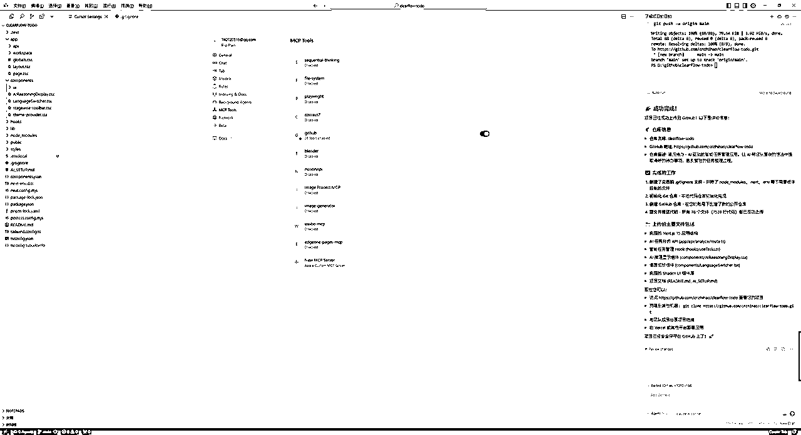

推送完成后，打开 GitHub 账号确认一下，仓库是否已经建好、代码是否正常上传。确认无误即可。

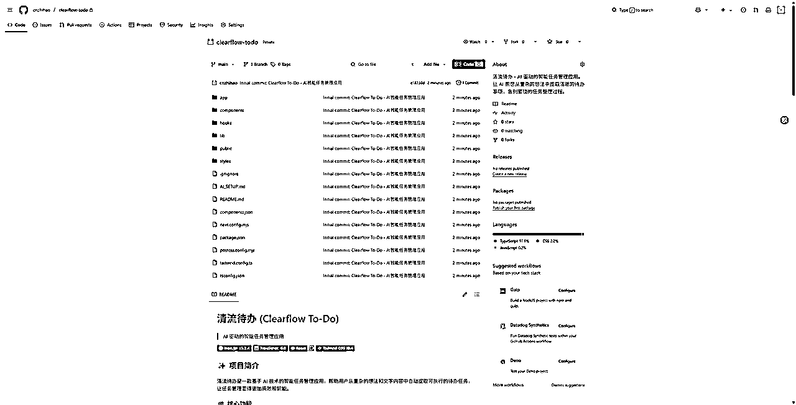

流程就是这么顺畅，懂的都懂！

### STEP8：Vercel 一键部署上线

代码托管好后，下一步就是用 Vercel 把它变成线上可访问的站点。

先登录 vercel.com，进入控制台后点右上角的 Add New

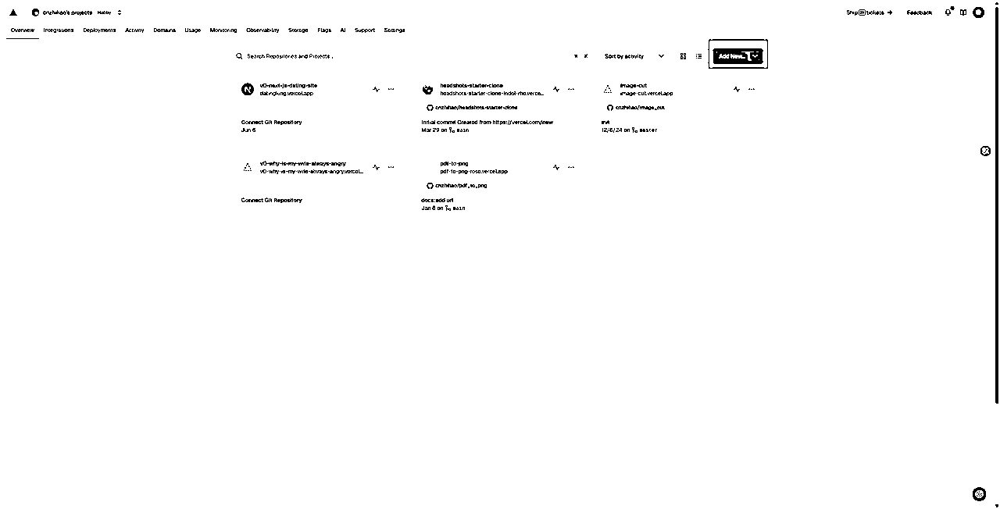

选择 “Project”。

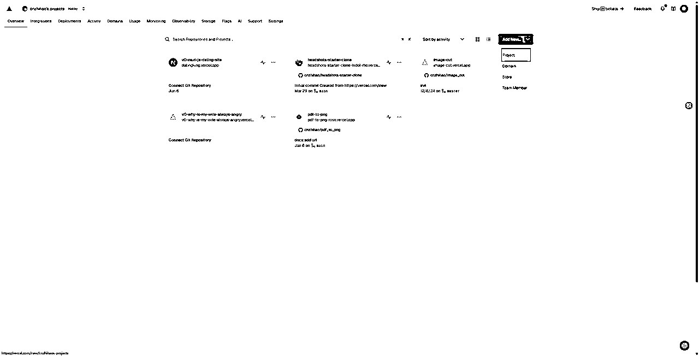

进入选择仓库的页面后，关联你的代码仓库。如果列表里看不到你的仓库，通常是因为 Vercel 没有获得对应仓库的授权权限。这时可以点击下方的 “Adjust Github App Permissions”

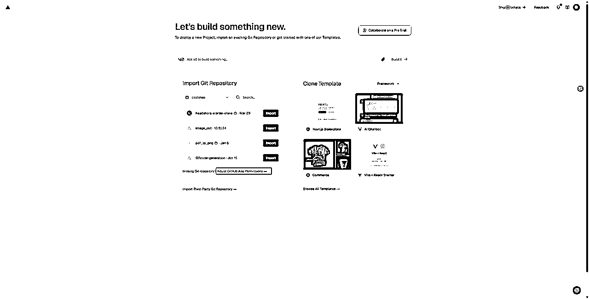

在弹出的授权窗口里，挑选你的组织或个人账号；

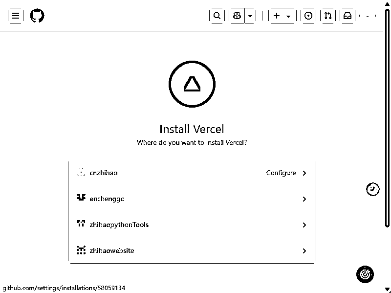

随后勾选需要授权的仓库。如果你像我一样仓库很多，可以只授权部分，也可以直接选 “All repositories”。

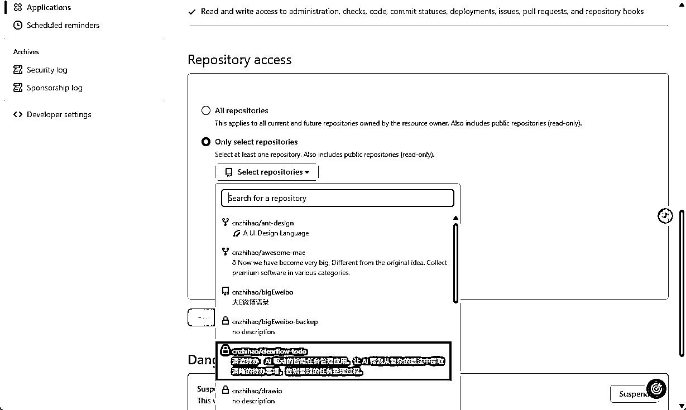

授权确认完成后，页面状态会发生变化。

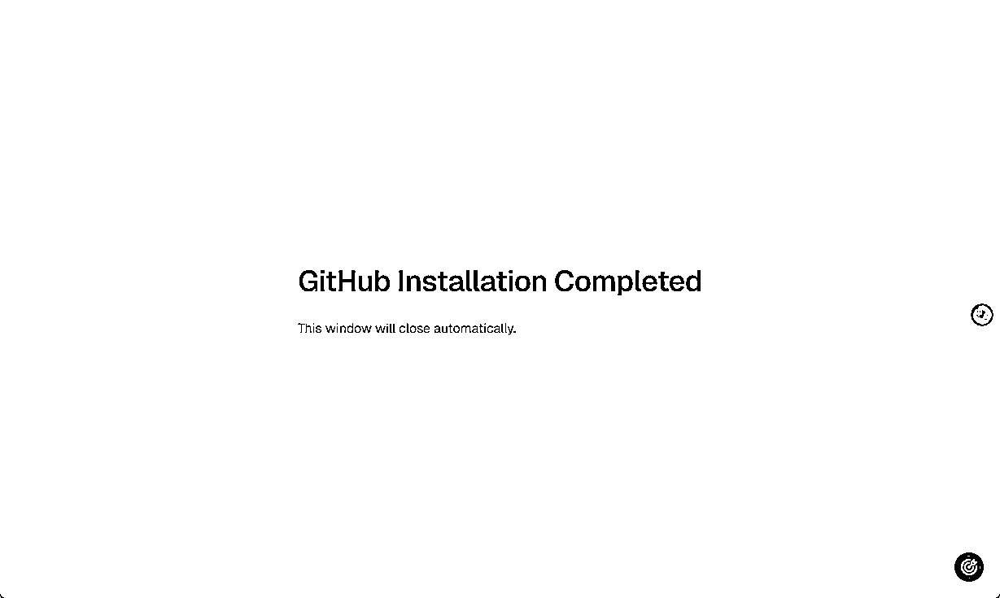

刷新一下项目导入页面，就能看到刚刚授权的仓库了。选定你要上线的项目，点击 “Import”。


接下来是环境变量配置，如果项目有用到的话。

怎么判断有没有用到？直接看项目根目录下是否存在 .env 或 .env.local 文件。有的话就把对应的变量填入 Vercel 的环境变量配置区，填完后点 “Deploy”。

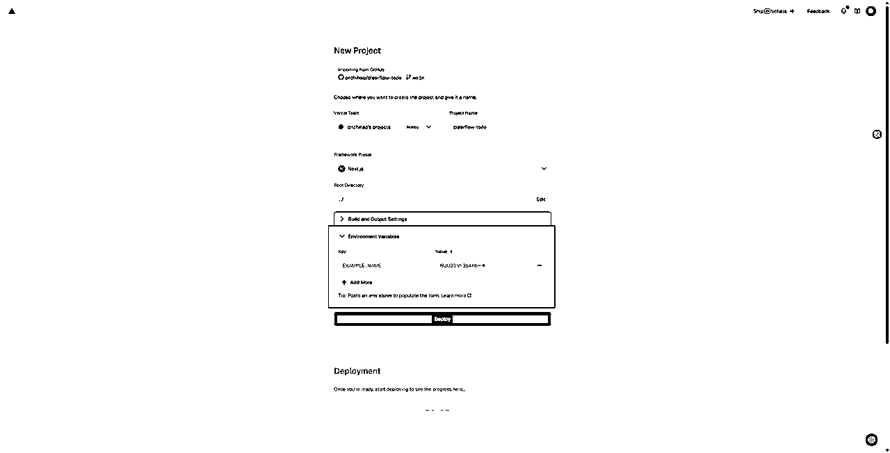

部署完成！

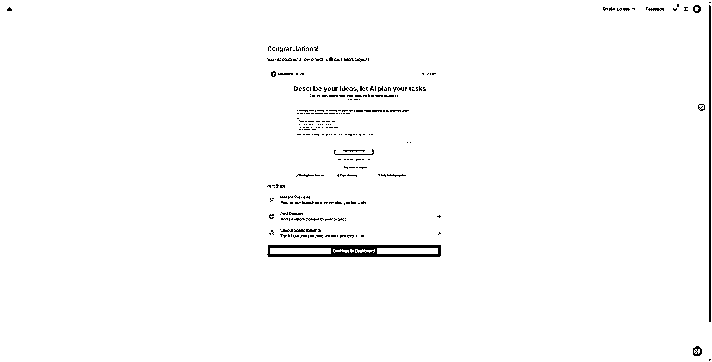

到这里站点就已经可以分享给朋友使用了！

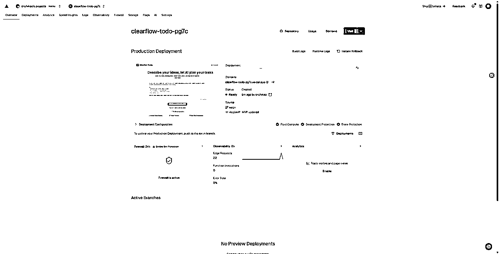

## 总结

归根结底，上线的本质就是把需求快速兑现。我写这篇内容，是希望做深海圈、做 Web 出海的伙伴们，能把更多精力放在需求思考和产品实现上，而不是耗在前端按钮样式和控制台报错上。让我们在产品的海洋里自由游弋，而不是在错误的海洋里反复打捞。

祝各位顺利！

## 下期预告

我最近在 GitHub 上 fork 了一个叫 software-planning-tool 的项目做了改造，目前在做高强度压测。它的核心能力是：根据你输入的产品规划或开发需求，自动生成一份超长、可展开查看、会自动记录完成状态的开发计划和任务清单，和 sequential thinking 配合使用效果非常好。我再深度用一周，如果稳定可靠，我会单独出一篇拆解，方便想做 MCP 开发的朋友参考。

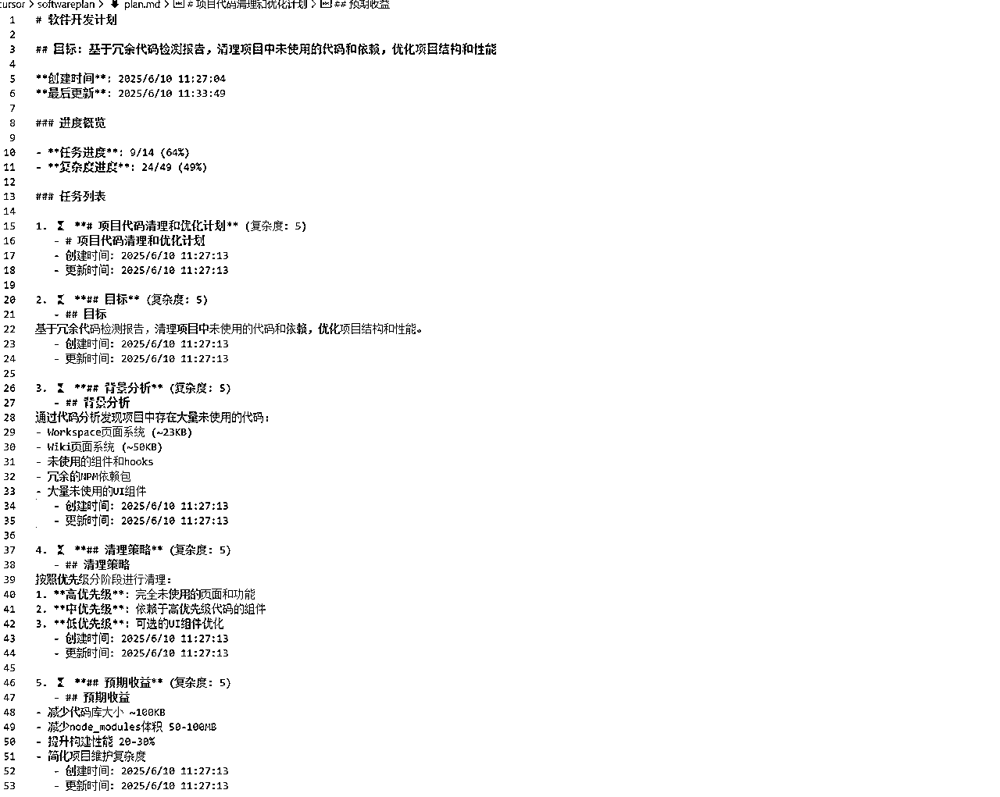

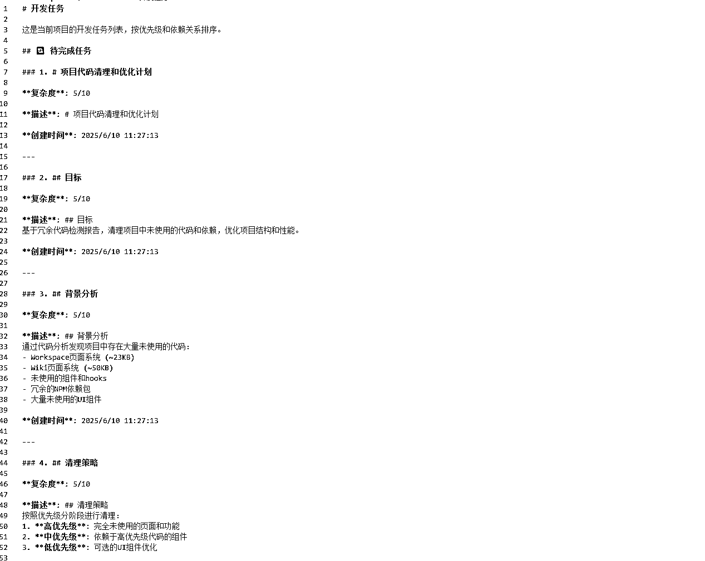

* * *

PS：原本只是想做个 Demo 页面来支撑这篇文章，没想到改着改着就上头了，最后顺手做出了一个可用的 MVP，自己也在用。感兴趣的朋友可以体验一下。

总耗时：10 小时

清流待办 Clearflow-todo

一款 AI 驱动的待办清单工具。你可以用 iPhone 的语音输入或讯飞输入法，在输入框里“口述”你今天要做的事，1000 字以上都行。口述完点一下“生成待办”。

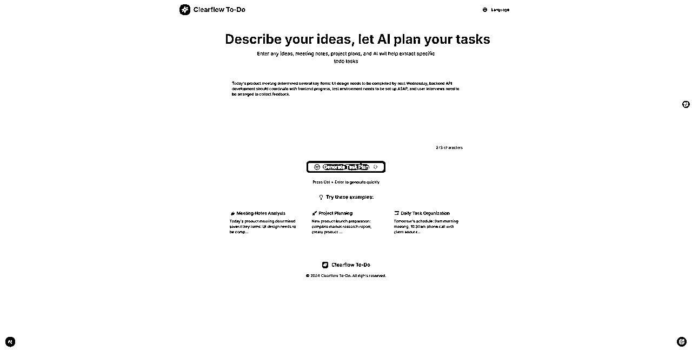

系统会根据你的口述内容自动抽取出待办事项，你可以把它们拖到右侧的任务板里。后续也可以继续口述来调整计划，支持生成后手动修改。

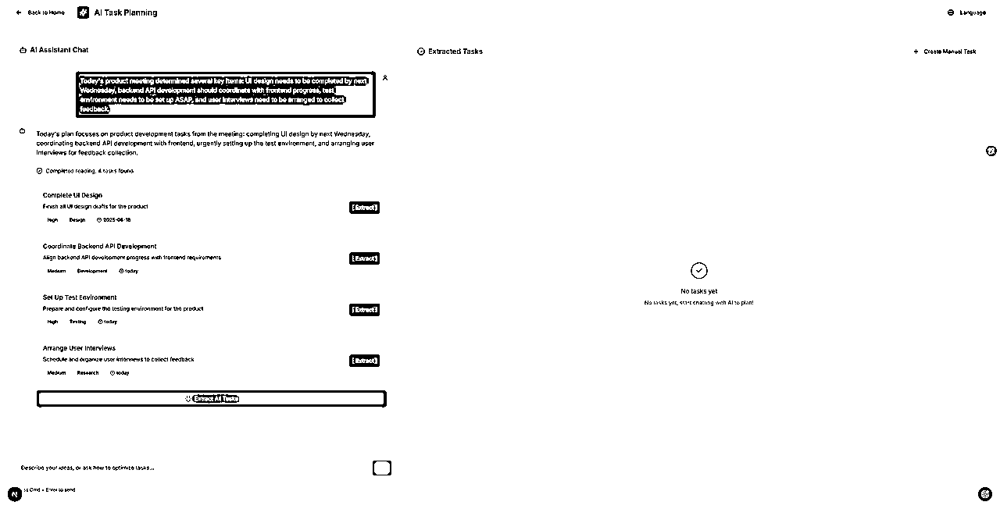

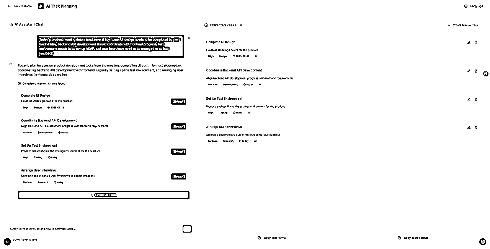

导出也很方便，支持 Markdown 文本格式复制到 Notion 或飞书文档，也支持表格格式复制到 Notion 或飞书表格。目前就先做到这一步，我自己已经深度使用了，现在再也不用花十几分钟手敲今日待办，直接口述完事，体验感拉满。粘贴后的效果如下，不同语言的粘贴呈现也会有差异。

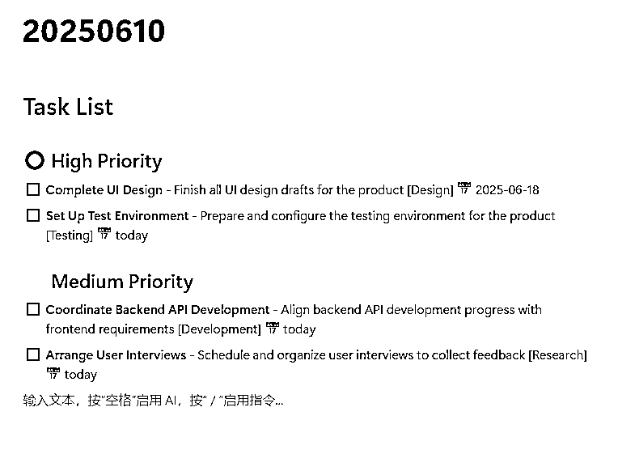

后续是否继续迭代，我会根据实际的网站访问数据来决定。说实话我也很想把任务板做进系统里，但 MVP 阶段加进去会太重，所以先只做导出能力。对我个人使用来说已经足够爽了。

也欢迎大家给我提产品建议，我都会看到。