# 从文案到排版再到发布，全流程一键打通的治愈系图文智能体
相信这类治愈感的配图文案，大家在朋友圈里早已见过不少。

只做图片的话，市面上的方案其实很多，我自己也试过可灵AI，Stable Diffusion、Midjourney这些大模型自然更不用说。也有人用第三方小程序把流程串起来。
可问题是，Coze能不能做到真正的“一键出图出排版”？效率要是不够高，还是不够爽。
抱着这个目标，我折腾了好一阵，最后不仅捣鼓出来了，还直接接入了我现有的自动发布链路，实现从生成到上线的全自动。今天就把这套方法分享出来。
# 一、文案+排版代码一键生成
## 1、先打开我封装好的智能体
入口地址：https://www.coze.cn/s/iUh2qud1/
进到页面后，找到快捷入口 图文创作。
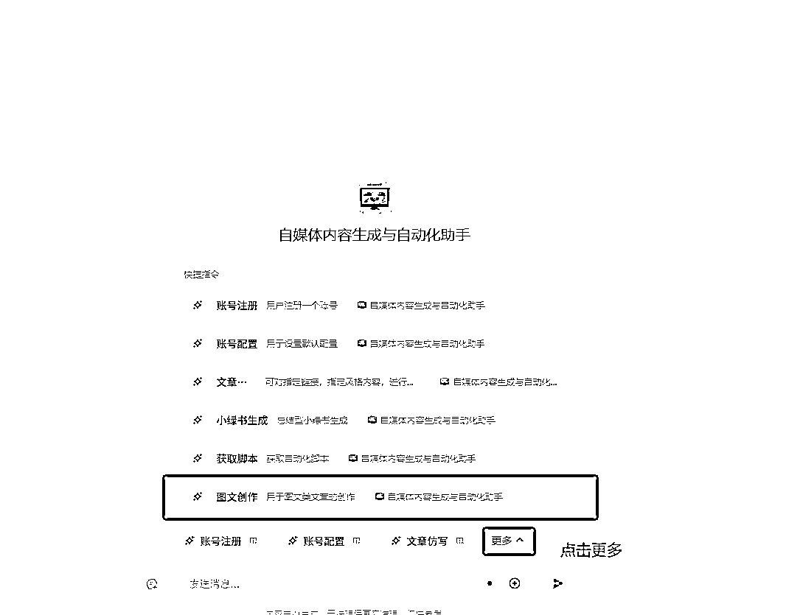
## 2、进入创作界面开始生产
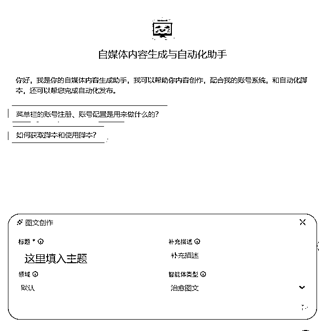
在主题输入框里写上你想要的方向，比如：看完这几句话，今天心情又变好了呢
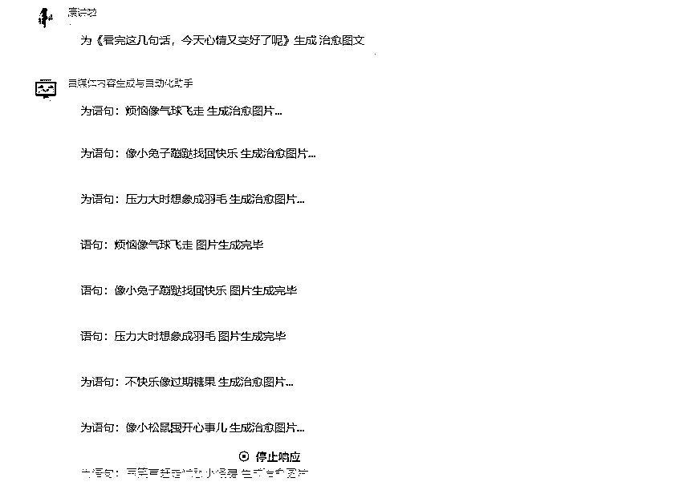
生成完成后，返回的是一段完整的排版 HTML 代码：
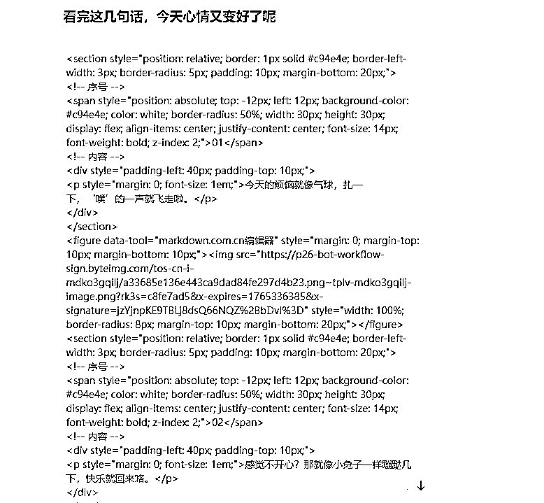
别被代码吓到，接下来直接转成可用的格式就行。
## 3、通过排版工具快速转换
打开这个在线编辑器：https://markdown.com.cn/editor
把刚才那段代码粘进左侧编辑区
当当当，就能看到可视化后的效果了：
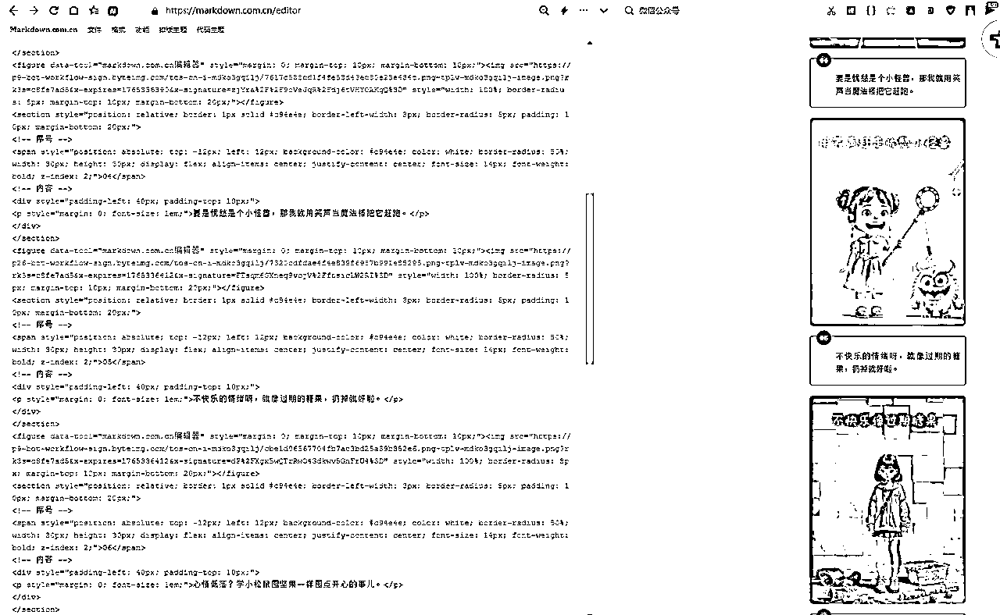
## 4、复制到公众号完成发布
点右上角的复制按钮
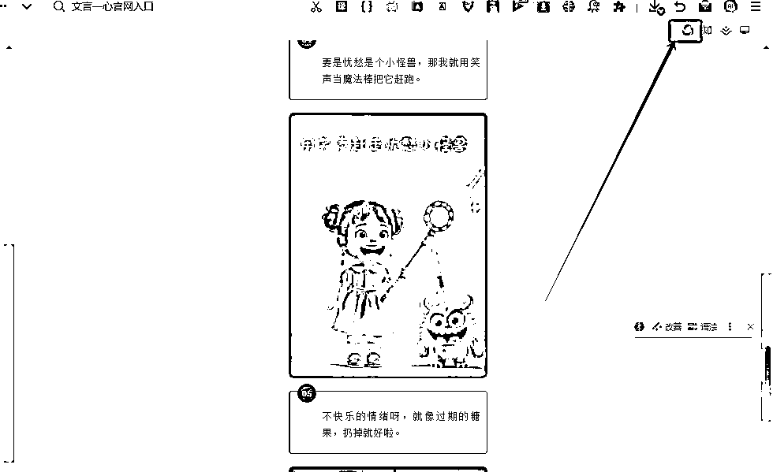
然后去公众号后台粘贴，保存或直接发布，一篇就搞定了

# 二、接入自动化发布系统
有人可能会说，复制粘贴还是手动操作，不够彻底。确实，我就是个懒人，目标是完全不用动手。
那要怎么做到零手动发布呢？需要我的自动化发布系统配合。
## 1、账号注册
这里的账号是使用凭证，同时会关联你的飞书信息，方便后续跳过重复设置。点击下方的“账号注册”，填入用户名和邀请码。邀请码可以直接用 88886666 来注册。用户名和邀请码要妥善保存。
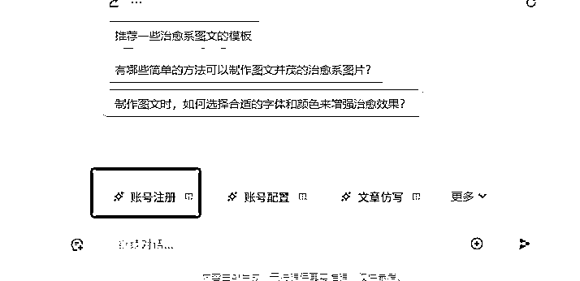
## 2、飞书注册与权限配置
系统底层是靠飞书来做内容存储，所以需要先注册飞书并完成授权配置。没做过的朋友请严格按照教程操作。
注意，表格模板一定要用最新的 v2 版本，旧版模板是对应老流程的。
## 3、账号配置
准备就绪后打开“账号配置”
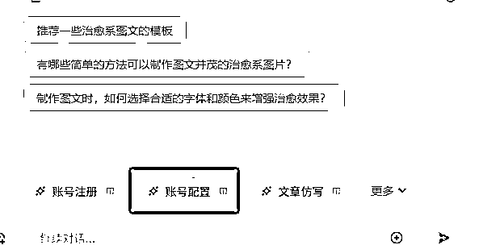
进入如下配置页
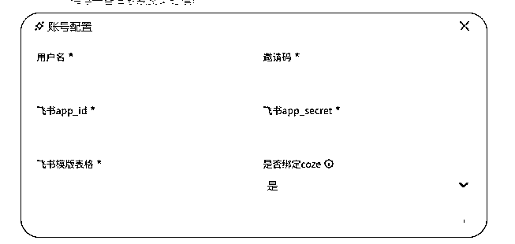
用户名和邀请码就填第一步注册的信息。
飞书 AppID 和 App Secret 参考教程获取。
飞书模板表格，复制你用我的模板创建的副本链接即可，打开任意一张表复制地址栏就行。
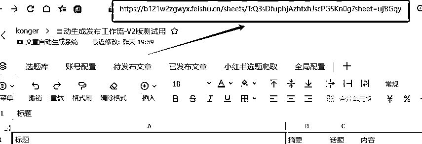
是否绑定 Coze， 默认填“是”，只能填“是”。这样你的配置就会和 Coze 智能体绑定，后续使用时会自动读取。
如果以后要更换或解绑，再改成“否”即可。修改配置时重新填写即可生效。
注意，飞书权限没配好会配置失败，成功后在表格的“全局配置”里能看到一条绑定成功的记录。

## 4、下载自动化脚本
配置完成后，去更多里找到获取脚本
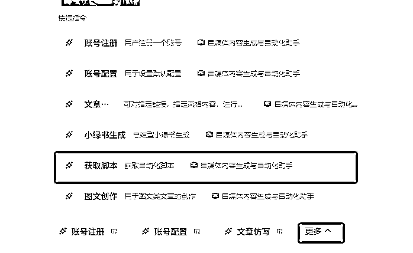
会看到如下界面：
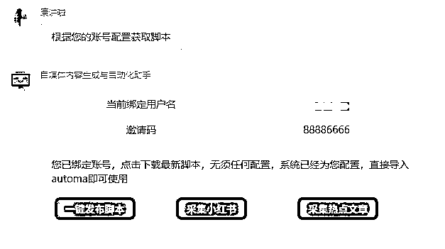
配置成功的话，这里会显示你的当前绑定用户名，未绑定则会提示未绑定。
只有绑定成功才能下载脚本。下载好“一键发布脚本”，导入到 Chrome 或 Bit 浏览器中使用即可。
对于新用户可能不太清楚怎么用，可以参考我之前的教程。唯一不同的是，这次脚本导入后直接可用，无需手动改配置，配置在下载瞬间已自动写入。不要改配置！不要改配置！不要改配置！
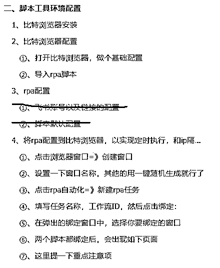
如果要绑定窗口使用，首次运行记得授权浏览器权限。不清楚权限设置的可以看：
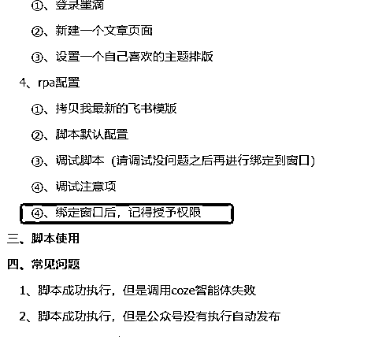
## 5、全局配置说明
所有开关都在飞书表格的全局配置页里，一目了然
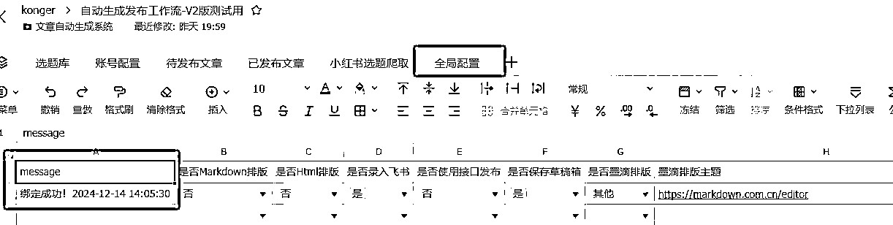
| 是否Markdown排版 | 填是，AI会进行markdown排版 |
| 是否Html排版 | 待开发 |
| 是否录入飞书 | 填是，在智能体工具上生成的内容会自动录入飞书 |
| 是否使用接口发布 | （图文类，可直接通过api发布到公众号）待测试 |
| 是否保存草稿箱 | 默认填是，自动直接发出去还未开发 |
| 是否墨滴排版 | 填是，使用墨滴，填“其他”（建议）使用另外一个markdown排版，不需要登录 |
| 墨滴排版主题 | 使用墨滴排版的话，需要设置主题，设置方法见 |
| 是否配图 | 填是会进行自动配图 |
| 配图模型 | 默认填 “通用”，其他的开发中 |
| 配图数量 | 可选择配图数量，（目前这玩意儿不精准，哈哈） |
| 热点采集领域 | 热点采集脚本用到，非会员，请忽视 |
| 热点采集链接 | 热点采集脚本用到，非会员，请忽视 |
| 比特下载路径 | 将比特浏览器的下载路径配置到这里（一键发布脚本必须配置，否则脚本无法工作） |
## 6、实战演示
拿刚才的治愈文举例，流程还是点生成就行
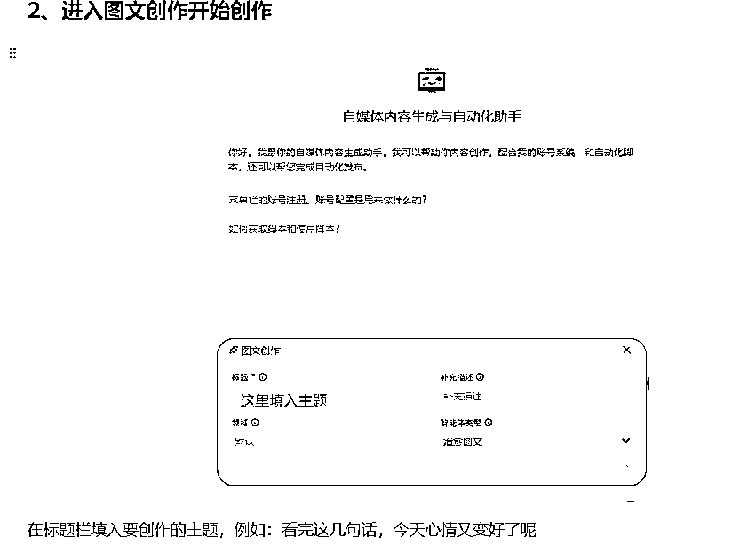
只是在全局配置里把 是否录入飞书 设为是

生成成功后，就能在飞书表格里看到这篇内容已被写入：
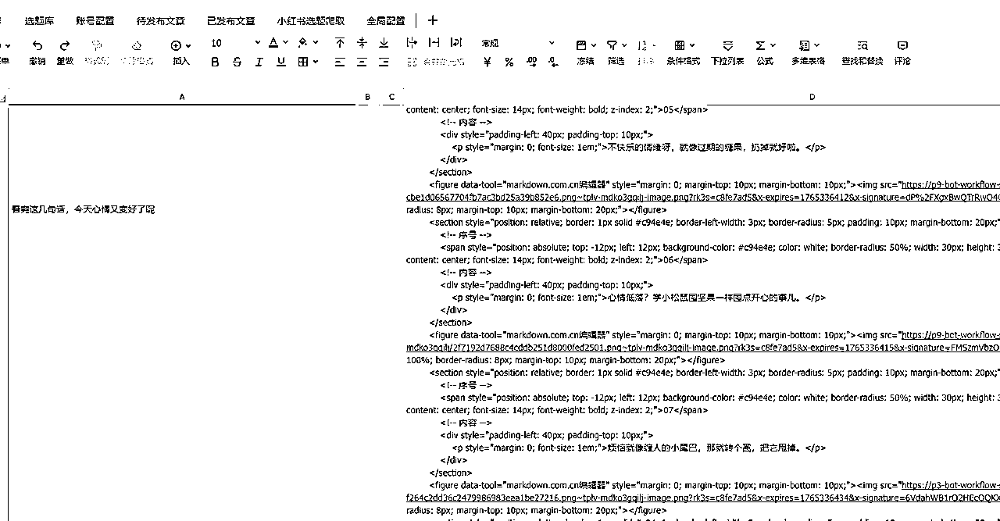
随后打开已导入的自动化脚本，点击运行，脚本就会自动完成发布。第一次运行需要扫码登录公众号。
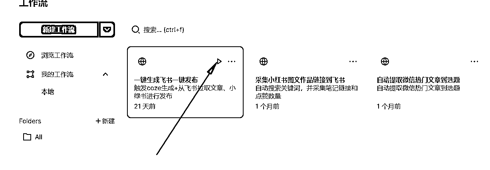
脚本的更多用法可以参考这篇教程：
# 三、额外补充工具
AI 生成毕竟有随机性，自动化产出后偶尔会遇到图不达标的情况。比如我这篇就撞到了一张怪怪的图：
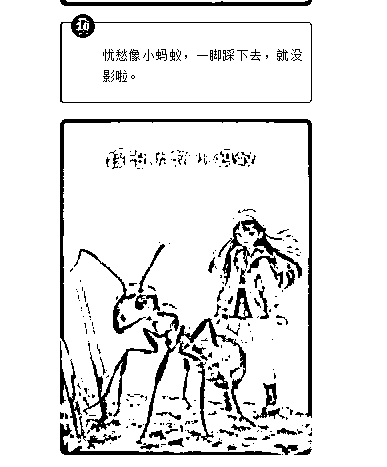
看着有点渗人，根本发不出去，删掉又觉得空了一篇。
不用慌，我额外做了一个单独的图片生成工具
https://www.coze.cn/s/iUkqKXDf/
不满意就继续生成，直到挑到满意为止，快去试试吧。
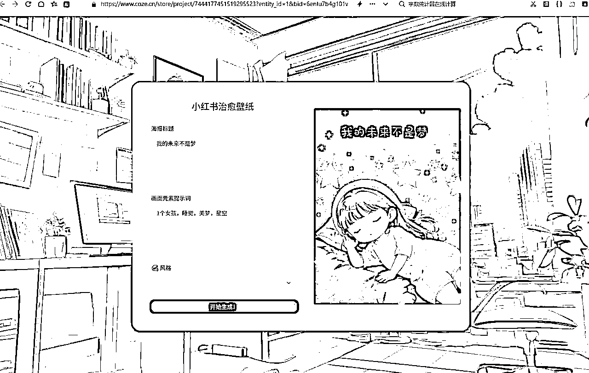