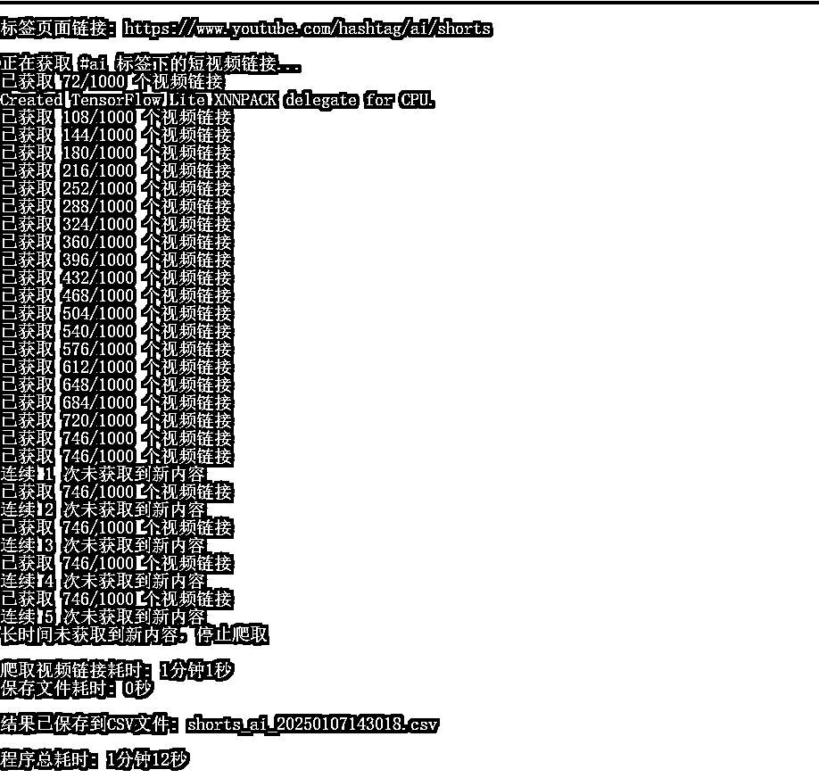
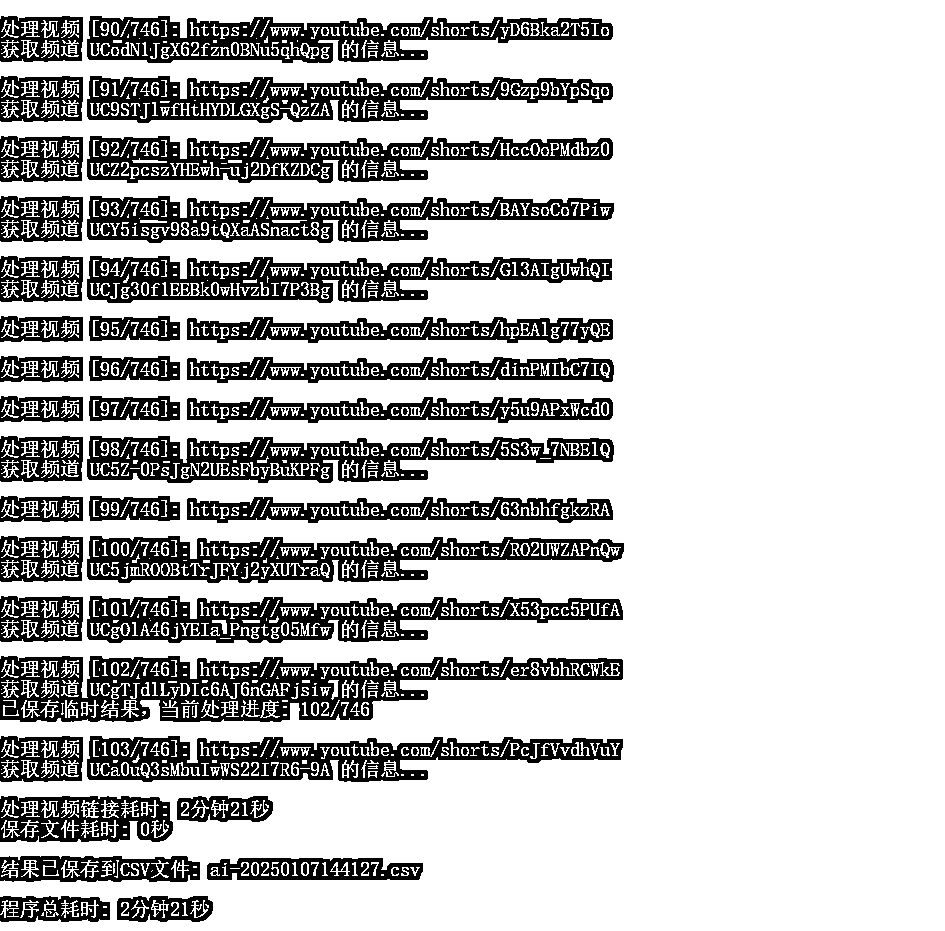

# 【初体验Cursor】让AI编程帮我搭起YouTube Shorts对标分析工具
# 开场白
各位好，我是龙哥，刚入驻赚钱不久的新人。
1. 我本身做金融方向的开发，加入赚钱后连着参与了两届航海。时间投入不多，但思维上的收获很实在，慢慢理清了变现思路，也从伙伴分享和航海实操里拿到了不少可直接用的打法。
2. 这次12月航海我没报Cursor板块，但对AI编程的热度一直有关注。按航海手册自学了一遍后感受很明显：对有一定代码基础的人来说，Cursor能把开发效率拉到一个新层次。有了它，程序员基本可以兼任产品和测试，自己快速把想法变成可用工具。
3. 我本期航海报的是YouTube Shorts方向，期间读到钱塘江鲤大佬的《1万个YouTube账号对标收集》笔记。于是我在练手Cursor时，就挑了同一个课题来复现。实操下来，Cursor的表现超出预期，具体过程整理如下。
# 项目落地情况
## 1. 产出
本次跑通了两步的数据采集：
1）锁定某个标签的 Shorts 汇总页 https://www.youtube.com/hashtag/{tag}/shorts ，把页面上所有短视频的链接全部抓下来存进 A.csv，效果如下：
2）拿 A.csv 里的视频链接逐个解析对应频道的基础画像，包含频道主页链接、开通时间、订阅量、总播放量、Shorts发布数量，效果如下：
## 2. 具体做法
第一步的采集，钱塘江鲤大佬原方案是用影刀。我这边直接让Cursor写 Python 爬虫。需要说明的是，Cursor虽然能根据我的爬虫需求生成框架，但定位页面元素的具体逻辑仍需人工点拨。得益于我对前端的一点了解，我直接给了它 XPath 路径
//*[@id="content"]/ytm-shorts-lockup-view-model-v2/ytm-shorts-lockup-view-model/a/@href
让它抓取所有链接。Cursor随即完成了代码，并自动引入 Selenium 来模拟下拉滚动、加载新内容。跑通一次后就能稳定出结果，不得不说只要提示够专业，Cursor的执行力非常惊人。

上图以 ai 标签页为例，初次加载抓到 72 条链接，随后每往下滚一次就新增约 36 条。但我发现 ai 标签页滚动到约 750 条左右就停止刷新了，所以我在脚本里加了最多尝试 5 次就自动退出的保护逻辑。不同标签的上限似乎不一样，有懂行的朋友欢迎交流原因。
采集结果文档如下：
第二步的频道分析
有了视频链接清单后，我选择用 YouTube Data API v3 来获取频道信息。优点是接口直接、速度快，拿到的订阅、播放等核心指标足以支撑对标。缺点是返回字段有限，且存在调用配额限制。值得一提的是，我在需求里并未明确指定用 API v3，Cursor自行判断选用了该方案，省了我不少调研时间。

上图是频道信息抓取的运行截图。这里有个限制：YouTube Data API 每天 1 万次调用上限，实际跑到 200 多个视频左右就会被拦住。所以本演示只取前 100 个频道做分析。脚本里我设置了每 2 秒一次请求，100 个频道约耗时 2 分 20 秒，和钱塘江鲤大佬的效率相比还有优化空间。另外部分频道的 Shorts 数量与实际页面显示有出入，可能跟 API 数据延迟有关。
结果文档如下：
# 复盘思考
## 1. 为什么要做对标系统
1）我在赚钱先后参与了公众号爆文、Shorts、ComfyUI 工具、Cursor 学习等多个航海。
目前我的认知是：做生意核心就是找到目标人群，并把产品卖给他们。
工具类航海的价值在于压低产品制作成本，而 AI 工具的成熟，让单打独斗的创作者也能低成本批量做产品成为现实。
内容类航海教的是如何借助平台流量和推荐机制，找到精准的流量用户。公众号、Shorts、闲鱼都是典型场景。
但还有一个关键问题没解：到底做什么内容。也就是产品选题。对标系统就是来解决这个问题的。
本质上，对标系统就是一套市场分析体系。若平台没有现成的数据看板，就需要借助第三方工具或自建爬虫系统来采集大数据做判断。
搭建对标系统的意义在于减少试错、压缩弯路。因为“大多数人踩过的坑会反复出现，而爆款背后必然有可复制的逻辑”。
## 2. 使用 Cursor 的几点体会
1）为避免改动后把稳定版本搞崩，建议用版本管理。本地 Git 就够用，若要云端同步，推荐码云这类国内托管，网络更稳。
2）提示词过长时，拆成多条逐步喂给 Cursor 更容易被理解。需求描述越清晰，交付速度越快。
3）复杂系统建议用最小可行原型先跑通，再迭代增加功能。先让Cursor出一版能用的骨架，再慢慢加肉。
4）Cursor 免费额度用完的小技巧：官网注销账号后，用同一邮箱重新登录即可重置。后续官方是否会封堵这个做法暂不可知。
# 收尾
Cursor 的实际体验非常顺滑，的确是目前我用过最省心的 AI 编程助手。接下来我打算试试 bolt.new 等其他工具，有新发现再和大家同步。