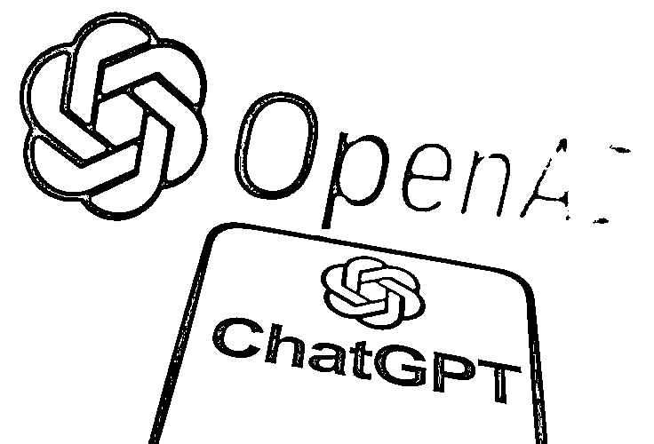
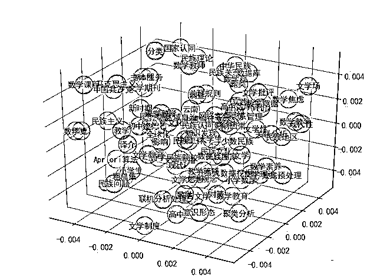
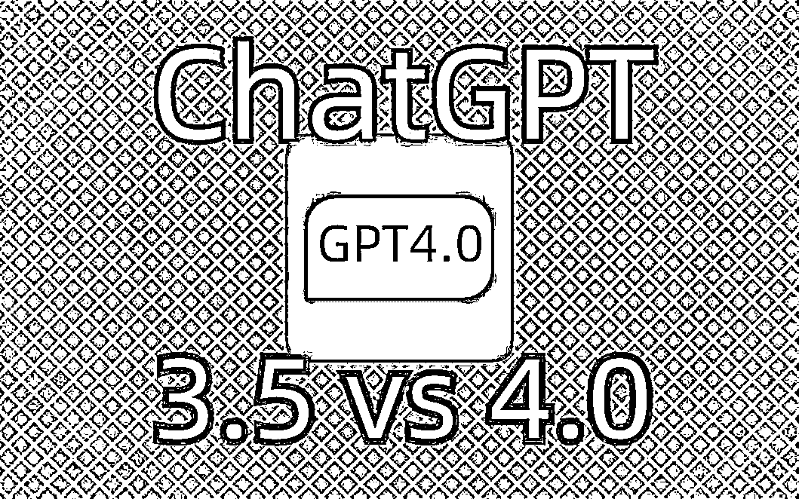

# 【基础】通俗化理解ChatGPT如何做到词语接龙？
作者：龙哥

你有没有想过，每次在对话框里敲下一行字，对面那个“机器大脑”究竟是怎么在几秒钟内组织出整段回答的？它不是翻字典，也不是从网上复制粘贴。它是靠一种奇妙的“接龙游戏”来完成这一切的。

今天，我们不聊晦涩的公式，也不搬复杂的术语，就从一个最朴素的问题出发：ChatGPT 到底是怎么做到“说人话”的？它凭什么能接住我们的话茬，还接得这么顺溜？

相信不少人和我最初的感觉一样——管它怎么做到的，牛就完事了！但直到我深入了解后才发现，真正懂它的人，都是先从“底层逻辑”开始啃的。

我认识一些早期研究提示词的前辈，他们那会儿哪有现成的教程啊，全靠自己对着屏幕一遍遍地问、一点点地试，硬是把原理给磨透了。也正因如此，他们在面对各种疑难杂症时，总能有条不紊地拆解问题。这条路，看似笨拙，却是最扎实的捷径。

那计算机是怎么“听懂”人话的呢？核心就两步：先“翻译”，再“提炼”。

所谓“翻译”，其实叫向量化。听起来高大上，打个比方就明白了。比如你手头有苹果、香蕉、橙子，想让电脑分清它们，很简单，给它们贴数字标签：苹果是 [1,0,0]，香蕉是 [0,1,0]，橙子是 [0,0,1]。以后你说“苹果”，电脑脑子里浮现的就是那串数字。当然，现实远比这复杂，苹果还有大小、颜色、熟度之分，每多一个描述维度，向量就越长，刻画得也就越精准。

但这只是开始。光把词变成数字还不够，还得让电脑明白词与词之间的“亲疏远近”。这就要靠海量语料库的反复训练了，也就是所谓的“信息压缩与特征提取”。你可以想象一个巨大的空间，每个词都是一颗星星，那些经常一起出现的词，坐标就挨得特别近；八竿子打不着的词，自然就被推得远远的。正如老话说的——“物以类聚，人以群分”。放在这里，再贴切不过。

那电脑是怎么学会这个远近关系的呢？全靠“试错”。给它喂一万个字的数据，它反复计算哪些词该靠近、哪些词该远离，算错了就纠正，纠正完再算。比如“苹”和“果”总是结伴出现，它俩就被拴在了一起；而“苹”和“名”几乎从不碰面，自然要被分隔开。

说到这儿，你甚至可以把自己代入进去——你能刷到这篇文章，不就意味着咱们这群“想用AI搞点事情”的人，在某个维度上坐标很近吗？这也是一种奇妙的缘分。

好了，现在每个词都有了位置，那“接龙游戏”怎么玩起来？这就得提到一个大名鼎鼎的机制——自注意力机制，它可是现代大模型的老祖宗。举个例子，有人问：“苹果的创始人是乔布斯，那么苹果指的是？”你猜机器会选“水果”还是“美国科技巨头公司”？它会把“苹果”“创始人”“乔布斯”这几个词拎出来，放进向量空间里算一圈，看哪个答案的“热度”更高。经过反复计算和比较，它最终锁定了“美国科技巨头公司”。因为“乔布斯”这个线索，权重实在是太明显了。

说白了，所谓“词语接龙式涌现”，就是机器根据已经蹦出来的词，不停地推测下一个最可能出现的词，算一遍、练一遍、纠一遍，选出概率最高的那个安上去，然后再重复这个过程，直到整段话说完整。

还有一个特别扎心的真相：ChatGPT 本质上是一个“修辞大师”，它生来不是为了解决数学题，而是为了把话讲漂亮。至于话讲得漂不漂亮，全看它“读过多少书”。GPT3.5 读过 1750 亿海量数据，所以有时我们觉得它讲得头头是道，结果却经不起推敲；而 GPT4.0 带着 1.8 万亿的数据量登场，自然更“见多识广”，听起来也就更靠谱了。

有消息说，未来的 GPT5 参数量可能是 GPT4.0 的一百倍。这让人既兴奋又恍惚——AI 的天花板到底在哪？恐怕谁也说不准。唯一能确定的是，学会驾驭它，已经成了这个时代绕不开的课题。

最后，拿一句自勉的话和大家共勉：学新东西，最忌浮躁。从地基打起，一步一个脚印，才能走到最稳。愿这点小小的分享，能成为你探索路上的一块垫脚石。