# 【实测】Coze 搓一个专属私教有多香？我亲手给 MBA 考试搞了个只会说人话的知识库机器人

MBA 考试周撞上，几门课的复习资料堆成山，眼看着根本啃不完。我灵机一动，刚好捡起最近学的 AI 玩法，决定用 Coze 自己拼一个小助手。你提问题，它就死守着课程材料来回你，而不是信口开河瞎编。真上手之后，效果比我想象的猛。

## 私有知识库 Agent，怎么搓出来的

这学期我在啃《创新创业管理》，老师讲理论，我脑子里全是画面。以前创业踩过的坑还在脑子里闪现，反而觉得老师讲的那些框架很对味，都是从实践里锤出来的。索性就拿这门课当试验田，开干。

### 我的思路很简单

给大模型喂专属数据，让它只按这些数据回答。难点在于怎么收住它。

收住它指两件事：第一，别发散、别联网胡说八道，必须锚定专有资料；第二，让它按我们定的格式输出。这里就牵扯到两个核心概念：知识库和工作流。

知识库就是你的私藏资料，Word、PDF、Excel 都行。这次我用的是课程录音转文字稿和老师的 PPT。

工作流就是一套处理 Pipeline。你丢进去一个提问，经过一系列节点处理后吐出一个回答。控制 AI 的关键就在这儿。

搞懂这两点，就能上手造机器人了 🤖。

### 1、先把料喂进去

第一步是把课程录音和 PPT 丢进 Coze。

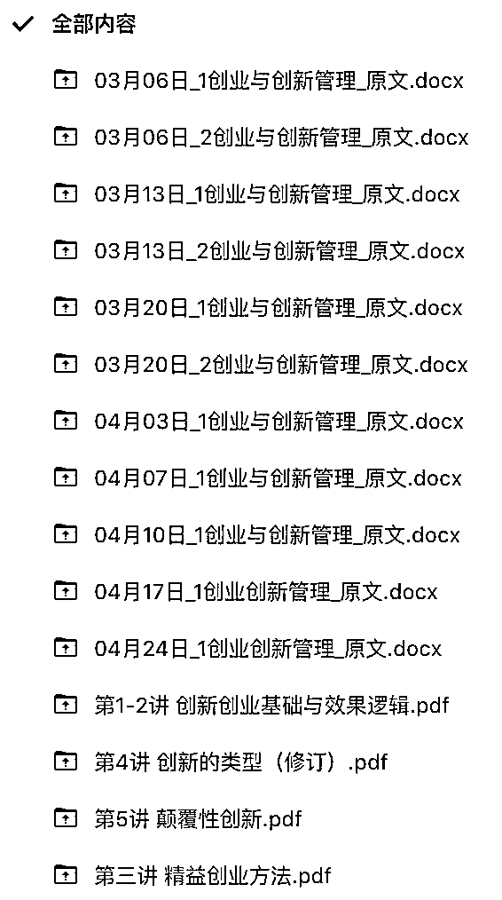

上面那份 Word 是我用“通义听悟”把录音转出来的文字稿，下面那份 PDF 是课程 PPT 本身。

Coze 现在的知识库接入挺全，本地能传 PDF、TXT、Word、Excel，在线能接飞书、Notion，还能自动爬站，很顺手。

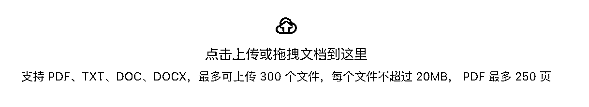

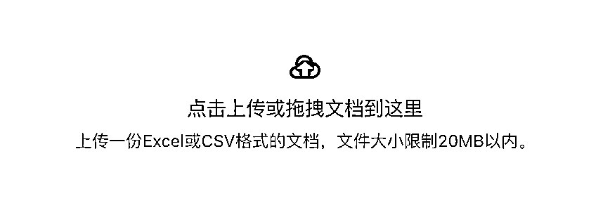

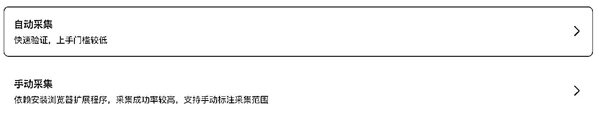

### 2、搭工作流

资料上完，最重要的就是搭工作流。我的流程不复杂，主要用了大模型、知识库、选择器、数据库这些组件。Coze 插件能力其实更强，这次案例里没用到。

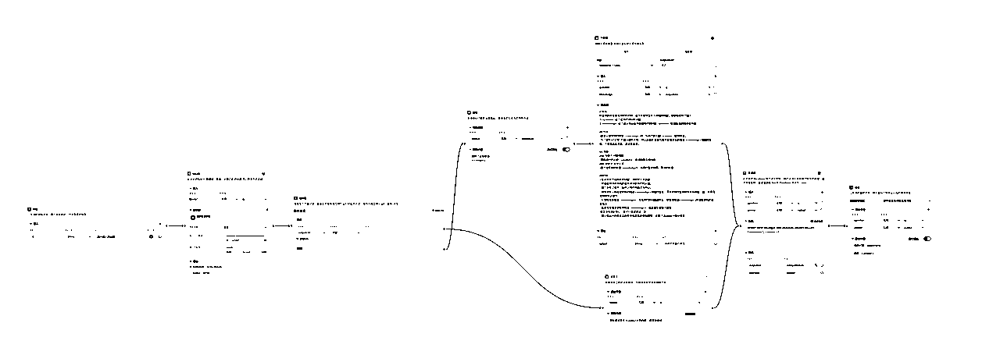

工作流怎么配可以单独讲一篇，今天不展开，有兴趣我们私聊。

先看效果更直观。

### 3、实战效果

最终就是一个输入框，我问它答它。PC 端就能用，发布后手机也能用。

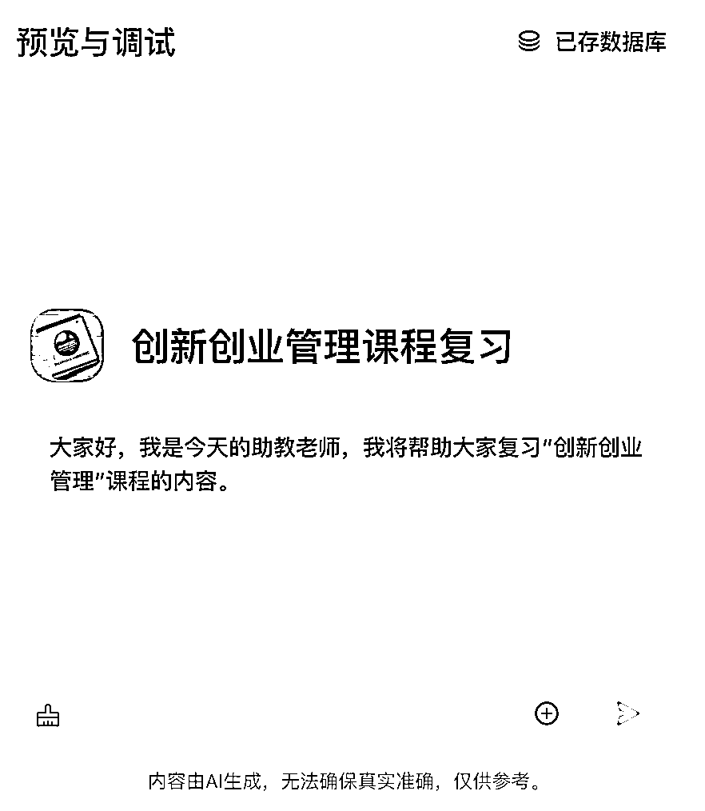

#### 问“是什么”

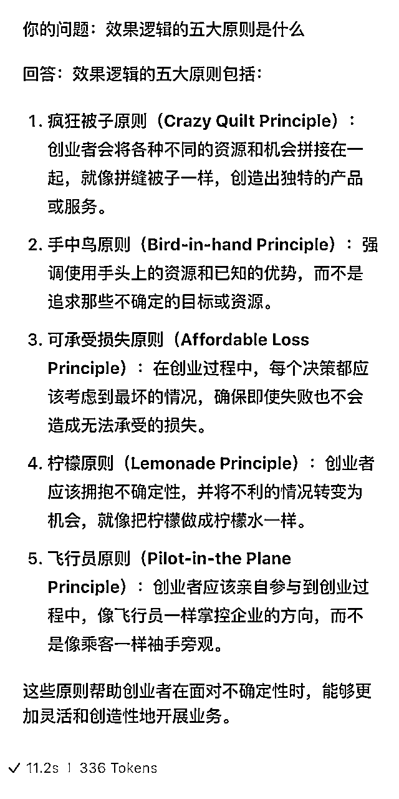

五大原则点是准的，但解释有点虚，再追一层。

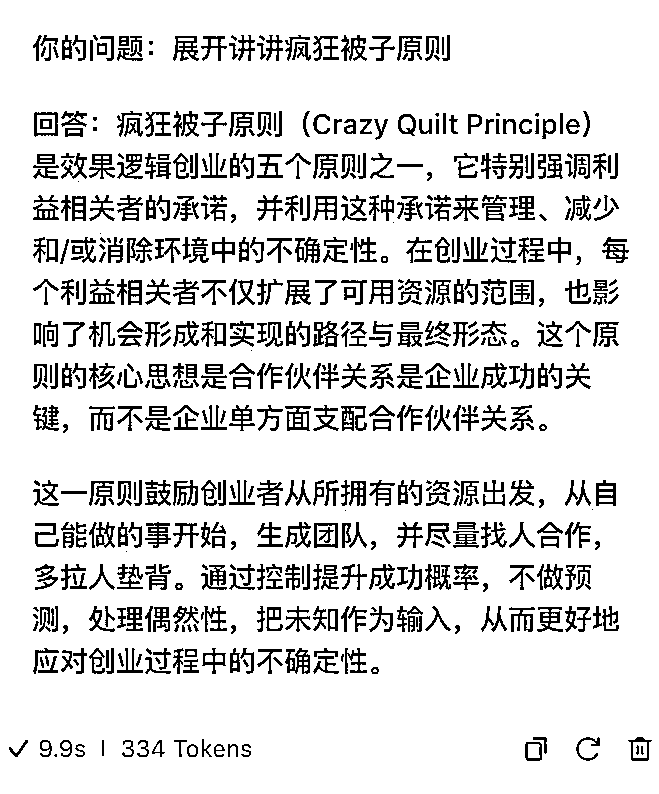

这次就对味儿了，很奈斯。再来一问：

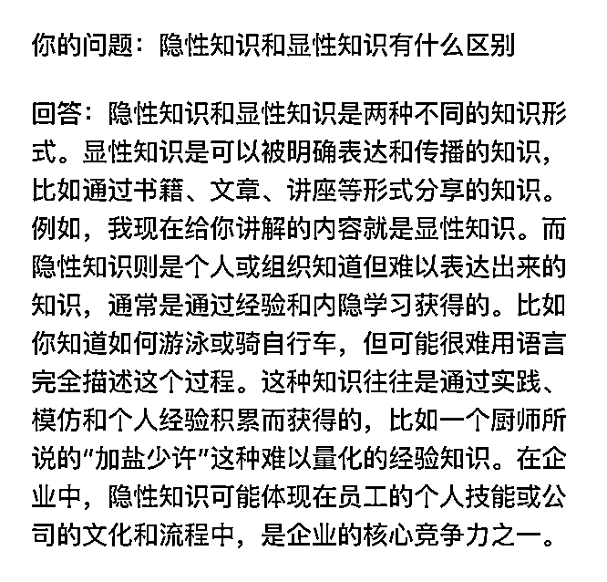

说得很有道理。隐性知识确实得攒，显性知识迟早会被“AI+搜索”吃掉。几句话就把老师讲 15 分钟的内容概括到位，很省心。

#### 问“为什么”

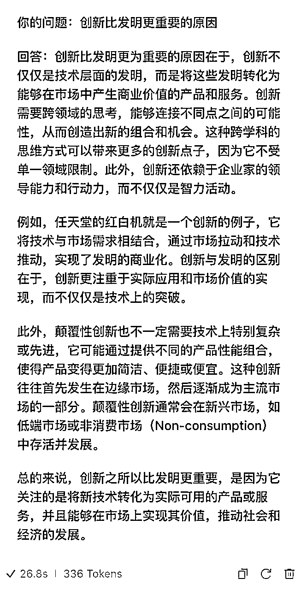

注意！我问的是“为什么创新比发明更重要”，它解析成了“创新比发明更重要的原因”，意图理解有点跑偏，回头得调一下工作流。

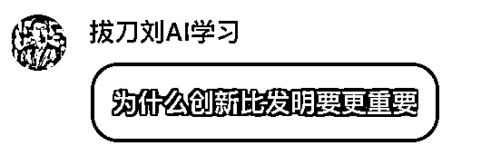

不过整体还行，甚至有点启发。成功把我快忘了的案例勾出来了。任天堂红白机那段，老师是这么讲的：一个技术小伙发明了性能很猛的主板，任天堂老板说爱咋做咋做，但成本必须压到一万日元以内。老师用这个讲清发明和创新的区别，技术派 vs 市场派，创造商业价值才是关键。

再让它复述一下这个故事对不对味。

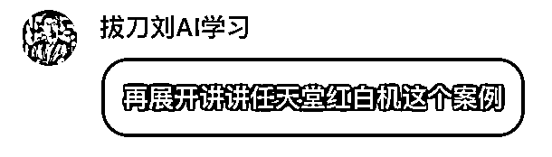

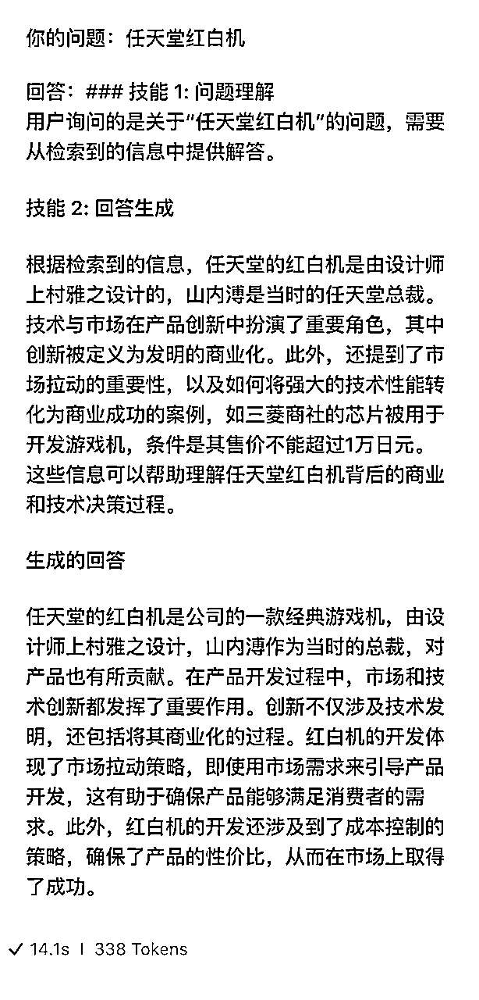

差点翻车，它居然把我的一部分提示词也吐出来了，明显有点吃力。但主体内容还是对的，和我记忆差不多。勉强及格。

应该是大模型或提示词的问题，我这次用的是 Kimi，不知道换成 GPT-4 会不会好点，后面再测。

再来一轮：

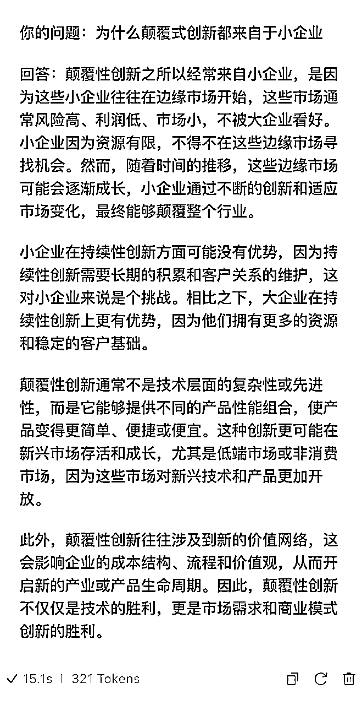

啧，这回答没毛病，稳了。

#### 问“怎么办”

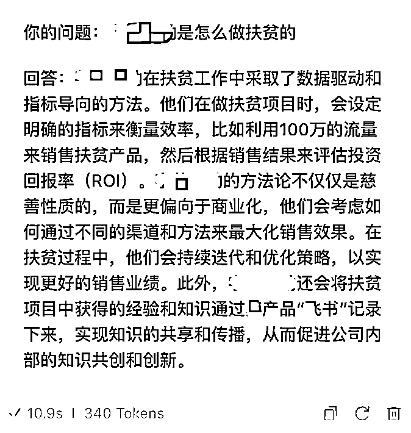

讲的是大厂扶贫怎么玩的，我先剧透一下。印象里是某大厂用自家媒体投放帮扶贫产品卖货，给了 100 万的流量资源，测试能不能卖出 300 万，结束后企业还能靠这个模型持续卖货。商业和慈善结合的案例。

让它回顾一遍：

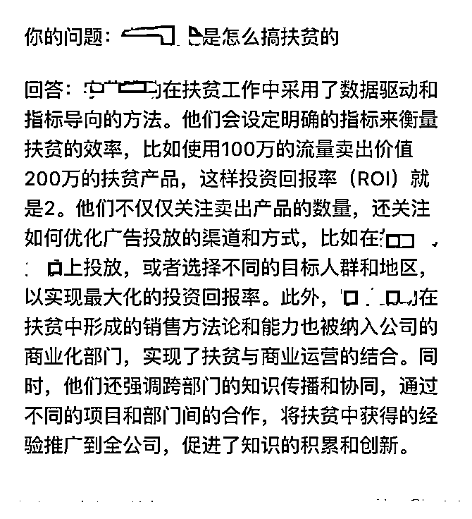

一开始提的表述不太准，第二次用同一个问题再问一次，回答质量明显提升。

#### 小结

我边写边测，整个过程不加滤镜。现在 AI 的水平，我觉得更适合内部用，不太适合直接对客户。你永远不确定它会不会嘴瓢。但作为企业内部工具，效率是真的高。

AI 提升的是能力下限，上限还得靠人

当个学习辅助，我给它 80 分。如果是老师贴身辅导那才是 100 分。不过 80 分也够用，比问那些不靠谱的同学强多了。

用冗余性对冲不确定性

很典型的创业思维，这次也验证了。第一次问大厂扶贫回答不够细，再问一次同个问题就好很多。AI 输出不稳，多问两遍总能撞上靠谱的。

先跑起来，在实操中迭代

写文章的时候我就发现了不少毛病，后面会继续调大模型参数、提示词、工作流、知识库分段规则，让它更顺。

## 这个方法能往哪儿用

学会搓知识库机器人，相当于拿到一把锤子，来看看有哪些钉子能敲：

销售话术库：金牌销售的隐性知识多，企业微信聊天记录可以沉淀成库，新人随时问。

教育培训：我这个本身就是案例。买了一堆视频课，先用 AI 提炼要点，再配合机器人复盘，学习速度拉满。

公司制度库：制度都躺在电脑里吃灰。Battle 前先搜库，理直气壮“甩锅”。

合规智库：金融圈最怕一句“你不合规”。以前靠嘴，现在靠库，规则先行。

企业知识库：项目纪要、邮件、群聊记录沉淀下来，隐性知识变显性，有长期价值。

个人知识库：把“稍后看”和收藏夹整理成分类知识库，以后翻出来还能用。

……

就这样。

更多内容：

Coze/扣子新出的图像流功能，有点惊艳到了！

我做的Agent智能体上了Coze扣子官方推荐之后……

告别手写Prompt！一句话自动生成6个结构化提示词，附工具地址。免！费！用！