# 0经验，从0到1，AI编程如何3个月做一个10W+产品
我叫周知。今天聊点实在的：一个普通人，怎么借大模型这股东风，做出能给自己带收入的产品。
总有人问我，现在下场还来得及吗？我的答案是：来得及。但有个前提——别闭着眼睛往里冲。
我刚开始捣鼓产品的时候，也跟大多数人一样迷信技术。功能越炫，自我感觉越良好，结果用户不买账，钱包更不买账。后来才慢慢想透，做产品和写文章是一码事：本质上都在帮人解决麻烦。那些踩过的坑，从挖需求、找队友到快速试错，每一步的教训我都记在小本子上。
这中间还有一个认知层面的变化，对我影响特别大：内容付费的逻辑换了——过去卖的是“教你方法”，现在卖的是“替你干活”。这个弯要是转不过来，你大概率只能在岸上看着别人捞钱。
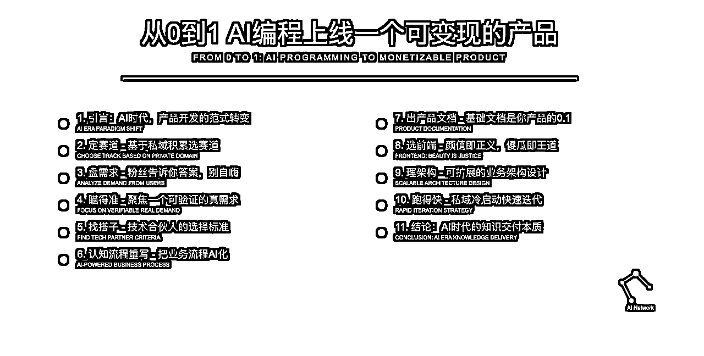
先问一句：有没有人辛辛苦苦做了个产品，上线以后根本没人来用？我干过。一年半前，我做了个猎头方向的智能应用，上线第一天，用户数——7个。其中5个是来捧场的朋友，另外2个是我自己注册的小号。
但最近有个数据，把我整个人都震清醒了：全球新写出来的代码里，已经有41%出自AI之手。换算一下，你每敲10行代码，差不多有4行是机器代劳的。这说明什么？说明过去那套“先把技术磨好，再满世界找用户”的路子，彻底行不通了。
回想两年前，做一个产品至少得花6个月。凑人、写码、测试、发布，每一步都在闯关。现在呢？从有个念头到跑通上线，一个月绰绰有余。我们的“智能笔尖”，30天走完全流程，上线首月就进了7万多块钱。AI硬生生把做产品这事儿的门槛，削掉了九成。
可惜的是，大多数人还在用旧脑子干新活儿。老一套的创业玩法，九成会死；换成AI来操作，成功率能放大约5倍。以前的套路是：我觉得这技术很酷→赶紧做出来→满世界找用户→没人搭理→凉凉。现在的套路是：用户反复问同一个问题→用AI快速搭出雏形→48小时跑一轮验证→真有人掏钱→继续加码。
看出差别了吗？过去是我说了算，现在是用户说了算。这也意味着，不会写代码的人，一样能下场做产品。门槛低了，机会反而大了。
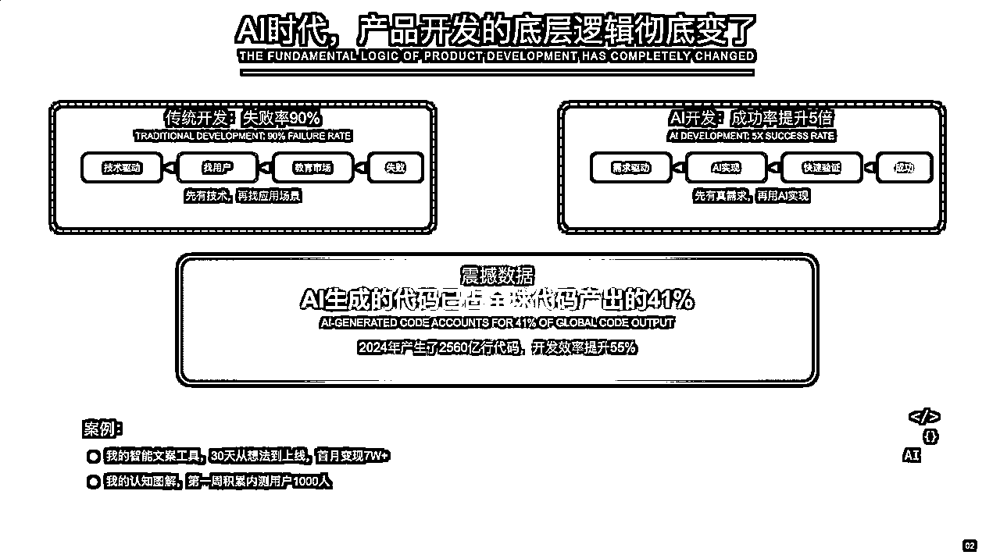
讲真，看太多人往AI这个圈子里扎，我都替他们捏把汗。大家摔跤的姿势五花八门，但绊倒人的石头就那么几块。
第一块，是技术自嗨。“快看，我这套模型能认出128种狗！”用户一句话顶回来：“然后呢？”功能再唬人，接不住用户真正的麻烦，就是自己逗自己玩。我那款简历自动生成工具就是活例子：技术不含糊，效果好得很，就是没人肯付钱。为啥？简历这玩意儿一年用不了一两回，哪来的复购？
第二块，是需求幻觉。“我猜所有人都需要自动记账。”真相是：需要是真需要，但没人愿意为它掏钱。九成智能应用活不下去，原因就两条：要么不懂需求，要么不懂变现。我有个朋友，花了3个月做了个数据处理平台，功能复杂得像迷宫，用户点进去就懵。再有用的东西，学起来费劲，照样没人碰。
第三块，是商业空转。“我产品日活破万了！”“那流水呢？”“……商业模式还在摸索。”流量一大堆，收入等于零，变现的路子一团乱麻。我那个图像生成的小工具就是追热点赶出来的：用户不少，一分钱没赚。没特色，被大厂免费版打得找不着北。
说到底，就一句话：技术要懂，需求更要懂，两手都得抓。不是技术不重要，而是你得先想明白做什么，再去想怎么做。
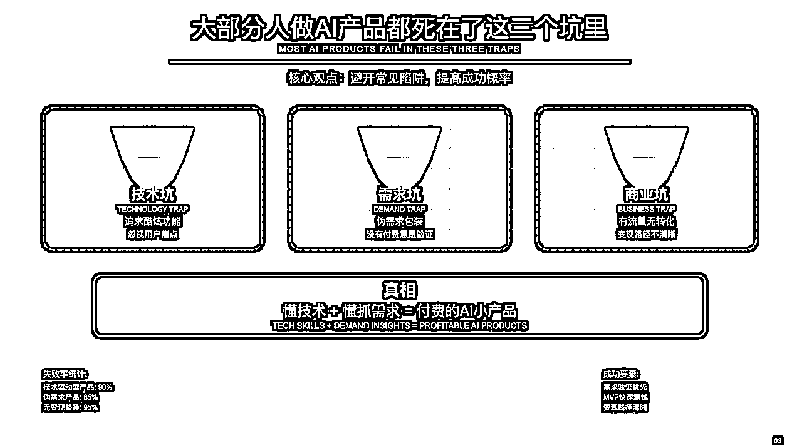
论踩坑，我可太有资格说话了。
第一款作品，就是那个简历自动生成工具。当时我兴奋得不行，以为一键出简历、还能跟着投递的职位变换风格就赢了。模型用的最先进的，界面还请了个当设计师的哥们儿帮忙把关。结果呢？用户试完就走，头也不回。为什么？简历一年最多用两回，没有复购，利润从哪来？
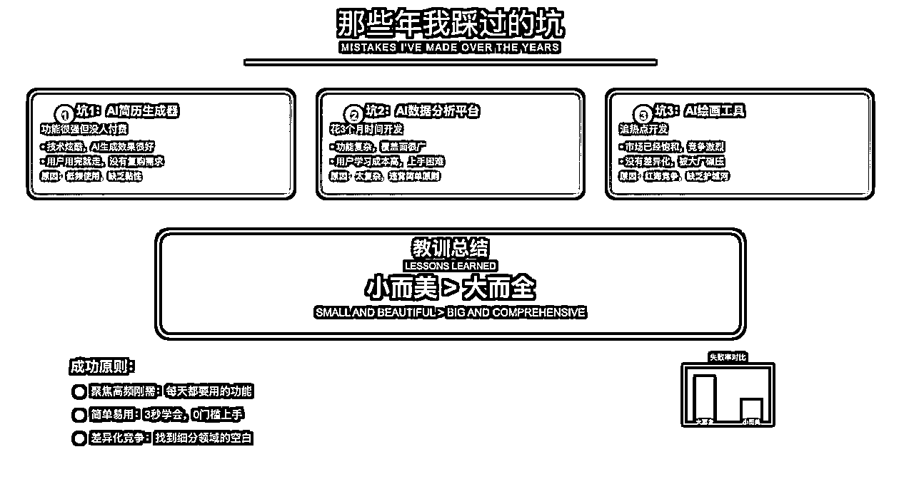
所以结论特别干脆：功能再强，没人反复掏钱，就是白干。这个道理我赔了两个月才真正认下。
第二款作品，数据处理平台。三个月的投入，换来用户扫一眼就关掉的结局。功能堆得太满，学习成本高到离谱。那一刻我终于开窍：用户都是怕麻烦的货，能一步到位，绝不肯多走半步。
第三款作品，图像生成的小工具，纯属追热点入局。等回过神来才发现，市场早就红海一片，没有差异化，扛不住大厂免费版的正面碾压。
三款产品，三种死法。但死也死出了经验：小切口、高精度，永远赢过包罗万象的大杂烩。别老惦记着做平台、搞生态，就盯住一个小功能，往死里打磨，做到有人愿意付费，这就够了。真正出色的东西，是磨出来的，不是画图纸画出来的。
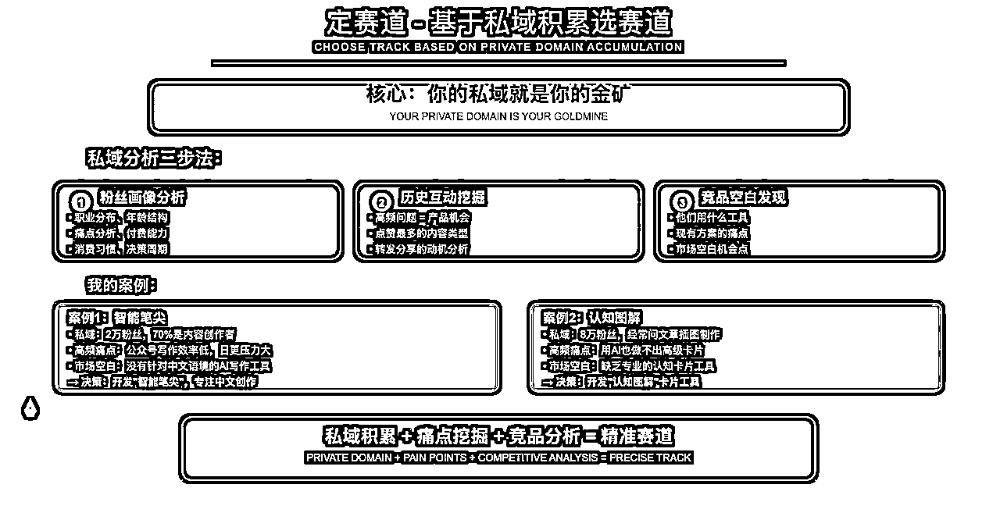
好，切回正题：怎么找到那个“对的方向”？答案可能出乎你的意料——先看看你的微信通讯录。
你手上的私域流量，就是一座没被开采的富矿。别去翻那些所谓的趋势报告，别分析什么宏大图景，就低下头看看，你的粉丝每天都在问什么。
我的做法分三步。第一步，打开公众号管理后台，把两万粉丝的互动记录全部导出来，一分析：七成都是靠内容吃饭的人。这是信号一。第二步，统计这半年收到的留言，出现频率最高的问题是什么？“你写稿到底有啥秘诀？”“推荐个好用的写稿工具呗？”“怎么做到天天更新还不掉质量？”这是信号二。第三步，把市面上能试的产品都试了一遍：ChatGPT过于大而全，中文语境根本拿捏不住；其他的，不是太贵就是太难用。这是信号三。
三个信号叠在一起，答案自己就蹦出来了：做一个懂中文、懂公众号生态、懂创作者的智能创作软件。“智能笔尖”的故事，就这么开了头。
再说我的第二款产品“认知图解”。它怎么来的？每次发完文章，都有人在后台问我：“你这配图是怎么做的？”一开始我还挺得意，挨个回复。后来问的人实在太多，我忽然一拍大腿——这不就是现成的需求吗？我有8万粉丝，就算只有1%的人需要，那也是800个潜在客户；哪怕10个人里只有一个肯掏钱，单子按399算，你自己拿计算器按按，这是什么体量。
别坐在屋里瞎猜需求了。你的粉丝，早就把答案送到你脸上了。
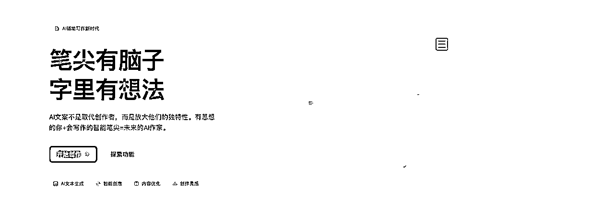
市面上的工具，没有一个真正贴合中文写作场景，这就是我做“笔尖”的原因。“认知图解”同理——老有人问我那些文章卡片怎么做的，他们也试过大模型，但就是做不出那种高级质感，空缺就是机会。
产品演示的视频也贴出来了。送你一个思路：私域池子、用户痛点、竞品空当，三条线一交，路就出来了。你对用户的了解有多深，你的壁垒就有多宽。
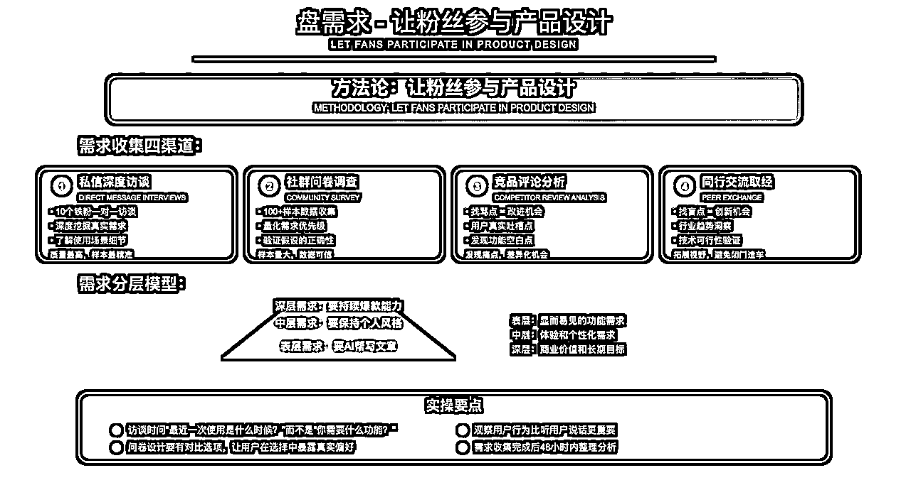
方向定了，第二步是拉粉丝一起参与设计。我的方法，四个渠道。
一是深聊。挑了10个互动最勤的老粉，每人聊一小时。我不问“你想要什么”，只问“你现在是怎么写稿的”。有个粉丝的话，我到现在还记着：“我最痛苦的不是没得写，是脑子里有想法，一写出来就不是那个味儿。”这句话把我点醒了——用户不是要AI替他写，是要AI帮他把想法变成像样的文章。
二是问卷。在几个创作者社群里发了调查，收回来127份。有意思的是，大家的痛点出奇一致：“怕丢了自己的调性”“怕被平台一眼识破是机器代笔”“做梦都想要那种篇篇能火的本事”。
三是翻差评。把竞品的评论区翻了个底朝天，被骂得最狠的三条：内容没灵魂、AI味太重、根本不懂中文的表达习惯。骂声越大，机会越大。
四是跟同行聊天。有几个做内容的朋友，其中一位说了句大实话：“我不是不会写，我是不知道怎么起头。”这句话让我彻底想明白：AI不该抢创作者的饭碗，应该坐在副驾驶上，当一个指路的领航员。
四个渠道走完，用户画像清清楚楚：他们不是想要一台无情的码字机，而是想要一个懂自己的码字搭档。记住，看用户做了什么，比听用户说了什么重要得多。会思考的你+能落笔的“笔尖”=未来的AI创作者。
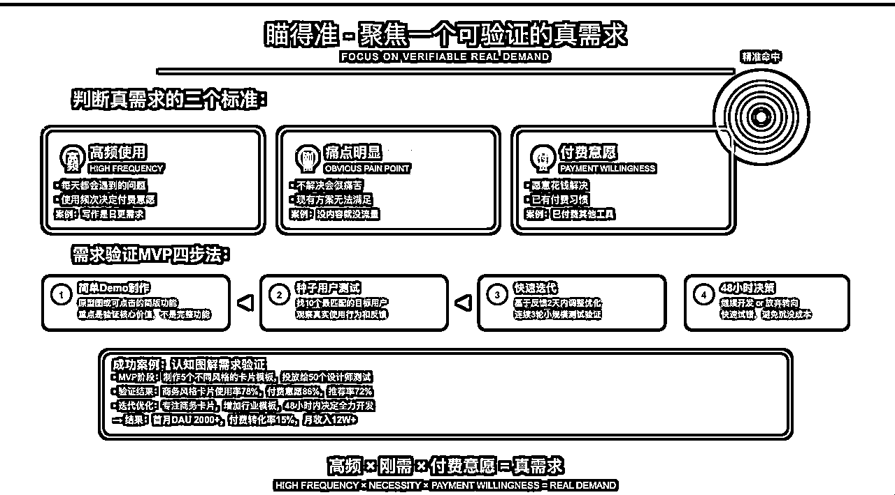
怎么判断一个需求是真还是假？我有个笨办法，看三样：用得勤不勤、不解决疼不疼、愿不愿掏钱。三条都满足，才是真需求。
第一，看频次。写作是不是天天要用？天天更新的号主，一天不写就心慌。反过来看简历呢？一年用两回就顶天了。
第二，看痛感。断更会怎样？没内容就没曝光，没曝光就没收入。这是刀割一样的疼，不是蚊子咬的痒。
第三，看付费意愿。我在群里做了个测试：“如果有个工具，能让你的写稿速度快一半，你愿意一个月花多少钱？”80%的人回答在50到200块之间。这说明，需求不但是真的，掏钱也是真的。
光有推理还不够，我做了个最小版本去验证。花48小时，和技术伙伴鼓捣出一个乞丐版：就一个功能——输入想法，生成个开头；界面丑得没法看，但能用。找了10个愿意帮忙试用的老粉。第一天，3个人说“有点意思”；第二天，7个人问“完整版啥时候出”；第三天，有人直接问“现在能先订吗”。到那一刻我心里就有底了。
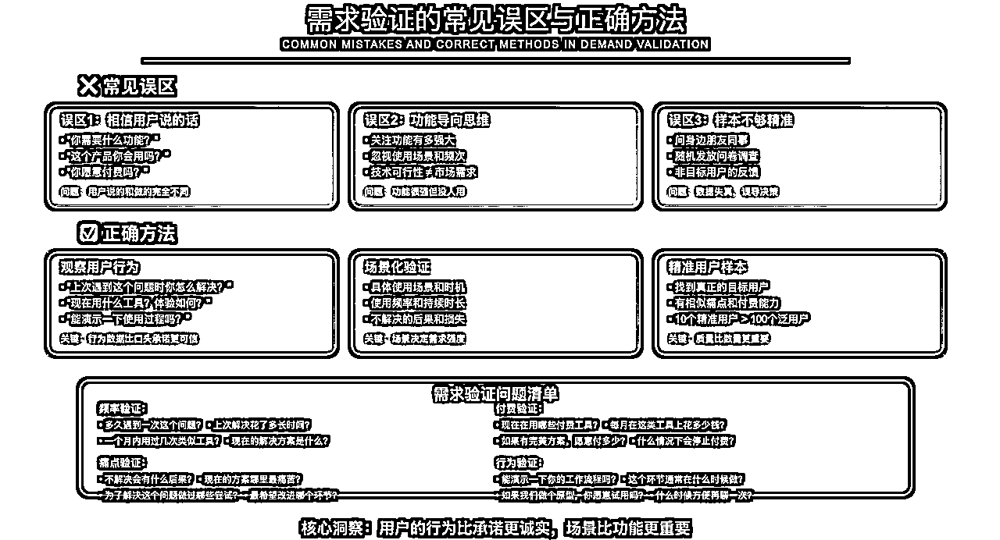
别听用户嘴上说什么，要看用户兜里的钱往哪花。肯掏钱的，才是硬需求。行为比承诺诚实，场景比功能说话。10个对得上号的目标用户，顶得上100个随便拉来的路人。
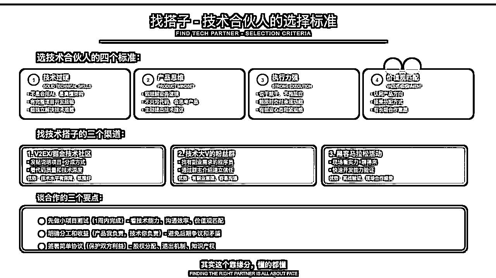
方向有了，需求也验过了，接下来最要命的一步：找个能打的技术合伙人。说实在的，这步最难。真正的大牛要价高，还不一定看得上你这个小摊子。
我是怎么找的？先立了四条标准。
一，底子得硬。不是会调两个模型接口就行，得真懂架构。我面试过一位，简历上写着精通AI，我问他：“高并发请求你打算怎么扛？”他当场愣住。这就不行。二，得有产品直觉。写代码的人一抓一大把，但能认真琢磨“用户真的需要这个功能吗”的人，没几个。我现在的搭档，就经常拿这句话来反问我。这种人，才叫对味。三，执行力得猛。创业最怕拖延，说好今天干完的活拖到下周，再牛的人我也不想要。四，价值观得同频。我们俩都认一个理：先把东西做出来，让市场用钱投票。
那去哪找人？我试过三条路。第一，技术社区发帖，像掘金、CSDN这些地方。第二，混技术大V的粉丝群，很多程序员都有副业的心思，能力也不差。第三，去黑客马拉松。这条最靠谱，当场就能看出谁有真本事。
最后怎么定的？方法特别土——先扔个小项目试手。我出的题是：“48小时，给我搞一个简单的文本生成工具。”我不光看结果，更看过程。最后留下的那位，功能做得不算惊艳，但代码写得井井有条，注释也齐全，还自己配了使用说明。人也是爽快人，不画饼，不绕弯子。
现在回头看，队友找对了，事就成了一半。总结起来就三步：小项目试水、分工和分账说清楚、签一份简单的协议。当然也得承认，这玩意讲缘分。实话说，我跟我的合伙人墨云，早就认识，合作是水到渠成。
好的搭子，不只是帮你把代码敲完，更是能在深夜跟你一起吵产品方向的人。价值观合拍，比技术高低重要得多。
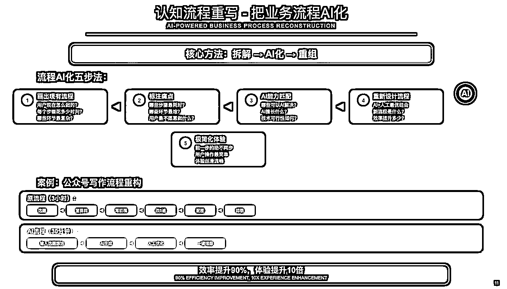
很多人用AI，只会做加法。真正的转型，是重新设计流程。
拆解→交给AI→重新拼装，就这三板斧。拿公众号创作打个比方。过去：定选题→查资料→写初稿→改五六遍→配图→排版，三小时没了。现在：扔个想法进去→模型自动出稿→人工润色→一键排版，半小时搞定。耗时压掉九成，体验更是天差地别。
但关键不在换工具，而在再造流程。你得反复追问自己：哪一步最烧时间？哪个环节最磨人？AI能帮上什么忙？能一步走完的，绝不拆两步；能自动跑的，绝不手动推。AI不是让你的活儿变多，是让你的活儿变少。
流程改造有五步：把现状画出来、标出疼点、对照AI的本事、重新设计流程、把体验砍到极简。
光做到这儿还不够。我们又撞上一个新问题：机器写出来的东西，AI味太重。怎么办？我们上了个“风格模仿”的功能。用户把自己以前写的文章传上来，模型就学着模仿他的笔调。这样产出的内容，既有速度，又带着本人特有的那股劲儿。
有个用户的反馈特别有意思：“用了你们的工具，我老婆愣是没发现稿子出自AI之手。”这就对了。最好的工具，是让人感觉不到工具的存在。记住：永远别让用户来迁就你的产品，要让产品去贴用户的习惯。
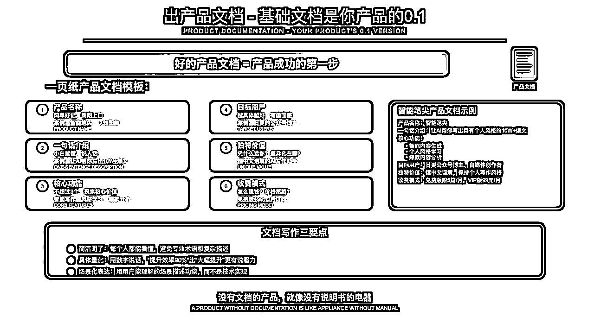
流程理清了，接下来写产品文档。好多人觉得文档是浪费时间，大错特错。一份清楚的文档，能让你少走无数冤枉路。
我的文档就一页纸，内容很简单：
产品名：智能笔尖。“笔”是写作，“尖”是精准，智能俩字不用解释。
一句话介绍：用上它，写出10W+不再靠运气。注意，不是“智能代笔”这种功能描述，而是直接把结果亮出来。
核心功能三个：智能辅助写作——注意是辅助，不是代写；风格模仿——保住你独有的味道；爆款拆解——拆一拆什么样的内容容易火。
面向谁：每天更新的公众号作者。越具体越好，别写“内容创作者”这种大词。
差异化优势：真正懂中文语境的智能创作软件。市面上多数工具是英文逻辑硬翻过来的，我们是土生土长的中文思路。
怎么收费：99元一个月，订阅制。为什么定99？因为刚好卡在100块的心理关口下面，让人不心疼。
这份文档，前后改了不下20版。每改一次，脑子里的产品图景就清楚一分。最值钱的，是那句“一句话介绍”。如果你没法用一句话把产品说清楚，说明你自己压根没想明白。
还有个私招：把文档打出来，贴在工位上。每次冒出加功能的想法，先看一眼。跟核心定位对不上的，一律不碰。克制，比放纵更难得。写文档的三个要点：简洁、具体、说人话。没有文档的产品，就像不带说明书的电器，让人心里发毛。
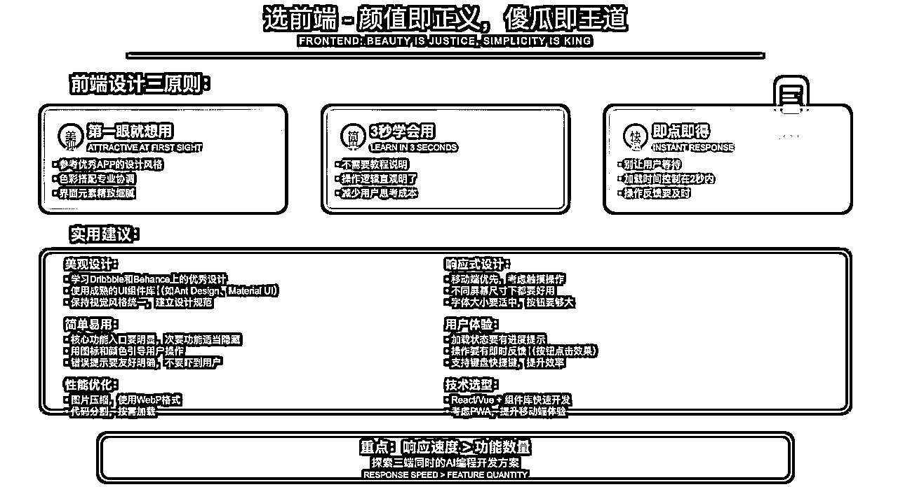
用户不会因为你后台技术多牛就掏钱，但会因为界面太丑直接跑路。没办法，这是个看脸的时代，产品也得拼颜值。
我们第一版界面，惨到什么程度？灰色背景、宋体字、按钮全是系统默认样式。用户的评价很扎心：“这网站是十年前的产物吧？”
被刺激之后，我们立了三条规矩。第一，好看。不求出彩，但求舒服。风格上借鉴Notion那种简洁路线，简单但不简陋。第二，简单。上手时间不超过3秒，首页就一个输入框、一个按钮，教程？不需要。第三，快。点击就要有反应，出稿不能超过3秒。功能可以少，速度必须快。
第三点尤其致命。我们测过：一旦生成超过5秒，一半用户会直接关页面。为了抢时间，我们想了不少招：用逐字蹦出的显示方式，让人觉得模型就跟在眼前写似的；把常见内容提前备好，减少等待；再挂上多套模型轮流响应，哪个快用哪个。
用户后来的评价是：“我靠，比Claude还顺。”在用户眼里，快就等于好，美就等于对。
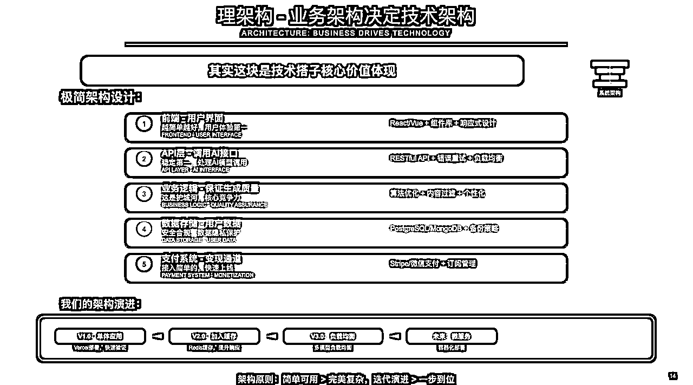
架构这块，坦白讲主要是技术搭档的地盘，但产品负责人也得懂个大概，不然没法沟通。
我们的架构走了三个阶段。1.0版，简单到不能再简单：一个前端页面，一个接口，直连OpenAI，托管在Vercel平台，没花一分钱。就靠这套配置，撑过了最初的验证阶段。2.0版，用户多起来，麻烦跟着来了：接口频繁被限流，体验大打折扣。我们引入Redis，把高频请求的结果存上一份。效果那是相当直接，成本降了六成。3.0版，一切为了稳定：接入了多家模型做调度，OpenAI出故障就切到Claude，Claude要是也抽风，就换通义千问顶上。用户全程无感，稳定性却涨了九成。
这里有个拿钱换来的教训：千万别一上来就追求完美架构。我见过太多项目，用户影子都没有，团队天天吵：搞微服务，还是老老实实做单块？数据库用MySQL，还是PostgreSQL？说句实在的，用户根本不关心你后端到底怎么搭的，他们只在乎这东西用起来顺不顺手。先把轮子转起来，再慢慢优化。这才是这个时代的做事方式。
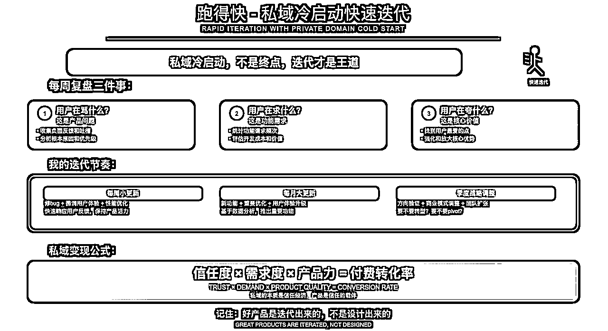
私域里的第一批用户跑完之后，只能算刚起步。真正的硬仗，是没完没了的迭代。
我的节奏：每周动小手术，每月上大版本，每季度做战略会审。产品上线不是终点，是发令枪。
打法概括起来就一个：短周期，快节奏。每周五，固定做三件事。
第一，看用户骂什么。对，我们专门追着骂声看。第一周被骂得最多的是“写出来的东西太模板化”，当天就优化提示词，加进更多变化。第二，看用户在求什么。有个需求被提了17遍：“能不能一键生成小红书笔记？”这本来不是我们的主线，但用户喊得响，那就做。结果呢？这功能成了最赚钱的一个。第三，看用户夸什么。被夸得最多的是“风格模仿”，这给了我们继续往深里挖的信心。
迭代的节奏大概是：每周修修补补，每月出新功能，季度末回头复盘，方向不对就调头。举个例子，“抓眼球标题”这个功能，就是被一轮轮喂大的。第一周，基础版随机给5个标题，用户说太随机；第二周，加上行业分类，用户说还不够懂我；第三周，引入历史数据，用户说有点意思；第四周，再叠上情绪分析，用户直接拍大腿。四轮下来，愿意掏钱的人数占比从5%涨到了23%。
想起乔布斯那句老话：产品是迭代出来的，不是设计出来的。但也不是所有需求都得惯着，偏离核心价值的，宁可不去做。
最后，我想留给大家一个认知：AI掀起的这轮变革里，赚到钱的未必是技术最强的人，而是离用户最近、跑得最快、改得最勤的人。希望我那几段翻车经历，能帮你少踩几个坑，早一点做出属于你自己的那个小产品。
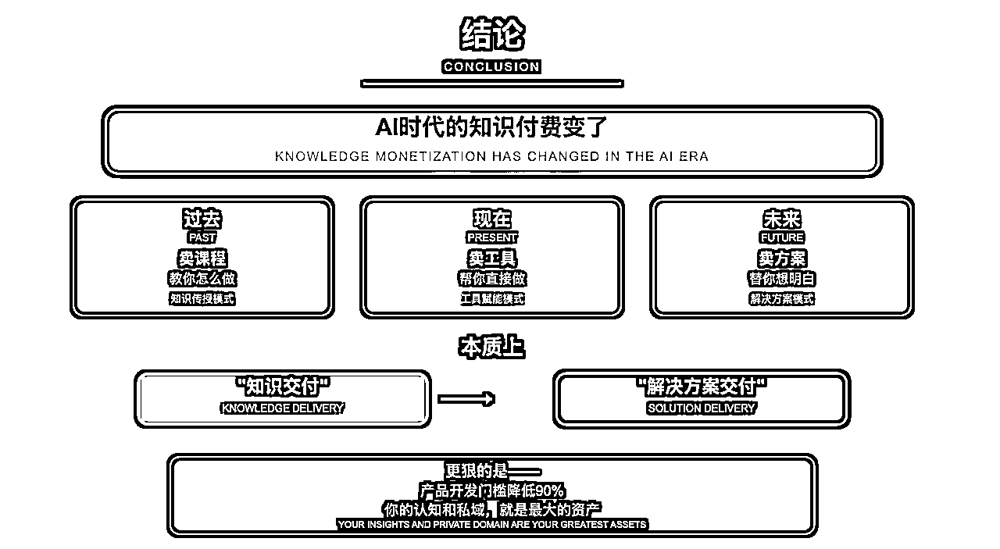
知识付费正在经历一次根本性的换道。
从前我们卖的是课，核心是把方法讲清楚；当下我们卖的是工具，核心是让事情直接被执行；往后我们会卖的是方案，核心是把思考替你完成。
逻辑已经从“交付知识”转向“交付结果”。
重点不再是教会你，而是直接帮你把事办成。
这场转变背后，藏着三个愈发明显的抓手：
其一，造物的成本被拉到谷底。AI 编程把产品开发门槛砸掉了九成，非技术背景的人也能独立做出可用产品。
其二，资产天平在倾斜。持续的认知沉淀和私域连接比纯技术更值钱，真正打动用户的，是对需求的深刻理解。
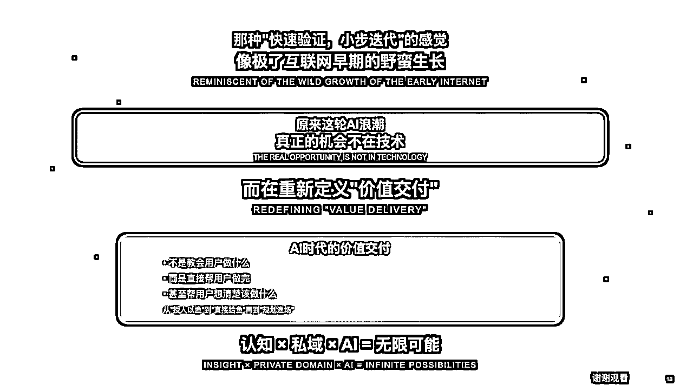
所以，关键词已经从技术迁移到了“价值交付”的重新定义。
这波 AI 浪潮的形态，和早年的互联网野蛮生长极其相似。
能拿到牌的，往往是敢于重新思考交付形态的人。
说到底，这轮浪潮的胜负手不在模型有多强，而在商业模式能否被重新定义。
如果你还犹豫着不肯入场，再强的 AI 也帮不了你改写结局。