# 1万个 YouTube Shorts AI 对标账号，真的是可以“挖”出来的
作者：龙哥

上周，龙哥放出了第二条超级标：YouTube Shorts AI 视频。他在分享里给了一个很关键的思路——如果你想知道哪些 AI 视频已经在 Shorts / YouTube 上火起来，不要只盯着单独一条爆款看。正确做法是：从一条视频进入它的描述区，把 tag、描述、评论里出现的关键词都抓出来；再用这些关键词去搜索、去扩展，循环几轮，最后就能找到一大堆已经被别人验证过有流量的类目词。

我顺着这个思路，直接写了一套 RPA，让它自动在 YouTube Shorts 里跑 AI 热门的对标分析。流程大致是这样：先定位一些对标视频，抓取视频详情，把描述和 tag 全部收集起来；再拿这些描述和 tag 去搜 Shorts，同时点击 tag 页继续采集；拿到新 tag 后再向外扩展，如此循环，最后落到对应频道里，把 channel 详情也一起抓回来。采集过程中，我特意用了不同国家和地区的 IP，尽量让数据覆盖到各个文化圈里的 meme，避免样本太偏。

最终共收集到 10000 条左右的 channel 账号信息。其中，注册至今不满一年、但订阅数已经超过 1000 的有 1657 条。每个 channel 都保留了完整原始字段，包括基本信息、注册时间、总视频数、总订阅数、总观看数、所在地区、Twitter / IG 等个人信息，后面不管是继续筛选，还是做精准对标，都非常方便。

对标账号数据链接：

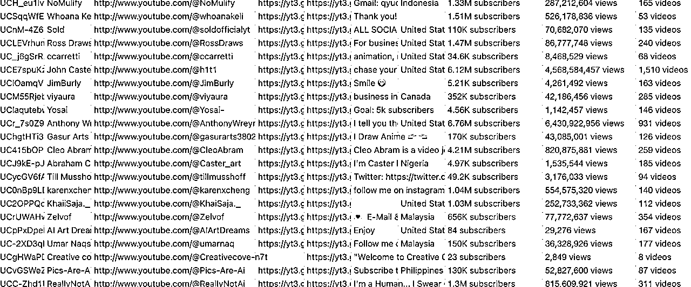

另外，我还把高播放量、高点赞量视频的描述做了分词，并统计了每个分词对应的视频数量和总观看量。这张表可以帮你更全面地发现 YouTube Shorts AI 视频里的流量机会：

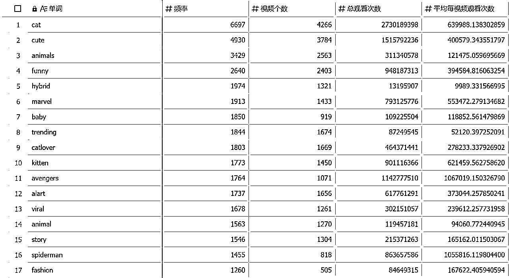

完整数据主要分成三块：channel 信息、关键词频次、short 视频信息。下面聊一聊具体的实现过程。

## 一、整体思路

核心逻辑并不复杂。先找一条 AI 生成的视频，再进入描述区抓 tag。手动点一下 Shorts 里的 tag，会发现它直接跳转到对应的 tag 主页。比如点击 #aiart，就会进入这个页面：


而且 URL 格式是固定的：https://www.youtube.com/hashtag/{tag}/shorts 。看到这个，我们就不用傻傻地模拟点击了，直接把关键词拼成 URL 去采集，速度会明显更快。

之后每个 tag 都可以单独采集：既能直接在 tag 页里抓，也能从 YouTube 搜索关键词后、选中 Shorts 再采集。两条路可以并行。

试一下搜索也能走通：输入关键词，点“shorts”，页面就只显示 Shorts 视频了。所以思路彻底清晰——先手动找几个对标视频，RPA 再根据这些关键词不断裂变、采集新关键词，循环下去，基本就能把想要的数据全部覆盖。

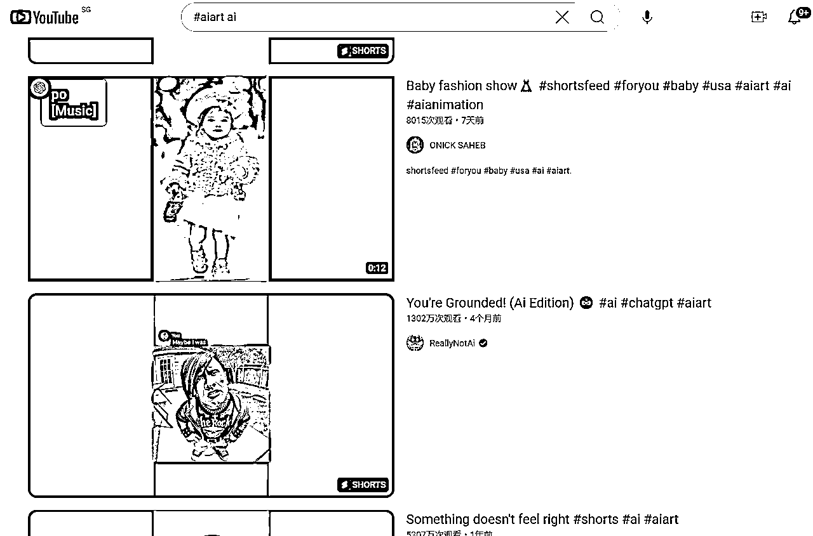

## 二、数据采集

做采集之前，我先说明一下技术选型：这次统一用 RPA，不只为省事，还因为后面打算用影刀做自动化定时上传，以及多矩阵账号的数据拉取。RPA 上手快，最快一两小时就能把整套流程跑通。当然 YouTube 官方也开放了 API，可以去 developers.google.com/youtube/v3 申请，但官方 API 有配额限制，数据也不如网页端全，具体根据自己的情况选。

以搜索“baby fashion show”为例。在控制台里查看请求，会发现搜索结果是通过 youtube/search 接口返回的。于是最省力的方式就出来了：用影刀滑动页面，同时网络拦截 https://www.youtube.com/youtubei/v1/search ，解析接口返回的数据就行。

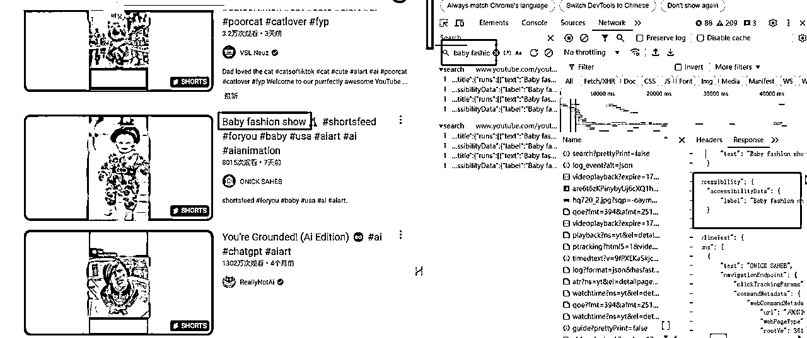

我在影刀里写了一个无限循环：输入关键词后切到 Shorts，然后不停滚动页面，直到出现“无更多结果”，就结束当前关键词，继续下一个。

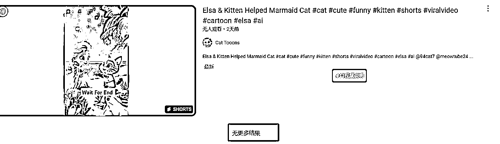

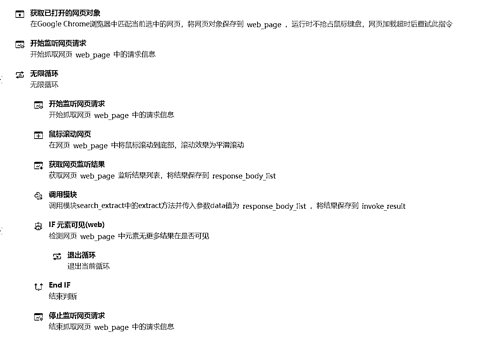

再全局监听一下 search 接口，把返回的 JSON 丢给解析模块处理就行。注意，解析完成之后一定要做存储。我因为有自己的数据库，直接写进了表里；如果你不熟悉数据库，保存成 Excel 或 JSON 也完全可以。代码逻辑见下面：

```
import json
import os
import mysql.connector
from mysql.connector import Error
def extract_youtube_search():
with open('youtube_search.json', 'r', encoding='utf-8') as file:
data = json.load(file)
effective_contents = data.get('onResponseReceivedCommands', [{}])[0] \
.get('reloadContinuationItemsCommand', {}) \
.get('continuationItems', [{}])[0] \
.get('twoColumnSearchResultsRenderer', {}) \
.get('primaryContents', {}) \
.get('sectionListRenderer', {}) \
.get('contents', [{}])[0] \
.get('itemSectionRenderer', {}) \
.get('contents', [])
results = []
for item in effective_contents:
videoRenderer = item.get('videoRenderer', {})
print(videoRenderer)
if not videoRenderer:
continue
video_data = {
'videoId': videoRenderer.get('videoId', ''),
'video_url':f'https://www.youtube.com/watch?v={videoRenderer["videoId"]}',
'thumbnails_url': videoRenderer.get('thumbnail', {}).get('thumbnails', [{}])[-1].get('url', ''),
'cover_url':f'https://i.ytimg.com/vi/{videoRenderer["videoId"]}/frame0.jpg',
'default_thumb_url':f'https://i.ytimg.com/vi/{videoRenderer["videoId"]}/default.jpg',
'title': videoRenderer.get('title', {}).get('runs', [{}])[0].get('text', ''),
'accessibility_label': videoRenderer.get('title', {}).get('accessibility', {}).get('accessibilityData', {}).get('label', ''),
'snippet_text': ''.join(run.get('text', '') for snippet in videoRenderer.get('detailedMetadataSnippets', [])
for run in snippet.get('snippetText', {}).get('runs', [])),
'channel_name': videoRenderer.get('longBylineText', {}).get('runs', [{}])[0].get('text', ''),
'channel_id': videoRenderer.get('longBylineText', {}).get('runs', [{}])[0].get('navigationEndpoint', {}).get('browseEndpoint', {}).get('browseId', ''),
'channel_url': f"https://www.youtube.com{videoRenderer.get('longBylineText', {}).get('runs', [{}])[0].get('navigationEndpoint', {}).get('browseEndpoint', {}).get('canonicalBaseUrl', '')}",
'channel_avatar_url': videoRenderer.get('avatar', {}).get('decoratedAvatarViewModel', {}).get('avatar', {}).get('avatarViewModel', {}).get('image', {}).get('sources', [{}])[0].get('url', ''),
'published_time_text': videoRenderer.get('publishedTimeText', {}).get('simpleText', ''),
'lengthText': videoRenderer.get('lengthText', {}).get('simpleText', ''),
'length_label': videoRenderer.get('lengthText', {}).get('accessibility', {}).get('accessibilityData', {}).get('label', ''),
'viewCountText': videoRenderer.get('viewCountText', {}).get('simpleText', ''),
'meta_url': videoRenderer.get('navigationEndpoint', {}).get('commandMetadata', {}).get('webCommandMetadata', {}).get('url', '')
}
results.append(video_data)
return results
```

单个浏览器采集的效率还是太低。之前在推特矩阵里，我们分享过多独立环境矩阵操作。这次直接把它搬过来用：开十个浏览器，同步做关键词挖掘和数据采集，效率直接拉到 10 倍。单个浏览器大约 3 秒能采 20 条，一个小时下来轻松一两万条。用 RPA 做临时采集已经完全够用；以后做矩阵，同样可以十个浏览器并行隔离运行，养号和统计都很方便。

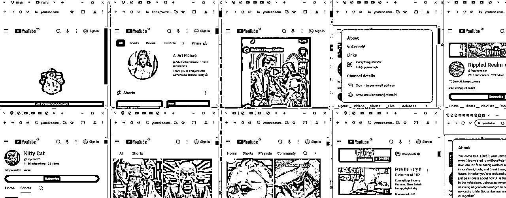

后面的 tag 和 channel 也是同样思路，解析之后保存即可。采集完之后，我把描述区的词汇集中分析了一下。这里用 Cursor 写代码就够了，如果自己写不出大段提示词，可以直接去 Claude 官方控制台（https://console.anthropic.com/）优化提示词，效果非常好。

写代码的过程中，我还有个意外发现：同样的提示词下，升级后的 Sonnet 3.5 明显更适合写代码了。它会主动问我是否需要重构，等我确认后，直接帮我把原来将近 300 行的脚本压缩到 177 行，方法名也做了语义化处理，跑起来完全没毛病。

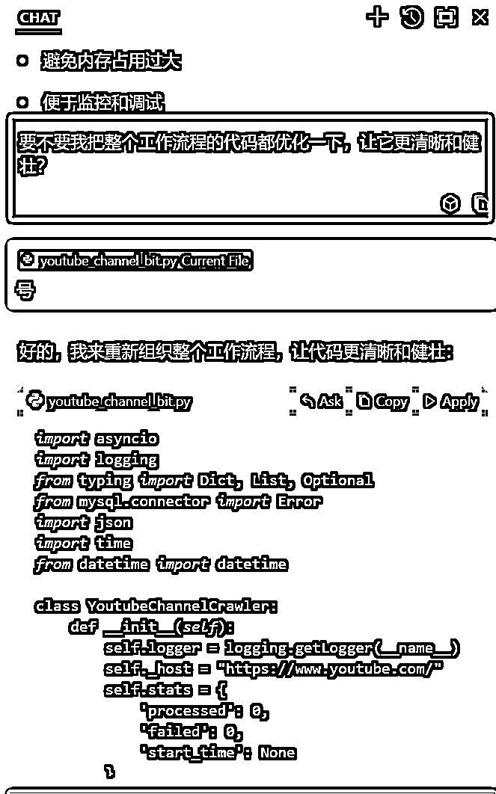

channel 账号去重后，数据大约剩 9266 条。这些账号大部分都可以直接用来对标。再继续用 Cursor 统计一下 tag 的情况，就能看清哪些类目词是真正的流量池。

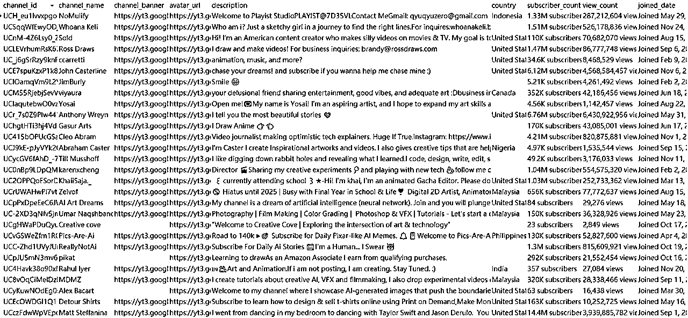

我把采集到的 YouTube Shorts 公开数据存进了 MySQL，想从 Shorts 的 tag、描述等字段中，找到已经被验证过有流量的类目词，于是请 Cursor 重点分析 title 信息，并输出成表格：

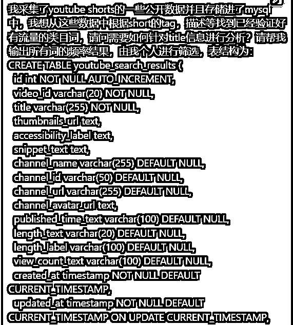

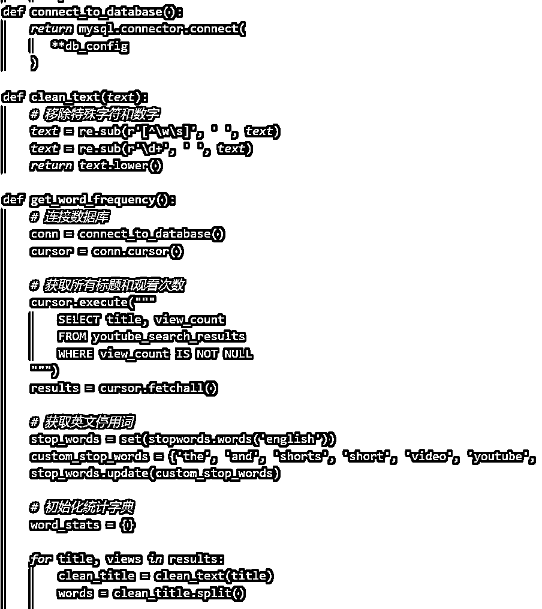

还是忍不住感慨，Claude 模型现在写代码真的稳，90% 的情况都能 bug free 一遍通过。最终执行后，直接输出 Excel 表格：

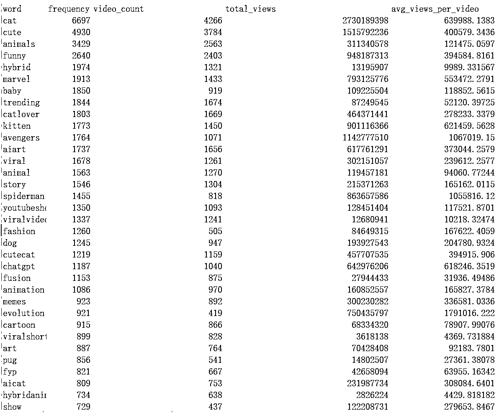

完整代码：已经整理好，有需要的朋友可以自取。

```
import mysql.connector
from collections import Counter
import jieba
import re
from nltk.corpus import stopwords
import nltk
import pandas as pd
# 下载停用词
nltk.download('stopwords')
db_config = {
}
def connect_to_database():
return mysql.connector.connect(
**db_config
)
def clean_text(text):
# 移除特殊字符和数字
text = re.sub(r'[^\w\s]', ' ', text)
text = re.sub(r'\d+', ' ', text)
return text.lower()
def get_word_frequency():
# 连接数据库
conn = connect_to_database()
cursor = conn.cursor()
# 获取所有标题和观看次数
cursor.execute("""
SELECT title, view_count
FROM youtube_search_results
WHERE view_count IS NOT NULL
""")
results = cursor.fetchall()
# 获取英文停用词
stop_words = set(stopwords.words('english'))
custom_stop_words = {'the', 'and', 'shorts', 'short', 'video', 'youtube', 'a', 'of', 'to', 'in'}
stop_words.update(custom_stop_words)
# 初始化统计字典
word_stats = {}
for title, views in results:
clean_title = clean_text(title)
words = clean_title.split()
valid_words = [word for word in words if word not in stop_words and len(word) > 2]
for word in valid_words:
if word not in word_stats:
word_stats[word] = {
'frequency': 0,
'total_views': 0,
'videos': set()  # 用于统计包含该词的视频数量
}
word_stats[word]['frequency'] += 1
word_stats[word]['total_views'] += (views or 0)
word_stats[word]['videos'].add(title)  # 添加视频标题到集合中
# 创建DataFrame
data = []
for word, stats in word_stats.items():
video_count = len(stats['videos'])
avg_views = stats['total_views'] / video_count if video_count > 0 else 0
data.append({
'word': word,
'frequency': stats['frequency'],
'video_count': video_count,
'total_views': stats['total_views'],
'avg_views_per_video': avg_views
})
results_df = pd.DataFrame(data)
# 按频率降序排序
results_df = results_df.sort_values('frequency', ascending=False)
# 关闭数据库连接
cursor.close()
conn.close()
return results_df
def main():
# 获取词频统计结果
results_df = get_word_frequency()
# 输出前20个结果作为预览
print("\n前20个最常见的词及其统计信息:")
print(results_df.head(20).to_string())
# 保存完整结果到CSV文件
results_df.to_csv('youtube_shorts_word_analysis.csv', index=False, encoding='utf-8')
print("\n完整结果已保存到 youtube_shorts_word_analysis.csv")
if __name__ == "__main__":
main()
```

完整数据呈现：

频道信息汇总：

通过 https://www.youtube.com/channel/+channel_id 即可直达，channel_id 对应表格第一列。

访问频次说明：

Short短视频信息：