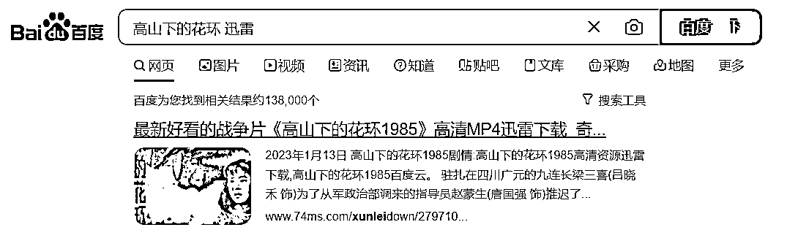
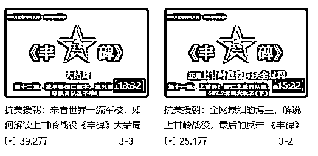
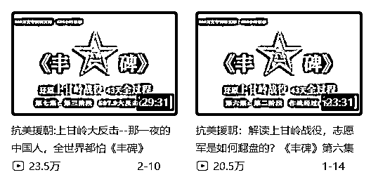
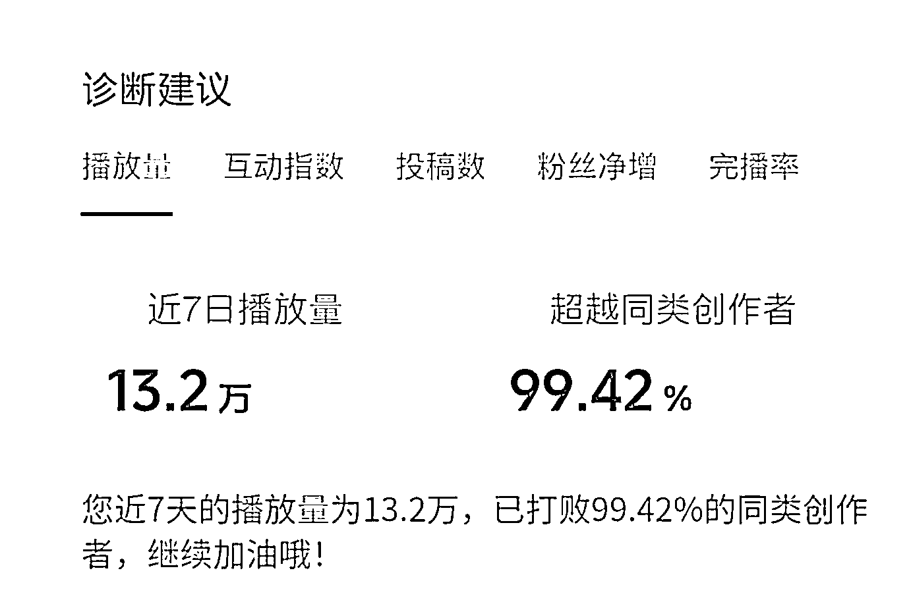

# 2023年，我的军事解说账号每天进账4000多
你有没有想过，自己还会不会点开一支长达4小时的视频？
我现在做的，就是这种不太讨喜的严肃知识类自媒体——讲军事历史、讲天文地理，一开口就是几个小时起步。很多人可能觉得，这种长视频早就被市场判了死刑：接不了广告、带不动货、又不打擦边球，能赚什么钱？可实际上，像我做的这种军事历史解说，只要账号跑通了，单靠流量收益一天就能有4000左右的收入；哪怕一周不更新，躺平状态下每天也有近2000块进账。
看到这里，估计已经有圈友蠢蠢欲动了。但大家心里也清楚，能拿到这个收益的账号，背后一定是有积累的。那么问题来了：都2023年了，知识类账号还值得做吗？
这个问题我跟不少百万大V聊过，他们的回答出奇一致——能做，但很难。结合我自己这几年的踩坑和摸索，今天就把一些心得整理出来，给那些本身有内容优势、又愿意分享知识的朋友做个参考。说白了，就是希望咱们能在自己感兴趣的领域里，“站着把钱挣了”。
先说明一下，最近在赚钱看了很多大佬分享的自媒体玩法，大多是电商、虚拟资料方向，纯内容创作的帖子反而很少。所以这篇文章并不是普适教程，可能不适合大部分人，建议根据自己的实际情况再看下去。

大家好，我是龙哥，前某官媒的记者兼全能编辑，做了三年新闻宣传工作。今年从我手上过的视频稿件差不多300篇，文案100多篇，B站单平台播放量破百万的爆款视频也有15篇上下。目前我的副业主要是做一个红色历史类自媒体账号。跟赚钱的大佬们比，我赚的确实只是点流量小钱，不算什么成绩。
不过因为工作原因，我长期和大量百万级大V打交道，也经常找他们取经。具体账号名字不方便透露。这篇文章的干货，一部分来自他们的指点和启发，一部分是我自己摸爬滚打出来的经验。内容上跟电商类短视频有相通的地方，可以参考，但差异也挺大，大家理性看待，批判性吸收。

（工作期间经常去B站北京总部交流学习）

综合我自己的情况和各百万大V的经验来看，账号如果做得好，养活自己绰绰有余。但要跟几年前新媒体野蛮生长的阶段比，确实差远了。所以这篇文章本质上更像“劝退指南”，希望大家结合自己的实际情况判断。
难点主要集中在以下几个方面：
**1、赛道已经相当拥挤**
这几年短视频平台把“一夜暴富”的故事讲得太多了，吸引了一大波来自各行各业的人进场淘金。狼一多，肉自然就不够分了。再加上各个平台的用户增长基本到了瓶颈期，先发优势已经不存在了。
**2、门槛比以前高了很多**
2018年短视频刚火的时候，很多领域都是空白，观众看什么都觉得新鲜。那时候一晚上涨10万粉丝真的容易。可这几年下来，特别是疫情过后，自媒体内卷到极致，各种玩法层出不穷，连影视解说号都开始用快板节奏来抓眼球了。观众变得极其挑剔，如果你对自媒体没什么经验，想在短时间内脱颖而出，难上加难。
我大概总结了一下，如今观众有几个显著特点：
**（1）看视频的时间在缩短**
大家都知道，近几年大环境一般，大家都在忙着搞钱。疫情放开前，大家没事干只能刷手机；去年底放开后，变化非常明显，流量几乎是断崖式下滑——差不多腰斩，收益自然也跟着大打折扣。
**（2）算法升级导致关注意愿降低**
现在的算法太聪明了，你喜欢什么，抖音就源源不断给你推什么。哪怕你不点关注，系统也会自动把你爱看的内容塞到你眼前。观众都懒得去点关注了。而中视频计划里有一个“铁粉收益”占了不小比重，这其实对数据影响挺大的。

（节选自庄心妍抖音评论区，这其实是很多创作者的共同痛点）
**（3）娱乐化倾向压倒一切**
知识类内容本来就带着严肃属性，可短视频平台的用户大多是用碎片时间刷视频。碎片时间里，大家更想放松、找乐子，真正有教育意味的东西，反而没人想看。知识类自媒体天然就要面对这对矛盾。
**3、预算端被卡死**
疫情之前，品牌方为了抢口碑，疯狂争抢广告位。那时候厂商基本不看ROI，只关心能不能占住坑位。现在不行了，厂商手里也没钱，广告预算被大幅压缩，而且越来越看重实际转化效果。做账号很重要的一环是“正反馈”——当品牌来找你投钱，你赚到第一桶金，才会有继续做下去的动力。可现在很多自媒体作者，连第一桶金的影子都看不见。

我目前观察到的知识类自媒体变现路径，基本集中在五个方向：流量收益、广告收益、直播带货、知识付费、剪辑收徒。
**1、流量收益**
抖音上很多知识号、游戏号，包括不少做矩阵影视解说的圈友，其实视频里很少接广告。之所以还能保持高频更新，靠的就是中视频计划的流量分成。开通入口基本都在创作者中心后台。如果你跟某个平台签了独家，还能在这基础上拿额外收益。比如B站一些做得好的UP主，只要保持一月四更，平台就能给到十几万的费用（具体金额要自己去谈）。这笔钱，已经足够你招几个人成立一个小工作室了。
**2、广告收益**
这块大家都熟。前两年行情好的时候，B站广告商几乎是按粉丝数的10%来报价，而且给钱很爽快，生怕晚一步就没位置。如今广告商都在压低价格，各家有各家的算法。我认识的那些百万大V，主要收入来源确实是广告。但对我们这种红色历史账号来说，广告这块很尴尬——中国近代史本身就是一部屈辱史，做这类内容时，能植入的广告少得可怜，基本上只要一带广告就会挨骂，搞不好还会把自己推上舆论的风口浪尖。再说大众消费品广告主本来就偏爱泛娱乐流量，所以做红色历史的创作者，广告收益几乎可以忽略。
**3、直播带货**
这个不用多讲，做电商的圈友肯定比我们熟。我们自己也还在摸索。今年打算尝试做自有IP的文创产品，但说实话，我们并不乐观。历史内容的受众大部分是男性，红色历史这块男性占比甚至超过95%，带货难度相当大。
**4、知识付费**
现在B站很多UP主都在做付费课程，定价各不相同。能卖出多少，全凭个人本事，但平台一般会给予一定的流量扶持。
**5、剪辑收徒**
收徒也是一块相当可观的收入。去年那些大V招个万把学员基本没问题，就算一个学员定价399，算下来也够玩了。不过现在疫情放开后，学员没那么好招了；另外，如果交付质量跟不上，很容易砸账号的口碑。对于知识类创作者来说，口碑真的是命根子。

目前主流自媒体平台基本可以分成两类：
**一类是抖音这样的短视频平台，本质是“快消品”。**
在上面创作，3到5分钟是最佳时长，7分钟是极限，12分钟以后基本算无效时长。这个结论不是官方口径，但很有参考价值——我们统计了20多万条视频数据才得出来的。
**另一类是B站这样的中长视频平台，本质是“沉浸式知识场”。**
B站的视频消费时长至少是5分钟起步，15到25分钟最佳，35分钟是天花板。跟短视频不同，长视频平台几乎没有所谓“无效时长”。
因为我以前的工作重心在B站，额外聊一下：B站UP主通常深耕某个垂直领域，很多人是“用爱发电”。如果是联合投稿，只要策划足够有趣，不少大UP主甚至可以不收一分钱就来拍，比如影视飓风这类团队——预算根本不是核心，有趣才是第一位的，差旅费都能自己掏。
再来说说做知识类账号比较关键的几个要素：
**（1）黄金三秒**
在短视频平台，开头三秒必须把全文重点抛出来，而且还得幽默风趣。说白了，要多学学营销号的套路。观众要不要停下来看，基本就取决于这三秒。随着大家审美疲劳，这个时间还在不断缩短，比如现在抖音后台已经开始看“两秒跳出率”了。但B站用户会更有耐心，所以B站UP主一般都有专属片头，观众看到片头就会停下来。这里特别提醒：如果你在B站发的是竖版短视频，片头一样！很重要！（B站官方跟我透露，现在B站短视频和中视频的比例已经基本是1:1了）
**（2）文案内容**
文案必然是最核心的环节。知识类视频的灵魂就是文案，这一点下面会详细展开。
**（3）封面制作**
对推荐流算法平台（比如抖音）来说，封面没那么重要，有个就行，文案才是重点。但B站这类瀑布流展示平台，封面跟小红书笔记一样，几乎直接决定生死。封面做得不好，你连被点进去的三秒机会都没有。封面要简洁大方、有吸引力，就像展示卖点一样，尽可能把视频里的高价值信息提炼出来。这点很多圈内大佬都讲过，我不再重复。
**（4）发布时间**
跟不少大佬交流过，基本上发布时段推荐在晚上18点到22点之间，按这个来一般不会出错。
**（5）话题标签**
话题标签和平台活动方面，千万别偷懒。选择跟视频内容方向相关的标签就行。一方面可能拿到官方流量扶持，另一方面也决定了视频第一时间推送到哪类人群面前，对提高爆款概率有帮助。

**1、文案能力**
我觉得这个必须排第一。但知识类自媒体最容易踩的误区，不是“讲得不够专业”“不够新奇”，而是——能不能让人听懂、听下去。这条下文会重点展开。
**2、剪辑水平**
现在自媒体这么卷，剪辑能力也越来越重要。尤其是文案、画面、声音、配乐之间的契合度。做得好不一定会加分，但契合度太差的基本会被观众打负分。不过剪辑差就一定数据差吗？也不然。B站UP主侯翠翠的视频几乎没有任何剪辑技巧，文案也没什么设计，全靠自然输出、唠嗑式表达，结果照样成了百大UP主。但这种案例非常少。
**3、素材问题**
素材这块讲两个：视频画面素材和文案素材。
视频画面可以通过很多方式下载。比如想下载某部电影，可以搜“电影名+迅雷”，像“高山下的花环 迅雷”。查台词可以去 zhaotaici.cn 这个网站。如果找不到下载地址，可以安装IDM插件来抓取。更省事的是直接去B站、抖音下别人的混剪片段来用，别人已经剪好的，自己再加工会高效很多。
文案素材方面，尽量选可靠来源。我个人建议优先从一手资料找起，研究性论文往往更真实可信——各大论文网站、图书馆、相关书籍都可以。这方面圈友已经分享很多了，就不赘述。

（百度 电影名+迅雷）
**4、声音问题**
音频方面，现在很多人用AI配音，比如魔音工坊。但真没必要担心自己声音不够好听、不够有吸引力。我关注的好多大V，一开始都对自己的声音不满意，早期网友反馈也很差。但随着用心更新，声音反而成了这个博主的个人特色——一听就知道是他。后来换成优质配音，大家反而不认了。
**5、人群画像**
人群画像是很多新手容易忽略的点，其实和电商思维一模一样。很多新手做视频完全按自己喜好来，选高大上的画面和配乐，这其实是一厢情愿的自嗨。不同年龄层的人喜欢不同风格。比如红色历史内容主要瞄准抖音30到50岁的人群，那我们的配乐就会选那种烂大街的，因为高端货大家根本不买账。

**1、好好讲话**
知识类自媒体的文案，通常需要大量权威、详细的资料，搜集过程确实很折腾，但这也是知识类博主的护城河。问题在于，这些史料文献读起来非常官方和厚重，自己读着都费劲，观众就更别提了。所以文案一定要让观众听得懂——这一点极其重要！
听起来简单，做起来却很难。
举个例子。有一次我和某大V联投视频，我把他文案里的病句挑出来改了。但有一句开篇文案，他死活不让动，说改了就没那个“味儿”了。我听了他的，最后那条视频的播放量是正常水平的三倍（当然不全是那句话的功劳）。大家可以感受一下：
他原稿写：但就是数学及格不是那么经常
我改成了：但就是数学经常不及格
那么，什么程度的文案才算合格？那位大V给了一个主观标准——小学生能听懂。这背后其实是流量池的问题。根据公开资料，1978年到2022年，中国持有本科及以上学历的总人数大约7505万，占总人口约5.3%；而同一时期的网民比例达到76.4%。也就是说，网民中数量最庞大的人群其实是专科及以下学历。我没有学历歧视的意思，没有本科学历不代表不好学、不成功，只能说明他们不喜欢传统的教育方式，或者说传统教育方式不适合他们。
所以，如果照搬“教书育人”的路子来做互联网内容，尤其是视频内容，几乎必败。文案必须照顾到用户的情绪价值。我拆解了不少大佬的文案，总结了四个可落地的办法：
**（1）玩梗**
有些梗在特定人群里非常有市场，比如蔡徐坤的“鸡你太美”、马保国的“闪电五连鞭”。如果觉得这些太低俗，也可以拿电影里人尽皆知的片段来玩，比如《让子弹飞》里的经典场面，把台词二创一下，效果也很炸。关键是，这些梗本身就自带流量。

**（2）谐音**
用谐音会让大家觉得更有趣，弹幕也会同步疯狂刷屏。比如：“日本人要是不想和平，我们就帮他‘核平’。”
**（3）歇后语**
这一点必须佩服我们的圈友半佛老师，真的很强，推荐大家去看看他的视频。举个简单的例子，比如你想在文案里表达“离开”，直接写“离开”或者“走了”总觉得差点味道，但如果换成歇后语“滚开的水煮小牛——滚犊子”，感觉马上就出来了。
**（4）造梗**
很多博主都有自己的专属梗，比如小约翰可汗的“通辽宇宙”。当这些自制梗被抛出来时，弹幕会快速增长，用户粘性也随之提高，视频更容易被推进下一个流量池。
**2、微观切入**
知识类账号从微观视角切入，更容易获得观众认可，而且会显得更真实。举一个我特别欣赏的案例：奔放的小豆豆，他做了一期上甘岭战役系列视频。他从中、美、韩、日四国翻找了两千多万字的原始资料，以小时为时间单位，以个人为视角，全景式还原了上甘岭战役中能够查到的每一次战斗；那场战斗中诞生的所有英模单位、英模个人，他都逐一讲述了他们的作战过程和牺牲经过。这个系列不仅受到大量普通观众的好评，也让作者本人打出了影响力。据公开资料显示，这位博主后来还成了今年多部电影的顾问。

**3、结合地图**
做历史类账号，必须专门提一点：讲历史离不开地理。当你听到一个历史故事里提到某个地名，如果完全没有空间方位感，那基本等于听天书。比如红军长征中的“四渡赤水”，因为发生在国内，观众只知道它是神来之笔，3万大军从40万人的包围圈里跳了出来，但具体怎么厉害，不看地图根本体会不到。但凡涉及战略、军事层面的历史，离开地理去讲，简直就跟耍流氓一样，谁能听懂才怪。而有的博主就是专门做这个事的，比如“奔放的小豆豆”“沙盘上的战争”，直接切中了观众的痛点，效果非常好。

（B站UP主“沙盘上的战争”四渡赤水上下两集都拿到了极高的播放量）
**4、联合投稿**
联合投稿也是一种非常容易出圈的方式，尤其是有人脉资源的朋友。一个大V愿意拉你联投，基本可以直接把账号带起来。同时，各个平台也比较鼓励跨区合作（比如资讯区、体育区、健身区等等）。B站某板块负责人跟我说过，在跨区合作上，他们愿意给更多流量，为的是提高站内活跃度。
不过，这些经验都不是绝对的。今年有很多视频的爆火，其实完全出乎我的意料。特别是我们单位的00后编辑，搞出了不少新梗。明明年龄差不大，但我已经明显感觉到“代沟”了。视频发布前我还反复劝他：“你别发这个，一定会被观众骂。”结果他没听。
发出去以后根本没当回事，结果却莫名其妙地爆了，评论区全是好评。数据起来之后，编辑部从主编到写手的每个人都愣住了——这个成片连十分钟都不到，刷出来的播放量却顶得上我们之前一年精心打磨的所有作品加起来。
所以说爆点这件事，真的说不准。你费尽心思押的“爆点”，可能纹丝不动；你随手一拍的东西，反倒会莫名其妙被推上热搜。B 站上那句老话形容得真准：“十年磨一剑无人问，一朝整活全网知”。
既然要做，就别想太多，大胆试。毕竟谁都有思维盲区。

（今年七月官媒的 00 后编辑们集体开始整活，当时一堆 90 后看得一脸懵）
# 
那知识类自媒体，到底适合什么样的人入场？我个人觉得先把下面这几件事想清楚。
**1、是真有分享欲的人**
第一条，也是最核心的：如果你没有非常强烈的表达欲和分享欲，这个赛道最好别碰，尤其是想在 B 站做知识输出的。很多头部创作者都跟我说过同样的话。
知识本身没温度，分享的人要有温度。你自己都不想讲的东西，观众自然听不下去。现在内容内卷到这个程度，没人愿意陪你听唠叨。
即便现在有 ChatGPT 这类 AI 工具辅助，观众也分得清文案是否走心、剪辑是否用心。进来的用户，基本上两秒抓不住，就直接划走了。
**2、能扛住数据焦虑的人**
几个百万级的创作者给我的共识基本一致：好内容不一定马上就有好回报，但烂内容的数据一定不会好看。
就像做小红书电商的，养十几个号，发几百篇笔记，最后能起来的也就那么一两篇。平台不会因为你努力、你用心，就给你倾倒流量。
爆款有很大一部分是概率问题。现在各大平台基本都是分层推流，靠一套评分模型来判断你的内容值不值得继续放大。首批用户的完播、互动，当时有没有热点加持，这些你都控制不了，只能尽力。

（我们自己新开的小号，一条 13.2 万播放就已经超过了 99.42% 的创作者，靠的就是这一条视频硬撑）
**3、本身有新媒体经验的人**
前面也说了，现在赛道卷。新手想转知识类，门槛其实不低。零基础从零学习，试错成本会很高。
**4、能沉得住气长期做的人**
想靠垂直知识号快速日入过千的，可能要失望了。知识号讲的是长期深耕，而不是像电商那样靠矩阵量和概率对冲。
哪怕是百万粉的创作者，也不敢保证下条视频就能起号。2023 年靠一两条视频就爆的案例不是没有，但概率已经小到跟买彩票中 1000 万差不多。除非你经验极老、运气极好。
大部分优质账号，粉丝都是慢慢攒起来的。以前房琪还在 10 万粉的时候，一周内冲到 200 万；今年火起来的“好梦一日游”，我第一条就刷到她了，剪辑节奏、情绪、配乐都顶级，基本能判断她会火。但她前期也是一条条攒，很久才到几万粉，并不是靠几条视频就百万了。
最后说点实在的。做知识类自媒体，如果只是奔着赚钱去的，我的建议是别走这条路。中视频计划想快点变现，矩阵号、营销号、迎合情绪的内容，流量和收益都会比纯知识分享好得多。就像谣言永远比真相传播得快。
真想做知识分享，就得沉下心来做成自己的风格。把这件事当成和平台共生的过程。你想赚钱没错，但你得先让平台赚到留存。
平台要的是能留住人，能给用户提供茶余饭后的谈资、真实有用的干货、或者纯粹的快乐。尤其是 B 站这类平台，观众要的是深度、有信息差、有新意的干货，你才能立住。
做知识输出，本质上也是在不断挖掘自己的过程。粗制滥造可能一时火一下，但能长久的只有走心的作品。
同时创作者要有担当。你的每一句话都有影响力，事实不能为了爽感而随意。我们做红色历史账号，同行里不少人就是网上抄一篇爽文改改就发，确实能爆，但跟史实完全对不上。
语言可以接地气，但事实必须严谨。
最近越发能体会创业之难，创业说白了就是一场场没有硝烟的硬仗。太阳底下没有新鲜事，就像当年道坤老师读《毛选》悟出蓝海思维，马云低谷时跑到延安找灵感一样。我党的历程，本身就是一部充满挑战与智慧的创新史。
如果大家感兴趣，我也想把一些红色创业故事、经典战例、逆风翻盘的策略，从这个角度和大家聊聊。
以上是我的一些实操感悟，欢迎交流。
* * *
评论区：
Chris : 😂我特别佩服“孤烟暮蝉”这个博主，她讲国际政治和世界史，女孩子做这个方向真的太少了
小光 : 确实稀缺
Chris : 如果我做全中国地理+历史的视频，收益会不会不错
Chris : 好，已加
佐敦道 : 我做娱乐盘点中视频的，现在单价一直在跌。
小光 : 供给多了，用户就饱和了
家蒙 : 写得太用心了，感谢分享
S : 写得很真诚，长视频确实能筛出铁粉，几小时都能看完的都是真爱

* * *