# 2024.11 一个小时做的「小猫补光灯」App 到底怎么冲到百万播放

## 从上线到爆发的全过程

上周一我把「小猫补光灯」上架了。这款工具的逻辑很朴素，就是把 iPhone 屏幕变成一面可调色的补光卡，给女生拍照时提供更合适的布光参考。简单到什么程度？我是龙哥，用 Cursor 折腾了一个小时就跑通了，隔天 App Store 就审核通过。

上线后我在小红书做了首发，其中一条内容直接跑出了 118 万阅读、7.3 万点赞、超过 3 万次下载的成绩。

热度最高的时候，App 在 App Store 分类榜冲到了第 20 名，前后夹着的正是 YouTube、Instagram、Canva 这类体量级的产品。

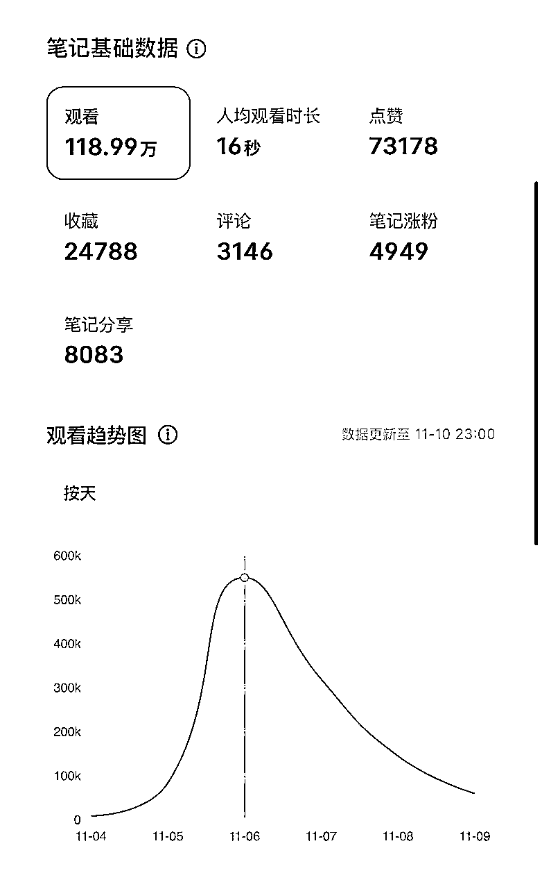

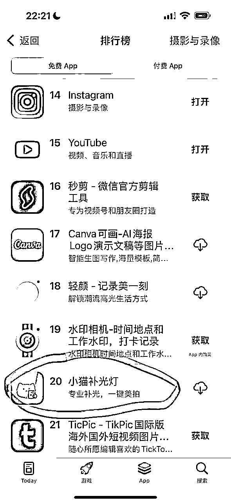

下面把这次偶然撞上的爆款拆开讲，尤其是需求是怎么被我捕捉到的，以及我对笔记为何能在小红书引爆的几点体感。

先说清楚，这绝不是一次我能完全掌控的预设营销。运气和偶然占了很大比重。但我当时的做事节奏和心态，或许正是让运气落到我身上的土壤。

## 起点：先做出来，再谈完美

做这个 App 的缘起其实来自一期 YouTube 的 Cursor 教学。视频里我想强调的核心观点是「先完成再完美，尽快把东西放出去」。视频链接：https://www.youtube.com/watch?v=1wLcjd13N0g

为了证明 Cursor 已让开发门槛大幅下降，我跟粉丝说如果不知道做什么，可以直接去小红书、Reddit 这类平台看真实需求。那天 Reddit ChatGPT 区有个帖子很火：有人花 4 小时用 ChatGPT 做了一个能调亮度和冷暖色的手机手电筒网页。我就顺势现场演示如何用 Cursor 10 分钟搭网站、30 分钟封 iOS App。

剪辑视频时女朋友随口说了句：做手电筒不如做个给女生补光用的色卡吧。我当时一脸懵，补光卡是什么？我之前完全没概念。

随手在小红书搜了一下，瞬间被震到：大量博主在分享纯色图当补光参考，发布时间集中在近一两个月，点赞基本都在数万到十几万。需求真实、刚需且高频，当时我就觉得这事能做。

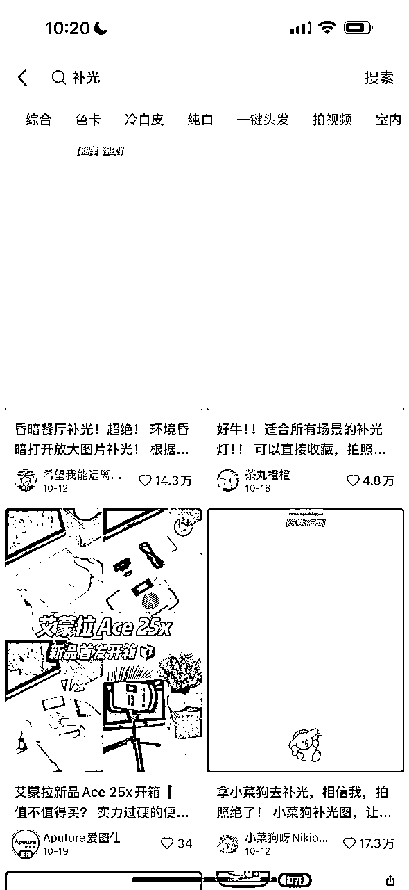

于是当晚视频发完，我就又花了一个小时把 App 跑出来了。

## 敢发，比做更重要

产品第二天上架。那天我刚结束马来西亚到印尼偏远海岛的奔波，但上线消息一到，我还是立刻在即刻、朋友圈、微博、小红书同步发出。很多产品投入不大、bug 可能不少，发出去会有点社死感。但我早就不在乎了。我的原则已经被刷烂了：发布物如果让你不觉得尴尬，说明你发晚了。

## 流量不是自己来的

做完、发出，还不够。你需要一点平台嗅觉，和一点运气。

这款工具的需求本身就是小红书上长出来的，受众 99% 以上是女生，发布阵地自然只能是小红书。所以我做了两轮笔记的测试。

把两条笔记的数据遮住，你能一眼猜出哪条会更好变现？我当时也猜不中。

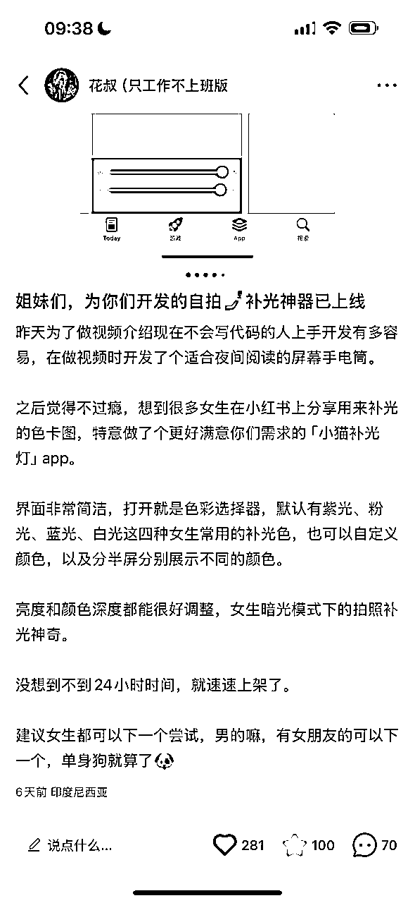

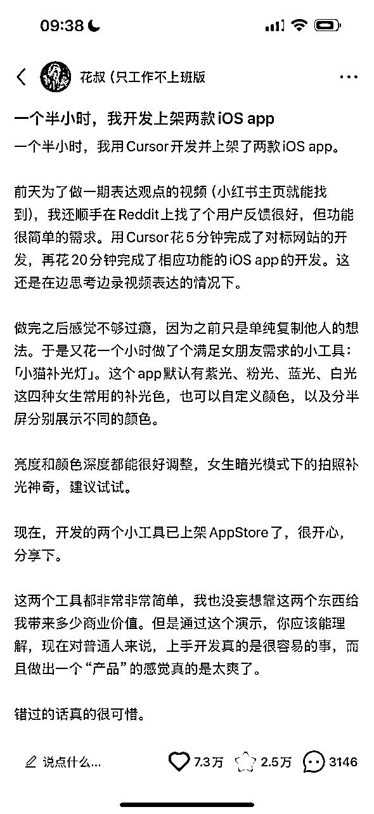

第一条我刻意偏讨好，语气面向「姐妹们」，预期是更利于下载的。但实际表现平平，2 万阅读里一半还是后面爆了才被带动的。

第二条才是真正的爆款。看文字就能感觉出来，我预设的读者是关注 AI 编程的群体。因为我近期一直在做 Cursor 系列长视频和付费星球，这条更像是想吸编程粉和订阅用户。

## 第二条笔记为何起飞

它花了两天才真正起势。起势路径可以用三个词概括：争议、性别议题、Meme。

### 争议

第一天主要吸引来的还是男性程序员和开发者。他们的反馈分两类：一种是否定价值，觉得这么简单的东西凭什么能过审；一种是质疑我说的开发时长，对没用过 AI 编程的人来说，这确实难以置信。

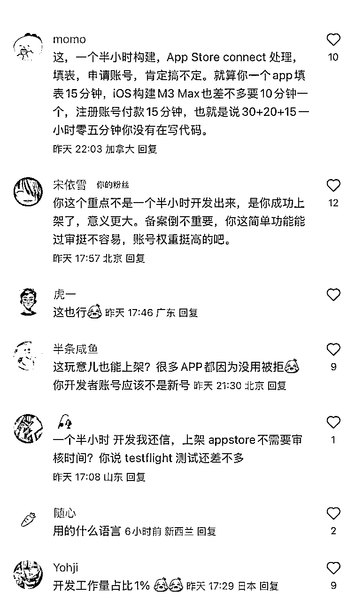

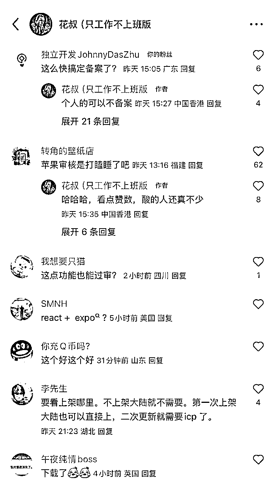

酸味挺浓的。但我没删评也没去辩解。因为争议带来了小红书最看重的互动之一：评论量。我后面会再展开为什么平台爱评论。

高评论率让笔记在第二天获得更多分发，开始触达真正的核心用户——爱拍照的女生。

### 性别对抗

第二天目标用户来了，看见评论区对产品的质疑和对我的围攻，风向立刻反转。女生们开始集体发声，说明这个需求是真实存在的，还轮番把质疑的评论压下去。

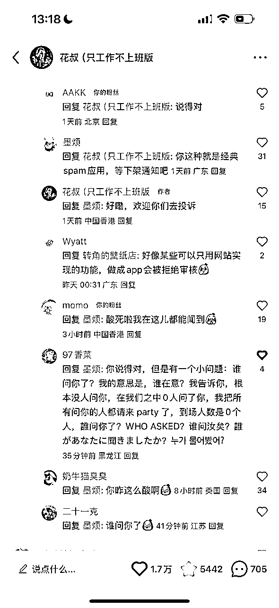

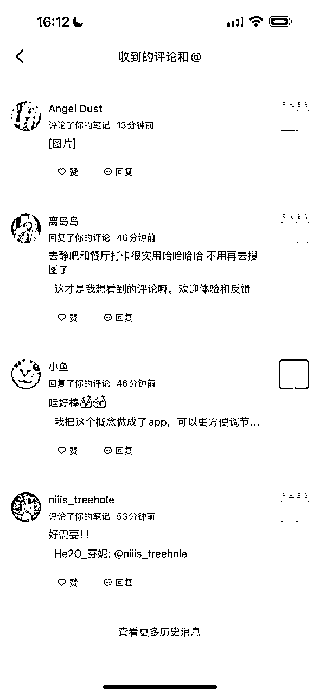

这波反转推高了互动，但还不是终点。

### Meme 化

真正的转折是评论区有人开始喊我的名字。App Store 会展示个人开发者全名，所以名字是公开的。一旦名字被反复喊出来，两件事发生了：

1、我从「一个开发者/博主」变成了有血有肉的人，和「姐妹们」的距离被拉近了；

2、名字本身成了 Meme，给笔记打上强标签，氛围感起来了。大家开始 @ 朋友、转发扩散，而分享恰恰是小红书最爱的信号。

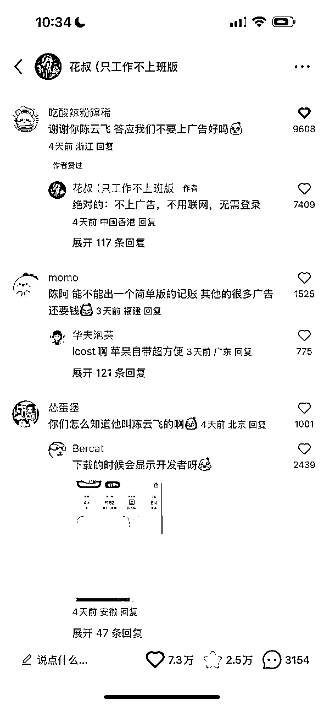

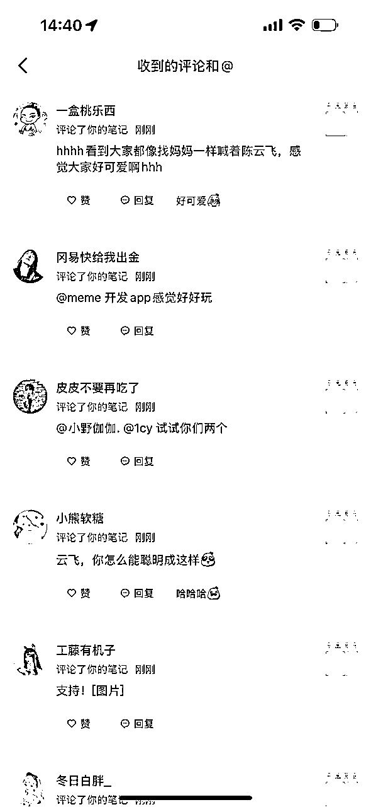

三个阶段走完，笔记就彻底炸了。

### 爆了之后我做了什么

为了让热度延续，我主要做了三件事：

1、在评论区保持真实人格，明确站到用户这边；

2、连夜迭代产品，两天内推了三个版本，快速响应需求和 Bug；

3、苟住不动，不改原文、不发新笔记，避免干扰平台的分发节奏。

### 平台要什么我才明白

讲完这次爆款的机制，我再说说我对小红书的理解。我之前在厂里做过千万 DAU 产品的运营，经手过上亿投入，对算法和社区逻辑有点体感。

很多人做自媒体只想自己想要什么，却忘了思考平台想要什么。你给平台它想要的，它才会回馈你。

比如 YouTube 为什么大力推 Shorts？因为它要对抗 TikTok，于是给创作者更多激励。逻辑很清楚。

小红书的核心诉求是提升日活和社区活跃度。看过运营书的人都知道，用户一旦开始关注、评论，留存和时长都会明显变好。所以小红书最爱两类内容：

1、能刺激分享、带来拉新的笔记，这是比任何内部行为都重要的；

2、能带来评论或关注的笔记，这直接提升留存和停留。

点赞、收藏、完播这些指标也重要，但更多是当深度互动不足时，用于判断内容质量的基础分。光靠点赞收藏很难真正引爆。

## 这次我学到了什么

1、小红书的转化很可怕。118 万阅读、7.3 万点赞、3.1 万下载，点赞转下载率在 40%~50%。女性向产品绝对不能放弃这个阵地。

2、爆款离不开运气，我能复盘原因，但复制不了。能做的，是把自己放在更容易被运气撞到的位置上。

3、先完成再完美，并且不怕尴尬地发布。所有的红利都来自这个习惯。

4、AI 编程已进入 GPT-4 时刻级的拐点。它让非技术人也能用「产品」的方式抓住路边机会；效率提升让我可以高频发布、快速试错，经验积累的速度被放大了。

## 11月13日后记

这波 Build in Public 做下来，抄袭者不少，但小红书和 App Store 的表现都很拉胯。我自己在上周日推出了迭代版「小猫补光灯 Pro」，11 月 12 日晚上发的笔记 10 多小时就破 10 万阅读、1 万点赞，再次引爆。有兴趣的可以自己去分析为什么我选择另开 Pro 而不是在原版上叠加更新😉

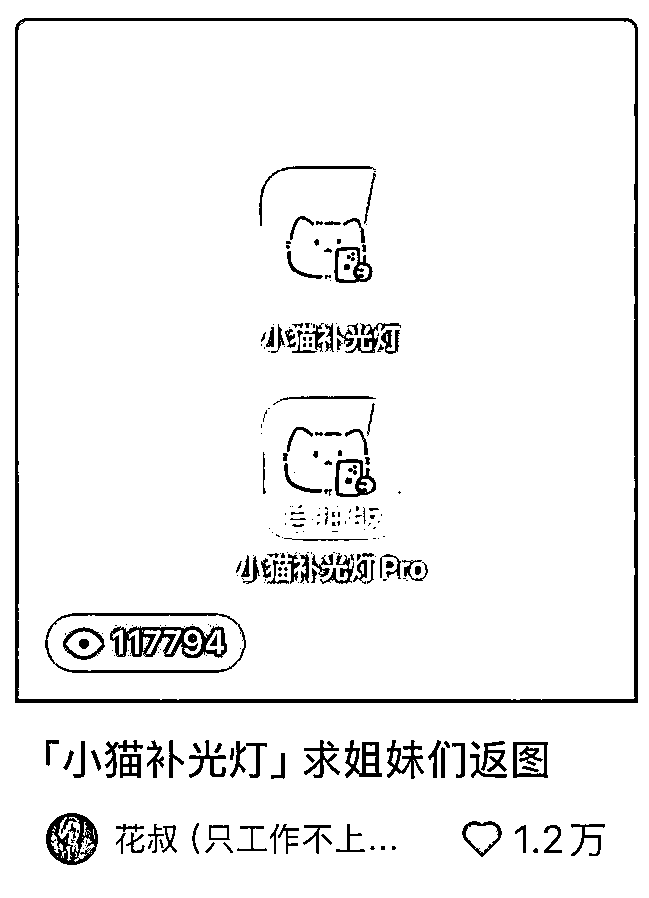