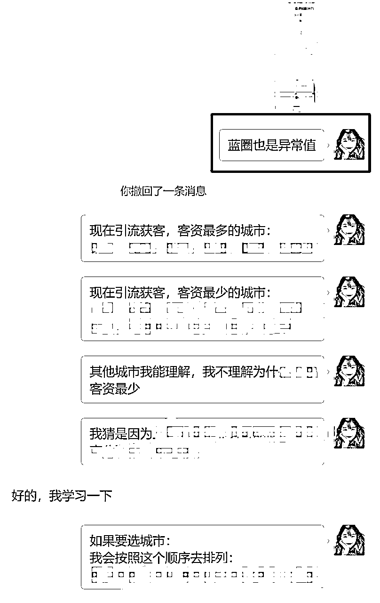
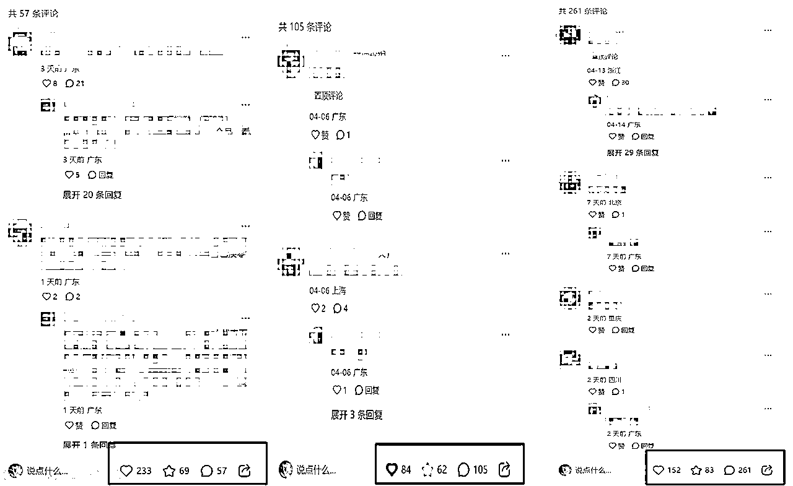

# 2025年，小红书操盘手能活下来的4种生意打法
作者：龙哥

大家好，我是龙哥。

这几年我跑过不少赛道，留学起家，后来碰过房产单边代理、旅游、教育、律所、美容等多个高客单领域。靠着代运营这件事，我搭上了不少大老板的快车。

把这些实战拆解出来分享后，社群里越来越多老板主动找我合作。我把项目分给付费学员去操盘，我在后面做带教。这样学员能积累真实项目经验，我也能持续触达不同行业的生意逻辑，慢慢把自己从纯投放手变成了“左手IP、右手操盘”的高客单商业操盘手团队的发起者，带队帮高客单IP做增长。

今天聊一个很现实的话题：小红书操盘手现在卡在哪，以及怎么选下一笔生意自救。

1. 小红书操盘手当下的卡点

2. 选生意的自我拯救逻辑

2.1 以行业为锚点做生意

2.1.1 做与大势同频的生意

2.1.2 做有技术壁垒的生意

2.2 以客群为锚点做生意

2.2.1 把别人的利润品当成自己的引流品来打

2.2.2 做能持续沉淀客户与人脉的生意

# 小红书操盘手现在的困境

这个困境几乎是行业通病，只是表现时间有早有晚。

赛道不卷的暂时感觉不到，但迟早会撞上来。赛道卷起来的，已经能闻到平台的凉意了。

我接触过一个做教育的操盘手，他原话是“给机构送线索的感觉像去讨饭”。线索送过去等结算，签了单等佣金。教育引流越来越难，他又跑去给AI赛道送线索，因为那边获客快、佣金结算爽。哪里好薅就去哪里。

这让我想起自己起家的留学赛道。

2021-2023年上半年，是小红书起号的黄金窗口。聚光投放是23年下半年才大规模起来，最先被波及的就是留学。那个阶段做小红书，随便玩个矩阵都能大几万粉。

但分化也是从那时开始的。

如果你从2021-2023年一直做个人IP，还真让粉丝占到便宜，到2025年依然能活得不错。

如果你那几年只是在收割风口红利，做无IP的矩阵号，我猜90%的人现在都在焦虑：去哪找一个引流不卷、转化率高、佣金还好的项目？

前者有复利，后者没有。

后者的结局很典型：号死了就注销重开，没有记忆点，粉丝认不出你。你只是平台的过客，不断找风口、找米袋子，想复制“做矩阵就能吃大风钱”的旧日子。

我当年也吃过这波红利。留学赛道两年营收2700万，自营账号更新不勤，两年260万，利润率55-65%，是实打实的利润。代运营更是风口上的钱，获客简单，后端转化强，一个月几十万佣金很正常。

吃过风口红利的人，很难再回到需要精耕细作的日子。

好在我那两年没完全躺平。搭建团队、带人改稿，把小红书的流量逻辑摸透了。风停了我才有转身的本钱。否则在“20分的引流能力赚到120分收益”的蜜月期里，极容易迷失。

结合亲身经历，我总结当下小红书操盘手的六大困局：

1）对项目的销售和交付环节缺乏认知，只懂爆款封面标题和引流。一旦赛道内卷，写不出有穿透力的内容，拿不到有效线索。

2）引流变难就换赛道，靠撮合线索赚钱。两年后赛道再卷又换下一个，始终没有根基。

3）想独立创业找交付，但自己没有成交能力，私域话术也不会搭建，线索来了也转不了。

4）追逐平台规则，没有个人IP。号一倒，全部清零。

5）与客户零粘性。操盘手只负责把微信推给商家，客户与商家的关系是商家维护，操盘手只能收一次佣金。

6）没有平台迁移思维。万一用户离开小红书怎么办？又要从零研究新平台规则，再用无IP矩阵起号吗？百度有周期、淘宝有周期，小红书难道没有周期？

光选赛道已经不够了，还得重新定商业模式。

我也是在做代运营的过程中，接触到一群优秀老板和合伙人，才慢慢找到破局方向。

# 小红书操盘手的自我拯救指南

生意本质就两条路：以行业为圆心，或以客群为圆心。以前读雕爷的《MBA教不了的创富课》就讲过这个。

IBM当年卖过磅秤、主机、小机、个人电脑，看起来像在追行业。其实它一直在服务世界500强、政府、银行这类超大组织，是客群生意，让它穿越周期。

现在很多小红书操盘手服务的是谁？服务的是“需要人给他们送线索的中小企业”。只会送线索，在企业眼里就是可替换的获客工具。

想长久赚钱，就得解决企业真正的痛点：线索来了怎么转？私域怎么搭？交付跟不上怎么办？增长飞轮怎么设计？

只有能做全案的操盘手才值钱。只会送线索，只能伸手要饭。

做“送完线索拿佣金就结束、没有势能积累”的生意，年轻时能赚点钱，十年后、二十年后呢？

如果当初的目标只是快速赚500万就退场，赶上风口当然可以。但人生不只一个高光时刻。

下面是我从代运营里提炼出的可复制打法。

## 围绕行业做生意

### 操盘符合趋势的生意

什么叫符合趋势？专精特新、数字经济、国产替代、硬核科技、自主可控、乡村振兴，这些关键词一出来，大部分行业就对不上号了。因为很多领域央企主导，普通人进不去。

市场上讨论的常见切口有：

1）人口结构：银发经济。像川藏线318，核心消费群体是有闲有钱的老年人。上门助浴、居家护理等服务需求在增长。

2）科技创新：AI、人形机器人。很多人觉得高端玩不转，其实可以做应用层。帮企业做AI图文视频素材库、智能客服搭建。用get笔记扒视频直播逐字稿做成行业选题库、知识库再卖给老板。机器人也能做租赁生意，按时长出租给酒店餐厅做迎宾送餐。

3）收入分层：消费降级。以前卖大牌化妆品的现在带货小样，家长以前请私厨现在把孩子送去小区小饭桌。

4）场景迁移：麻辣烫从学校门口到便利店关东煮，再到旋转小火锅。盛香亭把回转寿司+卤味+小火锅+茶融合，做成排队生意。

5）政策引导：K12被整顿后，雅思语培也受波及。政策不鼓励的方向尽量避开。现在爆的IP像谢康校长，踩中人工智能教育+中华文化传承两大政策导向。未来面向海外游客的国内游和以英文弘扬中华文化的旅游内容，会越来越吃香。

宏观判断只能看大方向，具体能做什么，操盘手切不进行业深水区。交付方都在行业里深耕很多年，引流手很难快速吃透。

这时可以做三件事：

A. 服务正在崛起的新个体。他们在岗位上积累了口碑和专业度，最缺放大势能的人。操盘手帮他们在小红书做种草与IP塑造，绑定后端分成。

比如我最近服务的川藏线旅游IP，对方对行程保障、差异化优势、客户真实评价、行程定制细节等素材了如指掌，一天就能把素材库填满。这种人最适合放大。

B. 服务已跑通0-1的超级个体。他们想冲向M型社会的顶端，需要有人帮他们升级商业模式。

以律师为例，要么冲到虎诉、大暄哥那种年入500-800万的头部，要么卡在50-200万区间随时被淘汰。这批人愿意花钱打造IP放大势能。

C. 服务大公司。优化产品、获客渠道、私域转化，整体提升销售。

我接过一家老牌企业的单，学员一个月打出的线索量顶得上同行20年老店4个月。后来签了一年约，服务费按季度根据线索效果动态调整，又被引荐给两家上市公司谈合作。

从其中我看到大公司的共性痛点：

1）创始人年纪偏大，想上小红书却不懂，缺一个能对齐信息的人。

2）长期靠渠道获客，从未做过C端。怕得罪渠道，又缺乏C端经验。

3）产品供应链很强，但一直做B端。疫情后B端萎缩，想转C端却不知道如何改造产品迎合C端偏好。

4）私域交给月薪不到5000的运营，群发广告、发优惠券，品牌势能下降还招来羊毛党。

这给我三个启示：

1）能帮忙优化产品的操盘手才值钱。有贵人朋友先做市场调研报告拿到老板信任后，负责把产品改造为适合C端推广的款式并独立运营提成。

我参与调研时发现，某款产品在小红书引流很容易但也极易违规。我们让大学生扮演真实客户去联系全国商家，摸清推广量、价格、门店分布、转化话术，发现私域话术非常粗糙。同理，另一款产品我们调研了省会城市的现状，发现异常数据后结合行业人士判断，快速找到适合C端的设计方案。

2）能优化私域转化话术的操盘手才值钱。只会引流只能卖线索。真正的高阶私域会在加微信瞬间做标签、设计转化节奏。考量客户偏好、活跃时段、痛点、购买触发条件，7天、28天分别做什么动作。沟通像人和人，而不是机器人发广告。

3）能优化商业模式的操盘手才赚钱。某赛道线下门店大量倒闭，年均线索量有限。我们用一个月打出了行业老店四个月的量。这套打法可复制到全国濒临倒闭的同类门店。

围绕行业做生意，先把趋势、壁垒、产品与私域能力吃透，才能从“线索搬运工”变成“商业操盘手”。

这篇文章跟你聊点实在的：为什么有人能把生意做得风声水起，而有人却始终在原地打转？

先说一个反常识的现象。我们这套玩法落地后，客户能在自己所在的城市快速打开局面。凭什么？因为我们把整个赛道的赚钱逻辑重构了一遍。同行都在靠产品A获取利润的时候，我们靠产品B创造收益；别人还在给客户提供C服务，我们给出的已经是D、E、F的组合方案。这个产品直击行业用户的深层痛点，推向市场后迅速点燃了用户的热情。

这背后真正的分水岭，在于——只有吃透运营底层规律、具备真正影响力的操盘手，才能赚到钱。

珍妮接手一个新项目时，贵人第一时间就把之前的代运营团队撤换掉了。但这并不是草率的决定。在让对方出局之前，贵人不光通过珍妮带队打出的实际战绩来检验她，还用一连串的提问去测试她——看她是否具备长期合作的潜质。那些小红书运营的底层逻辑问题，很多人根本答不上来，或者换个问法就懵了。

那天，珍妮把自己从2024年3月1日开始、每周更新六次的各赛道打法分析递给贵人过目，又把自己整理的系列资料发送过去。贵人看完，当场给了这个赛道最高的佣金比例。

后来，当业绩足够证明实力，在解除上一个代运营团队的合约那天，贵人发了一条朋友圈：

“运营圈有个误区：人们追随的是拥有底层逻辑的牧师，而不是吃了红利的传教士。平台红利和老板认知盲区之间的信息差，不等于运营能力。能选对行业赛道，又能找到平台弱监管的流量洼地，这才是底层运营能力。”

他问过珍妮：为什么能帮老板控制运营成本？

她把“高客单IP-我-学员-宝妈/大学生”这几类人串联起来，形成一个各方都有钱赚的闭环。

以她的一个实操项目为例：她拉了116人入群围观打法和细节，最终筛出6人组成一个小型获客小队深度参与，为项目持续输送客户。目前项目方交付压力大，还没放开放量。一旦放量，她又可以从中筛选出操盘手，付费请他们去进一步培训学员，让更多人参与送客。而这些筛选出的操盘手，还能从其他人送的客资里拿到签单提成。所有人利益深度绑定，一起赚钱。

再来看生意门槛这件事。

未来的趋势很明确：所有依赖信息差、认知差作为核心竞争力的模式，都会逐渐崩塌。这个世界最终会奖励那些踏实做事、把更多价值交付给更多客户的人。

反观那些没有门槛、纯靠信息差和认知差赚钱的生意，那叫风口，不叫事业，注定没法长期赚钱。很多人去做这种无门槛的事情，本质是因为他们本来就没打算长久做，要么有一搭没一搭地赚点钱，要么打一枪换一个地方。

但对于一个真正想长期做下去的小红书操盘手来说，必须要做有门槛的生意。

什么是有门槛的生意？竞争对手做不到、不想做、懒得做、不敢做，而我们能做成的生意。

比如珍妮为什么会选择去做房产单边代理？因为房产行业本身就有门槛，单边代理更是难上加难。一个新人对房地产可以说一无所知，但当她遇到一位行业深耕的资深人士，对方把观点和素材交给她，她就能围绕这些做运营获客。

她还能去找那些已经跑通1-10阶段的房产IP，和他们利益绑定，把对方的势能放大。

有人可能会问：人家都跑到10了，凭什么跟你绑？跑通10到100不是理所当然吗？

错了。跑通10，真的就能跑到100吗？有多少人跑通10之后，就被自己的时间绑架、动弹不得？

一个颠扑不破的真相是：越有钱的人，越愿意花钱雇人干活；越没钱的人，越习惯亲力亲为。

所以，做有门槛的生意，和对方长期绑定利益，才是操盘手真正的破局之道。

再说说定位这件事。

如果你做生意还在死守定位，那你的路可能会越走越窄。你看看那些能长期做下去的人，有谁是死咬着一个定位不变的？他们其实都在围着一群固定的客户做文章。

其中一招很有杀伤力：把别人的利润品，做成自己的引流品。

同样的产品，别人卖上千块，你通过优化让性能更好、价格更低。你等于把别人的利润空间全让给了客户，你自己靠其他附加服务赚钱。那这个产品推出市场，当然能瞬间引爆。

珍妮接手过一个项目。最初跟甲方谈的时候，她心里还犯嘀咕：这也有人买？这赛道能赚到钱？

甲方直接甩出数据，给她看他们在小红书发的笔记。她一看愣住了：这赛道这么好打？

然后甲方给她讲了赛道现状，她才发现：原来这赛道本来不好打。只是他们把别人的利润品做了优化——价格压到同行的一半甚至四分之一，服务还更好，获客自然轻松。

更关键的是，整个赛道目标用户有一个共同的痛点，市面上解决这个痛点的成本起码要一两千。而甲方这个服务，定价只有竞品的四分之一到一半，因为甲方压根不靠这个产品赚钱，真正的利润点在靠供应链优势带出的到店服务上。

这个产品一上线，优势碾压所有对手。甚至有外地客户专门坐飞机到他们所在城市来买服务，还有在新加坡的人，趁着到香港出差的机会专程过来。买完引流品，顺带把其他服务也一起下单了。

这是当时的获客数据，纯自然流量，零广告投放。

还有一类生意要警惕：送一个客资过去，如果换不来自己的客户或人脉积累，那就是ROI极低的生意，别做。

珍妮做房产这些年，接触了很多项目和贵人，反复听他们讲一个理念：老板永远要把精力投到ROI最高的动作上。

她接过一个代运营项目。通常她是非常挑剔的，毕竟精力有限，即便她把研究和迭代获客打法交给学员执行，她也要为整体交付质量负责，所以大多数项目她都推掉了。

但这个项目不一样。贵人告诉她：这些客资，背后不只是A类客户群的需求，同时可能还有B、C、D、E等各种兴趣点。围绕兴趣点B，可以对接另一家公司，收一笔费用帮他们输送客资、优化转化。围绕兴趣点C，又能对接第三家。同一个客资反复用，反复产生收益。

这就意味着她和学员都能长期从这个项目受益。好项目的标准，就应该是这样的。

再比如前文提到的“帮助有势能的IP放大势能”，同样是个好项目。因为这世界上最珍贵的是人，是人才。

那些跑通0-1或1-10的IP，被自己的业务完全困住，时间被切割殆尽，他们愿意花钱找人干活。只要你能帮他们在商业模式和势能放大上破局，就可以和IP深度捆绑，拿到签单后的分成。这类IP本身已经在自己的领域打出了实绩。

帮别人锦上添花的生意，永远好过给人家雪中送炭。锦上添花、长期利益绑定，就是操盘手持续积累客户和人脉的最佳路径。

说到这里，有些朋友可能听过一个理论——“不要做需要教育市场的生意”。这句话分场景。

珍妮认识一位贵人姐姐，无论她带什么货、卖什么服务，都能卖得掉。她根本不需要教育市场，只要把产品往粉丝群一发，粉丝直接闭眼入，商品直接售罄。

只要一个人有IP，并且愿意长期让客户占便宜，那他带什么货都能卖出去。哪怕需要教育市场的产品，他也能丝滑地卖出去。

从这里就看得出，和一个IP建立长期利益绑定，是多么有价值的生意。

最后聊聊珍妮的心里话。

她经常说：我转行是因为在赚钱遇到了贵人。

这句话，含水量为0%。

没有赚钱，就没有今天的珍妮。

她在留学行业曾经赚到过大钱，但当留学和英语赛道因为信息差消失而走向衰落时，她也迷茫过。她甚至做好了最坏的打算：转行失败，就线下打工，从头再来。

因为她没办法接受：自己的人生就只是赚个几百万就结束。留学赛道的成绩不能是她一生的高光时刻。她热爱的是克服困难、为别人创造价值的成就感，她喜欢的是那个一点点变强的自己。

恰好，在赚钱，她实现了无痛转行，和强者并肩，走在共同变强的路上。

贵人跟她说过这样一句话：“珍妮，你是幸运的。你在合适的年纪做出了业绩，有了自己的基本盘，吸引了我们这些愿意帮你的人。我在你这个年纪的时候，走了很多弯路。”

她听懂了，这是有人愿意拉她一把的讯号。

要想继续和强者同行，她就必须为强者们提供他们真正需要的价值，日拱一卒，让别人看见她的贡献，让更多人因为认识她而获益。只有这样，她才能持续吸引更多的强者与她并肩，才能在这段关系里走得更长远。

感谢龙哥盟，感谢所有同行的伙伴，感谢那些愿意给她机会的贵人，感谢大家。