# 2026年把个人经验封装成产品，用工作台放大虚拟业务的完整方法
260826 副业SC 精华
## 一、内容摘要
这篇分享围绕五个层面展开：
第一，初学者为什么要去红海赛道，以及红海里真实的机会在哪里。
第二，2026年AI原创虚拟产品的下半场，如何借助Skill、Agent做原创，为什么不能闭门造车，以及AI该如何去改造已有生产资料。
第三，课件赛道的机会逻辑，教材每次改版就是一次重启，课件之外还能衍生哪些生意。
第四，个人如何用Skill原创虚拟产品，Skill的设计思路，如何基于自身业务设计Skill，以及真正提效的工作台是什么样。
第五，一人公司如何从1做到10，一点心得。

### 完整闭环与三阶段骨架
整场复盘的骨架是一条闭环：评论区挖掘商机 → 指南做产品 → 长文/笔记做IP沉淀 → 选品 → 蒸馏对标博主。贯穿始终的公式只有一条：虚拟产品 = 基础需求被满足 + 体验被创新。先用存量东西把基本需求兜住，再做体验层差异，这就是虚拟产品的底层。
再往上抽象，对应三步：发现项目 → 定义项目 → 放大项目。发现是去红海里找已验证的需求；定义是用Skill把需求固化成可交付的产品，也就是指南或工作台；放大是靠内容养IP、靠矩阵和人力杠杆做成持续生意。整场分享也是按这三步走，先讲发现与定义，再讲放大与守住。
### 四类机会
目前虚拟产品机会最集中的四个方向是课件、PPT、知识库、面试题。如果真想做成生意，建议围着知识库打。
圈内有人做育儿知识库，从日入几十块做到月入3万，每天投入2小时到手1000，证明知识库是可以沉淀、可以长做。
四类里，课件吃改版红利；PPT和面试题走量但同质化严重，面试题单品能卖几万份，必须和指南、简历打包做差异化；知识库的成败看有没有击中“跟我有关”的钩子。但底层都还是图文。
前提是长期内容积累。讲师做了8年内容，每篇1万字以上、全部原创，正因有了长文写作和行业经验，才把能力固化成Skill。这是个关键前提——Skill必须是源自真实能力与经验的程序化，不是空想出来的“我觉得要做一个Skill”。
对AI的本真理解是：AI帮你省时间，让你去体验生活，再把生活经验反哺给AI创造。理想状态是领导不懂AI你懂，用AI把8小时压缩到4小时，剩下的4小时才是AI给你的真正价值，用来丰富自己、用来创造。
## 二、底层认知：先把商业判断立正
### 2.1 红海才是新手的入场券
新手普遍怕竞争，要避红海，这想法是错的。
红海之所以红，是因为需求的确定性已被市场公认。K12为何永远有钱赚？因为22岁前，考试是东亚人的终身课题。K12竞争激烈、利润高，正因如此才要做，而不是躲。第一件事别怕竞争，竞争是好事，没竞争的赛道才危险。红海可以抄作业，蓝海要教育用户，对新手是伪命题。
突围不是硬卷，而是找“最后一公里”。毛选里“你打你的，我打我的”游击策略，要在有敌人的地方打。最后一公里就是创新：在相同需求下，让产品更容易被获得。视角要从“避开竞争”转为“换个视角看竞争”。
常见误区是先想结合优势再变现，顺序反了。你的优势在小红书可能没人看。很多vibe Coding玩家有个疯狂想法，结果小红书一单没有，还烧掉不少token。每天早起先看Twitter看OpenAI有没有重置额度，额度重置就赶紧用完。核心不是“我有什么优势”，而是“红海里有什么确定需求，我怎么把优势插进去”。
### 2.2 暴雨型生意 vs 河流型生意
虚拟产品分为两种。
暴雨型：SETI、各种测一测，朋友圈刷屏一阵就消失。像测历史原型、测前任能不能挽回，爆发快、消退快，最后没留下资产。甚至小红书卖两毛一份，卖100单才20块，投入产出不划算。
河流型：持续、可积累、可当事业做。前端后端有承接，才能沉淀IP、有复购、有护城河。
判断标准是前后端是否承接。黑暗人格测试本身没用，但职场博主用它接简历诊断就能变现：测评给出2000字报告，指出简历问题，用户急了，后端1000块改一次简历自然成交。这就是前端喂后端。反之，前后端不连，测完就结束，只适合后端是心理机构引流用。
要避开两种心态：一种在0到1原地打转，今天1000单利润10块，没沉淀、没复购、没护城河；另一种野心过大，产品没赚一分钱就想赚100万。中国现在的环境，100万很难赚。拿2万MacBook、100美金CodeX做零收入产品，就是典型的笑话。
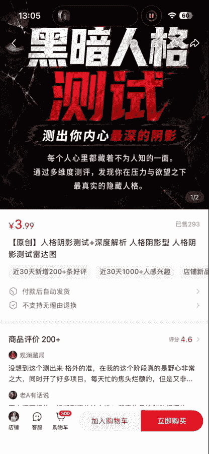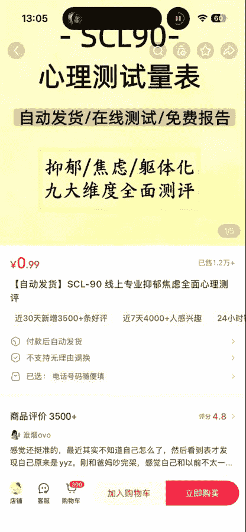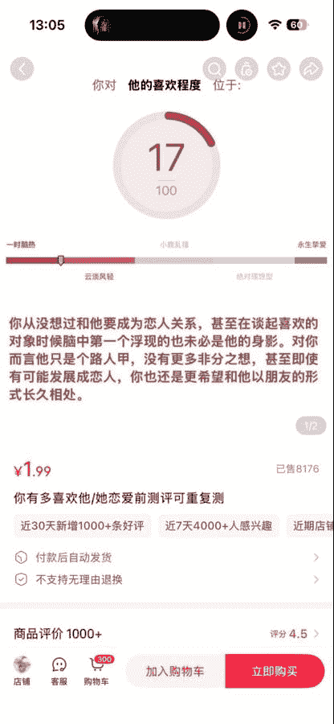
### 2.3 AI的本质用法：改造旧生产资料
AI的正确用法不是凭空造需求，而是改造旧模式、旧工作。每个人都有生产资料，每个旧需求都能用AI重做。
绝对有机会的品是背诵。东亚人22岁前都在背，知识点、考点、英语课文、古诗文言文，只要需要背的都能做。而且背诵没有尽头，小学到初中到高中，换教材换学段就是新需求，长期可做。
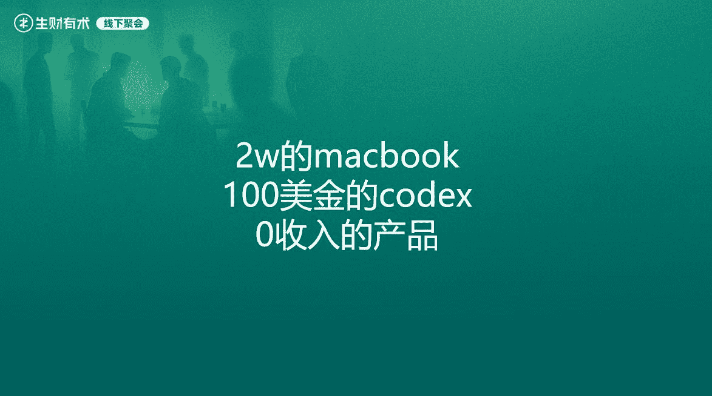
### 一鱼三吃
每次技术升级都要想机会。Image 2能生成透明底PNG，听起来普通，却能做云朵字。以前老师用PPT做云朵字，现在直接生成透明底PNG，用在公开课课件。去小红书搜云朵字，已经有人做生成器卖几百单。
所以不要只看自媒体的“天塌了”，要扎根市场想清楚大模型升级给自己带来什么。
一鱼三吃思维：同一个旧需求，不同模型各做一次。背单词内容，nano banana pro做过一版，Image 2出来再做一遍，等蒙娜丽莎升级再做第三遍。旧需求+新模型=重复机会。
不用教育用户是最大优势。很多产品卖不动因为要从0到1教育用户，付费有曲线。背单词、背古诗每个人都经历过痛苦，用动漫记忆在教育场景极易被接受，这是第一个风向标。
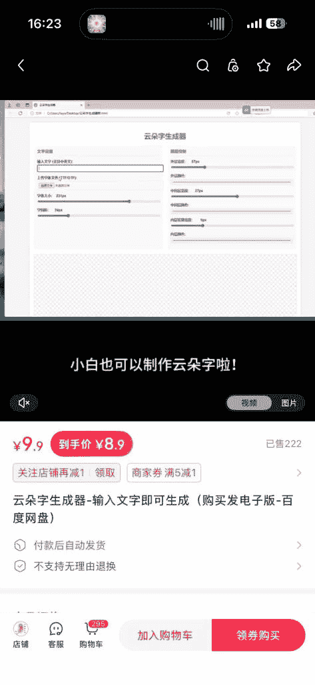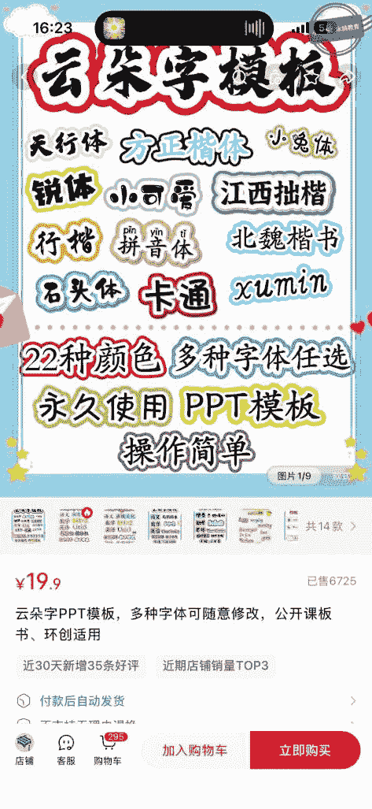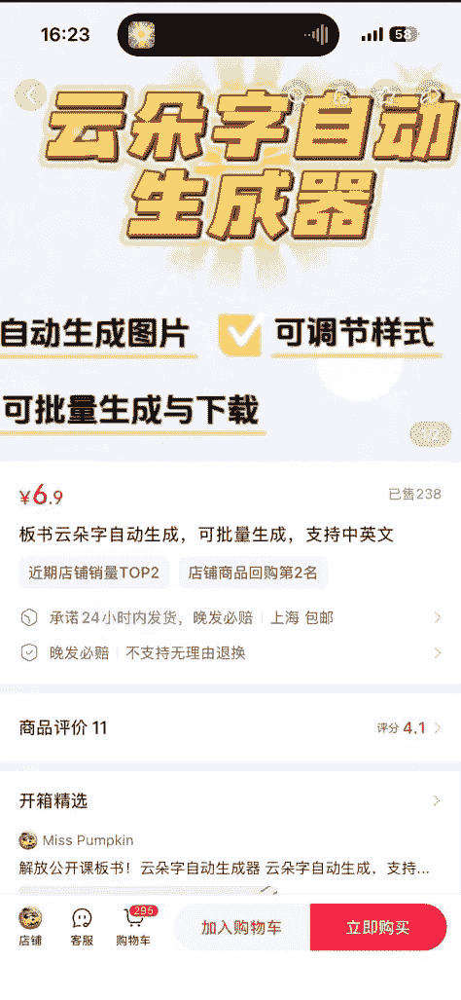
真实案例：一位学员看了分享后做其他教材，一两周内卖出1.03万。机会一直都在，缺的是在干中学的能力。
### 2.4 课件赛道与改版红利
课件核心机会是教材改版。教材年年改，旧课件作废。去年改一二三年级，今年轮到四五六年级，改版后老商家资料全废，新入局者吃红利。
销量差距验证逻辑：四上语文背诵复述学习导图和二上导图销量差很大，因为四上刚改版，旧资料不能用，四上背诵导图一周卖600单，用Image 2做的。
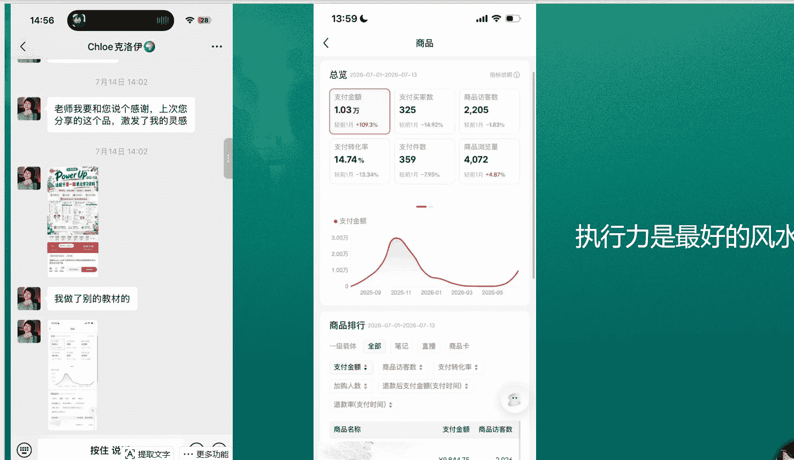
怎么找改版机会？看公众号。很多老师不刷小红书，学校官方号都在公众号。做课件不能只卖一个SKU，要成为行业专家。长期浸泡能培养敏感度，比如在咖啡厅听到顾客说要带儿子看钱塘江，就能推算孩子三年级下、开学四年级上，第一课是《观潮》。
### 2.5 AI赋能虚拟产品的两阶段
2026年3月前：主要用Image 2、NotebookLM做课件，大模型生成素材，Skill未普及，Agent介入浅。
2026年4月后：进入Agent原创虚拟产品期。建站门槛骤降，人人能做网站。OpenAI 4月“开窍”，推出Image 2和CodeX，把Agent从写代码拉到解决一切工作。普通人能做网站、小程序。但注意卡点：小程序收款需个人营业执照，无执照难收款。
## 三、产品层：用Skill把需求做成产品
### 3.1 Skill与提示词的本质区别
提示词只能产出内容，Skill是产出内容+交付结果的工作流。提示词不能接飞书CLI，Skill能直接发飞书，还能一次性生成7万字。长文写作、PDF类产品因此被解决。
提示词局限在token，聊着聊着就失忆。Skill走向工作流和结果物。
工具选择：日常用Claude Code加DeepSeek API。DeepSeek某天涨价，做一个Skill要30块，以前30块够一个月。装Claude Code可用Workbody一键装，3月还要配环境、Switch，现在方便。Workbody像外包，可装插件和自制Skill。
误区：别做无法提升生产力的Skill。PPT Skill、公众号排版Skill满大街，AI博主只能做表面功夫。别人做得好的拿来即用，别造轮子。Skill要从自身工作场景出发，解决真实痛点。有人用指南Skill月入稳定3000。
### 3.2 指南Skill：内容出版平权
AI时代实现表达平权和出版平权。普通人也能把经验做成可交付产品。
三句话：内容是杠杆，指南是放大器，产品是变现器。指南=前端收入+后端客资，也是钩子品。好指南既能卖钱又能沉淀客资。
很多人指南卖不动，是因为缺内容创作能力推出去。所以需要长文Skill和笔记Skill。
指南解决的核心问题是隐性知识表达。行业干七八年，经验丰富却说不出来，像中焦不通。指南Skill是方子，把零散想法变成专业指南，实现熵减，还能自动检索参考资料。
## 六、关于一人公司
从1到10靠系统力。用知识库做自动化交付，用Agent替代重复劳动，用内容引精准流量。生意做成自我运转系统，睡觉也在赚钱。
AI给你的真正礼物不是多做事，而是让你只工作四小时。剩下四小时去生活、体验、感受，然后把体验带回给AI做下一轮创造。这才是终极生产资料。
怎么让指南 Skill 真正听懂你、做出不像 AI 的成品，关键就在于先把私有上下文喂满。这套输入其实是六块拼图：明确话题、锁定读者、沉淀个人经验、补充信息源、确定交付形式、提供风格样本。话题要够细，读者要够准，经验有就直接丢进去没有就明说让它去搜，信息源最好是亲手投喂好的原文，形式决定最后长什么样，样本负责蒸馏语气。把这六块补齐，信息差就被填平，输出才不会千篇一律。
### 能做成指南的产品类型
一旦流程通了，边界就被打开了。复述训练指南、面向 ADHD 的人生突破指南、广志的大客户销售指南这类职场方法论，教师场景类的指南也是一大片：社会化指南、训话逐字稿、新手班主任入门、管理刺头学生、语数成绩实战、课堂管理实战等等。职场面试类更是标配钩子，比如京东采销面试指南，人群清晰需求明确。最常见的是组合拳：面试题单+面试指南+简历指南打包 19.9 元，反而比单卖面试题更有辨识度。
### 两个极端案例看想象力
吵架指南就是个“万物皆可指南”的证明。它用议题重置来破局：当对方在会议上质疑方案风险大，就把擂台搬走——我们要的是零失误的方案，还是能推进的方案？高手从不在对手划定的范围内打。亲密关系里，赢了道理输了人就不算赢。
炒股指南则展示了专属化。有人把推特大神 47,257 条内容全部整进 Skill，产出了一套个人投资方法论，讲行业选择也做了社区众包研究。做这类专属指南要记住两点：语料必须真实可溯源；内容仅作制作逻辑展示，不构成投资建议，但做引流非常好用。
杭州九月亲子游学指南是城市游学的模板。视角从孩子出发：浙江省博物馆之江馆、中国丝绸博物馆、良渚的 5000 年文明体验、茶玩家、九溪十八涧、梅家坞、水上巴士；吃喝上给出孩子友好选择，九月秋老虎的温差提醒，外地人常卡在龙翔桥的避坑点，以及几天够玩、中途闹情绪怎么办、是否请导游、水上安全等常见问题。做完后还能推到 NotebookLM 或 Image 做成图文互动版。游学手册的核心是让家长觉得孩子会喜欢，价值感才上来。
### 选题与差异化的判断
能做指南的前提是话题有足够的信息量需要系统化梳理。穿搭不适合做万字指南，直接查资料就能解决，更适合做流行趋势指南。游学、博物馆、亲子出行这类点位多、知识散的场景，越适合做成体系。
当人人都能做指南时，起跑线趋同。Skill 解决的是能不能做的问题，真正的分水岭在后面的长文 Skill 和内容积累：质量、深度、是否被看见、能否建立信任。
### 3.3 工作台：围绕真实痛点的工具
工作台不是好看的摆设，而是为真实痛点提速。Luke Studio 就是围绕“看 YouTube 视频”这个链路做出来的：以前要自己扒字幕、丢进 Claude Code、同步到飞书，现在被一站式收拢。
收字插件解决收藏与学习断层，看到公众号、小红书、YouTube 的内容一点收藏，就能进入沉浸阅读；全民阅读把多平台内容统一处理后集中沉淀。YouTube PDF 杂志可一键生成 130 页 PDF 进微信读书；社群日报把视频压缩成 800 字发群，提升服务深度；朋友圈创作先建个人画像再半自动写作；选题建议、闪念笔记、Skill 中心等构成操作闭环。
底层是 CodeX，后续可接入 DeepSeek Harness，一切皆插件，还能读图。打通 Obsidian 知识库后，内容不再只是收藏，而是被拆解、批注、沉淀。学习心法是“为我所用”，把一篇好文章拆成为什么写得好，再沉淀成可复用资产。从顾问思维到精者思维，就是从分析到下场。
工作台的扩展逻辑是把 Skill 焊进去。Skill 与工作台本是一体，做成插件点一下就能收藏、处理。个性化细节也能提升体验，比如宠物提醒站立喝水，点一下唤醒工作台。做工作台的心法是言出法随：一次把需求说完，别反复改。两次 CodeX 重置就把 Luke Studio 做出来，靠的就是需求一次性完整。
商业上，工作台也能变现：卖方法论、卖提示词、做 Workbody 手册、做细分人群操作手册。
### 3.4 知识库：要有一个跟我有关的故事
知识库能否卖出去，取决于着力点。纯荣格知识库卖不动，荣格视角下的社会化指南就能卖，因为社会化本身已验证。毛选知识库难卖，毛选知识库·职场版就有了钩子。
把 Justin Welsh 包装成一人公司鼻祖、24 小时 AI 助手就能卖；把 Simms 教授定位成斯坦福教授、40 岁以上女性专属健身顾问就有人买。卖点永远是“这跟我有什么关系”。
知识库的底层需求是学习成长与职业发展，学习是终身课题。毛选、道德经在小红书、知乎持续热销，就是因为踩中了这个刚需。但必须切分场景：职场知识库要围绕求职到转正的完整链路展开，减脂知识库要升维到睡眠、皮质醇、血糖、二区运动、线粒体等高级感话题。
### 3.5 英语背单词：可迁移的垂直赛道
背单词永远有市场。做法是漫画化：考研红宝书、雅思词书直接做成漫画；读爽文背单词、网站化承载。快速试验的关键是场景+理念融合，如母语思维、真题高频词分布规律。
核心是迁移性：漫画背单词的模式可以复制到任何记忆类内容，考研英语、其他考试都能复用。它不是一次性产品，而是可无限复制的模式。产品故事+理念才是让老需求焕新的关键。
### 做 Skill 的方法论
切口要小，只解决一个具体问题，从自身场景出发。不会做就和 AI 共创，把场景和痛点丢过去让它扩充功能。营销视角要清晰：产品、价格、渠道、推广。
记住一个事实：这些 Skill 都是 AI 写的。流程是说需求→让 AI 写→测试→迭代。宝洁 88 问 Skill 就是 AI 产出的飞书文档 2 万字，一测就通，后续可批量产出。
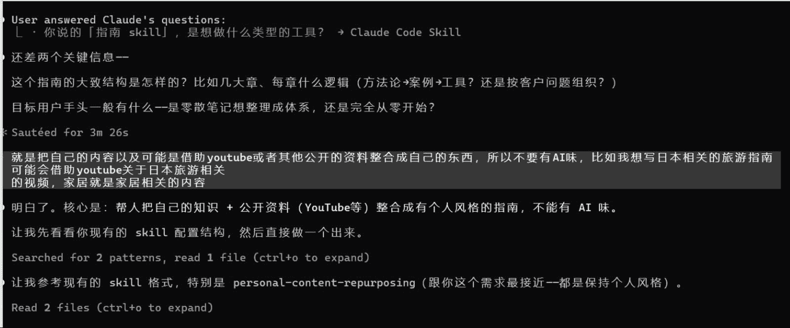
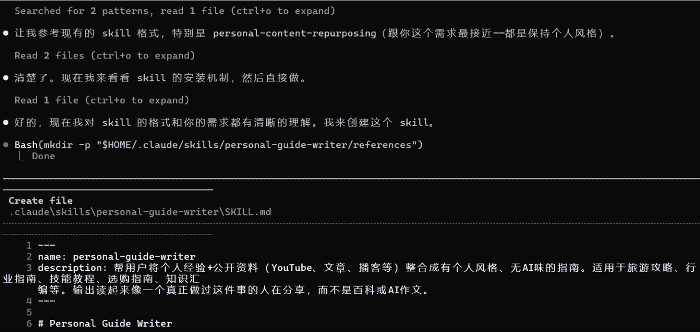
做 Skill 的完整流程：说需求 → 让 AI 写 → 测试 → 迭代。
## 四、内容层：用内容把产品推出去
### 评论区商机挖掘：从群众中来到群众中去
底层逻辑是评论区藏着需求信号。先识别高价值信号，再用 Skill 整理成指南。做跨境电商不知道写什么，就去同行评论区看真实讨论，Skill 会给出商机矩阵。值得关注的是有问题碰撞的区，而不是吵架或引流区。
用社媒助手盘点评论量大的内容，让 AI 帮你筛出信息增量强的。抗糖的延伸链路就是从一个小妙招评论区长出来的...
从留言区到内容工作流，一套可复制的变现玩法
在内容平台上，看到某个话题讨论火爆，不等于它就能变成生意。留言区有信号，只说明有人需要，不说明有人会付费。以控糖为例，很多人分享过苹果醋这类偏门控糖法，这是很好的情报；再配上油管的进阶内容，就能整合成一本控糖手册。但手册做出来能不能卖动，取决于它有没有明确的卖点、有没有后端承接，这完全是另一层判断。挖商机靠的是信息整理，判断商品能不能卖靠的是商业嗅觉。
用班主任这个方向演示一遍。围绕这类人群的留言，能整理出一串可以直接上架的小产品：开学首周立威手册（新老师最缺）；被家长刁难的50种回应模板（比如家长说“老师你太年轻了”“你没孩子你不懂”，你可以说：“我确实没生育过，但我也从小孩长成大人，受过专业训练，现在带着几十个孩子；您只看到自家孩子，我看到的是整个班级。”这句话把话题拉回自己的主场，再配点辩论技巧，整套回应就完整了）；开学三张表；班主任自我保护手册（哪些要留档、哪些是红线）；不想带班的新老师心态急救包。这些先定价9.9元卖出去，售后还能顺着聊出家长会、开学第一课、主题班会等更多需求。所以不必被垂直账号框住，围绕同一批用户的痛点，什么都能卖。
内容的扎实感从哪来？把真实留言直接喂给工具。比如有老师分享：拿到学生名单后先把名字预习一遍，多音字、生僻字查清楚，开学那天从容地叫出每个名字，这是给孩子的第一个专业印象。这种细节只有亲历者才写得出来，纯AI生成不了。一条不够就换别的素材继续找，工具会告诉你缺什么、去哪找。需求挖掘跑完，再交给内容生成工具，整个流程就闭合了。
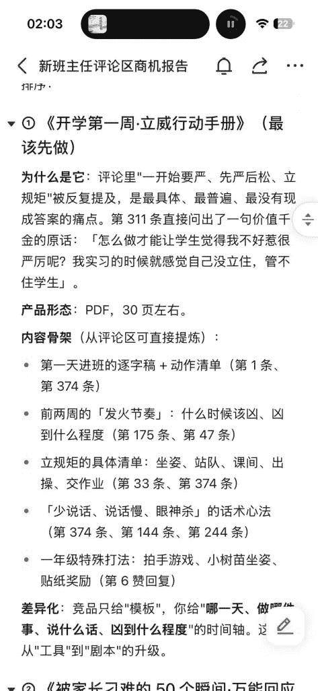
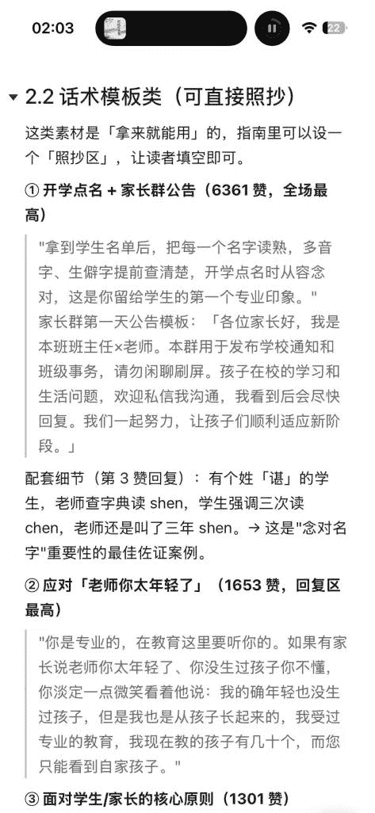
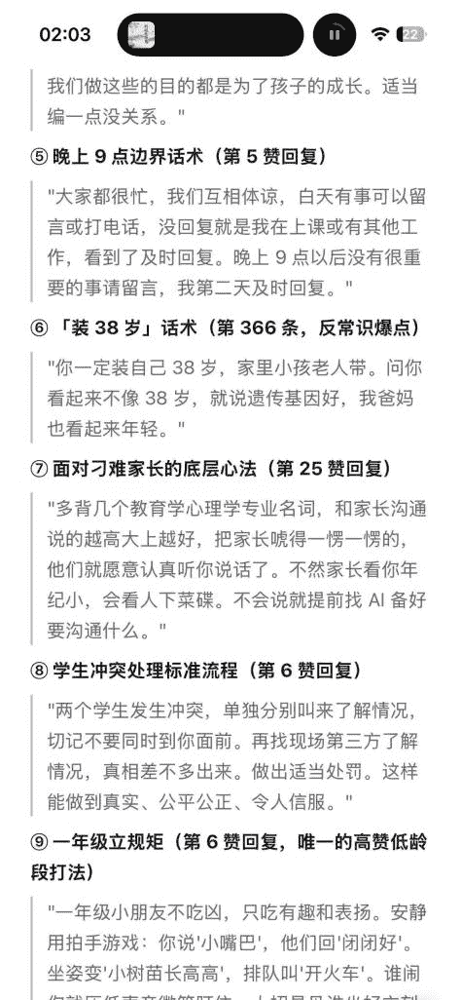
再说长内容写作工具。它解决三件事：去机器腔、章节重点、阅读流动感。
机器腔长什么样？爱用长横线，总喜欢“并非A，而是B”的转折，塞大量没有意义的比喻，句子也非常碎。句子太碎，读起来就像在拼积木，块与块之间没有牵引。真正有沉浸感的长文，句子之间是连续向前的，读者会不由自主跟着走，还会在某一句停下来想：这话说到我心里去了。
章节也要有起伏。一篇5000到6000字的文章，如果分五章且每章都是一千字，整体会非常平，用户刚入戏就换章，自然没有收获感。更好的结构是让第三章当主角，比如1000/1000/3000/1000/1000，把最重的内容集中展开。
去机器腔最根本的办法，是给模型喂真人作者的作品当教材。先拆解、模仿，再把机器腔清单交给它让它避开。这类工具的第一条提示词都应该这么做。长文工具后来还有两个升级：一是接搜索流量，把你想做的关键词发给它，让它全部融入文章；二是做体系性内容，针对“知道要努力但不知道每天干嘛”的人，把一百天计划做出来，每天发什么、开什么栏目都排好，用户只需复制粘贴。
这个方法背后的认知是：爆款会重演，爆款结构能跨赛道搬运。求职圈有个经典题是“怎么在早期找到并加入下一个安克、大疆、影石”，换到财经领域，就是“怎么在早期找到并买入下一个英伟达、美光”。选题还能从那些听起来高级的概念里长出来，比如谢圣子说的“见世面不要见消费端世面，要见生产端世面”，以及“身弱之人”“着相”“流量相”这类带哲学味道的词。当有人问“身弱的人是不是更适合做金融”“身弱的人是不是更适合做一人公司”，这种题天然让人想点。
拿身弱这个例子说，工具只要收到一个观点，就会自己去搜索。搜“身弱”时，它会找到八字身弱、精力低适合什么工作等实时内容。现场写出的《身弱之人才适合做一人公司》有5600字，核心是：大多数人都把身弱当成要修正的问题，其实它是精力错配；职场和传统创业都在抽干这类人的能量，而一人公司恰好是为他们准备的赛道。这篇内容可以直接发。
为什么身弱的人在这个平台上反而是优势？因为精力旺的人能量太外放，表达方式总是“你们听我说”“我来教你”，要快、要猛、要马上见反馈。但站内用户最烦的就是说教感。于是有了身弱者的内容生存法则：能量优先，产出其次；保护自己的敏感，别把它磨钝。最妙的一句是：这个平台要的不是太阳，是月亮。把创作者分成太阳型和月亮型，身弱者天然适合当月亮。这样有张力的表达，才是流量的来源。
顺带说选题的多元入口。站内有些博主特别会造金句、起名字，比如谢圣子把各种理论重新命名，狼狗论就是其中之一。他说的“见世面不要见消费端世面，要见生产端世面”也值得扩写成一篇长文。国学概念同样可以落到具体问题里：身弱不担财、着相、流量相——我们都着了流量相。只有把这些看起来遥远的东西和现实中的焦虑碰撞，好选题才会出来。
另一个现场案例是“怎么找到下一个宇树科技，并在早期加入”。里面有几个狠点：为什么不完美的创始人比全能型更值得关注？王兴兴的简历放进任何一家大厂的系统，第一轮大概就会被刷。价格屠夫的底层逻辑是临界点——当赛道从“能动”变成“能用”，你的位置比公司更重要。还有一句“加入下一个宇树科技”，听起来很燃，但里面藏着一个容易忽略的问题：你加入的时候，公司已经多大了？结尾那句更扎心：选公司这件事，大多数人都在刷招聘网站，真正有价值的信息却发生在搜索广告之外——去用它的产品，去翻创始人的所有公开内容，去找他的前客户聊聊。这些话直接发出去，文末挂一个校招表格，闭环就有了。
长内容这条线还有三个细节。第一，平台有“写长文”按钮，写完自动生成图片，从写到发几乎零成本。第二，工具已经升级到5.0，不再只是写文章，而是帮你搭一整套内容体系。第三，长文工具和指南工具放在一起就是商业闭环：指南负责生产产品，长文负责生产内容，内容建影响力，产品做变现，两件事可以同时跑。
这些能力不是凭空来的，背后是真实的代运营积累：在平台上亲手写过1000多篇自然流量爆文，早年还卖过海外的房子（曼彻斯特、伯明翰），写过婚礼策划、婚礼八大金刚、婚宴厅这些垂类。正因为都做过，才提炼得出爆文方法，再做成工具给别人用。世界上的路没有白走的。把能开源的开源出去，也才有精力创造新的东西。
接下来是笔记工具。它主要写指南类图文，核心是“动态样本库+先读后写+单篇解析+去机器腔”。很多人的问题是：每次写内容都要找参照，找完就忘，下次又要重新找。解法很简单，把所有你认为好的作品放进一个飞书文档，每次动手前让工具把整个文档读完，再逐篇仿写，写10篇就10篇，写20篇就20篇。
这里踩过一个坑：如果非要把6篇好文章融合成一个万能模型，最后只会变成四不像。正确做法是断其一指：一篇一篇单独拆结构，10篇拆出10个模型，才能写出10种不同的内容。AI真正要学的是完整的叙事动力链，不是一堆修辞碎片。
现场演示了日本旅行指南的9篇图文。读了有真人味的样本后，标题和正文都能直接用。“5年留学生跑遍日本后，我做了一份能查能问的知识库”“在日本留学5年，我把日本自由行写成了5万字指南”，正文是“花了5年时间，我在日本留学，顺便把这个国家从北海道到冲绳能跑的地方都跑了个遍，翻了上百份攻略，踩过无数坑，也攒了一肚子只有住下来才懂的经验”。这些内容里没有“并非……而是”，也没有长横线，因为它是严格按“先拆结构再仿写”来做的。
另一个杭州亲子游学的案例很打动人：孩子在苏堤上走，突然蹲下来看水里的鱼，说“妈妈，这条鱼和昨天在花港看到的不一样”。那一刻妈妈突然明白，游学的“学”不是记住了多少知识，而是孩子在真实世界里长出观察的触角。
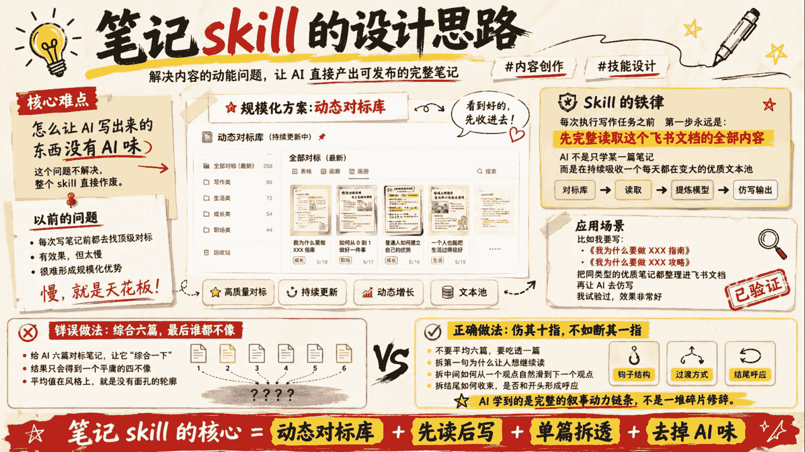
那怎么找样本？去目标赛道里找100个优质内容创作者的置顶帖，一篇一篇看他们怎么把产品和内容融在一起。高手不会直接喊产品好，而是把产品包在故事和场景里，让读者读完自己就觉得想要。这种润物无声的表达，是最好的参照。
笔记工具还有一个很实用的用法：指南还没做出来，也能先写指南型内容。只要填一组参数：产品形态（飞书文档）、产品规模（5万字或3万字）、作者背景（带娃来杭州旅游的妈妈）、篇数（10篇）、输出形式。工具会先读最新样本库，再拆解每一篇的模型，然后逐篇仿写。正因为流程是先拆结构再仿写，这套方法可以迁移到任何领域：你想做哪一类内容，就把那一类的好样本攒成一个库，以后每次都让它先读。
笔记工具做对了一件事：给规则，不给空标准，样本库始终是活的。AI时代真正的护城河是品味。你不断喂给它你欣赏的内容，它就会越来越懂你，所以要像集邮一样积累好样本。
再来说萃取工具。它的本质不是复制某个博主的文风，而是让博主为你打工：帮你出选题、出产品、搭产品结构。为什么有人能卖一万单、连卖四年？因为他不是靠灵感，而是靠栏目和策略。一个人发了一千篇内容，人看得完吗？看完了能总结出系统吗？很难。但AI可以。
操作上，选一个和你的产品有交集的博主，用采集工具抓取内容，建议抓300篇。过了300篇工具容易崩，而且300篇已经足够代表一个创作周期。导出表格后加载萃取工具，它会交付一份完整的分析报告：内容结构、选题栏目（一号栏目发什么、二号栏目发什么）、爆款模型、标题句式、关键数据，还有最核心的knowhow——这个博主为什么能持续产出。然后就可以直接让它出100个选题，甚至直接写内容。
现场案例是“说瘦就瘦”，一个卖考研英语外刊的博主。萃取出的栏目包括：考研英语方法论、阅读提分、ADHD也能坚持的考研邪修等等。这些栏目可以平移到红宝书背单词网站，因为外刊和背单词都围绕“背单词”展开，有交集才有迁移价值。萃取出来的栏目本身就很有价值：“考研英语的风向标已经很明显了”“考研出题人会把名牌直接打出来”“疑似考研英语的邪修怪谈被泄露了”“ADHD也能坚持的考研邪修”，每个都自带吸引力。这就是有章法和拍脑门的本质区别：真正会做内容的人，发什么、什么时候发，都是提前排好的。
内容质量举个例子：市面上几乎所有背单词App都在做同一件事，把5500个大纲词丢给你，让你每天打卡，却没人告诉你真题只考了4200个，剩下1300个十年都没出现过。再比如：红宝书是一本好词典，但不算一本好背单词书，因为按字母排列。从A背到Z，三个月过去了，真题里最高频的词始终散落在全书各处。于是有人用真题词汇重新排序，第一个词不再是abandon，而是十年真题里出现次数最多的那个。顺序一变，效率差三倍。
萃取完的成果可以直接落地成100个选题、100篇内容、一个百日起号包。一个号的素材全部齐了，剩下只是按节奏发布。做完之后会有点“瘫坐感”——那些需要花几个月才能悟出来的规律，几分钟就被摊到面前，强得让人一时不知道还能做什么。
接着看选品工具。选品不能凭感觉，必须基于真实语料。步骤很简单：先花五轮对话聊清楚你是干什么的、想做哪个赛道；然后去读案例库，找和你匹配的需求。选品完成后再按“任何东西都能写成指南”的原则，输出你该做什么指南、目录怎么搭，再配上100个选题。选题、指南、选品都有了，账号自然就起来了。
这个案例库是花了一整年手动攒出来的，从去年8月9日到今天，一共356个真实商业案例，每个都配有人工解读，不是软件批量提取的。当时不知道这些积累会被做成工具，但现在明白了：世界上没有白走的路，每一步都会在某个时刻兑现。案例库还有一个用法：看到下架的产品就再做一个。下架可能是商家不想做了，或者被平台累了，但需求已经被验证过；只要链接消失，马上重新上架，这就是最真实的卖点。
再聊消费者洞察。知识库搭建、爆款分析能不能全部自动化？对个人来说，不建议。用AI抓500篇内容，你根本不知道这500篇具体写了什么，只能站在数据维度看。真正的洞察，数据只能帮一半。广告行业做调研有两种方式：一种叫消费者洞察，靠数据；一种叫焦点小组访谈，找典型用户深聊。711创始人在《零售的哲学》里写过一句话：现场藏着答案，神明就在一线。数据不一定给你正确答案。什么是洞察？从现象看到背后的商业原理。怎么洞察？必须亲身经历。所以做优质内容，要手动去看、去感受，不能完全依赖自动化。
还有一个打法是“边做边公开”。发内容、分享产品理念，把自己正在做的东西晒出来。比如“金老师教生物”做了一个班主任App，iOS技术上线。那篇帖子没有任何干货，但它公开了正在做的事，评论区变成了需求池；只要留下客户反馈，真实需求就会自己浮出来。
但有个提醒：当所有人都在做同一个东西时，机会只留给快速进场的人；垂直刚需永远还有机会。别人都在做面面俱到的工作台，我只做留痕小程序，只围绕“留痕”这一件事做深，就会有机会。再比如班主任排座，有人做了个能离线编辑、不用部署服务器的网页，卖了300多单。它也是WebCoding，但它从真实场景长出来。所以不必追求大而全，小而美、小而垂、垂而刚需，才更稳。
虚拟产品本质上就是基础需求加体验创新。客户反馈这需求，表格就能完成，但当你把它做成一个可以个性化设置的网页，老师真正愿意用，就是体验创新。
关于平台的虚拟商品权限，现在确实收紧了。电子资源类目很难开，以前没资质也能上架，现在有资质也可能开不了，只能等。但替代思路很多：金V（行家），粉丝过3000（或在“成为行家”入口查资格），可以无痛引流，不担心封号；卡类目，把商品标题的关键词改成明信片、杂志这类词，先匹配上架再改回来，缺点是没法自动发货；个人售卖，能自动发货也能出单，只是没有主页展示，但笔记排名更容易靠前，还挺方便；群成交，发内容后把人引进群，群里个人售卖，或者引流到微信成交；实体加虚拟，比如“刚哥运营笔记”卖手稿，平台不卖未经出版的虚拟刊物，他就把虚拟内容做成手抄实体赠送，反而卖得很贵，卖错题本也是这个逻辑，需要邮寄，但玩法多了；还有挂靠商品开橱窗，找别人帮你挂，橱窗开了就能卖。

心态上，强者不惧平台规则。门槛提高反而是好事，它会把一大批人过滤掉；能卖的人照样卖得动。
账号选择也有讲究：个人号拿免费流量。一旦认证成蓝V，平台会默认你有投流预算，基本不给自然流量，蓝V只能靠聚光、薯条。蓝V能开私信通获客，但现在金V也可以。很多人是公司店只挂商品，再用个人号带橱窗发内容拿免费流量。核心还是那句话：规则是过滤器，口子还会再开。
最后单独强调一点：在这门生意里，内容永远排在产品前面。出单的第一位不是产品，而是内容、标题、选题能不能把用户的需求勾起来。同样是卖一个知识库，会不会写、会不会起题、会不会做选题，直接决定10单还是1000单。平台上的产品拿到淘宝往往卖不动，因为它们是为内容而生的；一个知识库在淘宝很难卖，却能在这个平台卖出千万，因为用户买的是理念。所以，内容永远值得放在最高优先级，这也是后面那一整套内容工具存在的原因。
再往后，从小到大的放大路径还有矩阵、人力杠杆和护城河。多开店、多账号做矩阵，是其中最常用的一条路径。
真正能把生意放大的，往往不是把单个账号经营到极致，而是把已经验证过的模型拆开复制。
想做到百万级收入，可以换一种计算方式：不要求一个账号独自贡献100万，而是让每个账号承担10万，再复制出十个相似单元。规模，来自复制，而不是执着。
比如课件业务，先从英语切入，验证成交后，再分别拓展语文、数学、历史和班会等方向。每个细分领域都单独运营，收入由多个小店共同构成。这样做还有一个额外好处：某个平台账号出现问题时，不至于全部归零。
复制时要注意两件事：
第一，面向不同需求时，商品要有明确区分。语文需求对应语文内容，数学需求对应数学内容。
第二，用于获客的低价产品可以复用。比如同一家公司用多个店铺发布“普通人如何找到不上班的收入来源”之类的强刺激内容，再把用户引导到低价商品，随后进入社群、参加短期直播训练，最终承接高价课程。这类“低价入口—社群培育—高价成交”的链路，在知识服务领域很常见。
## 把重复劳动交给别人
真正耗时间的通常不是设计产品，而是整理、排版、上传、修改这些琐碎环节。
因此，先把业务拆成清晰流程，形成可执行的操作手册。你只保留方向判断和商品筛选，其他可标准化的部分交给外部人员。
人员来源可以很灵活：
- 在招聘平台寻找课件、资料整理类兼职；
- 到内容平台发布招募信息，寻找大学生；
- 与一线老师合作，用销售分成的方式共同推广；
- 直接进入成熟团队工作，近距离观察他们如何获客、生产和成交。
如果想快速了解一个行业，最有效的方式往往不是听一堆理论，而是进入现场，亲手参与其中。很多成熟团队的经验，只有真正做过才会理解。当前这类基础执行工作的价格并不高，只要方向确认，马上安排人手测试即可。
## 别让客户只停留在平台里
前端成交只是开始，更有价值的是把客户沉淀到自己的联系渠道中。
购买行为本身已经完成了一次信任筛选。比如，一位低年级教师买过你的资料，未来很可能还会需要更高年级版本。平台推荐不会永远出现，但朋友圈、私聊和社群可以持续触达，也更容易发现客户的新问题。
联系客户需要自然理由，例如：
- 发现漏发资料，主动补送；
- 在网盘中提供额外内容，并留下联系入口；
- 邀请对方反馈使用体验；
- 用售后服务延伸关系，而不是只做一次交易。
这件事不刺激，也不容易立刻看到结果，却是把一次成交变成长期收入的关键步骤。
## 付费推广要建立在验证之后
广告投放不是用来拯救一个尚未成立的产品。
如果连自然成交都没有，就急着花钱买流量，通常只会放大问题。更稳妥的顺序是：
1. 先靠自然曝光找到有反应的内容；
2. 确认哪些人愿意购买；
3. 打磨出稳定的成交路径；
4. 再用付费方式扩大覆盖面。
自然增长负责验证，广告预算负责加速。两者的作用不同，不能混为一谈。
## 一人企业，可以同时拥有多条收入线
个人业务不必只有一种变现方式。只要持续积累，经验、案例、素材和受众都可以被重新包装成产品。
常见方向包括：
- 承接品牌合作；
- 提供简历修改和行业指导；
- 制作求职作品集模板；
- 销售电子资料和其他数字商品；
- 把经验整理成专栏；
- 面向老客户推出后续产品；
- 举办付费直播或小型训练营；
- 把内容账号当作商业合作入口，同时作为新产品的验证渠道。
例如，广告从业者可以把行业经验整理成求职指南；从公开求职资料中提炼共性结构，去除隐私后制作成模板；再把几页纸的实用手册定价为29.9元，通过内容平台持续销售。
专栏也可以采用“低价首发—社群维护—后续产品”的路径：先用较低价格吸引首批读者，持续提供有用内容，再向已有用户推出升级版本。很多续费收入，并非来自陌生流量，而是来自前期已经建立信任的人群。
## 不必追逐百万粉丝
长期生意不一定需要庞大粉丝量。假设有1000名稳定支持者，每人每月贡献19.9元，就能形成接近两万元的月度收入。更重要的是，这些人可能持续购买多年。
维持这批人的方法并不复杂：把产品做好，把承诺兑现，把表达说清楚。
用户已经见过太多夸张营销，真正稀缺的是可靠。别人敷衍时，你认真交付；别人只会制造焦虑时，你真正解决问题。信任一旦形成，复购自然会发生。
## 给一人企业设置“测试实验室”
内容账号除了带来合作收入，还可以承担产品实验功能。
每开发一项新服务，都可以先通过账号发布相关主题，观察收藏、评论、私信和购买意愿，再根据反馈调整产品。这样，账号就不只是展示橱窗，而是一个低成本的市场验证工具。
不需要每天高频更新，但最好保留一个属于自己的内容阵地。它能帮助你判断：用户真正关心什么，哪些表达有效，哪些产品值得继续投入。
## 工作状态需要被设计
### 让工作和休息分开
长期在家工作，很容易让生活失去边界。家里适合休息，工作地点承担产出功能。如果两者完全重叠，人的状态就很难切换。
常见结果是：坐下后先休息一会儿，休息变成刷视频，白天拖过去，晚上又因为没完成任务而熬夜，第二天效率继续下降。
因此，即使家里有书房，也建议固定到外部地点工作。
### 选择适合专注的环境
办公地点最好满足几个条件：能步行抵达、有电源、噪音适中，附近还有吃饭、散步和运动的选择。
不一定要去最热门的连锁店，也不建议选择熟人过多、容易被聊天打断的地方。杭州可以尝试一些管理有序、服务及时的独立咖啡空间，也可以去人流相对平稳的公共阅读场所。周围有公园、运动场和超市，会更方便安排一天的节奏。
吃饭也尽量离开工作环境，减少外卖带来的封闭感。
### 缩短有效工作时长
工具升级后，很多人的有效产出并不需要八小时。可以把核心工作集中在中午到下午的连续时段，完成后安排骑行、课程或散步。
长期待在封闭空间里，思路也会变窄。没有屋顶遮挡的户外环境，往往更容易让人恢复精力。杭州秋季天气舒适，更应该增加外出时间。
如果晚上完成直播后仍然处于兴奋状态，不要强迫自己立刻继续工作。先休息一段，再去夜间骑行或散步，让高强度输出后的情绪慢慢落下来。对精力敏感的人来说，缓冲本身就是工作安排的一部分。
### 保持社交和兴趣
刚开始创业时，很多人会觉得线下活动“暂时没用”，于是越来越少出门。实际上，社交并不只是为了马上获得资源，它还能防止孤立、缓解焦虑、打破思维惯性。
去公共空间工作、参加行业活动、进入数字游民社区，哪怕没有立刻成交，也是在维护自己的状态。真正长期做事的人，必须保留一项愿意持续投入的兴趣，并且经常走出房间。
## 一套可复用的判断框架
### 1. 新人先去成熟需求中找机会
已经有人购买的市场，不需要从零教育用户。先观察成熟需求，再思考自己能在哪个环节做得更好，通常比先盘点“我有什么优势”更有效。
### 2. 智能工具适合重做旧需求
它更适合提升既有产品的效率和体验，而不是凭空创造购买理由。单词记忆、课程资料、练习册、图像字效，这些都是原本存在的需求，工具的作用是让交付更快、更便宜或更好看。
### 3. 优先选择能持续流动的业务
不要只追逐短期爆款。前端要有获客方式，后端要有复购、升级或服务承接，收入才能逐步沉淀，而不是每次都从零开始。
### 4. 数字产品要同时满足功能和体验
先解决用户的基本问题，再提升使用过程。例如，先用表格完成反馈管理，再进一步把它升级成更直观、更符合个人情况的页面。
### 5. 自动化能力的价值在于完成任务
单纯给出一段文字，并不等于完成工作。真正有价值的自动化方案，应当能调用工具、处理资料、生成较长内容，并交付可直接使用的文件。它连接的是完整流程，而不是一次性回答。
### 6. 商品需要明确的切入角度
同一个主题，泛泛讲知识可能没人买；一旦切入具体人群和具体场景，价值感就会明显提升。比如“某位思想家的知识整理”过于宽泛，而“如何把这套思想用于日常社交”就更容易让用户产生关联。
### 7. 把业务串成循环
可以建立这样的链路：
评论与讨论中发现需求 → 把需求整理成解决方案 → 将方案包装成产品 → 用长文和短内容持续传播 → 研究同领域优秀账号，持续补充选题和产品方向。
单个工具的价值有限，多个环节互相供给后，效率才会不断提高。
### 8. 放大依赖复制、分工和客户沉淀
模型稳定后，用多店铺扩张；把重复劳动交给兼职；每次成交后，都设计合理的售后和联系机制。规模不是靠一个人无限加班换来的。
## 可以直接执行的七个阶段
**第一阶段：确定方向**
选择已有购买行为、并且具备后续服务空间的领域。避开只能靠一次性测试、没有延伸空间的商品。先问两个问题：市场是否已经证明有人愿意买？成交后还能提供什么？
**第二阶段：采集样本**
购买同类资料，研究结构和用户关注点，再用工具重新组织内容、调整版本和呈现形式。同时关注教材更新、软件能力变化以及新的制作方式。
**第三阶段：寻找真实问题**
重点观察那些正在认真讨论困难的用户，而不是只看争吵和广告。把高频问题归纳成服务方向，再转化成产品提案。
**第四阶段：制作解决方案**
先建立自己的资料库：目标读者、使用场景、已有经验、信息来源、案例和交付形式。资料充分后，再扩展为长篇指南、图文版本或其他增值形态。
**第五阶段：持续发布内容**
长内容负责建立信任，短内容负责扩大触达。不要把内容当作产品的附属品，很多成交恰恰发生在持续阅读之后。
**第六阶段：研究同行样本**
选择与自己方向相关的账号，收集足够多的公开内容，拆出栏目结构、表达方式、用户痛点和高传播主题，再据此批量规划后续内容。
**第七阶段：复制放大**
验证有效后，按细分领域建立多个销售单元；把标准流程交给外部人员；自己保留方向判断、质量把控和客户关系维护。
## 调研时，别只盯着一个平台
- **官方内容渠道**：行业通知、教材变化和机构动态，常常比热门内容平台更早出现；
- **讨论区**：高质量问题通常藏在评论、问答和用户反馈里；
- **海外内容**：育儿、健身、减脂等领域，可以研究海外创作者，再结合本地用户需求重新表达；
- **人工观察**：批量抓取只能提供素材，不能替代理解。真正的判断仍然来自现场体验；
- **访谈与数据结合**：数据告诉你发生了什么，面对面访谈帮助你理解为什么发生；
- **营销基础**：围绕产品、定价、渠道和传播四个维度检查业务；
- **主动向工具提问**：不清楚如何完善流程时，可以让工具反向提出功能建议，例如增加操作规范、检查清单和常见问题处理；
- **阅读经典**：商业、营销、管理与哲学类书籍，能帮助你建立更稳定的判断框架；
- **关注使用成本**：长文本处理和复杂任务会消耗大量计算额度，应该根据任务难度合理分配工具，能用轻量方案完成的工作，不必全部交给高规格模型。
最终可以浓缩成一句话：
先从已经存在的需求中选方向，再把解决方案做成商品，用内容建立信任，用复制和分工扩大规模，用长期联系沉淀客户。真正拉开差距的，不是知道多少，而是能否马上开始，并在行动中不断修正。
————分割线————
很多人读完方法论，会产生“我已经懂了”的错觉；真正开始执行时，却常常在第一个动作上停住。
教程只是入口，工具也不是核心优势。更难复制的，是马上开始的行动速度，以及与高质量实践者共同成长时获得的信息密度。
这里主要讨论具体项目、商业路径和智能工具的实际用法，系统内已经整理了1000多个经过实践检验的项目案例。
👉 查看完整数字资产与加入条件：
