# 221206 龙哥赚钱周报

整理日期：2022 年 12 月 06 号

专属群的各位朋友，这一期的赚钱周报又和大家见面啦。

部分内容需要跳转飞书阅读，如果碰上复制权限被锁的问题，可以看这篇解锁方法：[解除复制限制！](https://mp.weixin.qq.com/s?__biz=MzI1NjAxOTI0Ng==&mid=2647895304&idx=1&sn=df7e3e36c3bf503a2513f8b4c6636d3d&chksm=f20a1349c57d9a5fccaa92c5068cb3e492ba9e3ebb178584d018892c0211214dc9d112c1f73c&token=37691864&lang=zh_CN#rd)

往期周报的精华合集，都收在专属群的 Q 群文件和群公告里，有需要就自己去翻。

祝大家每次都能淘到新启发～ 

先把看帖小提示放前面：标题带“（精华）”字样的是高赞精华帖，前面的数字就是截至今天的点赞数。这期内容不少，按兴趣挑着看就行。

# 一、赚钱认知&技能

## （43赞）《正确签署劳动合同，让你少赔钱》

先跟各位老板聊个扎心话题：你有没有被员工仲裁赔过钱？很多时候，老板明明也签了合同，最后照样赔付，问题往往出在合同设计、绩效设计、裁员处理、纠纷应对这些环节上。

这篇分享来自老严。他之前请劳动纠纷领域的行家“宅男”，到自己的干货群里做了一次内部讲解，后来他把内容梳理出来，形成了一套比较完整的应对思路。

全文一共拆成 5 个模块：一，怎么签合同才能降低公司隐患；二，公司赔了 3 万多换来的劳动纠纷经验；三，被辞退的员工怎么处理才损失最小；四，员工申请仲裁之后，公司如何保护自己；五，处理劳动纠纷时容易被忽略的细节。

正式开讲前，老严先让每个老板做一轮自查：你公司真的跟员工签劳动合同了吗？签的合同具备法律效力吗？合同签了却依然赔钱，问题到底出在哪儿？

### 1. 合同只是枪，附件才是弹药

一份有效劳动合同不能“裸奔”，必须搭配岗位考核表、公司规章制度、廉洁自律协议、员工保密协议等附件。这几样组合起来，才叫防御体系。

岗位考核表：新老员工都要签，把考核目标写明确。员工考核不达标，公司可以单方面解除且不给赔偿；如果没签，辞退时拿不出依据，就要面临双倍赔偿。

公司规章制度：要贴合自家公司的业务属性和关键情景，提前把风险堵住。每位员工看完后要签名、按手印，留下“已经知晓制度”的证据。

廉洁自律协议：看着像摆件，但利益面前人心难测，防人之心必须有。

员工保密协议：必签项。有人白天上班，晚上把核心机密卖出去或者自己单干，有了这份协议，公司可以名正言顺开除，严重的还能追责索赔。

### 2. 签合同的 8 个关键细节

① 劳动合同要从试用/试工第一天开始计算签署时间，很多人不重视这个节点。

② 合同上的工作地点尽量具体到区级，万一后续调动工作地点，写进员工手册做补充。

③ 实习期员工不签劳动合同，只签实习协议。

④ 签字过程一定要录音，别嫌麻烦，这步很关键。

⑤ 员工入职一个月内必须签完；遇到重大节假日，要提前签，不能拖过节点。

⑥ 试工三个月后，第一次续签签三年，第二次可签一年，第三次签永久合同。

⑦ 合同里必须写清履行义务、重大事项以及补偿情形，定稿前交给律师核对。

⑧ 合同到期后一个月内完成续签，别让合同出现空窗期。

### 3. 三个案例，合计赔了约 3 万+

下面先用几张真实记录给大家打个预防针。

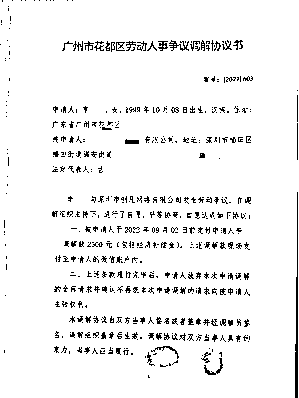

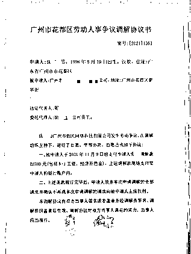

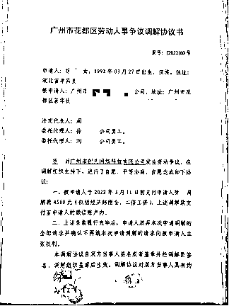

这些坑随时可能落在自己身上，越早重视越好。

**案例一：品牌部张先生劳动纠纷**

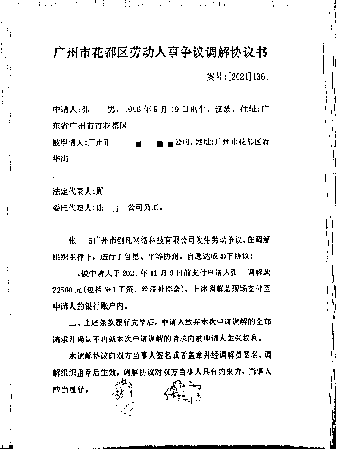

入职时间：2017 年 3 月 6 日

离职时间：2021 年 10 月 15 日

在职时长：4 年 6 个多月

优化原因：入职初期表现不错，后来受人影响逐渐变成“职场老油条”，仗着老员工身份顶撞上司、散播负能量，业绩越来越差，也不接受调岗安排。

协商结果：赔付 22500 元（月平均工资 4500 元）。按 N+1 计算：4 年折 4 个月，满 6 个月不足 1 年的再算 1 个月。

教训：有些人状态不行就是不行，必须及时优化，留久了只会变成定时炸弹；同时这件事也倒逼公司把劳动合同体系补完整。

**案例二：运营部徐女士劳动纠纷**

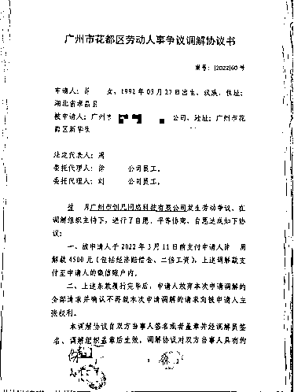

入职时间：2021 年 10 月 15 日

离职时间：2022 年 3 月 6 日

在职时长：约 5 个月

优化原因：春节回来后状态奇差。但核心问题是公司一直没签劳动合同。按《劳动法》规定，入职超过一个月未签合同，要按双倍工资赔偿。

协商结果：赔付 4500 元。每月平均工资 4500 元，入职 3 个月不满 6 个月，按半个月工资算，再乘 2 倍。

教训：合同一定要及时签，逢年过节更要提早安排，而且要把监督责任落实到具体的人，不能只喊口号。出了事再去后悔，已经来不及。

**案例三：短视频部李女士劳动纠纷**

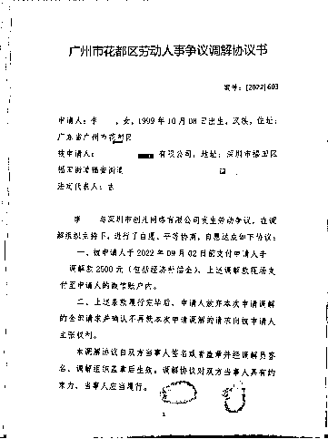

入职时间：2021 年 11 月 2 日

离职时间：2022 年 8 月 23 日

在职时长：约 9 个月

优化原因：工作态度消极，缺乏创新，负能量重，同事之间有矛盾，还互相举报推广内容，多次考核不通过。

协商结果：赔付 2500 元。原本按周考核表可以直接辞退且不补偿，但因为上级没有及时签考核表，公司只能认赔，协商后降到 2500 元收场。

教训：员工考核不能停留在口头上，周考核表要安排专人推进、责任到人，还要找律师确认文件有法律效力，否则关键时候根本用不上。

### 4. 被辞退的员工，怎么谈才能把损失压到最小？

坦白讲，想完全避免赔偿几乎不可能，我们只能尽量压低成本。

**安排会表达、会说话的人去谈。** 之前就吃过直属领导的亏，一句“你业务太差，明天别来了”，员工转头就去仲裁。如果换个人去打感情牌，说清公司的难处，员工反而更容易接受，大家体面散场。

**引导员工签离职表。** 无论主动离职还是被辞退，都要引导他签离职表，离职原因写“个人原因”或“其他”。签完这张表，代表员工主动提出离职。注意：公司不能在离职表上盖章或签名，否则性质会变成协商解除，而不是员工自愿离开。

**工资当天结算。** 我们曾经在周六谈好了一位员工的离职，但直属经理已经休假，提成算不出来，就约定下周一再结算。等过几天去结算时，对方直接改口要求赔偿，理由就是“公司辞退我”。如果当天谈完立刻签表、即刻结账，后面这一堆麻烦都不会发生。

**提前把证据准备好。** 辞退员工要有理由。业绩不行就用考核表；传播负能量就拿出录音录像；上班时间干私事就保留监控截图。真到了仲裁庭，法官只看证据，光靠一张嘴没有任何说服力。

### 5. 员工申请仲裁后，公司怎么维护权益？

很多人不知道，就算是员工主动离职，只要在离职后一年内，他依然可以去申请劳动仲裁。

比如员工以“公司没买社保”为由要补偿，他的意图大概率就是拿钱。如果真走到仲裁，公司除了补缴社保，员工自己也得出一部分钱，他的实际付出并不少。这种情况下，可以私下协商解决，告诉员工“你自己补缴的成本也不低”，给他几百块作为补偿，双方握手言和；之后再把公司的社保流程补完，避免重复踩坑。

如果是被辞退的员工申请仲裁，按三步走：

**第一步，收齐证据。** 考核不达标的表单、上班摸鱼的监控、传播负能量的截图，全部整理留档。

**第二步，稳住心态。** 一慌就容易跟着员工的节奏走，思路全乱。冷静下来，凡事都有第一次。

**第三步，提前研究规则。** 先按国家规定推算大概该赔多少，再定自己的心理底线。可以咨询律师，也可以查类似判例。如果证据够硬，谈判时可以适当强势一些。每次仲裁结束，都要复盘、总结、优化制度，因为每处理一次，公司的合规水平都会往前迈一大步。

### 6. 处理劳动纠纷的 4 条避坑建议

**① 能让员工主动离职，就不要主动辞退。** 辞退对公司最不友好，老员工更可能要赔 N+1。能私了尽量私了，好好协商。

**② 员工离场必须签离职表**，离职原因写“个人原因”或“其他”，员工要签名按手印。离职表由公司保存，不能给员工带走，公司也不要在上面盖章或签名。

**③ 老板尽量别亲自下场谈判。** 这些事交给负责人、人事甚至委托律师处理都行。公司法人电话也可以换成管理层电话，不然劳动局三天两头找你，心累人累。

**④ 培养不起来的员工、刺头员工，越早清退越好，最好在入职半年内动手。** 未满半年只需要赔半个月工资，这点钱不值得省。人一旦拖久了，留在公司的综合成本只会更高。

最后说一句：现在各类媒体和短视频平台都在教年轻人学劳动法，“00 后整顿职场”已成大势。老板必须把劳动合同这件事拉满重视，否则将来赔的只会更多。真的，重视、重视、再重视。

## （46赞）《IP如何风骨体面和年入千万》

这篇是“落地实操版”的干货，作者先把文章发给几个朋友做内测，大家清一色好评，于是强烈推荐所有做 IP 的朋友都去看看。

这篇文章的优势很具体：第一，它既有 IP 的底层逻辑，也有顶层设计，比起市场上只讲零散经验的分享，普适性和复用性高得多；第二，只要想做一个能穿越周期的 IP，不管你是 S 级大号还是刚入门的小白，都值得认真读一遍，至少避免以后被人骂“割韭菜”；第三，里面的步骤和注解非常清晰，几乎可以立刻迁移使用。

文章态度也很鲜明：大大方方、坦坦荡荡，先把第一个一千万挣到手。想看全文，戳飞书链接：

## （30赞）《如何为高净值客户诊断需求》

分享人忻忻有个自封头衔——“龙哥盟首席高净值客户官”，她还开玩笑说龙哥未必同意。这篇文章是她之前一场分享的文字整理稿，核心话题很简单：怎么跟大客户沟通，怎么拿下大单。

很多人刚开始碰大客户，第一反应是对方肯定很难搞。但忻忻的经验恰恰相反：只要你有过一次搞定大客户的成功经历，后面反而会爱上这种客户。因为大客户逻辑更简单——我们提供价值、帮他解决问题、然后他付钱，路径非常直接。

她主要讲了三个方向：一，如何快速让对方信任你的价值；二，怎么在对方的经验体系里占据优势；三，如何获得长久依赖感、最终形成个人 IP。

### 先拆第一部分：怎样快速让大客户信任你

越是大客户，越依赖某几个固定的销售来处理问题。但很多人没能好好利用这种依赖，反而被白嫖——客户服务也用了，建议也听了，最后就是不掏钱买产品。

要理解这件事，可以先看一套很经典的销售系统。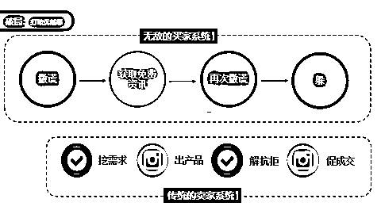

二十年前就有个词叫 NBSS，全称是“以需求为导向的客户销售体系”，大家也爱戏称它为“牛逼闪闪的销售系统”。

这套系统的思路是：不要一上来就推销产品，先去挖掘客户需求；等客户的需求浮出水面，再把产品放到他面前。听起来很专业，但真正在一线跑过销售的人会发现，就算需求抓到了、产品也递上去了，客户的问题依然没完没了。接着销售们还要处理异议，再用限时、折扣、买赠等手法逼单。

这套模式，本质上是“卖家系统”：销售拿着剧本当导演，主动推进一切。初心没问题，但面对大客户时，第一招就开始卡壳。

为什么卡？因为大客户身上有身份、资历和金钱堆出来的威严，销售在挖掘需求时很容易放不开；更麻烦的是，大客户拥有一套运转极熟练的“买家系统”，所有客户都会，只是高净值客户用得更加丝滑。

买家系统具体是什么？想一想你逛商场的场景：店员热情地过来问“需要帮忙吗？”，你大概率会回两个字——“看看”。心里想的是“别烦我”。再比如，加了一位大佬的微信，你发一句“想围观一下你的朋友圈，向你学习”，内心潜台词其实是“我怕你收费，先白嫖一下”。

这些反应都是买家系统里的“撒谎本能”：我们不会向疑似销售的人展露真实诉求。

问题来了：一个大客户一旦对你撒谎，你敢怀疑吗？几乎不敢。他能通过撒谎免费获得大量资讯，有些资讯甚至要花不少钱才能买到。销售还没法判断真假，只能选择相信，因为稍有迟疑，客户可能就再也不理你了。

接下来，大客户会再给你一点“希望”，但不会有明确承诺，这种状态就是“有希望，没下文”——俗称客户渣你。可这时候沉没成本已经很高，你只能被牵着鼻子走。很多做大客户销售的新人都会经历“招之即来，挥之即去”的阶段，极其痛苦，但绕不开。作者之前提过，向高净值客户提供六大价值，其中一个就是情绪价值，这是接触客户前必须交的学费。

最后，客户还会用一招“躲起来”。高净值客户在 PUA 销售这件事上，天然有优势。他甚至不用故意冷落你，只要一躲，销售自己就会给他找理由：“他太忙了，不是不想理我。”

所以，破局的关键是：从一开始就在心里砸掉那层滤镜。这位高净值客户确实有钱有势，但他的招数并不比普通人高明，只不过演技好。

摸清双方惯用套路之后，销售可以在开局就制造一点好奇心，让他觉得“这个销售怎么跟我想象的不一样”。一旦客户对你这个人本身产生兴趣，后面的机会就来了。

至于怎么制造好奇，忻忻给的技巧是：先反问，或者先给客户布置一个小任务。让对方带着疑问继续跟你聊，关系才算真正打开。

由于篇幅有限，这篇先分享到第一部分。想继续看后面两个方向的完整拆解，可以直接去原文读。祝各位都能在本期周报里挖到金矿，下周见～

在财富管理行业，几乎每次会面都会出现同样的开场：客户坐下后，第一个动作就是比较——你们过去几年给投资人创造了多少回报？利率比其他机构高多少？同行往往顺势掏出产品手册，试图用数据说话。但我从不这样，一旦开始回应比价，就等于跳进买方市场，被对方的节奏牵着走。

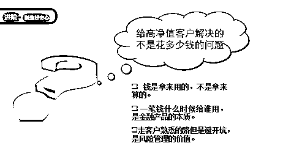

我的切入点恰恰相反。我会告诉对方：今天我们不聊数字，数字背后其实是价值判断和趣味选择。

钱在这些人手里是工具。我常常抛出问题：您觉得资金是用来流动周转的，还是用来囤积观赏的？第一次听到这个问题，多数人会愣一下，然后陷入思考。此刻，他已经从熟悉的比价模式中被拉了出来，进入我设定的对话语境。

真正把金钱当藏品欣赏的人，全世界数得过来。绝大多数亿万身家的人，反而更看重钱的流动性——买地、扩大投资、添置物业、替孩子补上历练的窟窿，钱始终在流转。当客户愿意跟我一起想这件事，第一步就成功了。我会给他布置一点思考功课，抛出三四个待思考的线索，让他在会面后继续琢磨。

这种配合一旦形成，我的专业威信也就悄然建立。随后我会重新定义金融：资金安排的本质，就是确定一笔钱在什么时点、交给什么人使用。传统的说法是“钱能生钱”，投一百万年化百分之二十，听起来诱人，却缺乏生活温度。我的定义把抽象概念拉到具体人生阶段，客户原有的判断系统被打破，他需要花额外时间理解我的逻辑。这些时间与精力，就是他为此付出的心力，成本越大，他对这段对话越重视。

进入第二部分：如何在客户的经验世界里建立优势。有参与感还不够，还要展示专业度。资产丰厚的客户身边从来不缺少竞争者，少则两三位，多则五六位，都在追着同一个客户跑。客户凭什么选你？诀窍不在于把产品介绍得天花乱坠，而在于让他感到差异。多数销售在挖掘客户的显性需要，我则把这些需要转化为一种必须立即行动的紧迫感。

有想法未必会购买。你告诉客户市场要上涨，现在买能赚百分之五十，他会客客气气说考虑一下。问题在哪？只因他没有情感催化剂。行情波动是他听来的，不是他看见的。但假如他认识的人已经在上涨中赚到钱，那位大妈买菜的钱一周翻了一倍，他情绪立刻被点燃，之后就会忍不住冲进去。情绪一旦形成，意愿就变成了非做不可的冲动。如果客户一直平静如常，我们不要轻易放他走，这种情绪一旦在别处被激发，钱就会流到别人那里。许多做高端市场的销售一听到顶级客户就发怵，觉得周期长、成本高、容易被白嫖。但真正的原因往往是，他们只停留在人家的意愿层面，没有进入情绪层面。丢小单不觉得痛，丢大单才会痛，这个痛正好提醒你该转变打法了。

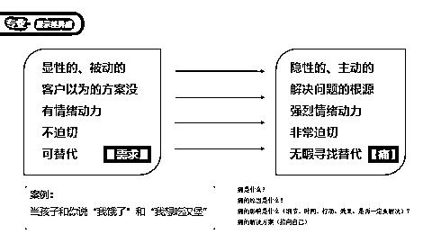

那么，普通的想要和真正的必须，差别在哪里？用快餐店门口的场景来说，店员问一个小孩是否想要汉堡，母亲会说汉堡不健康。可孩子已经饿得蹲在地上，母亲什么都不会再讲，只会立刻掏钱。想吃是个模糊的愿望，饿到站不住则是非解决不可的紧急状况。诊断的方法很简单：此刻你有什么感受？是否分析过原因？这种情况维持了多久？只要有情绪渗透其中，它就从普通想法升级成了不得不处理的问题。

对于财力雄厚的人，最致命的软肋不是缺钱，而是对未知的恐惧，以及对人生的失去控制。

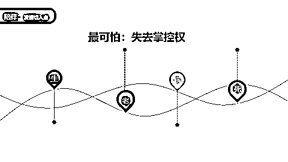

疫情后很多富人比中产更焦虑。他们害怕的不是破产，而是发现过去三十几年从未失控的轨道突然失灵了。寻常人无法改变房价和股市，认命就行。但一个常年掌控一切、甚至掌握别人命运的人，突然意识到自己也只是海浪里的泡沫，那种落差极为致命。由俭入奢容易，享受过掌控力的人，最难退回被动的位置。

这也解释了女性为何愿意为容貌和身材一掷千金——那是她们还能牢牢把握的少数事情之一。同样，抓住富人对失控的恐惧，他会感觉你比本人更懂他。在这个圈子里，销售习惯装专业，客户同样习惯装从容。你只需亮明态度：我帮你做的，就是让你继续拥有控制权。他会立刻发现你不一样：你的财富未必多于他，岁数也未必长过他，但你能解决他绕不过去的难题。

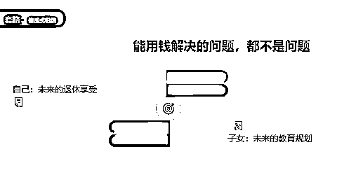

落到金融产品上，客户心底最大的焦虑是自身未来。企业会不会被时代淘汰？枕边人是否始终如一？身体会否突然罢工？这些不确定就像暗流。保险、基金、长期配置这些工具，本质上都是为不可知的明天留一份选择权。谈退休，不必扯年龄。没有谁愿意一辈子被办公室绑住，但人人都希望自由地创造价值。对资产雄厚的人来说，退休生活真正的吸引力在于：即便不再打拼，生活依然按照自己的意愿运行。

另一个常见的焦虑来自下一代。富人们大多有过打拼经历，婚姻和子女结构往往不简单。一名后代尚可全神贯注，两三名加上复杂家庭关系，可失控的维度一下子多了。寻常人烦恼赚钱太少，富人烦恼钱该留给谁、何时给、出于何种目的给；企业能不能扩张；子女会不会继承家业。烦恼越多，销售越有机会。

做顶级客户的生意，产品牌要留到后面。除非货品本身强到无需技巧，否则佣金越高越要借助包装。我习惯借助提问让对方的顾虑显形。三个案例是我常用的方法。

第一个案例：子女教育。

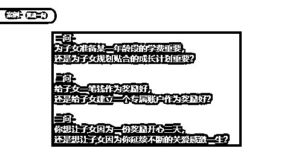

若我手中有一份教育储蓄计划，我不谈收益率，而是问她：你更在意子女入读名校的某一笔开销，还是他整个成长过程的设计？这句话往往瞬间打开话匣子。很多高资产人士自己对早年没受够好教育耿耿于怀，于是想让后人实现补偿；也有人靠读书完成阶层逆袭，就希望下一代复制同样的路径。随后我继续问：如果娃表现优异，该不该有奖励？当然该有，正反馈是一个人坚持的动力。那问题来了，奖励是等他交出成绩单再给，还是事先把规则讲清楚？富裕人士大多在规则感中获胜，所以他们更认同后者，例如“考到某个档次、进了某所学校，按约定有多少回报”。进入这个对话阶段，客户已经和我有了某种同盟感。最后一步，把话题落到隐性成本：你为后代付出这么多，真的不想得到任何回响吗？我不相信父母的爱是无私的——不是不愿无私，而是他们索取的回报是无形的，譬如感恩、陪伴、光耀门楣。如果五百万培养出一个只会敷衍道谢的年轻人，再富的父母也会失落。所以这笔钱用得值不值，才是他们真正的焦虑点。与我讨论怎样用出价值，其他销售就很难抢走这笔单子。

第二个案例，谈客户本人。

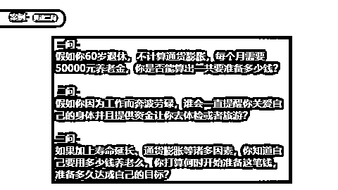

资产雄厚的人并不缺资金，真正稀缺的是有人能站在他的处境看见他的疲惫。有句话很老套：成家的人享家庭之福，充当支柱的人独自扛风霜。它能打动人心，正因它说出一个被所有人忽略的事实：家中顶梁柱也有撑不住的时候。越能干的人，越容易被视作理所当然的救援者。可谁也不愿被供上神坛，谁都希望自己做个寻常而有温度的人。

我常对客户说：你如此打拼，可曾给自己留过退路？可有人提醒你也需要被照顾？有一次我和一位年薪三百万的高管聊天，他常年被人喊作X总、X哥，身边的人都在向他要决策，却没有人问他累不累。我问他：你有多久没有认真想过自己想要什么了？那一瞬他明显愣住，随后开始讲他真正担心的事。这种触及内心的提问一旦落地，你和客户的距离就近了。

顶级客户难以被攻下，关键在于销售只盯着他们的头衔。可他们也有脆弱，也有情绪，也需要有人把那个软肋温柔地戳一下。我最愿意谈的其实是养老年金安排，因为这笔钱只跟客户自己有关。这笔钱无需用于照料家人，也不必向任何人交代，更像是写给未来自己的一封保证信。你可以问他：你给晚年做过什么规划？若他回答“手上有几处物业在收租，每年还有分红”，那就更好——他开始向你展示真实的价值取向：更乐观还是更审慎，成就感来自成就他人，还是来自拥有本身。每个人的答案都不一样，但一旦你掌握了他的价值取向，你就几乎能卖给他一切。

第三个案例，可以称之为“未来的角色”。我会和客户一起想象：多年以后，他希望在别人眼中是怎样的形象？是继续掌舵的领袖，还是被家族遗忘的提款机？这个想象会释放更多情绪。如果他渴望被记住，那就帮他设计一份带有传承意义的安排；如果他想要自由，那就规划一份足够安全的现金流。所有产品只是载体，真正成交的是那份走入内心的洞察。

摸清价值取向，就等于拿到了销售的钥匙。如果客户偏自利，就让产品看起来是对自己的奖励；如果偏利他与意义，就让方案呈现为一项福祉。很多富豪投身公益，并非钱多到无处安放，而是那种称为功德的感受，正好击中他们的兴奋点。

说到底，所有花钱决定都包含情绪。有些是为了立刻解决问题的痛，比如牙疼到深夜只能服止痛药；有些是为了取悦自己的快，比如女孩买网红奶茶，明知会长胖也照喝不误。若情绪波澜不惊，人很少主动打开钱包。顶级客户也不例外，甚至更情绪化——有人没做背景调查就斥资数亿建厂，听起来荒唐，其实就是被当时的热情推了一把。因此别把他们供上神坛，用看待寻常人的眼光去理解他们。当你给的理解无法被轻易复制，对方自然懒得再去货比三家。

给他掌控感，给他情绪出口，给他一个懂他的伙伴——这才是最深层的成交密码。

最后一个谈的是传承。

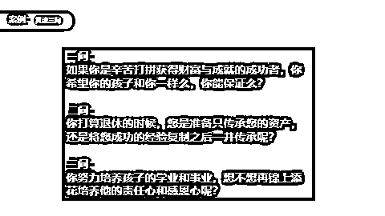

跟高净值人群交流，最常被提起的其实都是下一代。话题既有教育，也有血脉怎么延续。近些年愿意直接承接父辈事业的二代越来越少。一旦孩子选择另行其路，创业者心里会产生一种难以填补的空缺。他们在意的并不是那块牌子或那个公司本身，而是自己一手撑起来的事业——那份事业在他们眼里和亲生孩子几乎等同。所以表面看是岗位交接，实质是两种存在在情感层面的认同出现了错位。

很多客户卡住的地方，并不是孩子肯不肯接手。而更像是两个原本互不相识的孩子被强行介绍认识，其中一方始终不肯承认另一方的存在。症结不在二代，而在于父亲觉得：这家企业是我一点点养大的，足够优秀，为何得不到承认？孩子不接班，最刺痛他的并非经营问题，而是自己倾注的全部心血不被看见。这正是情绪上最深的裂口。至于用人，找职业经理人去运转不就好了？但这层心理结不打开，你永远读不懂顶端客户在想什么；而且企业规模越做越大，孩子越不愿意接班，失落感就越强。

在这种节点上谈传承，关键要把焦点掰正：钱怎么分配、资产怎么放着，都不重要。真正要厘清的是，你想留下来的是什么精神内核？把这个问题想透了，不管是工厂、土地，还是某种独特的赚钱方法，本质都是一样的——接手的那一方要对你交付的东西心怀感恩，并且真心认可你的眼光与成果。

这个心结解开了，任何产品都能找到落点。你只需要把产品的叙事锚定在这个内核之上即可。

再说那套递进式的三问。第一步是探明内在想法：你最初是怎么打算的？第二步是复盘准备：想法成形的过程中，实际做了哪些铺垫？你会发觉哪里卡住了？这个阻碍如何化解？第三步自然延伸：是否愿意让结果更圆满一点？是否希望得到更好的反馈？这正是产品与方案切入的窗口，也正是客户最敏感的痛点。因为极少有人能聊到这个深度，我们才具备不可替代性。最终传递的讯息是：我懂你的处境，我给你一套可执行的解法。

我一直强调，风险本身不是需求。你想推动客户去做的事，未必就是他真正的需求。那什么情况下他才会果断下单？就是让他去推演，如果不做，他在意的人和具体事情会走向什么他无法接受的后果。一旦这种推演在想象里成立，成交的概率就会显著提升。

赚钱模式之所以好用，很大程度上在于它抓住了人性行动的触发点。我们通常在什么时刻会立刻行动？往往是看到上一批参与者拿到了清晰可见的收益。有人从零起步，粉丝量猛涨到几十万；有人原本月薪平平，做了一个爆款后日收入大幅提升。旁观者立刻会算：我不参与，就等于把这些收益拱手让人。这种无法承受的损失感，才是推动决策的核心力量。

其实顶端客户也是普通人，甚至比普通人更单纯。他们的时间和精力几乎全部投向了赚钱、经营关系以及安顿家人。我接触过一位老板，除去赚钱，其余所有心神都放在几任伴侣和众多子女身上。很多时候我们习惯先介绍产品的优势，对方本能反应往往是再多比几家。于是又回到了他最熟悉的货比三家模式。

但如果把他从这个框架里拉出来，换个角度：你关心的那些人和事，我来帮你处理。你牵挂的对象那么多，我一件一件帮你梳理妥当，那往后几十年的生意自然还在你手里。所以说，高净值客户并没有那么难打交道。

归根到底就两点：一是自己先把逻辑想通，二是掌握一些朴实的小方法。大道至简，人性相通，无论身处哪个行业都成立。如果你卖的是看得见摸得着的实物，那可以展开的故事空间会更大。

祝各位都能搞定高净值客户，龙哥盟。

一提起“无人直播”，很多人都会觉得：这是小打小闹吧？错。它其实是直播赛道里的隐形巨头。我自己在抖音就亲眼见过一场无人直播，7月16日那一天，销售额直接冲到了116.8万，这个数字能压过不少真人直播间。更关键的是，它的进入成本低得让人意外，天花板却高得吓人。

什么是无人直播？你看春晚，所有明星在现场实时演给你看；而无人直播更像你在电视机前刷《甄嬛传》，孙俪根本不需要站在你面前表演。提前录制好内容，循环播放就行。这种操作还能划分成好几种：纯录播、转播别人的信号、真实场景不带人出境。

无人直播的赚钱路子，传统的一类是挂小黄车带货赚佣金。可现在越来越难做：大家钱包瘪了、快递动不动停发，佣金还要等到确认收货后7天才到手。于是，越来越多的人转向打赏赚钱，圈内叫“撸音浪”——专门挣观众送的礼物。不用挂车，不用卖货，下播马上提现。一万音浪换一千块钱，一场结清，没有退货，没有等待期。就好比你在一场直播里收到25万音浪，平台分掉一半，到手就是1.25万。这种简单粗暴的收益模型，也正是它突然爆火的原因。我自己也把工作室的三分之一资源，砸向了撸音浪和互动游戏。

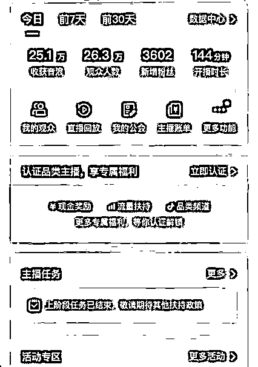

那么撸音浪具体怎么“撸”？说透了就一句话：全是骗音浪的套路。我盘点了市面上常见的五种：

1. 乞讨型。这跟天桥上的乞丐没两样，只是换成了直播间。视频素材怎么来？有团队去农村找老人拍，拍一条两百块；励志大学生就更简单，直接在哪个学校偷拍一段吃饭镜头，再打一张假装求学的纸，主播假扮学生在那里不停感谢。活脱脱“开局一张图，故事全靠编”。这种封号率很高，缺德指数满五星能给四星。

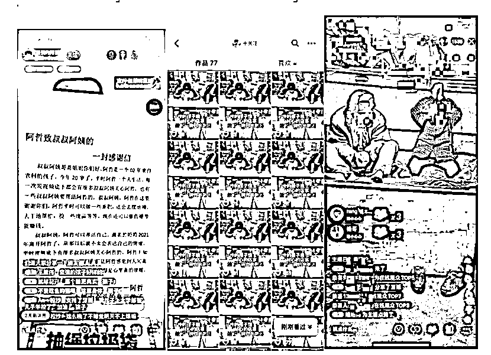

2. 涩涩型。利用“老色批”心态，画面常是黑屏、马赛克或暧昧剪影，配上喘气声，先让人停下脚步。最妙的是左上角的“入口”，其实是直播伴侣里的投票功能，标题写着“成人入口”和“未成年勿进”，观众越少抖币门槛就越低，人越多标的越大。等有人点了进去，发现啥都没有，水军小号马上带节奏：“我已经刷了8次终于进去了”……继续骗人掏钱。说起封号，色情诱导是红线，几率很高，道德评分四星。

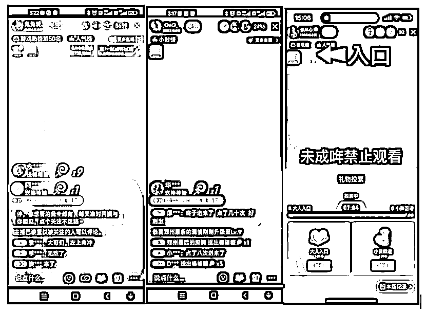

3. 赌博型。世界杯一开赛，赌球党闻风而动。搞一段已经结束的足球比赛录播，挂个小游戏推广的小程序，把在线人数拉到260，再发起比赛竞猜投票pk，水军立刻在弹幕里说自己押中多少。其实抖音根本不能像斗鱼虎牙那样真下注，这纯粹是消费球迷对足球的狂热和搏一搏的心态。这种封号概率倒是不高，缺德指数两颗星。

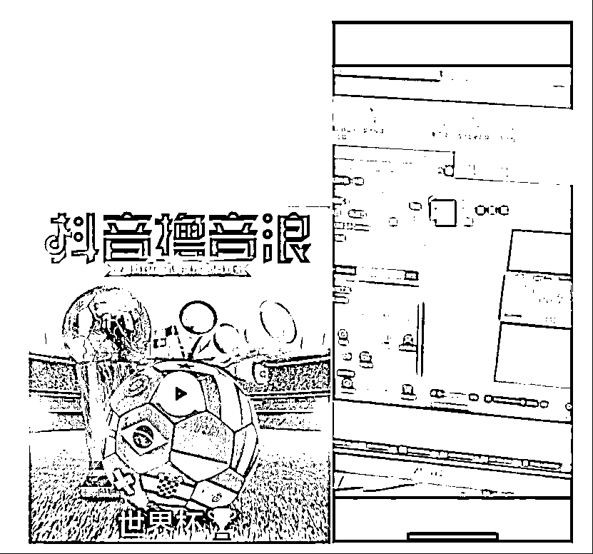

4. 祝福型。非洲小伙送祝福、财神送祝福、雪地写字、沙滩写字、表白场景……这些都需要真人出声道贺，照着稿子念就行。优点是门槛极低，缺点是卷成麻花，而且长时间说话很累嗓子，对普通话、音色都有要求。平台几乎不封，道德也没毛病。

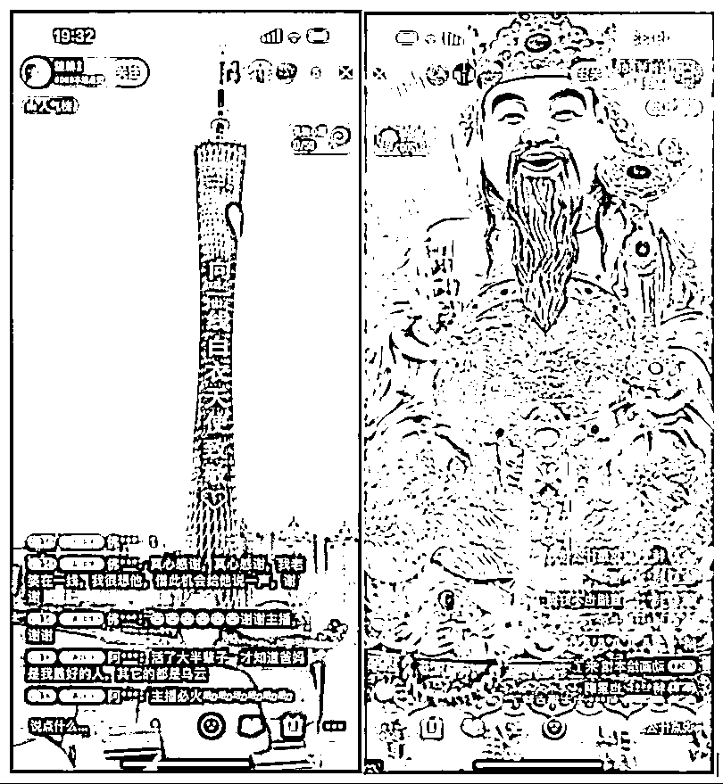

5. 互动游戏型。传统游戏赚钱要用户下载、注册、看广告、充值；互动游戏直接在直播间里弹幕操控。比如红蓝对决、云蹦迪、自习室、泡脚，玩法分红蓝阵营PK和休闲参与。技术流程就是电脑上装好游戏，开播，通过接口抓取弹幕、ID、头像，把命令自动填进游戏，再投屏到桌面上。用户为了赢，或者为了抢C位，刷起礼物毫不手软。但这类游戏热度消退快，所以开发者不停“换皮”——三国对战、四国风云、上古战场、红色警戒，一个接一个。

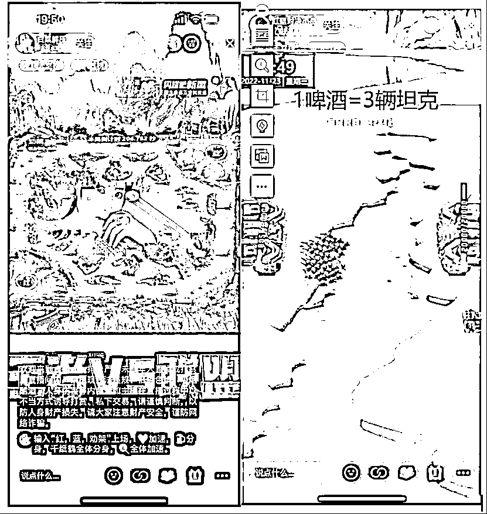

休闲类倒省心，大家一起上自习、逛街、做体操，打赏就能坐C位。全自动挂机，封号率极低，赚多赚少全看命。

我对互动游戏的判断：入局的人会越来越多；能赚到钱的永远是少数，二八法则很现实；最稳的其实是开游戏工作室，做上游卖水。我们团队就4个人——两个产品、一个技术、一个玩法，一周就能做出一款新游戏，大多数是换皮。收入大头在哪？一、自有账号批量直播拿打赏；二、把游戏接口租给达人们，一个月399到599元；三、跟网吧、闲置公司合作，挂到工会矩阵放量。适合谁玩？家里蹲有电脑的人，或者已经和生活妥协、开始摆烂的人。

无人直播能长久吗？说句实话，它就是在和平台规则玩猫抓老鼠，终究不是正道。可在当下这种大环境下，普通人扛不住那些重资产、长周期的大项目。不如先用无人直播、在线课程、虚拟玩法把第一笔钱攒下来，等经济稳定了，再拿这笔钱去做真人直播、做品牌、做IP，做长久且有生命力的东西。到那时，抗风险能力也是今非昔比。

下面讲实操。

硬件工具我们很用了点心，自研了一个小盒子。插到电脑上，系统会把它识别成摄像头，直播伴侣里显示的就是一个摄像头设备，干净得不留痕迹。原理其实就是：摄像头本来把光信号转换成电信号，盒子把光路拦住，把视频伪装成光信号送给电脑。主要是防系统检测，人工举报还是防不了。

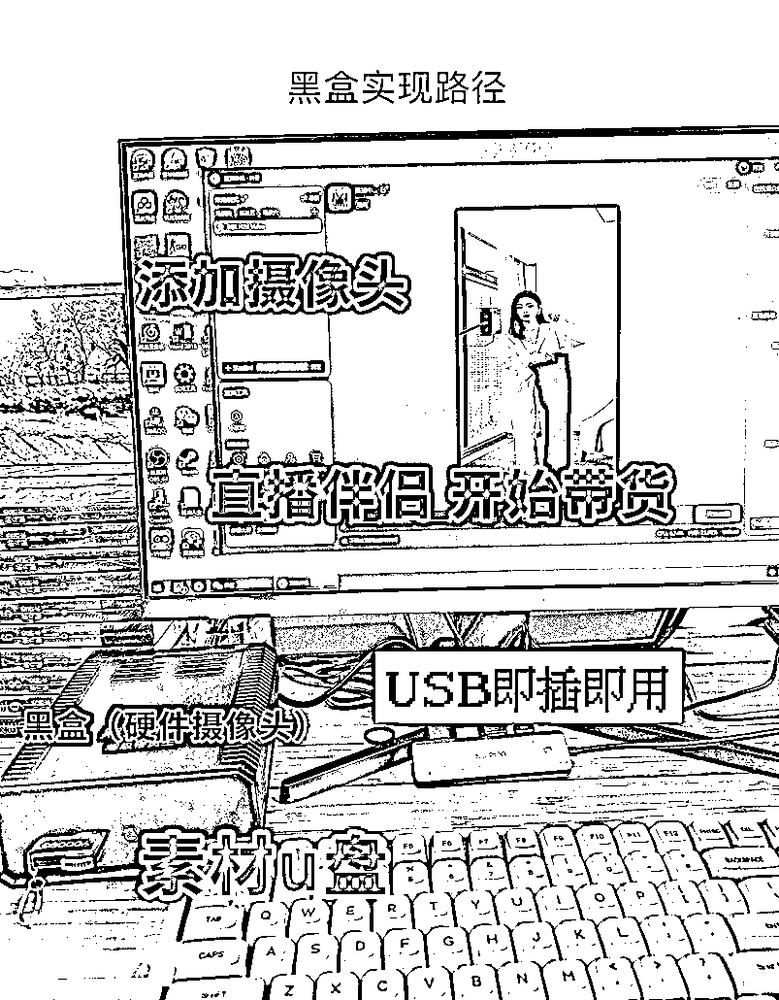

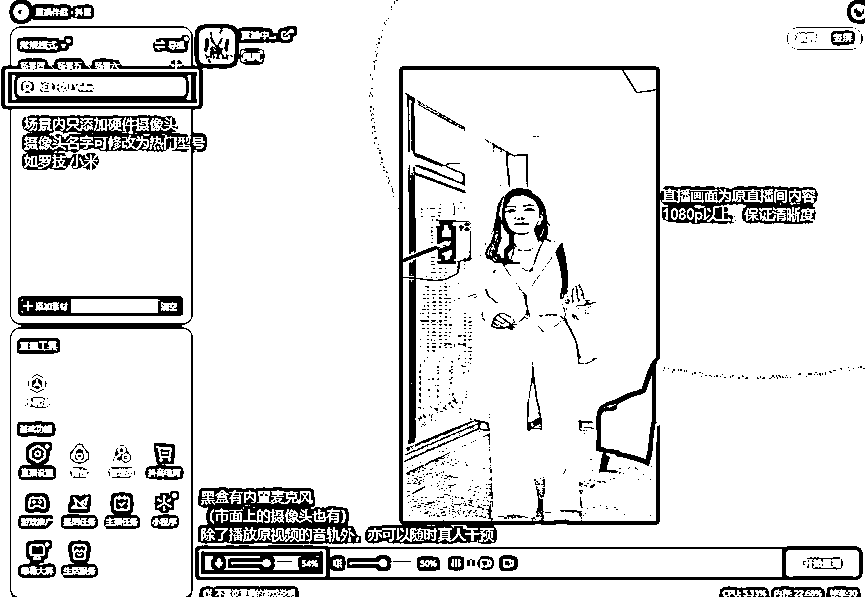

直播素材怎么做？最简单的就是录别人的优质直播。用自动录制软件，设好关键字，别人一播你就录。录完人工过一遍，没有违禁词、平台名、直播间名、时间日期，再去重导出mp4。绝对！千万！不能录带明显Logo的，比如阿迪达斯，一旦用上就是品牌侵权，直接封号。你要是看到有人用，赶紧举报，包赚不亏。

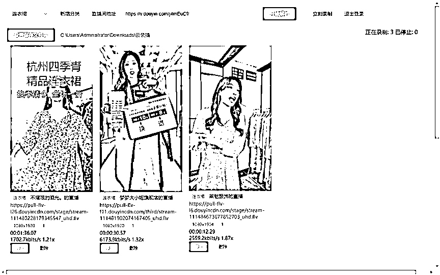

我之前选素材，筛来筛去发现70%的好货都来自蓝V店铺直播，卖的是自家的东西。要么不上精选联盟，要么佣金只有1%。眼馋吃不到怎么办？我直接找客服聊：“我是一名主播，很喜欢你家商品，可以去KS带货吗？”店主一般有三种反应：要么拒绝，要么同意开店，要么爽快同意甚至每天给你主播的排期和最合适的录制时间。现实里大多数是第二种。店主们运营其他平台精力不足，你主动送上门当免费代理，何乐而不为？遇见大供应链的，还好心奉上海量原创素材——在他们眼里，谁卖、怎么卖根本不重要，能出单就是好人。

录真人直播间的素材有个大优点：看起来场景真、人物真、兴奋劲也真，外人根本看不出是无人直播。但也要注意，用几天就换掉，要是直播间当场卖爆（销售额过十万），赶紧下架。也可以蹲着这位主播，录他下一场。

自制内容适合手上有产品的人。单品的死磕细节，话术围绕它讲；多品的就拉远镜头展示商品全貌，话术重心放在促销和引导关注，别逐个品讲，否则弹窗跟不上，也不符合“轻运营”的初衷。有时也会倒过来，先盯上正在上升的品类，再去找对应素材。素材搞定，去精选联盟挂橱窗，开播。

选品。这是直播间的生死线。定位首当其冲：主播是谁？卖什么？卖给谁？三者对齐才成立。比如我做的大码女装，目标人群是20~35岁、120斤到180斤、客单价50到190元的女性。直播间画面永远是一个胖姑娘穿着大码装，看起来明显显瘦。因为大码女生的第一诉求就是显瘦，其次才谈潮、舒服。选品也只做大码。别为了引流放9块9的袜子——买袜子的不一定是胖子，一旦成交，流量就会跑偏，垂直度瞬间被污染。福利品怎么选？上大码内裤。这也是大码女孩的刚需，买它的人绝对是我要的精准流量。所以说，一千个泛粉不如十个精准粉，这个道理到哪儿都通。开播前先问：卖什么？属性是什么？用户是谁？什么内容能吸引他们？回答好了，流量自然来。比如我们最近卖得好的灰指甲药水，素材就是涂药前后对比，话术隐晦讲疗效，转化特别快。选品能力也靠练，有同事主管中老年女装后，狂看一周才算分清什么才是真的“中老年款”，最后才明白“小香风外套”原来是个垂类标签。

至于流量运营，粉丝经常问我几个问题：

付费投流？我不投。录播内容本身就见不得光，广告审核那关大概率翻车。而且一旦跑出付费成交，系统会认定你是付费达人，自然流量就越给越少。当然，如果你是稳定真人直播间，ROI正向，投个爽没问题。

短视频引流？不做。直播和短视频确实互惠，但短视频要花太多心思。

养鱼？我偶尔买鱼，不自己养。广场鱼6块每小时每条，鱼塘鱼20块一条，最低210条起，补单鱼7~15块一单。买来的鱼能活跃氛围，提升权重。

有一个我常用的骚操作：把成熟直播间的流量导给新号——要求两个号用户画像一致。爱喝酱香酒的人，不管在哪喝都要喝酱香，那我就多开几个“酱香酒店”，怎么走都绕不到别人家。

憋单？我从来不憋，直接挂车开播。现在的憋单很容易被判诱导或者“不挂小黄车”，流量没起来，账号倒先没了。

卡广场？早不用了。靠猎奇画面吸来的泛粉，转化极差，还会洗坏标签。

总结流量差的原因：账号权重低、直播内容差、直播间转化差。前期养号很重要，新账号先按类目养上一周，再正式开播。

无人直播只是一个阶段工具，别把命押在它身上。聪明人用它快速完成原始积累，然后才有力气走向正轨。

直播带货的增长逻辑，本质上是看数据说话。

B.直播内容

素材是否够抓人、直播间互动是否活跃，直接决定了系统是否愿意持续给推流。观众在广场看到封面不点进来、进来就立刻离开，意味着曝光进场率低、停留时长短，互动层的流量自然就会被压制。遇到这种状况，通常要先从封面和直播内容本身着手优化。

C.UV 值较低

进场 1000 人、1000 个人都没产生成交，UV 的价值就是低的。UV 价值的计算方式是销售金额除以场观人数。平台的算法很简单：谁带来收益就推谁。

直播间的流量漏斗

初级层是直播间互动，包括点赞评论关注这类泛流量；

中级层是商品曝光和商品点击，属于带交易标签的流量；

高级层是商品成交，属于精准标签流量。

这三层也可以换个说法：

互动层，对应广场曝光进入率；

曝光层，对应小黄车的点击次数、商品曝光次数、商品点击次数；

成交层，对应成交数量、成交金额、场观人均价值。

挂了小黄车之后，就进入了后两层赛道。直播间能不能被持续推流、推流是否精准，完全取决于前面这几项数据。

# 三、无人直播的问题和风险

## 1.最常见的问题：流量差

我始终相信数据冰冷但不会说谎。所有问题都会在数据上体现，也能从数据上找到解决方向。

实测的及格线是：观看人数 : 商品曝光 : 商品点击 = 1 : 10 : 0.5

达不到这个比例，系统基本就不会再加码。

没达标的原因通常有三类：

观看人数少：内容不吸引人；

商品曝光低：话术不行，没引导用户去点开小黄车；

商品点击差：选品无吸引力，用户点开后没兴趣。

解决思路：

1) 观看人数少

A. 优化直播标题和封面

系统在直播广场给你推 100 次，进来的人寥寥无几，责任在你自己，是你没把人勾进来。

B. 优化直播间内容

人进来坐不住就走，说明期待没被满足。可能是初始流量偏泛，也可能是留客能力弱。

提升留客能力，本质是满足用户的情绪需求。

比如一个女鞋直播间，流量一直平平，后来换了做法：找来一位腿毛的男同事，穿黑丝袜配 40 码高跟鞋，放劲音乐摇曳，恨不得跳一段广场舞。你换位思考一下，进来的人能不看一会儿吗？性别反差就把流量拉高了一半。品没变、受众没变，只是刺激方式变了。

2) 商品曝光低

为什么没人点小黄车？可以这样说：25 号链接是我给大家准备的福利，一件爆款羊绒围巾只要 9.9，只要是粉丝都能点进去抢。特意强调 25 号，是因为用户会从 1 划到 25，这就带来了 25 次商品曝光。

同理，把商品卖点也写在奇数链接上，比如 25 号链接，来白嫖我！在解说商品时也能带动一批人去点。

3) 商品点击差

一般用钩子品加爆品的组合来提升点击。

排品思路举例，直播的是一件羊绒大衣正价 199 元：

1 号链接设为钩子，0.9 元，定时开售比如下午 2 点，库存设为 0；

2 号链接是正常价 199 元，但无库存，制造稀缺；

3 号链接是正常价 199 元，有库存；

4 号链接是高价 1999 元，有库存，只为衬托 3 号更划算；

5 号链接可放成套装，提升客单价。

这种定价和排品的玩法，在《定价的艺术》里有大量案例，本质是利用消费者心智完成无硝烟的博弈，让人愿意掏钱。

## 2.无人直播最常见的问题：封号

一说无人直播就想到封号。归纳起来是账号本身被风控和账号内容被风控两类。

账号本身被封控：

1) 网络风控

同一个 IP 下，若有账号违规限流封禁，抖音会连带排查该 IP 下的其他账号。

解决：一机一宽一号，电脑宽带下同时只能开一个号。换号或违规断播后必须换 IP，重启光猫或拨号。

2) 手机风控

同一设备登录，若有账号违规，会连带检测设备上其他账号。

解决：理想是一机一卡一号。条件有限的话，一台手机上的所有账号都要正常养号，保持高活跃度个人用户行为，也可做到一机五号。

3) 基站风控

同一基站下出现大量异常账号行为，平台会重点审查。

解决：换办公场地。更换地点后若有推荐则说明基站问题解除。

4) 账号行为风控

不养号被判定为非正常活跃、批量同地注册、物联卡注册、直播违规、换设备登录、异地电脑登录等。

解决：用四大运营商手机号 4G 流量错峰注册，换设备异地登录后养号三天再播。异地电脑登录可连播三场，每场一小时以上解风控。直播违规可尝试手机六开六关秒开秒关应急。

Ps：如果把养号当玄学，你也可以按自己的方式来，只要有流量就行，就当我没提过。

账号内容被封控：

1) obs 来源问题

用 obs 推流时双方会获取权限，平台很容易识别循环播放。大型主播多层叠加主副摄像、麦克风、贴片等不重复素材输入，接口才能通过。权限在握，系统知道一切。

2) 循环录播

从 2018 年至今，抖音检测标准在变：5 分钟、15 分钟、半小时、1 小时…目前超过 1 小时不重复素材暂时安全，实操一般准备 3-8 小时不重复素材。

3) 前后比对

平台会对比本场与前后两场，判断是否重复播放。一旦被举报，人工也会核查。

4) 多人直播

A 素材被多人使用，平台会判定多人直播而违规。

5) 主播人脸识别

近期在头部主播中试点，视频里出现特定人物会自动判定。没有授权就用他人脸，会被判违规、品牌侵权、肖像侵权、盗录。

抖音早有“直播间出镜人须与实名一致”的规定，本质就是人脸检测，只是尚未全面执行，随时可能铺开。

开播 10 分钟内触发违规提示多为机器识别，需换素材去重；10 分钟后多为被举报人工提示。注意：账号一天内不要超过 2 次被弹 10 分钟违规，连续触发会升级为 1 天、7 天或永久封禁。

基于这些风控，我认为无人直播的生命周期很短，随时可能消失。但我依然建议小白学习，因为进入直播行业只有两条路：a 去企业找工作，b 自己搭建直播场景。a 路岗位难进，从主播到场控运营都不易；b 路成本高，场地装修、人手投流等投入大且试错周期长。

我同事的侄女毕业后找直播相关工作两个月无果，后来跟我们做无人，一个月佣金赚到 17 万，已经熟练掌握场控、话术、流量、转化等全链路。现在有公司想挖她，她不想做嫁衣，打算回温县做铁棍山药的挖掘直播带货。

可以把无人直播当成进入直播行业的跳板，为下一步蓄力。哪怕以后不能做无人，回撤真人直播也会比以前更强。

以上仅一家之言，不能涵盖全部方法，使用需谨慎。最后祝你发财！

## （69 赞）《「抖音 SEO」2 天线下大课圆满结束》

很荣幸与「龙哥盟」首次合作举办的「抖音 SEO 陪跑计划」中，两天线下课顺利收官，效果超出预期，当场就有老板出单！好产品值得推广。内容大纲：01 陪跑式：理论结合实操 02 选词定生死 03 抖音 SEO 仍属蓝海，做好后轻松持久 04 精准：你戳中我的痛点了 05 细节决定成败 06 线下课福利：工业级生产，全自动的收集全网爆款素材库：

评论区：

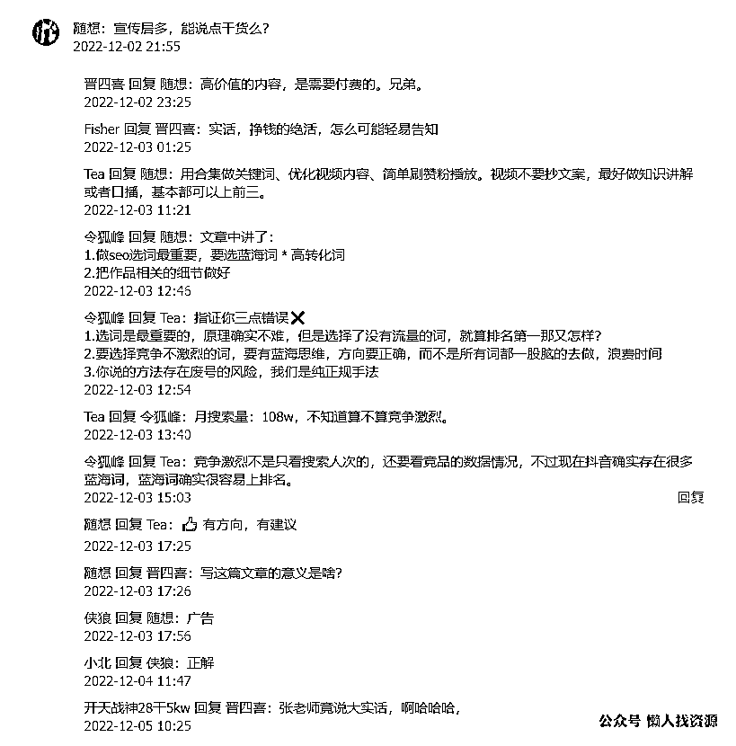

## （43 赞）《抖音团购—业务全流程复盘》

当时做抖音团购时，赚钱里几乎没有人分享，只好自己摸索。最近业务又火，我翻出当时的复盘分享出来，供大家参考。

一段时间我不愿回看这段经历，有很多难以面对的地方。最近对唯心有些新感悟，看得也开了。

## （108 赞）《「硅基主播」试用体验》

两周前我向刘润老师咨询过他用“数字人”做短视频的供应商硅基智能，后续对接试用。因出差耽搁，昨天才出了一段数字人模拟短视频。

流程是：先提供几段过往拍摄的原始视频捕捉表情动作，再录一段音频训练数字人对口型、表情手势，随后拍一段视频训练整体效果。

我因隔离在家尚未完成再训练，但第二阶段模拟视频已出来，下面这段就是基于早期视频和音频模拟的。

模拟完成后，无需化妆、背稿、拍摄，只需输入文本就能输出以假乱真的短视频。

我录 3 分钟短视频加上剪辑至少需 2 小时，训练完成后只需打字即可，个人时间成本大幅下降。

刘润和李笑来都是效率化的标杆，我跟随学习也能提升不少。这个数字人技术也用于带货主播直播间，还有其他应用场景。

## （98 赞）《抖音引流卖教辅资料，单人单日 500+，虚拟产品私域玩法实战分享》

大家好，我是小许，一个靠流量生存三年的工作室负责人，本文约 3700 字，阅读约 10 分钟。

今天分享一个近期爆起的赛道“抖音引流+私域售卖教辅资料”全攻略，小白可直接复制。如果你认真阅读，足够赚回社群门票。

玩法看似简单，实操仍需时间。以下是我团队的真实经历和技巧，希望能帮到疫情下迷茫的赚钱朋友。

目录：自我介绍、目前战绩、项目拆解

一：自我介绍

这个部分怎么写还没定好，标签很多：大学班长、省优秀毕业生、毕业后新媒体总监、短视频培训老师、现在工作室负责人？

我的经历起点和大家类似，只是运气稍好。2018 年以省优秀毕业生身份毕业后进入互联网，先后接触微信小程序、字节跳动、抖音培训行业。感触最深的是培训行业，从懵懂应届生蜕变为给上百位企业家授课的老师。

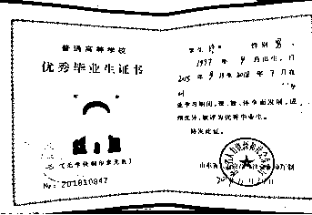

一次偶然的机会

基于长期积累的偶然，我选择创业。工作期间常刷抖音知识博主和卖项目的老师，积累了大量业务微信，受朋友圈影响萌生创业念头。某天早上看到老乡在推项目，果断透支信用卡 3000 元付费。正是这次决定开启了我的第一个项目男粉引流，两年变现 300 万，是第一个也是深耕至今的项目，改变了生活现状，一年还清百万房贷，换了车，存下积蓄。

创业初期只考虑如何活下去，有了底气后出发点改变，如何做得更久？我坚信只要逻辑成立且有成功案例，差距不在项目而在深度。正因如此，经历几次起伏都坚持下来。今年为走得更长久切换赛道，经过半年犹豫徘徊，于 2022 年 10 月在新赛道拿到结果——教辅资料。

二：目前战绩

团队从零开始做教辅项目，10 月初上号、包装产品、包装承接流量的微信朋友圈，十月底开始变现。测试加稳定期约两个月，三人合计盈利 45610 元。相比之前男粉项目日进数千，利润不高但开心：第一证明路径可行，第二赛道可长期积累，第三是纯绿色平台风控轻。

两个月加好友近 3000 人，客单价 39.9 元，成交超 1000 人，转化率约 30%。客户精准，我们全程手打字沟通，朋友圈影响加后续刺激，成交率满意。39.9 元客单价不高，纸质试卷一份十几到几十元，这个项目简单粗暴且可复制。

也是可复购项目，卖 1-6 年级学习资料，每年级 39.9，和年费社群类似，有价值明年会续费。后续玩法很多：家长朋友圈裂变、嫁接淘客卖品、对接机构推课程等。

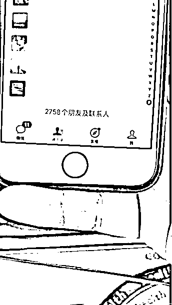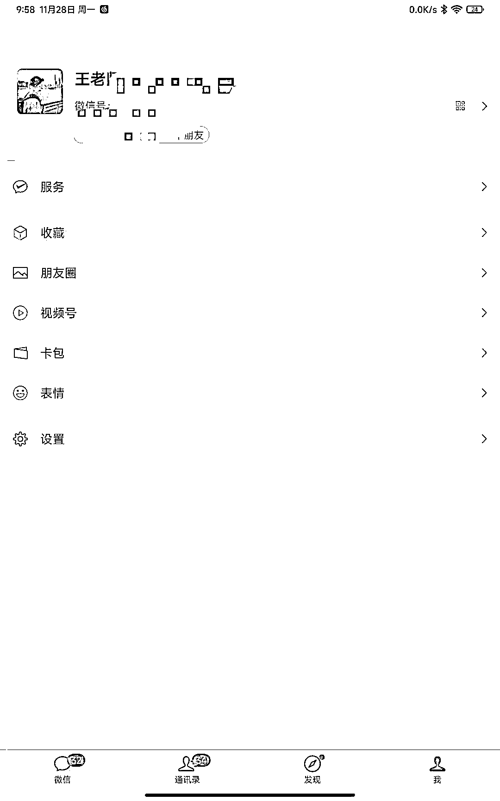

三：项目拆解

（一）项目离不开流量和变现。流量在哪？变现用什么产品？

1：流量在短视频平台。从微信离不开到现在离不开短视频，我们每天看短视频的时间远超大部分 app，项目顺理成章用短视频解决流量。

2：变现产品。个人或小工作室做实物要考虑物流和选品门槛，我们选择虚拟产品：小学教育学习资料电子版，无需物流。

总结：目前通过抖音和小红书图文发布内容，引流 1-6 年级家长到微信，微信成交学习资料。内容形式可复制，小白剪辑即可上手，无需电脑。

（二）实操教程

先在抖音翻阅同行，小红书也可但目前结果较少不做分享，无实战不分享。

第一步：确定人群

需要细化，比如主做一年级还是二年级。实战反馈一年级、三年级家长转化更好，建议做这两个年级。

第一步：同行账号学习

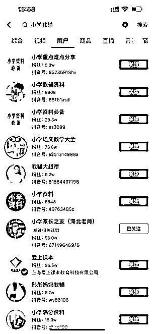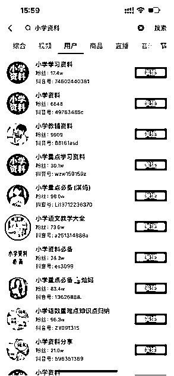

直接搜关键词即可：小学教辅、小学生资料、小学三年级等。打开一看内容并不复杂，多为小学试卷，每个作品收藏点赞比例很高，证明家长有需求。点赞收藏触发多因感觉有用方便后续查看。

第二步：账号准备

做短视频最大的坑就是上来就猛刷内容跑量，定位偏了堆再多播放也白搭。下面这套从注册到变现的实操框架，是实战踩坑后沉淀下来的经验。

先判断角色。

一个人操盘还是工作室矩阵，思路完全不同。单人号建议用自有实体卡注册，封号风险低，更适合长期做大。矩阵团队卡源不足时多以接码为主，最好挑选可保留号码的渠道，等账号数据跑顺后再转绑回个人卡。单人带量，同步操控5到8个号，工作量完全可控。

建号别追逐玄学，养测包装三步走就够。

养号被神化很严重。我们做流量三年，也经历过整夜掉号上百的情况。矩阵账号通常2到3小时后就能开播，动作就是模仿真实用户：滑内容、点赞、关注、评论。关键是只与同赛道的账号互动，不要跨界瞎刷，这样后期人群标签才精准。1到2天即可，权限高低与养号时长关联不大。

测流是很多人忽略的环节。养号结束准备发正片前，先用App自带拍摄功能拍一条7到15秒的随拍，风景或人物皆可，配正常音乐和文案发布。24小时后看播放，200以上视为正常，低于200就先养两天再试。同时检查是否可以开抖+，部分账号无违规却既不推流也不播，这类号建议放弃。

通过后再做形象包装。封面可选教室场景图、引导关注的海报、或说明账号内容的图，例如每天更新三年级数学重点。头像可用真人自拍或文字头像。签名示例：三年级班主任，日更三年级资料，欢迎家长关注。前期不要做强引流。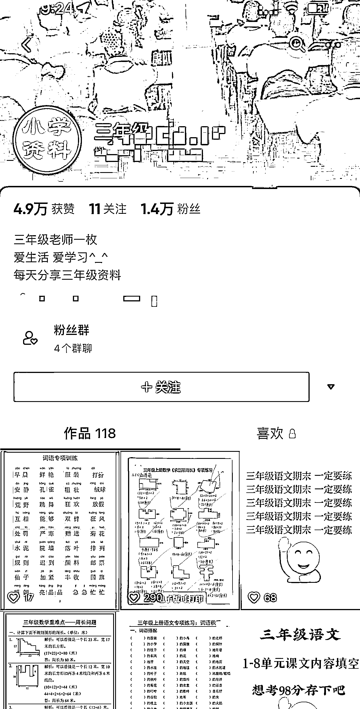      不会弄就直接套用这个模板。

引流方式四种。第一，正片中埋钩子，提示家长我们有可打印的电子版。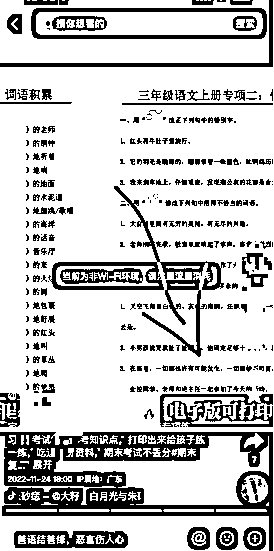第二，封面引流，建议粉丝破千后再用。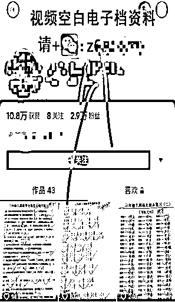第三，私信引流，家长群体即使留了联系方式也不一定会加，私信更直接，话术用“要电子版加V”，严禁说“领电子版”，领字会让人觉得白嫖，白嫖量会暴增。第四，群聊导流，大号开通群聊后，用小号在群里引导家长添加微信。

话术转化没有高深技巧，多聊几个同行就能找到适合自己的节奏。收款方面注意，别长期用个人微信收款，用久了易触发风控影响转化，建议用快团团或支付宝。

产品就是学科资料包，每个年级一套。直接去拼夕夕搜索一年级学习资料、二年级学习资料，1到6年级全部买齐，总花费通常在一百以内，整理后即可用。私域运营要学微商打法：朋友圈每天发十条左右，生活类两成、成交类五成、反馈类三成，偶尔发督促学习的内容，家长关注度会提高。为每个家长打标签，记录是否成交、添加时间、年级群体，后续便于跟进。私域的优势是可重复触达，多次营销，必须做好。

流量、话术、产品准备好后，就是执行。同行是最好的老师，多看高播放作品，直接复刻内容形式即可。若尚未定位，可用笨办法：拿张白纸写下自己每日重复的事，从中挑一个最感兴趣的。职场人可写通勤、做表格、下班做饭，每条都能延展出方向；宝妈可写带娃、辅食、收纳、育儿、婆媳相处，都是可做的赛道。选自己最爱的方向，因为热爱才能坚持，坚持才有机会做出细分优势，最终做到头部。

真实案例：有人按此方法起号，第四条视频发布前一晚播放卡在300，次日直接拉到6万+，一天涨数百粉，当场开播还成交了一单课程。能爆因三点：内容有收藏价值；开头三秒抛出“现在做自媒体还赚不赚钱”这类大众关心的话题；戳中部分同行“在家待业没收入要不要外出”的焦虑。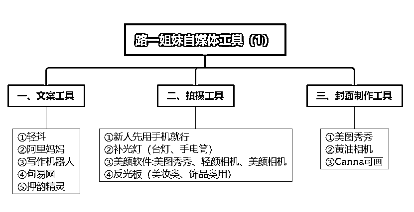

底层认知三条：第一，内容能多平台发就多发，东边不行西边行。第二，新号比停更的老号更容易被照顾，标签干净、平台需要新鲜血液，但不代表要放弃老号，有号先用。第三，有流量立刻开播，别等准备完美，黄金期错过就凉。直播能给视频导流，视频也能为直播间带人。

平台赚钱可用天时地利人和解释。天时指天气季节节日，寒潮来卖保暖，炎热卖防晒，双十一节点蹭大促流量，提前预判才能吃红利。地利指平台规则，抖音早期只能跳淘宝转化路径长，后来自建电商路径顺了转化就上去；视频号从无橱窗到开橱窗，道理一样。人和指团队匹配，擅长直播的做直播，擅长短视频的做短视频，擅长投放的做投放，不匹配及时剔除。做无货源店群一定要矩阵思维，至少准备5个以上店铺，用数量对冲不确定性。

最后说个新玩法：现在有主播做收礼物自动打印送礼人头像并自动语音播报“感谢某某的小心心”，这种互动很刺激打赏，主播打印纸都换了好几卷。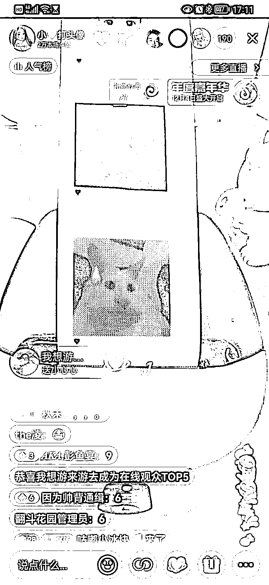

行动永远比技巧重要，立刻去跑。

先讲讲自己这几年的经历。早些年路走得太顺，整个人发飘，摔跟头只是时间早晚。疫情那阵子让我亏了钱、吃了苦，但也把心气磨踏实了，现在反而对以后更有把握。会员日那篇亏钱复盘还有太多细节不适合公开写，做项目的人都知道，盈亏同源。

我在不少创业社群和副业社群里潜过水，除了少数专门聊代发玩法的圈子，几乎没人愿意把这类模式讲透。即便是赚钱，讲后端供应链的帖子也远少于讲账号运营和直播的。这行里比我强的人多的是，但真诚拆解的极少，多数是放个钩子等你去私聊买课。所以我10月份在赚钱发过一条关于微信小视频电商后端的内容，当时给的判断到现在还适用：这个方向依然值得做，新手从零入场也不晚。

下面按四个板块聊：模式、利润、操作方法、几个关键提醒。

**一、模式扫盲**

定义其实很宽泛：自己不用囤货、不用发货，接到订单后让上游代发，从中吃差价，这就算代发套利。所有电商平台上都有这类玩法，不必怀疑。今年是这个行业震动最猛的一年：

- 拼系、淘系、抖系纷纷上线买家隐私号，订单还能拍，但取货码短信收不到，号码有时效，稍一超时连买家都联系不上；

- 七八月拼系和抖系先后限制拍单，一个频繁风控退款，一个直接封掉商品橱窗；

- 以前的自动拍单工具基本失灵，凭空多出一块成本；

- 拼系现在每一单都会给收件人发提醒短信，明摆着告诉买家别让中间商赚差价，退货率因此被拉高，麻烦多了不少；

- 平台对空手倒卖的打压也在升级，比如抖系明文规定禁止这类操作，动不动就违规、扣保证金、封店。

这些问题后面还会提到，看完大概就知道怎么应对了。

**二、利润到底怎么样**

先给真实数据。下面是我11月23日用手机微信能登录的7家店的经营截图：

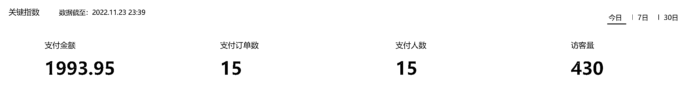

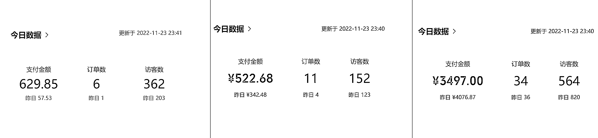

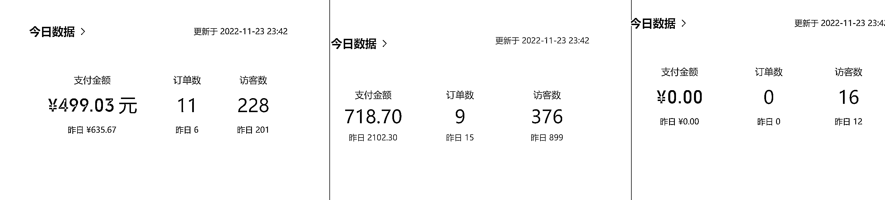

有挂零的，有个位数订单的，也有几十单的。那个零单店是我太久没维护，卖的东西也比较冷门；只要认真优化，现在挂零的情况已经很少见。当天七家店合计营业额7858元，均摊到每家1122元，正常毛利大约30%，算下来每家店每天净利300到400元。和我上次帖子里的数据基本对得上，这个平均数一直很稳。

所以结论很直接：多开店、做精细，平均每店月利能做到一万元上下；十家店就是十万。但注意，我说的是均摊，不是每家店每个月都稳过万，上面零单和几单的店就是证明。有人开一两家店，随便铺几件商品就等着躺赚，不出单就骂项目不行，问题其实是预期从一开始就错了。还有少数人唱衰，是另有心思。

正确的做法是做店群，至少五家店起步，用数量对抗不确定性。

上面讲的还只是日常单量，没算爆单。短视频和直播总有爆发的时候，达人爆一次就是额外加餐，单次赚几万也正常，我们每个月总能碰上几次。

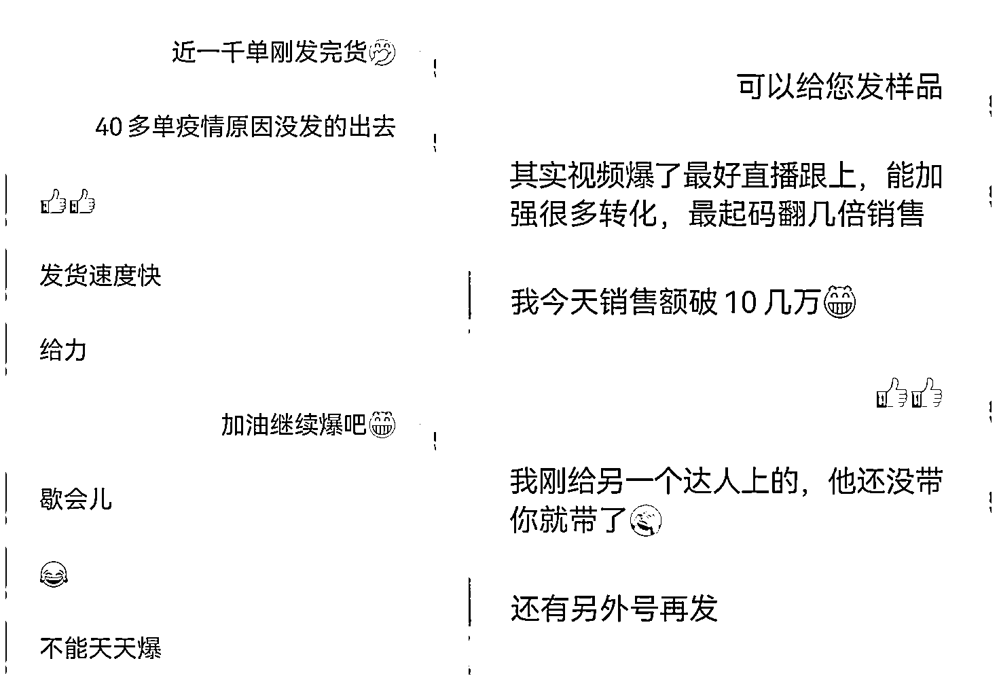

这个后端为什么能赚？根本原因是后端供给太缺了。别看到半年涌入不少人就以为卷了，其实早着。抖音卷成那样，照样有人靠代发吃饭；这个平台的选品库整体依然单薄，达人想带的品在选品中心搜不到，太正常了。所以现在进来，就算直接暴力铺货也能出单，差别只是出单多少。尤其30号之后，官方小店几乎是唯一入口，可上架商品至少缩水一半以上，这个判断已经算保守了，想做的要趁早。

纯做后端、自己不出镜不带货，就必须接入优选联盟，否则商品没有展示入口，流量自然也无从谈起。想做长期，再转精细化：选品要贴合平台用户生态，找源头供货商谈价格，优化商品留足利润，再把售价和佣金调到最佳状态——售价越低越好、佣金越高越好，这个平衡需要自己拿捏。再进一步，就是主动私信达人，谈专属合作；关系处到一定程度，有些达人宁愿少拿佣金也愿意带你。不过现阶段还没必要走到那两步，前端后端都谈不上卷。选定品类大量铺货，正反馈自然就有了。

**三、实操怎么做**

**（一）开店**

30号之后，只有本地小店能带货，其他渠道要么成本畸高，要么月底关闭。小店必须用企业执照注册，个体户进不了优选联盟。入池门槛原本不低，但11月25日刚出调整，12月3日生效，整体放宽了不少。官方公告和类目表可以去微信后台自行查阅。

进池通常两条路：一是买商标授权开品牌旗舰店，以下就叫品牌店；二是开普通店，再把数据刷进池子。代办市场随便收费一千到两千，其实一点技术含量都没有。我专门去摸了一遍价格，有个自称赚钱圈友的也收我1900，报身份也没用，哈哈。希望还没付费的朋友别交这个学费。

开品牌店，先对照开放类目表看项目能不能做。比如图书类目，只有官方店和品牌店能进优选联盟，所以我书店只能开品牌店。商标授权在拼系或淘系都能买，一年费用在300以内，贵了就砍，不让价就换人；不知道买哪一类，直接报给卖家，他们会告诉。

但千万记住：只买已经在淘宝或京东开过同名店面的商标授权，因为入驻时必须同名。平台事前不会提醒，最后审核被驳回时才知道踩坑；要是那家不支持退款，钱就白花了。我第一次就栽在这上面，有一家死活不退款，后来也懒得去扯。

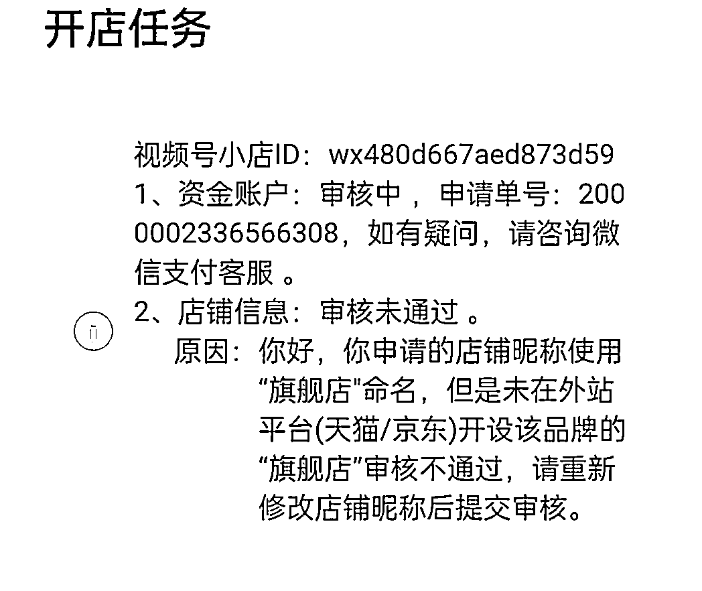

品牌店的店名必须和淘宝或京东一致，但主体可以不同。30号以后，有赞、微店这些第三端口子也没有完全堵死，还能走品牌升级接入交易组件3.0，只是都要求主体一致。

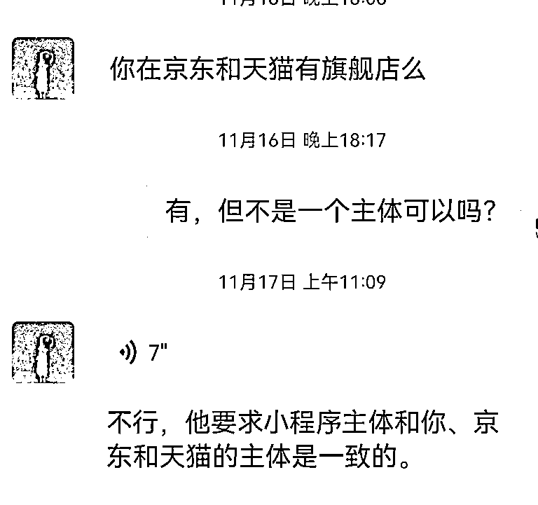

所以基本可以断定：之后这类代发玩法，实际还是只能落到官方小店里。

开普通店刷池子的条件，就是官方字面写的那些。市面上说不用垫资代操作的，听听就好。当个“刷子”其实没那么难：1000单、100万流水、开店满30天即可，我这边圈子目前还没听说风控。最新规则是100单、10万、满15天，更简单了。

但品退率和纠纷率不能高于平台均值的1倍，做代发的人一不小心就会超，超了会被清退；品牌店的标准是2倍，安全很多。所以能开品牌店，就优先开品牌店。

品牌店的具体材料：企业营业执照、法人身份证正反面、商标注册证、品牌店独占授权，以及微信实名不是法人时需要准备的经办人身份证和业务授权函。入口在创作者中心—带货中心—小店开店，按提示填写即可。

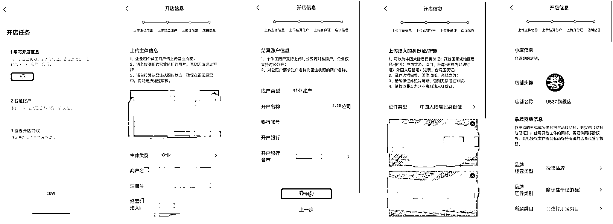

店名直接起“XX品牌店”，但前提是淘宝或京东已经有同名店。商标和品牌授权书按模板提交；别觉得商标、品牌授权这些词很高大上，实际一年成本也就几百块。

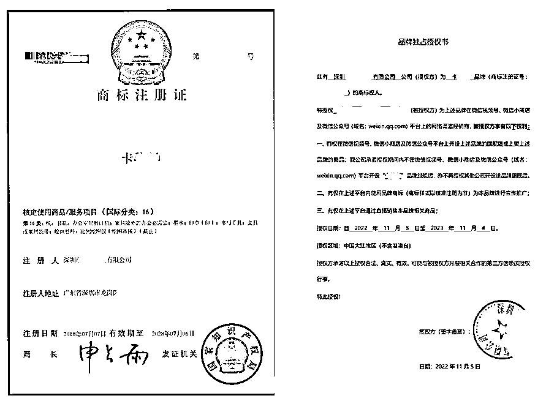

提交后还有资金账户审核：微信实名是法人就直接确认，不是的话需要法人扫码。审核一般3到7个工作日，最近入驻的人多，速度偏慢，每天点开看一眼就行。通过后电脑登录后台，界面有点像简版微信小店；在店铺管理—类目管理里申请类目、上传资质，不需要资质的类目最好也申请一下。

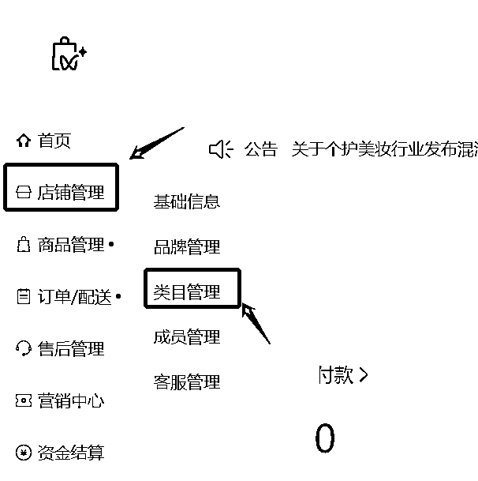

保证金是上架第一个商品时才提醒你交，注意交满60天后才能提现，没想清楚就别急着交。到这儿，店就算开好了。

**（二）选品与上架**

开店之前就应该想好做什么类目。新手我建议先别研究精细选品，直接把营业执照能覆盖的类目大量铺一遍。如果小店没出现，我肯定推荐图书、食品这类要资质的品，证书不难办，还能甩开一批竞争者。现在小店刚出来，入池门槛把不少人挡在外面，反而给其他类目留了窗口，尤其是百货类，谁手快谁吃肉。我估计到年底都还有红利。

我自己现在已经有5个图书店、5个食品店，最近一直在忙着继续开店和铺货。顺便说一句：如果你只做前端、缺货盘，可以找我合作上架，利润透明，赚钱圈友按三七分，我三你七。

采集渠道很多：淘系、拼系、1688、抖系都可以。但代发赚的是差价，价格最低的货源大多时候在拼系。采集时就要算清楚：加价多少、给达人多少佣金、自己留多少利润。达人佣金一般开20%到50%，开太低没人帮你带。

店多了可以做同品霸屏：同一个商品拆分出3条以上链接，价格和佣金分别拉开，达人不管选哪条，订单都是你的。有电商经验的人可以稍微筛一下品：多刷同行店铺，按销量排名看，这个生态的后端商品大多没刷单，榜单基本是真实销量。同行卖得好的品直接搬过来，多做几条链接，用不同价格和佣金组合去打。

具体工具方面：拼系采集我用至尊宝插件批量导出商品链接，上架用稿定商品，也就是原来的欢乐逛来搬家。以前业内至少一半人靠拼系发货到各平台，所以拼系一限拍，圈里哀嚎一片。以前爆品时段一小时拍1000单都很轻松，现在拍多了就退款，确实劝退了不少人。

抖系爆款可以去精选联盟手动采集，按销量排行一条条抠链接，慢但准确。出单这事很玄，特意选的品可能不动，随手挂的链接反而天天出。能采多少就采多少。想省事也可以用考古加、蝉妈妈、飞瓜这些付费工具导链接，最后上架还是稿定商品。

**（三）拍单发货**

拼系的风控退款躲不掉。目前还在用拼系货源的人主要两条路：一是加供应商微信走线下发货，适合单量稳定，能绕开风控和短信；二是找代拍团队，每单让出2到3块利润。

自己备号也能缓解：一台手机能注册微信、QQ、手机号三个账号。我们测试过，单号一天拍10单以内、错开时间基本安全，客单价30元以上的商品更稳。单量少自己拍，单量大走线下，基本够用。

拼系佣金方面，部分商品开了站内推广，自己拍单也能吃一点返利，但注意别去比价，也别用一个账号多地址代购。我手里还有几万佣金卡着提不出来，有代提技术的可以来找我。想正常吃佣金只能走第三方淘客工具，平台太多，不做具体推荐。

拼系给买家发提醒短信这事确实烦，但对后端影响不大。这里的买家很多年纪偏大，拍完单经常找不到订单入口；就算找来，就说我们在拼系也有店，订单是系统自动打的，短信也是系统自动发的，基本能糊弄过去。我还遇到过买家投诉后连连道歉，非要撤诉，但找不到撤诉入口，教也教不明白。从这些细节能看出，这个平台的买家还没被别的电商教育过，做起来舒服很多。我们的客服咨询量大概只有订单量的5%。

如果采的是抖系链接，那只能去抖店拍，并且采集时就应该按精选联盟佣金倒推加价和利润。操作上，开个橱窗号，去自己橱窗里拍就行。可以找代开0粉橱窗，最近听说暂时开不了；也可以刷1000粉自己开，我们后来一直用刷粉方式。刷粉还有个附带价值：能开通团购带货。想做本地生活类目的代发玩法，基本绕不开这条路。我只说一句：万物皆可搬，这个蓝海方向值得自己重视。

以上是我目前正在跑、也确认能赚到钱的全流程。不保证人人都适用，但方向大概率没错。欢迎同路人交流。

视频号后端无货源店群现在是我这边收入的主战场，玩法也已经被我跑熟了。

先说最头疼的橱窗问题。从8月开始，自己拍自己的橱窗基本就开始被风控，一个号一单一个号是不可能的，多拍就会封。实测下来一个橱窗能活3-5天左右，封了之后佣金结算完想注销重开，得等一两个月。于是就得靠多号轮着倒着用，时间错开。每个橱窗背后都是一个实名，我自己就搞了20来个，像我这种有条件的就自己堆号。

如果号不够，手上的橱窗资源撑不起来，就走第三方，把一部分利润让出去。拍单用的小号本身不用实名，操作更灵活。同样的思路，多多进宝也是这个打法。

除了视频号，还可以去别的平台找货源拍。风控基本不存在，只要货源价格和佣金合适就行。我们平时用得不多，通常是遇到采集链接价格变动或者佣金波动，才会去多平台比价找补。

再补充几个实操关键点：

1. 每个小店上架1000个链接就够了，优选联盟本身也只进1000个。

2. 一个企业主体最多开5个小店，一个微信号只能开1个。

3. 人力成本上，一个运营可以带5-10家店，覆盖客服、拍单发货、上新维护优化。熟练了能带10个以上。我们是按人头包店，按业绩提成。

4. 小店开成功之后暂时不支持退店注销，只能在开店前注销。开好了想关，就得先注销视频号，小店会跟着一起关。

5. 小店客服只能用企业微信，一个企业微信可以绑定N个小店。正常询单看不到买家信息，需要的话去服务市场买个客服工具。

6. 延迟发货可以选最底部的报备，但最近审核忙不过来，报备基本没什么用。

7. 小店目前不支持运费险，后面可能会上。现在想用运费险只能去服务市场找工具，据说能做，我没用过。无货源玩法的运费险其实也没啥必要。

8. 不能空发，必须上传物流单号，目前没有免物流的选项。

以上就是视频号后端无货源店群的核心打法。无货源的思路并不局限于视频号，所有电商平台都能套用。哪怕是难度最大的抖店，现在依然有人在做。99%的同行都撤了，剩下的做精细化运营，反而活得挺滋润。

我们现在手上还在同步做的有美团电商和小红书。美团电商是看青岛圈友刘家齐的分享去测试的，目前刚起步，还没成绩。小红书后端给我感觉很像今年年初的视频号后端，有红利的迹象，我已经交了2万保证金开了店，还没开始动，这是下一步的计划。等有了进展再来更新。

另外QQ小世界的后端也被很多人忽略。我之前测过一个店，结果被误判三级违规，暂时不打算走第三方了。我会继续观察，等QQ自己的小世界店铺开放再进场。

有问题直接评论区聊就行，我不带培训也不卖课，让圈友们一起讨论也更高效。有合作的可以私聊，交流学习。

完。

## 10天从0到变现6000+，场观破万，我做了什么

大家好，我是姚麻。很久没在赚钱写正经复盘了。刚从多多视频脱坑，转去试视频号。15号萌生想法，17号发第一条，截止27号，10天变现正好6201元，最高播放310W。直播也第一次场观破万。

趁着今天发什么都0播、直播没人又接到通知上船，就把这十天的操作和思考梳理出来。

先特别感谢李诚老师，给了我大量解答。上期航海没上船，老师依然耐心应对我的“骚扰”，等佣金到账一定好好感谢。

原文我在星球写过，被删了，敏感词问题。现在放到飞书了，方便查看：

## 动员80万宝妈做童书社群分销，2年成为行业头部的打法

宝妈一直是商家最想占领的人群。社群分销看起来增长猛，但重、复杂，行业里很少有人公开讲。一方面头部玩家埋头赚钱，比如蜂享家动不动百亿GMV，没动力分享；另一方面小玩家做法不规范，不敢公开。

现在大家都盯着短视频直播，社群相对平稳，关注度低。

我是陈欢，书里有品联合创始人。书里有品是童书社群分销平台，2020年4月上线，疫情期间4个全职员工起步，上线第一个月零投放进10万宝妈和老师做分销员。现在已有80万+阅读推广人，200多家出版社直发，销售额1.5亿，已完成4轮融资。今年开始给蜂享家、万物心选、云货优选、喜马拉雅供货。

接下来把0预算单月10万分销员、30人团队带80万宝妈两年做成行业头部的经验毫无保留分享。

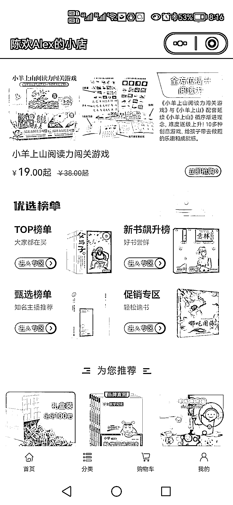

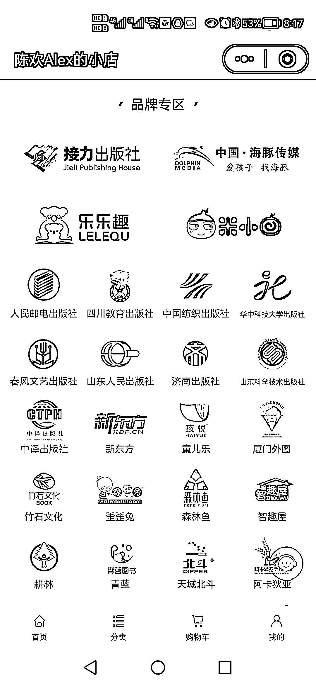

这套打法对三类人有参考价值：

第一类，做女性、宝妈生意的人。宝妈业务怎么设计、怎么组织社群？

第二类，有私域流量的人。如何嫁接社群分销杠杆，从自己卖变成大家卖？

第三类，有优质货源的人。怎样跟社群分销生态合作快速起飞？

我们也踩过很多坑，交了几百万上千万学费，差点全军覆没。市面上有些说法听起来顺，实操无效还埋雷。我的观点可能和主流不同，请批判性看待，仅作参考。成绩离不开靠谱合伙人和给力团队，我只是代表发言。

目录如下：

1、冷启动怎么做：0预算一个月10万分销员

2、社群分销如何设计：核心增长公式

3、去哪里找分销员和团长

4、如何调动团长积极性

5、快速增长期如何把握关键

6、你的业务如何嫁接社群分销

名词解释：分销员是以分销为副业的用户；团长是组织分销活动的负责人，业绩达标后升级。

# 一、冷启动怎么做

2020年4月上线，正逢疫情。团队2个合伙人+4个员工，一个有图书供应链经验，一个有阿里电商运营经验。先找性价比高的图书，通过有赞自带分销体系，4个人发朋友圈，很快被几个图书群主跟发，一个月不到进10万分销员。

社群分销的特点就是触达一两个核心节点就会指数级裂变。当时线下绘本馆没生意，老板想养员工，马上转线上卖书，成为第一批优质用户。

复盘10万人里，大部分没做过分销副业，属于儿童教育赛道意见领袖。比如南京一位作文老师，一条朋友圈带来过万用户。

冷启动关键：

1.1 核心是产品和供应链强度，不是运营。冷启动要选标品，性价比明显，无需教育。童书赛道有差异化，没有强巨头。若卖百货水果之类，市面平台太多，大家只买不推。

1.2 产品要有社交形象加分。发圈动力=佣金/发圈压力。分享好书等于展示爱阅读爱教育的好妈妈形象，正向无压力。若做服装美妆食品，也可从健康生活方式角度挖掘社交货币。

1.3 初始流量要求不高，关键是找到核心人群的传播节点。我们试过复制到其他有私域的社群，效果差很多。人数多但都是普通消费者，没有裂变；人不多但有意见领袖，裂变就好。

# 二、社群分销设计：核心增长公式

收入增长=供应链强度 X 顶层设计 X 动员能力

供应链强度：产品是否有优势。标品看价格，非标品看朋友圈转化率。

顶层设计：关系绑定、销售流程、佣金分配、分销员升级机制等。

动员能力：一条信息能让多少人跟进行动。

供应链强度：前期假设月销100万，分散到100个单品，每个1万，供应商无感。若集中80万到8个爆品，每个10万，供应商马上给更好政策。爆品需要深度洞察，讲好故事。冬奥邮票应景就是爆品；15元对标49元的积木，价差越大越爆。也可以提供低价买样、免费送样给大团长，或从市面已爆品第一时间谈回来。

顶层设计：

1）关系确认机制。一般绑定永久无法解绑。绑定方式有点击绑定和购买绑定，建议购买绑定更公平。最后一次点击链接下单即绑定。最便宜产品设9.9以上，防止用低价批量绑定。

2）商品销售机制。一件代发，售出一件结算一次佣金，平台兜售后。

3）佣金分配机制。分销模式产品利润至少25%。国家规定不能超三级分销。我们比例为一级佣金：二级佣金：营销费用=5:3:2。一级高利于普通分销员带货，二 diligence... 佣金预留税，提现前先扣税再结算，避免到手打折的不快。

4）升级机制。自购满99元可申请开通分销，提升ARPU值，主动申请增加身份门槛。

5）开店礼包谨慎设计。虚高礼包会导致卖礼包变成卖空气币，业务空心化。

6）其他机制：佣金别搞太复杂，顶层设计定好后中途别改。

动员能力参考下文展开。

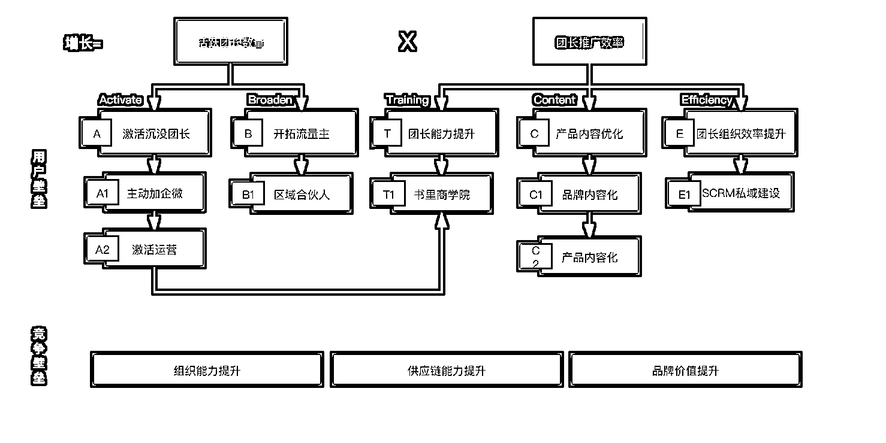

# 三、去哪里找分销员和团长

流量池是无数私域小水洼，分销要做的是串联成海。不要想着培养团长，效率太低。优秀团长基本都有两年以上社群分销经验。书里有品团长画像多为读书教育类群主、教培老师、做过其他社群分销的团长。他们活跃在学习社群，下场分享容易找到。去年一条产品线私聊4个团长，一个月裂变几千人，卖大几百万。

吸引优质团长：

1）躺赚机制。普通分销员找大团长，团长达标给一次性奖励。

2）平移机制。有资源的团队长满足条件可整队平移。

说服团长关注点：产品是否正版、有无优势、是否挣钱、是否麻烦、是否与主业冲突。图书可作为引流品增值业务。

# 四、如何调动团长积极性

我们曾走弯路：重赋能、重培训、做附加价值活动，结果增长放缓。

复盘：

1. 不要过度赋能。团长只管头部就行。他们有矛盾心理，既怕平台加人抢资源，又希望平台帮忙运营。拉大群投入运营岗收效甚微。

2. 注意力有限，别消耗。活动太多会分散带货注意力。读书会反馈好但占用精力，后来改为每周五直播连线作者，既推新书又发展用户。

3. 扛住压力不盲目加SKU。团长抱怨书不够，其实是书不够挣钱。平台靠爆品，遵循二八定律。书越多越乱，难以形成声浪。调整为爆品+长尾，每天推一个爆品推几天，单品能卖百万，团长一天躺赚千元，动力十足。

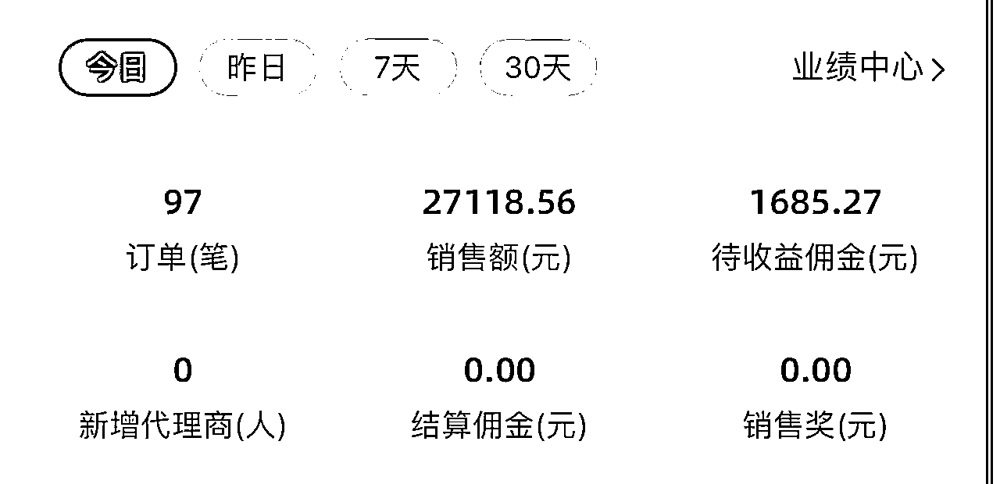

# 五、快速增长期如何把握关键

供应链给力、顶层设计合理后会进入快增长期，需重点关注：

1. 动力培训提升不来。打鸡血没用，要树立致富典型，让一部分团长先富起来。基础新人培训要做，知识库定期更新。沟通中多分享先进案例。真正激励是爆品带来的佣金反馈。

2. 只抓大团长。核心大团长拉群，老板亲自带推爆品、晒收入，效果最好。

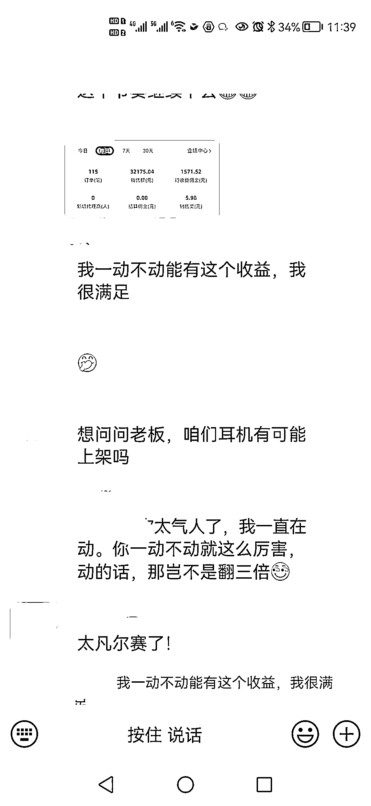

为什么不花精力管理分销员呢？

不少人会有这样的疑问：平台是不是该把更多精力放在把底下的分销员培养成团长？老实说，我们最初也是这么盘的。

但真金白银试错了一阵子之后，我们意识到，平台亲自下场去抓普通分销员的运营和孵化，其实是一条低效路径。原因说穿了也不复杂：

1）最懂团队潜力的永远是团长本人。他要是真想把谁带起来，那份用心是平台远程给不了的。

2）平台一掺和进来做培养动作，大团长反而乐得当甩手掌柜，整个体系就越搞越僵。

3）算不过来账。更聪明的做法是集中火力把中台机制和激励框架搭好，再把主要精力花在跟大团长打成一片上，借力比用力更省劲。

还有一个常被忽视的机会：机构同样需要分销，机构手里的流量是一座没被充分挖的富矿。

之前有位操盘千万级粉丝公众号的朋友找过来，他的算盘是用图书做钩子，把读者一点点导入企业微信，最后转化成自家课程的付费用户。我们一起把引流链路和运营 SOP 打磨跑通之后，这个号每个月能走掉一百多万的货。

如果你的产品本身具备引流属性，公众号绝对是一个值得深耕的流量池。

再往后我们把格局拉得更大：直接开放供应链，给外部分销平台做后端服务，赚服务费。当分销帮你把市场撕开一道口子后，真正卡脖子的壁垒就变成了供应链。

目前我们已经和蜂享家、万物心选、云货优选这些百亿体量的社交电商平台深度绑定，供应链这条线的收入已经快追平甚至反超分销主业。

# 六、想套用社群分销？先看你的业务该怎么嫁接

如果你的客户画像里宝妈占大头，又打算走分销路线，有个关键原则请记住：

把分销包装成一种“副业身份”，而不要让它停留在零散的行为上。你得造出一个完整的概念。

拿我们自己举例，对外的话术永远是说“开个线上书店”，而不是讲卖某本书能赚多少钱。身份感一旦立住，招商才有规模化的可能；如果只是一次两次的顺手买卖，根本长不出自组织的生态。

另外，产品设计要尽量往“百搭副业”上靠——那些已经在跑其他副业的团长，也能顺手把你的产品当作额外一条产品线来挂。

比如很多专攻课程、美妆个护分销的团长，就喜欢拿我们的图书来当引流款，兼带活跃社群气氛。

如果你手头已经有相当扎实的私域底盘：

先在产品和顶层方案上用足心思，

然后借助推文或直播把团长招募令发出去，把那些有分销经验的熟手挑出来。

接着让这批团长自己去拉新、去转介绍，自然流量撞进来的零散小团长，就塞给有耐心的大团长代管，权当福利给他们。

这样操作下来，你几乎不用额外增派人手，原来中心化的流量就会自然地演变成网格化的局面。

如果你是手握好货的供应商：

先把前面那套分销逻辑消化掉，然后大胆地主动去链接头部团长，借他们的路线摸到平台面前。初期不必铺太开，挑几款毛利在 25% 以上、转化稳稳的爆品去合作就够了。

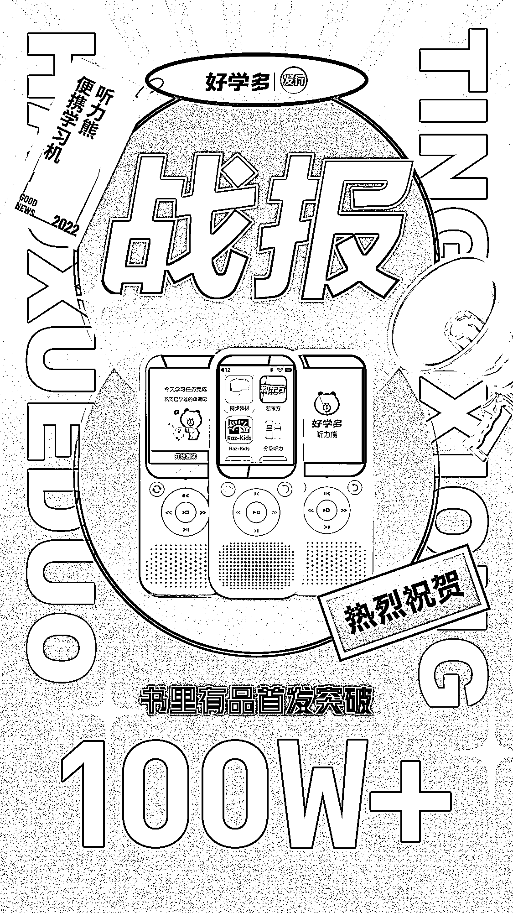

另外还有一招，亲测极其好用。

分销团长的基本盘大多是女性，品牌方的创始人或老板娘如果肯放下身段，亲自注册一个团长号，钻进社群里跟大伙打成一片，把关系经营透，团长们反而会主动催着平台把你的产品挂上去。

不知不觉一口气写了六千来字，还是有不少细节没法尽数展开，先补上一张用户体验流程图外加核心指标。

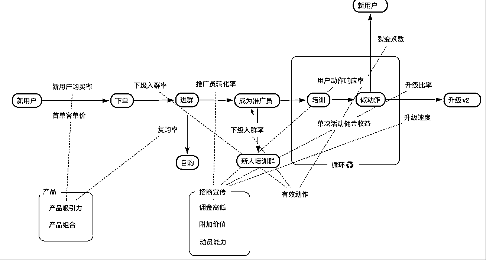

头一回在赚钱发帖，感谢各位的点赞捧场，盼着这篇东西能给你带去一点火花。

## （11 赞）《视频号直播，孩子成长和教育的生意》

#风向标# 视频号直播，瞄准孩子成长与教育赛道 1、兴趣班避坑指南做到 10w+ 场观，顺手带飞趣味编程创作礼包 2、围绕 5-13 岁学业及特长规划，用实体书做精准钩子，评论区家长纷纷求购

### 3、国内平台 - 小红书

## （104 赞）《小红书资料引流虚拟电商工具库大全》

很荣幸能入选这次小红书资料引流的教练阵容

老话讲得在理：工欲善其事，必先利其器。这篇帖子里我把做小红书要摸的工具一次性打包奉上

#### 1、千瓜数据 [http://www.qian-gua.com/](http://www.qian-gua.com/)

#### 2、新红 [https://xh.newrank.cn/](https://xh.newrank.cn/)

#### 3、灰豚数据：[https://xhs.huitun.com/](https://xhs.huitun.com/)

二、做图工具推荐（掌握一个就够，最建议 PPT）

做图路子大概有这么九种。美图秀秀、黄油相机、创可贴都附了简单的操作示意，可以照葫芦画瓢；但要做批量出图，头号推荐还得是 PPT，简单顺手，效率也非常能打。

#### 1、醒图 APP

#### 2、美图秀秀

拿美图秀秀怎么生产图文笔记？这里给个简单的参考思路。当然也可以多翻翻同行的账号封面，再按自己的审美来调。

先准备一块干净的纯色底图存在手机里。打开美图秀秀软件，进入“图片美化”，把刚存好的纯色背景图放进来。

再点“编辑”，在裁剪里选 3：4 的竖版比例，点右上角的“√”确认；随后切到“文字”输入标题。

接着再加点“贴纸”来增强封面记忆点（贴纸风格按你的眼缘搭配就成）。

结束前记得把它存为模板，方便下一回直接复用。存成模板以后，每次只需改改名字就能继续用——点击截图里我圈出来的那个小图标即可存模板！

务必养成存模板的习惯

另外封面成品也别漏了“保存”键

美图秀秀自己也有小红书封面模板可供参考

操作路径：进入美图秀秀，在海报模板里下滑，能找到不少小红书封面样式

#### 3、黄油相机 APP

黄油相机的大致逻辑跟美图秀秀差不多，这里简单讲一下

1.点中间的图标，先挑一张背景图

2.进“布局”---“画布比”---选“3：4”---点“√”

3.再点“文字”---输入想要展示的内容

4.继续加“贴纸”点缀

5.做好之后的封面临门一脚怎么处理？怎么整成模板复用？

（1）点一下“去保存”

（2）左下角“保存到相册”可以把封面以图片形式留在手机里，右上角“存草稿”则是把它收进模板库

（3）右下角进“我的”---找“草稿箱”---点开上次留下的那个模板---选“编辑”就能再次使用了

#### 4、创客贴

#### （ [https://www.chuangkit.com/](https://www.chuangkit.com/) ）

进来点“免费作图”，或者直接走右上角“登录”来完成账号认证

进到工作台，选“新媒体”---再选“小红书封面配图”---筛“免费”资源

从里面挑一个顺眼的模板，点进去开始动手

存过的模板要去哪里找？想再改一版咋整？

路径很简单：“我的设计”---选中之前保存好的封面

#### 5、Canva 可画 APP

#### 6、Picsart APP

#### 7、稿定设计

#### （[https://www.gaoding.com/](https://www.gaoding.com)）

#### 8、图司机

#### （ [https://www.tusij.com/](https://www.tusij.com/) ）

#### 9、PPT

三、免费图片素材工具推荐

1、Unsplash（[https://unsplash.com](https://unsplash.com)）

备注：名气最大的免费图库之一，风光类素材特别出彩

2、Lifeofpix （[www.lifeofpix.com](http://www.lifeofpix.com)）

备注：建筑和自然景观居多，整体风格往清新文艺走

3、Freejpg （[http://en.freejpg.com.ar/](http://en.freejpg.com.ar/)）

备注：有少量动物图片资源，还支持按色系来搜图

4、别样网 （[https://www.ssyer.com](https://www.ssyer.com)）

备注：国内站点，用中文搜起来很顺手

四、小红书内容工具

#### 4.1 小红图 [http://www.xiaohongtu.cn/](http://www.xiaohongtu.cn/)

用来搬运小红书笔记素材，复制笔记链接，就能把配图一整组取出来（微信小程序里搜“小红图”也可以）

#### 4.2 小红书违禁词查询

能查违禁词的工具不在少数，前三款用起来手感最好，4~6 也可以备着

4.2.1 零克查词 [http://ci.lingke.pro/](http://ci.lingke.pro)

专门针对小红书敏感词的检测器，文案贴进左侧输入框，一键出结果，敏感词和违禁词全部摊开在你面前

4.2.2 句无忧（[https://www.check51.com/](https://www.check51.com/)）

句无忧适用范围更广一些，它的提示语写得很细致，会对不能碰的违禁词给出明确标注，拿来找雷区很顺手

4.2.3 易撰（[https://www.yizhuan5.com/work.html#1-4](https://www.yizhuan5.com/work.html#1-4)）

易撰自带爆文标题玩法，也能做文章质量体检，能大致摸清一篇稿子的健康度

4.2.4  禁用词查询([https://www.jinyongci.com/](https://www.jinyongci.com/))

4.2.5  句易网（[http://www.ju1.cn/](http://www.ju1.cn/)）

4.2.6  词爪（[https://www.cizhua.com/](https://www.cizhua.com/)）

五、标题采集工具

#### 1、新红（付费）

#### 2、后羿采集器（免费）下载地址：[https://www.houyicaiji.com/](https://www.houyicaiji.com)

把攒好的链接批量贴进采集器的地址栏，随后启动“智能采集”

采集器会自动判断话题的网页端结构，抓取完的内容会以表格形态呈现

第三步要去点标题链接列里的随便一个链接（这里说的标题链接，本质上是指向用户主页的，自动生成的字段偶尔会出现名字错乱）

点完会进入二级主页的采集视图，这会先把“清空所有”按掉，再着手“添加字段”

逐项勾选你想要留下来的用户头像昵称、简介、标签、所在地

关键提醒：采集结果导出成 excel 之后，务必好好做一轮数据清洗。把跟对标无关的杂乱信息剔掉，再规整到飞书表格里，方便自己随时同步和展开对标拆解

最近在龙哥盟里刷到一批风向标帖子，从小红书资料引流到跨境电商独立站，从亚马逊运营到AI绘画，信息量很大。我把它们整理成一份“项目观察笔记”，希望给你带来一些新思路。

**1. 小红书资料引流**

用 XMind 把知识点梳理成总结性封面，效果相当亮眼。 尤其值得留意的是，在 iPad 上写出来的手写笔记，特别容易引发点赞潮，一不小心就能冲到千赞甚至万赞。

**2. 游戏初始号生意**

这是一个比较细分的方向，专门有人做游戏初始号，靠信息差和渠道优势赚钱，对游戏生态足够熟悉的朋友可以研究研究。

**3. TikTok+Shopify 独立站爆品模式**

TikTok 加 Shopify 这套玩法，现在依然有不少人在问：还能不能做？答案是还有机会。TikTok 还处在增长期，流量价格相对友好，官方也愿意扶持流量主；平台想长期运转，商家也必须能赚到钱，这个游戏才续得住。

对比之下，Facebook 已经变成存量博弈，风控很严、同行很多、流量也贵，虽然身边依然有卖家在稳定产出，但利润空间早就被压薄，当年那种 ROI 十几二十倍的疯狂阶段已经回不去了。 平台处于不同生命周期，打法必须跟着变；一旦觉得吃力，就要迅速跟上平台的节奏，否则只会被慢慢淘汰。用户和需求一直都在，总有人能继续做起来。

具体操作上，核心就是 Dropshipping，也就是一件代发：客户在你的独立站下单，你把订单转给供应商，从中赚差价。这个玩法在海外已经存在很久，老外玩营销和品牌打磨，往往比我们国内玩家更老练。

建站一般直接选 Shopify，它是目前市占率最高的独立站 SaaS 平台，官方还常做活动，性价比不错。注册流程很顺，按引导依次填好业务类型、网上商店、商品名、国家和邮箱密码，选择一个套餐就能开始。

广告开户有三条路：国内代理、海外代理和海外个人户。新手想快速启动，可以用海外个人户，但安全系数相对低；个人户可以用 VASA 卡充值，到账快，缺点是预算大时容易不够用。

接着要绑定 TikTok Pixel，让广告平台知道用户在独立站上的访问、加购和结账行为。在 Shopify 里装好 TikTok 应用、关联广告账户和像素后，系统就能根据转化数据帮你优化人群。

落地页同样不能忽视。页面必须干净，标题、评分、购买按钮都不能少；详情页用“标题+描述+GIF 动图”的公式，用户一眼就能看懂产品卖点，信任感也会上来。

选品基本决定了项目成败。产品身上要有高价格感知，能支撑 3 倍以上定价，还要有新鲜感和明确的购买理由，最好在竞品基础上至少有一个拿得出手的改进点。 选品渠道也有很多：站内关键词、Facebook 广告资料库、平台推荐算法、亚马逊热榜、TikTok 官方创意中心、付费广告间谍工具、谷歌趋势和关键词研究，都能帮你找到潜力爆品。

广告投放用 CBO 预算 50—100 美金启动，目标选转化，版位只选 TikTok，兴趣不用设太窄，尽量让系统自己去寻找受众。素材可以复制 6—10 组分开测试，后续重点盯 CTR、CPC 和消耗情况，表现差的广告组及时关掉。

**4. 亚马逊卖家避坑分享**

一位做了八年跨境、营收过亿的卖家认为，亚马逊是一个能容纳个人、小团队和成熟团队的平台，但平台本身没有绝对好坏，关键看你手里有什么牌——资金、团队和资源。当下依然有机会入场，但要想清楚目标。

在亚马逊上生存无非三种模式：铺货、精铺、精品。铺货适合轻资产起步，核心是效率和供应链，但最大的坑是多站点多品类同时开花，容易把人拖垮；精铺就像在练兵场里磨炼，对团队复制和供应链配合要求高，最怕库存备太猛，现金流被压断；精品对操盘者的全局把控和应变能力要求极高，如果团队里没有拿到过结果的人带队，很难真正做出爆款。

他还分享了几条经验：跳出平台看平台，想清楚自己进场的目的是什么；最大的成本其实是时间成本和决策失误成本；赚钱、找人、定方向这个顺序不能乱；要尽早做品牌、域名、专利等护城河；多向头部标杆学习；同时要重视 HR 和财务部门，让数据参与决策。

关于品牌出海，他认为 TikTok、Facebook 等短视频和社媒平台确实加快了进程，但前提是先赚到钱，再拿利润的一部分慢慢养品牌，否则长期投入会消耗团队信心。

**5. 传统金融转型 Web3**

一位做了十年金融分析师的朋友，2021 年开始转型 Web3 创业，写下了自己的完整经历，从背景、探索到未来展望都聊了一遍。他特别强调，文章里涉及 Web3 的专业名词均不构成任何投资建议，欢迎圈友交流指正。

**6. 复合型销售拉新**

这套打法很有意思：公众号负责引流，超市承担线下售卖，微信再把流量承接起来，形成多触点组合。作者之前用公众号做白酒营销，最火的一场在贵州单日卖了 36 万；现在公众号流量下滑，只能把营销重心转移到“薅羊毛”“占便宜”的用户感知上，同时结合其他业态一起摊薄营销成本，实现双重利润保障。

**7. 地推三部曲**

这是 97 年自由职业者昱龙整理的地推拉新系列，分理论、学习、案例三个部分。他不仅拆解了地推拉新的赚钱逻辑，还请教过单月佣金 50 万的阿锋团队，把长期和短期该关注什么讲得很清楚。案例篇更是拿自己的实战成绩说话：曾在美团单个点位做到 150 单以上，连续十几天稳坐同城单量头名。红利虽然在退，但地推这种现金流生意，还是有小团队能活得不错。

**8. 站群版“音乐 U 盘”项目**

有人专门把戏曲、二人转、相声等内容做成独立站点，再打包灌进 U 盘里卖，目标用户就是中老年群体，帮他们省去一个个下载的麻烦。这类资料定价比普通内容贵不少，算是小而美的好生意。

**9. AI 绘画**

一个追逐风口的尝试案例：作者本想趁着 AI 绘画热度，做一个小程序或网站承接搜索流量，结果发现现实远比想象复杂。定制开发报价从 3000 到 15 万不等，小程序还需要服务器、营业执照，各个平台又互不通用，工期也赶不上热点；最关键的是，这波搜索流量几乎都集中在公众号端，想靠“搜一搜”被动引流基本不现实，最后只能放弃。他总结说，供应商质量、后续服务、服务器成本和工期都很关键，而且必须会主动引流，想清楚变现模式，否则很难做成。

另一个案例则轻松一些：一位小白圈友花二十多天跑通了 AI 绘画项目，赚了 1000 块。他觉得 AI 绘画并没有想象中那么难，本质就是用关键词“唤醒”设备，和语音唤醒 Siri、小爱同学异曲同工。工具方面，Midjourney 这类国外综合型工具，能驾驭二次元、古风、现代、写实等多种风格，就像一个“全能画师”。

以上是本期风向标盘点。每个项目都有自己的玩法和坑，关键还是结合自身情况小成本试错，慢慢找到适合自己的方向。

## 一、什么是初始号？

### 1. 初始号是什么

很多人第一次听到“初始号”会问：这是什么？平时我们玩一款新游戏，一般是用邮箱或手机号注册全新账号，创建角色进入服务器。除了系统发的新手礼包，背包基本空空如也，一切都要从零开始慢慢攒。

### 2. 抽卡游戏带来的需求

不少手游都靠抽卡驱动，角色和阵容的强度并不平衡，个别角色或组合就是拥有碾压级强度。能不能拿到这些关键角色，几乎决定了游戏体验。想获得心仪的角色，通常只能靠运气加氪金。

### 3. 运气靠不住，氪金门槛又高

在算法规则下，运气往往并不可靠：中奖概率常常只有零点几，卡池却深得夸张，能抽到的角色太多了。于是氪金成了更直接的路径，但愿意大把充值的玩家毕竟是少数，那普通玩家还有别的选择吗？

### 4. 初始号的生意逻辑

于是，开头提到的初始号就出现了。游戏为了留住玩家，会在前期新手任务中送出抽卡道具，一般累计有 10 至 20 抽。有人把这当成商机：批量注册邮箱，再批量创建游戏账号，用模拟器或真机群控跑脚本，自动完成简单的新手任务，最后把账号挂到电商平台出售。价格低则几元，高则上百元。指定角色或阵容的账号更贵，本质上等于卖家把卡抽好了，替买家承担了“抽不中”的风险，所以定价自然更高。

### 5. 两个典型例子

先看原神。这款游戏大量角色只能靠抽卡获取，初始号的需求很旺盛，销量也相当可观。再看王者荣耀，它的初始号也叫“转移号”，提供一些初始英雄、金币和铭文碎片，资源越丰富，价格越高。由于王者荣耀的账号角色按区服划分，初始号可以用游客身份挂脚本刷资源；玩家买下后，直接把对应区服的角色和资源绑定转移到自己的账号上，使用起来很方便。

### 6. 不止于热门游戏

类似生意的范围远比想象中大。暗黑 2 新赛季开启后，一件装备能卖到几十到几百元；暗黑 3 新赛季带人速升 70 级，一个人头收费 5 到 10 元，开服当天半小时就能带约 12 人。阴阳师、崩坏三、炉石传说等游戏也在其中。还有大量叫不上名字的 IP 手游，本质只是把抽卡模式换一层皮，用来收割 IP 粉，这种游戏的初始号同样卖得不错。

### 7. 结语

以上只是个人整理，不一定全对。月底了，希望能中标！

## 二、AI 绘图高赞分享（55 赞）

### 1. 工具选择

图片加载失败国内可用的工具是“AI 画了个画”，它对标 Midjourney，由圈友研发，目前出图效果很棒，已经有小伙伴用它出图并完成了变现。

### 2. 二次元风格工具

国外有一款适合二次元绘画的工具叫 Novel AI。在这个工具里，提示词被画师们称作“咒语”，听起来很有仪式感。和 Midjourney 相比，Novel AI 多了两个功能：支持正向词和反向词，也支持权重设置。举个例子： @饼公子 作品

正向词代表你希望画面里出现的元素和细节；反向词代表你不希望出现的内容。{} 表示强调，叠加得越多，强调力度越强。Novel AI 在国内的平替是“意间 AI 绘画”，不过出图等待时间比较久，急性子可能等到跳脚。

### 3. 提示词怎么用

分享者木木之前提到，AI 画图的原理是：用一段文字指令唤醒对应设备，输入一句话，它就能为你产出一张图。经过大量素材投喂，模型已经比早期智能很多。以前要写一大堆描述词才能看到还不错的成品，现在简单描述几句，也能得到很棒的画面。

很多人手里并不缺提示词，问题在于怎么用。木木经历了三个阶段。

第一阶段：抄。直接把现成提示词复制到“AI 画了个画”里出图。

第二阶段：混改。把提示词里的某个词换掉。比如很火的十二生肖系列，把生肖兔改成生肖牛，然后不断出图，也就是俗称的“抽卡”，博概率刷出好看的图。

第三阶段：创作。木木称之为“衍生扩句”，也就是从一个词出发，不断扩展成更丰富的描述。

以“虫洞”为例，输入“虫洞 --v 4”，就能得到下图： 在虫洞的基础上继续加词，尽情发挥想象，可以延伸出无数张图。下面这些都是同类思路做出来的： @伟祺 作品 @梨云 作品 @Bingo 作品 @招财武 作品

所以，会扩句就会写提示词。

关于提示词怎么写，有小伙伴说出过困惑： 后来打开抖音，看到一种说法：“为什么别人能做出好看的图，而你不行？只要知道以下这些关键词，你也能画出很漂亮的作品。”

那如果不想画人物，这些技巧还有用吗？其实可以拆分提示词的构成。木木认为，提示词本质上就是在扩句，扩句逻辑可以拆成：形容词 + 人/物 + 风格 + 滤镜。以下面这张图为例：

形容词：可爱的，穿着蓝色衣服，戴着帽子、背着书包等；

物：牛宝宝，唯一主角，所有描述都围绕着它展开；

风格：皮克斯风格；

滤镜：电影灯光、中国文化、高清晰细节、高清晰材质、特写、复杂纹理、辛烷渲染、zbrush、8k，画质 5 --v4 --upbeta。

理解结构之后，就能玩出很多花样。再看一个例子： 原图  衍生图 @饼公子

先说明一下：Midjourney 一次通常生成 4 张图。上面原图看起来像 8 张，是因为提示词里用了“分屏”，让画面左右对称，视觉上像 8 张，本质上是一张图沿中轴做了镜像。不过这种对称并非完全规则，左右两侧并不是同一个主体。想实现真正的左右对称，可以借助一个词：mirror image，中文叫“镜像”。按牛津词典的解释，镜像能让画面左右对称；这个用法还能延伸到其他提示词中，实现“对称”效果。于是，上面这张衍生图的提示词大致是：mirror image + 水面上方一艘高大海盗船 + 水面下方一只巨大章鱼 + 日出 + 写实摄影 + 电影感灯光 + 创意，参数为 --ar 2:3 --v 4。 @饼公子 添加镜像后的效果见下图： @饼公子

顺着这个思路，一位 12 岁的小姑娘也做出了自己的镜像作品： @饕餮仙子 作品 霍格沃茨城堡。当然，同样的玩法还有很多，欢迎大家继续探索。

### 4. 为什么放着捷径不走，还要自己创作？

这就像短视频搬运：搬运很轻松，也能赚到钱，为什么还要坚持自己创作？

第一，搬运不符合平台规则。虽然每次出图效果不完全一样，但整体方向还是别人的，本质上属于二次修改，很容易被举报抄袭。

第二，对原创作者来说，尤其是视频带货、小红书这类创作者，学会用提示词描述画面，才能做到“想要什么就有什么”，而不是被别人的素材限制住。自己描述出来的图，永远最适合自己的需求。

第三，AI 绘图和设计一样，最终是为了画出自己内心想要的世界。就像那位 12 岁小姑娘，用 AI 画出了她的霍格沃茨城堡和卢娜。她还说，探索 AI 绘图的过程带来一个意外收获：学习提示词，让她的英语写作能力和细节描述能力都有了明显提升。

第四，拥有自己的作品本身就是一件快乐的事，而创作带来的成就感，也许只有真正创作过的人才能体会。希望读到这里的你，也能感受到这份成就感。祝大家早日学会魔法，让 AI 为我们打工，早日变现。

## 三、《N 卡、A 卡都不用！免费运行，再烂电脑也能跑！竟然有这样好事？》

最近不少小伙伴对 AI 画图感兴趣，正准备大干一场，却被电脑配置卡在门外。网上很多安装包往往执行几步就没了下文。正好这次小航海也有 AI 绘图，相信不少人会遇到同样的问题。我把之前一直在用的免费在线绘图方法整理了一下，分享给大家，希望能有所帮助。

这里随便贴一张图：

## 四、《适合个人或小团队低成本运作：AI 生成红包封面》（26 赞）

这是过年期间的风口项目，个人或小团队都能低成本操作。用 AI 生成红包封面，谁生成，版权就归谁，不再需要为封面版权发愁。还可以让客户自己申请喜欢的红包封面。自动对接红包封面申请接口后，既能给企业或个人卖专属封面，也能生成独特封面售卖激活码。#风向标#

## 总结

以上就是本周的赚钱周报，合计 8.4 万字。除了离线版，小懒也会整理到在线版合集里，方便大家检索和手机阅读。