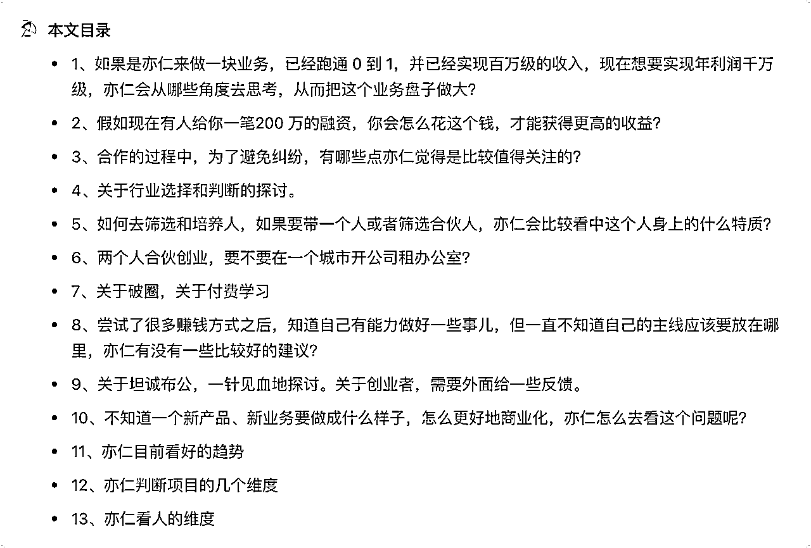
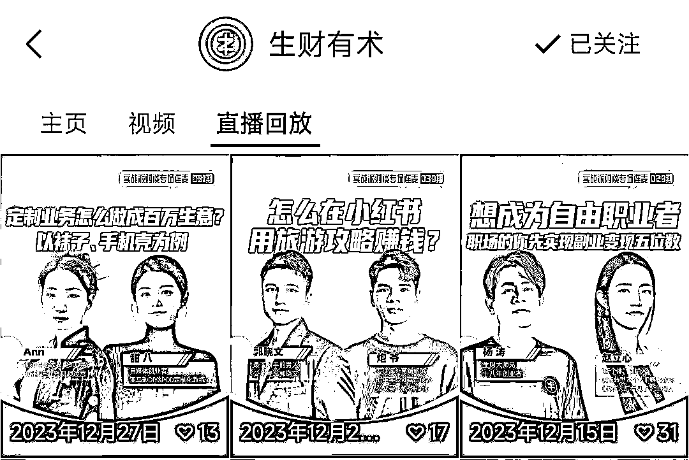

# 2小时对话，龙哥拆解了我们从百万到千万的路径，和合伙人选择的底层逻辑
2023年冬，我们合伙人傅超人和我飞到杭州，和七小一起约了龙哥做了一场两小时的深度咨询。聊的内容太多，篇幅有限，下面挑出对大家最有用的部分精简复盘。
这次聊到的核心议题包括小红书境外高客单旅游的合作机会与转化链路、明年该业务的规模与利润预估、境外游赛道的整体判断与突破点、平台流量获取的困境、新品牌的机会空间，以及更底层的投资思路变化、项目孵化协作的注意点、创业分润原则、团队搭建与战略调整、企业管理思考、合伙人筛选标准、行业选择与个人成长的关系等。
本文目录

对话伊始，龙哥先反问了我们几个关于业务本身的问题，比如：
* 小红书境外高客单旅游的完整流程与实际转化表现
* 我们团队明年在该赛道的体量和利润预期
关于这块业务的具体打法和细节，先前在赚钱也分享过，在龙哥盟视频号上也有炮爷和郭晓文老师的直播回放，这里不再展开。
👇👇👇
《 》
《 》

两小时信息密度极高，几万字全展开不现实。而且部分涉及超炮团队或七小的私密业务，敏感或过于细节的内容不便公开，所以下面会做脱敏处理，只留下真正有迁移价值的部分。
回到正题。咨询中我问了龙哥一个关键问题。
### 1、如果龙哥接手一个已经跑通0到1、年入百万的业务，要冲到年利润千万，会怎么思考？
站在他已做过年入千万甚至过亿项目的角度，如果他现在就在我们的位置，手里的小红书高客单境外游已经验证了模式、有了百万级收入，想把盘子做大到年利润千万，会怎么拆解？
注：下面以超炮团队的小红书境外高客单旅游为例展开，但里面的底层逻辑适用于任何赛道。
龙哥的思路是这样的。他先聊的问题，其实就是在测试我们的思考框架。
在他看来，第一步要先想清楚，培训到底是基本盘，还是只是获客手段。是把旅游当主业，还是把培训当主业，这个定位必须先厘清。
想把旅游做起来，就必须回到旅游行业本身的本质：用户的核心痛点是什么、真实需求在哪、供应链资源如何盘活。
要做大，就必须回到上游供应链。甚至做到一定阶段，可能需要重仓布局，比如收购一家旅行社，真正重度运营旅游。做大不等于做宽，而是做细。境外游盘子很大，必须切分。定制境外游是一个切口，定制日本又是一个更细的切口。任何一个细分的赛道，都能做到年利润几千万。可一旦做宽，就做不深。
从他的视角，一定会沿着旅游行业走下去。培训只是冷启动获客的利器，可以薄利甚至不盈利，但最终留住用户的，是产品本身。产品后端不被自己掌控，就没有抓手。
第二，到了新阶段，后端整合成熟后，培训的获客效率会被体系化的人才招聘、员工训练和激励体系全面超越。培训只是起盘工具，不能依赖。下一步必须走向公司化、矩阵化、团队化获客。
第三，现在的做法其实是借助平台流量，带着学员一起薅。学员体量小，分散，平台短期内感知不到，但不可持续。终局一定是走向付费投放。付费投放后，竞争对手就变成携程、去哪儿这样的大品牌。他们已经在小红书矩阵化运营。如何在与巨头的正面竞争中做出差异化？这是必须回答的问题。
大企业不一定能做精细化，而这是中小团队的机会。可以正规化做品牌，做出一个差异化的旅游新品牌。
战略清楚了，就要知道终局是什么，先做什么、后做什么，把节奏排好，再做沙盘推演。2024年利润破千万不一定马上达成，但基本盘要稳住，后续就有机会真正做成一个新旅行品牌。
做品牌、做行业深度，才是关键。旅游需求是真实存在的，抖音、小红书上旅游内容创作者很多，机会很多。往后端走，往产品走，抓住一个点打透，就能做很大。
傅超人补充说，就像中国地质局出的南极攻略，一放出来票就没了。
龙哥说，这就是差异化路线的需求识别能力。洞察当下用户趋势，自研1-2条线路打出特色占住心智后，流量自然会来。别人会抄袭，比如长白山、哈尔滨旅游的爆发，去年前年不火，是有人提前识别价值点打爆的。
如果能识别强需求的线路，自研出来，再结合手上几百个培训学员去种草，就能迅速引爆。自研产品有利润，还有人帮你传播。一条线能做1000万利润，形成方法论后复制更多线路，十条线公司就起来了。
整体策略上，他会先研究头部玩家，对标他们的体量和打法，打开视野，不要停留在招多少学员的层面。要有干大事的格局。
流量能力是我们的核心优势，能聚集一批懂流量的草根，这本身就很难复制。如果后端产品资源能创新，优势会更大。
炮爷说现在模式是合作后端，要分利润出去。
龙哥回应，分利润没问题，先把流量盘活。但想做重做深，供应链必须自己深入掌控。可以整合，也可以自研，整合利润有限，自研才有大利润。
比如中老年研学，如果能设计差异化产品，用流量放大，一条线一年赚几千万都大有空间。
培训要做好，但着力点不一定要在培训上，把培训当获客手段，站位会更高。
炮爷说要多研究大品牌，看他们怎么玩。
龙哥说要拆解抖音、小红书、公众号、视频号上所有做旅游的账号，看他们的个人打法和产品研发逻辑。
炮爷说我们已经在做了。
龙哥强调，这个事要做就得往大了做。抓住一个机会深耕，不要频繁换项目，换来换去累，也赚不到大钱。大钱不在流量表层，在行业深处。
傅超人说之前没重视，现在会重视起来。
* * *
### 2、如果现在给200万融资，会怎么用？
假设有人给超炮团队投200万，会怎么花？我们当时自己也没想好钱该往哪放。
刀姐黄小刀也问过类似问题：如果龙哥投100万或200万，怎么用？我当时说可能直接给股份，但我们也不知道该怎么用这笔钱。因为现在利润能覆盖成本，招人也能负担。
龙哥说，钱是为战略服务的，组织也是为战略服务的。战略定了，才知道要干什么。比如要自研团队、自研产品、搭建组织、付费获客，要在哪个时间点做到什么程度，才能在明年达成目标。在明确的时间表下，资金才有作用：是招兵买马还是投放。
没有战略，就不知道商业模式怎么走。
炮爷说战略没想清，即使拿到投资也不知道花在哪。
龙哥说有人帮你梳理战略意识会加速，不然觉得现在还能赚钱，就不会去想大的战略层面。
趁精力好的时候，把体量扩一扩。
* * *
### 3、合作中容易产生纠纷的点
龙哥做过很多项目，合作中最大的雷是什么？
主要是分钱。利益分配是很多创业公司分崩的根源。
解决办法就是引入专业人士。比如他现在做股权管理，直接花20万请股权顾问开会，把所有看不见的风险点都列出来，按双方诉求协调落地。
最后是15%还是25%、30%，差别不大，关键是心里觉得合适就行，不要抠细节。
炮爷说先把事做起来最重要。
龙哥说理性范围内有个基本尺度，上下波动无所谓。协议写太细没用，0到1没跑通前，框架协议就够了。在可接受范围内差不多就行。随着个人价值和稀缺性提升，话语权自然变大，就像董宇辉。
早期分配不要太纠结，后面价值升高，形势会逼着分配提升。
* * *
### 4、行业选择与判断
以房产交易为例。
龙哥认为，不管形式有没有改善，现在交易是缓慢回暖还是倍数增长，这就是行业变化。他的判断是行业在下行，交易越来越少。
可以赌未来两三年房地产回暖，但这是赌博，很可能起不来。越来越多人想卖，买的人越来越少，交易会持续萎缩。
下行行业里做任何事都是事倍功半。一定要选上升期的行业，旅游就是上升行业。通过小红书捕捉旅游需求的趋势是向上的，平台也在强化这个趋势。
只有在对的趋势里用力才有价值。在逆势电梯里用两倍力，结果也只是微增，还会自我怀疑。底层逻辑是顺势，而不是改变趋势。顺着上升趋势走，成功更容易。
对于下行行业，不需要看太多数据分析。数据抓取有限，总能找到上涨或下降的指标。靠体感就够了。如果一个趋势需要数据才能判断，说明还不够明显，等它再明显一点，体感自然能抓住。
比如TikTok和小红书赚钱的人越来越多，这是明显的趋势。最近几年谁靠房子交易赚到钱的？很少听到。我看到很多人降价也卖不出去。
所以一定要在上升趋势里做事。
* * *
### 5、如何筛选和培养人，选合伙人看重什么特质
第一个是人品。过往圈子里有没有败坏人品的行为，这是1票否决。其人是否正直靠谱、诚信，圈子里有没有纠纷，都能体现。
第二个是有没有拿过结果，有没有自己的作品，能否从0到1做出事，能从公开信息看到成果。
第三个是格局大、视野大。团队分钱时不要斤斤计较，斤斤计较最后都会出问题。谈好任务就行，多一点少一点不重要。
第四个是专注度。围绕一件事做深做透。小钱都是大钱的铺垫，往往几年后才挣到。有些圈友前两年只赚一两百万，沉淀资源信息团队后，今年就赚大钱了，明年更多。越在上升行业待久越赚越多。
希望对方不要轻易换赛道。WEB3、AI、海淘来回跳的人，往往没有想清楚自己要什么，浅尝辄止。
任何上升行业，深耕都有前景。再看互补性。合伙人要能补上你的短板。比如你擅长发现机会和整合资源，他擅长团队管理和精细化运营，互补最好。两个人优势相同容易打架。
炮爷说他和傅超人相对互补，下面带人也各有分工。
龙哥总结，两个人合伙有个共识：大家会慢慢觉得自己贡献越来越大。
合伙这件事，最怕的就是贡献算不清。
你单独问每个人“你觉得自己占几成”，十个合伙人可能给出十个1000%。
所以合作里头必须有两件事一起做：第一，主动看到别人的价值，第二，客观评估自己的分量。双方都得这样想。否则一味觉得自己牛、自己多，关系很快就会失衡。
关系能走长久的，靠的不是谁更能干，而是双向认可、经常沟通。价值互相看见了，方向才不会偏。
关于要不要把公司搬到一个城市、租一个办公室
这是组织问题，但组织永远是战略的服务员。
先问清楚：我们到底要把什么事做成？如果只是做点培训，明年有几百万利润也挺好，那两地分开也完全可以跑。
如果要做的事情需要快速协同、高频决策，需要线下团队紧密作战，那组织形态就必须跟着变。
战略先行，组织次之，再谈激励和分工。你得先有愿景的轮廓，哪怕是很模糊的模糊。有人一年只花一个季度想战略，其实战略是持续在调整的东西。半年前的清晰，过半年会更清晰，再过半年可能又要微调。
我一直坚定的方向，就是帮助普通人从零到一，从一到十，把副业变成事业。方向清楚了，载体可以变。航海家也好，垂直培训也好，都是路上可以切换的工具。重要的是保持开放，定期出去看行业天花板、看头部标杆、看外部玩法，不要被当下的小圈子信息锁死。
抖音上就有外行人杀进旅游，靠内容带流量再自建路线，现在做得风生水起。小红书上也有人做得相当规模，团队几十人起步。我们在小圈子里只能看到流量、IP、培训这些套路，真正的体量得去外面拆解。
关于破圈和付费学习
信息差就是护城河，也是限制。高阶玩家每年愿意花几百万买圈子，就是为了打破自己的天花板。
圈子只是入口，更重要的是沿着一个路径去拆解。把一个头部玩家从底层逻辑拆开，你会发现人家已经大到你想象不到的程度。这种对照会让ego降下来，你会清晰地看到自己其实才刚起步，还有十倍的空间。
当你知道终点在哪，小问题就不会把你耗死。将军赶路不打小鬼，眼前这些纠结就是小鬼，跟着大方向走就行。
关于找不到主线怎么选
先问自己核心优势是什么。
然后锁死行业，不要乱换。赚钱的诱惑就是到处有机会，一会儿这个赚，一会儿那个赚。可没有行业沉淀就被带着走，基本赚不到钱。
在一个上升的赛道里持续迭代、持续突破，两三年下来才有大钱。换赛道就是不断清空复利。
再者，行业必须是上升的。下行行业怎么努力都是错的。
比如现在帮助普通人赚钱的需求只会变大，失业的人找创业机会的人越来越多，平台依然处于上升期。
关于坦诚反馈和创业者心态
创业者需要有人一针见血地说话。我说的直，是为了帮你们锚定位置，不是打击信心。
做社群的人每天收到的多是正反馈，很容易把自己放得太高。社群里多数人并不如你，久而久之定位会失真。你以为很厉害，其实可能只是圈内认同。
一定要主动向上、向外看，重新校准自己。不要被马屁声淹没，保持清醒地往前走。你们还年轻，有十倍百倍的空间，别被眼前的小成绩迷住眼。
关于新产品怎么商业化
先别纠结怎么卖。先判断你创造的价值是不是足够大、足够独特、足够刚需。
一个能赚1000万的机会，完整拆解成报告，价值就很大。价值足够大，后面的商业模式有很多种，卖报告、卖版权、拿股份都可以。告诉别人怎么做，给10%股份加少量投资，人家也会愿意。
难的是识别需求、设计产品，把风向变成具体机会。
年轻人要创业，没必要自己把所有坑都踩一遍：组团队、找合伙人、搞流量、搭产品。把这些交给成熟团队，你把精力放在创造价值上，更高效。一个人单打独斗会浪费七八年的时间。
龙哥目前关注的几个方向
数字货币、AIGC相关、小红书商业化和中老年赛道、留学移民旅游出海、传统行业转型玩法、出海应用网站工具、赚钱生态周边。
判断项目的维度
看趋势是否对。趋势比个人努力更重要。平台和行业趋势决定上限。
看对社会、平台、用户有没有价值。能让平台一起赚钱的模式才有机会做大。
看行业里有没有可对标的成功案例。
看业务终局是什么，你在终局里能占到哪一块。
看利润空间，能不能打到千万级。目标要定高。
看人的维度
看优势标签是否清晰，执行力、培训力都行。
看是否极度开放，能容纳不同观点和信息。
看人品口碑，在圈子里是否爱惜羽毛。
看是否能交付结果。
看是否认同赚钱的价值观。
看见好的内容点个赞也是一种利他行为，也欢迎做旅游或想做旅游的圈友来链接交流。
我是
2024，继续一起龙哥盟！
欢迎链接沟通，备注「赚钱圈友」～
微信：paoye365，添加请备注：赚钱圈友
公众号：炮爷Hack