# 30岁+普通文科生，我靠AI从0到日用离不开，还靠它变现

AI内容创作，难道只属于程序员和理工男的世界吗？

我就是一个普普通通的文科背景，日常到底怎么把AI用起来，怎么让它帮我把效率拉满，又怎么靠它做自媒体来赚钱？

今天就把我这段时间的真实使用路径摊开来讲讲。说实话，我现在一天不碰AI就浑身难受，已经完全离不开了。说得夸张点，现在的我和过去的我简直像两个人，已经完成进化了。

## 一、搜东西这块：手机用豆包AI、文心一言，电脑用P.AI

手机端首选：字节跳动的豆包AI 和 百度的文心一言，应用商店搜一下就能装。

电脑端主用：https://www.perplexity.ai/，简称P.AI

豆包网页版：https://www.doubao.com/chat/

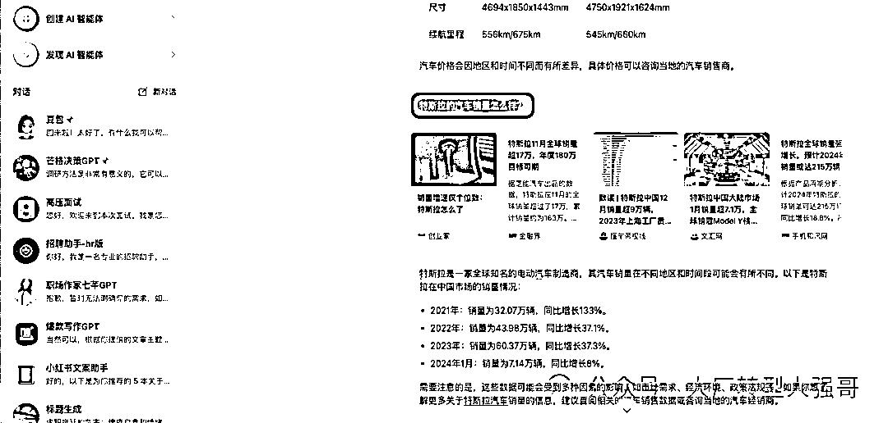

先聊聊两者在我这的差异。手机上因为涉及到是否需要🪜，能用上的选择就有限。

起初我用的是文心一言，体验也不错，用起来很顺。但总觉得反应慢半拍，回答偏官方，深度不够。

后来在AI交流群里看到有人安利豆包AI，就赶紧下了试试。那会儿正好GPT4.0在推语音功能，豆包就主打免费语音通话，聊起来非常自然，响应速度快得惊人。

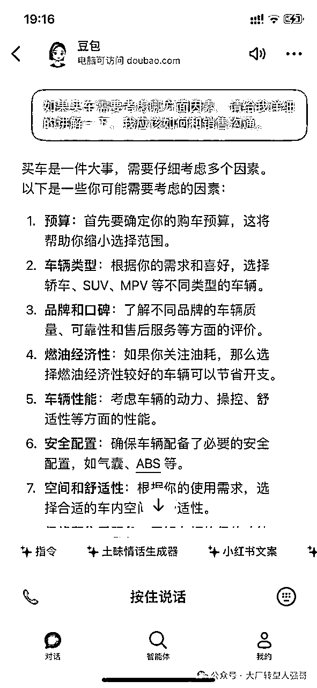

更关键的是回答质量比文心一言扎实得多，不会一句话带过。而且它能调取今日头条、抖音、西瓜视频等平台的数据，会主动给我补背景资料，还能直接点进去看。

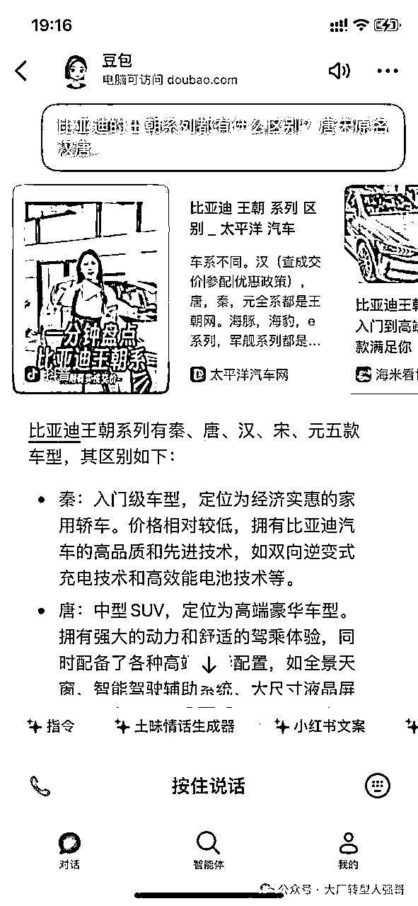

举个例子，我问“比亚迪王朝系列的秦、汉、唐、元、宋到底有什么区别，去4S店应该问哪些问题要注意什么”，它直接给我整理了一份带清单的攻略，太省心了。

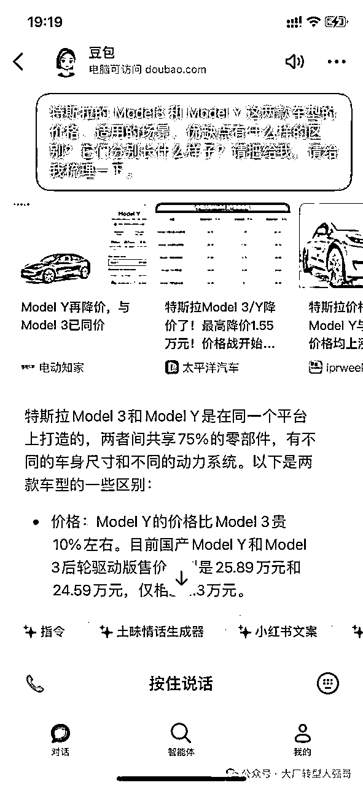

它还能直接出图，比如我问“特斯拉model 3和model Y的价格、适用场景、优缺点、区别、长什么样”，它立刻就把对比和图片一起放出来。

电脑端搜索这块，我以前一直是百度的重度用户，但广告太多太干扰注意力。后来换Google，再到微软Bing。它们的优势是能聚合全网信源，Bing早期还能直接给出答案，不用我再去筛。

但Bing稳定性太差，用着用着就卡。所以朋友推荐了我P.AI。

目前国内的360搜索AI、天工AI，UI和底层逻辑基本都是借鉴它。

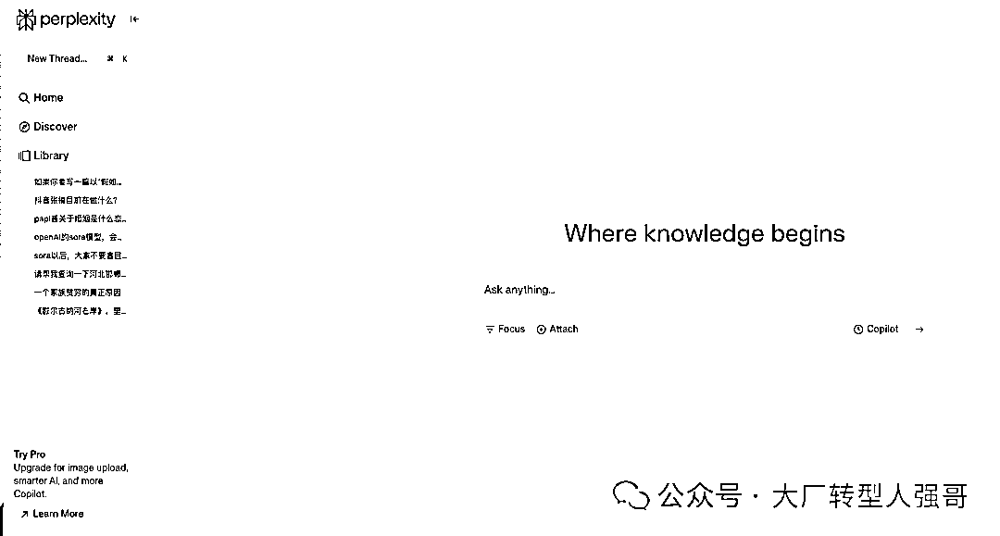

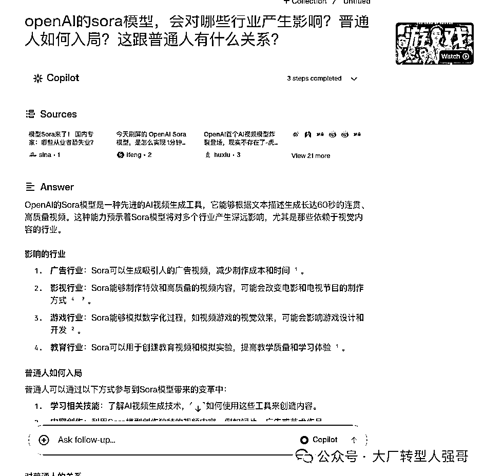

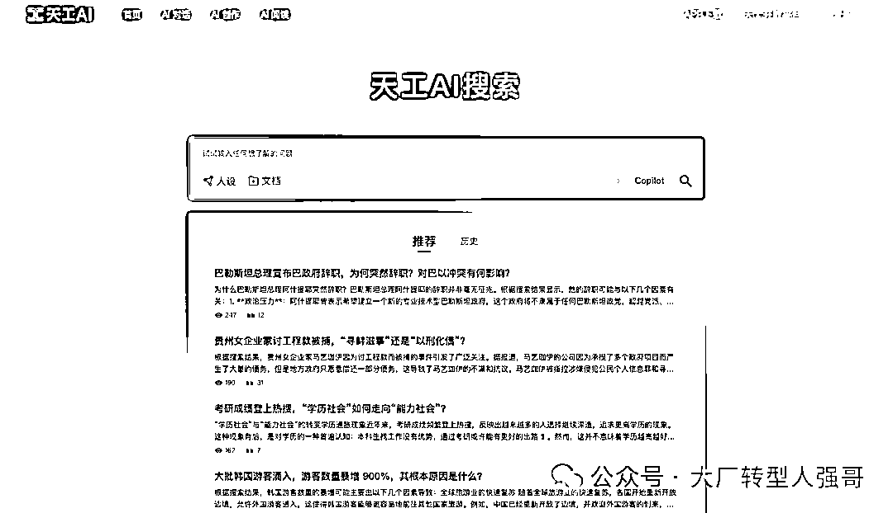

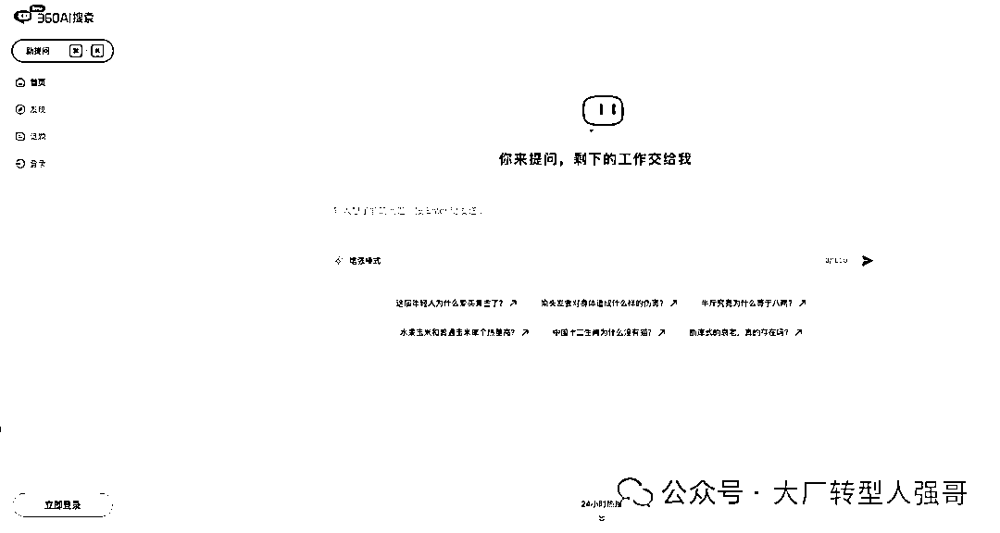

它的逻辑是你在输入问题后，它会去全网抓取资料再生成结论。为了避免等待的焦虑感，界面会有一个转动的动画提示它正在检索。它还有上下文记忆，可以接续对话，省掉了很多重复输入的精力。现在我只要在电脑上要写东西，P.AI基本上是标配。

## 二、AI结合自媒体：Monica、通义听悟、Kimichat、百川大模型

Monica网址，需🪜：https://monica.im/home

通义听悟网址，有微信小程序：https://tingwu.aliyun.com/home Kimichat

Kimichat，有微信小程序：https://kimi.moonshot.cn/chat/clo2dbhp2k12ua98ruhg

百川大模型网址：https://www.baichuan-ai.com/chat?sid=1660326

特别感谢super黄、Monica创始人肖宏的大力支持！是他们让我提前体验到了这么硬的产品！欢迎关注👇🏻

Super黄的念想

小红书产品领域优秀创作者:龙哥

300篇原创内容

公众号

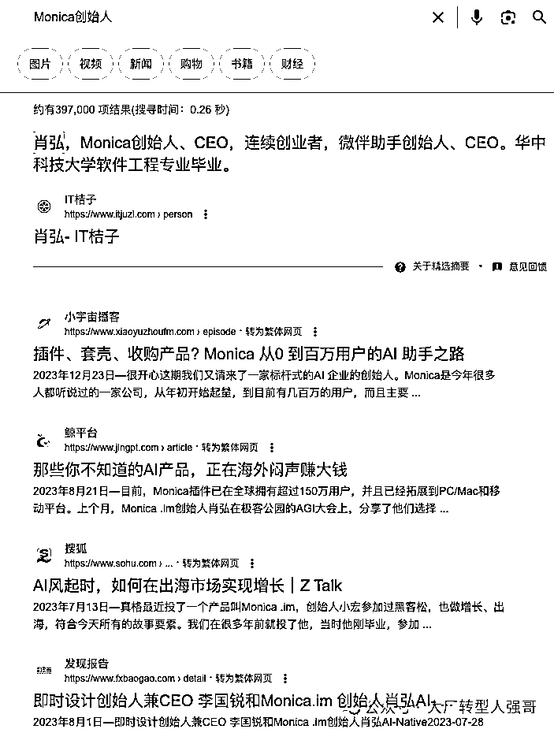

我最早用GPT，后来换Bing，现在主力是Monica，这个出海的浏览器插件真的很猛。

我的核心用法是让它帮我仿写、改写、扩写小红书的爆款文案，并且要求带emoji表情。全程不用我绞尽脑汁。

核心问题其实是小红书怎么起号、怎么写出爆款、怎么做私域引流变现。

靠AI+小红书，我已经产出了30多篇爆款，累计变现几十万。

强烈推荐Monica，用起来太顺了。你不用切网页，就在当前页面就能和它对话、阅读、翻译。

通义听悟我也超爱。

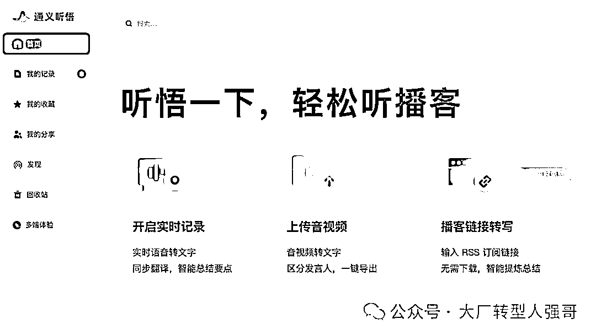

它能把录音、本地的音频视频文件瞬间转成文字，还会自动提炼要点，一键导出文档。我现在很多稿子都是对着它说话，它直接记录下来转文字。

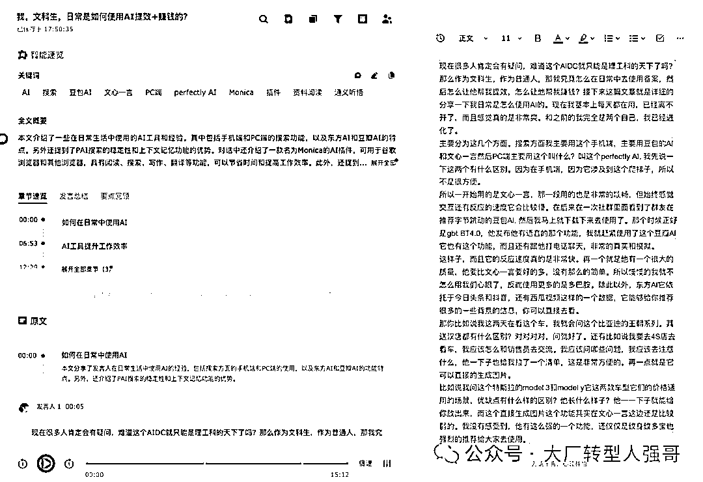

再用百川大模型简单润色一下，基本就能成文了。

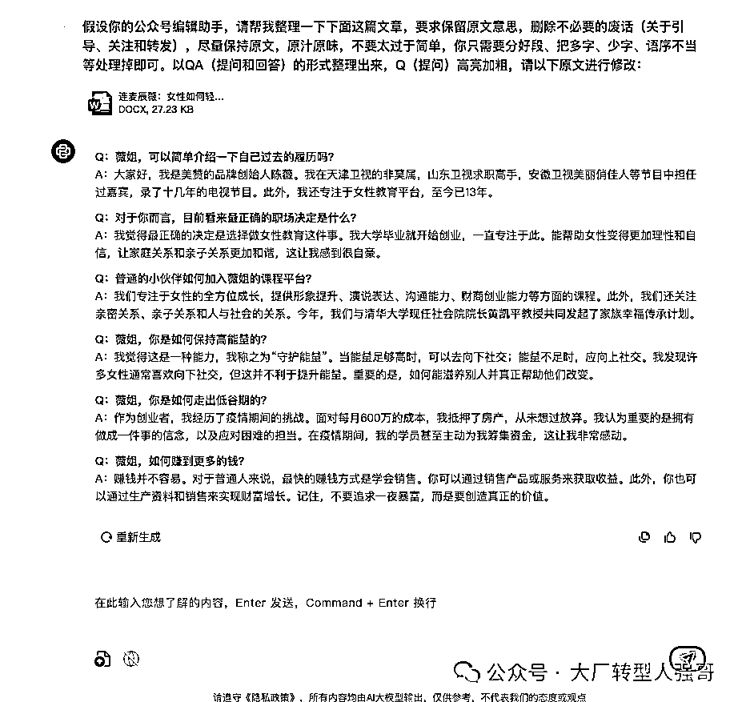

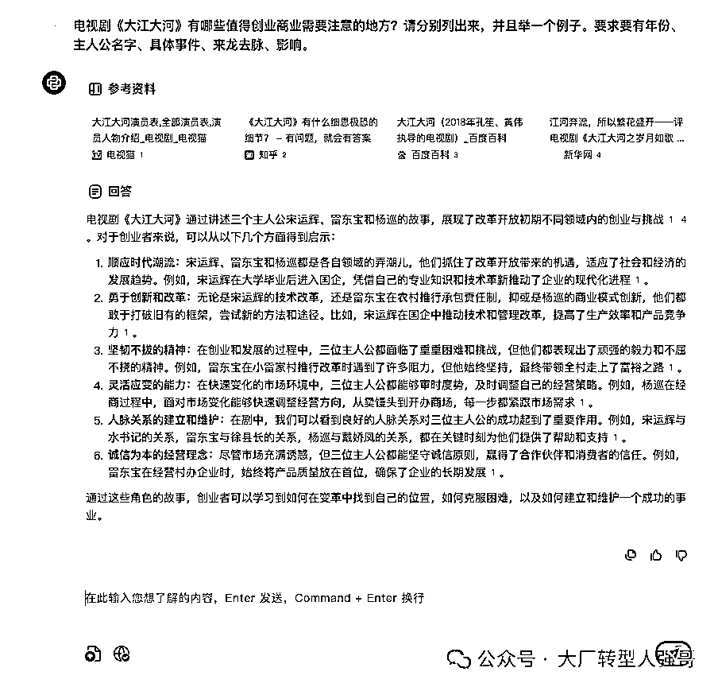

另外它现在已经打通了播客平台“小宇宙”，搞钱、投资、认知、女性成长等系列应有尽有，可以边听音频边看文字稿。现在正处于推广期，邀请一个人或每天登录都有时长奖励，我现在时长已经满了400小时。

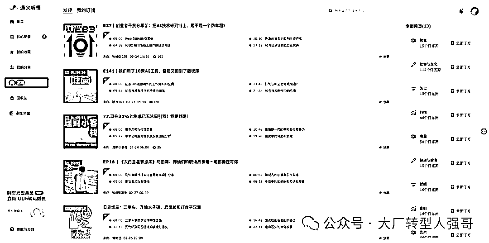

## 三、AI助力看YouTube：谷歌插件open Sider、Transcript&Summary

YouTube上很多优质视频，尤其是科技访谈，用这两个插件就能自动生成中英字幕、总结视频要点，不用硬扛60分钟。还能根据字幕定位重点片段。

现在看全世界各语言的优秀内容，语言不再是壁垒。如果你喜欢这个视频，还能把全部字幕导出成文档慢慢读。

## 四、AI做行业调研：ChatGPT/豆包AI/Kimichat等 + 麦肯锡工作法

这个用法主要在做行业调研、公司调研、岗位调研，最初是给公司内部培训用的。

它能帮你快速梳理行业的上下游、产业链、商业模式，不用东拼西找。

我把完整的实操文档和指令prompt整理好了👇🏻需要的话加我，回复“麦肯锡”，我发你。

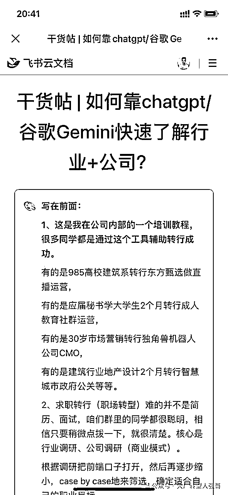

## 五、AI智能体

字节不久前推出了扣子开放平台，网址：https://www.coze.cn/home ，可以自己创建智能体agent，类似OpenAI的GPTs。

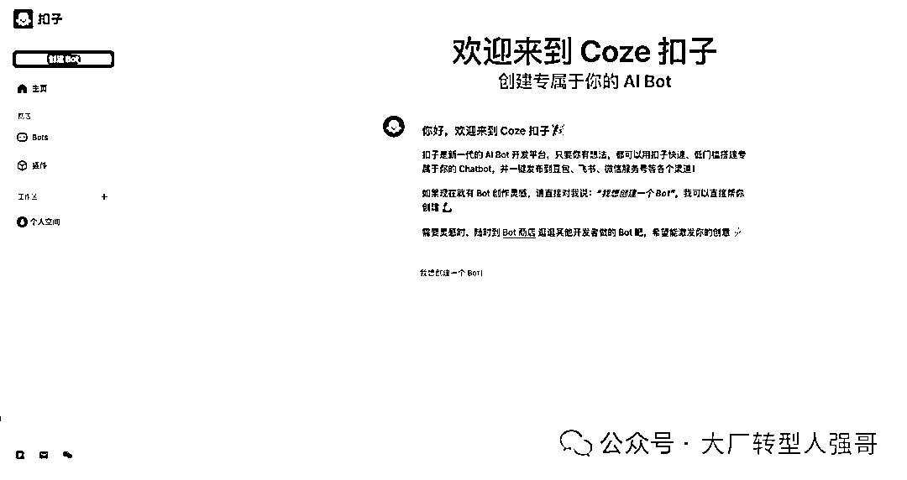

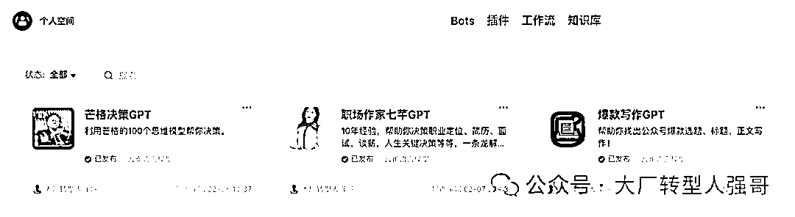

我已经做了两个智能体：职场作家七芊gpt、芒格决策gpt，已发布到豆包AI公开搜索，以及飞书内部使用。

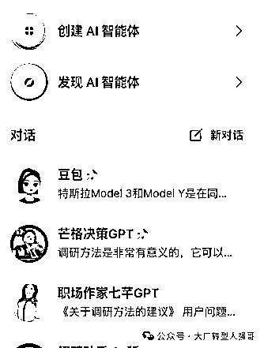

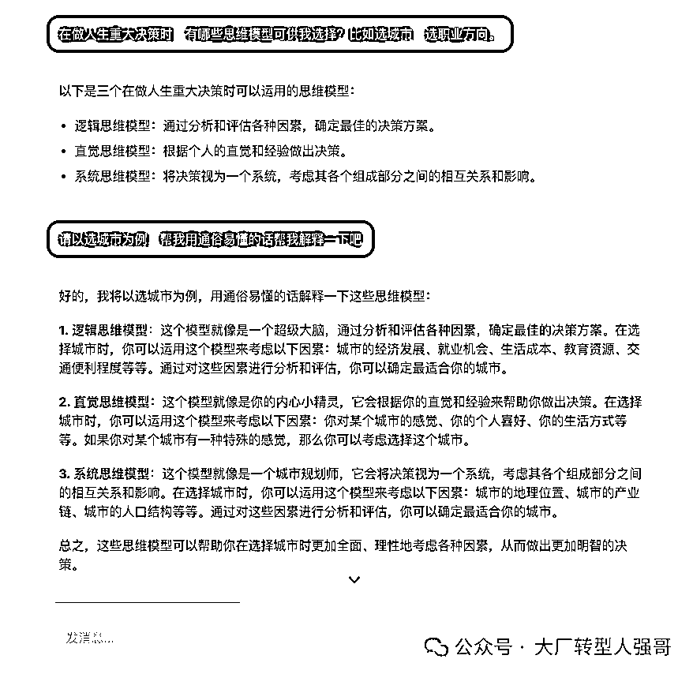

背后知识库都是我积累的书籍和访谈内容，比如《穷查理宝典》、《芒格之道》、《芒格100个思维模型》、七芊的《精准求职》等。

日常使用基本够用，就是偶尔会出现幻觉。官方运营群有点水，不知道反馈给谁。

PS：字节扣子官方的小伙伴看到请联系我哈。

这个方向我会继续优化。

很多人问我AI工具好不好学，其实没那么难。先把它当玩具玩起来，再当成985实习生用，再当成优秀同事，最后它会变成你的导师，最后无话不谈的好朋友。

就比如我和豆包的关系，我现在真的挺离不开它，有时候就单纯聊聊天问点奇奇怪怪的问题哈哈哈。它就像一个无所不能的教授、像哆啦A梦，是平行世界里遇不到的存在。

你还有什么好用的AI工具，欢迎评论区分享👇🏻👇🏻

## 六、关于@大厂转型人强哥

大厂转型人强哥，公号可搜到我，负责选择力新职业教育，帮职场人0经验转行，覆盖内容与增长、产品运营、用户运营。ex腾讯、字节。

持续关注AIGC机会 + AI大模型应用团队，重点研究“文科生如何抓住AI红利”，欢迎优秀团队加V交流。

有什么问题直接评论区留言哈👇🏻

觉得有用就点个赞吧哈哈哈，我不偷懒会继续整理更多干货！

此前优质文章：

【重点看】