# 3个月跑出40万GMV：我如何用AI剧情做视频号带货，并用Codex搭建生产工作台
260825 副业 SC 精华
大家好，我是龙哥。
2025年3月，我加入龙哥盟。到现在一年多的时间里，我真正长期投入、完整跑过的项目，其实只有两个：
一个是去年做的 YouTube AI 视频项目；另一个，是今年5月开始尝试的视频号 AI 剧情带货。
YouTube 项目持续了半年多，累计收益约2万—3万美元；视频号项目跑了三个月，目前累计GMV大约40万。
不过，到了8月份，市场上批量搬运的内容明显增多，作品获得有效GMV的效率下降，所以我主动放慢了生产节奏。也正好利用这段时间，把自己这几个月做视频号带货的实战经验，以及如何借助 Codex 搭建生产工作台的过程，系统整理出来。
这篇内容主要解决两个问题：
1. 一条真正能卖货的 AI 剧情视频，究竟要经历哪些环节：找对标、选品、查链接、改脚本、批量生成、剪辑、发布和数据复盘。
2. 如何利用 Codex，把原本琐碎、重复、容易出错的流程，整理成一套更高效的生产系统。
如果你已经做过视频号，或者接触过 AI 视频，这篇内容会更容易理解。即使你还是新手，也可以把它当作一张项目地图，先了解这个项目从头到尾到底是怎么跑起来的。
## 一、从抖音获客到 YouTube，再到视频号带货
在2025年初，我正处在事业低谷。
之前主要做抖音获客，但业务进展并不顺利，整个人对下一步该做什么没有明确方向。后来我在知识星球里注意到，赚钱长期处在热门社群前列，于是决定加入看看。
真正加入之后，我花了大量时间阅读圈友文章，也参加了一些线下活动。相比其他社群，赚钱让我感受最深的是，这里不只是讲理论，而是有人带着你做实战，也有很多圈友愿意公开分享自己的项目进展、失败经验和已经验证过的方法。
这种氛围让我觉得，这里确实是一个适合下场做事的地方。
后来，我看到龙哥发布的 YouTube“超级标”。因为自己对海外业务有一些基础，也想找一个能够长期积累的内容项目，于是报名参加了 YouTube 航海。
航海期间，我做出了两个 YPP 账号。结束之后，为了继续深入研究 YouTube，我又加入了曹教练的深海圈，开始系统学习平台生态和 AI 视频制作。
这个项目前后做了半年多，最终获得了约2万—3万美元收益，收入主要来自少数几个账号。
但对我而言，更重要的并不是这笔收益，而是在过程中积累下来的两项能力：
- AI 视频的制作能力；
- 对内容平台流量、审核和变现逻辑的基础认知。
真正的转折出现在2025年11月中下旬。
差不多一周时间里，我手上的十几个 YPP 账号陆续被平台停止收益，主要涉及儿童内容违规和同质化问题。大家都尝试申诉，但最后基本没有恢复的可能。
由于 YouTube 从起号到产生稳定收益需要较长时间，手里又有其他事情要处理，这个项目便暂时搁置下来。
项目停了，但我并没有停止研究 AI 视频。
过去一年多，模型、生图和生视频工具进步非常快。以前难以实现的画面，现在已经可以稳定生成；过去很难讲通的故事，也开始能够通过 AI 跑完整流程。
到了今年4月左右，深海圈开始内测 AI 视频号带货项目，我也把注意力重新转回国内平台。
在此之前，我几乎没有认真研究过视频号，平时刷得也不多。决定参与之后，我先把赚钱里有关视频号的文章基本看了一遍，先理解平台的规则、前辈们走过的路径，以及常见的坑。
我的判断很简单：
AI 视频，是我一直在积累的技术能力；视频号带货，则是一条相对直接、市场空间也足够大的变现路径。
技术能力和商业机会刚好能够衔接起来，那就直接下场验证。
5月中旬，我正式开始做视频号 AI 剧情带货。
## 二、先理解视频号 AI 剧情带货的完整链路
很多人刚接触这个项目时，会觉得最难的部分是“如何用 AI 把视频生成出来”。
但真正做起来之后，你会发现，生视频只是整个流程中的一环。
前面要找到有机会的内容和产品，后面还要处理商品链接、账号状态、发布方式、直播承接和数据判断。视频有播放，并不等于能够成交；商品本身不错，也不代表一定能获得精准流量。
完整流程可以概括为：
**寻找对标内容 → 确定商品与链接 → 重构脚本 → 批量生成分镜和视频 → 人工筛选与剪辑 → 发布作品 → 观察数据 → 放量、换品或停止**
目前我主要测试过两种成交模式：短挂和短引。
### 1. 短挂：视频直接承接商品成交
短挂就是在短视频中直接挂商品卡。
用户被剧情吸引后，点击视频左下角的商品入口，进入商品页面完成购买。
这种模式看起来简单，但商品链接非常关键。
发布前必须确认：
- 链接是否稳定；
- 是否存在每日限单；
- 是否达到一定销量后会被限制；
- 商品是否可能下架；
- 供应链是否能够持续承接订单。
因为视频发布后，挂载的商品链接通常无法再修改。
如果作品突然爆了，但商品链接刚好被限单或下架，那么最宝贵的流量就会直接浪费。
所以，链接问题一定要在发布之前解决，而不是等作品跑起来之后再补救。
### 2. 短引：短视频负责引流，直播间完成转化
短引的逻辑是：
**短视频吸引用户，直播间负责成交。**
视频发布后，一旦观察到流速开始提升，就要及时开播。用户刷到视频时，如果看到账号头像上出现“直播中”，点击后就会进入直播间。
需要注意的是，直播并不是一个可有可无的辅助环节。
在短引模式中，短视频只是负责把潜在用户带到直播间，真正的商品介绍、信任建立和成交，都发生在直播间里。
短挂和短引没有绝对优劣，关键要看阶段性的市场环境。
我刚开始做的时候，短引相对容易跑；到了7月份，短挂的效果更好，于是我又切换了测试方向。
普通账号和企业账号也是同样的逻辑：市场当下哪种方式更容易跑，就优先使用哪种方式。
### 3. 播放量只是过程，GMV才是结果
做纯内容时，播放量可能就是最重要的指标。
但做带货，播放量只是流量入口，最终成交金额才是真正的结果。
播放量、转化率和GMV之间，并不存在固定比例。
我见过2万播放卖出三四千元，也见过20万播放只成交几百元。
同样是接近100万播放的作品，如果平台推送的是精准购买人群，一条视频可能产生10万元左右的GMV；但如果平台推来的只是泛娱乐流量，大量用户只是围观不购买，最后可能只有几千元成交。
造成差异的因素，除了脚本和商品本身，还在于平台到底把作品推给了什么人。
这几个月做下来，我最大的感受是：
平台流量机制一直在变，这部分我们无法控制。但下面这些事情是可以提前做好、持续优化的：
- 脚本质量；
- 前几秒的留存能力；
- 商品和剧情的匹配度；
- 链接是否稳定；
- 单条视频的制作成本；
- 测试和复盘速度。
能控制的变量，提前做到位；不能控制的变量，就交给数据判断。
跑出来了，马上放大；跑不动了，及时换品、换脚本或停止，不要抱着侥幸心理继续消耗。
## 三、AI剧情带货作品的完整SOP
目前的视频号生态里，追踪已经验证过的爆款，仍然是一种相对确定的打法。
核心竞争力不是“谁知道这个爆款”，而是谁能更快完成重新创作并发布。
当你发现一条内容正在快速增长，同时商品也有不错的成交表现，就要尽快拆解并制作自己的版本。
如果等到内容已经被全网复制、市场审美疲劳之后再跟，成功概率就会明显下降。
这里说的“复刻”，并不是把别人视频下载下来、加个滤镜再上传。
正确做法是：
- 拆出原作品的开头结构；
- 理解人物关系和冲突机制；
- 提炼关键台词和情绪节奏；
- 围绕自己的商品重新设计后续剧情；
- 使用 AI 重新生成画面；
- 重新完成剪辑与发布。
整套路径可以归纳为：
**发现对标 → 确认商品 → 重做脚本 → 生成分镜与素材 → 剪辑 → 发布 → 短挂或短引成交 → 根据数据放大或调整**
### 第一步：寻找有价值的对标作品
我刚开始主要依靠人工刷视频号广场。
每天早上、中午和晚上，我都会固定观察同行内容。看到一条表现不错的作品时，我不会只看播放量，而是会把以下信息放在一起判断：
- 发布时间；
- 点赞、收藏、评论和转发；
- 是否挂商品；
- 商品是什么；
- 产品如何进入剧情；
- 作者主页和橱窗数据；
- 直播间是否有实时成交反馈。
#### 1. 先判断作品是不是还在增长期
追爆款本质上是在和时间竞争。
如果一条视频发布才一两个小时，点赞、评论、收藏和转发已经快速增加，这种内容通常还有较高的跟进价值。
越早发现，越有时间完成：
- 脚本改写；
- 分镜拆解；
- 图片生成；
- 视频生成；
- 剪辑；
- 发布测试。
比如我曾经看到一条作品，发布仅1小时左右，就已经获得777个点赞、100次转发、726次收藏和166条评论。
这类数据并不是一个绝对标准，关键是看它在相近赛道、相近时间里，增长速度是否明显高于普通内容。
发布时间和商品信息，是判断一条作品是否值得跟进的第一层依据；点赞、转发、收藏和评论，则能够帮助我们判断它早期是否具备起量迹象。
#### 2. 研究产品如何融入剧情
接下来要确认它卖的到底是什么。
可以从评论区置顶信息，或者播放几秒后弹出的商品卡里查看。
但只知道商品名称还不够，更重要的是分析产品的植入方式：
- 是自然出现在人物生活场景中；
- 还是剧情进行到一半突然插入广告；
- 商品是否参与了故事推进；
- 用户是否能够接受这种植入。
真正值得拆解的作品，一般同时具备三个条件：
1. 内容数据不错；
2. 商品存在真实转化；
3. 产品进入剧情的方式比较自然。
#### 3. 查看账号和商品的不同销量口径
看完单条作品之后，我还会进入作者主页，重点查看商品橱窗。
主页橱窗能够帮助我们了解：
- 账号最近反复推广哪些产品；
- 主要集中在哪些品类；
- 账号累计卖出过多少单。
这里有三个数据很容易混淆。
**第一，主页橱窗销量。**
如果主页顶部显示“销量399件”，通常代表该账号橱窗历史累计成交399单，是账号维度的数据。
**第二，商品链接销量。**
商品卡显示“已售6728”，说明这条商品链接在平台范围内累计成交6728单。
一条公开商品链接可能被很多账号同时推广，所以这个数字不代表当前账号单独卖出的数量，也不能直接等同于这条视频的成交量，除非你确认对方使用的是独家专链。
**第三，直播间实时销量。**
如果对方采用短引模式，可以直接进入直播间，观察左下角出现的“热卖×128”“热卖×912”等提示。
这类数据能够及时反映当前直播间的真实成交状态，比单独查看橱窗更直接。
### 从人工刷内容，到用系统留下市场记录
人工刷视频的好处是能快速建立内容感觉，但缺点也很明显：刷过的东西很容易忘记。
几天之后再回看，往往很难准确想起：
- 当时市场在集中推什么；
- 哪些产品刚刚开始冒头；
- 哪类剧情最近反复出现；
- 哪些内容只是偶然爆发。
后来，我用 Codex 做了一套市场监控工具，并接入自己的工作台。
现在，一条作品刚刚出现起量迹象，系统就会提醒我。同时，近期频繁出现的产品、同行反复推广的品类，以及新出现的潜力商品，都会被自动记录下来。
这样，在复盘市场时，就不需要完全依靠记忆，而是可以调出历史数据进行对比。
这套系统帮助我更快判断：
- 当前平台在推什么商品；
- 市场风向有没有变化；
- 哪些产品值得继续观察；
- 哪些内容适合马上跟进。
不过，工具只能帮助我们更早发现线索和保存数据。
最终判断一条作品是否值得做、一个商品是否仍然有机会，依然需要依赖自己的网感和经验。
### 第二步：选择商品并确认可用链接
找到对标作品后，不能马上开始生成视频，还要先确定商品和承接链接。
通常有两种操作方式。
#### 常规方式：先确定商品，再找适配内容
手里先有明确的产品和稳定货源，然后去市场中寻找适合这个产品的剧情模板和爆款脚本。
#### 抢跑方式：先发现爆款，再快速匹配商品
市场监控发现某条内容正在快速上涨，而它推广的商品恰好是自己已有的产品，或者能够立即从供应链拿到同款、同类商品，这时就要尽快跟进。
无论采用哪种方式，链接稳定性都必须提前确认。
尤其是短挂模式，发布前要和供应链或号商沟通清楚：
- 每天是否限单；
- 达到多少单后会被限制；
- 是否可能突然下架；
- 供应链是否能承受爆单；
- 商品质量是否稳定。
剧情带货的爆款本身就具有偶然性。
很多时候，一个月的利润主要依靠一两条真正跑出来的作品支撑，前面大量测试视频和账号投入，也需要靠这些爆款来覆盖。
因此，每一条作品都应该认真对待，不能为了赶进度，随便找一个不稳定的链接。
如果作品获得了大流量，最后却因为限单、缺货或质量问题无法承接，损失会非常大。
### 选品时要注意：场景能否自然匹配
如果拿不到完全相同的商品，可以在同品类中寻找替代品。
例如，原作品带的是A品牌酸辣汁，后续可以替换为B品牌酸辣汁；原本推广红烧酱油，也可以换成红烧汁或其他同类复合调味料。
只要产品品类和使用场景一致，用户通常不会觉得突兀。
但不能为了带货而硬塞商品。
比如原剧情是家人在厨房做饭、吃饭的生活场景，最后却突然出现一条毛巾或完全不相关的日用品，即使文案能够勉强解释，画面和观感也会非常生硬。
AI 可以帮你完成文字替换，但产品到底是否适合这个故事，最终还是要靠人工判断。
原则可以总结为：
**同品类可以换品牌，但不能改变产品在剧情中的使用逻辑。**
### 跟品，还是自己开发新品？
我这40万GMV里，绝大部分来自跟品。
跟品的优势非常明确：
- 商品已经被市场验证；
- 用户已经证明愿意购买；
- 你只需要重点测试内容能不能拿到流量；
- 也只需要判断商品放进自己的剧情后，转化是否还能成立。
对于新手来说，跟品通常是更稳妥、试错成本更低的方式。
自己开发新品，成功后第一波利润可能更高，市场竞争也可能更小，但同时要验证两个问题：
1. 这个商品是否有真实需求；
2. 内容是否能够获得流量。
这意味着你需要更高的视频产量、更充足的测试预算，以及更稳定的供应链配合。
因此，刚开始时，建议先把跟品链路跑通，再考虑开发新品。
### 一个寻找独家链接的小方法
有时你会遇到这样的情况：
某个爆款推广的是独家链接，公开选品平台或常见供应链里找不到，但你又想快速跟进。
这时可以直接进入商品店铺，联系商家客服，争取拿到商务联系方式，再去沟通挂车链接。
这种方式通常比在各类选品平台里慢慢搜索更快。
不过，私下合作也存在风险，尤其是线下结算佣金时，偶尔会遇到商家在产生订单后拖延或拒绝结算。
虽然不是普遍情况，但在合作前最好确认清楚：
- 结算方式；
- 佣金比例；
- 结算周期；
- 对账方式；
- 订单归属和售后责任。
## 四、第三步：围绕产品重新设计脚本
产品和链接确定后，才进入脚本制作环节。
一段完整剧情要同时处理人物关系、冲突节奏、产品植入和分镜拆解，如果完全手工完成，效率会非常低。
刚开始做时，我使用的是深海圈内测的工作台。
现在市面上有不少 AI 短剧带货工作流，价格和功能各不相同，但底层逻辑大体一致：
把已经验证过的提示词和生产步骤封装进工具里，用户输入原始爆款脚本和目标商品后，系统会自动分析故事结构、人物关系，再生成一版适配新产品的二创脚本。
给刚入场的新手一个建议：
不要一开始就想着自己从零研发一套系统。
先用成熟工具把视频做出来，把从内容到成交的闭环跑通，比研究工具本身重要得多。
等你真正做过大量内容，对什么样的开头能留人、什么样的植入自然、什么样的剧情容易转化有了明确判断，再考虑使用 Codex 开发属于自己的工作台。
脚本二创时，我主要遵循下面两条原则。
### 1. 前30秒尽量保持原有结构
一个爆款视频的前30秒，往往已经验证了它的留人机制。
这部分需要重点保留：
- 冲突出现的时间；
- 信息释放顺序；
- 人物关系；
- 关键台词；
- 情绪推进；
- 镜头节奏；
- 观众产生继续观看欲望的原因。
可以调整人物身份，但不要改变人物在剧情中的功能。
比如，原版是父亲和儿子争吵，可以换成叔叔和侄子；也可以换成公公和儿媳。但冲突关系、情绪强度和关键台词的推进方式，最好保持一致。
很多新手知道开头重要，却仍然会在前30秒里大幅改动，结果把原作品最核心的留人钩子一起改掉。
所以，前30秒的处理原则是：
**人物可以等价替换，冲突结构和留人机制不要轻易动。**
### 2. 30秒之后，再围绕商品展开故事
从30秒之后，可以根据目标产品重写剧情。
重点不是把商品硬塞进去，而是让它成为故事中合理的一部分：
- 人物为什么会使用它；
- 产品如何解决当前矛盾；
- 商品出现是否符合生活逻辑；
- 前后剧情是否连贯；
- 观众是否会感觉到明显广告感。
脚本初稿完成后，需要进行人工审核：
- 故事是否讲得通；
- 人物行为是否合理；
- 对话是否自然；
- 产品植入是否突兀；
- 情绪节奏是否顺畅；
- 前30秒的关键结构是否被保留。
确认没有明显问题后，再进入素材生产阶段。
再次强调：
这里的复刻，是拆解已经验证过的内容机制，再重新写脚本、重新生成画面和重新剪辑，不是直接搬运原视频。
## 五、第四步：把脚本整理成可批量生产的资料
脚本确认后，工作台会继续把内容拆分为：
- 人物设定；
- 场景设定；
- 分镜信息；
- 每段对应的提示词；
- 角色参考图；
- 场景参考图；
- 商品参考图。
最后生成一份分镜 Excel，以及与分镜对应的图片素材。
Excel 中需要写清楚每条镜头：
- 需要使用哪些提示词；
- 对应哪些角色图；
- 使用哪一张场景图；
- 是否需要产品参考图；
- 后续视频生成任务如何读取。
这样，后面的生视频工作台就可以直接按照表格执行，不需要人工反复确认。
我目前按照日期管理不同作品。
当天生成的脚本、Excel、图片和视频，都会放在同一个任务目录中。前端产出的资料和后端使用的文件遵循统一命名规则，减少了大量重复整理和手动重命名的工作。
基本结构是：
- 每条分镜建立独立文件夹；
- 角色、场景和产品素材集中存放；
- Excel 统一记录分镜提示词和参考图；
- 脚本、图片、表格和生成视频按日期归档；
- 后续工具直接读取同一任务目录。
这一套整理方式看似简单，但当每天需要处理大量素材时，会显著降低混乱和出错概率。
## 六、第五步：使用SD2.0批量生成视频，并控制制作成本
拿到 Excel 表格和配套的分镜素材包后，工作就切到视频生成这一步。
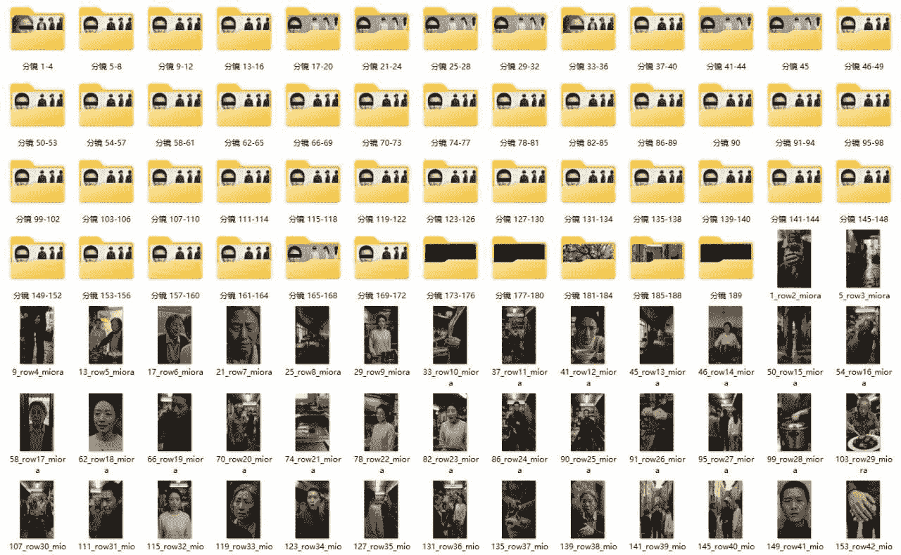
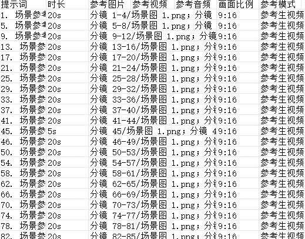
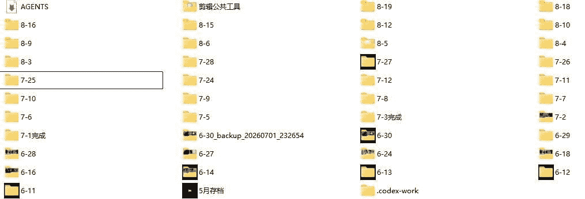
目前我日常主力使用的还是 SD2.0，也尝试过 Mini、Fast 这类轻量模型，实际成片质量并不理想。
#### 1. 合成的单位与最终时长
我的生成逻辑是按“任务”来划分：
- 单个任务大约产出 15 秒的片子，内部通常拆成 4 个小镜头；
- 初期做一条作品大概需要 30 到 50 个任务，折合 120 到 200 个分镜；
- 进入后期，为了让剧情更丰满、做出区隔、给剪辑留足冗余，我会把任务量提升到 70 到 80 个，接近 300 个小镜头。
把 80 个 15 秒任务全部跑完，原始素材累计约 20 分钟。剔除废片和瑕疵后，成片一般落在 10 到 15 分钟。
刻意做长并不是为了凑时长。保持爆款前 30 秒的钩子与核心转化机制不变的前提下，通过增添支线和细节来差异化，才能有效降低平台对同质化内容的限流风险。
#### 2. 生成渠道的演进与批量化改造
刚入行的建议是先用官方 API，哪怕单价高一些，也要把从生视频到调取分镜的完整链路跑通。
熟练之后再去对接市面上的低价渠道。不同来源的价差非常大：
- 便宜时一段 15 秒可能只要几毛甚至更低，一条完整作品十几块到二十几块就能完成；
- 走官方或高价渠道，一条长片轻松要两三百块。
一条作品包含几十个独立任务，若靠人工在网页上逐个选图、粘贴提示词、点提交、手动下载，既耗精力又易出错。更关键的是低价渠道生命周期很短，一两天就可能失效。
于是我搭建了生视频自动化工具：上游把 Excel 和图片准备好后，工具直接批量读取并一键提交，生成完毕后按分镜序号自动归档到当日的项目文件夹。哪一段失败或人物崩了，就在后台勾选单独重跑即可。
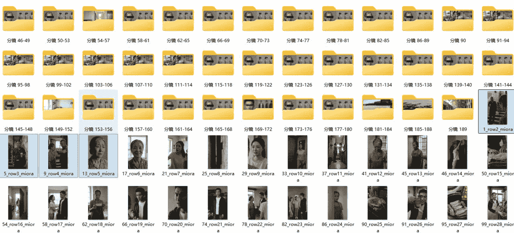
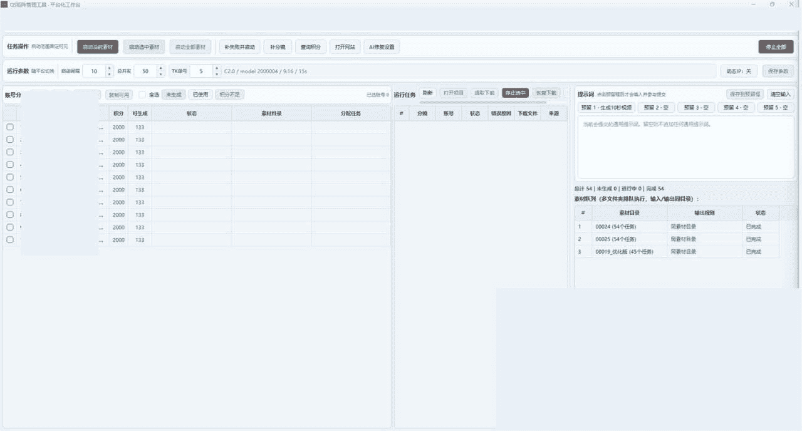
生成工作台统一读取上游资料并批量提交视频任务；批量任务记录用于跟踪生成状态、补做失败项和回收成果。
#### 3. 成本与产量认知：不要盲目囤片
单段成本下降的最大价值是能在相同预算下多测几条作品，多争取一次爆款机会。
但千万不要因为捡到极低价渠道，就在家批量生产几十上百条视频囤着。视频号的投放环境与热销商品是动态变化的，提前做好的素材放一周，可能商品周期已过、平台玩法已变，最终全部作废。
正确做法是紧跟当下在投放的产品与市场节奏。行情好、产品正处爆款期，即使采用成本高些的稳定渠道，只要能出单覆盖成本，就要立刻启动。
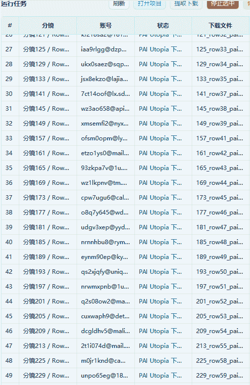
### 第六步：从拉片自剪到外包，再到现在的人机协同剪辑
所有片段下载到本地后就进入剪辑阶段。
AI 视频的最大特点是随机性。提示词写得再好，画面仍会出现动作变形、穿模、表情怪异。更致命的是商品货不对版：
比如售卖的是甘草金桔，AI 生成的金桔忽大忽小、包装数量与真实售卖不符，这类片段必须剔除。这不仅是审美问题，更容易触发平台“展示与实物不符”的违规。
- 产品外观、数量、包装与真实商品不一致的画面严禁使用；
- 商品规格展示不一致可能直接违规。
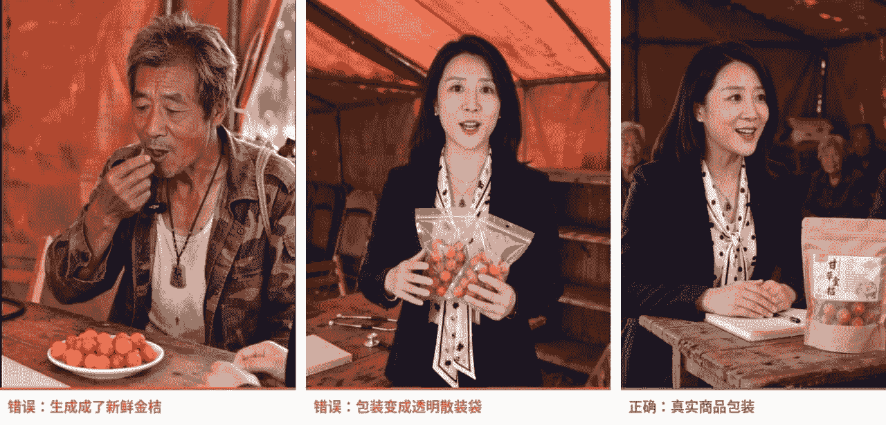
剪辑这块我也经历了三个阶段：
- 第一阶段 纯手工拉片：早期我自己看对标、逐帧拆解学习运镜、卡点、留悬念的方式，再一点点剪出来。虽然慢，但能快速建立短剧节奏和画面取舍的网感。
- 第二阶段 外包剪辑：业务增多后要盯供应链、数据、脚本、批量生成，精力不足就外包。但没接触过带货逻辑的剪辑师，对故事走向和产品展示缺乏体感，分不清哪些 AI 瑕疵是绝对不能用的。反复沟通修改反而更耗时间，培养可用的人成本很高。
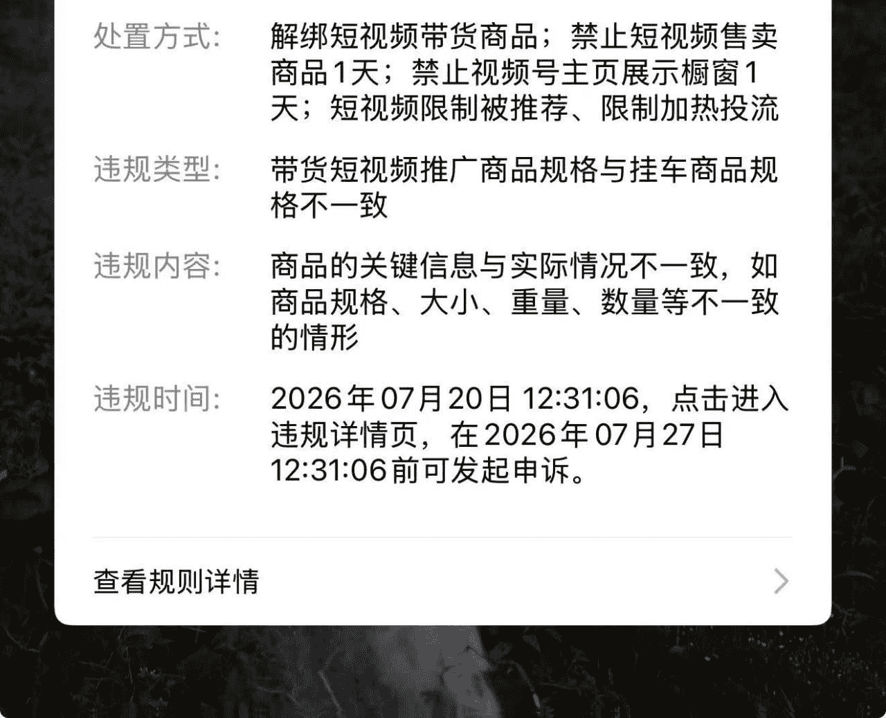
- 第三阶段 人工预检把关 + Codex 自动化收尾：
**a. 我先做预检把控质量：**把原始视频全部导入剪映，按剧情大纲快速浏览。依靠网感把人物崩坏、产品瑕疵、动作不自然的废片删掉，只保留最顺畅的核心画面；
**b. Codex 批量收尾提升效率：**废片剔除后，音频对齐、字幕生成、BGM 卡点、固定片头片尾拼接等标准化动作，按我定好的剪辑 SOP 交给 Codex 和自动化工具完成。这套流程是长期打磨出来的。
现在一条 10-15 分钟的带货长视频，我大概花 10 分钟做快速预检，剩余全部交给工具收尾。若有大佬把 AI 长视频全自动理解与稳定剪辑做得更好，欢迎交流。
### 第七步：账号、商品链接与发布准备
短挂和短引的成交逻辑前面已讲过。发布前我主要确认三件事：账号能否正常跑、商品链接是否健康、作品采用何种发布方式。
#### 1. 发布时间与个人习惯
我个人的发片窗口集中在上午 9 点到下午 5 点，这是跑下来数据相对平稳的习惯，并非绝对规则。晚上或其他时段同样能出爆款。
#### 2. 短挂与短引的操作差异
- 短挂：直接挂车发布即可。重点提前确认商品链接稳定性与限单情况，发布后观察作品是否起量、是否产生真实成交。
- 短引：需持续盯流速。流速起来就开播，关注短视频到直播间的进入率，以及直播间商品卡是否持续出单。
进入率没有固定及格线，要结合大盘来看：
- 行情好的阶段，我实操经验里平均 2% 左右算正常，3% 及以上算优秀；
- 行情波动、平台大盘差时，进入率会被压得很低，比如我遇到过播放量持续上涨，进入率只有 0.3% 左右。
表面热闹，实际无人进直播间，等于给代播团队打工。看数据必须结合市场大环境和单条作品表现综合判断。
#### 3. 账号是被严重低估的致命变量
新人建议先用自己或明确授权的家人朋友账号把流程跑通。
后期租号扩大产能，就要面对号主配合度这个不可控点：
- 租号市场层层中介，贵不代表好；
- 最致命的是异地登录扫脸。视频爆了触发风控，需在 10-30 分钟内联系号主扫脸，联系不上或超时，账号会被直接断流；
- 我们常是 10 个账号搏 1 个爆款，爆款收益需覆盖前期成本。好不容易跑出的苗子因号主失联、误删作品、封号、未成年等原因被限流，损失巨大。
普通号和企业号同样如此，比如 7 月份企业号挂车更容易跑。哪种方式有红利窗口就切换哪种。
另有实操小技巧：爆款作品可重复发。第一波流速掉落后，原视频在同号重发一次，甚至可发第三次。红利期有人一条爆款连发十几次吃流量。
可拿爆款授权给其他账号分发，把流量吃透。但前提是作品本身已验证能拿大流量。本身没流量的片子重复发多数无用，极少数情况第二次会逆袭。
### 第八步：用真实数据决定放大、换品还是换脚本
发布后我坚持分开看播放量、转化和 GMV。播放代表内容拿到流量，GMV 才证明脚本+商品组合跑通。
#### 1. 流量和 GMV 都出来 —— 24 小时内复刻放大
一旦组合跑出正反馈，24 小时内就要裂变：
- 保留验证过的黄金开头 0-30 秒和整体故事逻辑不变，只替换场景、背景、部分后端剧情，快速做出 5-6 个微调版本，分发到 4-5 个账号跑；
- 放大窗口通常只有几天到一周，越快吃完这波流量越好，否则同行跟进后生命周期迅速结束。
#### 2. 播放高 GMV 低 —— 对账诊断
播放几十万上百万却只卖几百，先与同行对账：
- 若大盘问题，同行同一时期都“有播放没转化”，说明平台在推泛流量，维持测试即可；
- 若自身问题，同行带该品正常出单而自己不出，则排查商品植入是否生硬、链接是否限单、脚本人群是否与买货人群错位。
#### 3. 发出去无流速 —— 果断止损
排查账号环境正常后几天无流速，就放弃换脚本换产品测试。不要在无正反馈内容上路径依赖。
视频号核心是低成本快测博确定性，跑出结果重兵放大，跑不出迅速止损。
## 四、把个人判断沉淀为工作流
一条作品流程跑顺后，我开始把反复的手工动作沉淀下来。
5 月跟深海圈内测时，我先用前辈验证过的方法把链路跑通。起跑比闭门造车实际。
随着产量提升，我形成了自己的判断：哪些开头不能动、人物关系如何等价替换、产品何时自然出现、哪些脚本不能入生产……这些网感因人而异。
若每次都要在对话窗口重新解释背景、再手动修改，产量一上来就会被沟通和返工拖垮。于是用 Codex 搭建工作台，把验证过的业务判断固化进去。
现在流程很顺：作品市场起量后，数据监控记录变化；我决定跟进后进入素材准备，提取结构与产品信息；确认产品资料后进入脚本创作、审核、返工；脚本通过后系统自动生成分镜 Excel 和参考图，按日期整理成任务包。
变化不在多了哪个按钮，而在不用每次重新找入口、重新解释需求。规则和上下游格式固定后，任务沿同一条流水线走下去。
需要我亲自把关的只有几个核心节点：是否跟进、产品是否合适、脚本能否入生产。工作台提升的是线索发现和批量执行效率，商业判断无法替代。
数据监控留存作品变化并提供复刻入口。
素材库集中保存作品结构与生产资料。
产品图生成后与商品资料绑定。
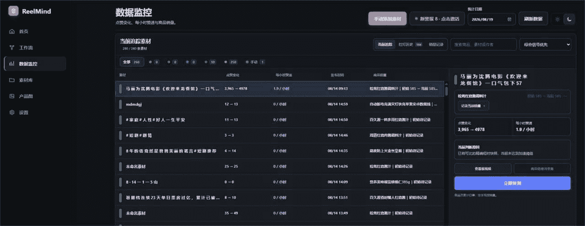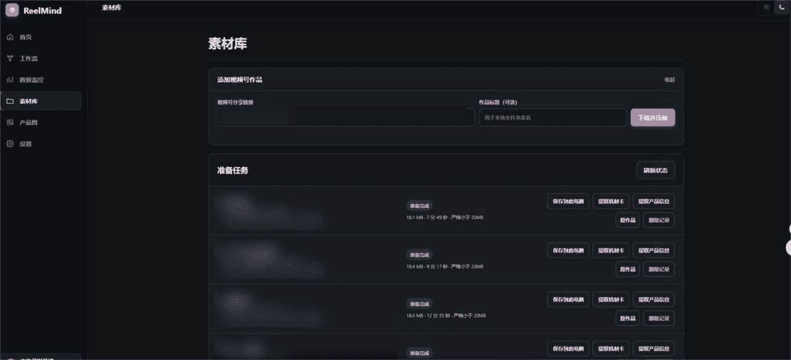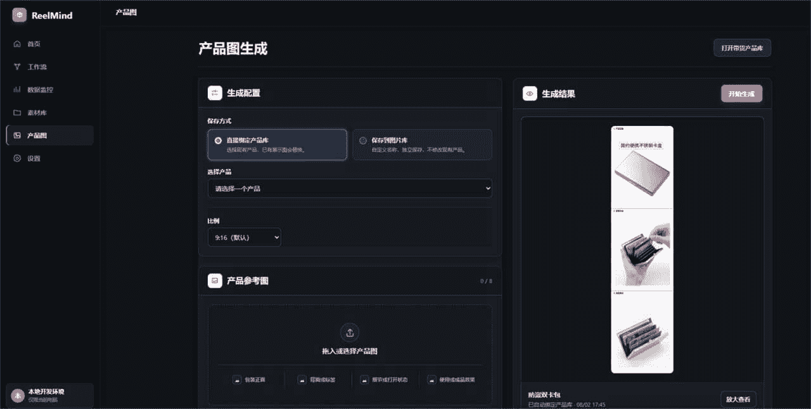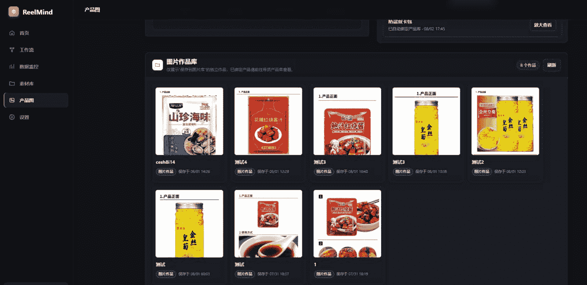
工作流运行记录让每一步的状态和结果可追溯。
## 二、生视频平台是产量逼出来的
脚本和资料标准化后，瓶颈转移到“逐条提交视频”。几十个 15 秒任务，人工逐段选图填词提交下载放回目录，效率极低，还容易错过短命的低价渠道。
所以我做了生视频平台，直接读取上游 Excel 和图片，后台统一管理任务状态。生成完成后按分镜序号自动下载到当日文件夹。中途失败可单独重跑，中断可续，效果不满意可指定重做。
我接入过十几个生成平台。单接入只解决一次性问题，后来我把“如何接入新渠道”整理成标准适配流程，市场上出现新低价渠道，只需处理差异化部分即可快速接入。
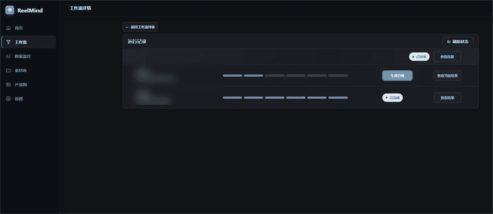
## 视频生成的真实成本与核算
生视频是日常开销大头，最初思路就是压低单段成本，用最低代价探出正反馈。
单条成本取决于渠道：
- 官方 API：2.0 或 2.5 价格偏贵，一段 15 秒约 7-10 元，一条长视频成本易冲到两三百；
- 市面低价口子：闲鱼、第三方渠道，一段 15 秒 720P 通常 1-3 元，属于常规可接受区间；极端最低见过 1 毛钱，但时效极短。
按常见分镜量核算：
- 50 个任务约 8 分钟成片：
- 1-3 元渠道，成本约 50-150 元；
- 极低价渠道可压到 50 元以内；
- 混用高价渠道约 150-200 元；
- 综合来看 50 分镜作品实际制作成本约 50-200 元。
- 我常做的 80 个任务约 15 分钟成片：
- 常规低价渠道约 70-80 元；
- 渠道稍贵约 150-250 元。
生产时常备多个渠道，贵的保底、便宜的冲量，按单价灵活控预算。一次便宜只能降当批成本，而能快速接入新渠道、稳定管理回收结果的 SOP 才是长期沉淀价值。
## 三、剪辑让我重新划清人与 AI 的边界
剪辑是我与 Codex 磨合最久、踩坑最多的环节。
起初追求全自动，希望 Codex 按规则完整剪好。后来接入 Gemini，结合抽帧、音频、上下文理解，效果提升但零点几秒的画面变形、穿模、细微违规仍可能漏检。
最终调整为现在模式：人先做素材好坏的快速预检，Codex 做标准化批量收尾。这次调整的启示是：自动化不是为了全自动这个词，能稳定交付、无违规才有意义。能说清、可验收的标准动作交给 AI，需要网感把关的部分留给人。
## 四、我如何与 Codex 协作
我完全没有代码基础，很多需求都是用大白话口述给 Codex。
不会写代码不影响做出工具，前提是真下场做过业务，清楚痛点和交付及格线。
我与 Codex 的配合习惯：
1. 先划清边界：让它先读透现有文档和业务逻辑，讲清本次只查看还是可直接修改，边界先说死；
2. 先拿最小闭环试水：把目标、不能改的底线和最终交付的格式一次讲透，用一两个小案例把整条路先走通；
3. 把错误沉淀成规范：输出偏离预期时，我不会笼统地丢一句“重新做”，而是把具体的错误点拎出来说清楚。
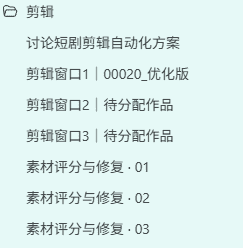
如果同一类问题以后还会反复出现，我就要求把“什么才算正确”写进提示词、SOP 或代码逻辑里。
只把当前这一版改对，救不了以后；把出错的原因带回流程，后面的路才会越走越顺。
至于要不要继续押注这个产品、大盘走势怎么看、供应链从哪里谈、直播现场如何调度，这些事 Codex 给不了答案。它真正擅长的是把已经定义清楚的动作执行到位，让我们从重复劳动里脱身，去处理需要商业判断的部分。
另外，我自己也一直在做企业端的 AI 落地。给自己做工具时，痛点、需求、验收标准全在脑子里，不顺手的马上能调；到了企业那里，第一轮需求往往就是对接人的几句口头描述，很多藏在水面下的东西，只有真正钻到业务一线、让团队反复使用之后才会浮现出来。这也让我越发明晰：能做出一套工具，和真正读懂一门生意，难度完全不在一个量级。
## 五、在视频号实操三个月后，我沉淀下来的几条体感
这三个月有高有低，也踩了不少坑，下面几条是我现在很确信的：
### 1. 平台一直在演进，经验只能阶段复用
把三个月切成三段看：
- 5 月，我基本是在拿钱买路，用偏贵的 API 接口硬生生把产品、脚本、视频、账号、发布、直播和数据这些环节全部拽在一起，成本高也认；
- 6 到 7 月，我保持多账号日更，用稳定的内容量把平台的“手感”喂了出来，7 月效果最好，我也趁这个势头把内容辅助工具和 AI 生成系统搭了起来；
- 到 7 月底、8 月，搬运和批量生成的内容开始泛滥，一条刚起来的作品很快就被复制走，原来能吃一周的流量红利，现在两三天就没了；平台给的泛流量也多了，播放看着不错，实际成交却上不去。
当自己测的量还不够时，人很自然会怀疑脚本是不是不行。这种时候，同行之间的信息同步特别关键——和圈里人把数据摆在一起，发现大家面临的是同一个问题，就不会鲁莽地全盘否定自己、反复改内容。
总有人在赚钱，说明这条路没堵死，但别人的解法不一定能搬到你自己身上。8 月我主动放慢了生产，把时间投到复盘和系统优化上，同时开始尝试“加强版二创”：先做几个差异明显的版本去试，有反馈后再集中放大。行情好就全力冲，投产比下滑就停一停、调整打法，这本身就是做项目的节奏感。
### 2. 能提前锁定的，不要临时抱佛脚
视频号里有很多变量不是我们能掌控的：算法今天给不给量、用户当下愿不愿买、某条内容能不能爆，这些只能接受。但脚本质量、选品和用户需求的匹配、商品链接限单、制作成本，以及号主能否及时配合验证，这些都可以提前安排好。
我们经常测了 10 个号才等到 1 个爆款，任何一个本来可以避免的小问题，比如链接失效、号主失联无法扫脸，都会把前面所有努力清零。所以我的原则特别简单：能提前落地的绝不抱侥幸心态。
### 3. 作品一旦成型，马上交给市场
刚遇到便宜的生成通道时，我也忍不住疯狂产出、囤了一堆视频在电脑里。但真正跑下来发现，产品和市场风向变得太快，囤得越多，最后越可能烂在文件夹里。
同时，关于成片质量：如果你觉得某条片子不够好，但既然已经做出来了，就一定要试着发出去。我也有过自己觉得很“拿不出手”的视频，结果发出去卖了四位数。片子行不行，应该由市场来给结论，别用自己的审美替市场做决定——很多你看不上的内容，反而跑出了意想不到的成绩。
### 4. 核算单条成本，要把失败一起算进去
看项目账本，不能只盯着“一条 15 秒视频多少钱”。真实的消耗还包括账号费用、工具配额、剪辑时间、直播运营，以及前面 9 个没跑通的结果。便宜渠道的价值在于把试错门槛拉低，让你在同样的预算里多测几组组合。
但如果不看商品时效盲目囤片，或者内容压根发不出去，那再便宜的成品也是废数据。把分摊成本想透，才能判断这个项目到底赚不赚钱、能不能加码。
## 六、想进场的你，先收下这些真实开数和避坑提示
如果这份复盘让你动了心，也准备试视频号 AI 剧情带货，那我用自己这几个月的真实经历，给你几条大白话建议。
先说花费（暂时不算生成视频的接口支出，只算其他必要开销）：
- 账号：
- 普通号租赁：市场价约 150～250 元/7 天；
- 外展号（挂车号）：约 180～300 元，跟着大盘行情上下浮动；
- 企业号认证：官方收取 300 元/个。
- 脚本辅助工具：市面上的二创产品从几百到几千都有，丰俭由人。
- 数据监控工具：比如小微猫看大盘和流速，会员约 80 元/月。
- 直播代播：短引代播一般 30～45 元/小时，白天夜间价格有差异，团队报价也不一样。
把这些杂项加上前期 API 测试的消耗，手里准备 5000～10000 元，就足够你来回跑好几轮小循环。
账号上，新手别急着租一大堆，先拿 2 个正常号（最好是自己的或家人的），提前做两三条内容留出容错空间就行。
至于能不能当副业，我的实话是：很难。因为每天要刷对标、拆脚本、挑镜头、做剪辑、盯流速、准备开播，事情非常零碎。真想拿到正反馈，前期每天至少要踏实投入 5 到 8 小时。
再提一下市场：目前这个阶段，搬运和“黑科技”已经相当多，纯新手不适合带大资金来拼量。一条好内容起来，几小时就可能被抄烂。更聪明的策略是先练基本功，用现成工具把做片、拆爆款、剪辑的手感练出来，再用小成本测试不同风格的变化；等看懂了出单底层的逻辑、摸清了平台的脾气，再等下一个窗口期果断放大。
这几个月我见到的“反面教材”也很有共性：
第一，上来就死磕“百分百原创”。在还没搞清楚什么是有效开头、目标用户为什么会停下看的时候，盲目自创剧本，最后多半是自我感动，发出去可能连几百播放都到不了。前期不妨先一比一复刻已被验证的爆款框架，先把第一笔成交拿下来再说。
第二，贪便宜囤片。偶尔发现一条一两毛钱的生成渠道，就忍不住批量下载几百条存着。但视频号的商品和风向变得极快，等你后面想起要发，产品可能已经过气，囤下来的全是电子垃圾。内容必须跟着时效走，做完就发，绝不积压。
第三，用自己的审美替市场下结论。我们自己看觉得画面土、不够精致，就不想发。可视频号的很多真实买家是中老年用户，她们偏好的东西和我们完全不同。只要没有硬伤或违规，做完就发，很多你认为一般的作品，偏偏就能卖爆。
第四，账号和链接的细节不能大意。我们常常测了 10 个号只有一个爆了，流速刚起来，结果因为异地登录需要扫脸，号主在上课联系不上，推荐直接被掐断；也有人跑了上百万播放才发现链接一天限购 200 单，大量流量被白白浪费。发片之前，一定要和号主约好时间，把链接的限单和资质查清楚。
第五，别一上来就追求“全自动”或自己写代码。你连单条视频出单的链路都没理顺，自动化只是在批量生产错误。先把成熟的现成工具用起来，等出单闭环稳定、产量真的遇到瓶颈，再考虑用 Codex 搭建属于你自己的系统。
## 写在最后
以上只是我实操中的一些经验，不是什么标准答案。视频号里的带货生态涉及很多细节，这篇文章主要把核心骨架、心法和踩坑点提炼出来。如果你对这个赛道感兴趣，建议多看几份优质资料补细节，再带着自己的判断跑一跑，也欢迎指正。
从 YouTube 到视频号，这一年多我拿过一些结果，也交过不少学费。回头看，真正沉淀下来的变化，比赚钱更重要。
以前看项目，我先问能不能赚钱；现在我会继续看它在什么阶段、哪些事掌握在自己手里、项目停掉后我能留下什么。
过去我很少做内容。经历了 YouTube 和视频号之后，对国内外内容的节奏、爆款开头、人物设计、剧情推进和视频拆解，都有了更具体的体感。
做项目的思路也清楚了很多：找对标、定产品、做内容、发布测试、观察数据、放大结果，我把零散的经验整理成一套可以重复使用的方法。
三个月 40 万 GMV，只是一个阶段的成绩。它来自产品、内容、账号、直播和市场的共同作用，也来自这段时间持续的生产和试错。
在 Codex 的辅助下，从找选题、做素材到生成、剪辑，很多重复动作一个人就能完成。但产品怎么选、市场怎么变、内容有没有网感、要不要继续投入，这些仍然需要人来判断。
这套方法的起点，是赚钱、深海圈、项目发起人和前辈们已经走过的路。落到自己手里后，我再不断测试、调整、迭代，才形成今天这版流程。
流量口子没了可以再找，产品窗口过了就换品，平台规则换了就重新研究市场。但这几个月积累下来的 AI 视频能力、内容判断、业务理解和工作流，不会随某个短期机会消失。
拿我自己说，如果做 YouTube 时没有在深海圈跟着周期把 AI 视频能力和内容感觉磨扎实，后来转做视频号里的短剧带货生意，我大概率拿不到这些结果。
平台和项目会一直换，但从项目里沉淀下来的底层能力可以随时迁移。只要你在一个项目里真正死磕过、拿到过正反馈，换到新赛道和新场景时，这些能力就是你快速破局的底气。
关于接下来的计划：一方面，我会继续稳固和放大现在的视频号打法，把更多时间放到高壁垒的二创甚至偏原创内容上；另一方面，也想探索视频号里更多不同的赛道和玩法，比如图书带货。
短视频和 AI 都变得太快，写下这些与大家共勉。也欢迎对视频号不同内容方向感兴趣的朋友多交流。
感谢龙哥盟、深海圈，以及一路愿意分享市场信息和实操经验的朋友们。
关于 AI 剧情脚本二创、视频生成工具、剪辑标准流程，以及 Codex 搭配 Gemini 的自动化剪辑方案，后面有机会再分别展开。
谢谢！
————分割线————
看完这份 SOP，你可能觉得自己会了。但 90% 的人一到实操，第一关就卡住。
工具和教程从来不是最贵的门槛，最贵的门槛是“马上动手”和“圈子里的信息差”。
这里只聊实际的东西，拆商业闭环、压榨 AI 效率。社群里已经沉淀了 1000+ 跑通的套利实战案例。
👉 查看圈子完整资源与上车方式：
