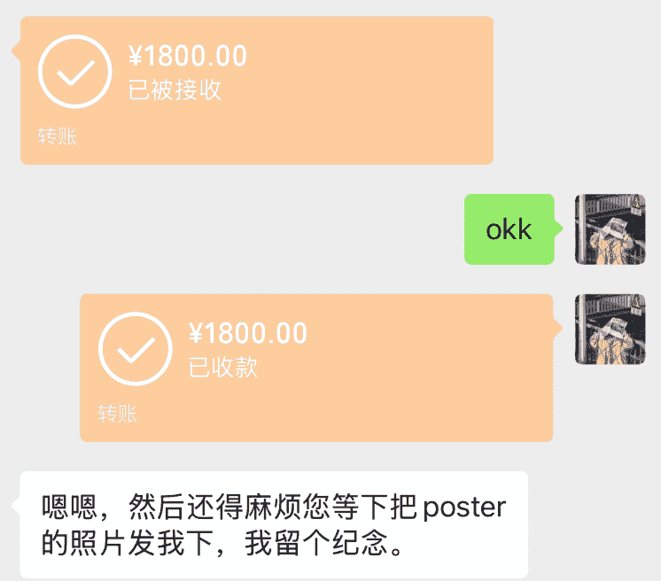
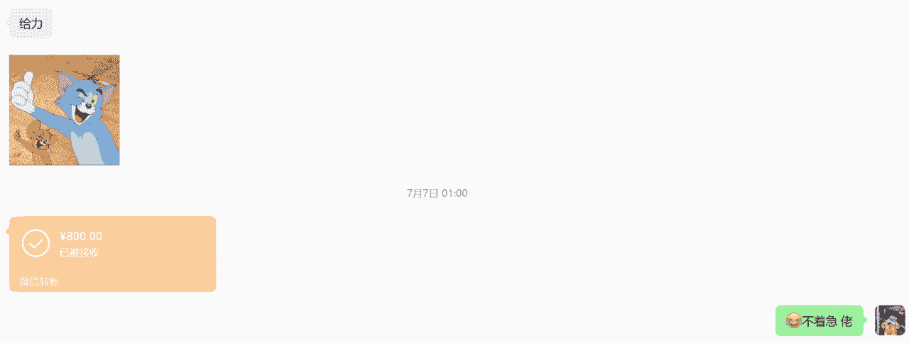
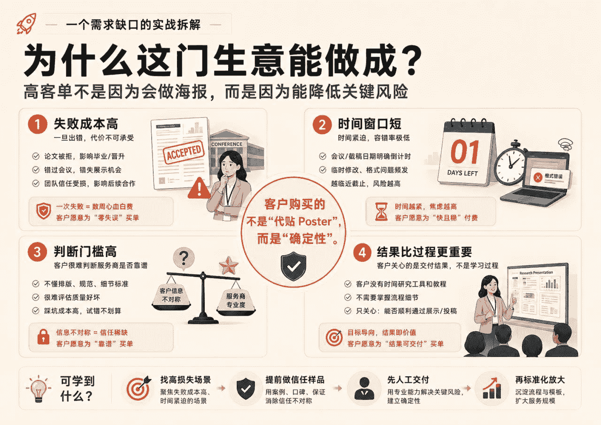
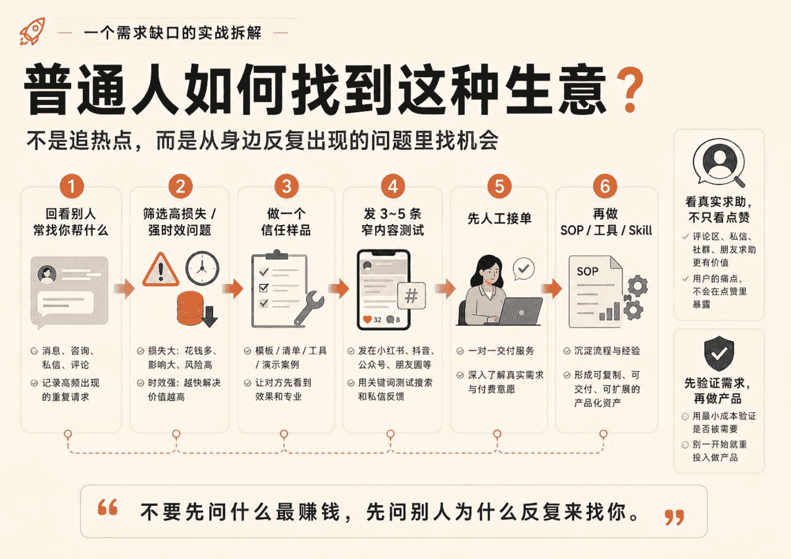
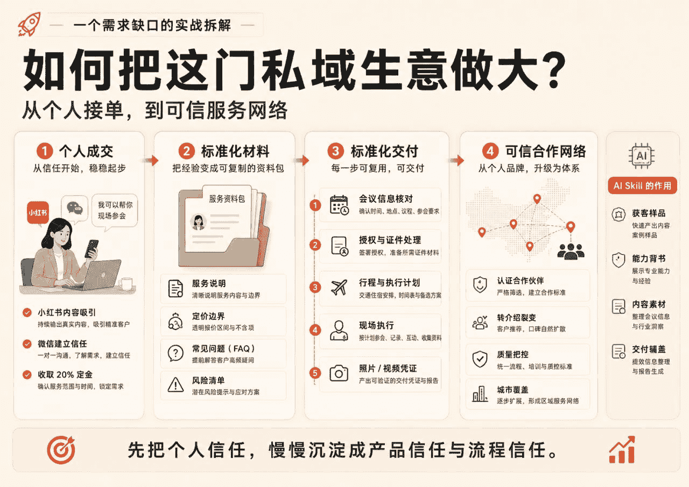

# 50粉小红书账号，3篇笔记撬动3天过万：我是怎么从一句“能代贴海报吗”里看到高客单机会的

先说结论。

一个粉丝在50个左右的小红书号，累计发出3篇围绕学术会议的内容，没投放、没直播、也没刻意做私域诱导，72小时内陆续成交金额破一万。

这里说的是成交额，不是净利，交通住宿要自理，订单体量也还很小，所以不拿它当成可以无限复制的成熟生意。

给我的最大启发是：变现不一定要先把账号做大，也不一定要先做一套完整的产品。很多时候，生意是用户在用了你的免费内容后，主动把需求说出来的。第一位客户加我时就问了一句：能不能帮我到现场贴Poster？随后才延伸出海报展示、口头报告、会议现场协助等需求。

我本来没想做这个方向。之前只是做自己擅长的事：写论文、跑会、做海报、准备口头报告PPT，并把整理好的模板、经验和AI工具放到小红书。粉丝没涨多少，但找上门来的客户需求很明确。

回看成交路径其实很清晰：先用免费内容解决用户的小痛点，让他相信我能处理背后更棘手、更紧急、更愿付费的大问题。

## 第一单，需求是用户帮我发现的

起因是我在准备一次人工智能国际会议时，顺手发了几篇笔记：会议时间安排与海报口头报告准备建议、海报模板与PPT做法、Paper2PPT工具介绍。

转发最多的是一篇海报模板。很多首次参会的人不明白海报到底要放什么，习惯把论文原图放大，摘要方法实验堆一起，字小重点不突出。

我强调海报的核心是让路人30秒内抓住：解决什么问题、方法和现有工作有何不同、结果如何、论文最值得记住的结论。现场讲解也要分层准备30秒、2分钟、5分钟版本，并提前准备创新点、基线、消融、失败案例、方法局限等常见问题。

这些对我来说是日常，对第一次出国参会的人则是降本试错的经验。随后一位读者私信问：能不能帮他现场代贴海报。

聊下来才知道，作者因签证护照学校政策工作安排等原因无法到场，但论文已录用，会议对海报展示、现场签到、口头报告又有具体要求。对他而言不是锦上添花，而是必须处理的刚需。

单纯做海报，市场替代多价格也不高。但需求变成“我人不在必须完成现场交付”时，客户关注的就不是省几百块，而是能否找到真正懂流程、能准时到场、能担责的人。

这就是需求缺口所在。

这类服务边界必须清楚。不同会议对代贴、替讲、远程、现场展示的规定各不相同，不能一概而论。承接前要核对规则，必要时让作者与主办方确认。不能冒充作者，也不能伪造签到身份记录。能提供的是规则允许范围内的协助，而不是绕开规则。边界不清短期可能多接单，长期会出事。

## 50个粉丝为什么能卖高客单

很多人把粉丝数当成变现门槛，觉得没几千粉就不配卖东西。

这次经历显示，对低频高客单明确需求的服务，粉丝价值有限，精准度更关键。

我的粉丝少，但搜索意图精准：人工智能国际会议、海报、口头报告PPT、学术会议汇报等。来的不是来娱乐的，是马上要参会有具体问题的。

不同内容承担不同角色：

会议攻略承接主动搜索，解决尺寸、时长、结构等基础疑问；

海报模板降低判断成本，用户看得见成果，比自我介绍更有说服力；

Paper2PPT工具则提供更深背书。输入论文PDF后提取研究问题、关键洞察、方法设计、实验结果，重构成适合现场讲述的故事线，再规划页面与配图，生成Markdown与reveal.js HTML演示稿，可导出PDF。它不是简单压缩论文，也不是直接出PPTX，而是把“适合阅读的结构”改造成“适合讲述的结构”。

这类工具本身未必是最终商品，却能证明我懂论文、懂汇报、有可复用的流程。高客单成交前最好先有一个低成本的信任样品：模板、攻略、演示、小工具。让用户先体验能力，而不是只听我介绍。

信任靠成果建立，而不是粉丝数。

## 复盘：高损失结果型搜索获客

客户不是被种草来的，是本来就有问题在找解法。

路径大致是：发现无法到场或不确定会务展示方式→搜索会议名、海报模板、口头PPT、参会攻略→通过免费内容找到我→用模板和工具判断靠不靠谱→小问题解决后透露更大需求→微信沟通→高客单成交。

我把它归纳为高损失结果型搜索获客。核心是找到那些不处理会有明显损失、且有明确截止期的事：会期将至、材料截止、必须有人到场、项目验收。客户不想自己从零学，也不愿试错，更想交给懂行的人交付结果。

这种生意不需要大流量，搜索可见性加快速建立信任即可。精准咨询不等于全部成交，有人嫌贵有人需问导师，但高客单本来就不需要100%转化。

## 小红书负责发现，微信负责聊明白

小红书适合被看到，深度沟通在微信。

我不会在私信里反复甩联系方式，而是让对方给我。我也不在加微信第一句报价，先问论文方向、导师、学校、实验室、参会情况。备注里常有学校信息，话题自然展开。

科研圈的信任建立靠共情，而不是话术。客户想确认的是：你是否理解他的研究环境、论文和会议对他意味着什么。若只把他当订单，很难托付重要事。

这门生意很依赖人，优势是信任强决策快，瓶颈是难以规模化。若咨询量上来，所有客户都要我亲自聊就放不开了。下一步要把“信我”转化为“信服务”：完整说明、可验证学术背景、脱敏案例、交付流程、风险预案、反馈清单。

## 高客单不是说服所有人

咨询里大致两类：觉得贵要考虑，和觉得价格可接受直接付定金。定金一般20%。

愿付定金的，不需要复杂话术，确认范围节点即可。对觉得贵的人，我不强追。买卖不成仁义在，我会提醒挑选服务者要注意：是否有真实参会经历、能否提供可验证身份、是否做过类似现场协助、能否提供脱敏行程凭证、突发情况如何处理。高客单客户最怕付钱后失联或现场搞砸。把风险和判断标准讲清，匹配的人自然决定。

## 哪些客户成交快

大致三类：

导师或课题组付费。学生无决策权，需回导师解释，链路长。最好准备可直接转发给导师的材料，写清内容、费用、合规范围、交付方式和凭证。

已在大厂、收入稳定的个人。更重效率和确定性，确认靠谱就快成交。

有明显共同点的。学校相近、方向类似、家乡相同，关系建立快。

第二、三类最快，第一类可成交但多一层决策。同一服务，不同人买的理由不同：时间、安全感、熟人信任、可给导师看的说明。用同一套话术效率低。

## 为什么我一个时间段只接一单

买的不是文件，是指定时间地点可靠交付。航班延误、会场调整、打印问题、口头报告时间变动、设备故障等不确定因素多。一单出问题会连累多单。

高客单最值钱的是兑现承诺的能力。现阶段宁可少接。现在出现多个需求会介绍给可靠朋友，积累同行关系。未来若发展，可建立合作网络：我负责获客、需求判断、服务标准和沟通，伙伴负责部分现场交付。但伙伴学术背景、英语能力、参会经验、责任感需验证，且客户须知晓最终执行人，否则口碑会透支。

## 低频也有自然复购

会议服务低频，但有复购。客户下次论文录用或同门遇到类似问题，更愿意找已合作过的人。第一次要做背景能力价格风险判断，第二次大部分已完成，只要交付没问题，沟通成本大幅下降。

我会在朋友圈发“有没有一起参会”的动态，老客户或其介绍的人会主动来。目前已有转介绍。价值不止当下订单，还包括复购、同门、同公司研究人员。

运营不必频繁打扰，关键节点出现即可。

## Paper2PPT的真正作用

做它最初不是为了引流，是因为很多人懂论文却不会讲。它把读论文、选图、搭逻辑的判断封装起来，成为公开的能力证明。过去能力在脑子里，客户难判断真假。现在可直接试用，成为信任样品。

未来它可辅助理解客户论文、生成提纲、整理问答、建立交付清单。但AI只能提炼生成，最终判断仍需人：理解是否准确、是否符合会议要求、是否适合现场表达。

客户付费买的是人对结果的判断与责任。

## 普通人怎么找类似机会

“代贴海报”不能照搬，但发现方法可借鉴。

不要从“什么最赚钱”开始，热门项目竞争激烈。更适合先看自己已处的圈子：每天接触谁？他们常在哪些事上抱怨卡壳求人帮忙？我这次需求来自一条私信。

回想三个月内别人反复求你帮的事。哪些对你很简单却让别人要花几小时搜索仍不确定？这类你觉得顺手别人觉得难的点，就是机会。

判断付费意愿看几个信号：不处理是否产生明显损失、有无明确截止时间、用户缺乏判断标准、更想直接拿到结果而非学习全过程。信号越多越好。

发现问题后别急着做平台，先做最小信任样品：模板、攻略、演示、清单、小工具或AI技能。发布到目标用户会搜索的平台，观察真实反应：有没有人带具体问题私信、有没有问能不能代做、有没有愿加微信聊、是否主动问价格。同一问题反复出现就可先人工接单。

人工交付会告诉你客户真正关心什么、最耗时环节、哪些可标准化、哪些必须人工判断、风险需提前说明。很多人急着做小程序平台，最后发现客户根本不需要。

关键是把一个具体问题稳定做好。

很多人做产品喜欢“倒着来”：先囤工具、铺Agent、搭Skill，再把合作伙伴网络拉起来，最后才想起问客户在哪。真正稳的顺序恰恰相反——先有愿意付费的真实客户，再从真实交付中沉淀出SOP，最后才考虑工具、Agent、Skill 或者合作伙伴网络。

AI 确实能把试错成本和制作成本压得很低，但需求验证这件事，它替不了你。那些真正有生命力的AI产品，没有一个是靠炫技活下来的，它们几乎都是从某个早就存在的业务问题里长出来的。

这一趟走下来，结果不算差，但我离“模式跑通”四个字还差得远。

现在至少横着四道关：

一是需求到底有多广？我不能只看见几场会议需要它，就拍胸脯说全行业通用。我得继续观察，这需求是普遍存在，还是只集中在少数几个场景、某几个特殊时间点。

二是交付能不能放大？目前我一个时段只敢接一单。等订单真的多起来，用什么保证合作伙伴的交付依然到位？这是眼下最现实的压力。

三是规则风险怎么办？不同会议有各自的规矩，哪怕客户愿意付费，有些需求我照样不能接。

四是获客能不能复制？我发了3条笔记就来了订单，可这不代表往后再发3条还能有同样的好运。

所以接下来，我会老老实实记录一组数据：多少人咨询、多少人加微信、多少人走到报价环节、多少人付款、客单价是多少、交付成本是多少，复购和转介绍又是什么情况。一单成交只能证明“有人愿意花钱”；而只有一段时间里订单持续出现，才能说它可能是一门生意。

这次最大的转变，是我终于不再把“做账号”和“做生意”当成分叉的两条路。

以前的逻辑是：先攒粉丝，攒到几万再谈变现。现在的逻辑变了：内容本身就是一台需求探测仪。你把自己真正做过的事、踩过的坑、能直接拿出来用的工具分享出去，用户会在评论区和私信里告诉你，他还需要什么。有人只是随口问一句，有人却会抛出一个你从未设想过的付费需求。

遇到这种信号，最忌讳的就是立刻把它包装成“暴富项目”。我更愿意继续追问：他为什么不自己解决？不解决会损失什么？为什么偏偏来找我？这个需求是偶发还是反复出现？我能不能保证稳定交付？

我的第一笔订单，没有任何戏剧性，就是有人问我：“能不能帮我代贴Poster？”

如果当时我只把它当成一次顺手帮忙，故事大概到此就结束了。但后来同样的问题一遍遍出现，我才慢慢意识到：这是一个值得认真研究的信号。

普通人找生意，真的没必要天天盯着宏大趋势。更实在的做法是：听清身边反复出现的小麻烦，把自己擅长的事做成一个样品，放到用户一眼就能找到的地方。很多机会最开始都不像一个“项目”，它只是有人走到你面前问：“这个事情，你能不能帮我做？”

————分割线————

这篇SOP，你只看一遍当然会觉得自己懂了。但现实中，90%的人一上手就会卡死在第一步。工具和教程从来不是什么壁垒；真正的壁垒是“立刻动手”的执行力，和“圈层信息差”带来的视野差。

👉 查阅圈子完整数字资产与上车门槛：

