# 6个月，广告分成200W+：一个普通人在公众号里找到缝隙的全过程
作者：龙哥

先晒一段最近的心里话——想聊这件事的起因，是龙哥前几天抛出了一个判断：公众号的细分垂直赛道，机会正在浮出水面。那一刻我觉得，是时候把我们从0到200W+广告分成的完整经过，原原本本摊开来聊一次了。

我叫林途，生活在河北，在赚钱社群里属于那种不太爱发声的家伙——从不晒啥成绩单，也不靠卖课赚钱，更不会包装自己，算是典型的“干活型选手”。

在翻阅键盘准备写这篇回顾之前，我其实犹豫了一阵。不是怕数字拿不出手——这圈子里大神太多，200W真不算啥。怕的是自己讲得不够透彻，白白浪费各位的阅读时间。想来想去，可能这段经历里最有价值的部分，不是收益数字，而是：一个没什么背景的普通人，怎么在一条看起来早已拥挤的跑道上，靠不断拆解、反复试错，硬生生劈开一道口子。

这一路，坑踩了无数，壁碰了无数，也认了不少“怂”。要是这些折腾出来的经验能帮后来人少走几步弯路，这篇回顾就有了意义。

先放核心观点，免得大家看得没耐心：

**爆款文章天然依赖概率和运气，可以赚快钱，却撑不起长期稳定的收益模型。** 单靠流量变现这根柱子，早晚会塌。所以今年上半年，我们已经在调整重心——把精力往垂直内容、个人IP、私域运营这几个方向倾斜。

关于这个行业的演进，我有一套自己的三段论：

- **草莽时代（我管它叫1.0）**：随便AI改写甚至洗稿就能捞到钱，赚钱的航海项目算是圈里动手最早的那批人。

- **竞争时代（2.0）**：细分赛道开始拥挤，想活着就得拼差异化内容与精细运营。

- **深耕时代（3.0）**：更垂直、更细分，核心逻辑从“引流”变成“公转私”，靠产品和服务承接流量。

有一点我必须坦白：我的写作功底至今仍然普通到有点拿不出手，但这不妨碍我把内容流量做到了亿级。写得不够漂亮的地方，大家海涵。

最近刚启用了自己的公号【林途link】，希望借着这篇回顾，和更多同路人搭上线。

## 先亮底：数字是最诚实的

项目从2023年9月1日启动算起，10W+阅读的文章已经有了几百篇，100W+也有一些，占比不算夸张。

七七八八加起来，总阅读量干到了几个亿，广告分成收益累计突破200W。

先放一张400多万推荐量的后台截图：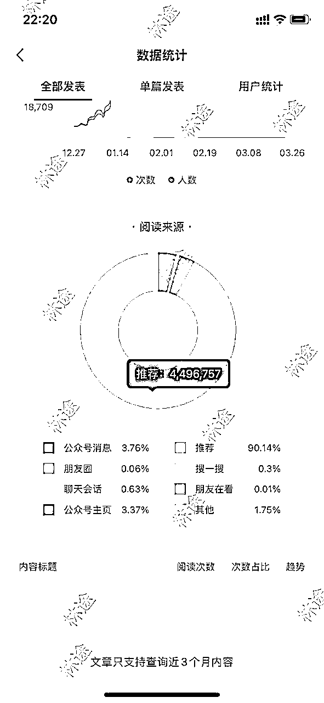

这是其中一个号七天的收益变化，基本每天都翻着倍走：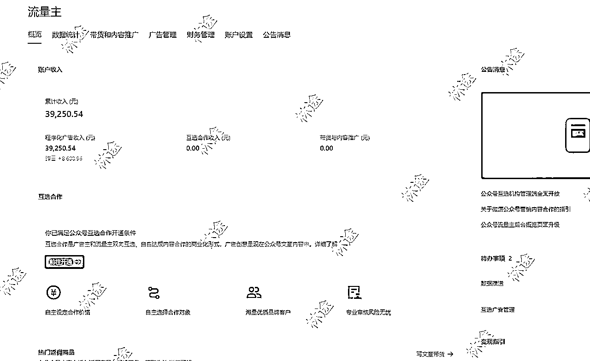

其他收益截图再贴一部分——因为不搞培训生意，素材整理得比较随性：

公号矩阵攒下了接近100W的粉丝。拿几个代表性账号的数据看一眼：

私域好友也积累了10W+。那会儿每天每个号都会收到上百条好友申请，我用RPA脚本自动点同意，虽然来的不算精准，但做原始流量池绰绰有余。

## 起点：普通人的“折腾”底色

先交代下自己，方便各位知道我是从哪个坑里爬上来的。

十八岁那年我成了北漂，记忆最清楚的是第一份工作月薪2800块。在老东家一待差不多十年，从基层干到带团队，负责整个华北区的交付业务，对接阿里、华为、金融、保险这些大客户，全国省会基本跑了一圈。后来跳去软件公司，做过项目经理和售前咨询。

2008年起我就开始了断断续续的副业生涯：QQ空间时代卖过头像、帮人装修空间、倒腾号，后来开过淘宝店、带过游戏家族、碰过电商和卡盟。全是兼职性质，没滚出啥复利，正职一忙就都搁下了。

回到河北之后，收入在当地算体面，但职业天花板一抬头就能撞到。在一家上市公司的河北分部做售前，基本24小时待命，技术咨询两头烧。后来想明白了：光靠上班挣的这点钱，满足不了我对生活的野心。索性辞职，躺了一阵子。

那阵子是真难熬。房贷车贷像两座山压着，每天一睁眼就是各种账单。最落魄时摆过地摊，三伏天四十度的高温站在太阳底下，一整天赚不到几个钱，那种看不到希望的窒息感，到现在想起来后背还发凉。但心里始终有个声音很笃定：我说不清自己想做什么，可我非常确定眼下这份工作不是我想要的。

AI是我2014年就开始关注的东西，但那时候的AI还困在知识库阶段，和今天的生成式AI完全是两回事。等这轮生成式AI风潮卷起来，我意识到——该找一个自己擅长、又能滚雪球的方向了。

## 相遇：误打误撞进了这扇门

配套的是一套七天左右的视频课，每节三五分钟，基本属于最低配的入门科普，跟咱们航海手册一比，粗糙得让人想笑。

即便这样，我依然在2023年9月1日这天，正式注册了自己的第一个号。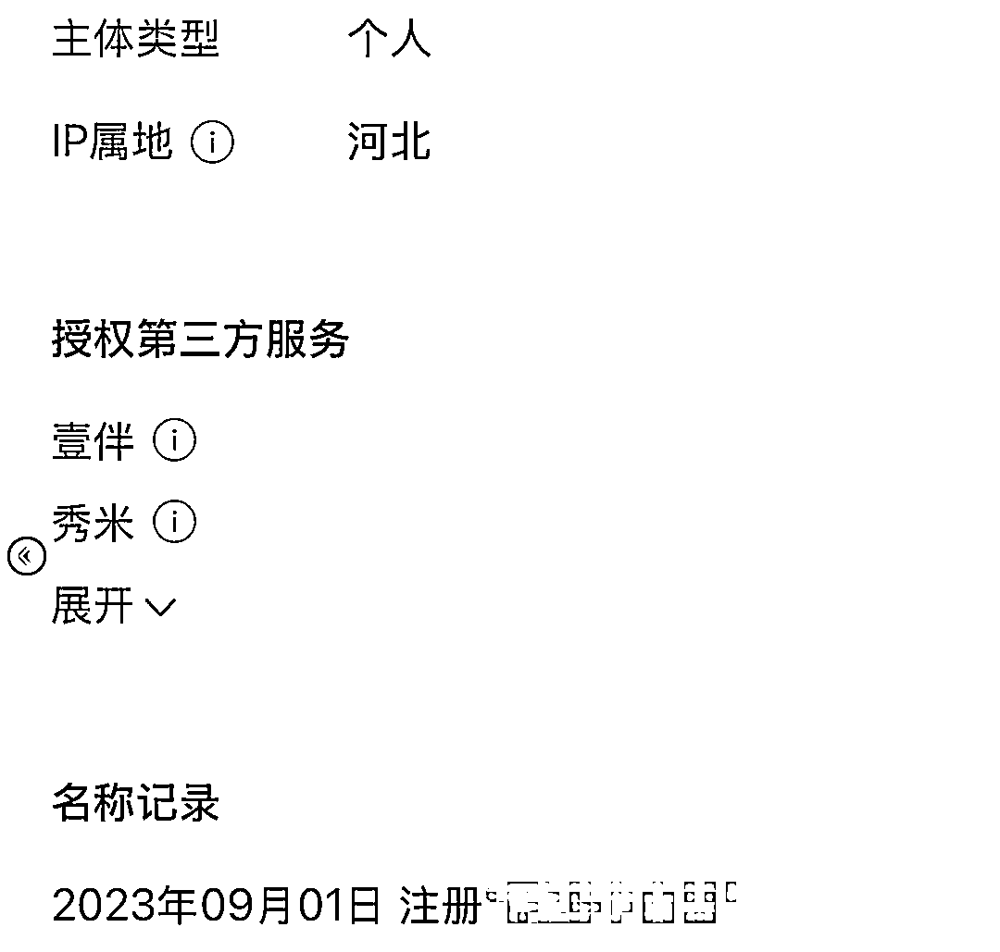

第一篇文是纯AI生成的，现在回看连排版都没有，逻辑也稀碎。但那是成长的脚印，每一步都算数。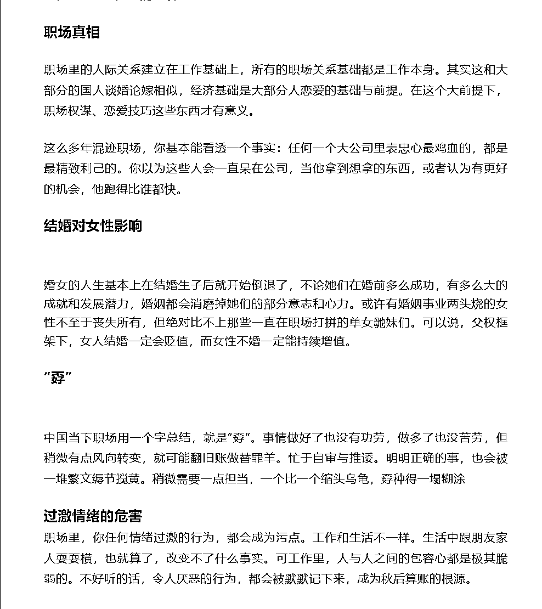

## 1.0时代：埋头干，别想太多

### 选赛道：别凑热闹，找自己的主场

2023年那会儿最火的领域是情感、民生、养老金、军事这些。我端详了下自己，哪个都不沾边。

于是我开始疯狂扫号，研究别人在搞什么。选方向给自己立了两条硬规矩：

- **避开大众**：人人都冲进去的领域一定绞肉机。

- **做自己擅长的**：结合过往经验，才有别人撕不开的护城河。

最后锁定职场方向——毕竟班上了这么多年，有真实体感，内容又利他，和自己价值观也匹配。

再往下拆，我先问自己：赚的是谁的钱？答案是流量的钱。流量哪来的？热门话题、争议事件、八卦心理。这几个答案一拼，最终定位到**职场八卦**。

时间点也赶巧：大厂裁员潮、35岁危机、N+1赔偿纠纷闹得满城风雨，这些话题自带炸弹属性。经济越不景气，人心越慌，看八卦解闷的人就越多。

当然凡事都有两面性：等哪天职场环境好转，大家都舒舒服服上着班，谁还盯着这些看？不跳槽不找工作，这类的关注度自然就凉了。

### 破0到1：第一条万+诞生

9月初刷到了一批专写职场八卦和大厂裁员的内容号，几乎篇篇几万阅读，新号起来的速度非常快，完全符合我设想的对标模型。

我文笔不行，但有个长处：会用工具。这里得真心感谢GPT——它治好了我面对空白文档的恐惧症。

养号周期普遍二十天起步。我从9月1号开始日更，边写边学，拆解对标的框架和标题套路。那时候手上没有成型的SOP文档，全靠微信公众号、小红书、百度几个渠道东拼西凑地扒信息。（所以每次有人让我给建议，我都先安利赚钱航海手册——是真的有用。）

日更到第20多天，9月26日，第一篇破万阅读的文章来了。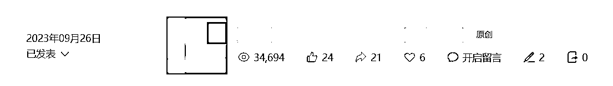

那几天我激动得不行，每天早晨五点就醒了刷数据。到了现在，别说10W+，就算100W+摆在眼前，心里也掀不起一丝波澜。这个增长势头大概持续了近三个月，拿其中一个号的部分数据给大家感受下：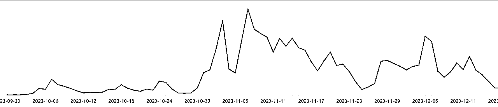

第一次看到收益进账的时候，我截图留了档，那是支撑我继续跑下去的第一针强心剂。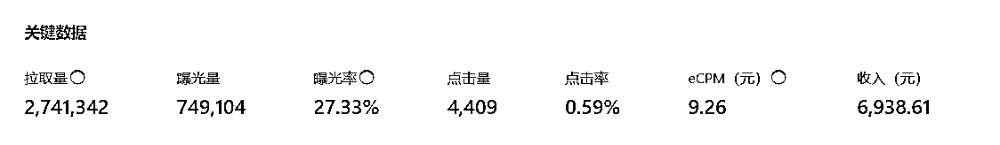

### 多赛道并行：哪些该放弃，哪些该死磕

当时同时起了好几个号，分别试水情感、体制内、教育、宠物。

- **情感号**：一直没起色，放弃了。但同期有个朋友靠情感内容一篇就拿了17000收益，只能感叹时也命也。

- **体制内**：内容踩线严重，稍微爆一点就被限流，及时止损。

- **教育号**：整整一个月没动静，但我一直舍不得砍——这方向既能帮别人又能沉淀自己，最有长期价值。结果第三个月直接爆发，天天十万加。那之后我彻底相信了一件事：很多时候不是方向错了，是放弃得太早。

- **宠物号**：同行卷成了麻花，对标账号活不下来，而且后续变现必须靠后端承接，综合考虑后放弃。

那阵子就是红利期，无脑抄对标、AI洗稿就有人看，只要你愿意坚持，月入两三万问题不大。

### 单价是道隐形门槛

当时的ECPM大概在万次80元左右，数据参考：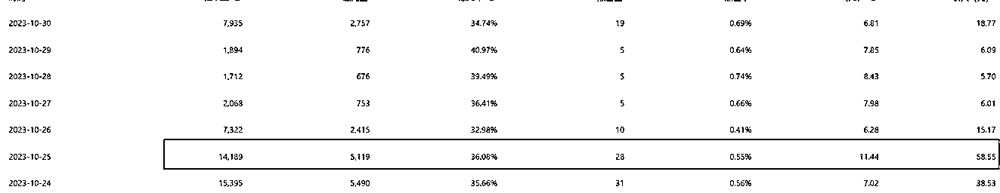

有个线下跟我一起跑项目的兄弟，一篇文章跑到了40万浏览，结算时才给了900块——折算下来单价不到25。我翻了下数据：完读率只有30%上下，流量几乎全靠推荐。

这种数字闭着眼都知道走不远。从那时起我开始琢磨：ECPM为什么有高有低？决定因素是什么？怎么把它提上去？这些问题后来成了2.0时代转型的思想火种。

同时我也认清一个规律：任何项目都有生命周期，风头一过必然洗牌。怎么熬过周期、怎么在某个行业里扎根下来，才是我该思考的命题。

## 掉池之后的冷静期

号差不多维持了2到3个月，流量开始大面积滑坡，每个号赚了一万左右就停住了。那段时间对信心是实打实的损伤。

回头复盘，原因大概出在四块：

- 内容高度雷同

- 冲进来的人太多，内卷白热化

- 纯AI无脑产文被平台识别，机器味太重、内容质量太差

- 内容涉嫌侵权，很多信息是AI改写后瞎编出来的

当时的AI水平还没到今天的程度，产出的东西又粗又水，我自己私下管那叫“电子垃圾”——当然，薅平台羊毛是够用的。

### 岔路口：深耕，还是拓宽？

摆在面前有两个选项：

- **一条道走到黑**：得持续输出高价值内容，但当时精力确实撑不住足够的产量。

- **新开一条线**：综合评估后选了情感文案类——毕竟谁还没经历过非主流时代？每天抄十句话，操作零门槛，对标拾句先生就行。

恰好我的搭档当时正在测这个方向，日均30万流量，收益稳定在100到200之间，效率相当高。单月涨粉能达到2.5万：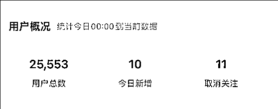

我心里的算盘是这样打的：一个号一天挣5块，100个号就是500块。如果全自动化跑，利润稳定还有增长空间，再加点小程序流量收入，这个模式完全能放大。

选它的理由很清晰：

- 不用标原创

- 复制性极强

- 阅读粘性高

- 支持批量化操作

基于这几点，我走上第二条路——拉了个小团队，从1月一直干到6月。

### RPA：一个人干一个团队的活

那段时间我系统地啃了RPA，花了一周时间把流程、排班、上传、同步、发布整个链条全部跑通，做成了一套自动化工具：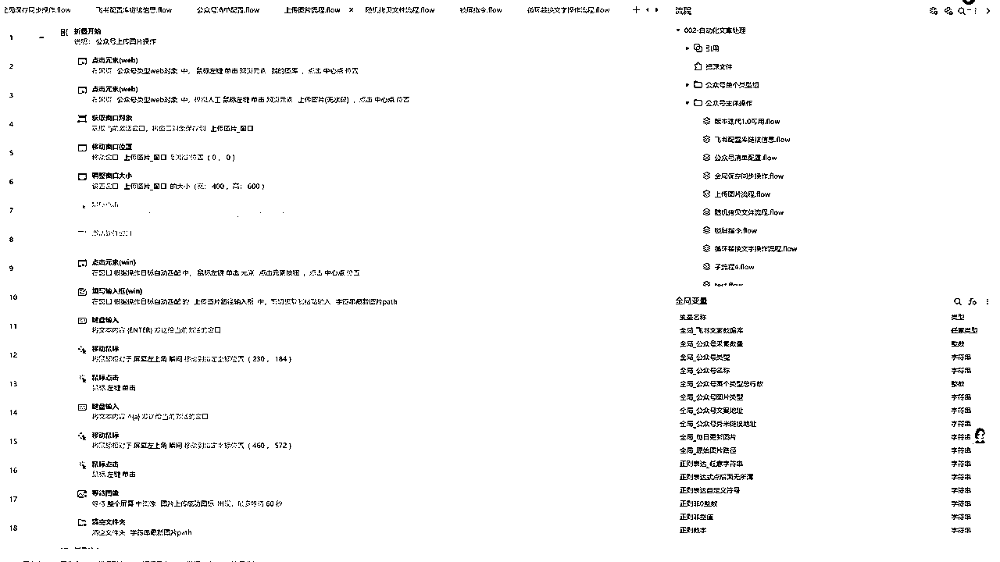

核心架构是这样的：

- 用飞书在线表格统一管理所有号的配置，这部分是参考B站教程做的RPA对接方案：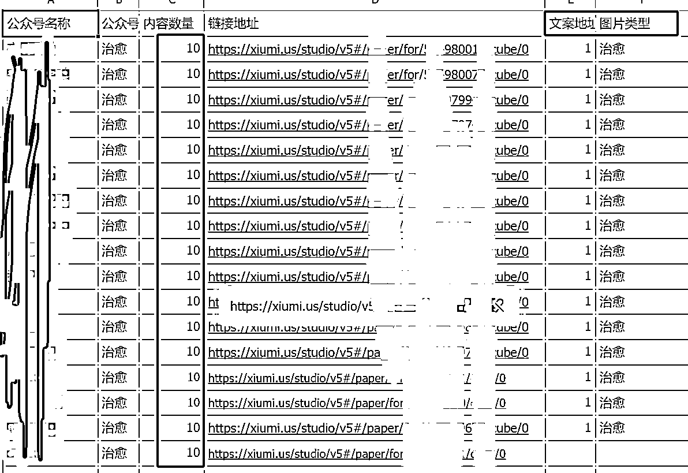

- 每个号都有专属的排班模版，配图也按搞笑、治愈、emo等类型预设好

- 所有号模版都是我一个一个手动配的，为的就是防止同质化

- RPA自动完成图片和文字替换，每篇的具体替换要求写在配置界面里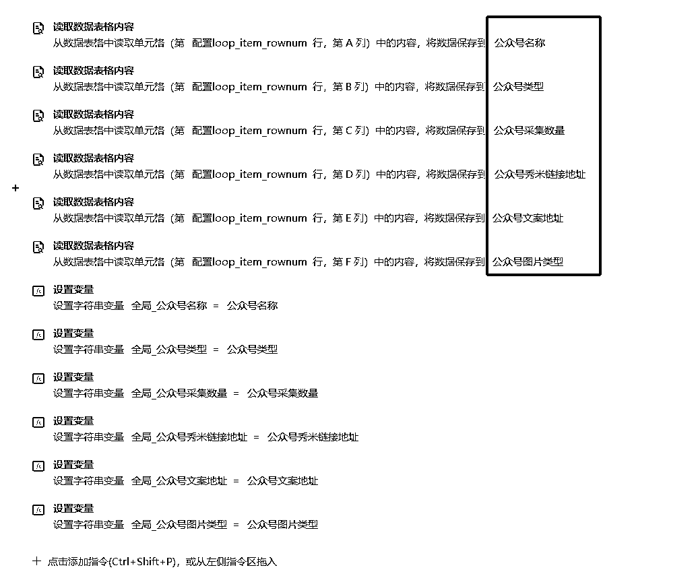

- 排版工具用秀米，绑定授权后RPA自动同步

- 图片和文案素材都是爬取后人工分类的，文案库攒了几万条，随机分发

有人可能会问：为啥不用AI直接生成文案？我试过，精细度完全扛不住高质量的要求，只能放弃。图片方面，爬来的数据做二次处理——统一裁成1:1，排版才会舒服。我用一个小程序把所有图片批量切割成1:1，配上秀米模版，整个版面清爽很多。

标题怎么做？我拆了无数个10W+爆款的标题，分析结构和关键词节奏：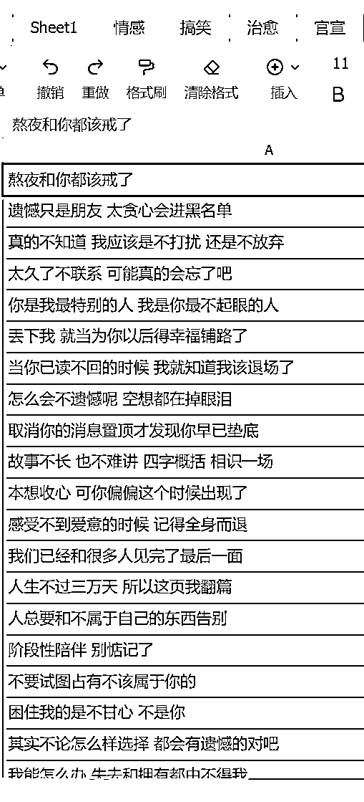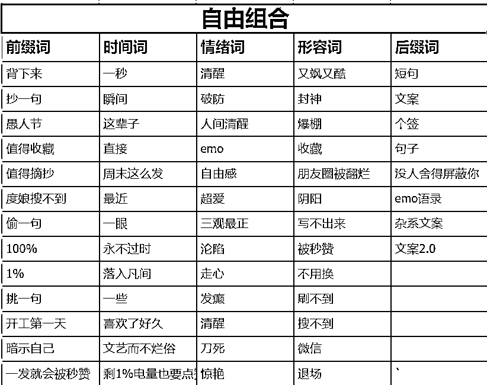

每一步做完，飞书群里会自动收到“XXX公众号已完成”的消息当作日志。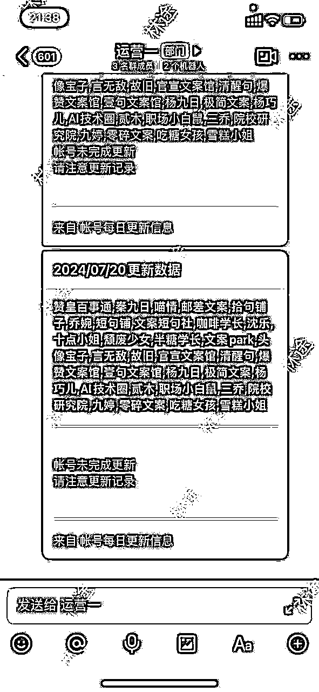

启动方式也实现了全自动化：用邮件命令当触发器，人在外面发一条消息就能远程开工，跑完电脑自动锁屏。

### 百号矩阵的疯狂实验

这套东西落地之后，一个号从同步到发布只要一两分钟。我前前后后搞了差不多100个号，有企业资质注册的，也有个人号。

结果非常戏剧化：**企业号90%全军覆没，个人号90%以上全部跑通。** 反差大到让人无语，原因说到底还是账号权重的问题。

企业号没跑起来还有一层原因：市面上有人直接注册了20多家公司来批量搞号，我们那5家公司在人家面前根本不够看。据说外面同时在跑的有上千个号，这还没算那些藏在暗处的。

变现路径比较单一，基本靠卖培训。跑起来的号日常收益稳定在100上下，贴几个图感受下：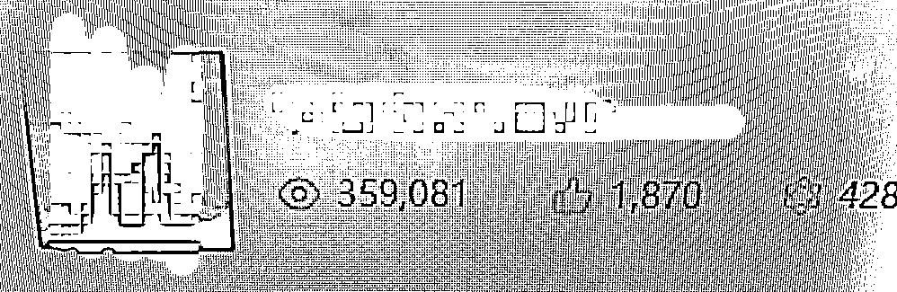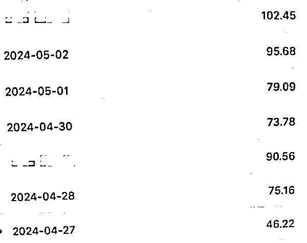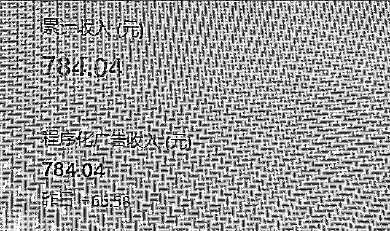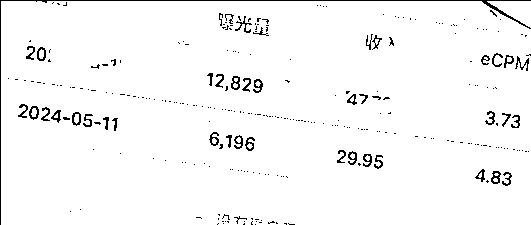

我还顺手做了个小程序，第一波导了几千流量，结果第二天收益1.88元，心气儿当场凉透——跟预期差了上百倍。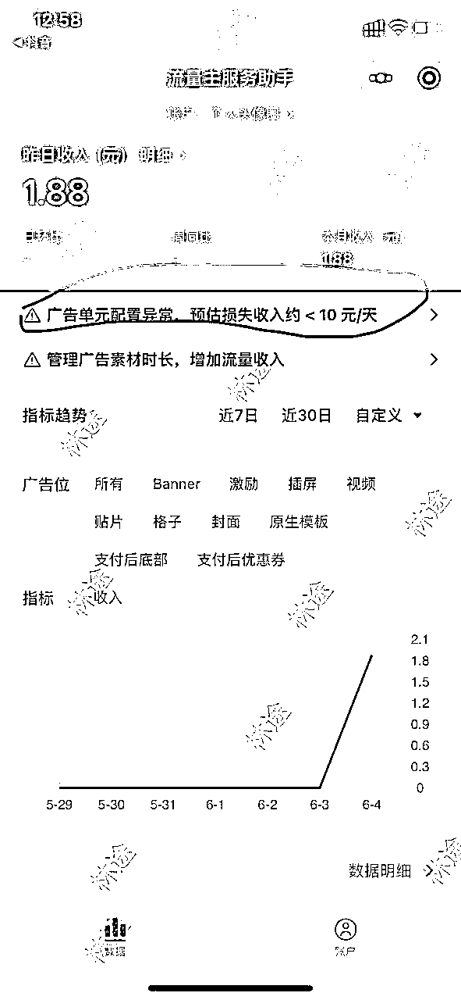

这部分的钱吃不到，只能认。后端产品承接需要砸大量精力，当时实在顾不上加码。没跑起来的号就扔在角落吃灰。

直到现在，还有一部分文案号在持续运营，收益不多但稳当，后台天天十万加，粉丝粘性一般，基本靠推荐流量养活。

这个方向的总结：起号难，内容压力大，流量有周期，不好精准把控。公司化做必须有后端产品承接利润；个人兼职可以做，但需要极强的网感和精细化运作。

到这里，我基本可以宣布：公众号爆文纯AI洗稿、野蛮生长的时代结束了。这被我定义为**1.0时代：始于2023，终于2024。**

## 2.0时代：把职场赛道捡回来

1.0落幕，我开始琢磨怎么升级打法。

核心思路就一句话：**卷流量不如卷单价。** 这也是我去年线下分享时PPT里的其中一页：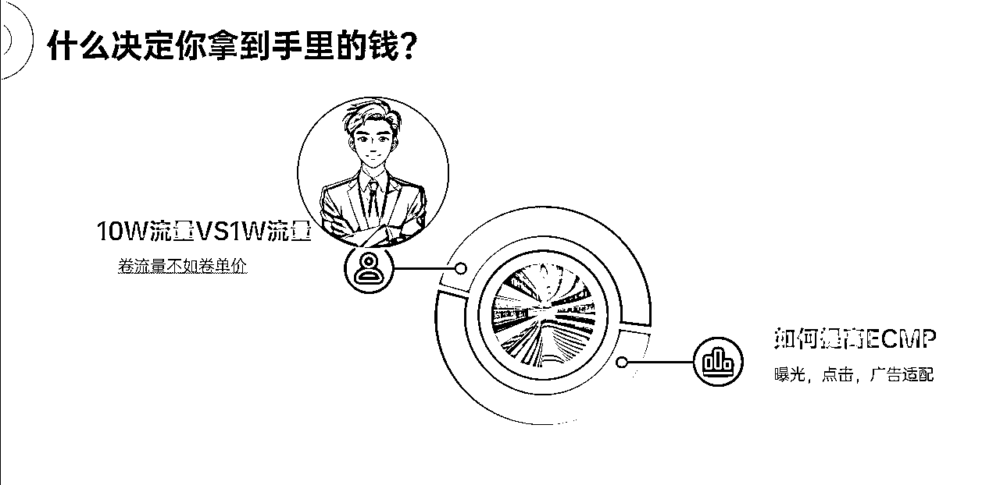

去年6月，文案号里没流量的被逐步断更，掉过池的号也没注销，留着观察当素材。当时围绕公众号爆文的主流玩法，我拆出了三种模式，见下图：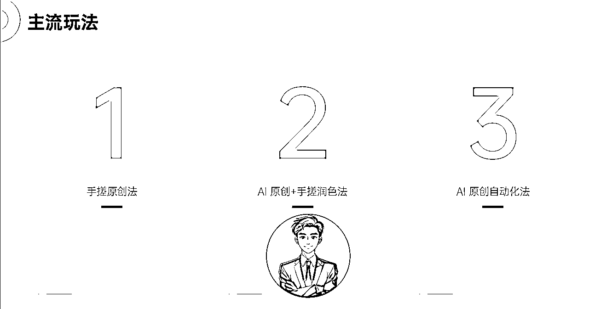

市场上普遍在搞自动化批量化或者代运营代跑，再就是“废号流”——掉池直接注销重来。

我们没有走这条路，原因有几条：

- 我想要的是基本盘的长期稳定收益，不是一把梭的短线生意

- 代运营模式本质靠跑量，我们没有足够的资源，也没打磨出成熟可控的方案

- 工具开发是团队的短板，没有技术底子撑不起这类运作

- 我更想沉淀一批数字资产，给后续发展当底牌

有个小插曲：市场上那批纯AI洗稿号，存活周期已经从去年的几个月缩到了一个月上下。平台明显在收紧，我还记得官方集中封过一批号。

### 重新测试：到底什么赛道能打？

基于这些判断，我又开始新一轮测试：生肖、情感、美女，试了不知道多少个方向：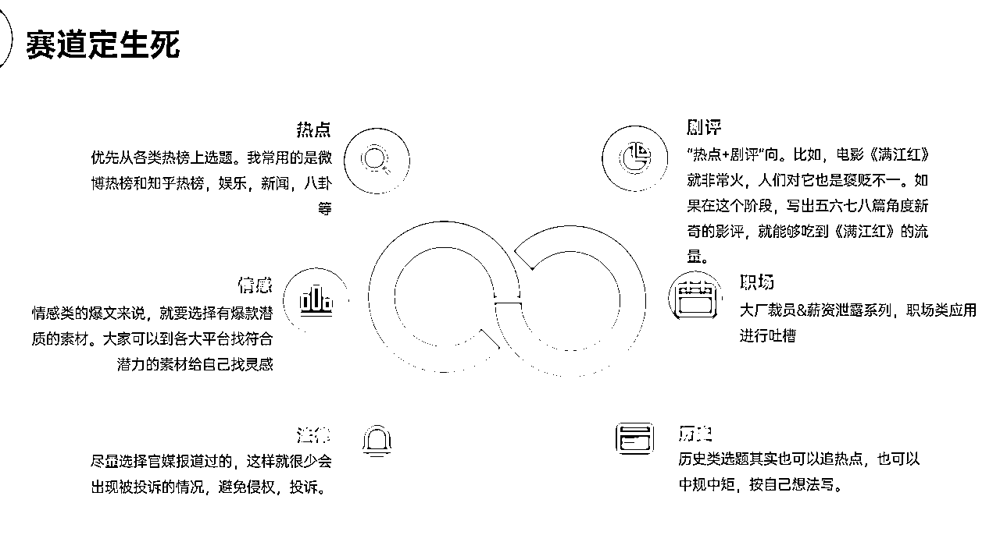

测试标尺围绕五个维度：**是否擅长、单价水平、存活周期、内容价值、流量规模**。如果单纯想薅流量收益，直接瞄准中老年群体最省事——养老金赛道经久不衰，法律赛道违规点密集，军事更是雷区，还有一些偏门的领域我们直接遇到过封号，好在损失可以承受。

绕了一圈之后还是回到一个本质结论：**利他、有价值、有真实内容的领域，才走得远。**

### 细分再细分：在大河里找小溪

后来我们不再追求大赛道，而是专挑大赛道里的细分缝隙打：比如职场高情商对话、职场八卦解读、体制内深度解密等等。

**细分才有机会。** 模式是先跑出数据、验证模型，然后标准化复制上量。标题怎么拆分、关键词怎么埋伏，每一步都有固定打法。看到某个细分空缺，就趁窗口期快速铺量卡位。这类内容的周期性很明显，不同时间段的受众口味不一样，所以每个阶段都得调整运营侧重。

几个高单价领域可以分享：养老金、美食、体育解说、游戏。按上面那套标准去挖掘，大概率能淘到不错的金矿。

### 精细化：AI+人工双轮驱动

生产内容时，市面上的原创玩法主要有三种，我们选了“AI+人工”的打法，既绕开系统查重，又把内容质量往上抬了一截。

具体执行层面，我会针对每个号逐一做分析，从账号定位到选题方向都单独调，而不是一套模版糊所有号。

从0到200W，这条路说起来没有一丝神奇，甚至有点笨：不断选方向、跑数据、熬周期、做修正。每一个踩过的坑都没白踩，全都变成了下一步的台阶。

至于将来的3.0时代，我个人的判断浓缩成三个词：**更垂直的细分、更细腻的运营、更扎实的公转私能力。** 这也是我们接下来要全力押注的地方。

感谢龙哥，感谢赚钱的各位朋友。希望这一篇能给你带来哪怕一丁点启发。欢迎关注【林途link】，咱们接着聊，接着链接，接着往前走。

江湖路远，见字如面。

坦白说，去年我们想清楚了一件事：不能只做一锤子买卖的内容，得把用户慢慢养起来，变成自己的资产。所以从去年线下分享开始，内容生产方式就固定成了“AI打底六成，人工润色四成”，用这套配方稳定输出。

这么做的直接好处，是账号活得比同行久，在平台的分发池里待得安稳，收益自然更厚，也顺带跟短平快的搬运号拉开了身位。

中途还有个小插曲：我们当时在跑的账号，不知什么时候被圈里朋友盯上，直接挂到了风向标里做拆解示范，不得不服各位的网感和手速。

（那段日子内容几乎是连轴转地出十万加）

再者我们这边的用人成本放在同行业里不算高，所以账算下来还能保持正收益，这种情况放到省会城市基本撑不住。

写文章时我们习惯套一个结构：开头立钩子，中段放内容，结尾做升华。开头通常蹭热点或抛冲突，先把人留下来；中段不用太密，给读者喘息的空间；结尾一定要往高处拉一把，把读完全文的概率顶上去。

这套打法不算秘密，大家可以直接抄作业。

再说说具体的操作框架。

## 账号定位

*   名称、头像、简介这三件套必须围绕定位来设计——情感、职场、亲子，不同赛道各有各的气质。

*   对标账号多多益善，重点抓爆款选题，标题、结构、写法、模板都可以拆下来复用。

## 内容产出

1.  纯原创内容，在原创度和质量都过关的前提下，每天去盯对标账号的异常流量、推荐波动和活跃节奏，照着跑就行。

注：热点标题和素材要找好存好，统一丢进飞书文档做弹药库。

2.  推荐低了也不要停更，按第1条的方式持续养号，只是原创度要压到25%以下。

3.  推荐率到了60%这道坎之后，再去碰新选题、新框架，尝试做创新，把原创度做高，把内容价值做厚，顺势把账号权重托起来。

4.  推荐和阅读都健康了，才考虑做引流动作。

## 视觉排版

*   跟着账号调性和用户画像走，参考后台数据里的年龄和兴趣偏好来定风格。

*   排版原则是“舒服优先”，能简单就不复杂，视觉上要留白。

*   字号、行距、分段格式全书统一，发出去之前先预览一遍，别偷懒。

*   正文字号推荐压到10号以下。

*   配图选高清、风格统一的，位置要讲究；有版权风险的必须标来源，并且自己留好底稿。

*   文首或文末固定放公众号名片。

## 执行细节

*   素材库是决胜手，验证过能爆的选题回炉再造，命中率依然可观——素材基本决定了五成以上的成败。开头不够狠，后面全白搭。

*   全文读透的比例维持在60%以上，阅读时长别低于0.7。

*   内容推荐占比保持在90%以上。

*   配图尽量用AI生成，省心也避坑。

*   单篇内容跟已有素材的相似度压在25%以下。

*   每天都要看一遍账号的单次点击收益。

*   点击率至少过1.5%这条线。

*   eCPM尽量做到12以上，这个数字直接影响单价。

*   单篇字数在1100字以上，广告位要提前模拟预览，别让广告打断阅读节奏。

有问题就随手记下来，及时对齐。

## 数据不好的原因

*   点击率上不去，基本就是封面和标题没勾起点进来的欲望。

*   完读率垮掉，是因为正文没让读者觉得“跟我有关”，价值感不够。

## 复盘心态

*   前期数据难看太正常了，先把账号活跃度养起来，心态别崩。

*   号做起来之后也会有周期起伏，碰到低谷就再把颗粒度做细，把定位收得更准。

## 补充事项

1.  一个号只深耕垂直人群，风格别东一块西一块，否则流量和单价都会被拖累。

2.  编辑卡顿时，清理页面缓存重新打开就行。

### 关于单价提升

拿1万阅读来说，收益可以差出20到1000的区间，空间就在这里。所以我们那会儿的口号很直接：与其追流量，不如追单价。

我们做过1万阅读量，收益冲到600到800也是常事；别人做10万阅读量可能只有400。两头一对比，谁都知道该往哪使劲——毕竟把1万流量做出来，比拼到10万流量轻松太多了，那不如直接把钱赚得厚一点。

*   我的观察是：赛道定生死。你选中什么样的人群，基本就锁定了点击率上限——中老年用户打开率天然高，这就是养老金类内容单价偏高的底层原因。

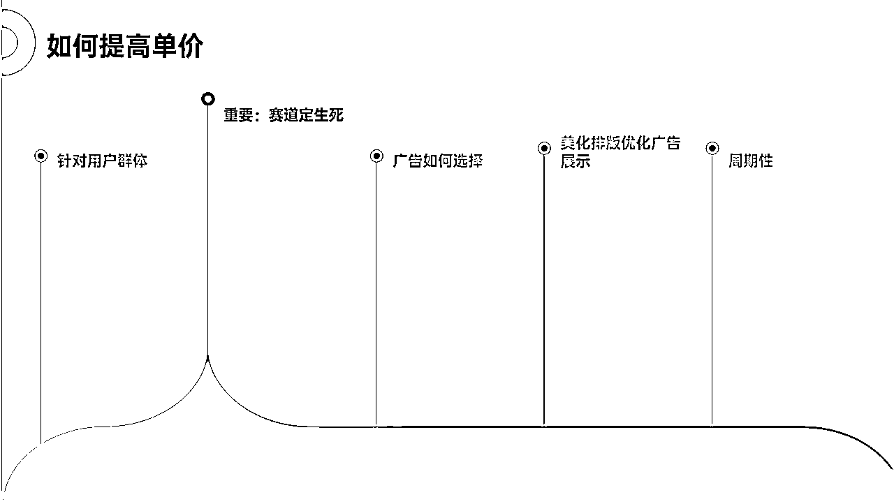

*   广告主可以手动调整，但前提是你真的懂自己的读者；不懂就乱调，反而会把单价做崩。

*   广告的点击表现跟投放周期、人群属性都有关系，只能靠实验去摸规律。比如春节前后购物类广告点得勤，而培训类广告单价更硬。

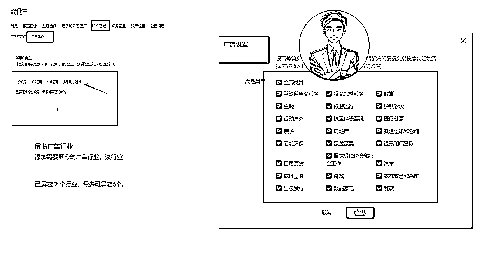

*   体育、游戏这些垂类的单价也不差，但仅供参考哈，亏了别来骂我。

*   选赛道之前，先去翻一遍广告主的分类，什么行业愿意出高价其实都写在明面上。

*   广告屏蔽要认真做，像棋牌、成人用品这类我们实测点击太低，直接拉黑。

*   排版别糊弄，舒服的版面真的会让广告多点几下，都是细处见真章。

*   高单价领域里我们会安排人工手动插入广告，这个小技巧供参考。

单价截图放这里了，各位自己品。

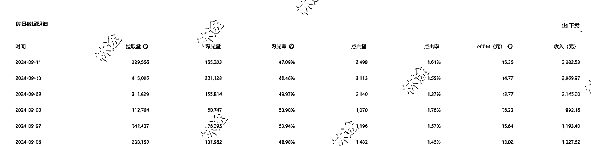

### 侵权怎么处理

个人号遇到侵权，删文基本就能翻篇。公司主体就得认真对待图片版权，别抱侥幸心理。之前在河南认识的一位朋友，公众号里用了一张图，最后法院判赔5万。当然多数情况也就是几百块的事了结，但没必要去赌。

我们也接到过专门做侵权生意的人打电话来，一听就是广撒网式碰瓷，直接不予理会。真遇到拿着资质找上门的，确认对方资质后删文就是了。

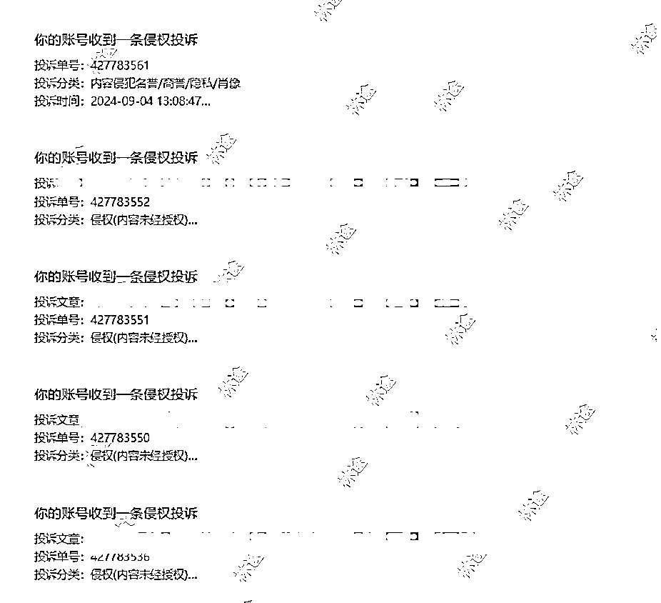

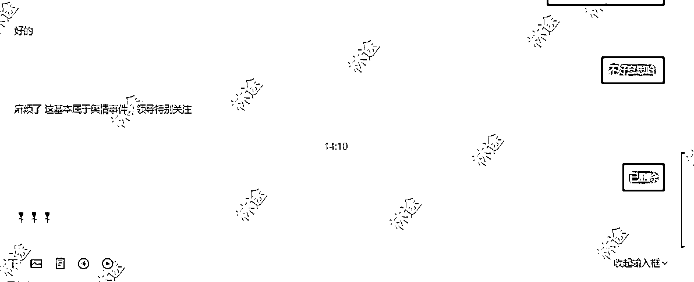

### 部分收益数据

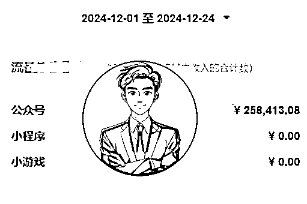

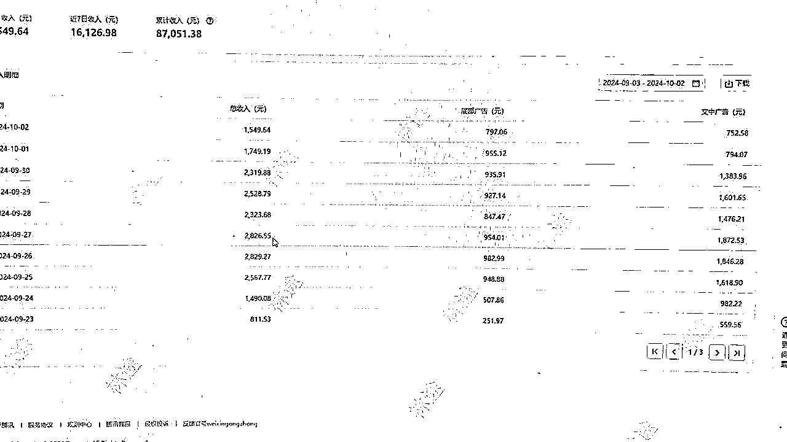

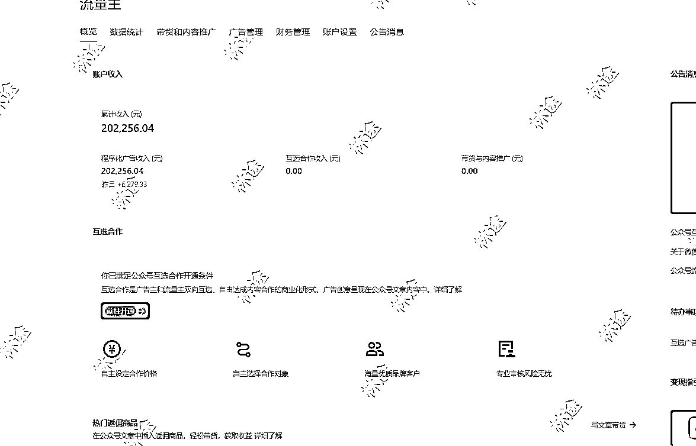

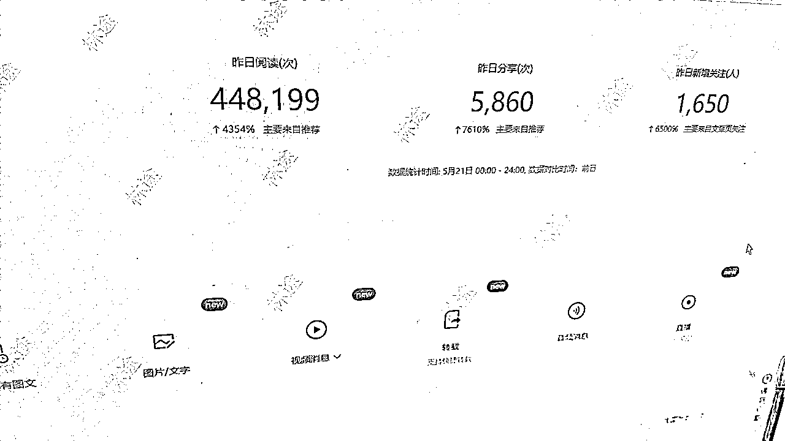

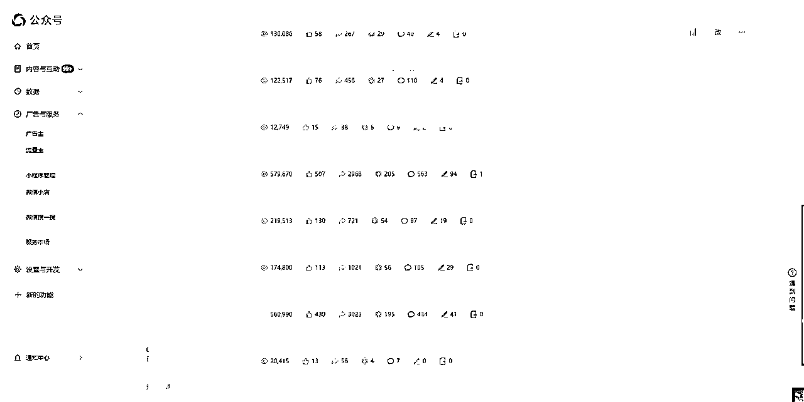

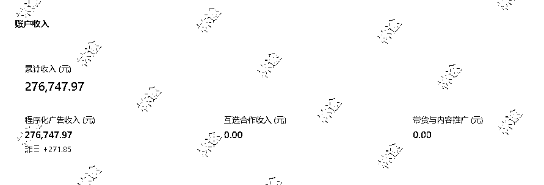

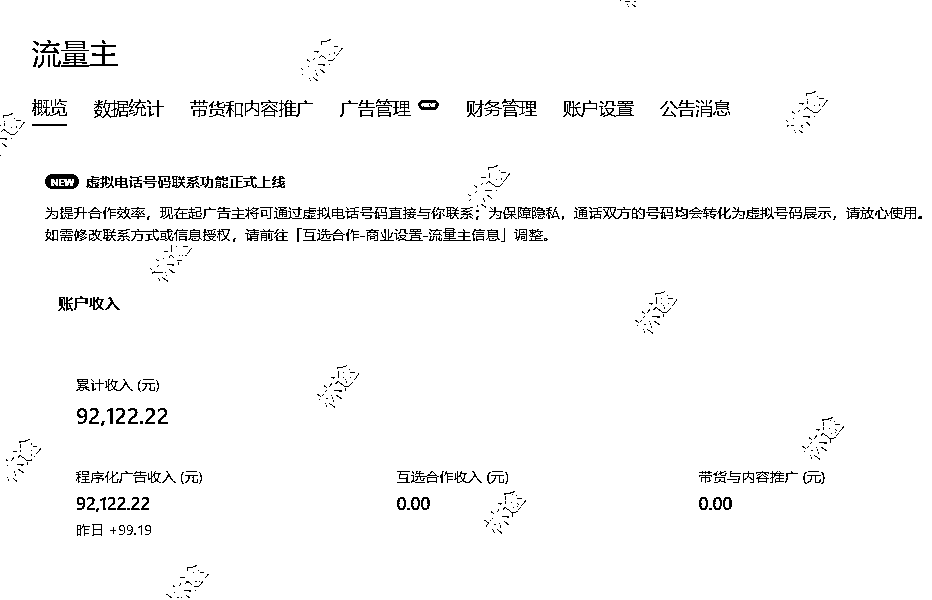

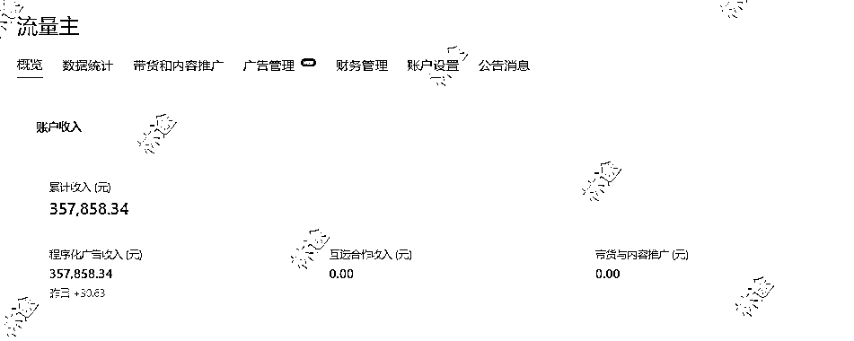

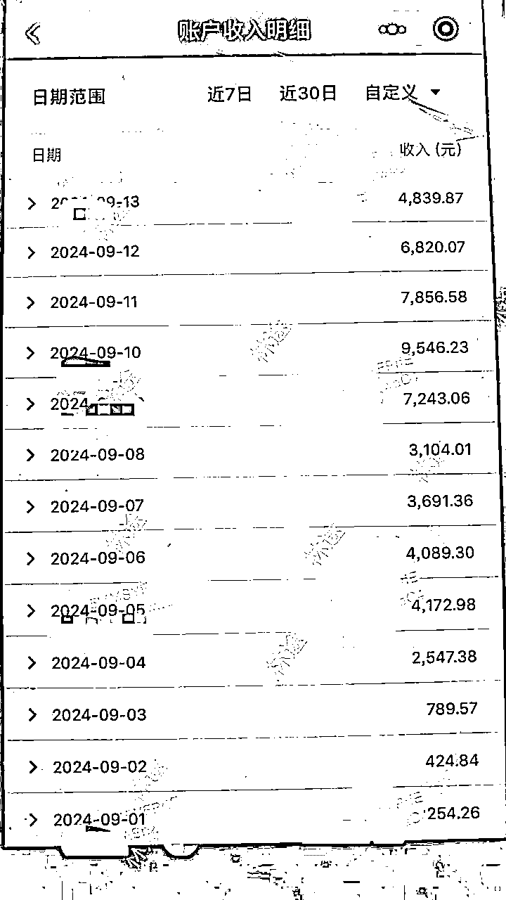

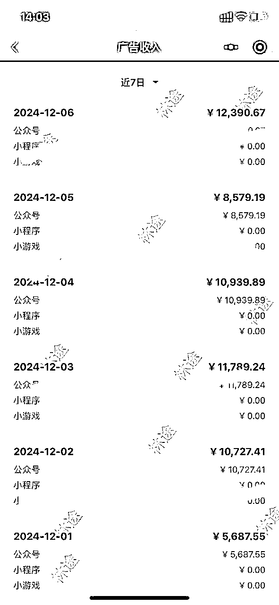

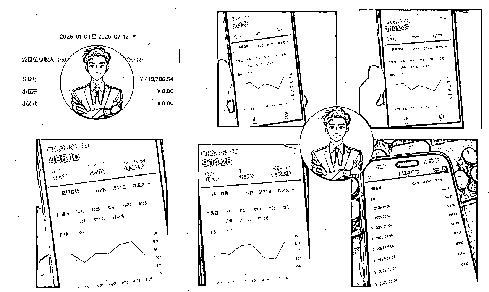

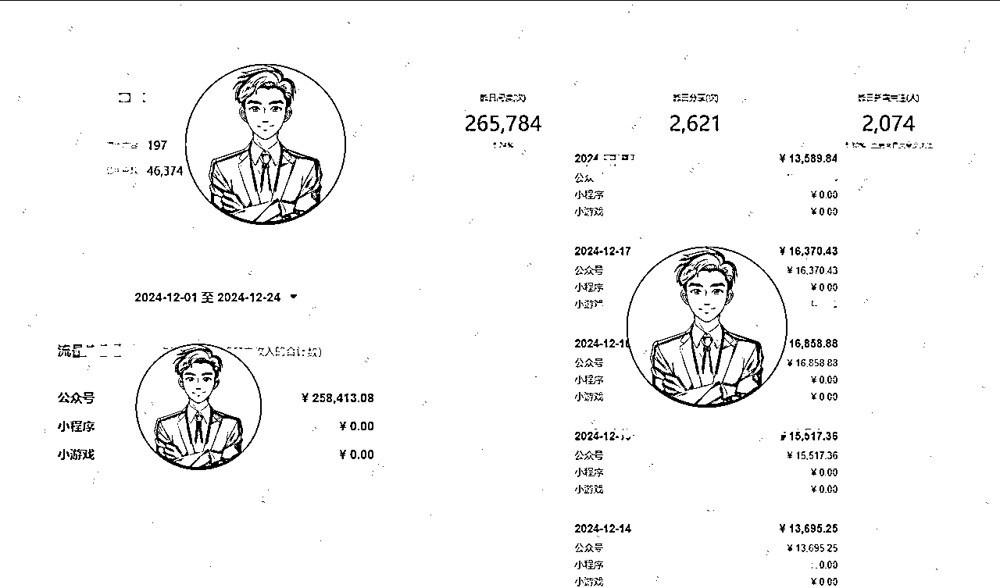

### 复盘总结

认知边界之外的钱，本就不属于你。

我们起步时选的就是平台分成这条路，所以天花板从一开始就摆在眼前：收益有限，变现方式也太单一。后面真正要补的课，是认知升级、商业模式拆解、资源沉淀。

如果去年能把攒下的流量导去培训业务，做后端的承接转化，多个500万以上应该不难。当时我们看对标案例，同类玩法的单价基本在2000上下，而去年培训市场的盘子完全接得住。

再就是合作这件事——借势、联手、共赢。龙哥老大反复讲过要找靠谱的搭档，戴巍哥（戴哥）也当面叮嘱过我们，当时去北京还专门聊过这事，再次感谢戴哥拉我进航海家。之前也接触过一些企业，但总担心后端不够规范、信任基础没搭起来，最后没有往下推。所以还是那句话：圈友之间优先合作，信任成本最低。

流量这边我们始终在拆解、重构，不停试新模型。同一条赛道上，我们要求自己做得比同行更细，然后把力气集中在一个点上凿穿。做事的态度就是：别人有的我要更好，别人好了我要做出差异，别人差异了我就要钻研成专家。

但说句掏心窝的话，光靠平台分成这条路，已经走到头了。最扎心的是，我们有个号半个月赚了近10万，结果被平台直接扣掉，心里那个难受到现在都记得。😪

对我们来说，公众号流量主的2.0阶段就算正式收尾了。

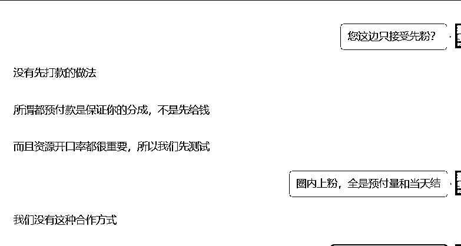

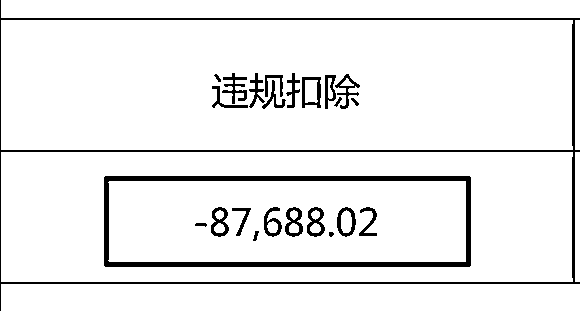

# 布局私域产品转化【3.0时代】

## 卡点在哪

去年单靠平台分成，养一个小型工作室绰绰有余；但换成一个正规团队来算账，这个模式根本不成立——太飘了，扛不住固定开支。

所以去年中期我们就开始琢磨产品化的事，用自有产品去对冲平台流量的不确定性。靠推荐吃饭说白了是看平台脸色，它开心了给你一口，不开心就西北风。可手里要是有自己的产品，哪怕流量没那么猛，每天也睡得着觉。

那段时间心里其实很拉扯。一边是分成收入摆在眼前，确实舍不得；一边又清楚这日子不长久。像泡在温水里，舒服是舒服，但再不动就真熟了。

下面这些思考，也是去年分享过的，一并放出来供参考。

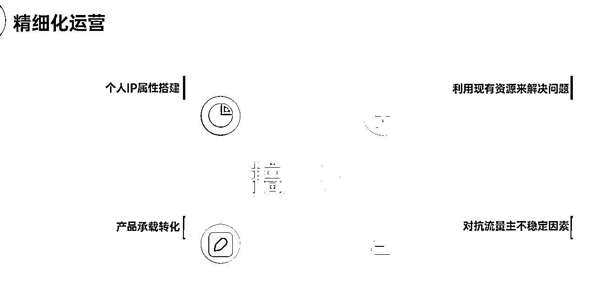

现在不少赛道都在喊难，单靠分成已经喂不活团队。前几天跟朋友聊，好几个人问：平台不给流量了，怎么办？

我的判断是：平台规则、政策风向、周期变化、红利消退，这些都属于不可控变量，我们改不了大气候。

能做的，只有在大盘里抠细节：

*   做得更深、更专业，爆文的概率能不能多1%？

*   多铺几个号，矩阵化运作，是不是又多1%？

*   标题、配图、发布时间这些细节点优化一下，又多1%？

*   别人撤了你还守着，又多1%。

1%加1%，再叠1%再叠1%，复利就是这么滚出来的。细节能定生死，道理人人都懂，但肯弯腰做的人没几个。

PPT做得糙，大家将就着看。

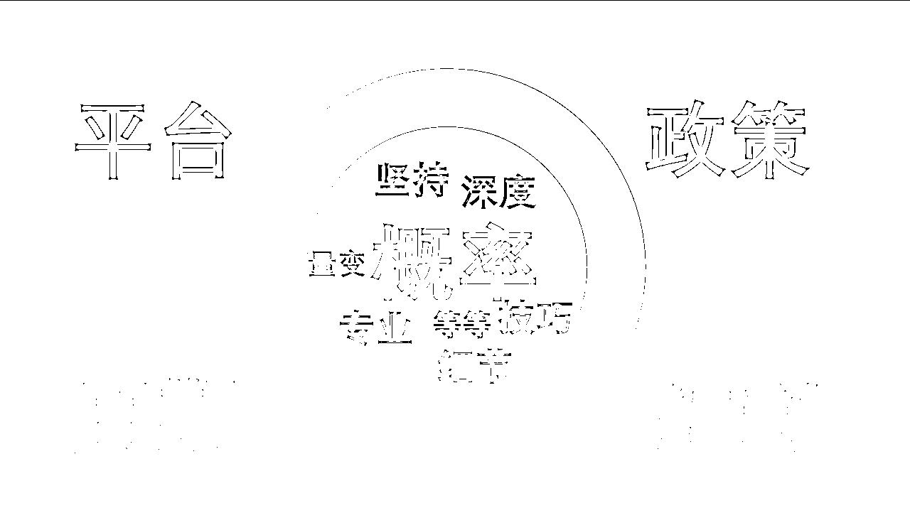

## 私域才是基本盘

公众号是微信生态里承接用户最顺滑的容器——你可以不装抖音、不刷快手、不用小红书，但微信是所有人离不开的底座。

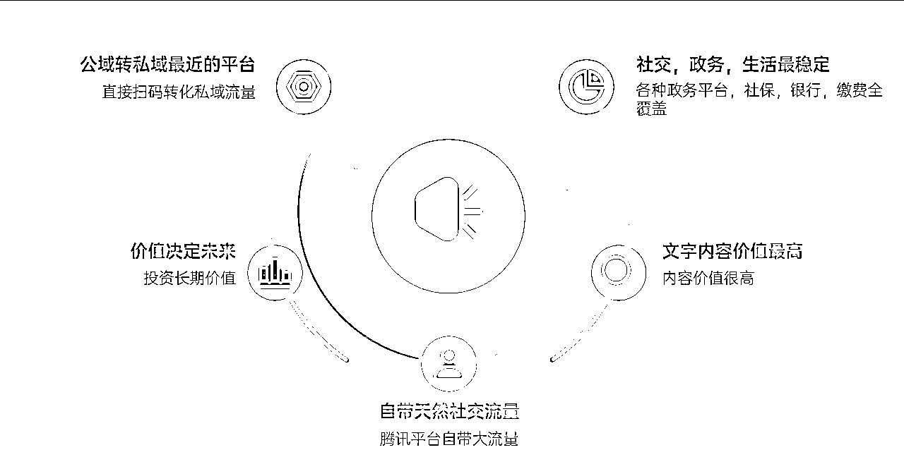

都说流量贵了、弄不到了，这话不假。但要搞清楚一件事：做流量的目的，是为了给产品铺路。泛流量吃的是平台分成，精准流量才养得起自有产品。

想赚谁的钱，就得站在谁的立场上想问题，把自己放到服务者的位置上。私域不是一个流量的终点站，而是深度服务关系的起点。

能转化成产品的，从来都是精准流量——它本身就是一道筛选器。泛粉进来，运营成本被抬高，转化的效率却很低。所以要在前端就做筛选，把人群过滤干净，后面的运营才省力。

做法就是：按自己的用户画像去生产内容，完成第一轮过滤。

整体思路长这样：

*   前台用账号矩阵做流量分发，把盘子铺开；

*   中台靠IP和内容建立信任背书，为成交做铺垫；

*   后台在私域落地产品线，把前端的流量稳稳接住。

对做流量的人来说，归宿只有两条：泛粉走平台，吃分成；精准粉走私域，做产品转化。以前光写文章就行，现在要琢磨用户画像、转化漏斗、产品匹配度，复杂度翻了十倍不止。

我们现在就是按这个框架来布局公众号，用矩阵拿流量，靠精细运营做转化，中间当然全是坎，欢迎各位圈友一起聊、一起试、一起迭代。

## 销转

“销转解决了，流量就解决了。”这句话出自天堂地狱老师，我深以为然。这也是我们眼下砸资源最多的方向——从纯做前端流量，切换到后端重运营，不是动动嘴的事，需要人、钱、时间一起往上堆。

我们还在一步一脚印地验证和踩坑，好在赚钱有路，身边有一群同行的人。路虽远，行则将至。

## 往后看

最近老大写了公众号的“超级标”，核心就四个字：垂直＋IP。公域流量放开本身就是一个强烈的信号——腾讯手里握着全民社交入口，没理由不去跟抖音、小红书抢一杯羹。微信整个生态，包括视频号在内，正在形成一个完整的闭环，值得慢慢挖。

我的体感很直接：公众号的第二个春天，可能真的来了。以前说“没落了”，现在看只是换了玩法——从粗放的流量收割，转向精细化的用户运营。

我的态度是：不为凑规模而做规模，要为创造价值而做价值。至于能走到哪一步，得靠实践一点一点试出来。眼下变化太快，计划赶不上变化，我们只能确保大方向不偏，然后保持灵活。

实践，永远是检验路线的唯一标准。我们在这条船上漂了三年，风暴经历过，顺风也享受过，但最要紧的是：船还在开，人还在船上。

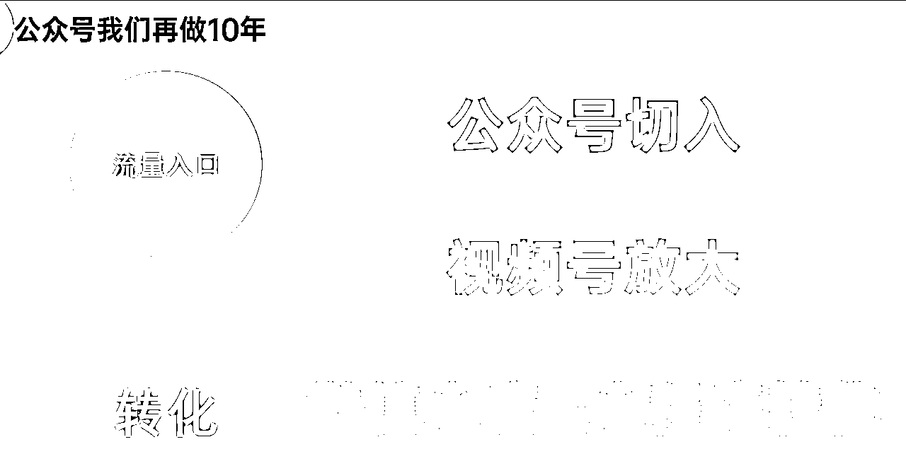

# 写在最后

*   怎么看项目

任何项目都有它的生命周期。最近跟天堂地狱老师学习项目周期，很受用。

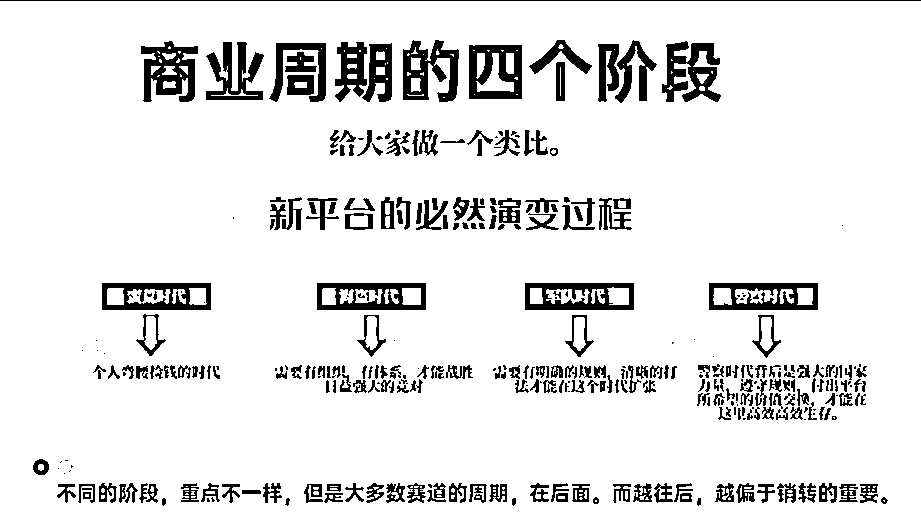

每个项目都要经历几个阶段：

最早的阶段，是弯腰捡钱的蛮荒期。2023年公众号爆文刚起势的时候，只要你肯干就能赚到钱，能赚多少全看执行力，那会儿根本不用动脑子。

第二阶段，开始拼技巧、拼团队了。赛道要细分，单价要做高，流程要标准化，规则要建立起来——这就是我们说的2.0阶段。

第三阶段，就是我们现在所处的处境。对团队来说，纯分成玩法已经走不通了，必须主动求变，想清楚怎么借公众号立住基本盘，把它变成一个杠杆支点。

第四阶段，面向未来——如何跟平台、生态和谐共生，互惠互利，这会是下一道考题。

还有朋友一直在问：2026年了，公众号还能做吗？爆文还有戏吗？

我的看法是：

*   细分赛道绝对还值得做，而且值得往深里做。我们自己也还在布局，细分的池子里仍然藏着大流量。

*   普通人和新手想全职入局，一定要想清楚周期——现在的周期比之前长太多了。真要全职做，建议走“IP＋产品”的组合路线，靠多种变现方式分摊风险，把它当成一个流量载体来看，而不是指望分成吃饭。号不多、收益又缩水，投入产出比确实不划算，也许不如去做高客单价项目或者出海来得实在。

*   当副业来做，反而很推荐：用自己的积累写点东西，做没有边际成本的事，既能攒影响力，也能把公域流量导到私人号、交到朋友，写作能力还能越练越熟。

*   拿我自己说，以前对着屏幕坐半天也憋不出几个字，小时候最怕写作文。现在有AI帮手，至少敢写了——不然这篇文章你们也看不到。不过这篇是我一个字一个字敲出来的，所以还是建议大家多练笔。

*   龙哥老大的“超级标”，其实印证了我们去年下半年的预感：跟平台硬刚、靠洗稿过日子的时代彻底翻篇了，垂直、小而美、精细运营的精品号才是新方向，值得押注。

我性格偏内向，不擅长场面话，真心感谢每一位看到这里的朋友。觉得有参考价值的话点个赞，后面我会持续把这篇内容迭代下去。

也要感谢所有赚钱圈友，这一路帮了我太多。

# Q&A

先给赚钱这个平台点个赞，确实提供了很实在的交流环境。

我写作水平有限，千言万语汇成一句“牛X”。也欢迎各路朋友多提意见，说一千道一万，不如交个朋友慢慢聊。

欢迎全国各地的朋友来河北做客——这么近，那么美，周末到河北😊

有任何问题都可以在评论区聊，或者加微信找我，我会把高频问题慢慢整理上来。