# AI 企业培训分享 | 12 小时准备高质量 AI 培训课！

从接到邀约到上台讲课，只有7天。我靠着一套AI工作流，把备课时间硬生生压到了12个小时。这大概是我做过最划算的一次“半免费”培训。

事情是这样的：一位无锡的企业家朋友找到我，想请我去他们公司做一场AI科普培训。这位朋友正好是我们隔壁社群的圈友，以后也可能长期合作，所以费用我压根没好意思谈。最后收了两个礼品卡，折算下来差不多600块人民币。坦白说，直接收入确实不高，但战略上的收获比这点钱重要得多——它让我拿到了一手的AI企业培训案例，也向外界证明了我有能力接这类项目。至少从这一刻起，我算是坐上了这桌牌局，以后可以正大光明地谈付费培训了。而且，培训本身也是个很有意思的切入口，往后还能往企业AI解决方案、产品带货这些方向延伸。

有人可能会问：一周时间，来得及备课吗？老实说，我一开始也犯嘀咕。我之前做过30多场数据分析工具类的企业培训，课程开发的流程不陌生。但按老方法，一门两天的内训课，我们5个人分工协作，每人差不多要花3个工作日，合计120个工时才能磨出来。而这次我白天要上班，公众号还得日更，真正能用来备课的，只有晚上的零碎时间。可我最后还是接了下来：一方面想借这次机会把自己脑子里那套AI知识体系重新捋一遍；另一方面，我也确实需要一个AI领域的公开培训案例来支撑个人IP。

既然分享的主题是“降本增效”，那我备课的方式就得先“降本增效”起来。我给自己定了一个硬规矩：这次做课件，全程必须用AI辅助。我选了两款工具——ChatGPT 4.0用来生成内容和梳理知识点，Mindshow用来排版PPT。选Mindshow，是因为它的可控性相对更强，每一页对应一个二级标题，逻辑很清晰。

最后，我利用一周里每天晚上的1到2小时，做出了一份120页的PPT，累计耗时差不多12个小时。对比以前的120工时，刚好实现了10倍提速，也算是给“10倍提效”这个主题做了个活验证。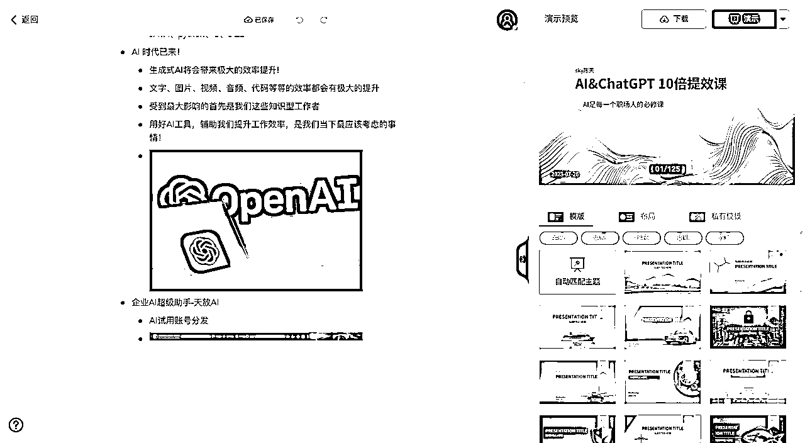

整个备课过程，大概经历了这么几个晚上：

周一晚上只花了1小时，让ChatGPT帮我生成了一份适合一天线下培训的课程大纲，还包含了具体的时间分配。我拿到之后自己手动改了几处，一份能直接用的授课框架就出来了。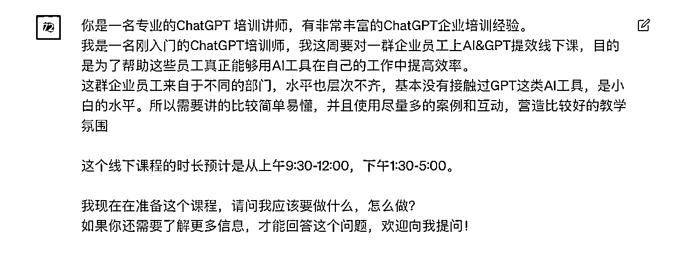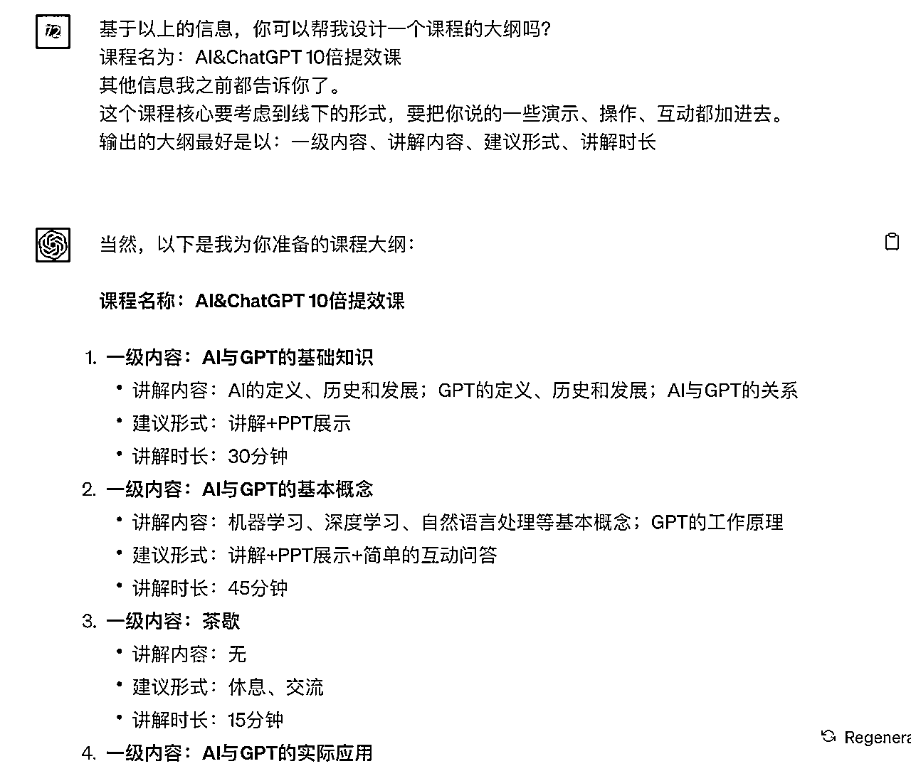

周二晚上是最烧脑的一晚，大概花了2小时。我在幕布上把每一页PPT的标题全部敲定，同时把前一半的内容骨架填充完整。为什么这部分最累？因为它决定了课程的核心干货，需要靠平时的积累和系统梳理，AI只能打辅助。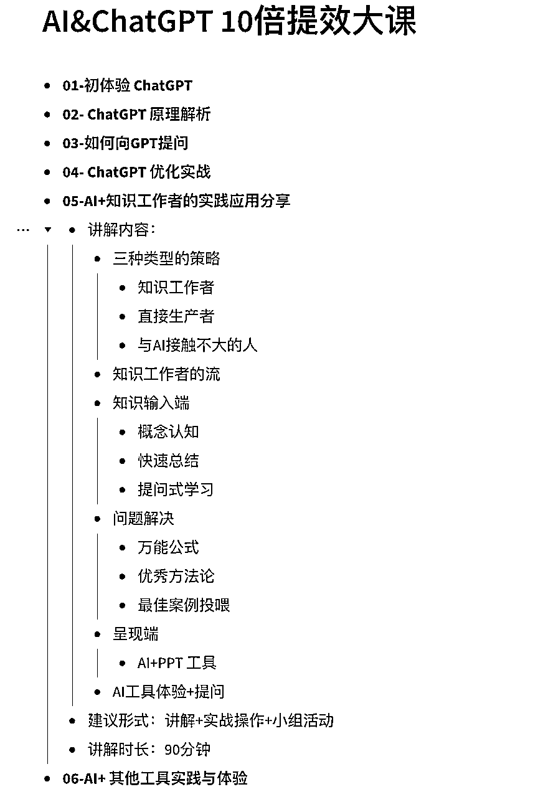

周三晚上同样花了2小时，把剩下的内容骨架补齐了。一些比较细的知识点，我直接让ChatGPT帮我列好要点，再自己筛选润色，放进PPT里，效率立刻上来了。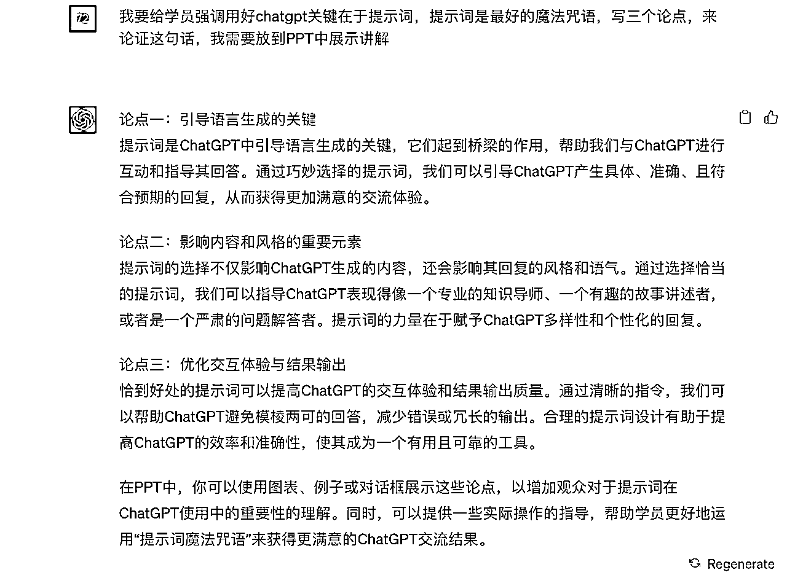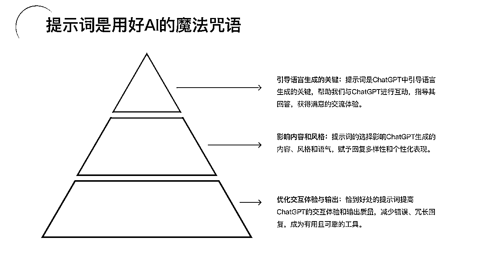

周四晚上加班到9点多，实在没时间碰PPT，只做了一点点调整，基本等于没推进。

周五晚上进入冲刺阶段：花了约3小时把配图一张张填进去，逐页检查排版，导出后还手动修了一些Mindshow处理不了的细节。接着又留了2小时，自己在脑子里把整堂课过了一遍，相当于提前试讲了一次。像AI行业应用这类内容，直接用PDF报告截图，又省事又好看。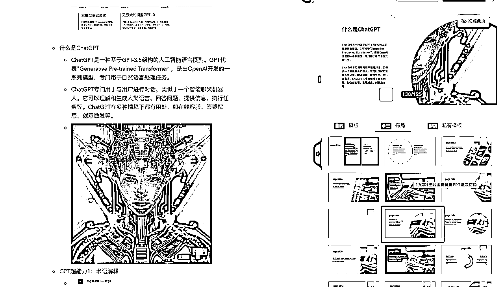

整体算下来，课程开发的总时长刚好在12小时左右。当然，这堂课本身是入门科普级别，如果换成更高阶的内容，这个时间肯定还得往上加。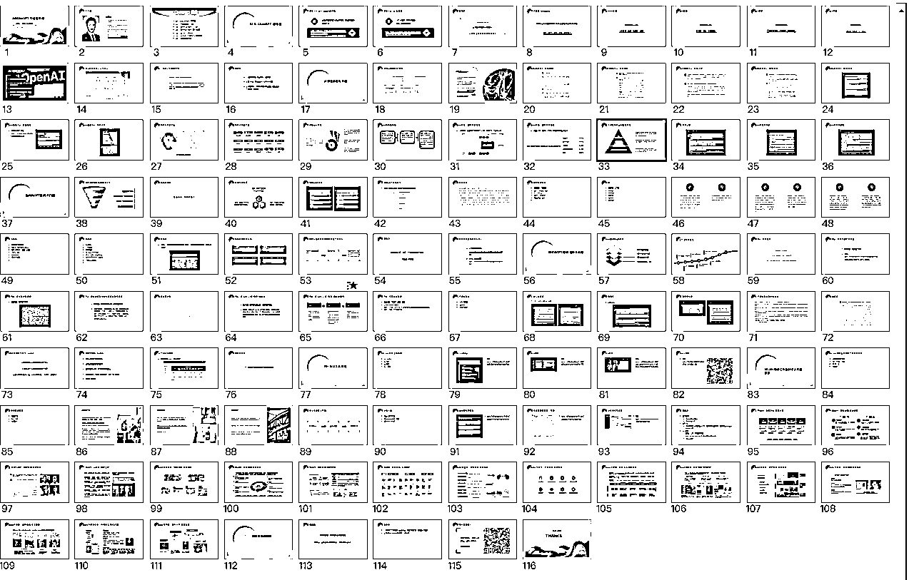至于PPT本身，我就不直接分享了，毕竟它是我以后要拿来吃饭的家伙，请各位见谅。

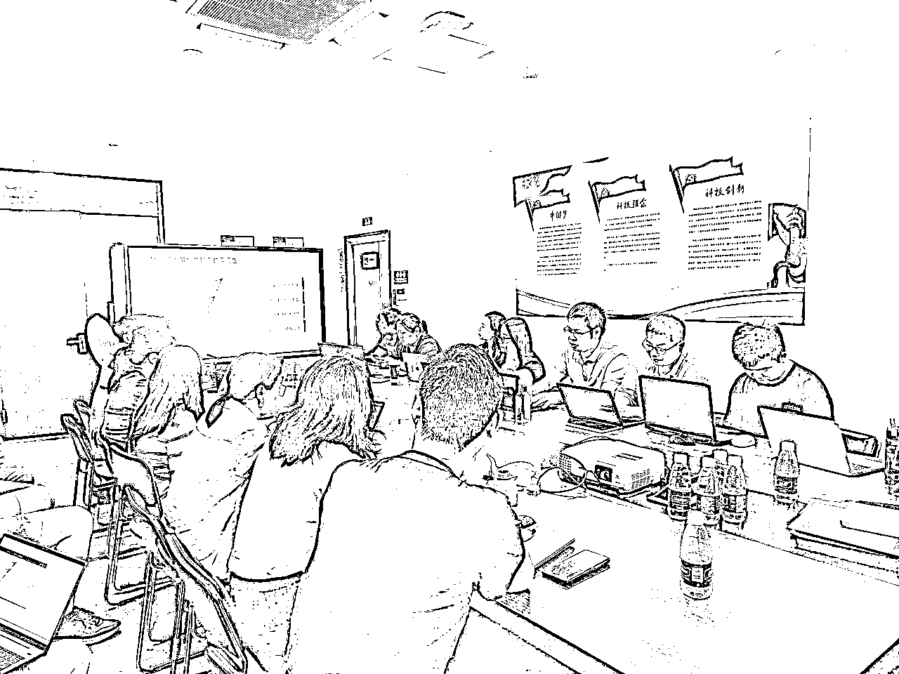到了培训当天，现场效果我自己还挺满意，老板和学员也给了不错的反馈。最让我惊喜的是路演环节——我布置了一个任务，让学员用ChatGPT完成一项真实的工作。结果有位学员直接用AI写了一篇关于这次培训的企业公众号软文，只花了10分钟就出了初稿，而且质量不差。要知道，以前写这种文章怎么也得折腾半天，这一下就是几十倍的效率提升。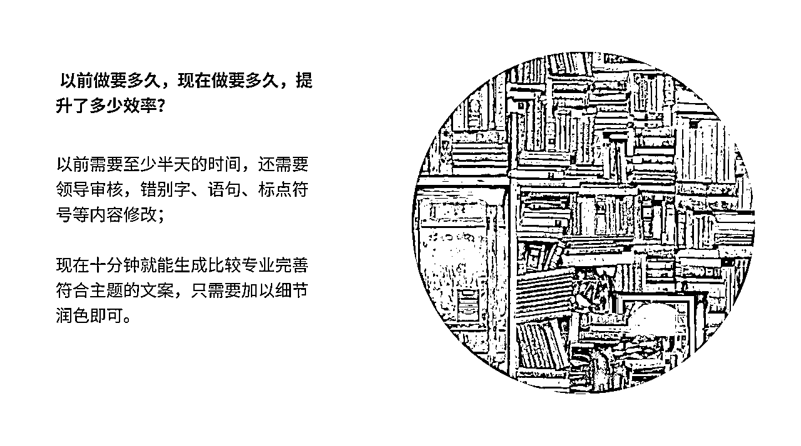

这次经历，让我有几个挺想分享的感悟。

第一，别高估学员的理解程度。心理学上有个词叫“知识的诅咒”，我这次算是狠狠体验了一把。我原本准备的是一天的内容，结果现场只讲完了三分之二。很多我觉得已经足够基础的知识点，小白学员还是要花不少时间去消化和实操。这让我重新思考：讲师真正的本事，不是自己讲得爽，而是能不能站在小白的视角，把复杂的事讲简单，并且引导学员动手练起来。以后再做分享，我会提醒自己：从最简单的演示开始，千万别想当然。

第二，不同行业之间的信息差，真的比想象中大得多。开课前我做了一个小调研，40多个学员里，只有三分之一的人用过ChatGPT这类大模型产品，真正把AI用在自己工作流程里的，只有2个人。还有个更震撼的例子：我两个月前就看过的AI+Office视频，在我潜意识里认为这功能都这么炸裂了，打工人应该人手一份了吧，结果现场发现还有好多人听都没听过。这件事让我更确信：做AI转型顾问，核心任务就是打破次元壁，去更多行业里做传播、做赋能，把AI这把锤子带到更多钉子面前。

第三，时间会给出复利的答案。我从数字化转型顾问、工具产品运营经理一路转型过来，到现在开始做AI培训师，最大的感受就是：只要你专注地研究一个方向，不断输出和积累，就一定会在某个节点突破。这次做课，我发现好多个知识点都可以直接从我自己写过的文章里拿过来用，整个知识体系很快就被串起来了，那种感觉真的非常奇妙。而我所做的，不过是从0开始学了55天、写了55篇文章而已，连两个月都不到。如果把这个时间拉长到一年、两年，复利效应只会更惊人。

第四，学AI，实操永远比听课重要。这次培训让我深刻体会到：讲完一个知识点，马上让学员动手试一把，效果是最好的。听十遍，不如自己做一遍。我也顺便反思了一下自己：最近一直忙着备课、写公众号，好久没有沉下心实操写Prompt了。接下来我打算跟着小七姐的提示词课程好好练一练，把基本功补回来。

最后聊聊：我是怎么拿到这次机会的？

最核心的一点，是把自己暴露在人群里。我连续55天日更公众号，写的全是AI相关的内容，每天都雷打不动地同步到朋友圈。慢慢地，朋友们给我贴了一个标签——“那个每天雷打不动更新、敢跟自己死磕的狠人”。这个标签背后，其实是一种势能，一种持续输出的能量场，它会慢慢吸引来欣赏你的人，以及机会。这次合作，就是一位圈友通过我日更的公众号找到我，发现大家刚好都在无锡，于是一拍即合。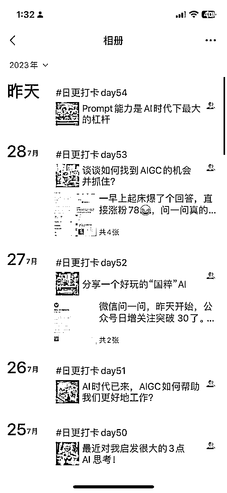

所以我也特别想对大家说：别总觉得自己内容不够好，不好意思分享。只要你的内容对某一个人有启发，它的存在就有意义。培训结束后，又有一个无锡朋友申请转载我之前写的4000字干货长文，后来我才发现，原来他是当地一家前沿信息企业协会的人，说不定以后还有合作。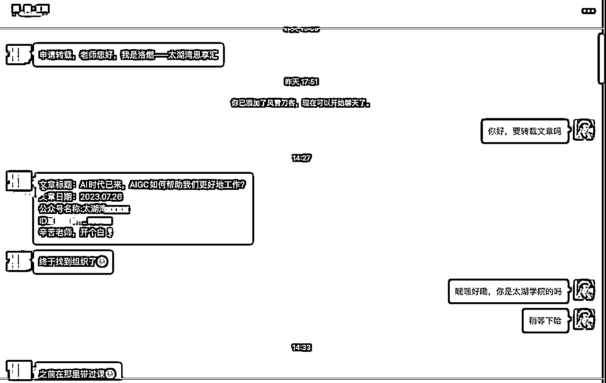还有一个让我开心的小插曲：有人通过公众号找到我，想让我帮他做一个AI法律助手，我还没来得及报价，这已经是一个潜在的定制Prompt商机了。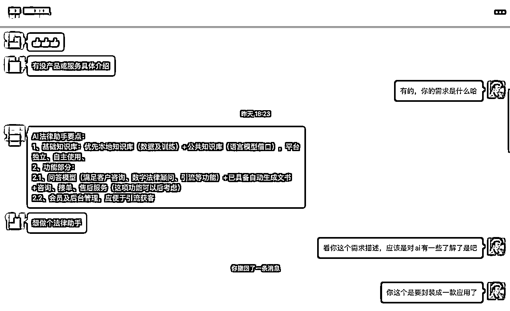

第二点，如果你不在北上广深，请务必重视区域化的机会。非一线城市的AI人才确实稀缺，但当地企业和机构对前沿信息的需求一点都不少。这个时候你去做分享，用AI去赋能，几乎可以说是降维打击。就拿无锡来说，能和我聊AI的同行都很少，但这就是我的机会。接下来我准备联合无锡本地的企业协会，先把“AI转型顾问”这个IP在本地立起来；下一步，还打算尝试打通大工校友在江苏的圈子，做区域化深耕。全国全网当然也要做，但一线城市的竞争太激烈了，AI大佬实在太多，区域市场反而更值得先跑起来。

这次企业培训带给我的，远不是那600块礼品卡能衡量的。希望我的这些心得，也能给你带来一点启发。接下来的路，我们继续在AI这条赛道上一块儿走，一起学习，一起迭代，一起向前。