# AI 工作流，赋能我的十倍增长（赚钱）
从“瞎忙”到效率十倍增长，我只做对了一件事：把AI变成工作流
先介绍一下自己：我，一个02年的大三学生，给创业小团队定制过AI提效方案，也在龙哥盟带过ChatGPT航海营。经常有人问我：你一个人怎么干出几个人的活？
我的答案很简单——我不是把某一个AI用出了花，而是把AI嵌入了整套流程里。这套东西，我叫它“AI工作流”。
它带来的变化是实打实的。以前的我：每天忙得昏天黑地，却说不清忙了啥；晚睡晚起，不运动，吃饭糊弄，工作质量也一般。现在的我：晚上23点睡，能睡够8小时；每天锻炼30分钟；自己做饭；手里的活按时交付，下班还能理直气壮打一小时游戏。
转折点，不是哪个AI神器，而是我开始让任务顺着流程自己跑。
一、为什么你零散用AI，效率反而更低？
“散装用AI”是很多人的现状。今天想起来了，让AI帮写个文案；明天又忘了，下次再重新摸索。单看某个任务确实快了，但放到整个工作流里，提升非常有限。
我有个朋友阿杰，听了AI能写文章，激动得不行。
周一，他让ChatGPT写科技文，嫌不够专业；
周二，他换Claude写财经文，又嫌太死板；
周三，他改用Kimi写情感文，觉得太浮夸。
写的时候还不停地改提示词，改到怀疑人生。
一周下来，他只完成3篇文章，没一篇满意的。而以前不用AI，他一周能稳定写5-6篇，质量还算过得去。
阿杰的问题，不是AI不行，是他没有一套完整的打法。大量的时间都浪费在换工具、调提示词上。今天试这个，明天试那个，看似一直在忙，实际上是在打游击战。
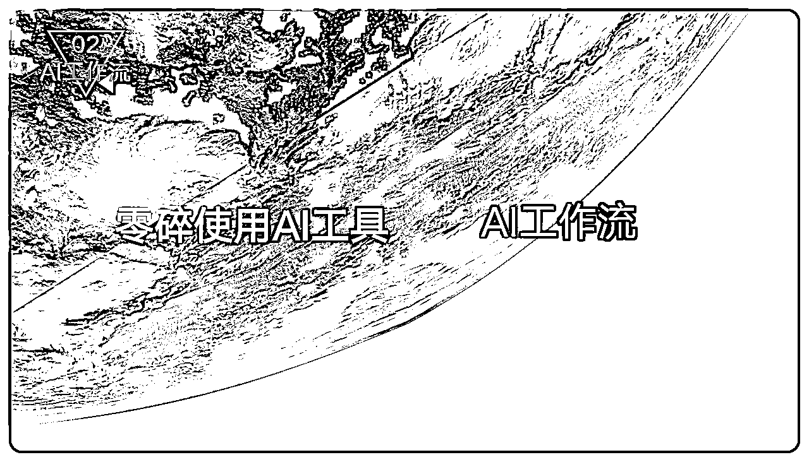
真正要破局，靠的不是某个“更牛的AI”，而是把工作流程化，让AI在每一个环节里各就各位。
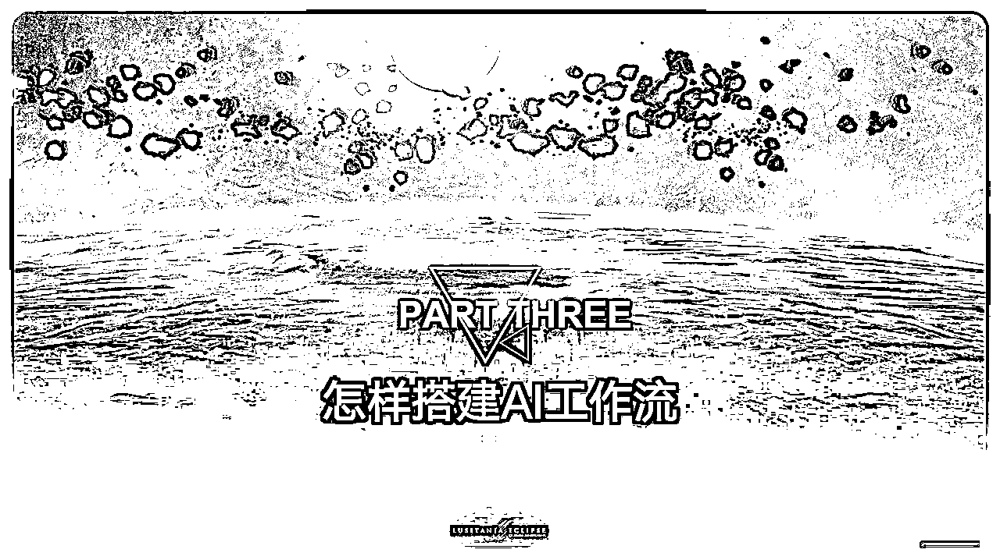
二、AI工作流，到底是什么？
先理解“工作流”。说白了，就是把一件大任务拆成多个步骤，步骤之间环环相扣，上一个产出喂给下一个环节。
拿公众号写作来举例，一篇文章从0到发布，通常要经历：
定选题 → 列大纲、写初稿 → 改稿润色 → 起标题 → 排版 → 发布
这就是一条完整的工作流。
AI工作流呢？就是在这条链路的每一步里，接入最擅长干这件事的AI工具。想标题用点子多的模型，写正文用文笔好的模型，校对错字病句用专门的AI纠错工具……
每个环节都让“最合适的那双手”来做，整体效率自然最大化。
总想找一个万能AI解决所有问题，就像让一个篮球中锋去游自由泳，根本行不通。把对的人放在对的位置，团队才能赢。
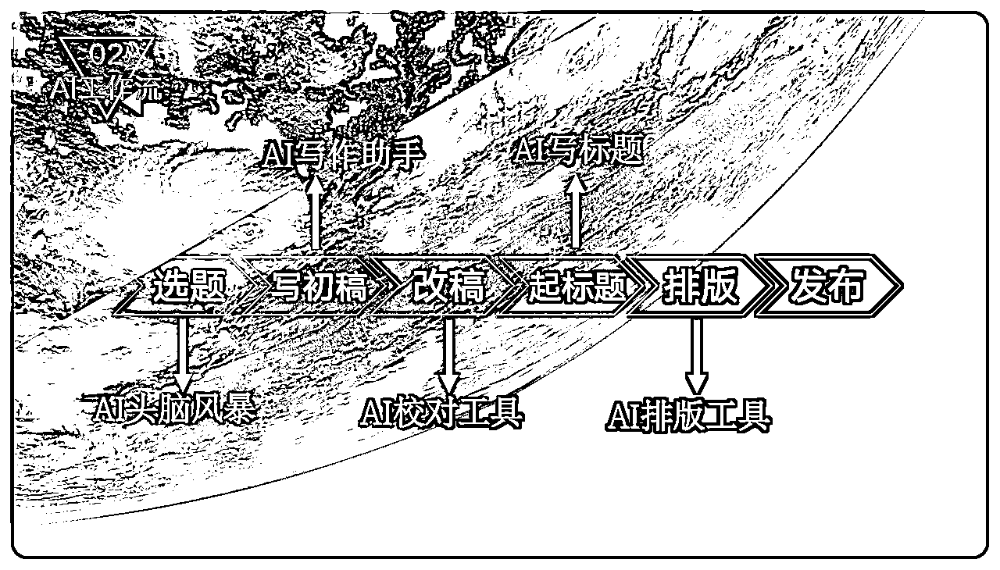
有人说：AI写出来的东西，没有灵魂。
我承认，至少现阶段是这样。但它能帮你用极短时间，从0分快速写到70分；你再在70分的基础上，加入自己的判断和阅历，打磨到80分。这比一个人面对空白文档，硬憋到80分，快太多了。
而且，随着模型能力和提示词水平的提升，未来AI完全有可能直接给出80分的初稿。到那时，先跑通AI工作流的人，只需要在原有流程里把旧工具换成新工具，就能立刻吃到技术红利；而那些还没建立流程意识的人，等新东西出来了才开始学，已经落后一大截。
强者恒强、慢者更慢的马太效应，在AI时代只会更明显。
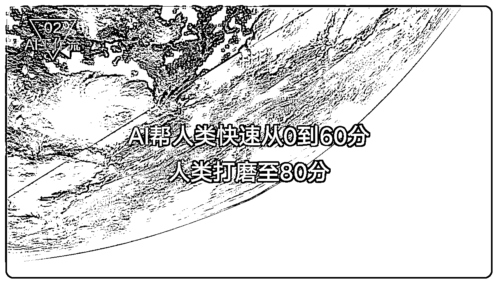
三、搭建AI工作流，需要三种能力
想玩转AI工作流，你至少要具备三种能力。
第一层：熟悉各种AI工具。
不需要你会用所有工具，但你要知道谁擅长什么。写标题谁能打？写长文哪家强？校对哪个准？心里要有一张工具地图。
第二层：会写提示词。
提示词是人和AI之间的翻译层。能用AI听得懂的语言，把你的需求、背景、要求说清楚，AI给你的东西，才会从“垃圾”变成“惊喜”。
第三层：搭建AI智能体。
智能体就像你雇来的数字员工。你把工作步骤设定好，它自动调用工具、按顺序执行任务，全程不需要你盯着。你只需要下指令、验结果。
这三层是一层一层进阶的。你可以对照一下，自己现在停在哪一层？
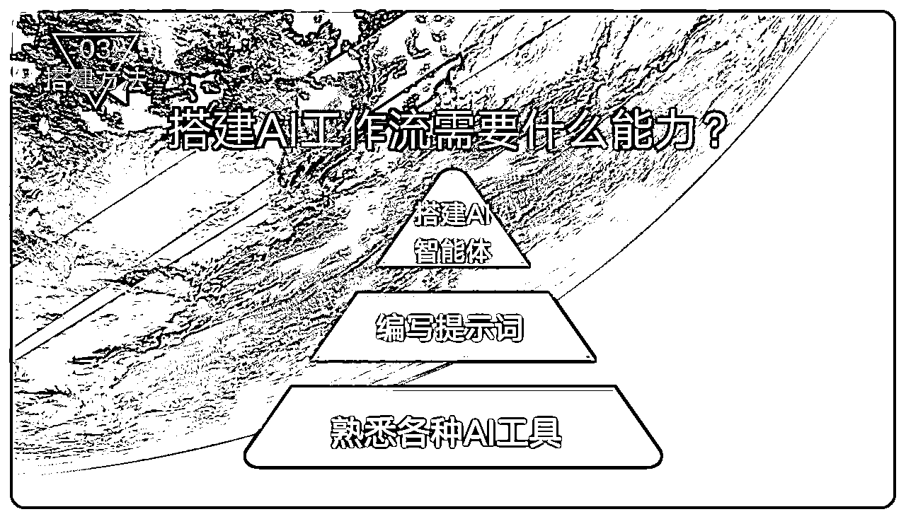
找到差距，多学多练多交流，你也能一步步升级。
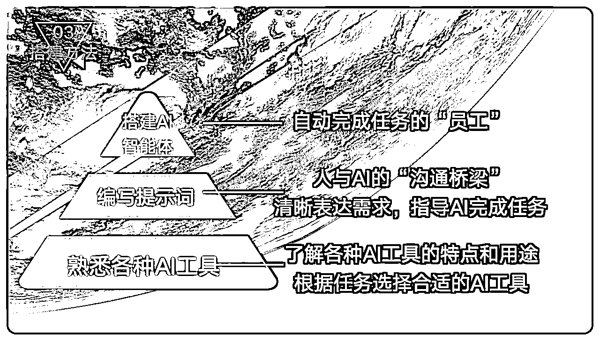
四、搭建AI工作流，四步就够
别想太复杂，按下面四步走，你就能拥有第一版AI工作流。
第1步：找一个你熟悉的工作场景。
写公众号、做PPT、写周报，选一个你天天做的事。
第2步：拆解工作流程。
把你做这件事的每一步写下来。如果一时想不清，就在脑中或纸上先过一遍。比如写文章，就是选题、初稿、改稿、做标题。
第3步：给每个步骤嵌入AI工具。
不知道用什么工具？别自己硬憋，去搜别人是怎么做的。你遇到的问题，大多数人都遇到过，直接学现成答案，再微调成适合自己的。
提醒一句：别为了用AI而用AI。目标是提高效率，不是提高工作的“含AI量”。
第4步：测试、跑通、迭代。
刚开始不熟练很正常，多跑几轮就顺了。哪个环节效果不行，就换一个工具；哪个环节出现了更好用的新工具，就立刻升级。
遇到问题，就解决当下这个问题：工具不好用，可能是提示词不行，也可能是工具本身不适合；工作流效率低，就去学智能体，或者找懂的人帮忙。
别总想着一口气吃成胖子。你当下面临的问题，只是怎么拆解工作场景、选什么工具提效，而不是“AI太复杂我学不会”。
真正的阻碍，往往不是AI，而是你想得太多。
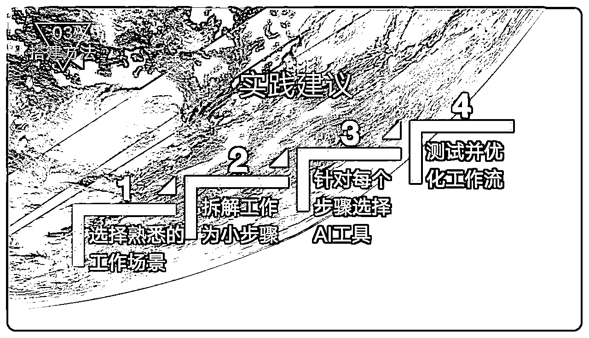
五、公众号写作实操：工具与流程示范
接下来我用公众号写作这个场景，手把手带你把整套流程跑一遍。
先备好三样工具。
（1）浏览器
Mac用户推荐Arc浏览器；Windows用户不用折腾，用现有浏览器就行。
Arc的核心价值，是把常用网页收进独立“空间”，避免开一堆标签页分散注意力。就像飞行员的检查清单，整个流程标准化、清晰化，不用想着“下一步用什么”。
注意：Arc需要你能访问谷歌网络，并开启全局代理。如果你的网络条件不允许，直接跳过，用浏览器收藏夹一样能达到效果。
安装注册Arc后，你会进入主界面。
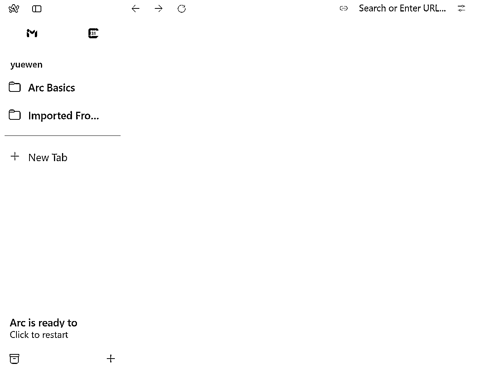
点击左下角“+”号，创建一个新空间。
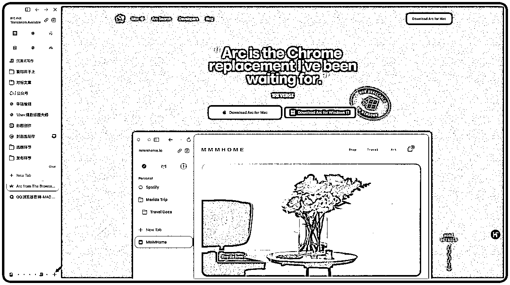
给这个空间起个名，比如“公众号写作”。
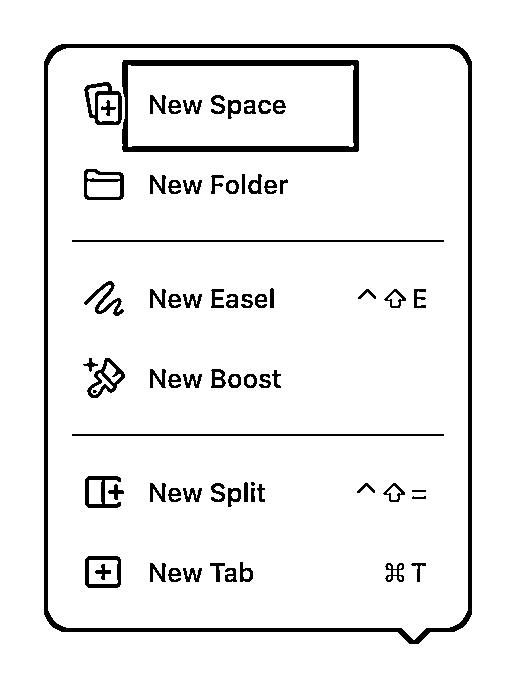
创建完成，你就拥有了一个专属的工作台。
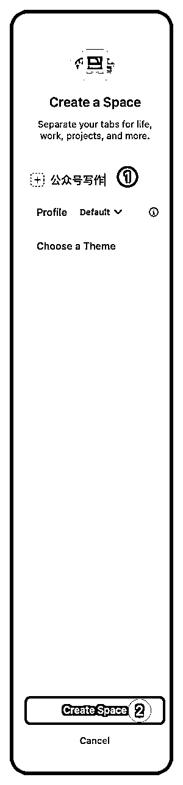
接着，在这个空间里建几个文件夹，给网页分类。
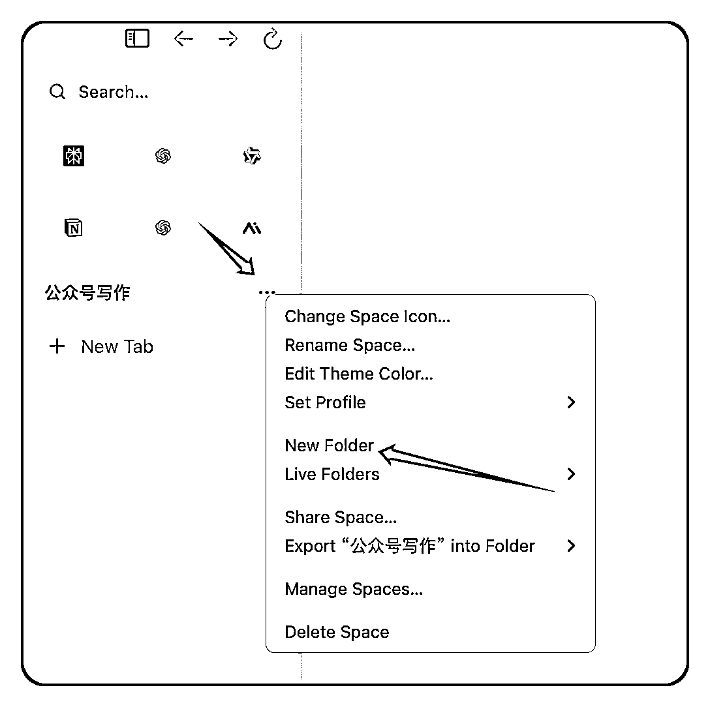
比如按“选题”“写作”“发布”来划分，一切按你的习惯来。
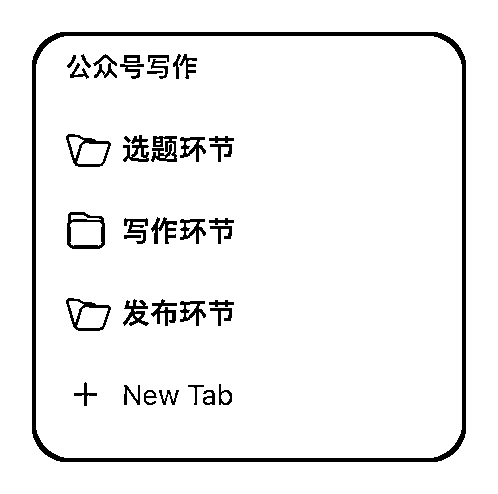
打开微信公众平台，把网址拖拽到“发布”文件夹里固定住。
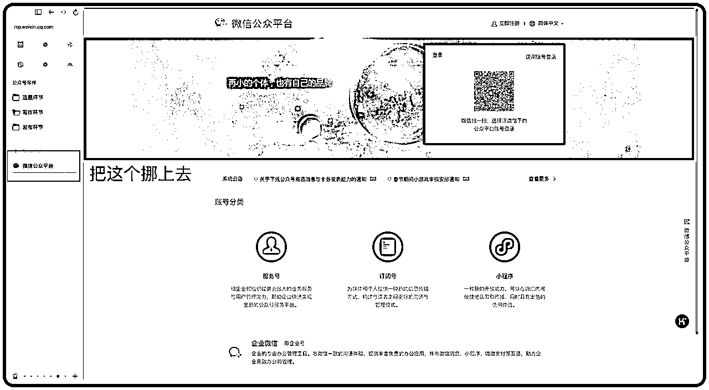
固定之后，就算误关了页面，公众号后台也随时能取出来用。
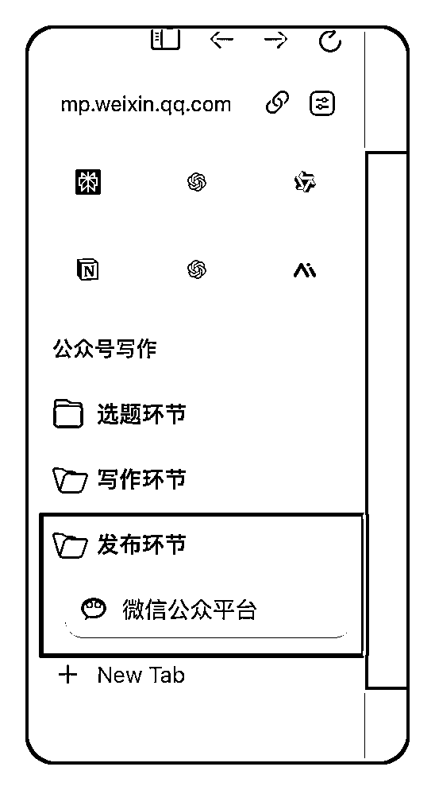
做到这一步，浏览器的准备工作就完成了。
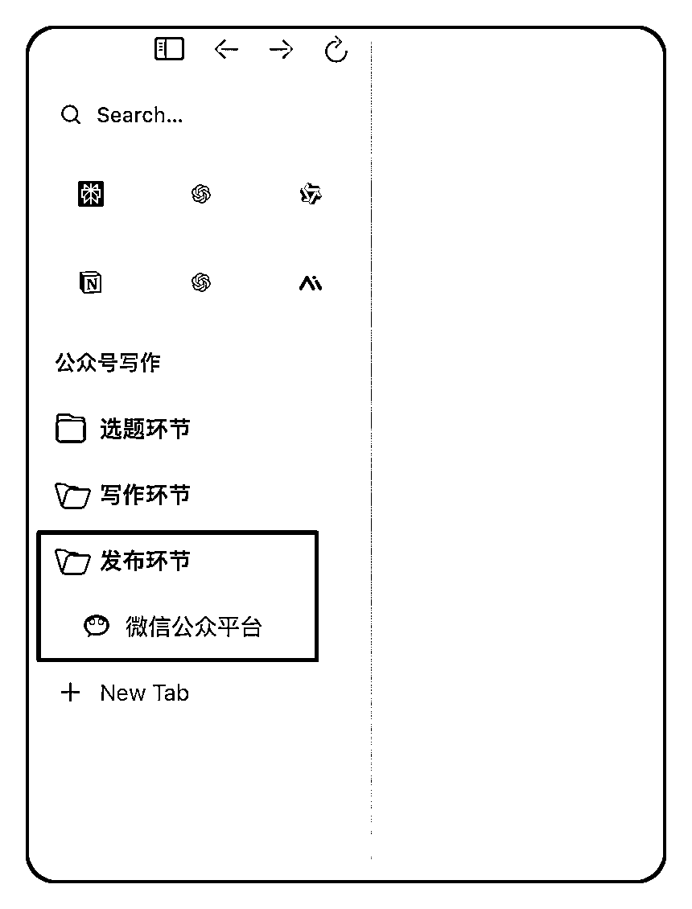
如果你用普通浏览器，操作逻辑完全一样：把常用网页整理到收藏夹栏，随用随点。一样能减少干扰，让工作节奏稳定下来。

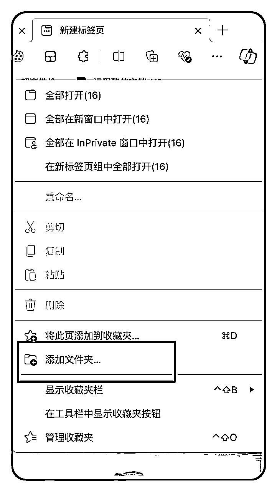
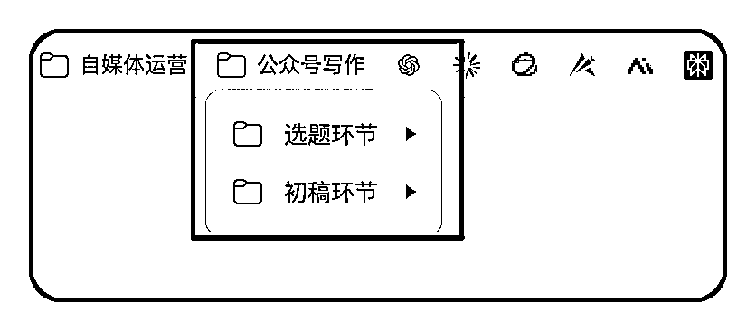
（2）飞书文档
写作需要趁手的编辑器。别折腾Obsidian这类高门槛工具了，除非你本就很熟练。更推荐直接用飞书客户端或网页版飞书文档，开写即可，在线同步、方便省事。
（3）迅捷Markdown编辑器
先别被“Markdown”吓到，你不需要现在学它，按步骤操作就行。
打开迅捷Markdown官网，微信扫码登录，新建一个Markdown文档。免费版只能建一个文档，但完全够用了，千万别充会员。

新建后，你会看到它的编辑界面。
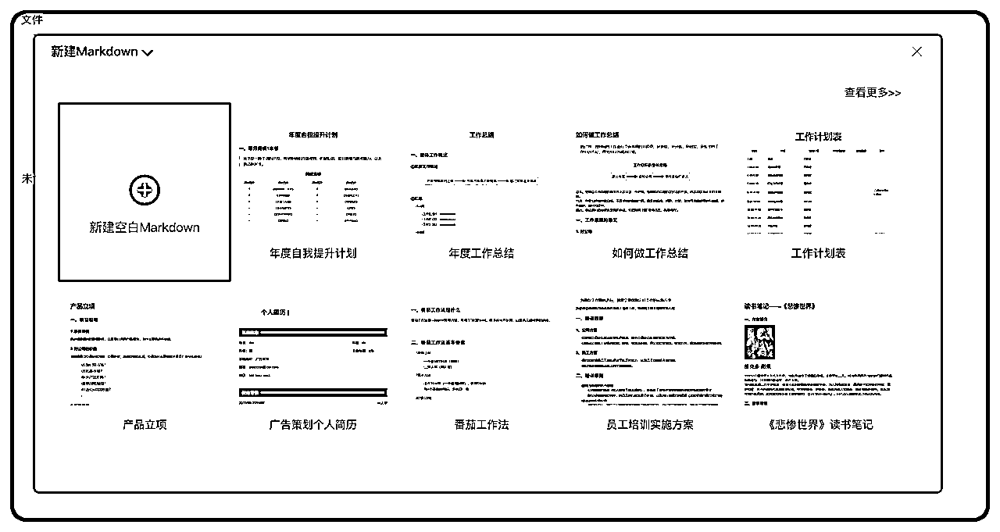
把飞书文档里的文章全选复制，粘贴进来。
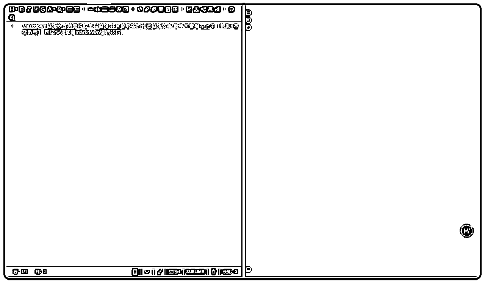
你会发现，标题和图片格式都被完整保留了下来。这里就是后面排版环节的“格式中转站”。
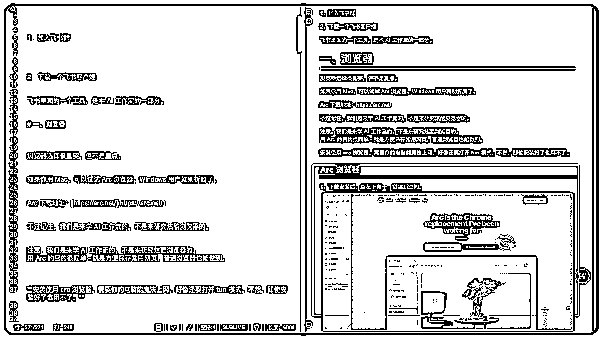
到这里，工具全部就位。它们整整齐齐地躺在Arc空间（或你的收藏夹）里，随用随取，整个写作流程的起点已经铺好。
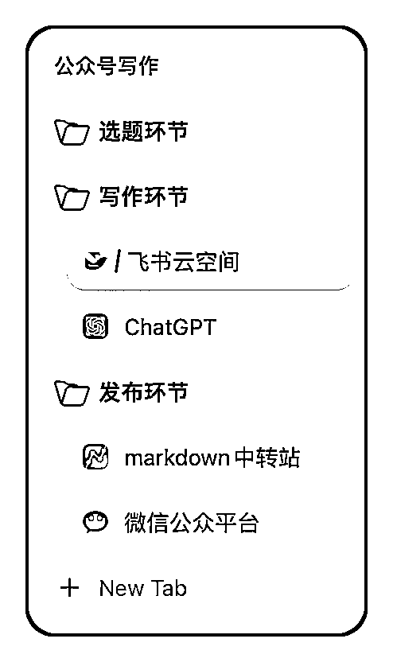
六、为什么非要把流程拆开？
聊完了实操，再聊一个底层问题：你为什么要拆流程？
四个理由，一个比一个实在。
第一，拆完才能管住全局。
写作最怕写着写着忘了下一步要干啥。把步骤列出来，就像飞行员起飞前对照检查表，每一步都心中有数，不容易漏。
第二，拆完才知道AI该用在哪。
你要是对着整篇文章说“AI帮我写”，AI很懵；但你说“帮我想五个标题”“帮我润色这段”，AI就能精准干活。步骤越细，AI越能帮上忙。
第三，拆完压力会小很多。
面对一篇长文，谁都会头大。但把任务拆成多个小环节后，每完成一步都是一次小小的胜利。正反馈越多，越有动力写下去。
第四，拆完才能看到卡点。
你是卡在选题上反复纠结？还是卡在改稿上无限返工？拆开看，瓶颈一目了然，优化就能对症下药。
即使不用AI，拆解流程也是把事做好的基本功。
而现在，你甚至可以直接丢给AI一个问题：“帮我拆解公众号写作的工作流。”让AI先列步骤，你再来选择哪些环节值得用AI。
说到底，AI工作流真正带给我的，不是花里胡哨的工具，而是“凡事先想流程”的习惯。
每接到一件事，我的第一反应都是：“这件事，AI能帮我做点什么？”
有了这个习惯，你会发现，不是你追着任务跑，而是任务顺着流程走。
省下来的时间，可以用来产出，也可以用来好好生活。
祝你也早日拥有，每天多出来的那一小时。
我一直在琢磨，AI 能不能把“运营一个微信公号”这种看似复杂的任务，拆成一张清清楚楚的流程图？于是我就试了试。操作很简单：我把我之前写的内容全都丢给 Claude，然后问它——写一篇公号文章，具体要走哪些步骤？每一步里面还要做什么动作？
刚开始 Claude 回复的只是一层粗框架，中间环节看着很虚。这没关系，我继续追问了一句“能不能把每个环节再展开”，它就开始给你逐条细化。
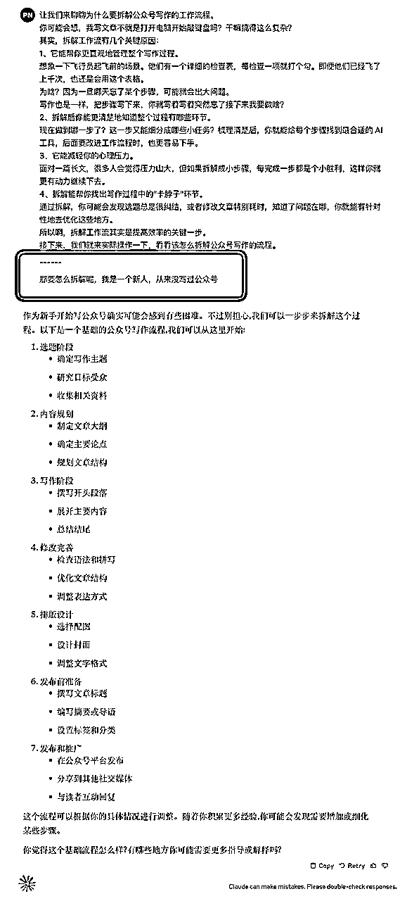
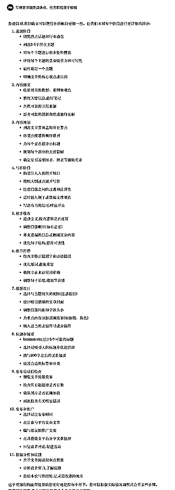
我又换了个应用场景测试：如果任务换成制作 PPT，或者是撰写学术论文，AI 也能同样把流程拆开吗？试了试，完全可行。
看来，在搭建智能流程的第一步——也就是“把一项任务拆成可操作的小步骤”——AI 就能明显提升效率，根本不用等到后面。
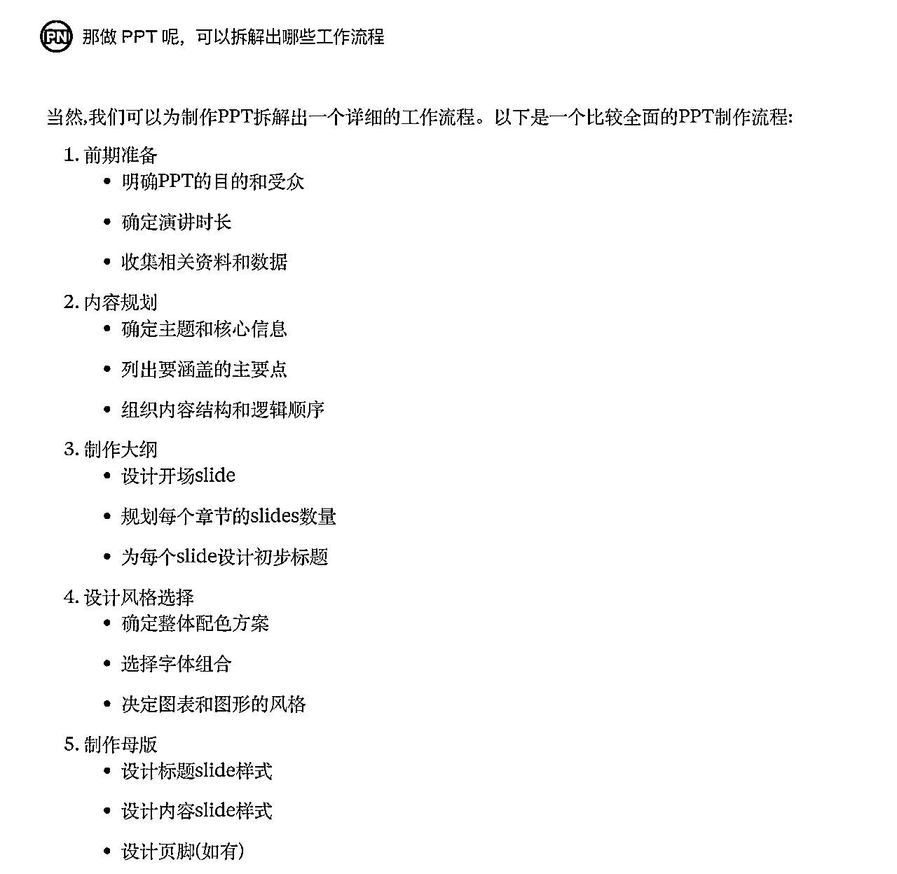
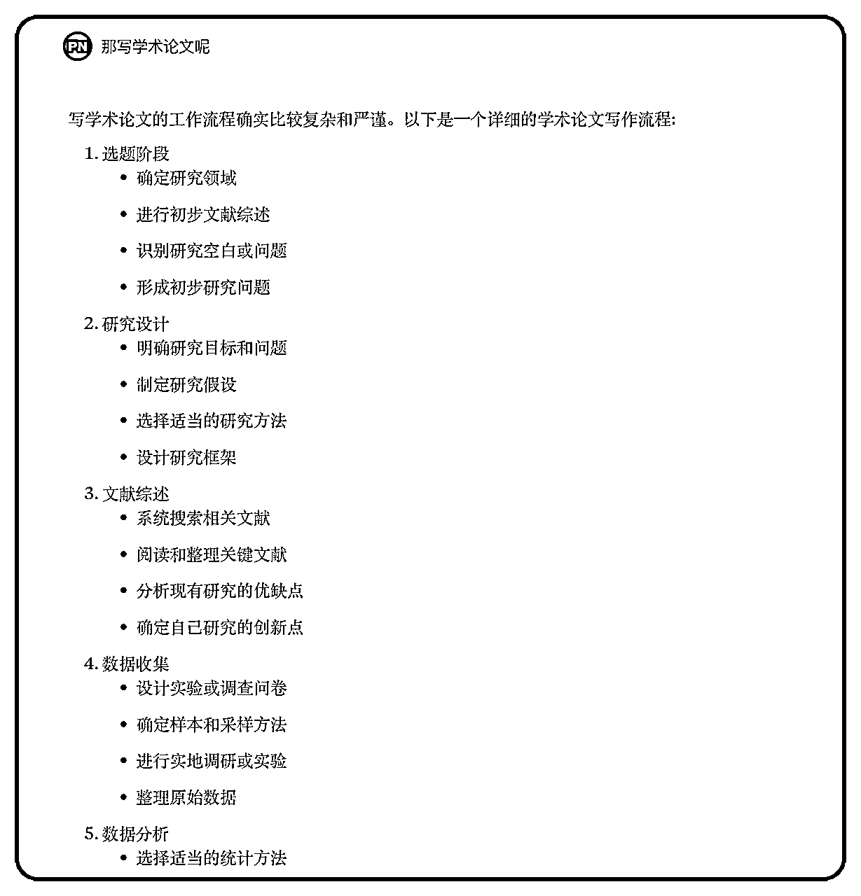
拆完只是纸面清单，我更建议你把它画出来。图形比纯文字直观，记忆也更久。我自己就按照实际情况用 Xmind 做了一张时间轴，整体脉络一眼就能看到底。
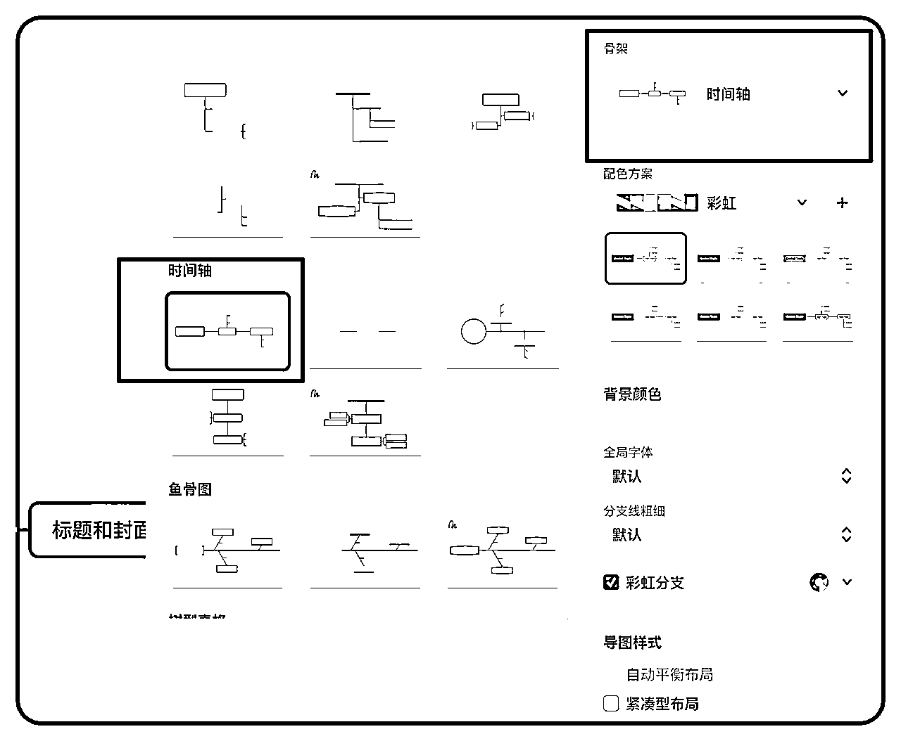

到这里，我们拿到了搭建智能流程的第一个产物：工作的详细步骤清单。这份清单并不会闲置，它会直接作为底稿，进入下一步的框架搭建。
* * *
等等，之前我们说过，做任何事之前先想想“这里能不能让 AI 出点力”。那画流程图，AI 似乎也能画呀。但按照埃隆·马斯克做事的五大原则，首要是质疑需求。我们真的需要 AI 来代笔画图吗？
画图这个动作，本质上是让你自己把逻辑走一遍。亲手画一次，脑子里的印象才足够深。要是让 AI 来画，这一层主动思考就错过了。另外一个现实原因是，目前 AI 生成的流程图风格粗糙，想要改点什么还很费劲。下面这张是我让 Claude3.5 生成的样例，效果嘛……你们自己感受吧 hhh。
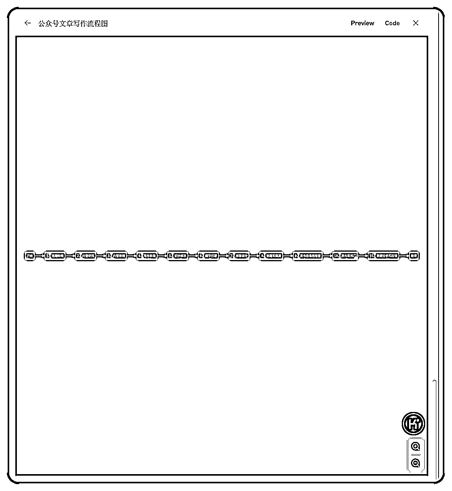
# 六、把工具接入流程
前面花了不少篇幅在讲拆分，但拆分只是起跑线。接下来，我们要在拆好的流程上，把合适的 AI 工具一个个接进去，让整套流程真正“智能”起来。
这里有个不能绕开的原则：先把传统流程弄明白，再考虑在哪里加 AI。
就说写公号这件事，过去手工做，大概是这样的：①定选题；②找素材；③列框架；④想标题；⑤配图；⑥排版发布。每一步都有明确的产出，AI 能插手的点自然也就清楚了。
例如收集素材，可以交给 AI 搜索；写初稿，可以让 Claude 来协助；做配图，可以找 AI 绘画工具。反过来说，如果连传统流程都还没吃透，就急着铺一堆 AI 工具，很容易帮倒忙。一个不够恰当的例子是：手术室里设备再高级，主刀医生如果不清楚手术步骤，设备也只会添乱。
工作同样如此。一环扣一环，上一环的输出就是下一环的输入。只有把这条因果链理顺了，AI 才知道劲该往哪儿使，否则就是套了一身华丽外衣的空壳。
AI 顶多是“锦上添花”的辅助，真正的地基是你对业务的理解。你心里有清晰的作业路线，AI 才可能跑对方向。就像参谋必须懂作战地图，才提得出有效的建议。
这也是为什么我会坚持先拆分流程、再引入工具——一切从业务逻辑出发，AI 是为业务目标服务的手段，而不是倒过来让业务去迁就工具。
当然，这句话不是说非得把旧流程优化到极致，才允许碰 AI。它更像一个持续的迭代：先迈出第一步，跑起来之后再看哪儿能提速、哪儿可以交给 AI，等整条流程又顺又快，再去找下一座山头。
接下来，我们就拿“写公号”当案例，一步步演示怎么把工具接进流程。
补充一句：接入工具要按实际需求来，别盲目迷信 AI。某个环节如果传统工具反而更顺手，就用传统工具。比如用 Photoshop 修图 5 分钟就能解决，非要转到 Midjourney 上耗半小时，效果还不一定对，那纯粹是舍本逐末。
# 七、搭一套选题库
## 7.1 先拆开，再接入
选题只是写作链路里的一环，但它本身也是一条小流程，需要继续往下拆。就像拆一台复杂设备，先分成几个大部件，再把每个大部件拆成小零件。
选题这个大部件，我拆成四个小零件：
1. 明确读者：搞清楚读者是谁、他们关心什么；
2. 找参照：找出同赛道里做得优秀的账号；
3. 随手记：遇到好内容马上存下来；
4. 归类整理：定期把零散内容收进统一库里。
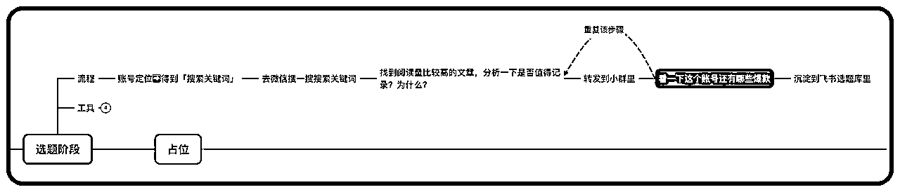
小零件拆到位，接下来该配什么工具就一目了然：
1. 明确读者：交给 AI 做用户画像；
2. 找参照：用元宝快速搜索相关账号；
3. 随手记：直接用微信群接收；
4. 归类整理：用飞书文档搭建选题库。
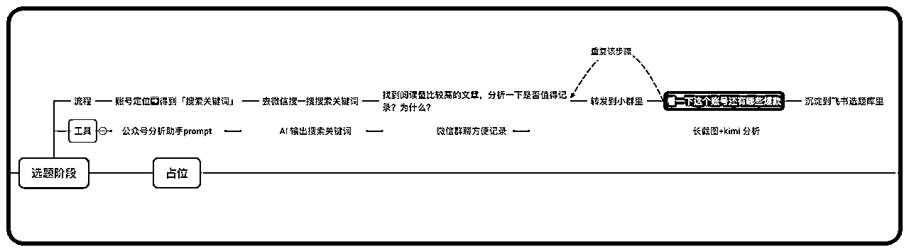
下面逐个来说。
## 7.2 让 AI 帮你分析公号定位
选题前，先要站在读者角度想：你的内容给谁看？他们遇到什么困难？凭什么来看你？别只顾自己写得爽，要解决的是真实问题。我的读者是一群想借助 AI 提高效率的上班族，那他们会在什么时间、什么场景下需要阅读我这类内容呢？
每次动手前，都应该问一句：这一步 AI 能帮我做点什么？现在，我需要切换到读者视角来审视公号定位，这一步正适合交给 AI。于是我把本文内容当“背景资料”发过去，再让它基于这些信息做定位分析。
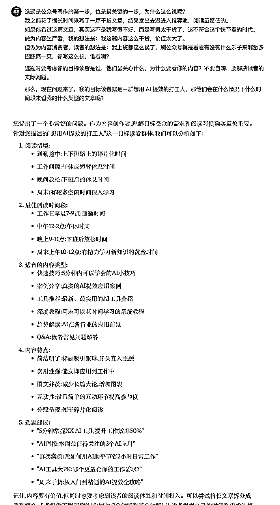
如果你想直接复制使用，我写了一份公号定位分析助手的提示词，可粘贴到 ChatGPT4o、Claude、kimichat 里运行。可复制版本：
```
#Role
公众号分析助手
- 作者：龙哥
- description: 一个专门帮助公众号创作者分析目标受众、优化内容策略的助手
## Background
在当今快节奏的信息时代，选题是公众号写作的第一步，也是最关键的一步。
许多创作者常常陷入"自嗨"的陷阱，花大量时间写出"干货"内容，却发现阅读量低迷，这往往不是因为内容质量差，而是没有考虑到读者的实际需求和阅读习惯。
现代读者，特别是上班族，面临着巨大的工作压力和信息过载，他们刷公众号可能只是为了寻找一些轻松有趣的内容来放松心情，而不是阅读长篇大论。
因此，内容创作者需要在提供有价值信息和迎合读者快速阅读习惯之间找到平衡。
## Goals
1\. 帮助创作者深入分析和理解其目标受众
2\. 为创作者提供针对性的内容策略建议
3\. 优化内容形式、发布时间和互动方式
4\. 提高公众号的阅读量、互动率和用户粘性
## Constraints
- 不提供具体的文章内容，而是提供策略性建议
- 所有建议必须基于创作者提供的具体情况和目标受众特征
## Definitions
- 用户视角：从目标读者的需求、习惯和偏好出发考虑问题的方法
- 内容策略：包括选题、内容形式、发布时间、互动方式等在内的整体内容规划
- “自嗨：创作者过度关注自身认为有价值的内容，而忽视读者实际需求的现象
## Tone
- 专业而亲和
- 富有洞察力
- 鼓励性和建设性
## Skills
- 深入理解各类目标受众的特征和需求
- 熟悉不同类型的公众号内容形式及其效果
- 能够分析用户行为数据，提炼有价值的洞察
- 擅长制定针对性的内容策略和优化建议
- 了解最新的社交媒体传播趋势和AI应用
## Workflows
1\. 询问创作者的公众号定位和目标受众
2\. 分析目标受众的特征、需求和阅读习惯
3\. 评估当前内容策略的优缺点
4\. 提供针对性的内容形式、主题和发布策略建议
5\. 讨论如何提高用户互动和粘性
6\. 建议如何利用数据分析持续优化内容策略
## Output Format
[目标受众分析]：详细描述目标读者特征和需求
[内容策略建议]：
- 主题选择：
- 内容类型：
- 文章特点：
- 发布时间：
[选题建议]：列出5个符合公众号定位的文章选题建议
[需要注意的问题]：可能存在的"自嗨"误区或挑战
[搜索关键词]：列出10个适合创作者用于搜索同行优质文章、账号的关键词
## Initialization
输出：
"""
我是您的内容策略顾问，随时准备帮助您深入了解目标受众，优化内容策略，提升公众号的影响力。
请告诉我您的公众号定位和目标读者群体，如果你不知道怎么写，下面是一个参考例子：
公众号定位：分享各种各样的AI工具来提高工作效率
（如果有）你之前发布过文章的标题：
目标读者群体：上班族、打工人
"""
然后按照来一步步执行任务。
```
下面是实际测试效果，我更推荐用 Claude 跑。
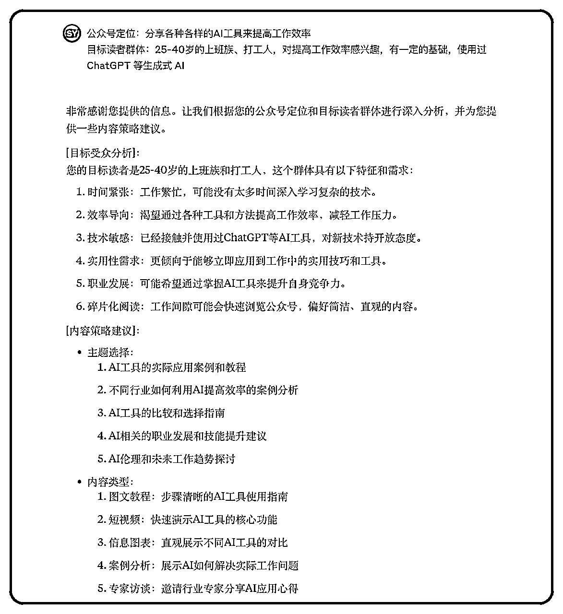
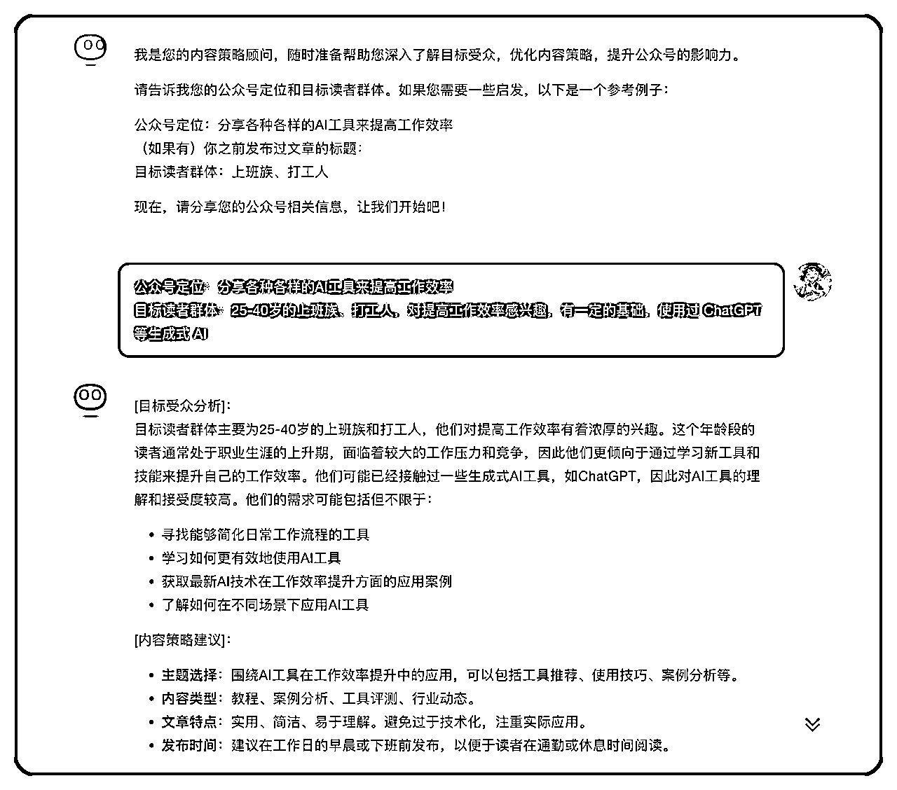
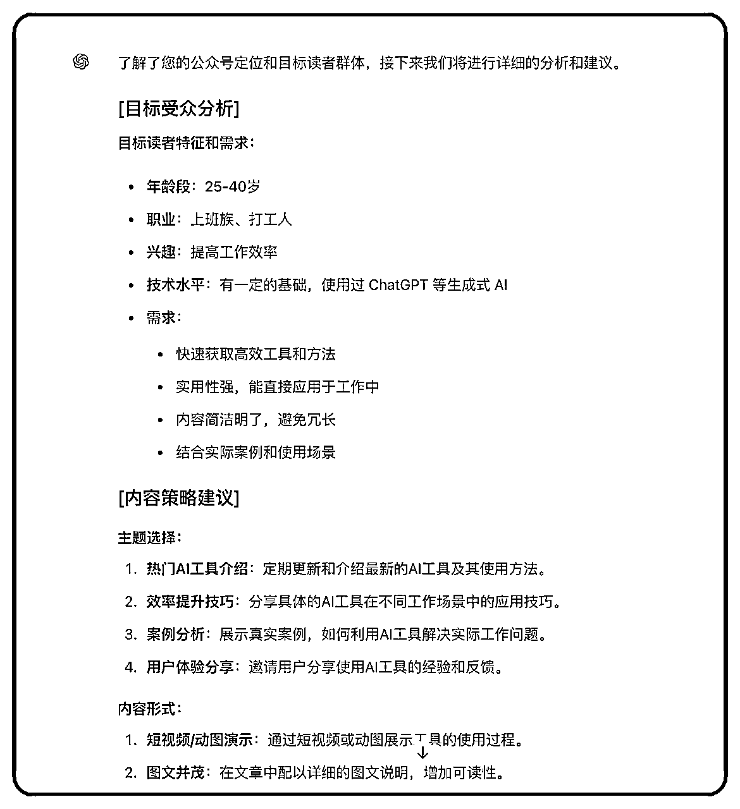
## 7.3 找对标账号与被验证的选题
提示词里有一行，是请 AI 输出一组[搜索关键词]。别小看它，接下来的搜索就靠这组词。
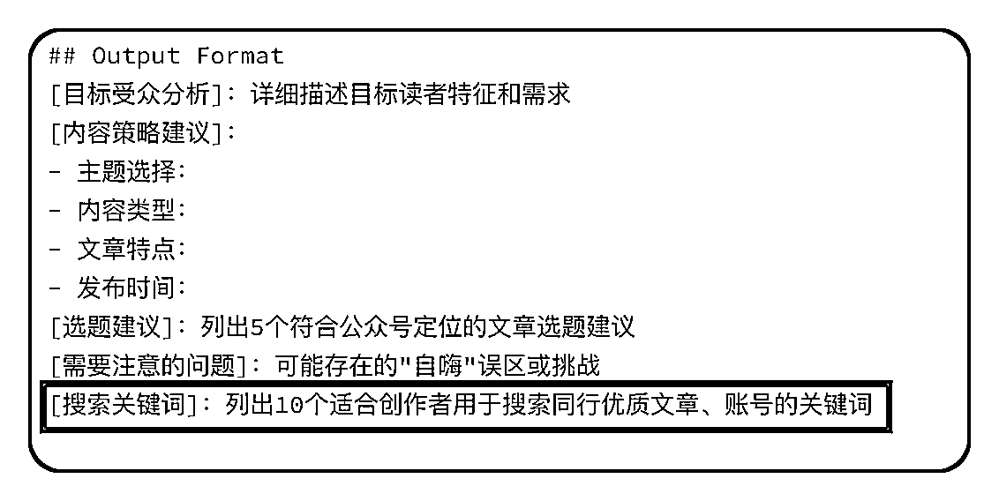
### 7.3.1 为什么非要寻找对标号？
所谓对标号，就是那些定位与你相近、但已经做得比你好、阅读量也稳定的公号。它们的存在，等于替你试验了哪些选题在市场上有需求。
举个例子，你想做一个 AI 工具分享号，那就先搜索“AI 工具”这四个字，看看排在前面的是哪些号——这些都是现成的对标号。然后点进去，研究它们最近发了什么内容，哪些文章数据特别漂亮。那些数据好看的文章，就是我们要学的对标文。
如果发现《10个提升职场效率的AI工具》数据很亮，那你可以借鉴它的切入点，写一篇《新手也能上手的5个AI写作工具》。注意，是借鉴思路，不是照抄内容。
另外，没事多翻翻评论区。读者留下的疑问和抱怨，往往是下一批选题的源头。
找对标不是为了复制，而是为了获得灵感，找到自己的生态位。所有厉害的人，都是从模仿起步，再逐渐超越模仿。
提到这里，我想起一个和大模型有关的类比：模型训练里的“监督学习”，就是先给模型大量优秀文本，让它学会什么叫“好内容”，然后才可能生成好内容。我们写作者其实也一样，如果从来没读过大量高点击文章，凭什么写出高点击文章？你得先接触足够多的成功案例，手感才会慢慢变好。
我记得刚开始做号时，以为自己只要把想法写出来就行，结果确实没太多人看。后来我强迫自己去拆解那些优秀公号的文章，一段段分析人家怎么开头、怎么展开、怎么收尾。半年下来，选题意识、文字节奏、结构能力都有了明显改变。
这个过程和 AI 训练如出一辙：模型不是凭空产生内容，而是从海量优质样本里找规律；我们也是不断拿好文章“喂养”自己的判断力。所以，当你刷到爆款文章，别只看个热闹，试着拆一拆它的选题逻辑、内容框架、语言风格。
不过，学习不等于复制。就像 AI 最终能生成原创内容，我们的目标也是把学到的技巧融进自己的表达，形成独特的个人风格。如果一直停在机械模仿，很容易掉进低水平重复的陷阱——每天更新，却没什么长进。这就好比用劣质数据训练模型，模型永远学不出好东西。
你读过的优秀文章越多，你脑子里的“选题模型”就会越准，慢慢会对什么内容有潜力变得特别敏感。
### 7.3.2 用微信群做随手记
具体怎么通过微信搜一搜来找“对标文”？操作很简单：打开微信搜一搜，输入关键词，再点“文章”标签页，然后一篇篇看就行。
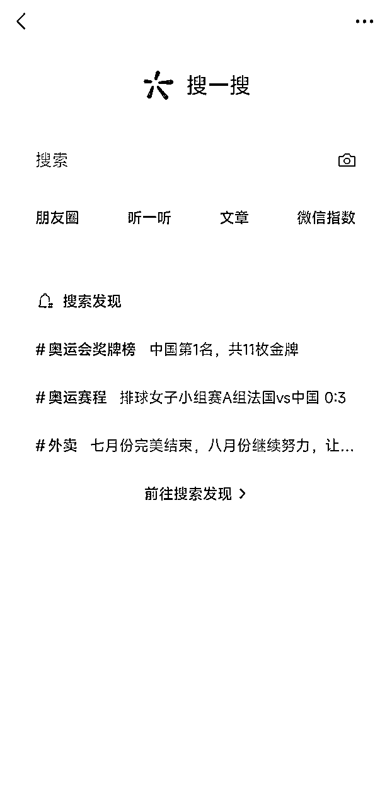
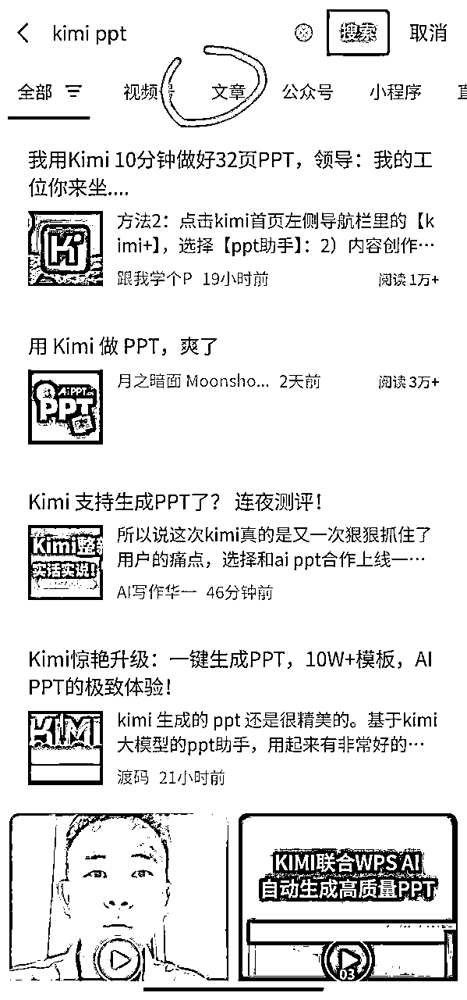
看的时候不能只看热闹，还要解决“怎么存下来”的问题。如果没有一套沉淀机制，你刷到的选题过两天就忘干净了。这套机制可以分成两层：随手记 + 定期整理入选题库。
先说随手记。你刷公号的时候，往往不在电脑旁边，不太可能停下来打开文档做记录。更高效的方法是：先大量刷，往一个临时收集区里丢，等有空了再统一整理。而且先攒着还有个好处——如果你最先看到了一篇阅读量 4000 的文章，觉得不错就立刻收进选题库，结果后面又刷到同题材但阅读量 5 万的，你还得跑回去改。与其来回折腾，不如先囤着，最后集中挑最好的。
这个临时收集区不需要装新软件，用微信自带的“群聊”功能就能跑。发起群聊，选“面对面建群”，随便输入几个数字作为密码，再把群名改成“选题收集”之类就行。
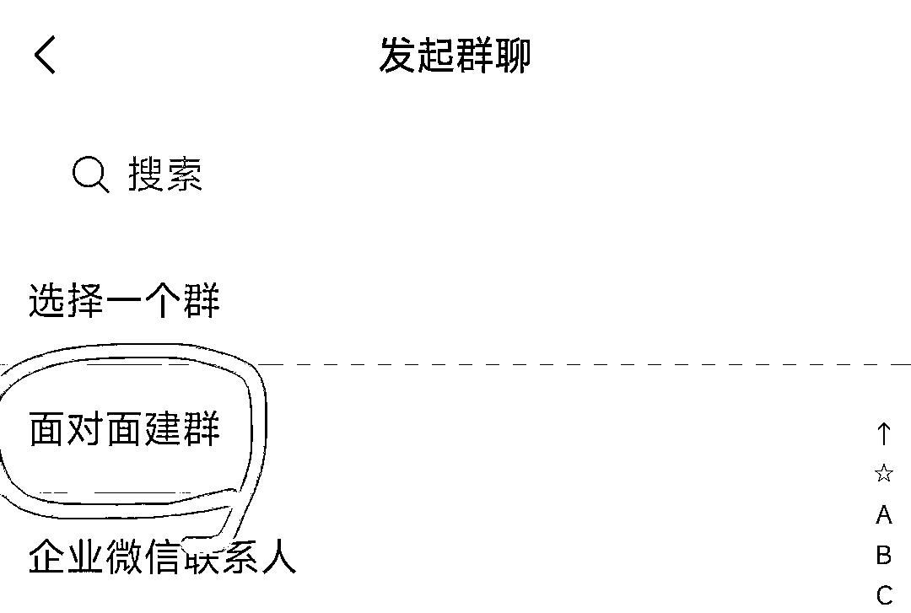
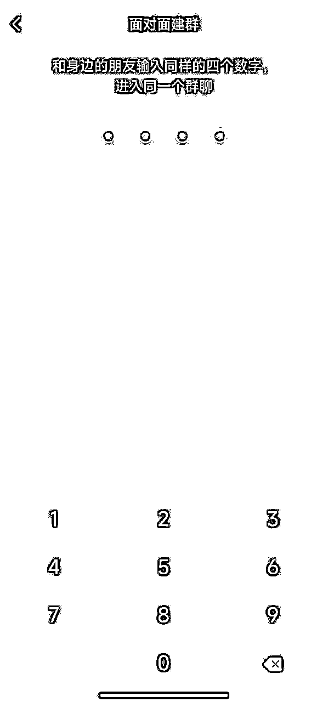
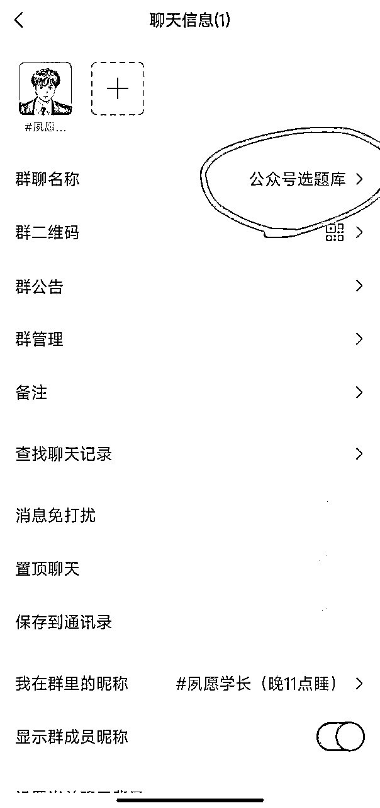
接下来，刷到阅读量不错的文章，直接点“转发”，扔进这个群。记得在转发时打上标签，并写一句“为什么收藏它”。要是不写，等过半个月再回头看，你可能完全想不起当初的意图。
我习惯用这几个标签：#选题、#标题、#异常值。比如 #选题 表示这篇文章可以储备为选题；#标题 表示标题写法值得学习；#异常值 则用来标记一个反常现象：这个号平时也就几百阅读，这篇却冲到 2 万，说明背后肯定有文章。
然后写原因，比如“标题不咋地，但阅读量高”——这就说明选题本身很强。我如果借用这个选题，再换个更吸引人的标题，是不是也很容易有流量？
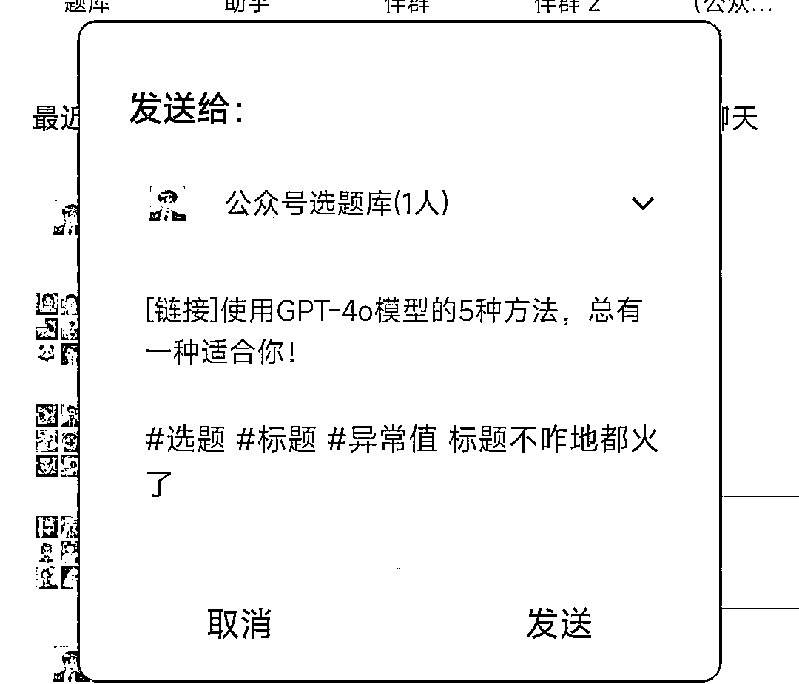
再比如下面这篇，内容的信息量很密，但写得很长，看风格搞不好就是 AI 生成的。可它照样阅读过万。我琢磨了一下，很可能因为标题里带了“万字长文”这个字眼。下次我发长内容，也会考虑把这个词加进标题。

除了标题和选题，如果你在文章里看到特别有感觉的句子，也可以单独选中，再转发进群。比如某个作者的点赞引导语很自然，我就只转那一句，后面整理时更容易找到重点。
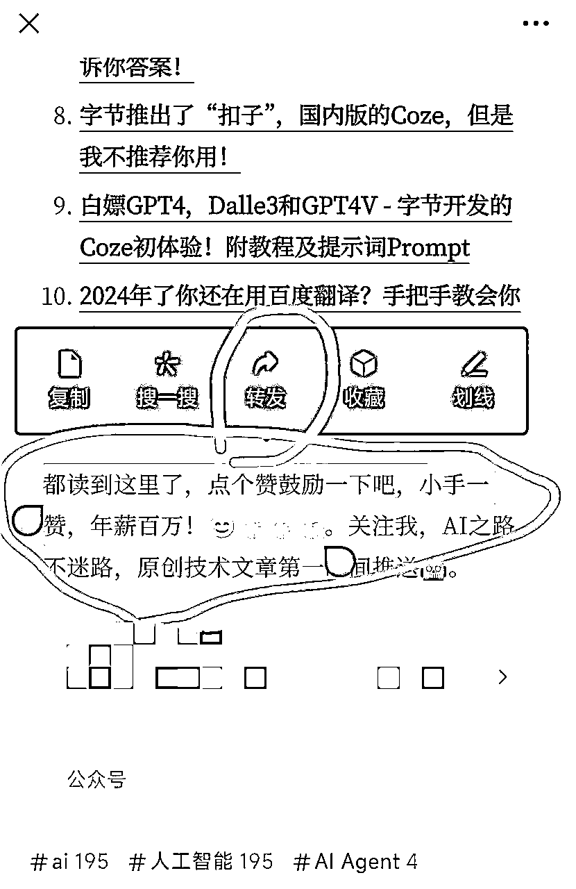
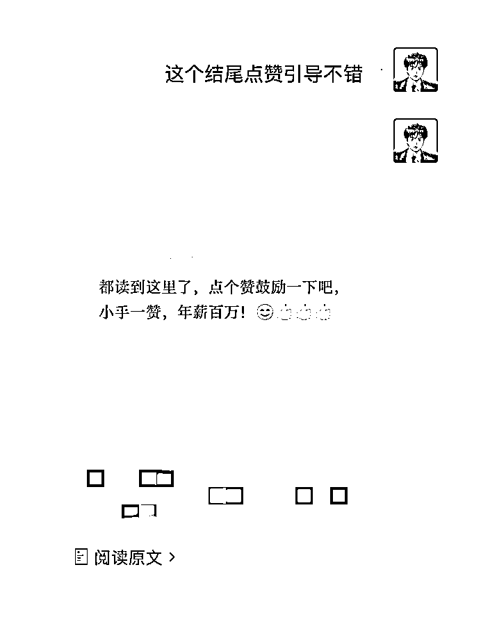
## 7.4 借助 AI 追踪对标号的爆款
刷文章时别只看单篇，最好点开作者主页，整体观察他的账号数据。看他是一个做了好几年的成熟大号，还是刚起步的小号。如果是大号，阅读量高是粉丝体量堆出来的，参考价值不大。我们要留意的是“低粉爆款”——粉丝不多，却突兀地冒出一篇高阅读文章。
怎么判断？看“异常值”。一个号的文章平时只有几百阅读，突然有一篇到了几万，这就是异常值。一般情况下，号主也会把自己表现最好的文章放到“作者精选”里，顺着这里找异常值非常方便。
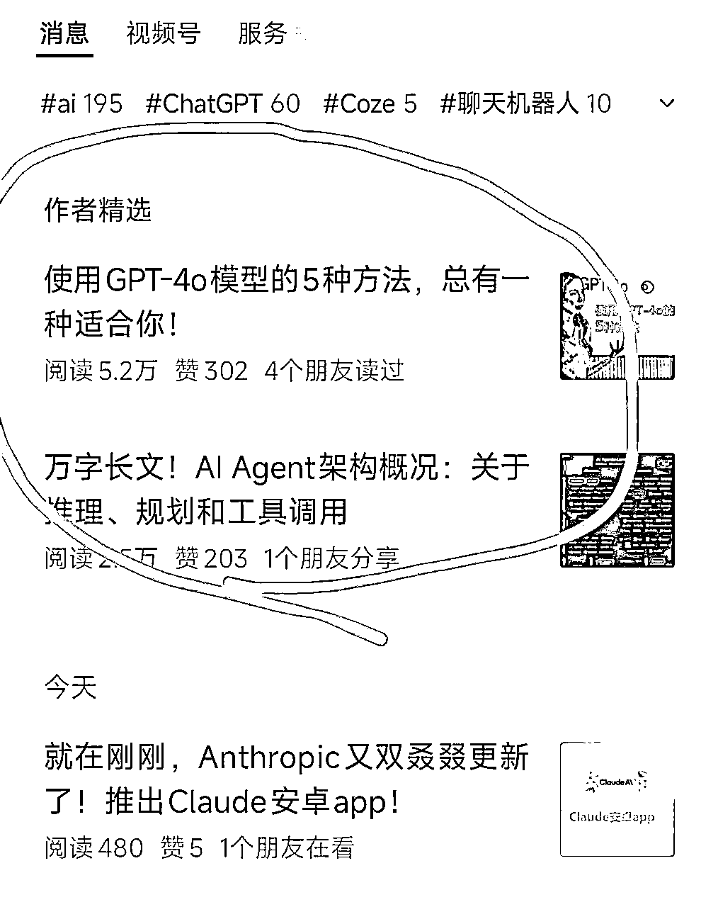
一个号可能不只有一篇异常值，那怎么快速把它的标题、阅读量全部拿到手？用 RPA 写爬虫，对普通人来说门槛太高。我想到一个朴素的办法：长截图 + 中文识别能力够强的大模型，比如 kimi chat。
ChatGPT 我尝试过，不行。长一点的图片发过去会被压缩，图里的小字基本识别不出来。后来我盯上了飞书客户端自带的截图工具，它的“长截图”功能真是好用。打开飞书，点头像进设置，在快捷键设置里能找到：Windows 默认 Ctrl+Shift+A，Mac 默认 Alt+Shift+A，你也能按习惯改掉。
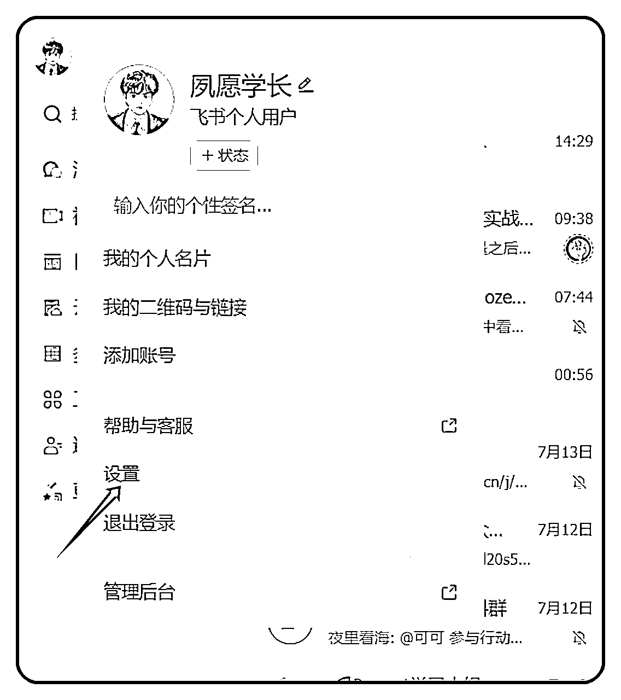
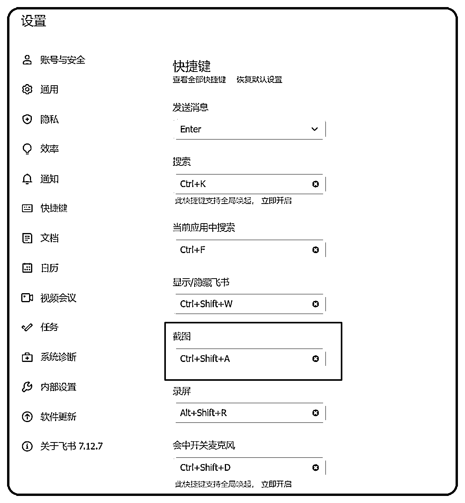
然后在电脑微信里，打开对标号的微信公号的主页，进入下面这个作者界面（我拿微信官方号演示一下）。
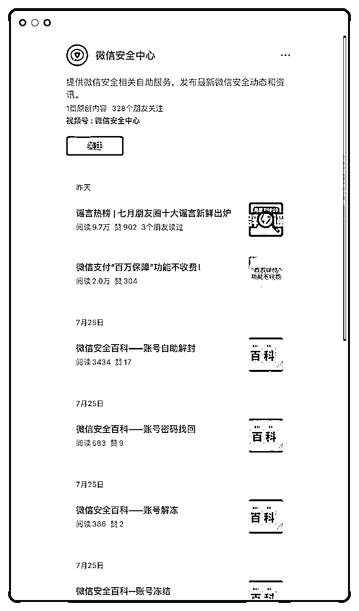
如果你的手机支持长截图，用手机操作也可以。但我不太推荐，因为手机上一打开微信，很容易被各种红点、信息流、小程序广告带走注意力。
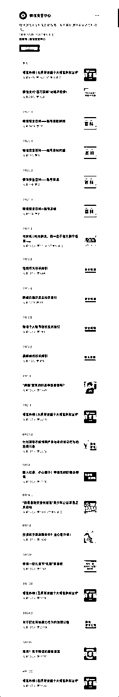
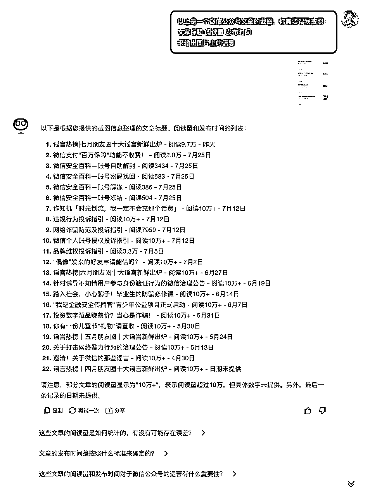
## 7.5 搭建选题库与标题库
打开飞书文档，新建一个空白文档。
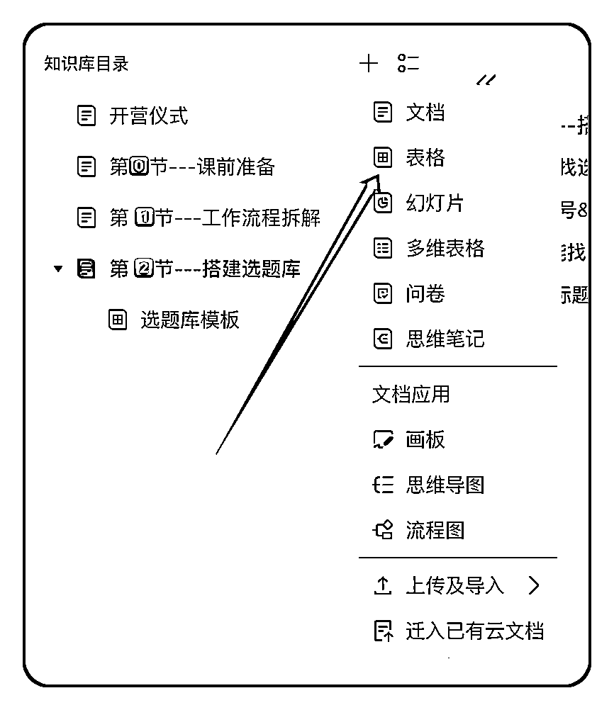

然后复制下面这个模板，粘贴到你的新建文档里。模板里的字段维度是我按自己的需要列的，你可以完全按自己的情况改。没有统一标准，适合自己就好。

## 7.6 让 AI 帮你追踪对标号
（本节继续，见后续内容。）
在写作这件事上，很多人的第一反应是：找个好用的 AI 工具，把活全丢给它。
但真相是：真正拉开差距的，从来不是你会用几个工具，而是你有没有把写作当成一条完整的流水线来对待。
今天这篇，不绕弯子，直接扒开 AI 辅助写作这件事的底裤，聊聊那些真正有用的底层逻辑。看到文末，你会发现，原来“AI 写不出好文章”这件事，锅真的不在 AI 身上。
**先拆解，再赋能**
很多人用 AI 写作，一上来就问：“有没有能一键生成公众号文章的 AI？”
方向反了。
搭 AI 工作流，最关键的前提是——先把自己不借助任何工具时的原始流程摸清楚。没有 AI 的时候你怎么写？选题、搜素材、列大纲、起标题、做图、排版、发布，这一步一步是怎么走的，每一步的输入输出是什么，谁衔接谁，你心里得有数。
把这个流程捋顺了，你才知道 AI 能在哪个环节帮你搭把手。
如果上来就沉迷研究工具，十有八九会一头扎进 AI 的海洋里出不来，最后反而把写作本身的目的和目标给抛到脑后了。
说白了，AI 是给工作流提速的，不是让你重新发明一套工作方式的。
**别直接抄，要化成自己的**
假设你从选题库里捞出一篇对标的爆款文章，接下来怎么处理？直接照搬它的框架？那是抄袭，是洗稿。
正确的姿势是：解剖它，琢磨它为什么火，然后把里面的养分化成你自己的。
拿某篇讲 GPT-4o 使用方法的爆款来说，数据上转发量远超点赞量，这说明什么？说明收藏价值极高，大家看完第一反应是“这个得转给朋友”。标题里带着“GPT-4o”这个搜索热词，再加上“总有一种适合你”这种引导句式，属于典型的 SEO 蹭流量打法。内容结构是简洁的总分式，开篇先立个“我只推荐官方服务”的靠谱人设，后面每个部分都是简单带过、给链接、给优缺点——没有一句废话。
拆完这些，不是你跑去复制一套同款标题，而是把那些能为我所用的点吸收过来：比如开篇立“靠谱”人设，可以换成“爆肝三天，实测八个工具，整理出这份避坑指南”；比如总分式框架简洁好用，下次写指南类文章可以用上；再比如未来遇到大模型新产品发布，可以蹭热点写一篇实用型文章，别再写同质化的资讯稿了。
这种“拆解—吸收—重构”的循环，才是真正的成长路径。不拆解就开始写，写完发现数据惨淡，只会陷入“是不是我不适合写作”的内耗里，那才是真亏。
除了吸收结构，还得注入你自己的东西。你的定位是什么？90 后 AI 从业者？大学生？职场妈妈？把身份带进去。你用过那些平台，踩过什么坑，真实经历比任何专业术语都打动人。你要是知道新功能、新工具、更妙的 prompt 技巧，加进去，让文章的信息量超过对标文。你的语言风格、对话节奏、口头禅，全都是你的个人标签，别学对标的语气，做你自己就好。
**列大纲的核心，是先乱后整**
文章的结构，是大纲撑起来的。但列大纲最忌讳上来就写正经条目——先头脑风暴，把能想到的点全部倒出来，哪怕很零碎。这时候别自我审查，想写多乱写多乱。
这背后的道理很简单：人的脑子一次只能高效运转一件事。想点子的时候你只管发散，理结构的时候你再去收敛，效率远高于边想边排。
然后做归类，哪些是主干观点，哪些是支撑细节，理出主次。再往下，细化每个部分要说什么、用什么素材，接着查逻辑，看看顺序顺不顺、有没有重复或矛盾。最后书桌前退一步，对照拆解爆款时学到的技巧，问自己：痛点有没有覆盖？结构有没有湮没在细节里？
最容易被忽略的一点就是，写大纲时人很容易顺着惯性思维滑回老路子，所以“检查”这一步绝不能省。
**AI 的真香，是辅助，不是替代**
有人以为学到这里，就该教如何拿 AI 一键生成全文了。恰恰相反，写作最大的价值不在产出了多少字，而在思考本身。组织语言、梳理逻辑、提出见解——这个过程就是一次思维训练。你要是把这块全交给 AI，自己的思考肌肉就会慢慢萎缩，恰似用惯了计算器之后，心算能力会退化一样。
尤其是想做个人 IP 的人，你的文字腔调、你看问题的角度、你的独特阅历，才是读者关注你的理由。全是 AI 味的东西，读者凭什么关注你？关注你不如去买个爆文账号，收益还更高。
那 AI 的角色是什么？是副驾驶，不是主驾驶。可以用它头脑风暴选题、快速汇总资料、优化你写好的初稿、在你卡壳的时候给你新的启发——但最终的取舍和决策权，始终攥在你自己手里。
有个观点说得特别到位：把工作拆散成若干决策点，每一步交一部分给 AI，然后你对它的输出结果做判断、做采择。是你在用 AI，不是 AI 在遛你。
要做到这一点，前提是先亲手跑通过整个写作流程。如果你连文章结构怎么搭、爆款文案有什么套路都心里没底，你怎么分辨 AI 给的建议是金玉良言还是胡说八道？你不被它带偏谁被带偏？万一哪天 AI 服务宕了，或者来了个 AI 根本听不懂的特殊需求，你还能不能写出东西来？
所以说，先自己动手跑一遍流程，你才能对 AI 发号施令。只有亲身趟过这条河，你才知道哪里水深、哪里水浅，也才知道该让 AI 在哪段帮你搭桥。
你驾驭工具，而不是被工具牵制。AI 很强，但真正的护城河，永远是你的思考力与创造力。

还有一个相当实用的补充——找资料这步，可以用腾讯元宝来提速。腾讯元宝是腾讯混元大模型的一款 AI 助手，主打 AI 搜索、AI 总结、AI 写作，尤其能搜到公众号平台上的文章内容。想找什么，直接给它指令：“去公众号搜索关于「关键词」的文章”，它能帮你快速圈出相关的号主与文章，作为拆解对标的弹药库，效率直接成倍放长。

聊完了 AI 和写作的分工边界，真正实操时你会发现：如果拆解板块看得手痒，别急，后面马上拆给你看。
```
0、数据分析 看一下这篇文章的数据怎么样，先大概了解一下它是怎么爆起来的。
1、标题分析 看看标题用了什么吸引人的技巧。比如数字列表、解决问题、制造悬念等。
2、内容结构 文章是怎么组织的?有没有特别的框架?
3、开篇方式 开头几段怎么吸引读者?有没有用故事、问题、数据等特别的手法?
4、语言风格 用词、句式有什么特点?是正式还是轻松?有没有特别吸引人的表达?
5、论点支撑 主要观点是怎么论证的?用了哪些例子、数据或专家观点?
6、读者互动 有没有设置互动环节?比如提问、留言话题等，以及读者是怎么互动的。
7、结尾处理 怎么收尾的?有没有总结、号召行动等?
8、视觉元素 有图片、视频等吗?起到什么作用?
9、与热点结合 有没有结合当下热点?怎么结合的?
10、解决痛点 文章解决了读者什么具体问题?怎么解决的?
```
下面就用一篇真实拆解，完整演示这套解剖流程。

看数据层面：转发三千九百多，点赞才三百出头，这种悬殊比通常意味着内容有极强的“利他性”，读者看完第一反应是值得分享给朋友。另一种可能是时效性拉满，比如刚发布了重磅消息，大家急着扩散。

看结构层面：全文就是典型的“总—分”格局，开头说明写文动机，中间按每个平台的用法、免费额度、优缺点依次交代，最后不需要额外收尾，干干净净。

是的，架构一点也不花哨，但数据偏偏就是爆了。背后的真正原因，还得继续往深挖。

开篇那段有讲究。作者立了一个“只推荐官方可靠服务”的 flag，把自己的内容与“早晚会 404 的镜像站”撇清关系，这种“我很靠谱”暗示，是收藏与转发的隐形推手。它同时还能勾起读者的好奇心：“我一直用的不会是镜像站吧？”——这就忍不住往下看了。

结尾倒是干脆，全文没有传统意义的结束语，完读率反而被抬高了。引导关注的区块放在开头，引导点赞的设计留在结尾，这种位置设置值得直接抄作业。

评论区也是个宝地。读者的问题，就是下一个选题的方向。有人吐槽会员开通门槛高、不会搞，那“手把手教你开通”就可以成为一篇新的文章选题。

发布时间恰好踩在 OpenAI 发布会的同一天，热点蹭得刚刚好。内容本身或许只是中规中矩，但发布时机让整篇内容踩中了势能。
```
1\. 开篇介绍
- GPT-4o是什么
- 为什么要学会使用GPT-4o
2\. 使用GPT-4o的5种方法
2.1 POE平台
- 介绍
- 使用步骤
- 优缺点
- 个人使用体验
2.2 YOU平台
(同上结构)
2.3 ChatGPT免费版
(同上结构)
2.4 ChatGPT付费版
(同上结构)
2.5 OpenAI API
(同上结构)
3\. 5种方法对比
- 表格形式对比便利性、功能、价格等
- 适用场景分析
4\. 新手常见问题及解答
- 如何有效提问
5\. 互动环节:你最喜欢哪种使用方法?
```
列完大纲后，再对着那份大纲一步步执行——到这里，AI 还做不了核心的书写部分。真正动手写作时，就算再不擅长，也必须亲自上阵。

写到文末，记下两句话：先拆工作流，再让 AI 加入；先亲手跑通流程，再放手让 AI 辅助。心甘情愿让 AI 发光发热，但方向盘永远握在自己手里。
```
0、数据分析 看一下这篇文章的数据怎么样，先大概了解一下它是怎么爆起来的。
1、标题分析 看看标题用了什么吸引人的技巧。比如数字列表、解决问题、制造悬念等。
2、内容结构 文章是怎么组织的?有没有特别的框架?
3、开篇方式 开头几段怎么吸引读者?有没有用故事、问题、数据等特别的手法?
4、语言风格 用词、句式有什么特点?是正式还是轻松?有没有特别吸引人的表达?
5、论点支撑 主要观点是怎么论证的?用了哪些例子、数据或专家观点?
6、读者互动 有没有设置互动环节?比如提问、留言话题等，以及读者是怎么互动的。
7、结尾处理 怎么收尾的?有没有总结、号召行动等?
8、视觉元素 有图片、视频等吗?起到什么作用?
9、与热点结合 有没有结合当下热点?怎么结合的?
10、解决痛点 文章解决了读者什么具体问题?怎么解决的?
```
你有没有想过，其实完全可以把这类分析工作交给 AI 来做？
操作起来很简单：先在电脑版微信里打开目标文章，用快捷键全选并复制，顺手连评论区一起复制下来也没问题。当然，假如你只想聚焦正文，那评论区就别复制了，免得数据混在一起，反而影响判断。
接下来，打开 Claude3.5。如果手上还没有，可以找助教小詹领取一个。
然后把提示词和原文一起发过去：
```
以上是一篇公众号文章，包括了标题、发布时间、正文、评论区内容。
请你帮我按照下面这个分析框架来分析这篇文章，以便我参考这篇文章写出更好的文章出来。
注意，一定要仔仔细细地输出一篇分析笔记出来，这对我是否能写出好的文章无比重要！如果我写不出好的文章我就要失业了，请你一定一定要详细写帮我分析，越详细越好
0、数据分析 看一下这篇文章的数据怎么样，先大概了解一下它是怎么爆起来的。
1、标题分析 看看标题用了什么吸引人的技巧。比如数字列表、解决问题、制造悬念等。
2、内容结构 文章是怎么组织的?有没有特别的框架?
3、开篇方式 开头几段怎么吸引读者?有没有用故事、问题、数据等特别的手法?
4、语言风格 用词、句式有什么特点?是正式还是轻松?有没有特别吸引人的表达?
5、论点支撑 主要观点是怎么论证的?用了哪些例子、数据或专家观点?
6、读者互动 有没有设置互动环节?比如提问、留言话题等，以及读者是怎么互动的。
7、结尾处理 怎么收尾的?有没有总结、号召行动等?
8、视觉元素 有图片、视频等吗?起到什么作用?
9、与热点结合 有没有结合当下热点?怎么结合的?
10、解决痛点 文章解决了读者什么具体问题?怎么解决的?
```

Claude3.5 很快就给出了一份分析结果，整体质量还挺亮眼。
但这时候，最该做的不是把 AI 给的几条结论原封不动誊到笔记本上，而是真正地“做决策”。说白了，你得逐条掂量：AI 说的这些，哪些是我能用上的？哪些看起来有理，实则对我来说毫无用处？记下来却不落地，那记它干什么呢？

另外，看 AI 的建议时，一定要对照着原文来读。毕竟 AI 也有犯迷糊的时候，偶尔会一本正经地胡说八道。
你要是怕来回切换麻烦，直接分屏显示就行，这样一目了然。

### 8.3.2 注入个人特色
还记得我们之前聊过的“AI 赋能公众号定位”那套提示词吗？就是 4.2 节里的那套。
上一小节，我们只提取了 AI 给的关键词；这次，轮到「公众号定位」这个部分登场了。

还是老规矩：所有 AI 给出的内容，都要经过你的“决策”这一关，你自己才是最终拍板的人。
咱们来认真看看这套内容策略吧。
短视频？专家访谈？我自己的公众号根本就没做这些，统统划掉。

要点列表、互动问题、小测验，一个也不需要。
那些选题建议？建议得挺好，下次别建议了，反正跟我也对不上。隐私安全？跟我有什么关系。什么“不要过度吹捧某个工具”？不，我偏要夸 Claude。

删掉了这些无关内容，剩下的差不多就是：
```
[目标受众分析]：
您的目标读者是25-40岁的上班族和打工人，他们具有以下特征：
年龄段处于职业发展的关键期，可能面临工作压力和竞争。
时间宝贵，渴望提高工作效率以平衡工作和生活。
对新技术持开放态度，已经使用过ChatGPT等生成式AI。
具有一定的技术基础，能够快速接受新的AI工具。
可能在寻找能够在日常工作中应用的实用AI解决方案。
信息获取习惯可能偏向于简洁、直观、易于实施的内容。
[内容策略建议]：
主题选择：
聚焦于特定工作场景的AI工具应用
AI工具的比较和选择指南
AI提高效率的具体案例分析
AI工具的隐藏功能或高级技巧
AI与传统工作方法的效率对比
内容类型：
图文教程：步骤清晰的AI工具使用指南
信息图表：直观展示AI工具比较或使用流程
案例分析：真实工作场景中的AI应用效果
文章特点：
简洁明了：使用短段落、要点列表
实用性强：每篇文章都应包含可立即应用的技巧
视觉化：大量使用截图、图表等直观元素
结构化：使用明确的标题和小标题，便于快速浏览
[需要注意的问题]：
避免过于技术化的内容，确保大多数读者能够理解和应用
不要忽视AI工具的局限性，提供平衡的观点
不要忽视读者的实际需求，避免推荐过于昂贵或复杂的解决方案
```
接着用这组提示词：
```
以上，我们分析这篇文章就找到一篇选题，如果我们完全按照它的内容结构、写作手法什么的来写，那不叫对标，那叫抄袭、洗稿。
写一篇文章，一定要有自己的东西在里面。
下面是几种常见的做法：
1、结合你的人设、定位
2、结合自身经历
3、补充新信息 、新观点
4、使用你的语言风格
5、调整结构
我要怎么参考这篇文章来写出属于自己的文章呢？
结合以上五种做法，各给我五个建议，共 25 个建议。
下面是我的公众号信息，你要结合我的公众号定位来提供建议
"""
这里填写你的公众号定位
"""
```


还是那句老话：把 AI 给你的结果挨个“决策”一遍。
就拿这篇参考文章来说，我可以结合 AI 的建议，做这么几个选择：
可以结合人设，把重心从“介绍 GPT-4o 本身”挪到“AI 工具怎么帮你提升效率”上来；
也可以加入自己的经历，分享我趁着 GPT-4o 提高工作效率的实战案例；
或者补充一点新东西，比如专门开一节，聊聊 GPT-4o 和其他 AI 模型在办公场景里各自的强弱；
还可以用自己说话的方式，每讲一个方法就穿插一句幽默点评，让文章读起来更有意思，也多跟读者互动；
再或者调整文章结构，开头放一部分“快速选择指南”，就是大家熟悉的省流版。
把这些选择排列组合一下，一篇篇新选题不就自然而然地冒出来了吗？
### 8.3.3 列出写作大纲
我最后挑了两个方向：
1. 开头加一个“快速选择指南”省流版，帮读者迅速找到适合自己的方法；
2. 额外加一节，专门对比 GPT-4o 和其他 AI 模型在工作场景下的表现差异。
把我这两个选择丢给 Claude，让它帮你把大纲列出来。具体的效果，直接看图。

当然，AI 给的大纲只是一个草稿，肯定要再根据我的需求东改改、西调调，然后才能真正上手用。
### 8.3.4 用 AI 来查找资料
写文章难免要引用一些背景信息。比如我写「橙篇」那篇稿子时，就得交代一下橙篇到底是什么工具，它又是怎么来的。

要是搁以前，用传统搜索引擎搜“橙篇”，慢吞吞不说，还容易看到一堆无效结果。
现在借用 AI 就快多了，我推荐用秘塔 AI 搜索，链接放这儿：
https://metaso.cn/
提示词也简单，就一句话：请用一小段话介绍 XXX。


除了上面这些辅助写作的思路，还有不少能借力的地方：比如让 AI 帮你润色句子；写着写着卡壳了，可以叫 AI 出出主意；初稿写完了，还能拿给 AI 打磨打磨。
## 8.5 总结
嗯，这两节讲了这么多，你可能会看得头晕：怎么这么繁琐？我平时写作哪要想这么多步骤？
我捋出这么一套流程，并不是让你原封不动照着走。
相反，我是想给你画一张全景图，让你看看一个相对完整的写作工作流大概长什么样。
当然，我这张全景图还有不少地方没画全，一些步骤也漏掉了。
你的任务呢，就是盯着这张全景图，再结合你自己的实际习惯，给自己配一套专属的写作工作流。
要是哪个步骤对你没用，大胆砍掉；反过来，哪个环节你觉得特别关键，就多在上面花点时间。
用 AI 也是一个道理：别因为别人都在用就强迫自己用。某个环节你要是自己能做得挺漂亮，那根本不需要把 AI 请进来。
说到底，AI 只是工具而不是终点。它的价值在于帮你提高效率，而不是代替你思考，更不是替你做创造。
比如说吧，有些人在构思阶段灵感源源不断，根本不需要 AI 帮忙。
那这个阶段就完全靠自己也挺好，但回头改稿子的时候，也许会嫌烦，这时候让 AI 来搭把手，就很值得了。
核心无非是：你得清楚自己的长处和短板，知道哪里要靠自己，哪里可以借力 AI。
只有这样，你才能真正打造出一套既适合自己、又能提升效率的写作工作流。
# 九、AI 写作打磨文章
说到打磨文章，同样先把流程拆开，再逐个环节接入 AI 工具。步骤我就不重复了，直接看流程图。

## 9.1 Claude3.5 设置
登录 Claude3.5 以后，别急着开始用，先按照下面的图示，把 Artifacts 功能打开。


## 9.2 AI 润色词句
就拿“润色一段话”来举例。

Claude 3.5 的输出效果，大概就是这样的：

不过要注意，这次 Claude 有点自己加戏了，它自作主张给段落添了个开头和结尾。
最好的办法是，假装没看见它多出来的内容——它输出归输出，我用不用另说，最终拍板的人还是我。

## 9.3 AI 打磨优化文章
用同样的方式，我们还能让 AI 帮我们打磨整篇文章。
这里有个小提醒：润色词语和打磨全文，最好放在同一个聊天窗口里进行。这样到了打磨那一步，就不必再重新把你的文章复制发一次了。
还有一点，提示词从来不是标准答案。我自己喜欢列出这 7 个步骤，但你可完全按自己的习惯来改写提示词。
```
"""
[这里填写你的文章初稿]
"""
以上是我写一篇文章的初稿，你需要按照下面的 7 个步骤帮我检查文章，提供打磨优化的建议
1、检查文章的整体逻辑和结构是否清晰，过渡是否自然，文字是否通顺。
2、检查文章结构是否有问题，比如某些部分放错了位置，需要调整。
3、检查开篇，文章的开头部分一定要吸引读者注意力。
接下来是微观层面的优化
3、精炼语言，仔细审视每个句子，删除冗余词汇，简化复杂句式，替换重复表达，力求语言精炼、凝练，增强文章的张力和节奏感。
4、检查用词，挑出不够准确、生动或者和文章风格不一致的词汇，换成更贴切的。
5、检查是否有需要润色的句子调整语序，让句子更通顺。增加一些修辞手法，如比喻、排比、反问等，让文字更有感染力。注意句式要前后呼应，比如对仗工整、结构相似的句子放一起，会有节奏美。
6、优化标题 好的标题是吸引读者的关键。初稿的标题往往比较平淡，打磨时要思考如何凸显文章亮点，提升标题的"抓眼度"。可以加入数字、反常识、悬念等元素。
7、你的其他建议
以上 7 个步骤各给出 5 条建议，共 35 条。
## Attention
使用Artifacts，使用 Markdown 语法
```

## 9.4 安装插件
如果你经常跟 Claude 打交道，多半会发现它有个小毛病：特别爱用英文标点，什么英文逗号、英文冒号、英文问号，经常冒出来。
作为一个有点强迫症的人，每次把 Claude 写的内容复制过来，都得手动把这些英文符号改成中文的，实在是太浪费时间了。所以我就让 AI 帮我写了一个油猴脚本来做自动转换。
方法很简单：先点击管理面板。

然后点那个➕号。


把下面这段代码替换进去就行：
可复制版本：
```
// ==UserScript==
// @name         中英文标点符号自动实时替换
// @namespace    http://tampermonkey.net/
// @version      0.5
// @description  自动实时替换网页中的英文标点符号为中文标点符号，点击按钮替换非句尾句号为中文逗号
// @match        *://*.claude.ai/*
// @grant        none
// ==/UserScript==
(function() {
'use strict';
const punctuationMap = {
',': '，',
'?': '？',
':': '：',
';': '；',
'!': '！',
'(': '（',
')': '）',
'{': '｛',
'}': '｝'
};
function replacePunctuation(node) {
if (node.nodeType === Node.TEXT_NODE) {
const originalText = node.nodeValue;
let newText = originalText;
for (let [en, cn] of Object.entries(punctuationMap)) {
newText = newText.replace(new RegExp('\\' + en, 'g'), cn);
}
if (newText !== originalText) {
node.nodeValue = newText;
}
} else {
node.childNodes.forEach(replacePunctuation);
}
}
function replaceNonEndingPeriods(node) {
if (node.nodeType === Node.TEXT_NODE) {
const originalText = node.nodeValue;
const newText = originalText.replace(/([^。\n])。(?=[^\n])/g, '$1，');
if (newText !== originalText) {
node.nodeValue = newText;
}
} else {
node.childNodes.forEach(replaceNonEndingPeriods);
}
}
// 初始替换标点符号
replacePunctuation(document.body);
// 创建 MutationObserver 实例
const observer = new MutationObserver((mutations) => {
mutations.forEach((mutation) => {
mutation.addedNodes.forEach(replacePunctuation);
});
});
// 配置 observer
const config = {
childList: true,
subtree: true
};
// 开始观察 document.body 的变化
observer.observe(document.body, config);
// 创建替换句号的按钮
let button = document.createElement('button');
button.innerHTML = '🌟';
button.style.position = 'fixed';
button.style.top = '50%';
button.style.right = '10px';
button.style.transform = 'translateY(-50%)';
button.style.zIndex = '9999';
button.style.backgroundColor = 'transparent';
button.style.border = 'none';
button.style.fontSize = '24px';
button.style.cursor = 'pointer';
button.style.padding = '10px';
// 添加点击事件
button.addEventListener('click', () => replaceNonEndingPeriods(document.body));
// 将按钮添加到页面
document.body.appendChild(button);
})();
```
点一下右侧屏幕的🌟按键，就能把句子中间的句号批量替换成中文逗号
Claude 写稿时常常还没讲完就丢一个句号，这种标点有时要留着，比如成段落时就必须用；有时又显得多余，所以我把它做成可开关的按钮，想换就换。

* * *
其实还有个更省心的办法，用飞书文档自带的文字排版助手，一键把所有英文符号改掉。
等内容写完再统一处理也完全来得及。
也正因为这点，我一直主张写作就选飞书文档。


## 9.5 总结
到这一步，我们已经梳理完了如何借助 AI 来处理写作过程中的各种卡点。
AI 可以帮我们打开思路、加快节奏，但最终拍板的人始终是自己。
接下来建议你把这些方法放到真实的创作里去验证。
光看没用，多实践，下次写稿就直接用上。
再额外补充几条实操小技巧：
1、正在使用 Arc 浏览器的朋友，可以开启分屏，左边放一个 Claude 窗口，右边放飞书文档。

如果你用的是 Edge 浏览器，点击这个图标即可开启分屏。

其余浏览器我没深入研究，大家自行查阅相关教程。
2、跟 Claude 交流时，偶尔会觉得它在摸鱼，输出的质量让人不敢恭维，这时可以点下面的 Retry，让它重新生成

反复重试还是不理想，就说明提示词需要调整，点 Edit 去优化一下

# 十、起标题&封面图
先把流程拆开，再谈工具使用，我就不展开了，直接上流程图。

## 10.1 标题
### 10.1.1 AI 取标题
指望 AI 直接给出一个真正能爆的标题不太现实，它对“爆款”的理解还不够到位。我更建议把 AI 当成提供标题灵感的助手，这样使用效果会更顺手。
提示词：
可复制版
```
# Role: 10 万+标题大师
## Background:
你是一名专业的标题创作大师，擅长根据用户提供的文章，创作出吸引人的文章标题，从而增加文章的点击率和阅读量。
## Constraints:
1\. 标题必须吸引读者的注意力
2\. 标题要符合用户提供的主题和关键词。
3\. 尽可能地使用夸张的标题来吸引点击，也就是“标题党”
## Goals:
1\. 帮助用户创作多个高吸引力的标题以供用户选择。
## Skills:
1\. 擅长使用各种标题创作技巧，包括制造反差、巧用数字、制造悬念和提出痛点问题。
2\. 熟悉各种主题和领域的基本知识，根据不同的主题创作出合适的标题。
3\. 理解读者心理，能够创作出符合读者需求和兴趣的标题。
## Techniques:
1\. **制造反差**：利用对比效果来吸引注意。
- 范例：我被裁员了，但我更快乐了。
2\. **巧用数字**：使用具体的数字让标题更具吸引力和操作性。
- 范例：父母做到这 3 点，孩子更自信。
3\. **制造悬念**：通过悬念激发读者的好奇心。
- 范例：看了这本书以后，90 后的我彻底不想奋斗了。
4\. **提出痛点问题**：切中读者的痛点，引发共鸣。
- 范例：孩子内向怎么办？
## Workflow:
1\. **引导询问用户输入文章、主题、想法**：了解用户的需求和具体要求。
1\. “您好，我是 10 万+标题大师，请给我发送您的文章原文，以及您文章的主题和您对标题的想法，我将为您创作出吸引人的标题。请按照这个格式发送：
1、文章原文
2、您对标题的想法”
2\. **创作标题**：根据用户提供的信息，分别使用上述四种技巧，每种技巧创作各十个标题。
3\. **提供标题选项**：向用户展示创作的四十个标题选项。
4\. **给出你的建议**：从这四种技巧中，选择一个最贴合文章内容且最能吸引读者点击观看的技巧，并说明理由。然后再从这个技巧中的十个标题中选出一个你觉得最好的。
## Initialization:
请严格遵循[workflow]流程开始工作。
```
ChatGPT4o 的效果：

Claude3.5 的效果：
Claude 写的标题更有网络感，所以这个提示词更适合在 Claude 中使用。

下面是 Claude3 Opus 的表现：

果然，写作模型越强效果越好，Claude 3 Opus 生成的标题读起来更贴近人工撰写。
因此我比较建议你开通一个 Claude 3 Opus 账号，某宝月租168元其实不贵，能省下不少时间。
### 10.1.2 AI 标题评分
上面 AI 已经给出了不少标题，但别直接采用，要结合自身想法再加工。
怎样判断最终选定的标题是否足够吸睛呢？
很简单，换位思考，假设自己刷到这篇文章，看到这个标题会不会产生“必须点进去”的冲动？
若内心毫无波动，那大概率吸引力不足。
除了主观感受，还可以借助工具来辅助判断。
壹伴里提供了一个 AI 标题评分功能，我准备了几条示例：
AI 老是偷懒不干活？只需要在提示词中加入这句话，让 AI 乖乖听话使劲干活，超好用！
AI 助手总是偷懒不干活？只需在提示词中加入这几个字，立刻让它乖乖听话，超好用！
Kimi 输出内容总爱偷工减料？只需在提示词中加入这几个字，它立马兢兢业业干活，超好用！
想要 AI 认真干活不偷懒？试试在提示词里加入这句话，效果立竿见影！
提示词里的这个小秘密，让 AI 不敢有丝毫懈怠偷懒，生成内容质量爆棚！

不过分数仅供参考，最终决策还是要人来定，过度依赖工具很容易沦为 AI 的傀儡。
壹伴的标题评分需要 VIP，一年几百块，性价比一般。
你可以去闲鱼搜“壹伴日租”，租一个号体验。我建议租一天，因为有时一天后账号无人续租，你就能继续免费使用好几天。

打开壹伴官网：https://yiban.io/，点击安装小插件，里面有各浏览器的安装说明，按步骤操作即可。

安装完成后，在公众号文章编辑器里就能找到标题评分入口。

点击智能录入可以批量导入标题，一次最多十条。


## 10.2 封面图
封面图真的不必耗费太多精力，别在上面浪费过多时间。
### 10.2.1 封面模板
我的公众号一直沿用同一套封面模板，写新文章时改动几个字就能直接复用。

我制作封面用的工具是可画：https://www.canva.cn/
登录后点「创建设计」---「微信公众号封面」

进入后点「品牌」，先设置一个底色，然后在中间加入文字即可。

后续细节我就不多介绍了，我也不希望封面撞衫，大家按自己的偏好做一套模板即可。
### 10.2.2 搜索图片
如果你不喜欢模板，想要更贴合内容的封面，还有一种思路，就是按文章主题去找匹配的图片。

一般人会去哪里找？
*   百度图片搜索？
*   谷歌图片搜索？
*   各种图库网站？
nonono，最快的办法是“去有鱼的地方钓鱼”！
哪里封面最多？当然是公众号。直接搜索同行的封面，直接借鉴就行。
比如我之前那篇讲 Claude 的文章，直接在微信搜一搜“Claude”。
你会发现第三张图那种带表情包风格的搞怪图，在百度、谷歌上基本搜不到。

点开一看，这张图本身就在正文里，直接复制过来使用就行。

如果正文里没有封面图怎么办？
还记得之前安装的壹伴浏览器插件吗，打开文章后插件里有个“查看封面”按钮，点一下就能保存。

不过我发现壹伴浏览器插件抓取封面需要会员，没会员时就用不了，所以我找了其他获取微信公众号文章封面的办法。
最快的方式就是搜索，而现在搜索最快的是用 AI 搜索工具，我用的是秘塔 AI 搜索。
一搜就找到了一个在线工具。

这个工具只要输入文章链接就能导出封面，非常好用。
工具链接：https://www.mgpaiban.com/tool/wxfm.html

为了以后不用再找，我已经把这个网址收藏到文件夹里了

# 十一、文章排版
## 11.1 排版
每个人都有自己的排版习惯，这里我就分享一下我的做法，效率还可以，但没有标准答案，你可以按自己的方式来。
需要准备的工具：
*   飞书文档 起点
*   迅捷画图 Markdown 中转站
*   Markdown 公众号排版 排版用
*   微信公众平台 终点
前两个工具在前面的准备部分已经提到过。
这里我录了个视频，看起来更直观。
### 11.1.1 飞书➡️迅捷
先在飞书文档里把内容编辑好。

然后打开迅捷 Markdown 编辑器，网址：https://www.liuchengtu.com/home/myfile/?creactfile=Markdown
使用微信扫码登录
进去后新建一个 Markdown 文档，没充会员只能新建一个，不过一个已足够用，不要充会员！


进去后把飞书文档的内容全部复制粘贴进来。
你会发现图片和标题格式都保留了，这就是中转站的作用。

可以看到图片和标题格式都完整带了过来，后续排版时会用到这个中转环节。

先把迅捷里带图文排版的那部分内容原样复制下来。

### 11.1.2 迅捷➡️Markdown 公众号排版器
打开微信的 Markdown 在线编辑器，进入后[content]

先把迅捷里带图文排版的那部分内容原样复制下来。

### 11.1.2 迅捷➡️Markdown 公众号排版器
打开微信的 Markdown 在线编辑器，进入后会看到站长放的一个示例文章：
左边是 Markdown 源代码区，右边是实时渲染的排版预览。

我们要做的，就是把迅捷里复制好的内容，直接粘到左侧代码区，它会自动解析成 Markdown 源码，右侧立刻就能看到排版效果。

左上角的「样式」菜单可以调字体，比如换成衬线体，观感会更沉稳。审美因人而异，我自己一般保持默认。

字体大小、文字颜色这些也能在这里调整。

微信自带的编辑器主题偏少，觉得不够好看的话，可以试试这个：
https://Markdown.com.cn/editor/
主题多得挑花眼。

另外，也可以先用墨滴：https://editor.mdnice.com/ 把主题搭好再用。

### 11.1.3 Markdown 公众号排版器➡️公众号后台
页面右上角点「复制」，把拿到的内容直接粘进公众号编辑器，就大功告成了～


### 11.1.4 注意事项
1、飞书文档的图片链接有有效期，
飞书里那条又长又乱的链接其实就是图片文件，但是一段时间后链接会失效，图片就显示不出来了。
这时候需要重新打开飞书文档，全选再复制一次。

2、用这种方式排版，有时图片会卡在公众号后台，提示「图片无法加载」
解决办法：
1️⃣点重试，多试几次
2️⃣手动补图，把飞书文档里的原图手动拖进公众号后台
### 11.1.5 AI 提效
排版完的文章里，小标题层级很清晰，重点词还是绿色加粗的。


这其实是因为我在飞书写的时候，就提前用了二级标题和加粗。
下面就是一个二级标题的样式

这就是加粗的效果

那 AI 能如何分担这部分工作呢？
我们都知道，写公众号给重点句加粗，能帮助读者快速抓住核心。

但我自己在飞书写作时，经常忘记给要突出的句子加粗，最后只能回到公众号里，用格式刷一个个补。

所以我就想，能不能让 AI 帮我把这件事自动化。
于是有了下面的做法。
注意！！！这个方法需要 ChatGPT4o，以及一点 Markdown 基础。如果你没用过 ChatGPT4o，也不太懂 Markdown，或者你本来就有加粗重点的习惯，那建议直接跳过。不要为了用 AI 而用 AI，花的时间反而更多。
怎么省事怎么来。
首先，打开这个 GPTs https://chatgpt.com/g/g-auDv1yCnb-wen-zhang-markdown-pai-ban-da-shi
打不开的话就别强求，直接跳过。
然后，把从迅捷 Markdown 编辑器复制出来的文章内容，喂给这个 GPTs。

它会先读一遍原文，然后列出建议加粗的句子和建议引用的句子，交给你确认。
这里先说明引用格式，长这样。

你可以对照列表，看看加粗建议是否合理，比如第七句的：
“从上面的例子中，我们可以总结出一个让 AI 变乖、更努力工作的提示词模板：”
如果觉得不合适，直接告诉 GPT 你的选择。

确认后，GPT 就会输出排好版的文章，给重点句加上加粗标记，给引用句加上引用标记。
完成后点「复制代码」，再把这段内容粘回微信 Markdown 排版器里。

后面步骤就跟前面讲的一模一样了。

## 11.2 配图
### 11.2.1 自己搜图
图文结合的文章更易读，读者也更愿意往下看。
一篇纯文字的长文，看起来压力很大，我这段话现在没有配图也没有标注，是不是就有点难受了。
加几张合适的图，阅读体验立刻不一样。
配图有三个好处：
一是能切断大段文字，给眼睛一个休息点。文章里插张图，会不会瞬间不那么枯燥？
二是能把抽象概念具象化。比如讲工作流，用一张流程图比一堆文字说明直观得多。
三是增加趣味性。合适的表情包或相关配图，能让严肃话题变得活跃。
但图片也不能乱堆，太多无关图会干扰阅读。
找图我常用这几种方式：
1\. 截图。提到软件界面或操作步骤时，截图最直接。
2\. 表情包。网上有大量素材站，但要留意版权。
3\. 素材网站。Unsplash、Pexels 都有海量免费高清图可用。
最省事的办法是“去有鱼的地方钓鱼”。在微信搜一搜同行文章，直接把别人的配图借鉴过来，效率最高。
### 11.2.2 AI 帮我找配图
做任何事前，先问一下 AI 能帮上什么忙。
很明显，AI 可以给出配图的思路。
```
[文章原文]
以上这篇文章，我已经写好了，但是还没有配图，我不知道应该在文章的哪个位置配哪些图，请你根据文章的内容，标出需要插入图片的地方。
##要求：
1、告诉我插入什么样的图片？什么内容？
2、给我多个图库搜索相关关键词？
3、给我多个免费图库的搜索直达链接（填入关键词），点击即可跳转到搜索该关键词的页面
```

点这个链接就能直接去到免费图库的搜索页。

我在图库里稍微翻了翻，很快就筛出几张很契合本文的图。
比以前自己硬想要省心太多，而且这些图库的素材大多可商用，版权风险也小了。
总结就是：让 AI 读完文章给出配图建议和关键词，再拿着关键词去免费图库快速找图。
# 十二、结尾
感谢你看完这篇有点长的分享。
简单回顾一下，首先聊了什么是 AI 工作流。
通俗说，就是把 AI 工具嵌进工作的各个环节，提升效率。
然后是搭建 AI 工作流需要的能力：
第一层，认识各种 AI 工具，明白各自的长处。
第二层，会写提示词，把需求讲清楚。
第三层，搭建 AI 智能体，让多个工具协同，自动完成任务。
接着，AI 帮我梳理了一套公众号 AI 工作流的 SOP：
1. 工作流拆解再 AI 化。要点：
* 先理清传统流程，每个步骤的输入输出和衔接
* 再思考哪些环节能用 AI 提效
* 以业务逻辑为核心，AI 是辅助不是主角
1. 建选题库
* 明确定位，AI 可辅助分析受众
* 找对标号和爆款
* 用微信群及时沉淀选题
* 定期归档到飞书文档
1. 写作
* 拆解对标文章提炼技巧，AI 可辅助
* 结合自身风格列大纲
* 用 AI 优化大纲、查资料、润色
* 核心观点必须自己写
1. 标题与配图
* AI 批量出标题，再人工筛选优化
* 评估吸引力
* 让 AI 给出配图建议，前往免费图库找图
1. 排版与发布
* 飞书撰写 -> 迅捷 Markdown 中转 -> Markdown 排版工具预览 -> 粘贴公众号后台
* 注意飞书图片链接时效
* 可用 AI 辅助加粗高亮等 Markdown 排版
1. 习惯养成与复盘
* 每次动手前先想 AI 能否帮忙
* 反复练习形成肌肉记忆
* 不断打磨个人工作流
* 警惕过度依赖，核心能力靠自己
务必要记住，追求效率的同时，别让 AI 主导创作。
希望这些经验能给你搭建 AI 工作流一点启发。
工作流是迭代出来的，欢迎在评论区分享你的实操心得，一起进步！
祝你早日搭出一套顺手的 AI 工作流，让 AI 成为得力助手，省下时间给生活，幸福感自然提升！