# AI 成为创作副驾后，我的内容生产力发生了什么变化
作者：龙哥

# 开篇

小时候听过一个关于沙漠的寓言。旅人苦寻绿洲，眼看在望却发现是海市蜃楼。随即出现的天使告诉他，你所见的或许不真，但你的每一步都在让沙漠生花。

我对写作的感受很像这段故事。真正的高光时刻是进入心流时，思绪会自行绽放。如今强大的生成式模型正扮演那位天使，在思维的荒原里指引新方向。它成了我的Copilot，和我一起探索内容的新形态。

超级个体创作的窗口正在打开。

这一切加速的起点是今年7月11日的Claude 2。我亲自试用后，把它深嵌进日常工作流，效率直接跃迁。

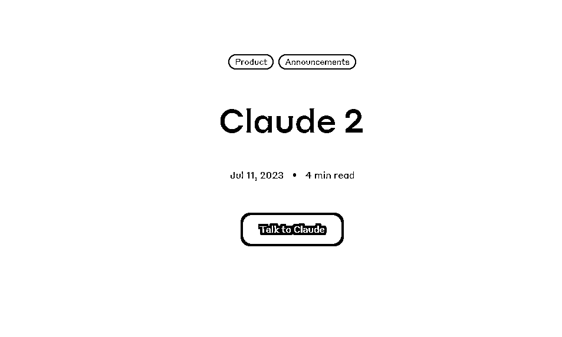

把模型用熟，就能拿到远超预期的红利。接下来用几组实操，说明我如何把Claude打造成内容生产的利器。

看完你会清楚：

💡 为什么首选Claude

💡 如何与模型形成闭环式的浸入写作

💡 模型怎样从海量素材里抽规律，反哺创作

💡 个人产能为何出现质变

💡 人类定大方向，模型负责执行，共同进入新创作周期

# 01 Claude 的优势在哪里

我会向人推荐它，基于下面这些感受：

第一.目前完全免费，性价比极高。注意，后续已开始限额。

第二.上下文与生成上限处于第一梯队。现在100K窗口，相当于一次喂入几百页资料。

第三.文件接入很宽松，一次可传5个文件，每个10MB，PDF、Docx、TXT、CSV、MD、ini都能识别，连字幕.srt也支持。

第二、第三点意味着批量文档分析成为现实，后面案例会展开。

第四.评测分数很高，仅次于GPT-4

在LMSYS的对话模型榜单中排名第二，排在GPT-4之后。

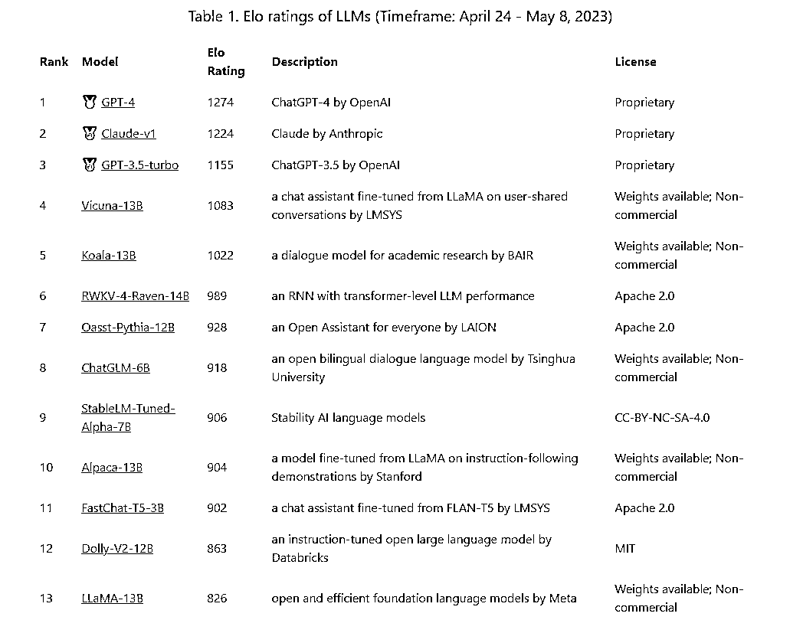

换句话说综合能力很强，和ChatGPT基本同级，只比GPT-4略有差距。

第五.具备自适应。每一次交互都在让它更懂我的偏好。

第六.配合手感特别好

这是最主观也最重要的两点：

1.  之前用Bing，响应拖沓。Claude的回写速度快很多，丢一个需求进去几秒就有可用草稿。

2.  文风偏稳健，推理更严密，和我的写作习惯高度重合。

综合判断，目前它是我认为最适配长文写作的外部助手。

# 02 以人为核心，模型当执行伙伴

先讲我的写作背景。我长期产出5k-1w字的深度稿件，对结构骨架和细节填充要求很高。

我也尝试过组建社群求碰撞，结果不理想。成员偏小众，发言难起来，火花感弱。

Claude出现后，我明显进入状态。过去写深度稿靠长时间沉淀提升理解，但自身体系已堆到21个方法后，个人层面触顶。下一步需要外部刺激。

我轮流对比过Bing、ChatGPT，最后Claude 2最合拍。

让我迅速进入状态的三点：

1.  反馈极快，秒级响应，随时能展开对话。

2.  风格契合，严谨且逻辑清晰，返回的内容基本可直接改写植入。

3.  使用越久越默契，我已清楚哪类提问能得到好结果。

我负责创意与总控，模型负责高质量落地。

从过去的单打独斗，到现在身边常驻一个高智商且执行力强的搭档，这种交流感非常爽。心流也由此被点燃。

# 03 用Claude完成深度长文的打法

我曾写过《Bing+GPT，打造全新的搜索体验》。这次流程重新梳理后，变成下面这套：

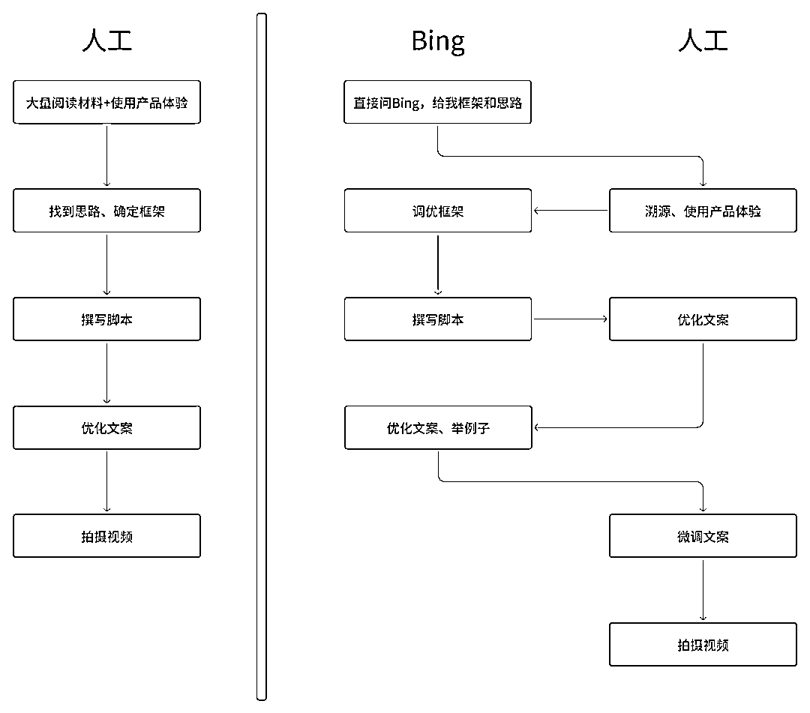

以产品分析为例，节奏大致如下：

1. 先做产品体验。不上手写的东西都是空谈。

2. 让Claude先出提纲。质量不一定惊艳，但常会蹦出几个意料外的小点。

3. 我结合自有的21套方法，对提纲做第一次重构。

4. 再把重构后的提纲放回去，请它以资深产品经理视角给建议，形成二次确认。

5. 分章节动笔。核心架构我来定，网上抄不到的独家视角必须自己写。

6. 卡壳时让它抛灵感。遇到展开困难的段落，让它提供思路。

7. 按大纲把主体填满。

8. 结构复盘。让Claude审稿，它会指出重复、主线模糊等问题，我择优采纳。

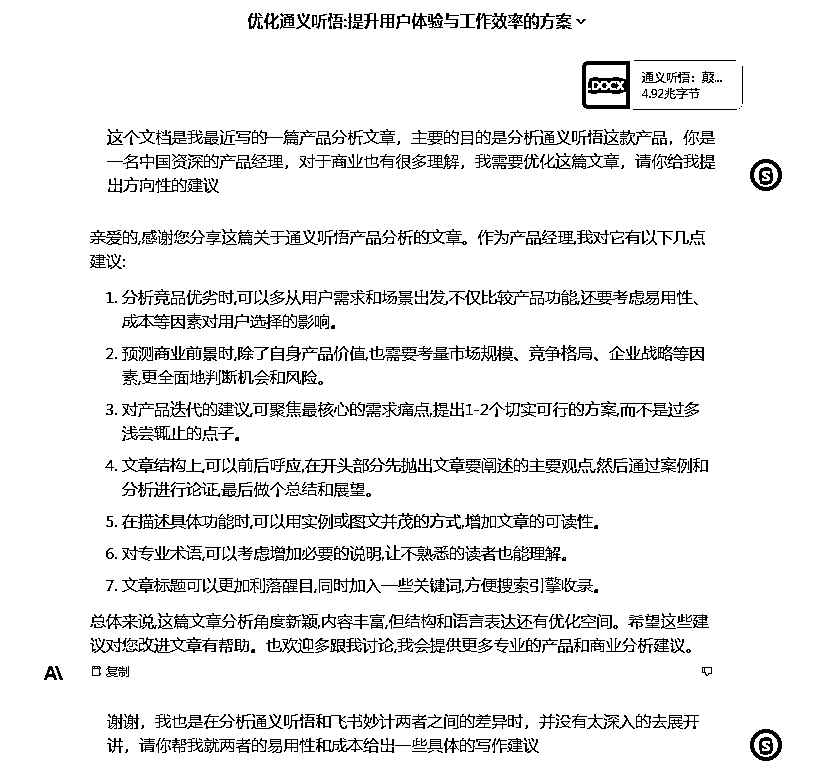

9. 主体再调整。该删就删，该重写就重写，这一步基本收敛。

10. 开头结尾外包。主体导出后，让它基于内容写开头与结尾，开头抓人，结尾有余味。

11. 开头结尾再人工润色，通常需要手动调。

12. 标题批量生成。把正文给它，让它产出吸睛标题。

13. 标题人工筛选，结合经验微调。

14. 文风举例微调，可在结构建议时同步处理。

15. 全文通读，排查问题。

16. 发布。

这套机制是人机嵌套。模型负责点子与优化方向，我掌控主线。并非每个环节都要走，我以自身判断为先，觉得够了就跳过。

让模型协同并不会稀释思考，反而是加成。对优质内容的尊重，就是我主导、模型配合。

# 04 从深度长文到爆款笔记

上面讲的是5k+长文，1k-2k的轻量稿件同样适用。

年初我和两位朋友做过一个小红书小号，一个月涨到1800粉。现在想重启，如何把已有深度图文快速拆成笔记？

Claude同样能胜任。

第一步，请它提炼笔记正文：

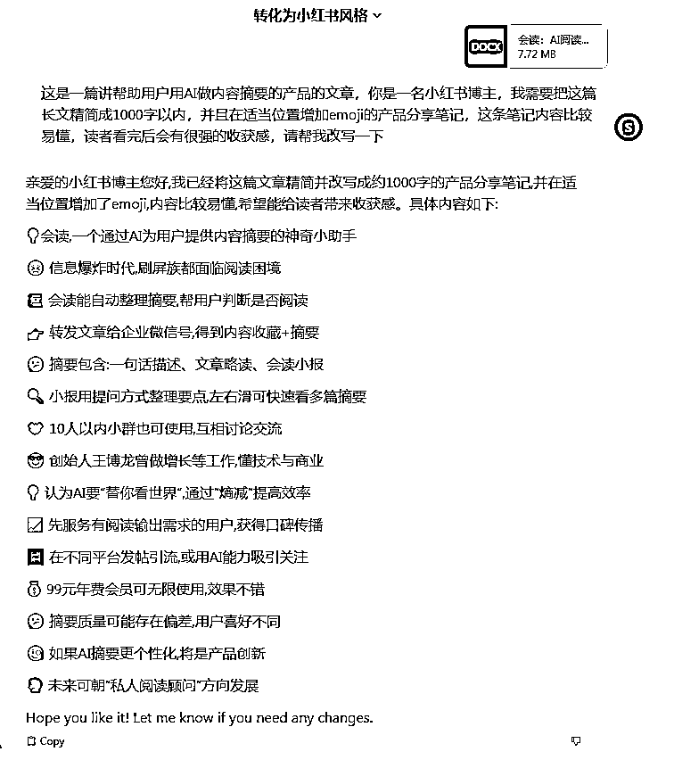

第二步，让它拆成若干张产品介绍图与若干张产品分析图：

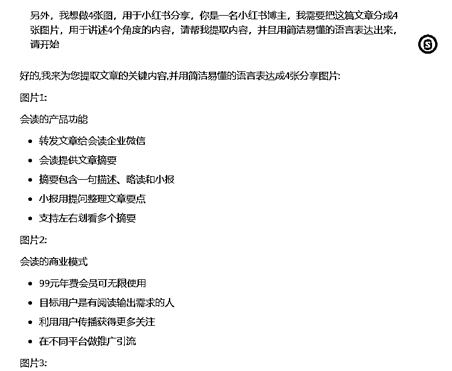

结合你自己的视觉模板，很容易做出多图笔记。

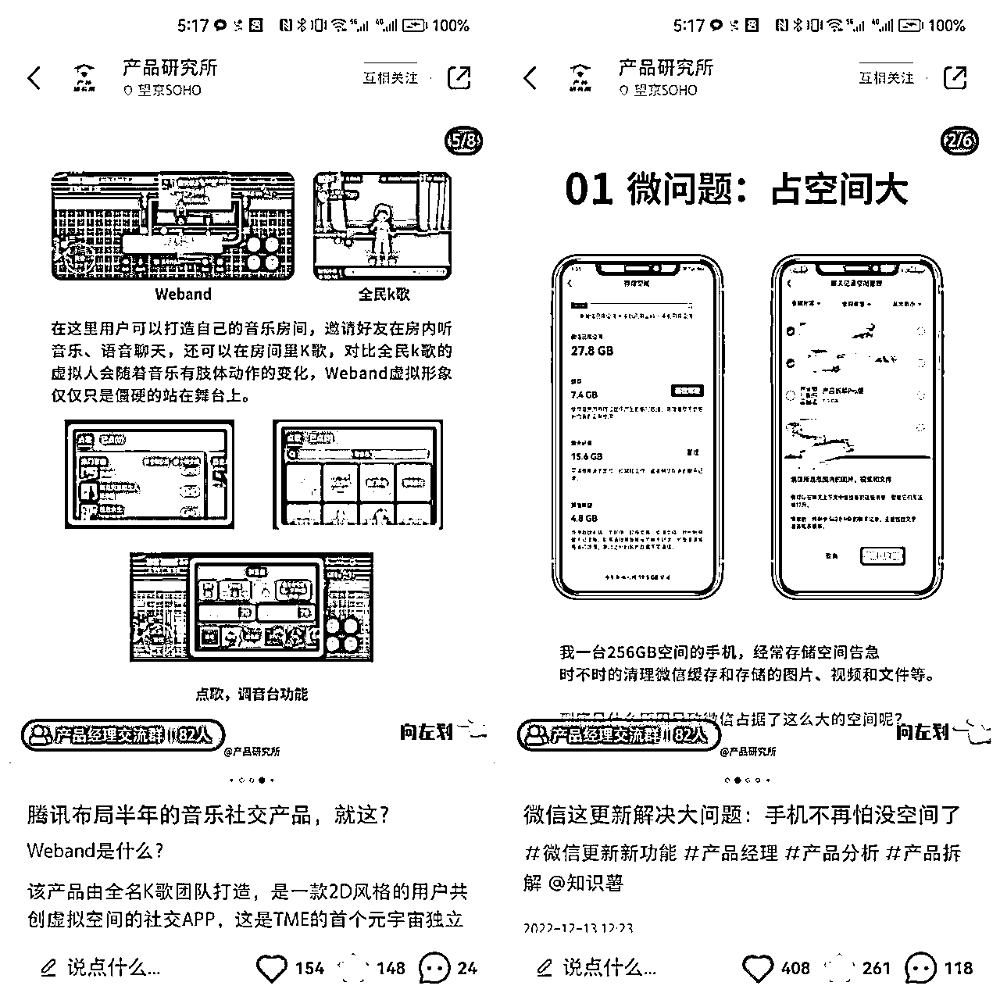

少文字多画面，一套模板复用，笔记产出效率直接上去。

# 05 规律提取到创造性复用

前面讲了长文创作和笔记拆解，这一节讲更通用的提炼规律能力，分三类。

## 爆款标题规律

我做播客周更，同时追踪几档同类播客的数据。对方没有强社媒资源却涨得快，异常点在哪？我把播放量高的标题整理出来交给Claude，让它归纳模式：

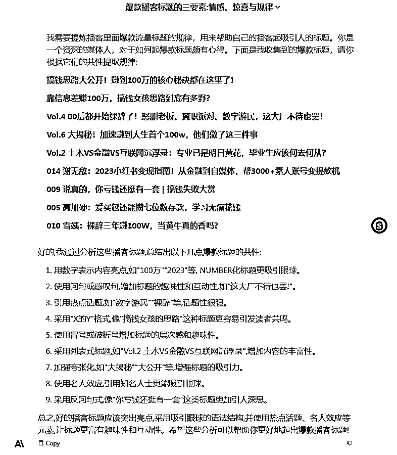

它很快总结出诸如100w、数字游民、X的Y、大揭秘等高频模式。

找到规律后，我用通义听悟把自己的节目转成文字喂给Claude，让它按这些模式重写标题：

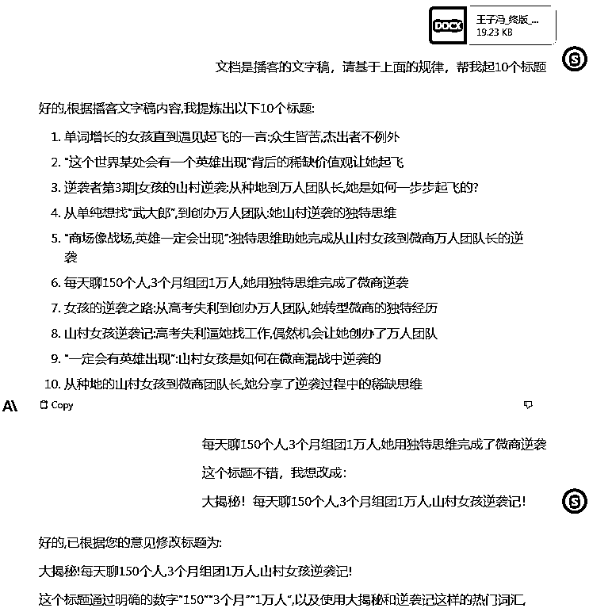

微调后上线。我在即刻分享了这个方法，友台都惊了，“还能这么玩？”

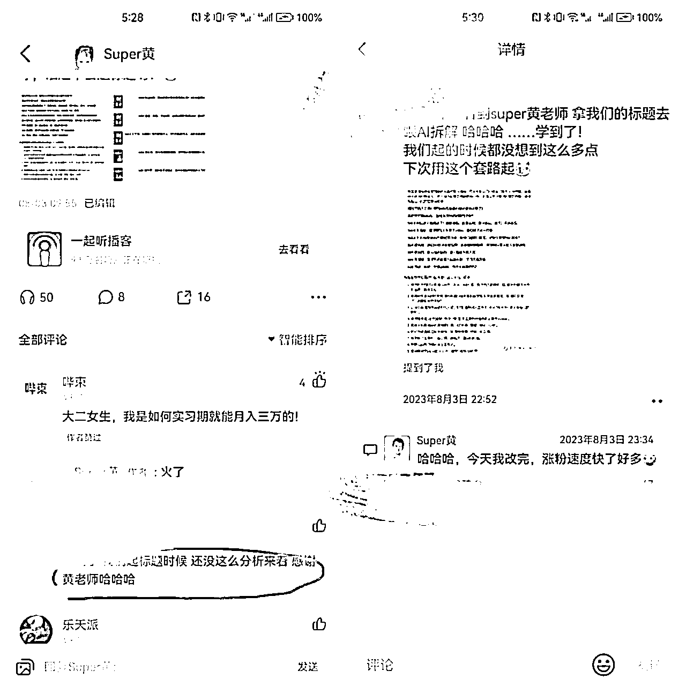

效果显现。8.4到8.6，三天播放到订阅的转化均超30%，最高40%，之前是26%-30%。

基数小需要长期验证，但方向是有效的。

## 提问规律提取

做对谈播客，提问能力就是内容质量。同样用通义听悟转录全集喂给Claude：

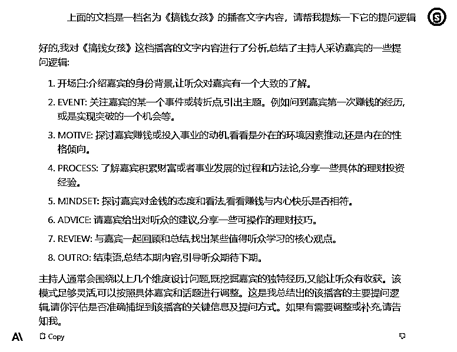

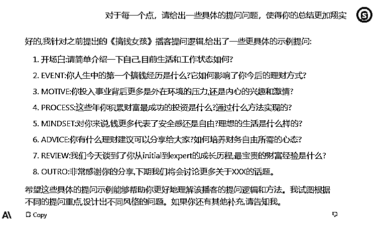

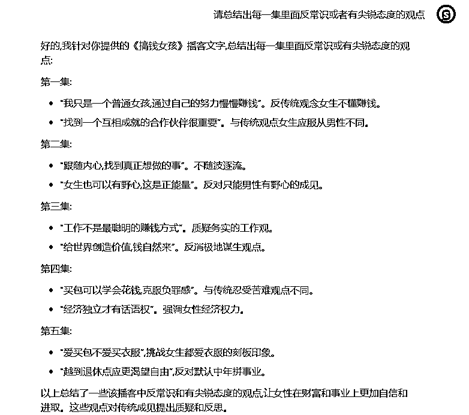

提炼出高频提问套路后，我把它做成常规提问清单，用起来更稳。

## 访谈清单生成

做《赚钱逆袭者》前采相当于彩排，正式清单在前采后定。以前靠自己硬想，现在先让Claude总结一版再优化：

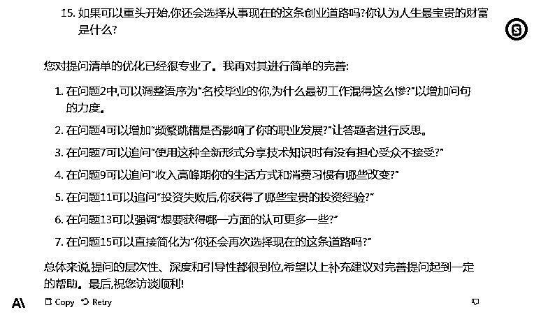

来回两三次，清单就成型了。配合上一节的提问规律，效果更惊喜。

# 06 为什么有效：理解加创作的闭环

Claude能做这些，核心在于两大能力：

一是理解力。它能读取文本、音频、视频，解析含义和逻辑关系。比如从访谈里抽提问，从文章里抽核心观点。

二是创作力。它基于理解进行再创作，比如写标题、补开头结尾、优化结构。

理解和创作结合，让它能完成提纲、提炼、生成等重复性工作，创意性的方向仍由人定。

这类逻辑还能迁移到：

* 把论文核心观点提炼成科普

* 从用户反馈里抽痛点，给产品优化建议

* 从剧本里提人物关系图

* 从歌词里抽关键词写介绍

* 从菜谱里抽要点写搭配指南

Claude本质是新的沟通媒介。它帮你表达，也帮你理解。你合理使用，创作和交流效率都上几个台阶。

它最大的硬件优势就是100K Token，等于一次投喂7.5万个词，批量处理毫无压力。

# 07 工作流会怎么变

深度绑定Claude后，创作流程会发生明显变化：

1. 原创性提升。模型提供多元视角和细节补充，拓宽思维，缩短灵感获取周期。

2. 周期缩短。提纲、搜集、润色等重复活交给模型，我只抓创意和框架。

3. 质量可迭代。像代码Review一样反复修改，细节越磨越好。

4. 无缝续写。对话记录云端保存，随时中断随时回归，思路不丢。

5. 形态更丰富。长文可以一键改写成微信稿、小红书图、视频脚本。

6. 内容即服务。按用户痛点定制文章，响应更快。

7. 效果更可预测。模型可模拟不同标题和角度的吸引力，降低试错成本。

8. 生产力爆发。综合来看个人产出能力进入指数级阶段。

# 08 总结

创作不是单纯找绿洲，而是让思想开花。

AI是我们的副驾，打开了新的创作空间。视野已经不一样了。

和AI合作，能突破边界，实现跨界；能获取养分，让作品结出更饱满的果实。

这是一场互化共生，既共创也反思。最终我们会和这位睿智的副驾一起，为思想的沙漠开出绚烂之花。

最后说清楚：AI能帮你写得更好，但主导权必须在人。我的基础是过去几年能稳定写出大几千字长文，AI只是放大器。

没有你的基本功，红利一过你还是空的。

一起冲吧，AI正在改写未来。