# Reddit 出海实战：从公开记录到社区共建的增长路径
作者：龙哥

对于独立开发者和一人创业团队来说，真正难的往往不是把产品做出来，而是找到第一批用户，并让增长持续发生。

如果你准备拓展海外市场，Reddit 值得被纳入早期渠道。它不只是一个内容平台，也是一座连接细分人群、真实问题和潜在机会的桥梁。

这篇文章会分享一套从入场、调研到获客的实践方法，主要包括：

- 从公开记录进展，转向与用户共同打磨产品

- Reddit 上已经跑通的创业案例

- 新账号如何熟悉平台、建立可信度

- 借助讨论内容寻找需求，测试产品假设

- 通过自然参与完成产品发布与持续获客

# 公开记录，还是和社区一起做？

我曾经尝试过把产品进度全部公开。看上去透明度很高，但实际吸引来的，未必是目标用户，也可能是嗅觉敏锐的模仿者。创意过早暴露，反而会让产品失去时间窗口。

Gumroad 创始人 Sahil Lavingia 在《小而美：持续盈利的经营法则》中表达过一条很重要的路径：

社区会让你发现值得解决的困境；困境推动你设计产品；产品最终才有机会转化为商业。

因此，正确顺序不是先埋头开发，而是先确认：

1. 你发现的问题是否真实存在；

2. 是否有足够多的人正在经历它；

3. 你的能力、资源与这个问题是否匹配。

当方向摇摆时，回到用户所在的讨论场景，往往比继续闭门思考更有效。

相比单方面展示进度，“和社区一起做”更接近真实的产品开发。你可以直接听到目标人群的反馈，判断需求是否成立；也能邀请愿意参与的人试用、建议和共创，逐渐形成第一批支持者。

那么，哪里适合完成这件事？Reddit 是一个值得研究的答案。

# 为什么许多独立项目从 Reddit 起步？

为了研究独立创作者的成长路径，我曾整理过近百个项目，分析它们的获客来源、产品形态、变现方式与开发过程。

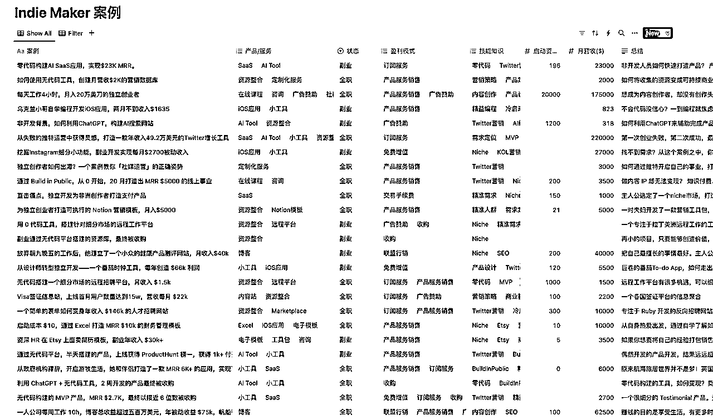

## Loopcv：先测需求，再写功能

Loopcv 是一款自动化求职平台。团队最初没有急着开发完整产品，而是先把一个几乎没有功能的介绍页放进 Reddit，观察用户是否愿意留下信息。

在获得数百名注册者之后，他们才开始正式开发。后续借助 Reddit 完成早期传播，月收入约为 1.5 万美元。

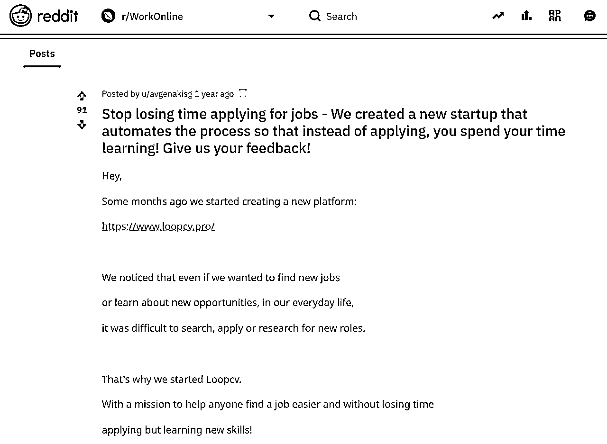

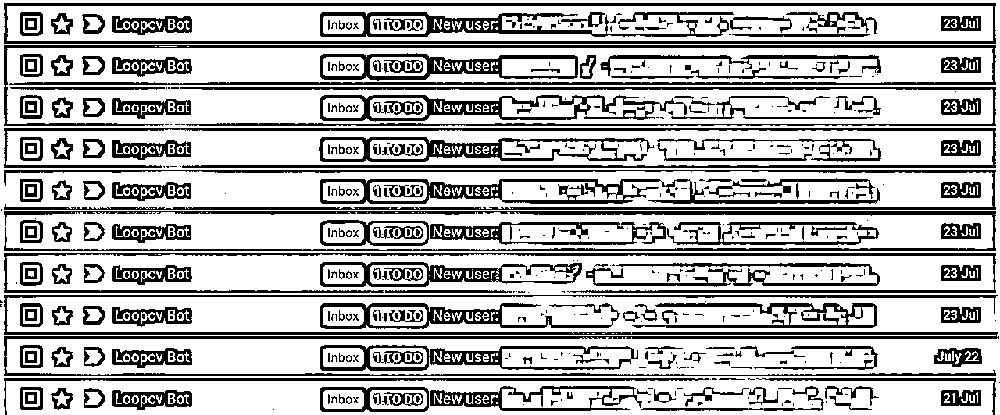

## Stagetimer：从细分场景切入

Stagetimer 面向的是一个非常具体的需求：远程控制计时。

创始人先在垂直讨论组里提出构想，依据用户回应不断调整，再开始制作。产品完成后，继续通过 Reddit 寻找第一批使用者，目前月收入约 8000 美元。

类似的路径并不只适用于软件产品。

一位 AI 工具目录网站的运营者曾把站点介绍发布到 Reddit。有人提醒他：如果用户只是收藏网页，后续很难再次回访，不如通过邮件内容建立持续触达。于是，他进一步推出 AI 主题邮件通讯 World of AI，并让两个项目互相导流，月收益达到约 6000 美元。

还有一位多次创业者，把多年积累的工具、资料和经验分享到 Reddit。由于不少人对这些内容感兴趣，他后来将其整理成可购买的标准化产品，月收入约 2250 美元。

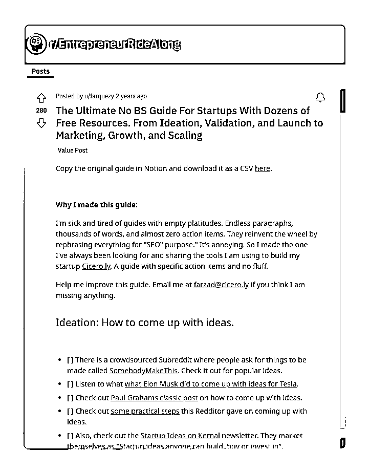

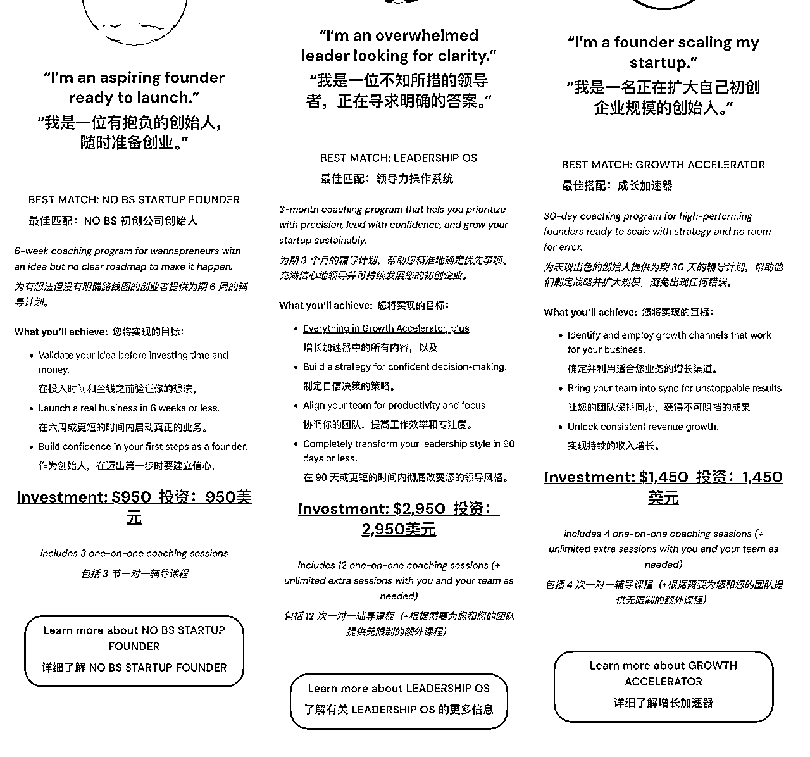

单个故事或许存在偶然性，但当类似路径被反复走通，就说明其中有可借鉴的规律。

当然，案例只能提供方向，最终仍需要结合自己的能力与市场亲自测试。

我从去年开始认真经营 Reddit。最初发出的内容几乎没有回应，后来逐步积累 Karma，开始收到真实用户的评论和讨论。这个过程让我意识到：对于想进入海外市场的新手来说，Reddit 是一个相对容易获得早期反馈的地方。

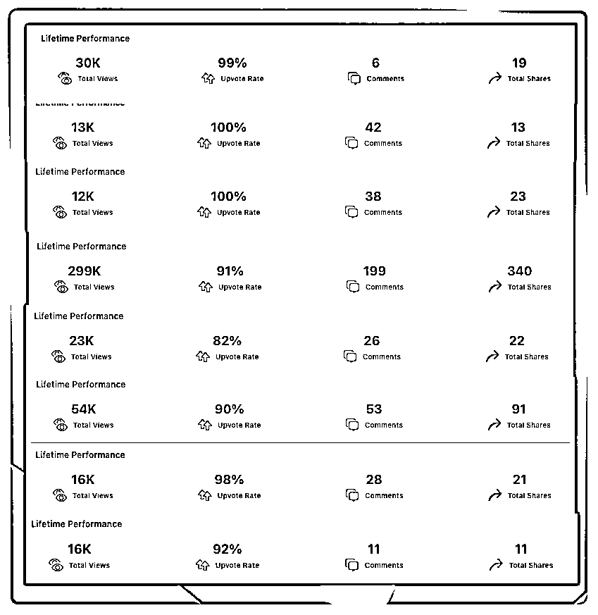

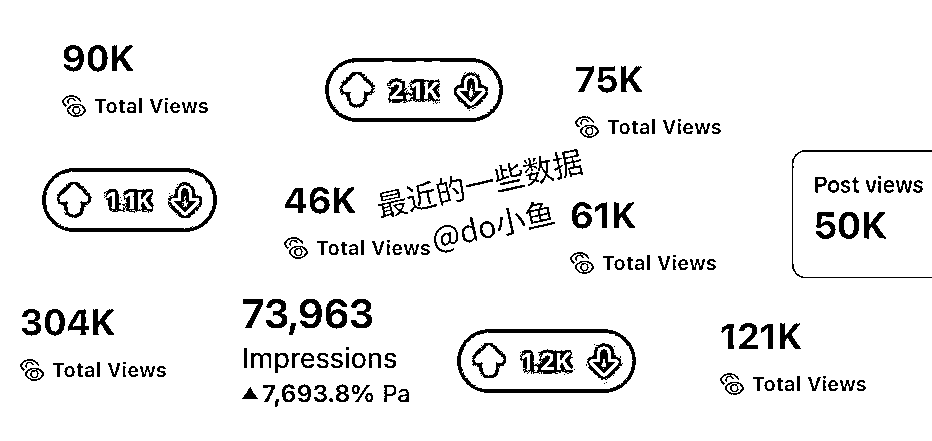

我的部分 Reddit 帖子互动数据

最开始，我只把 Reddit 看作宣传产品的渠道。持续参与之后，才发现它还有更大的价值：

- 观察海外用户正在讨论什么；

- 直接接触其他国家的创业者；

- 找到细分领域里的新机会；

- 获取产品和服务的改进建议。

Reddit 的独特之处在于，许多子版块自带稳定访问量。只要问题足够具体、内容确实有帮助，即使没有粉丝基础，也有机会得到回应。

# 新账号先完成三项基础建设

## 1. 找到适合长期参与的子版块

Reddit 的讨论单元以 subreddit 为主，主题非常细。无论你已经有产品，还是只有模糊构想，都可以先找到相关圈层，观察里面的人在交流什么。

我把创业、数字产品、苹果生态、移动应用、社交媒体等方向的版块整理进了 Notion：

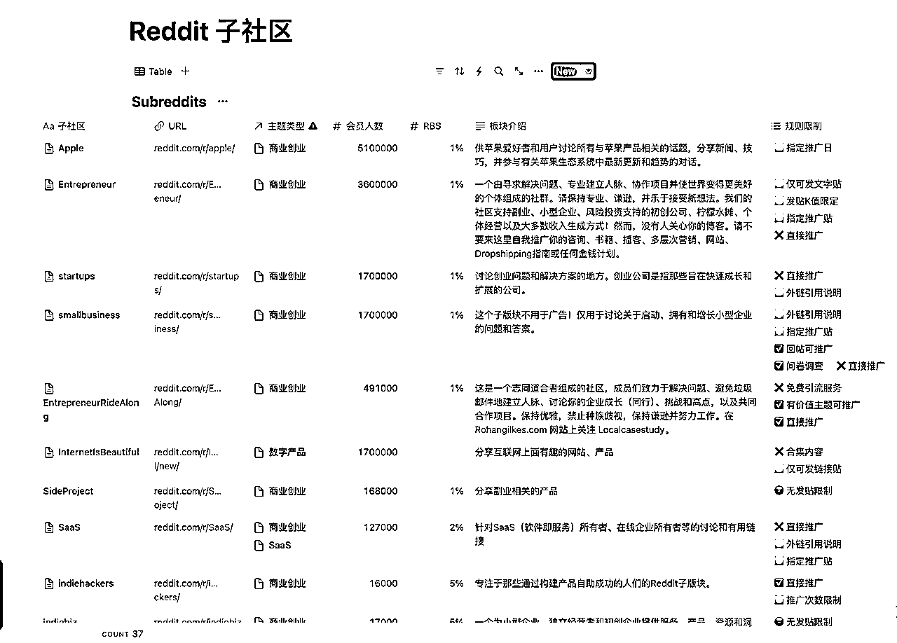

寻找版块时，可以用关键词进行检索。例如，你对某类用户或行业感兴趣，就先输入相关词，再根据讨论主题和活跃情况筛选。

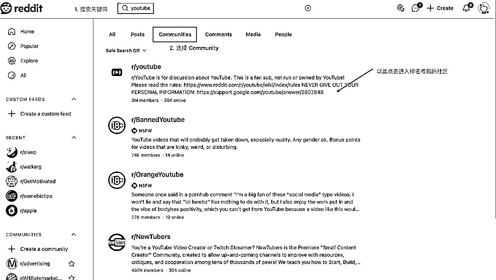

打开某个版块后，可以重点查看简介区域里的几项指标：

1. **Subscribers**：订阅人数，反映整体规模；

2. **Viewers / Online**：当前在线人数，帮助判断即时活跃程度；

3. **Rank by size**：规模排名，排名靠前通常意味着更大的潜在曝光池。

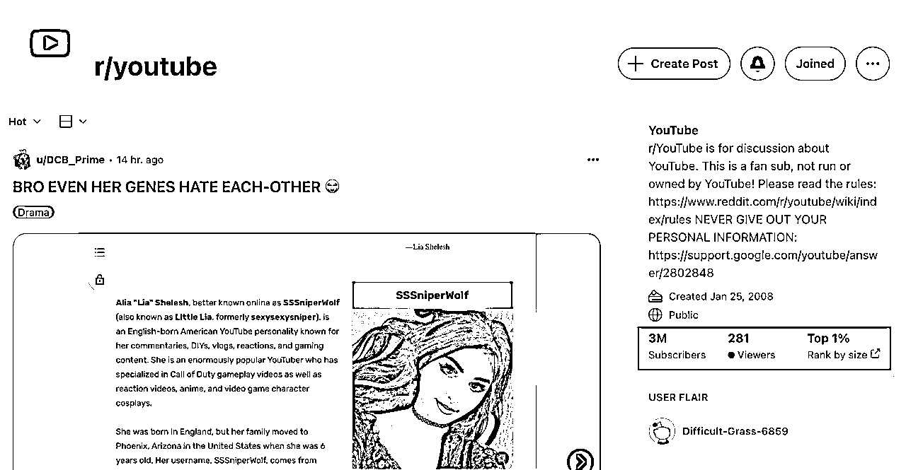

一个值得长期观察的版块，通常具备几个特点：成员数量可观、在线人数稳定、近期帖子持续更新。

确认后点击右上方的「Join」，之后便能在首页侧栏找到已加入的版块。

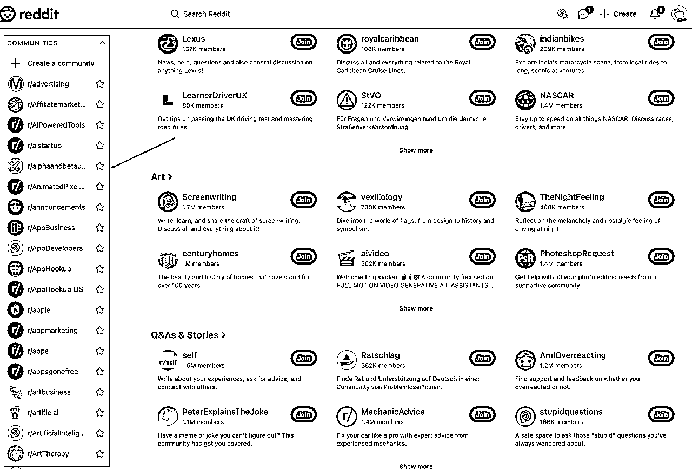

## 2. 先把版规弄清楚

在 Reddit，内容是否能留下，首先取决于你是否理解该版块的规则。

许多新账号一注册就连续发宣传内容，结果不是内容被移除，就是账号受到限制。无论在哪个平台，长期参与都建立在尊重规则、提供帮助的基础上，而不是反复投放广告。

每个 subreddit 的要求都可能不同，发帖前要重点确认：

- 是否允许放外链；

- 图片和视频有什么格式要求；

- 哪些话题属于禁区；

- 是否存在 Karma 门槛；

- 是否只在特定日期开放推广类内容。

有些版规篇幅很长，逐条阅读确实耗时。可以把长期关注的版块记录到 Notion，再让 AI 协助提炼和翻译。

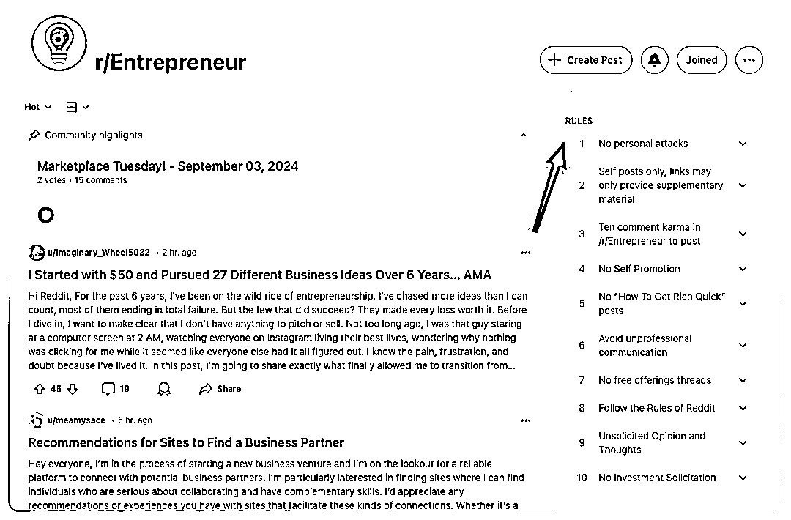

建议建立一份简明的规则表：

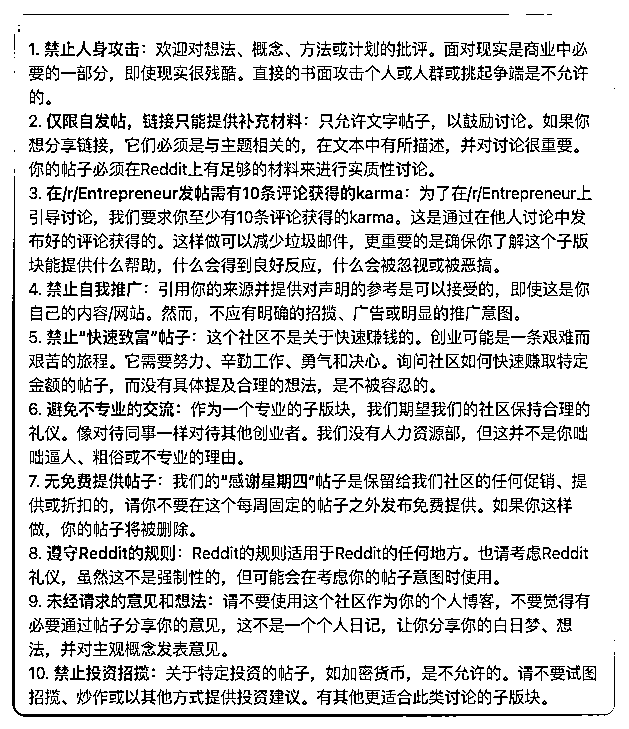

也可以用标签快速区分：

- ✅：通常允许；

- 🟨：允许，但需要满足次数、日期或内容形式等条件；

- ❌：明确禁止，触犯后可能被移除内容或限制账号。

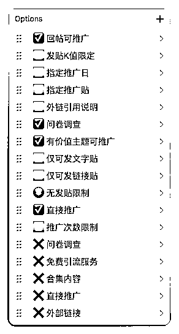

每次准备发言前，先查一眼对应版块的注意事项。这个动作虽然简单，却能明显减少无效操作。

如果你熟悉自动化，也可以把“版块收藏—规则提取—发帖提醒”做成浏览器扩展，方便日常使用。

## 3. 先建立账号信用

Reddit 会根据用户的发帖和评论表现，形成 Karma。获得赞同、互动或转发，通常都有助于提升这一指标。

Karma 并不是单纯的数字，它更像账号在平台上的历史信用。部分版块会把它作为参与门槛；当你后续需要分享项目、回复链接或联系潜在用户时，成熟账号也更不容易被系统误判。

我的个人 K 值状态

很多人刚开始会把内容发到目标版块，却发现几乎没人看到。后来我才意识到，若目标是先建立账号基础，就不必一开始只盯着最垂直的圈子。

Reddit 的热门榜单里，有不少娱乐、趣味和宠物类版块。这些地方访问量大、参与门槛相对低，适合新账号先通过正常互动熟悉平台。

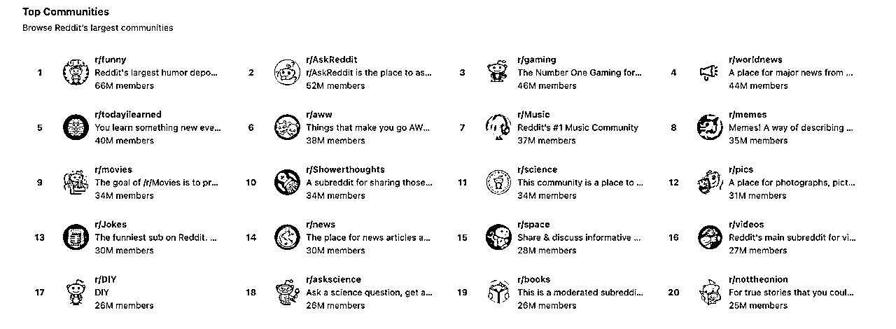

例如 aww 主要分享宠物图片。发布一张有趣的宠物照片，就可能获得大量点赞，从而积累早期 Karma。

# 用“看—问—测”判断需求是否成立

当你有了一个产品方向，最需要确认的不是“能不能开发”，而是“是否值得开发”。

Reddit 可以帮助你完成一套从观察到验证的流程。

## 第一步：看——从讨论中寻找高频困扰

### 先看圈子的体量

成员规模越大，通常意味着关注者和潜在使用者越多，但规模只是起点，还要结合内容质量和互动密度判断。

比如，近期在小红书上经常出现针对 ADHD 人群的产品，且相关内容互动明显，说明这个群体存在持续被讨论的困难。

在 Reddit 中搜索 ADHD，可以看到一个拥有约 200 万成员、排名处于前 1% 的版块。这样的体量意味着其中可能沉淀了大量真实经历和需求线索。

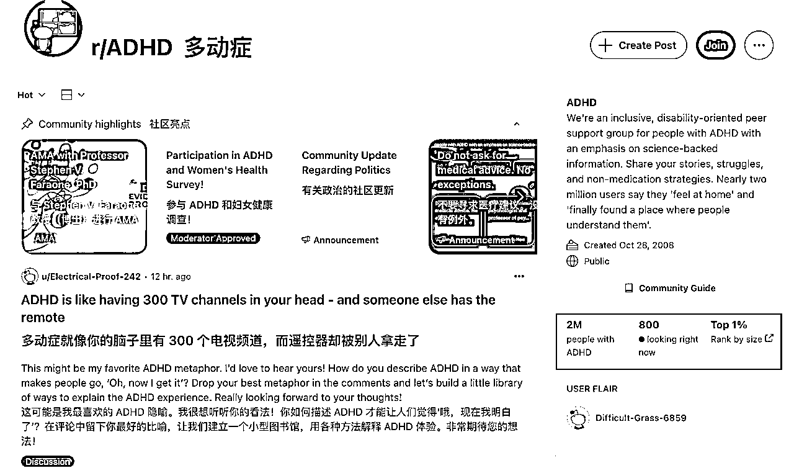

### 再看大家反复讨论什么

进入版块后切换到「Hot」，先浏览高热度内容，再重点查看点赞和回复较多的帖子。

真正值得关注的，往往不是标题本身，而是评论里的反复抱怨：

- 某个流程总是很麻烦；

- 现有工具无法覆盖关键场景；

- 用户已经尝试多个方案，却仍然没有解决；

- 大家不断询问相同的问题。

这些重复出现的阻力，可能就是产品机会。

为了提高效率，可以把热门帖子交给 AI 做初步归纳。挑选回复量较高的内容，让它提取用户情绪、具体障碍、现有替代方案以及潜在功能方向。

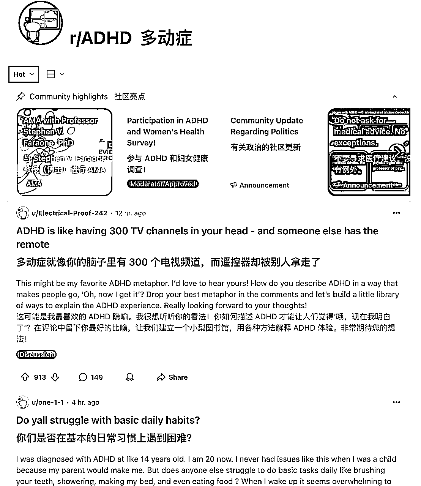

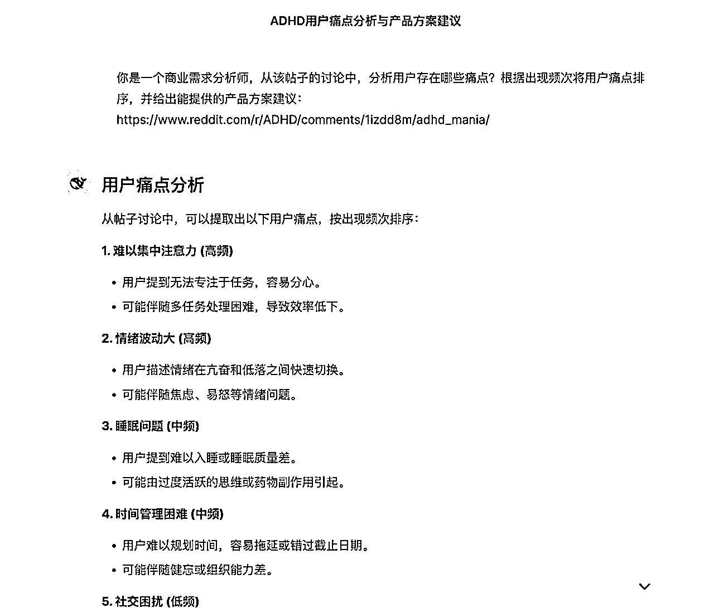

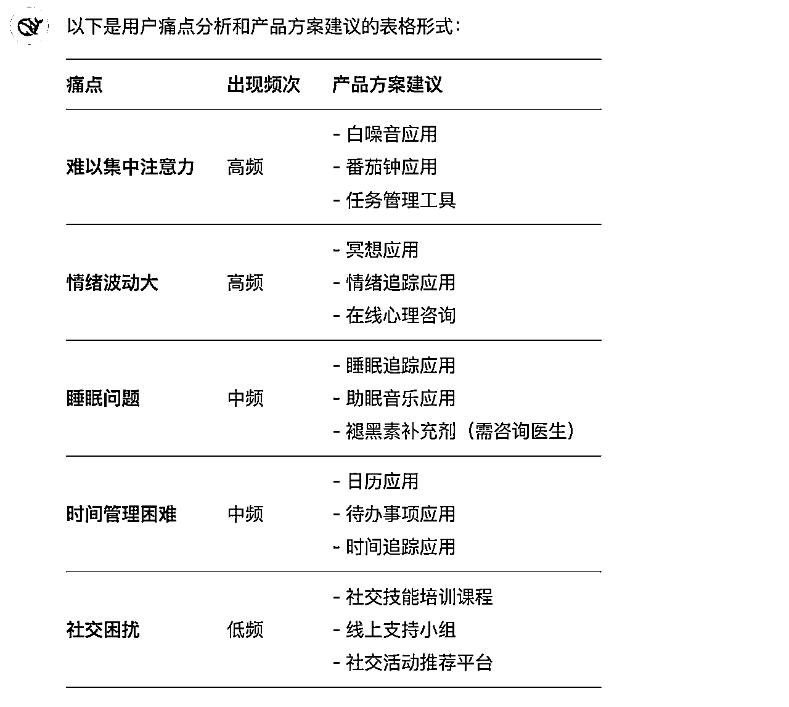

例如，可以批量处理回复数超过 50 的帖子，读取其中最具代表性的评论，再按照出现频率整理需求，最后结合自己的资源和能力进行排序。

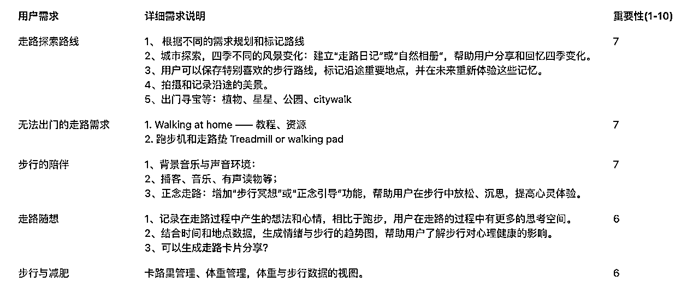

我曾经用这种方式收集过“走路”相关场景的需求，能够比较快地看出用户反复遇到的困难。

此外，圈友四喜也制作过一个用于分析 Reddit 需求的 AI Agent，有兴趣可以参考：

scys.com/articleDetail/xq_topic/4848144281141488

## 第二步：问——让真实用户讲出自己的经历

当你浏览了足够多的讨论，对目标人群和常见困境有了初步认识后，可以主动发帖提问。

提问时，不要泛泛地问“大家有什么需求”，而是把自己放进具体场景，描述一个清晰的问题，再邀请他人分享经历。

可以参考这个结构：

**目标人群 + 具体情境 + 遇到的阻碍 + 请求建议**

例如：

> 我正在经历注意力管理方面的困难。独处时，我经常无法持续完成计划中的任务。有人遇到过类似情况吗？你们通常如何应对？

用户的回答，往往会暴露他们目前正在使用的工具、替代方案和不满意的地方。这些信息可以帮助你决定哪些功能最值得优先制作。

## 第三步：测——在开发前验证假设

当你已经找到了重复出现的问题，也形成了初步方案，仍然不要马上投入大量开发时间。

可以先发布一篇概念验证帖，例如：

> 我正在尝试制作一款帮助用户解决某类困境的产品，想听听大家的看法。

内容里可以包含：

- 你遇到的具体问题；

- 目前设想的解决方式；

- 一张简单的界面草图或 Demo；

- 希望用户补充的功能；

- 是否有人愿意试用或持续关注。

如果有人主动询问何时开放、能否体验，说明这个方向已经出现了初步兴趣。此时可以放置一个简洁的邮箱登记页面，收集愿意继续了解的人。

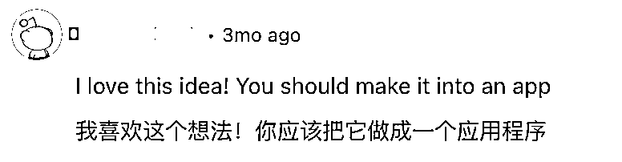

我曾把产品构想和原型放入相关版块，收到了相当直接的积极反馈。

到这里，已经形成一条小型验证链路：

**发现困扰 → 提出方案 → 观察反应 → 收集潜在使用者**

由于参与者本来就来自目标圈层，留下的信息通常比泛流量广告更有价值。

后续可以继续在社区里同步迭代进度，也可以通过邮件邀请他们试用、反馈和参与测试，让产品始终围绕真实需求演进。

# 产品完成后，如何在 Reddit 获得第一批客户？

Reddit 不只适合调研，也能承担产品早期发布和获客任务。

## 方式一：在匹配的版块分享项目

这是最直接的做法：找到与产品高度相关的版块，在合适的时间介绍项目。

但要特别注意两点：

- 先确认版规是否允许；

- 内容要以解决问题为主，而不是只贴购买链接。

比较适合的时机是正式上线、发布重大更新或开放测试。若长期重复发布相同广告，容易被用户反感，也可能被系统视为低质量营销。

## 方式二：回应正在求助的人

很多潜在客户不会主动寻找你的产品名称，但会公开描述自己的问题。

因此，与其到处宣传，不如先找到正在寻找方案的人，再提供有针对性的回答。

### 方法一：用搜索引擎定位具体场景

可以尝试这样的检索结构：

**How to + 应用场景关键词 + Reddit**

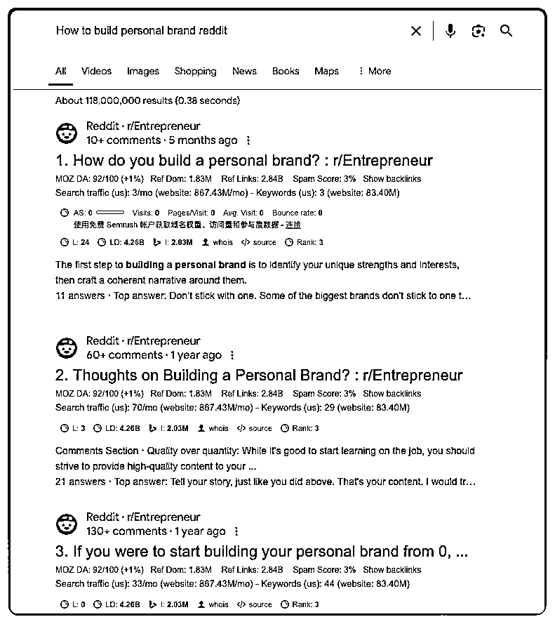

这种方式能找到大量真实提问。你可以先认真回答问题，再在确实相关时补充产品链接。因为内容与用户当前需求相连，通常比单独发布广告更自然。

### 方法二：用 f5bot.com 监听词语出现

f5bot.com 是一个免费工具。输入关键词后，只要 Reddit 上出现相关内容，系统就能通过邮件提醒。

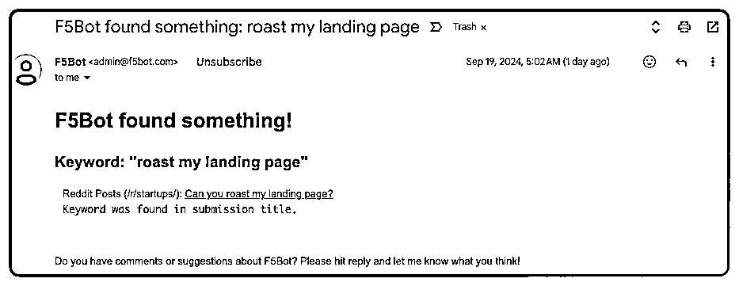

它还会统计近一周的出现频率，可以作为观察讨论热度的辅助指标。

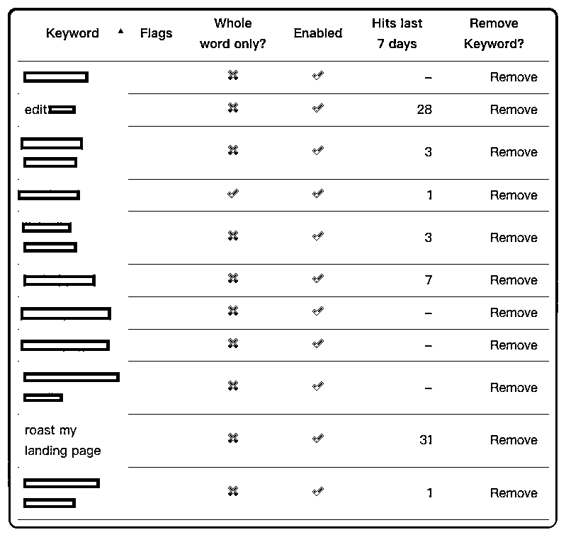

常见用途包括：

1. 追踪竞品名称，观察竞争项目如何参与讨论；

2. 测试 SEO 词汇，确认用户是否真的在使用和讨论这些表达；

3. 找到潜在使用者，在合适的评论中提供帮助；

4. 关注自己的品牌，发现支持者和负面反馈；

5. 为内容选题寻找素材，判断哪些主题已经有人主动提问。

不过，关键词出现不等于需求成立。同一个词可能出现在完全无关的语境中，收到提醒后仍然需要人工筛选。

## 提高转化：让回答看起来像帮助，而不是广告

流量多不代表转化高。真正有价值的帖子，通常是那些精准命中目标人群当前困境的内容。

### 场景式提问与回答

如果你的产品确实能解决某个具体问题，可以围绕用户身份、困难和求助意图组织内容。

例如：

> 我在管理注意力时经常遇到困难，大家有没有用过比较有效的工具？

结构可以概括为：

**目标人群 + 具体困境 + 寻找解决办法**

后续在评论中分享产品时，要说明它解决了什么问题、使用后有什么变化，而不是只留下一个名称或链接。

例如：

> 我后来试了一个叫「XX」的工具，主要帮我处理这个场景，目前对我比较有帮助。

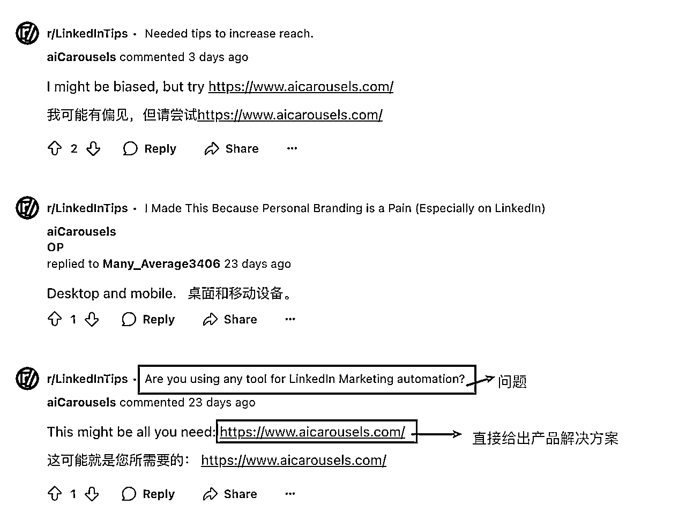

真正可持续的 Reddit 获客，不是不断重复广告，而是先参与讨论、理解用户，再在恰当的时机给出有用的方案。

当你能持续完成“观察—交流—验证—帮助”的循环，Reddit 才会从一个流量来源，变成产品迭代、用户积累和海外增长的长期阵地。

很多人做海外推广，首先想到的是发帖和投广告，却忽略了评论区这条低调的引流通道。在Reddit，你只需在相关帖子下面，自然地留下产品相关信息，就能把访客带去自己的网站。还有一个隐藏福利：Reddit本身权重高，谷歌搜索常常把Reddit的讨论排到前列，你留下的内容变相等同于长期SEO。

如果你的产品很难匹配到精准帖子，也别急，可以试试“真诚利他”的方法：把昵称改成【产品/网站名称+解决方案】，主页里写清楚产品介绍，然后去目标用户出没的帖子下，认真回答他们的问题。不需要开口闭口推销产品，只要你的回答有干货，自然会有人好奇点进你的主页，通过简介认识你的产品。

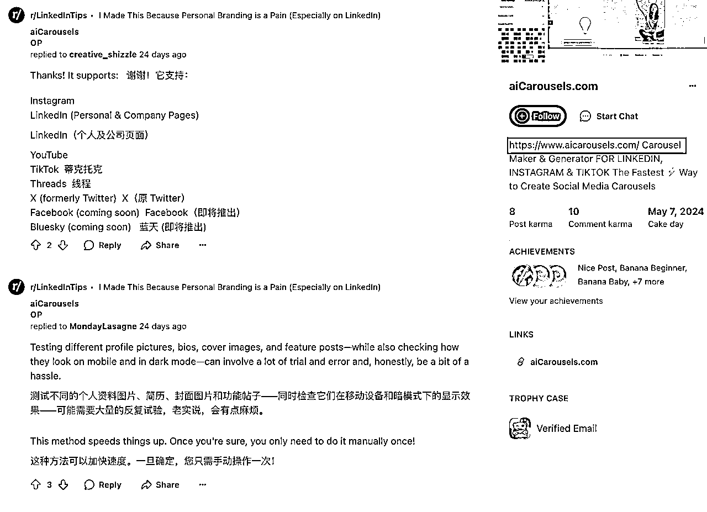

如果你自己运营网站，还可以把Reddit上那些高赞的用户提问收集起来，改写成SEO文章，再发到对应帖子下面。这样一来，既帮用户解决了问题，又给主站带来了精准流量。

说到底，出海不是一个人的战斗，从社区起步往往能少走弯路。社区会告诉你真实的用户问题，问题逼出解决方案，方案最终兑现成产品，生意也就水到渠成。Reddit值得出海人好好深耕，因为它流量够大、用户够活跃、子社区足够细分，能让你很快获得反馈。其他平台也有自己的小圈子，但Reddit的综合条件，确实更适合新手练手。

以上是我在Reddit实操中攒下的一点经验，欢迎大家在评论区补充。往期我还聊过需求挖掘、快速上线、用GPT4把创意半天变成MVP的话题，感兴趣可以翻阅历史。感谢阅读！