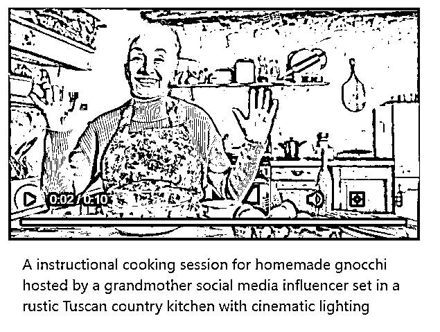

# Sora 真正好用的前提，是和这个软件一起用
很多人拿到 Sora 的第一反应是：会生成视频很厉害，但怎么用得更顺手、更专业，却没什么思路。
其实单独用 Sora，只能发挥出它 60% 的能力。把 Sora 接上一个合适的生产工具后，整个工作流才会顺起来，从灵感到成片的效率直接拉满。
这套组合的核心逻辑很简单：Sora 负责画面生成和动态叙事，搭配软件负责脚本管理、镜头排布、分镜对齐和后期精修。两者一前一后搭起来，既能保证创意不跑偏，也能让输出稳定可控。
以前做一条 15 秒的 AI 影像，要反复试参数、手动剪、手动对字幕。现在有了这个搭配，前期在软件里把分镜、台词、情绪节奏先搭好，直接丢给 Sora 一键生成，后期素材自动回流到项目里调色、配乐。省下的时间，都用在打磨创意上了。
如果你也在用 Sora 做短视频、广告预告、产品演示甚至个人 Vlog，建议别再单打独斗了。找对搭档，Sora 才能变成真正能交付的创作工具。
