# Stable Diffusion 应用场景和模型训练
作者：龙哥

最近参加了一场干货满满的线下分享，主题是Stable Diffusion的应用与模型训练。趁着热乎，我把重点整理了出来，希望能帮你少走弯路。

先快速认识一下SD：它是一款2022年诞生的深度学习模型，核心能力是“文生图”——输入文字描述，就能生成细节丰富的图片。除此之外，它也能做局部重绘（内补）、画面外扩（外补），以及在提示词控制下完成图生图转换。底层用的是潜在扩散模型，由慕尼黑大学CompVis团队主导研发，StabilityAI、Runway等参与合作，EleutherAI和LAION也为它提供了支持。

聊到实际应用，SD的玩法相当多元。比如辅助产品设计：给一张小白鞋原图，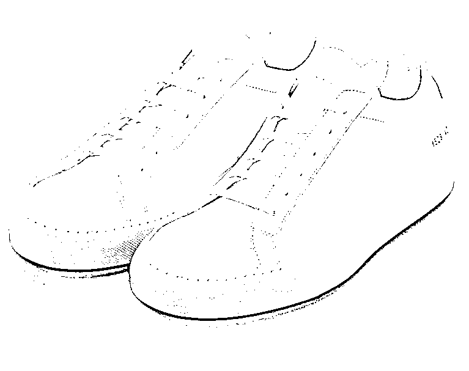配合ControlNet的Canny线稿模型，再加上合适的prompt，就能快速产出风格不同的产品渲染图。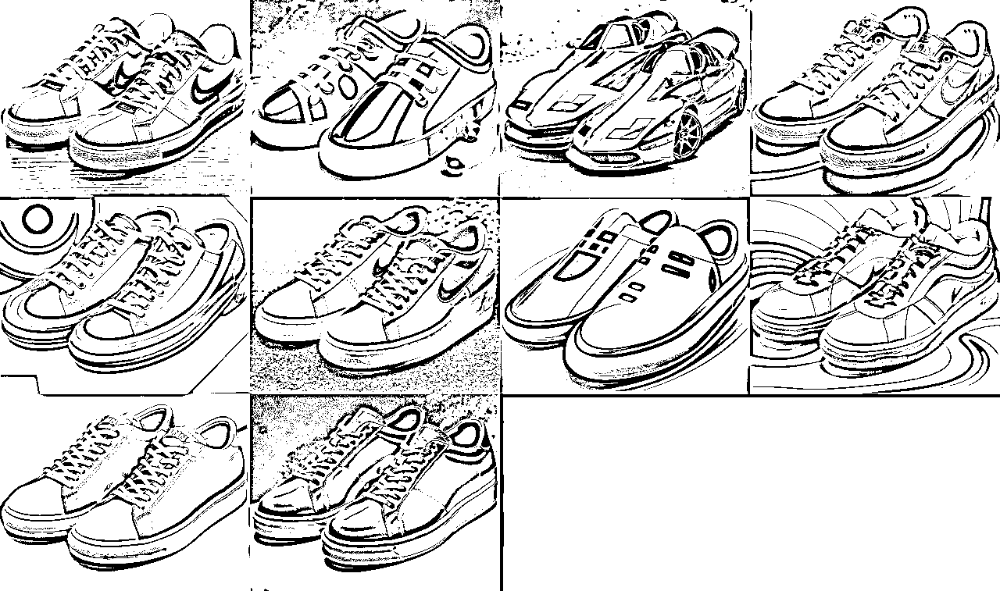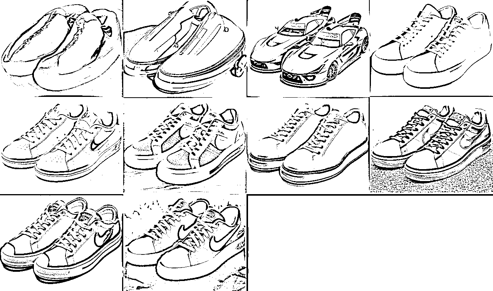

AI模特也很实用：用chilloutmix模型+ControlNet+图生图局部重绘，把石膏模特身上的服饰换成真实商品，实现AI试穿、试戴的效果。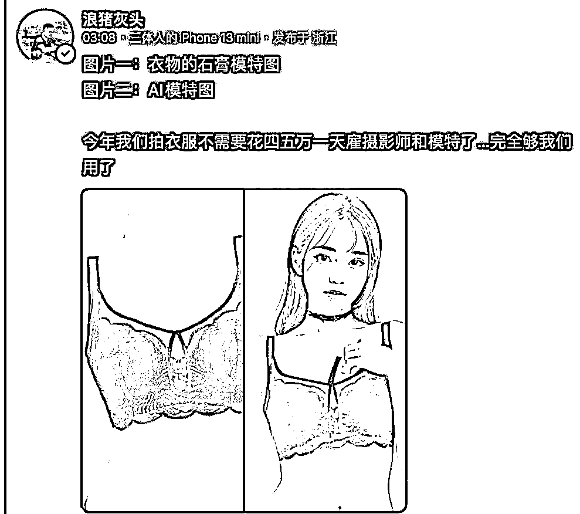（图源网络，浪猪灰头发布）

建筑领域同样能打：室内外设计借助ControlNet的Canny模型和建筑类LoRA，可以快速出概念图。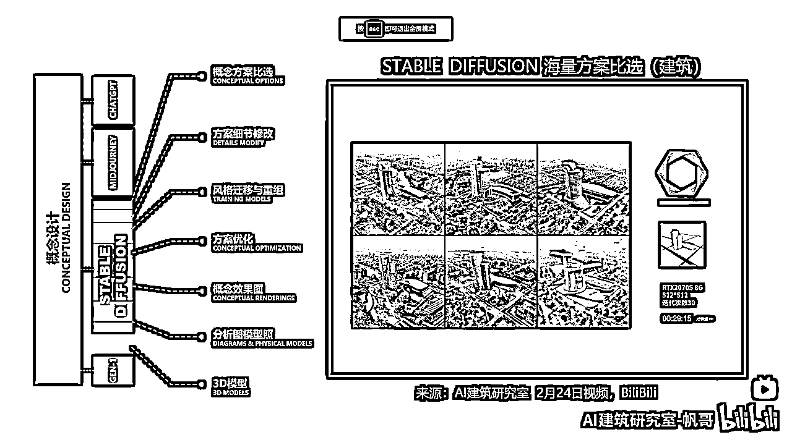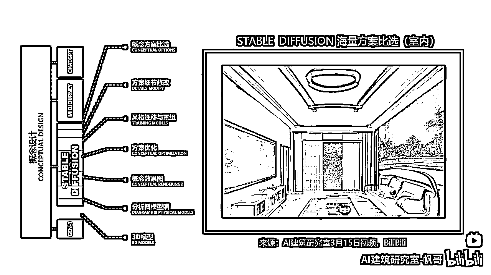（研究来自B站：AI建筑研究室-帆哥，链接：https://space.bilibili.com/2161614）

还有一种高阶玩法——训练风格模型。分享者透露，因为工作关系常和广告客户打交道，已经在尝试训练分镜生成模型了。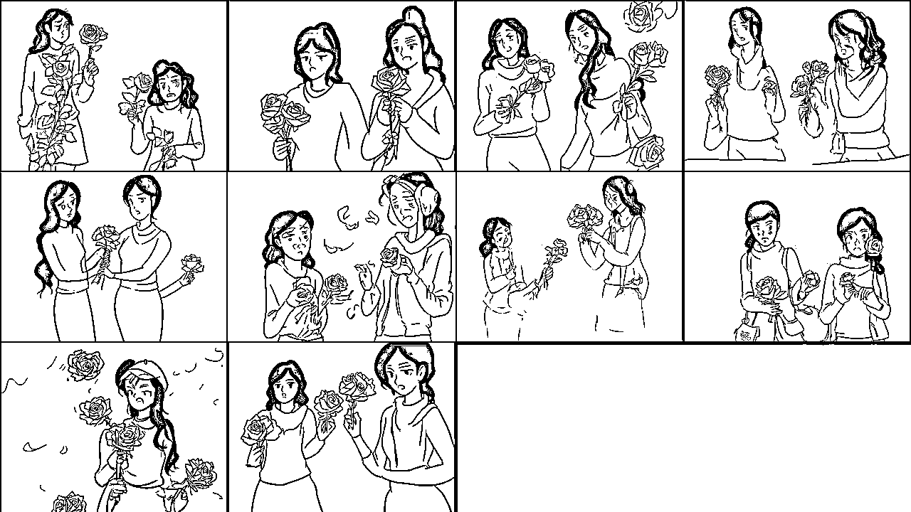

关于安装，分享会现场直接演示了，这里就不啰嗦啦。

下面进入重头戏：模型训练的工作流。分享者把它拆成五步，每一步都有讲究。

第一步，准备训练集。训练集算是整个训练的地基，简单说就是你希望模型去模仿的样本。它的质量直接影响最终成果，而质量又由两块决定：原图质量和标签精准度。

先看原图。图片必须清晰、分辨率高，这样裁剪空间大、细节保留足，训练效果更好（要练像素风之类特殊风格除外）。（图源Unsplash）

样本要丰富。练人物LoRA时，场景可以横跨商场、沙滩、雪地；角度最好覆盖正面、侧面、脸部特写、全身。如果训练时只有半身照和特写，生成时输入“fullbody”很可能出现崩坏——因为AI没见过全身，只能瞎猜。图片不够的话，可以用镜像翻转或裁剪同一张图来补充，但别过量，容易过拟合。

烂图要果断删：表情扭曲的、手机挡脸的、多人大合影的、妆后差异大到认不出的，统统不要。总之训练集要干净且统一。

然后是裁剪。其实裁剪不是硬性要求，新脚本支持自动分桶训练。但如果机器性能一般，裁到512x512会快很多。另外注意训练尺寸和出图尺寸别差太多：用512x512训练的模型去生成1024宽图，输入“1girl”可能变成多人。裁剪用SD自带的图像预处理就行：原图目录和输出目录分开（原图记得备份），设置512x512，开启自动焦点裁切，这样人物就算不在画面中心也会被恰到好处地保留下来。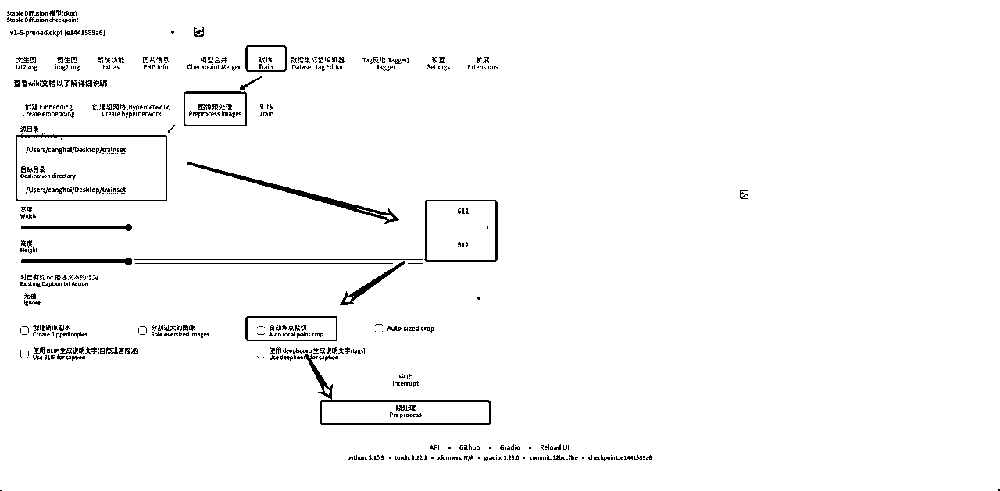

打标签这步很关键。机器本身看不懂图片内容，早期全靠人工写描述，比如SD1.5用的就是LAISON-5B数据集里的描述式标签。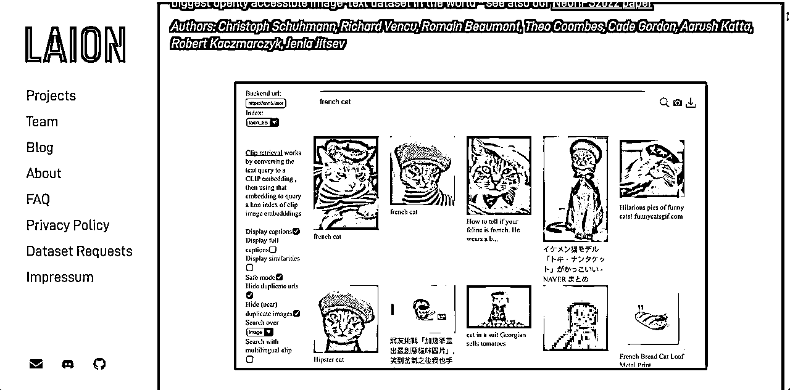现在可以靠打标器自动生成，我们只要检查修改。

标签分两类：一类是自然语言，人一眼能读懂；另一类是文字说明标签，更接近机器术语。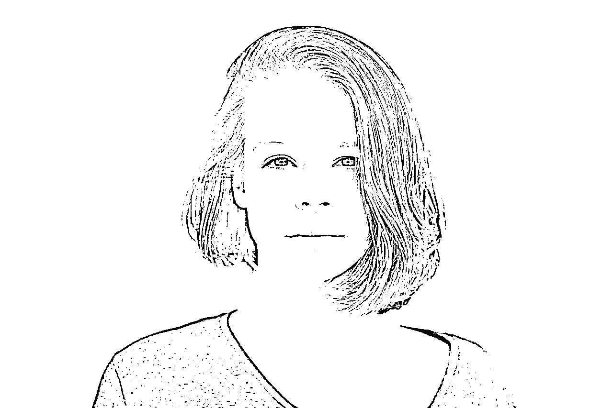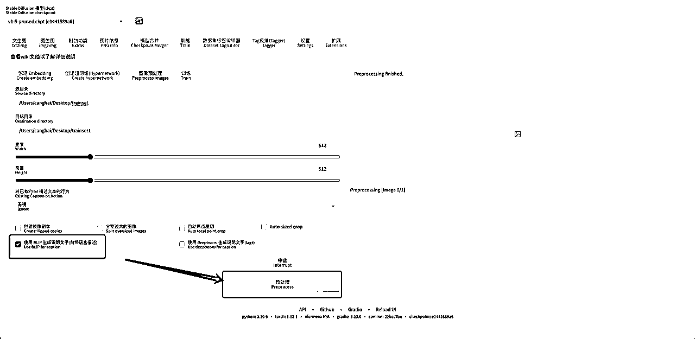比如自然语言可以说“a woman with red hair and a blue shirt is looking at the camera with a serious look on her face”；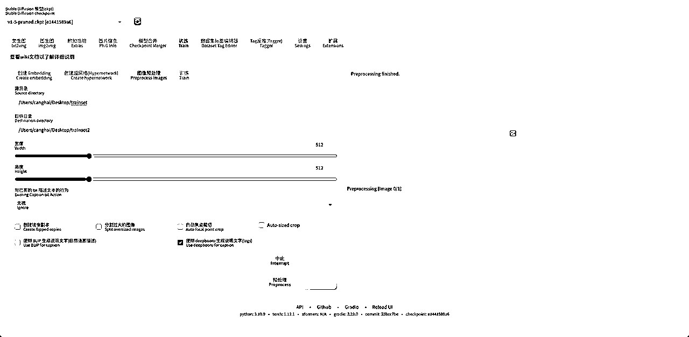文字说明标签则是“!, !!, ..., 6+girls, :<, :d, :o”这种风格。

打标器推荐Waifu Diffusion 1.4标签器（stable-diffusion-webui-wd14-tagger），在webui扩展里装就好。它的输出更干净，不太会出现乱码标签。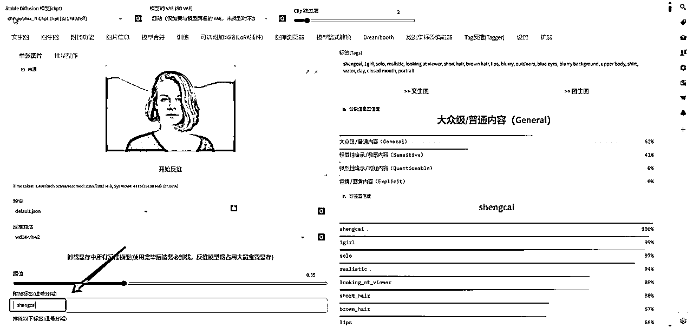比如它会生成“shengcai, 1girl, solo, realistic, looking at viewer, short hair, brown hair, lips...”这样的内容。如果要练LoRA，记得在附加标签里加一个专属触发词，比如“shengcai”。

接下来是减标签。如果直接用全量标签去训练，生成时得把所有标签都输入一遍才能还原目标，太麻烦。减少标签并不会让模型学不到那些特征，而是会把删掉特征的权重累积到序列靠前的词上。比如把short hair、brown hair、blue eyes、upper body、shirt这些删掉后，权重会向“shengcai”集中，之后只要输“shengcai”就能大概率生成这个小姐姐。练画风也一样，删到只剩触发词即可。

批量减标建议用stable-diffusion-webui-dataset-tag-editor。它会把100张图对应的100个txt标签一次性加载出来，按词频排序，然后批量删除。具体路径：载入打标文件夹→batch edit captions→移除→frequency-descending→勾选不要的标签→remove selected tags。频率特低的个人标签，留着不删也无妨。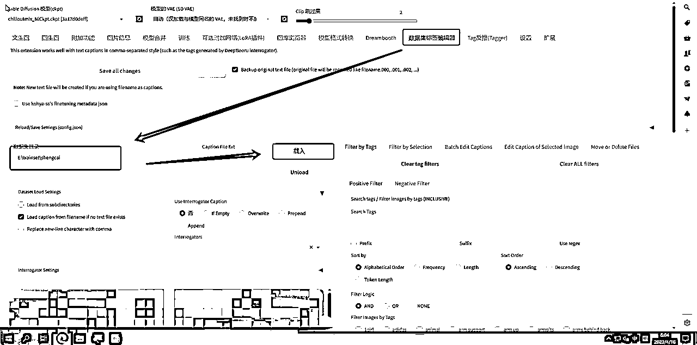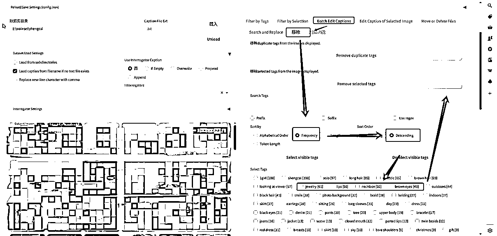

第二步就是正式训练。文中提到了Dreambooth和LoRA两种方式，现场应该都演示了具体参数。

第三步，测试与复盘。常开玩笑说“炼丹”，但得科学记录。分享者的做法是生成一张XYZ表：X轴放不同epoch的模型，Y轴放不同权重，然后用文生图批量跑图，最后肉眼评估并把结果填进表里。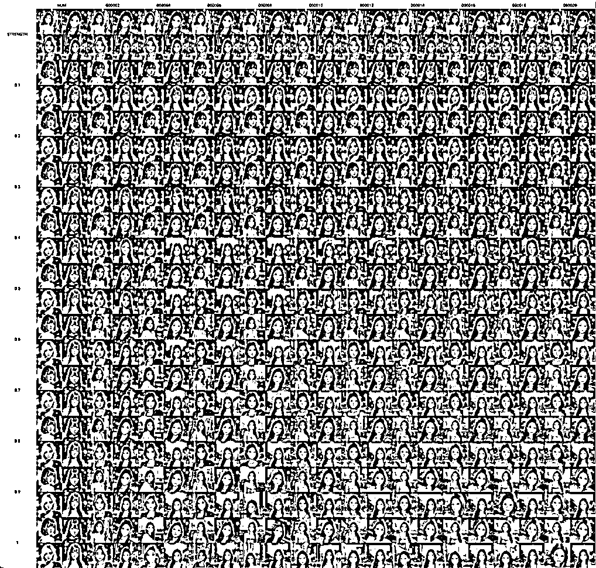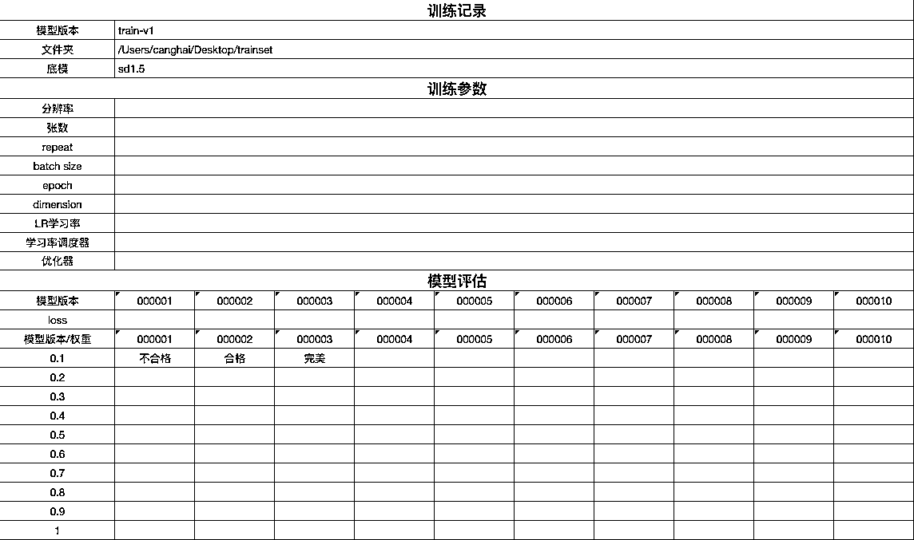评估模版可参考：https://docs.qq.com/sheet/DQ3ladU9GYmFXY2tI?tab=BB08J2

第四步，仿训练别人家的LoRA。如果在C站看到心仪的模型，想弄清它怎么训出来的——多少图、尺寸多大、文件夹怎么分、repeat几次、跑了多少epoch、底模是啥——直接打开LoRA文件，点“show metadata”就能看到。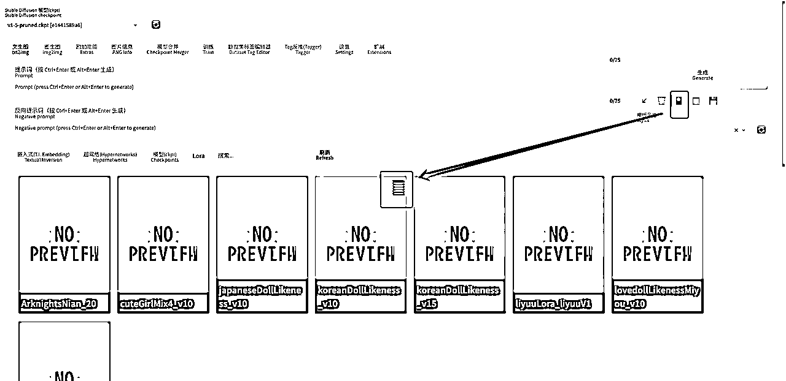

总之，Stable Diffusion不只是个“画图工具”，它在产品、建筑、时尚这些行业里都能落地。只要把训练集、标签清洗和测试复盘这套流程吃透，你也能炼出自己的专属模型。这篇整理就先到这，希望对你有用，下次再聊。

今天聊点实操的东西：怎么判断一个 LoRA 模型背后用的到底是哪个底模？

就拿 KoreanDollLike v1.0 来说吧。它的元数据里，训练配置记得清清楚楚：底模名字直接写着 URPMChill.ckpt，分辨率是 (713, 891)，CLIP skip 是 2，训练图一共 11000 张，训练集目录、每张图的重复次数、标签出现频率全都记录在案。除此之外，batch size、总步数、学习率、UNet 和 Text Encoder 分别设的学习率、LoRA 的维度和 alpha、随机种子、是否打乱标签、是否开 bucket 等细节，也一个不落。

既然训练参数都在眼前，查底模就方便多了：直接拿底模的 hash 值去公开的模型 hash 库里搜一遍。搜得到，说明是公开模型；搜不到，那大概率是没公开的私人模型。元数据里旧式短 hash 和新式长 hash 都给了，照着查就行。

当然，Stable Diffusion 的训练确实有门槛，主要卡在机器配置和软件部署两块。但它的应用场景真的很多，能帮不少行业把业务流程优化一大截，尤其电商和设计领域，机会相当多。另外，YouTube 上已经有人试着用 SD 做动画 MV 了，这个方向以后值得继续关注。

这篇文章的起因是广州赚钱群有小伙伴突然来问怎么训练画风。我多嘴说了句“我会”，结果就被推荐去组局教大家用了。群里的小伙伴真的超务实。感谢群主沐文、组局官程先生的太太、场地提供者哲平，也谢谢每一位来参与组局的小伙伴！最后照例声明：本人能力有限，教程可能存在错漏，如果和你了解的不符，一切以你为准。

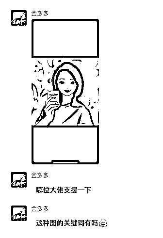

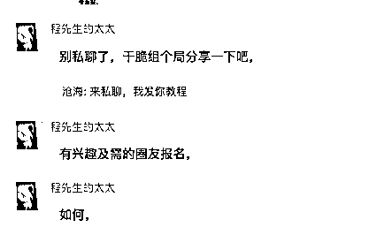

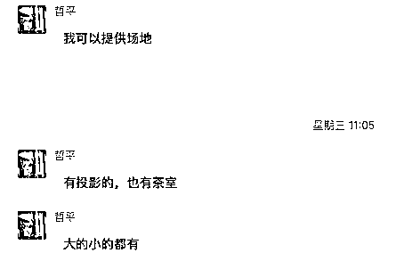

我是沧海，做了 6 年 SaaS 产品经理，最近对 AI 特别感兴趣，欢迎随时交流～