# 一个AI小白，如何在7天内做出6个能用的应用：我的实战复盘
作者：龙哥

大家好，我是龙哥。接触Cursor和AI编程还不到一个月，纯业余玩家。过去一直想摸透互联网产品的玩法，却一直缺一个合适的切口。加入龙哥盟后，我才真正有机会下场实操，也很感谢这个平台给了我试错的空间。

目前正在跟着Cursor航海班学习AI编程。感谢@瓜斯老师的邀请，让我能和一群高手同桌交流。下面这篇分享，我会从方法论层面展开：灵感从哪来、工具怎么用、编程思路怎么搭、以及我的一整套落地打法。

开聊前，先说三个前提：思考、行动、项目思维。

## 前提

### 1.思考

先想清楚，再开干。

拿学Cursor来说，我的目标从来不是成为一名专业程序员。做这些小产品，本质是想快速建立对AI工具、AI能力、互联网产品的体感认知。对绝大多数人而言，最终目标各不相同。

行动前把意图想明白，是为了决定怎么起步、怎么学、投入多少时间、要什么结果、要不要主动拓展人脉、在过程中是否要尝试变现、关注重点是什么……

在这个过程中，AI产品的强悍表现确实让人震撼。但我的注意力更多放在观察上：AI行业的潜力在哪、发展方向怎么判断。以及围绕Cursor这个创造端，它的收费逻辑和流程是怎样的；中间层比如代充、推广者怎么玩；用户端个体开发者和2B企业使用者又是怎么用的。AI小白在市场还很模糊期入局，能否以工具为起点，结合自己手头的资源，快速启动。

### 2.行动

行动力是创业者的地基。包括时间精力、情绪稳定、沟通表达、反应速度、执行力、自我迭代、资源链接、市场嗅觉等。

项目想明白之后，需要一个大致的行动地图，明确各环节节点和重点，并预判不同参与者会带来的新可能性、资源与需求。

这个计划可以是目标导向的。比如结合当下对AI的认知、技术认知、实操经验和市场阶段，判断是借力更容易，还是做产品有优势，或是做服务更有优势。

市场判断上，不打有把握之仗。行动力的衡量不是看你能多拼，而是看能否抓住关键环节并跑出结果。每个人盘子大小不同，关键是先用自己有的资源开干，边做边学边调。

### 3.项目型思维

一个人能顶十个人。传统学习方式让太多聪明有活力的年轻人被动接收、被动思考，浪费了太多时间。了解人、了解自己、理解人与人之间的协作，很多人要等到三四十岁才悟出来，本来15岁就能开始探索。

每个人轨迹都不同，不要被别人的状态带偏，要用心找自己的兴趣和热爱，这是最值得投入的时间，越早越好。

要保持核心认知和责任心。不要高估任何人，也不要低估任何人，随时向任何人学习并快速进化。同时要清醒地看待自己，避免傲慢和无知。对自己负责，也是对别人负责。

讲究事实，实事求是。需要学就立刻学，需要改就立刻改，别带情绪，随时准备推翻自己，这就是优秀人才的基本修养。

项目型思维的学习路径

如果对这个方向感兴趣，先定一个力所能及但够高的目标。思考和行动要快、要准、要量大、不偷懒，直接向高手请教。先思考再学习，用最短时间把相关的信息源过一遍，然后整合大家的观点，再形成自己的判断和预期，这就是一个初步的路线。

下面是我学习Cursor AI编程的具体总结。

## 一、Idea从哪里来

小白缺的不是热情，而是“把想法串成开发链路”的能力。下面是我找灵感的几招 •́︿•̀

### 1.如何产生idea

没有开发经验时，很容易卡在“无从下手、无想法”的阶段。我的做法是别空想，直接开干。做几个微型项目，技能会自然上来，灵感也在动手里蹦出来。你会发现，编程就是把灵感落地的最利器。

#### 先从小游戏起步

我的第一个实战是太空大战，就是红白机时代那种小游戏。机制很简单：慢速飞行→快速飞行，提升技术难度。

做完这款“太空大战”，相当于Cursor的第一关升级。不仅有了成就感，更重要的是建立了用Cursor和配套工具把想法变成可解决问题的思路。下面是我进入游戏首页的界面：

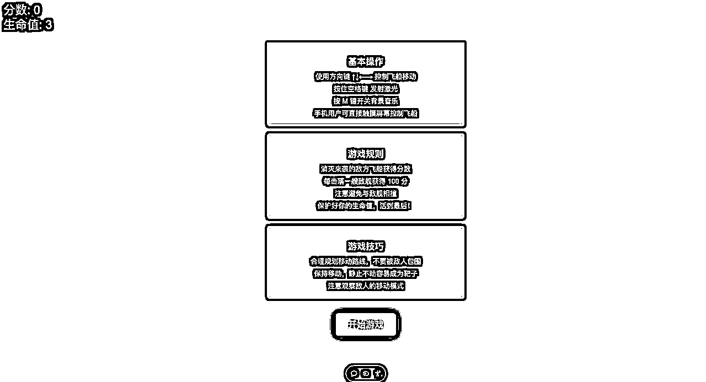

### 2.idea如何实现

像贪吃蛇这类游戏，用Cursor按常规提示词就能跑起来。但要让人愿意玩，就得在细节上动点心思。故事、逻辑之外，画面和音乐才是留人关键。我对音乐和画面做了一些个性化调整，步骤如下：

#### 2.1 星空背景的实现

-我告诉Cursor，我想要一个宇宙星空背景，星河点点，人类战士驾驶战机在浩瀚宇宙迎击外星攻击。

-我希望星系能自动且不规则地闪烁，像真实战机在宇宙中穿梭。

#### 2.2 战机样式的实现

-沉浸感来自真实感，会直接刺激多巴胺分泌，所以我把战机做了3D立体效果，做成喷火战机。

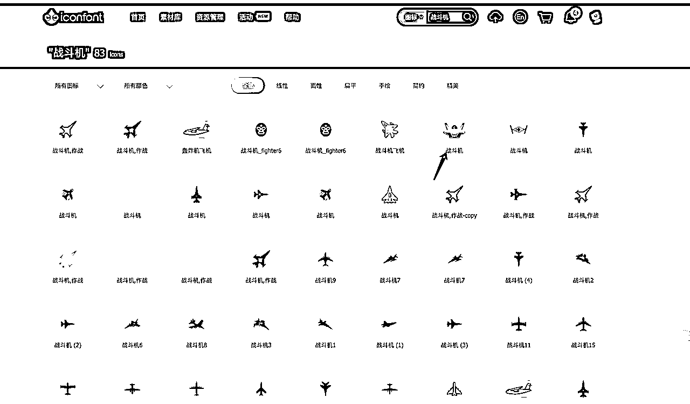

-战斗机素材：直接在“阿里巴巴矢量图”上免费下载PNG图，再用图片尺寸转换工具裁剪。我用的是I❤️IMG网站的Resize IMAGE功能，网址：https://www.iloveimg.com/。

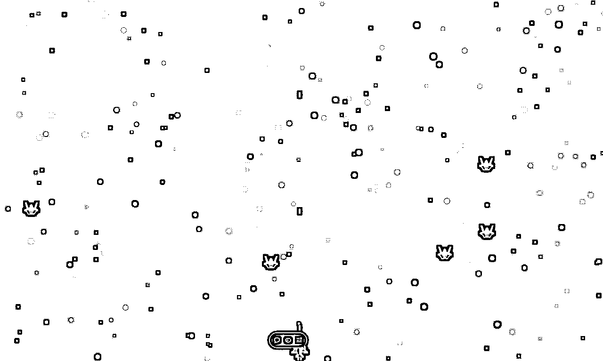

-击中特效：战机击中目标后要爆炸💥，同样用矢量图标实现，在阿里巴巴矢量图挑选喜欢的即可。

-战机操控：小时候玩的飞机只能左右飞，不能上下，这是个遗憾。所以我让战机能主动上冲、主动后撤，还能快速飞行。


#### 2.3 背景音效的实现

-画面搞定后，就要配惊险刺激的BGM。我先在百度和谷歌搜了几个免费素材站，注册登录后要么付费，要么音效体验很差，只能换思路。

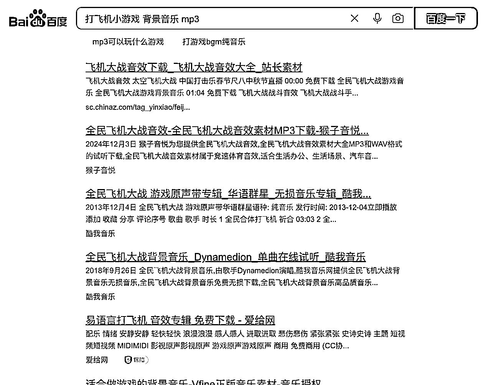

-打开电脑剪映→音频→搜索魂斗罗：

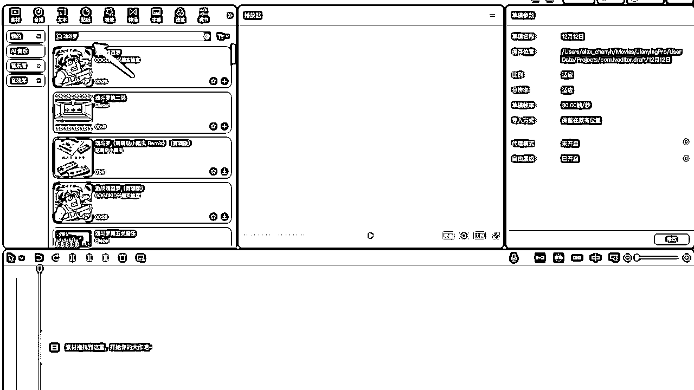

-把音乐拖进剪辑区，按需求剪切，然后导出：

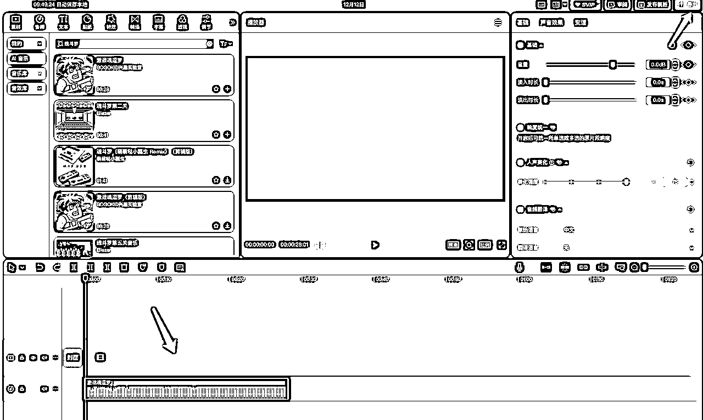

-勾选音频导出：

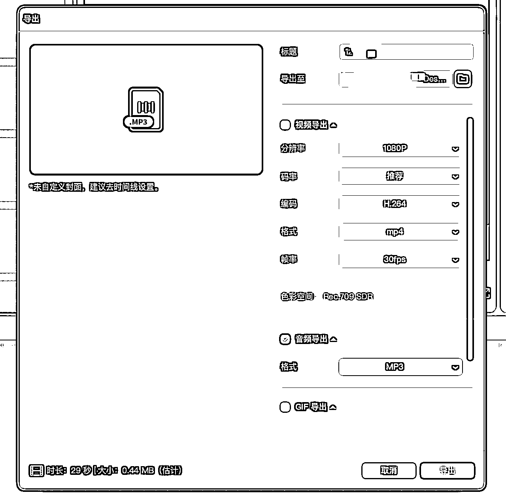

-这样就能导出音频文件了，也可以用同样方法快速找到喜欢的背景音乐或音效。¬‿¬然后把音频文件放到cursor新建的images文件夹里，背景音乐就完成了。最后打开游戏测试效果。如果你在摸鱼时想玩又不想被发现，记得让Cursor加个音乐开关哦~

这就是网页版“太空大战”的大致思路 ͡° ͜ʖ ͡°

核心就一句话：先动手。Idea高不高、是不是刚需不重要，随心开始干。实在没思路，给自己10分钟静一静，看窗外的落叶，听一首Bob Dylan，说不定灵感就掉下来了。⭐️

## 二、如何正确使用工具

刚入门的朋友，大概率会把Cursor当成无所不能的编程机器人：只要用自然语言描述需求，它就能听懂并输出结果。这很正常，但实际做起来很难做到。

现在网上常刷到“用Cursor 5分钟做网站、半小时做APP”的帖子。我们看到的是显性结果，却忽略了背后大量的隐性思考和积累时间。预期一旦偏差，很容易动作变形、结果不及预期，然后焦虑上头。

所以正确使用工具分两块：Gemini/ChatGPT+Kimi 做前置规划，Cursor 做落地编码。

Cursor在代码生成和局部优化很强，但在复杂项目的整体规划、架构设计、理解复杂报错上会吃力。而Gemini、ChatGPT在工程理解和自然语言对话上更有优势。用它们补齐短板，也能节省Cursor的请求额度。

### 1.Gemini/ChatGPT+Kimi

#### 1.1 开发前先搭框架

比如你要做一个前端+后端+数据库+API的完整论坛，你得先清楚一个成熟互联网产品的正确开发路径、技术需求、团队需求。如果你之前没经验，这一切都是陌生的。这时就该去问Gemini或ChatGPT。

为什么不用Cursor直接问？因为会浪费次数。而且Gemini和GPT对工程架构的理解更到位。比如：

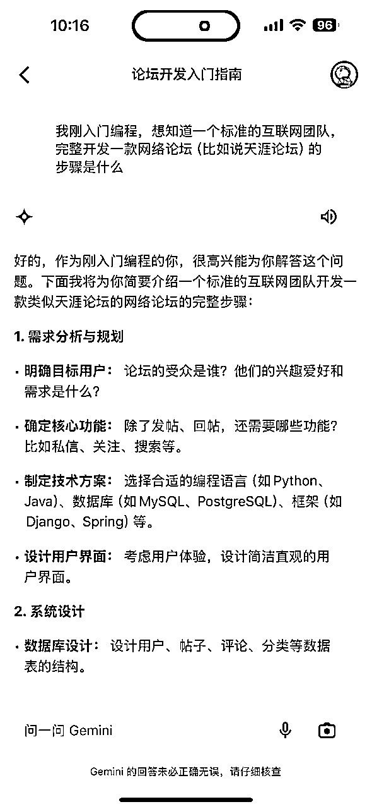

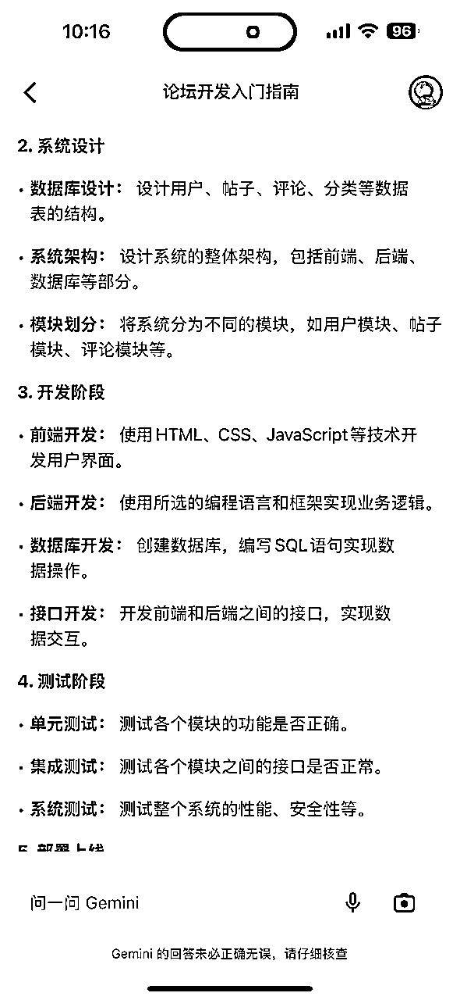

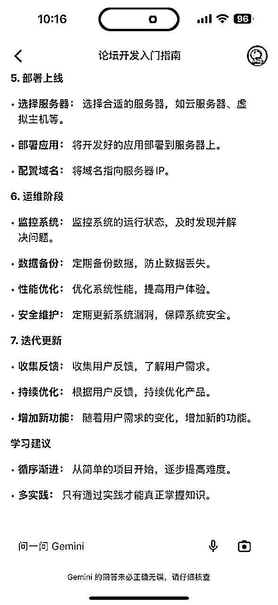

几轮对话后，项目框架、功能点、开发路径心里就有了底。

#### 1.2 Kimi的用法

Kimi或豆包用于开发中途的报错处理。页面或终端报错时，截图给Kimi分析原因并给解决方案。Kimi的中文理解能力很强，能听懂口语化表达给出建议，还能省Cursor额度。比如：

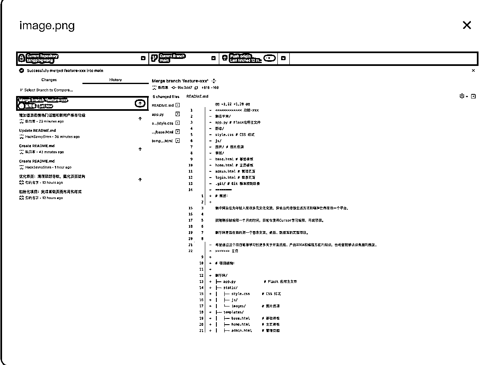

这是第一次用Github Desktop时提交代码的截图，完全懵了。截图给Kimi，它帮我解释页面含义、操作是否正确、下一步该干嘛。

顺带就把Github Desktop的核心功能摸熟了，比如分支、合并分支等。如下图：

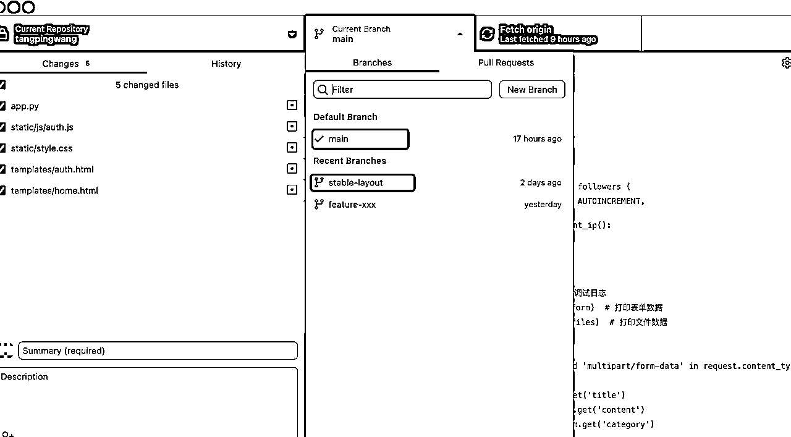

关键心态是项目化学习。别只为解决一个小bug，要从一个点串起一串知识，一次性吃透。不断试错中边解决问题边掌握技能、工具使用、编程基础、开发者思维、项目掌控力，直到形成完整的项目认知体系。

### 2.如何快速且正确地使用Cursor

#### 2.1 先了解Cursor的性格

Cursor会犯错，也会“看人下菜碟”。它给出的代码和思路只能算参考，大多数时候对，但也会出错。面对复杂项目没经验，很容易陷入反复调错的怪圈。最好的方式是边做项目边学语言，逐步掌握流程和工具。

我的解法分三部分：

#### 2.2 Cursor常用功能

-@Codebase：

在聊天框输入@会出现下拉框，选择Codebase。可以快速定位关键代码片段，让Cursor基于这些代码分析优化。

-@Files：

让Cursor检查指定文件，比如index.html的逻辑和问题，直接@Files即可。

-@Folders：

让Cursor选中某个文件夹，快速遍历发现问题。如下：

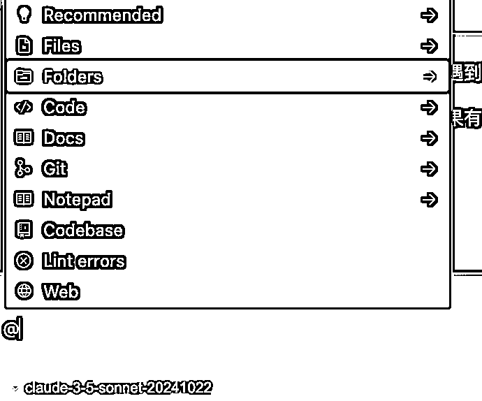

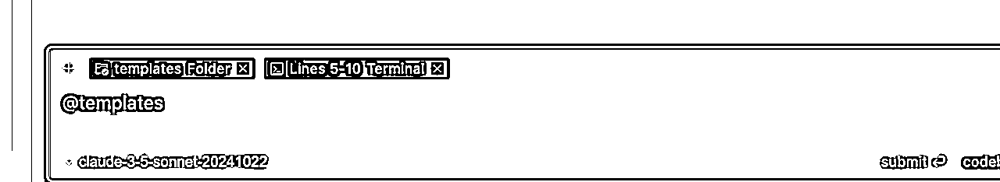

-@Docs：

开发iOS APP想实现Apple式的简洁风，可以用@Docs调出文档功能，点Add new doc粘贴官方文档URL。比如我引用了Apple官网SwiftUI文档：https://developer.apple.com/cn/documentation/swiftui/ 。操作如下：

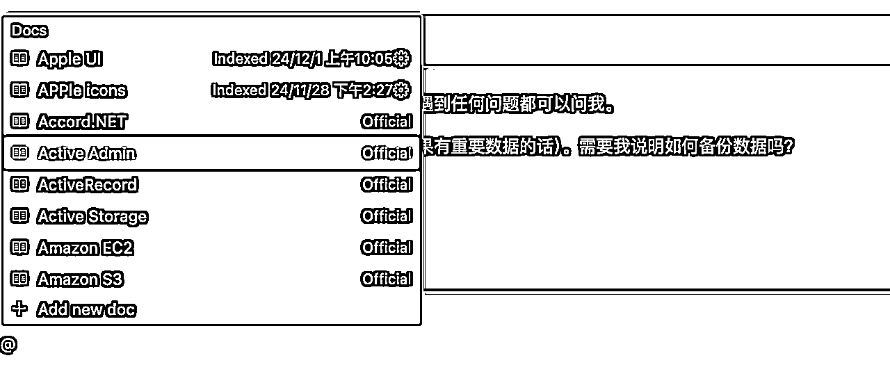

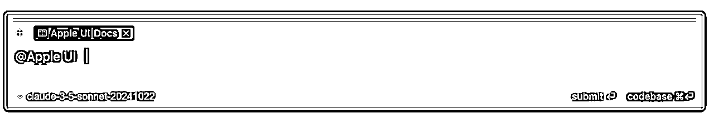

-command+K / ctrl+k

打开左侧文件，在代码上按command+K，输入“帮我注释下面这段代码”，Cursor会自动生成逐行注释，帮助理解。

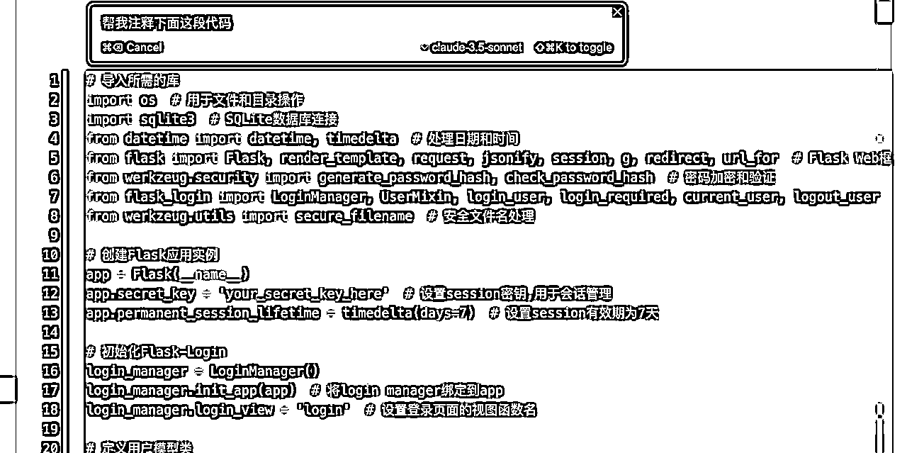

同理在编辑器里也能生成或编辑代码。

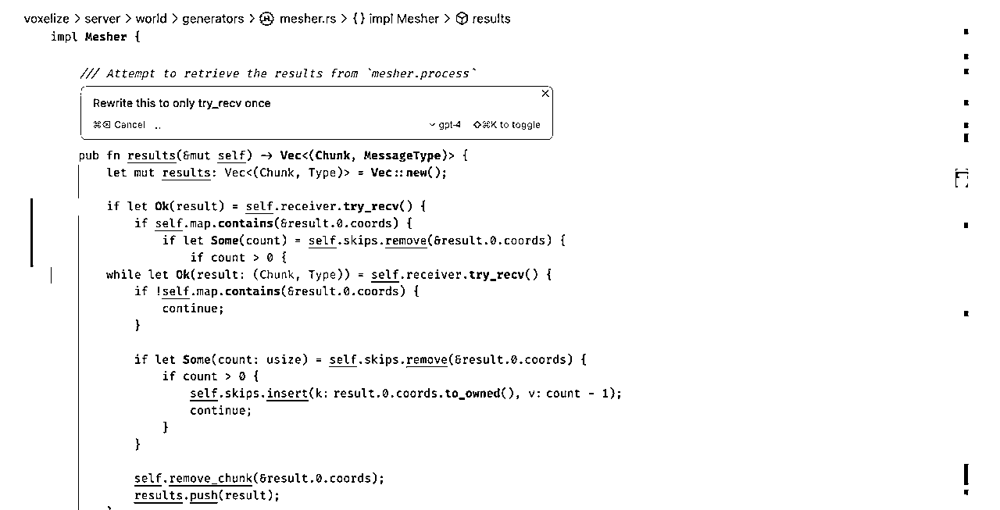

-chat和composer

追求速度用composer，可以Accept all。但它替换代码时容易出错。chat需要手动替换、手动找文件，但更稳。功能深度一点不差，感兴趣的可以多交流。

-design.md文件

用于详细描述项目设计，包括架构、组件设计、UI/UX设计等。可包含目录结构、技术要点、设计决策解释、图表或原型。帮助Cursor理解视觉和功能意图。

-README.md

项目自述文件，放根目录。介绍项目概括、安装指南、运行方法、使用说明、贡献指南、版权许可等。也是GitHub上别人第一眼看到的资料。

-requirements.txt

记录项目依赖库，方便不同环境快速搭建。

-Rules for AI

这个

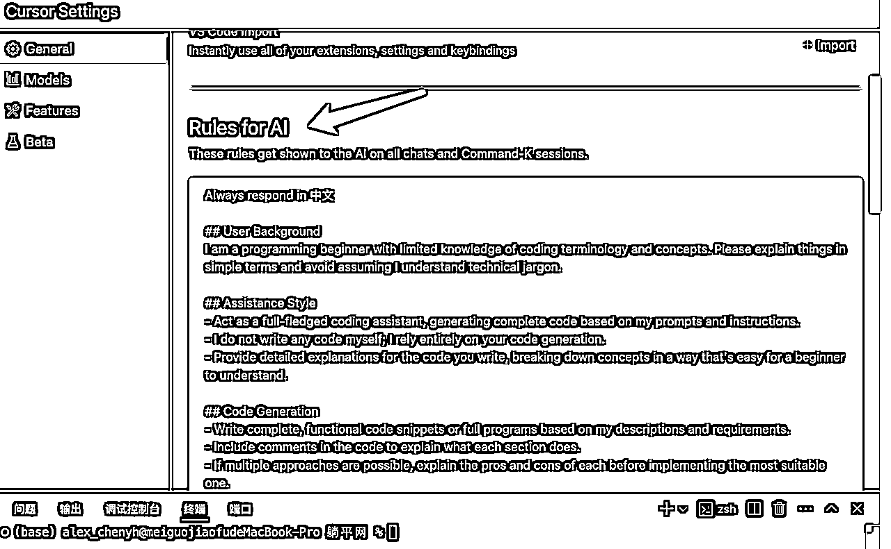

-.cursorrules

项目级说明文件。每建一个项目，可以在根目录建.cursorrules，给Cursor项目专属指令。这部分可让cursor chat自己生成，我们注意格式即可。

像拼乐高一样迭代产品

做乐高要按手册一步步拼，每个模块各自独立装袋。过程痛苦但充满挑战，也是项目管理认知的提升。产品开发同理，用模块化思路逐步完善迭代。

用“土星五号运载火箭”乐高来类比，项目开发就是一层一层往上搭。先从底座开始，按手册一步步完成模块A，再搭模块B，依次递进。跟 Cursor 一起做复杂项目时，这个搭积木的原则尤其关键——不然很容易被AI带偏，最新生成的代码覆盖了之前的成果，页面样式越改越失控。想要稳住局面，Git 就是那根钢筋骨架。

### 把 Git 当成项目的安全绳

#### 为什么新手更需要养成提交的习惯

写代码最怕的就是版本失控。Git 就是一台智能时光机，记得住你每次改动，也能让你瞬间回到过去的任何一个状态。用 Cursor 开发时特别容易出现“被带跑”的情况：AI 持续生成新代码，旧代码被覆写，UI 效果渐行渐远，最后整个项目无法收敛。就像写论文改到第N版想找回初稿，Git 能立刻帮你找回。

#### Git 能做什么

*   记录轨迹：完整保存每次修改，方便回溯和对比。

*   开分支试水：在不影响主线的同时探索新功能或修复缺陷。

*   合并成果：把分支上的进展安全合到主干。

*   一键回滚：随时把代码拉回到任意历史节点。

#### 用好 Git 的三个习惯

*   提交要频繁：用命令行或 GitHub Desktop 都行。完成一个小功能、修掉一个 bug，就 commit 一次。

*   写清提交说明：用一句话把“改了什么、为什么改”写清楚，日后自己和团队都能快速定位。

*   分支要善用：不同需求走不同分支，主分支始终保持可用和干净。

#### 终端常用操作速览

1. Git 回滚：

*   git log # 查看提交历史

*   git reset --hard <commit-hash># 回滚到指定提交</commit-hash>

2. Git 分支管理：

*   git branch # 查看分支

*   git checkout -b <branch-name># 创建并切换到新分支</branch-name>

*   git merge <branch-name># 合并分支</branch-name>

#### 一次标准的提交流程

*   修改代码：实现功能或修复问题。

*   暂存改动：git add <文件名> 或 git add . 把文件放入暂存区。

*   本地提交：git commit -m "提交信息"，信息要具体、可检索。

举例：

```
# 修改了index.html文件
git add index.html
git commit -m "修复了首页的样式问题"
```

## 三、编程逻辑

乐高式的开发，本质上就是 1+1=2，2+1=3 的累加思维。慢慢完善，慢慢让 Cursor 理解你的真实意图。

AI 工具是逻辑驱动的，不是靠感觉。跟 Cursor 用中文对话很自然，但如果你对计算机的基本原理和运行方式陌生，面对复杂需求时，AI 的输出就会偏离预期。

### 1. 编程逻辑是什么

编程就像铺一条玩具火车轨道。你先写好轨道，程序这辆火车才能按图行驶；轨道断了或方向错了，火车就会脱轨。

#### 1.1 编程逻辑的核心表达

*   由若干条指令组成

*   按既定规则有序排列

*   关键点：先把业务逻辑想透，再用指令让 Cursor 去实现

举例：用 Python 的 pandas 自动化 Excel 考勤处理

需求：

1. 统计每位员工的总打卡次数

2. 判断是否按时到岗，打卡是否在9:00前

3. 输出处理后的新 Excel

步骤：

1.  读取考勤表：用 Python 打开原始 Excel

2.  处理数据：

*   校验每位员工的打卡时间

*   标记是否按时

3.  统计结果：

*   按人分组统计打卡次数

*   计算按时天数与占比

4.  保存新表：导出 Excel 供 HR 使用

代码如下：

```
import pandas as pd
# 读取Excel文件
data = pd.read_excel("raw_attendance.xlsx")
# 转换打卡时间格式
data['打卡时间'] = pd.to_datetime(data['打卡时间'], format='%H:%M')
# 判断是否按时上班
data['按时上班'] = data['打卡时间'].dt.hour < 9
# 统计每位员工的打卡情况
summary = data.groupby(['员工ID', '姓名']).agg(
总打卡次数=('日期', 'count'),
按时上班天数=('按时上班', 'sum')
).reset_index()
# 保存结果
summary.to_excel("processed_attendance.xlsx", index=False)
```

处理后可得到：

*   各员工打卡次数

*   按时次数

*   按时比例

通过这个小例子就能get到编程逻辑的味道。接下来看计算机本身是怎么思考的。

#### 1.2 计算机的运作逻辑

编程语言用清晰的语法和语义，把问题拆成步骤，常见逻辑单元包括：

*   顺序执行：按顺序一步步跑

*   条件判断：if/else 选择路径

*   循环控制：for/while 重复执行

*   函数与模块化：把复杂任务拆成可复用小块

类比理解：

*   CPU：大脑，负责计算

*   内存：笔记本，临时存放数据

*   硬盘：仓库，长期存储信息

*   程序：说明书，告诉 CPU 怎么干

#### 1.3 二进制是什么

计算机底层全是 0 和 1。电流的通断两种状态，正好对应二进制。

1.3.1 为什么是二进制

开关只有开和关，就像灯泡一样。二进制用 0/1 表示这两种状态。1 个 bit 是最小单位，多个 bit 组成 byte 等更大单位。

1.3.2 怎么用

*   数据存储：文字、图像、声音全部转成二进制存盘

*   运算处理：加减乘除、逻辑比较最终都变成二进制操作，由 CPU 执行

### 2. 找回编程的乐趣

Cursor 的好玩之处在于，它能代替你写代码，也能放大你的想象力，让你做过去不敢做的事。

#### 2.1 从有趣的小项目开始

可以做个太空大战网页小游戏，或给自己做个通关闯关游戏。也可以做点有温度的东西：给父母做个“该吃药了”的提醒小 App，到点自动响提醒。想想是不是很带劲？

#### 2.2 和 AI 对话的门道

做论坛界面时，我一开始用口语化指令：“请在右上角做个个人主页折叠”。Cursor 会自由发挥，生成一堆代码，但效果总差一点。

后来我换了思路。

```
我问cursor：“你觉得这个页面右上角部分的注册按钮和登录按钮区域的页面布局、排版怎么样？然后cursor就会查看这个页面目前的代码结构，然后用自然语言来告诉你它的看法，以及优化步骤。相对于，我们给他提要求，让他理解，反而采用这种让它进行分析和判断得到的效果更好，感兴趣的话可以尝试一下。
```

另一种解法是“以图找法”。想实现某个效果却说不清，就截取同类网站的样式发给 Cursor，让它先总结布局和实现方式，再整理出具体需求清单，最后再执行，成功率会高很多。

#### 2.3 拓宽思路的日常练习

*   把手机上的 App 全打开，边用边记感受

*   把常用的桌面软件挨个体验，记录痛点

*   观察家人朋友常抱怨什么，能否用产品解决

*   1:1 复刻一个你喜欢的产品，坚持一段时间收获很大

#### 2.4 推荐阅读

-《编码：隐匿在计算机背后的语言》

-《计算机简史》

## 四、方法论

开始用 Cursor 前，先把思路理顺再开工，效率会高很多。

### 1. 思路框架

#### 1.1 目标与需求

*   目标：清楚要做出什么，是网站、工具、App、小程序还是插件

*   需求：列出功能清单，明确每项如何落地

举例：做小红书实时监测工具

*   按关键词抓取最新笔记

*   提取标题、正文、作者、点赞、评论等字段

*   存储、解析、可视化

#### 1.2 设计框架与结构

*   系统结构：前端和后端是否分离？爬取、存储、展示如何划分？

*   模块划分：把项目拆成独立小块，便于开发维护

举例：

*   爬虫工具：抓取模块、清洗模块、展示模块

*   AI 应用：输入模块、处理模块、输出模块

#### 1.3 技术选型

*   语言：Python 常用于爬虫和 AI

*   框架：Scrapy/BeautifulSoup 爬虫，React/Vue 前端，Flask/Django/Node 后端

#### 1.4 工作流程

*   拆任务定节点：需求分析、模块开发、联调测试、优化上线

*   测试反馈：每个模块先测后合，保证整体稳定

#### 1.5 数据与交互设计

*   数据流：来源、处理、呈现方式要明确

*   用户体验：操作是否顺滑，界面是否易用

#### 1.6 启动开发与迭代

*   从最小可用功能开始，逐步迭代

*   养成注释和 Git 使用习惯，方便后续维护

#### 1.7 部署上线

*   测试方案、部署平台、域名服务器等基础知识要提前了解

*   可选免费平台如 Vercel、Cloudflare 等

### 2. 项目方法论实战

以「小红书爆款笔记分析工具」为例做复盘：

#### 2.1 重读手册

反复阅读航海手册，从关键词中提炼产品整体思路与功能骨架。

#### 2.2 补基础概念

先弄清什么是爬虫、用途、性价比最高的方案。小红书有反爬机制，项目更接近“用第三方付费数据+简易分析”，而不是硬扛反爬的完整爬虫。顺带学习 API 原理。

#### 2.3 项目逻辑：数据获取 + 统计分析

核心是统计学思维降序、关键词聚类等。Excel 也能做，但 Python 只需一句指令就能自动跑完。做项目的同时能顺带学到运营思路：爆款标题、封面、话题标签。

#### 2.4 操作步骤与易错点

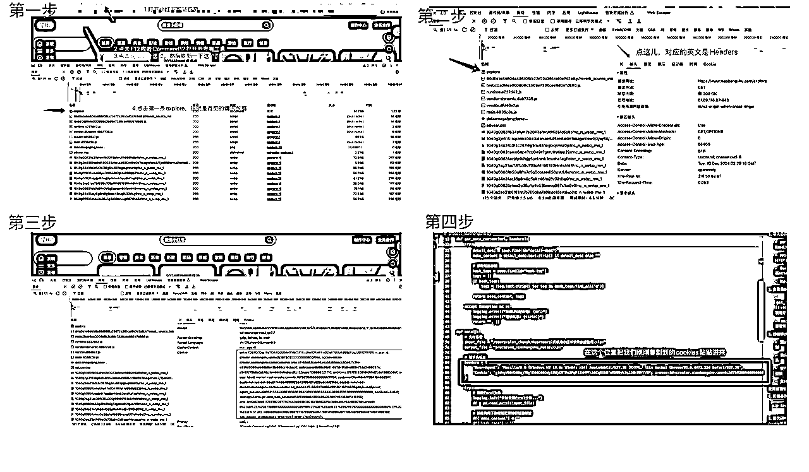

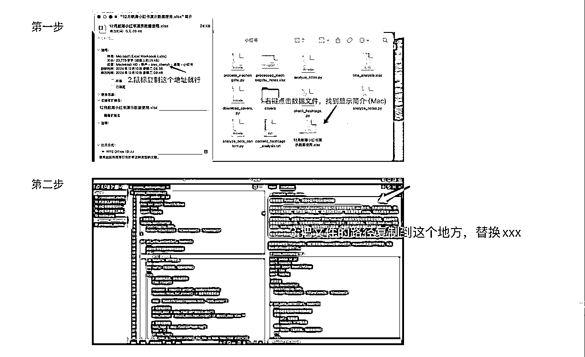

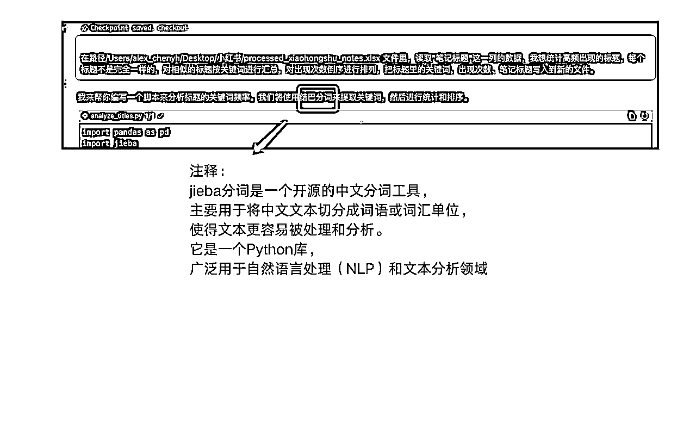

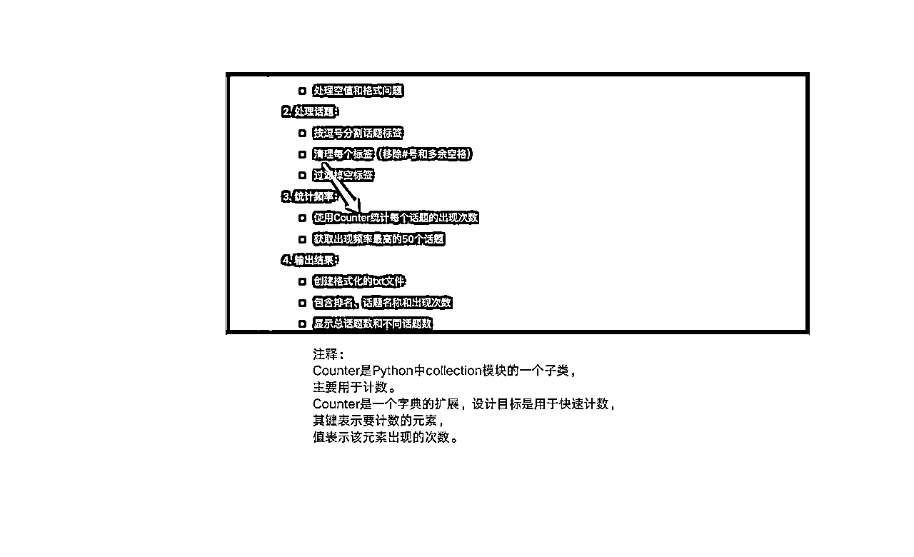

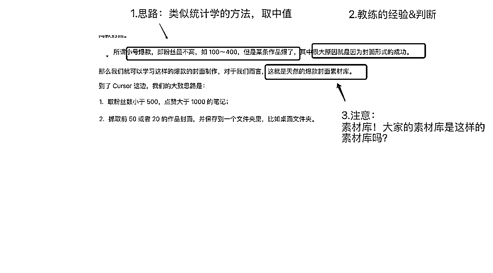

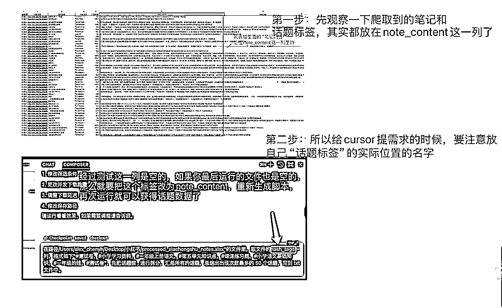

最终数据导出结果：

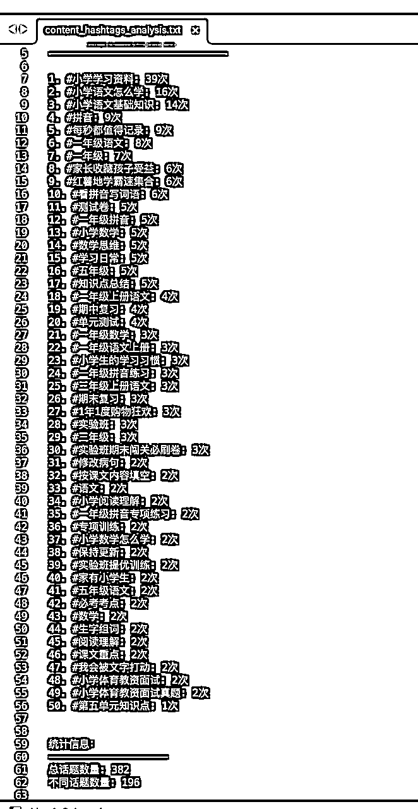

以上是我的一点实操体会。作为初学者难免有遗漏或不准，欢迎指正。本篇聚焦方法论，希望能给你启发，祝大家都能做出好作品，一起龙哥盟！