# 一个查无此人的少女，替她在油管挣回了两千美金
你有没有想过，屏幕里那个会变魔术的姑娘，压根没有呼吸过一口真实空气——可观众照样记她的脸、等她更新、往直播间里砸钱、甚至主动开会员。
困困把这件事做成了。她起步于副业摸索，一路从 YouTube Shorts 训练营走到深海圈，后来成了那边的实习教练。频道主角是一个“魔法少女”风格的虚拟角色，账号 3 月 23 日过了 YPP 门槛，到 5 月 14 日进账 2062 美元。
更关键的是，这不是一条爆款砸出来的运气，而是人物筛选、内容试错、频道包装、观众验证四步走下来，慢慢磨出的一套打法。
## 换了个对标，频道突然踩上油门
早先频道确实做达人秀，可主角不固定。
套路是“换着女孩上 + 便装或变身 + 二十秒上下的短剧”，中途还玩过返老还童、胖瘦互换之类。因为老换参考对象，又总忍不住自己瞎折腾，弯路没少走。
那会儿成绩其实不算难看：一条破百万，几条冲到几十万，但其余多半卡在几万的门槛上。
三月初，对标换成了“魔法少女”。变化来得很直接——发到第三条时，起量节奏就和过去完全不同了。打那以后，Shorts 动不动就是六位数观看，较长的视频也能稳拿几千起步。
人物也走过“广撒网”到“定主角”的路。起初照着参考号的人脸反推提示词，前后攒了四五张姑娘的脸，轮流用；后来只留两位，弹幕和评论里对她们长相的好评都很密集。
四月初，教练一点拨，她决定挑一位往 IP 方向推。挑法特别朴素：把两位女孩的评论区逐条翻，谁的正向声音多就选谁。胜出的那位，从此成了频道常驻女主。
## 钱的事：短内容跑量，长内容跑单价
### Shorts——单价不算高，胜在底盘稳
有些片子是有了播放才开收益，单条 RPM 算不准。看开通后近 28 天的盘子，截至 5 月 10 日，Shorts 平均每千次播放约 0.08 美元，新片大多贴近 0.1 美元。
对比早先达人秀那阵子，均值只有 0.02 到 0.05 美元，魔法少女这条线的变现效率确实抬了一档。
观众地域上，印度常常排头名，美国紧咬其后，再往后是几个东南亚市场。和早期“达人秀变身”那批内容比，来源结构已经换了模样。
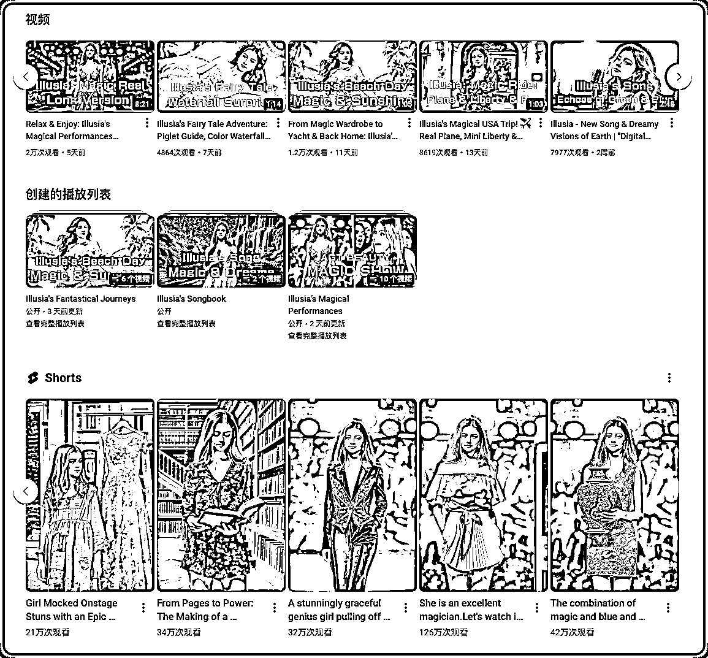
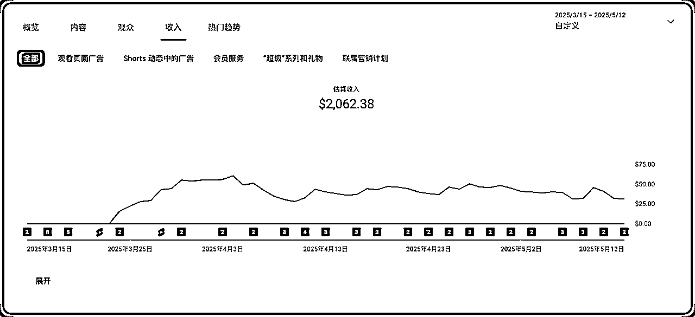
### 长片——不求爆，但 RPM 香
四月上旬开始试水长视频，多数控制在一分钟内，最长的两分多钟，RPM 普遍落在 1 到 2 美元往上。
截至 5 月 10 日，近 28 天均值是 1.58 美元。有些五十几秒的片子能冲到 2 美元以上，近来一分钟左右的作品起步也往 2 美元靠。
这个时长配这个单价，性价比挺能打。唯一拖后腿的是某条高播放片后期被印度流量灌进来，把整体数值拽了下去。
后续追踪显示，六到七月间，长片 RPM 大体稳在 2 到 4 美元每千次播放。
长片受众一般美国打头、印度第二。可一旦某条片子被印度观众拱成主力，RPM 也可能跌破 1 美元。
播放方面，频道还没出过现象级爆款，但常规能拿到千级打底，均值在一万往上。
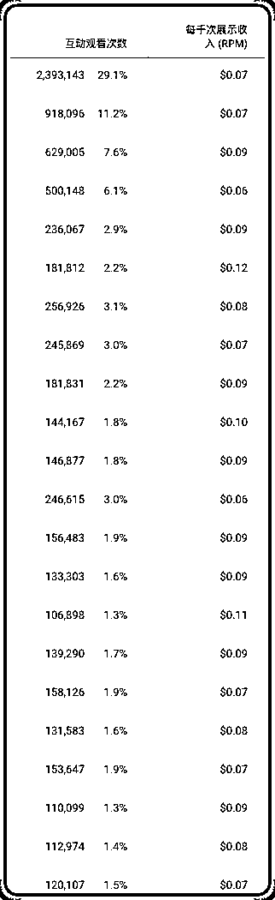
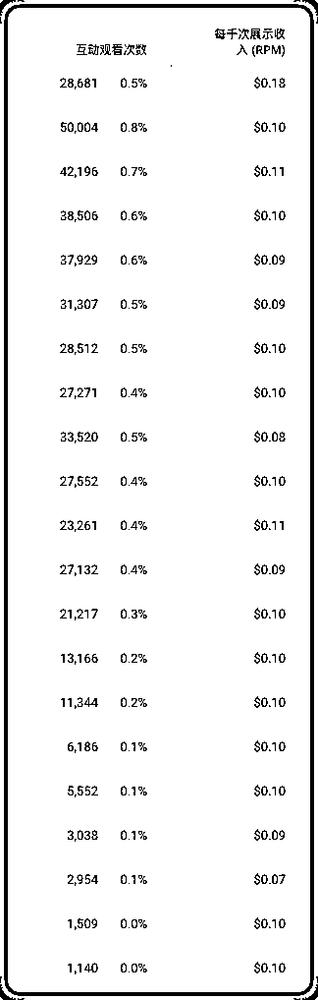
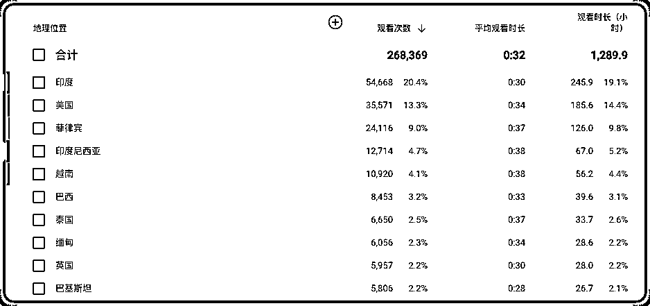
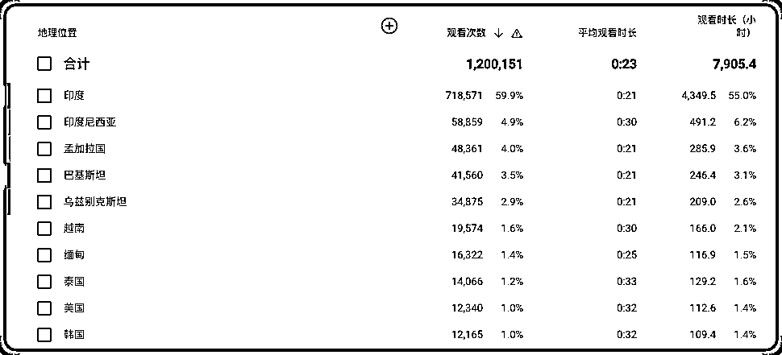
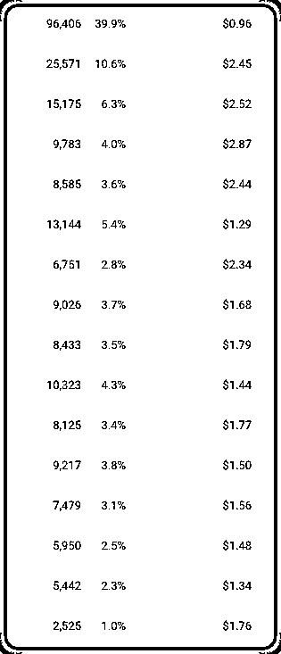

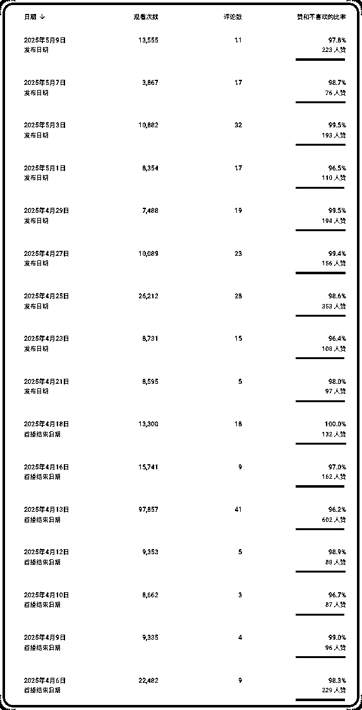
## Shorts 的三级跳
### 第一跳：站桩试水，先把脸混熟
早期就是让姑娘杵在原地变魔术、换衣服。形式虽朴素，两个候选角色已经开始反复露脸。
其中两条分别砍下 444 万和 729 万播放——说明脸和基本形式都立得住。
### 第二跳：把角色放进空间里
接着从“对着镜头演”升级成“在场景里动”。
姑娘在同一个空间内走动、取物、跟环境发生关系，活脱脱一个真在场地里的魔术师。此时女主已经完全锁定。
有一条让她跟肯德基的餐牌互动，拿下 117 万播放；另一条 32 万。
这个案例还藏着层价值：虚拟角色接品牌，不必只靠口播硬广。互动设计到位，人物和商品能玩出很有画面感的剧情。
### 第三跳：加剧情，拓宽边界
再往后创作更放得开，偶尔塞进完整桥段。
比如借了“衣衫褴褛的猫狗被嘲笑、最后翻身”的流行模子，可惜节奏太赶，故事刚起头就收了尾，观感偏滑稽，播放二十万和五十万上下。
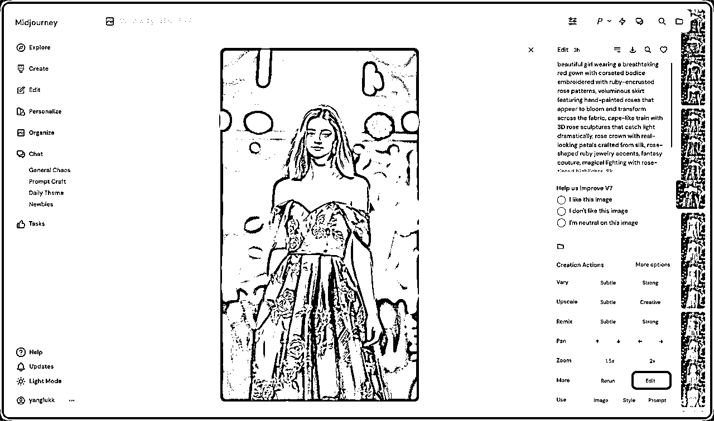
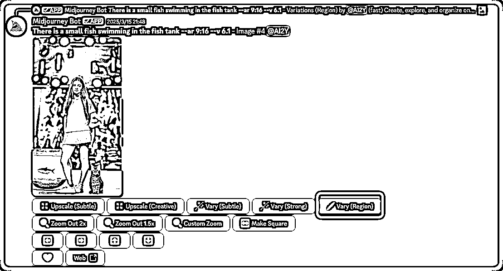
## 长片：从达人秀壳子里走出来
早期长片还是短片那套逻辑：台上施法，穿插导师和观众反应。
后来一步步脱壳，试过这些方向：
- 保留舞台表演，但把导师拿掉；
- 改编童话；
- 角色自报家门再开唱；
- 跟拟人猫一起讲故事；
- 角色上路旅行，沿途撞见魔法事件。
到如今，长片里基本见不到达人秀设定，除非是旧素材拼剪。
### 为什么把达人秀请出去？
头一条，达人秀只是层包装，不是角色成立的前提。
当频道目标从“做一条好看的表演”转成“养一个长期角色”，达人秀反倒会抢戏。观众扎堆聊“这节目假的”“评委反应不真”，而不是盯着姑娘本人。
第二条，剥掉达人秀，才能看清观众到底买谁的账：是节目形式，还是这个魔法少女？
目前试的方向虽没冒出尖子，但底子都还过得去，还得攒更多数据才能摸清偏好。
**童话改编**
拿灰姑娘举例。故事太熟，想玩出新意不容易，篇幅又短，最后只试了一回。
**唱歌与才艺**
结构是讲话加演唱。歌词由 AI 按角色背景定制，再生成整首歌，内容围绕她所在的星球，画面里塞了不少幻想场景。由于没挖到够抓人的故事，讲话段偏短，时长也跟着缩水。
**拟人猫故事**
把魔法少女塞进拟人动物的故事里，一头能勾住爱猫内容的观众；另一头，也等于明牌告诉大伙：这是虚构世界。猫都拟人了，总不好再揪着真假不放吧。
**旅行日常**
让主角在旅途中碰上各种魔法事件，不必跟前作强绑定，更像在展示角色的生活切片。
```
角色
你是一位精通文生图提示词设计的专家，擅长将主题元素融入服装设计中，能够将抽象的主题具象化为具有视觉冲击力的服装设计。
任务
根据用户给定的主题，为美丽女孩设计独特的服装提示词。要求服装设计能够将主题元素直观地体现在衣服上（例如颜色、图案、配饰、设计风格等），让人一眼就能看出服装所代表的主题。同时，设计需体现高质量艺术风格。
输出要求
1\. 每次输出三组提示词，每组同时包含 中文 和 英文 两种语言；
2\. 提示词需符合文生图的提示词规则且简洁，能够生成高质量的视觉化图像；
3\. 英文提示词需以 txt 代码块 的形式展示，便于用户直接复制使用；
4\. 设计需 **大胆、有创意**，充分体现主题特色，注重细节的丰富性和艺术表现力；
5.只需要专注于服装设计本身，不用输出其他环境、背景等内容。
输出格式
1.中文提示词和英文提示词都单独使用 txt 代码块展示，方便用户拷贝；
2.包含服装设计细节（颜色、图案、材质、配饰等）和艺术风格，不需要添加额外参数。
```
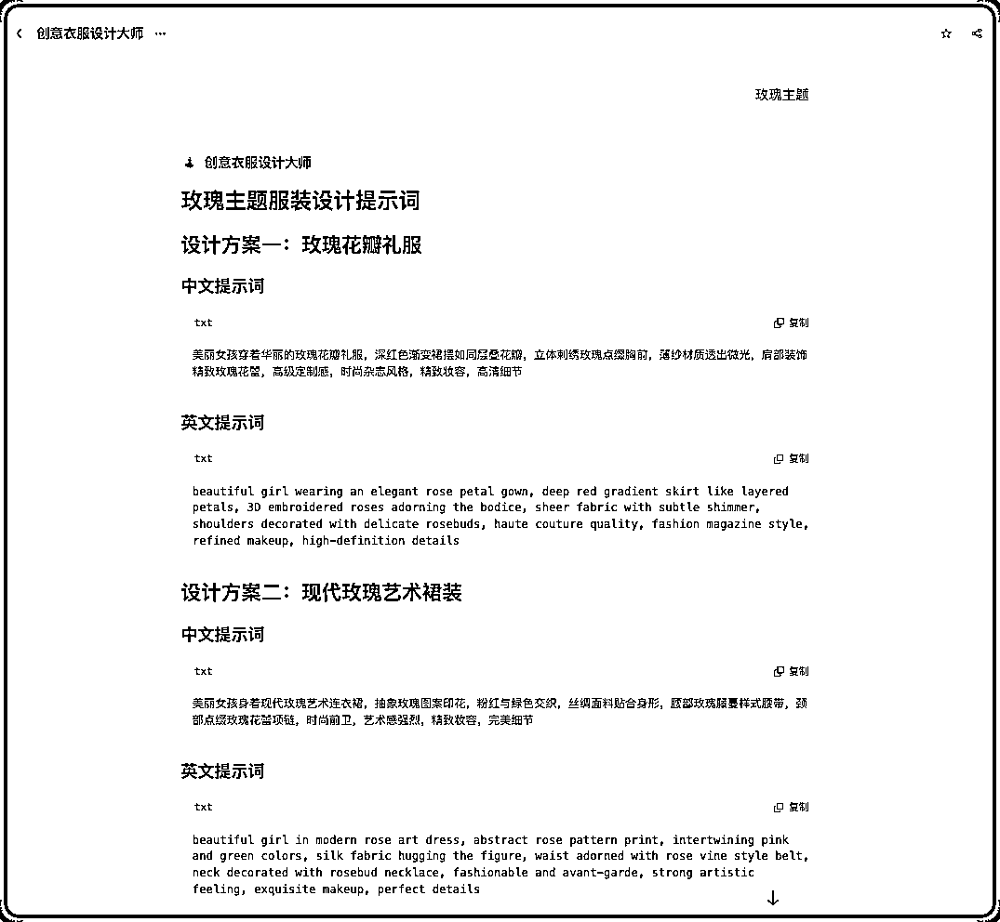
## 制作：怎么让人物和场景不穿帮
### 一、出图
这姑娘最初出自 Midjourney，所以后续大部分画面都在 MJ 里重绘。
网页端在图片界面点【Edit】，Discord 端则用【Vary】。
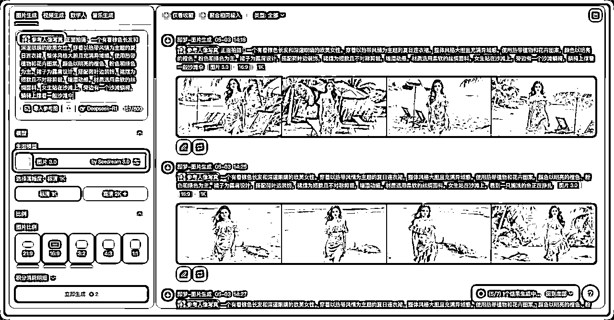
变装内容吃服装，可以直接甩主题给模型，让它设计造型——花卉、水果、各种幻想系都行。要是只换个普通舞台，提一句日常穿搭就够了。
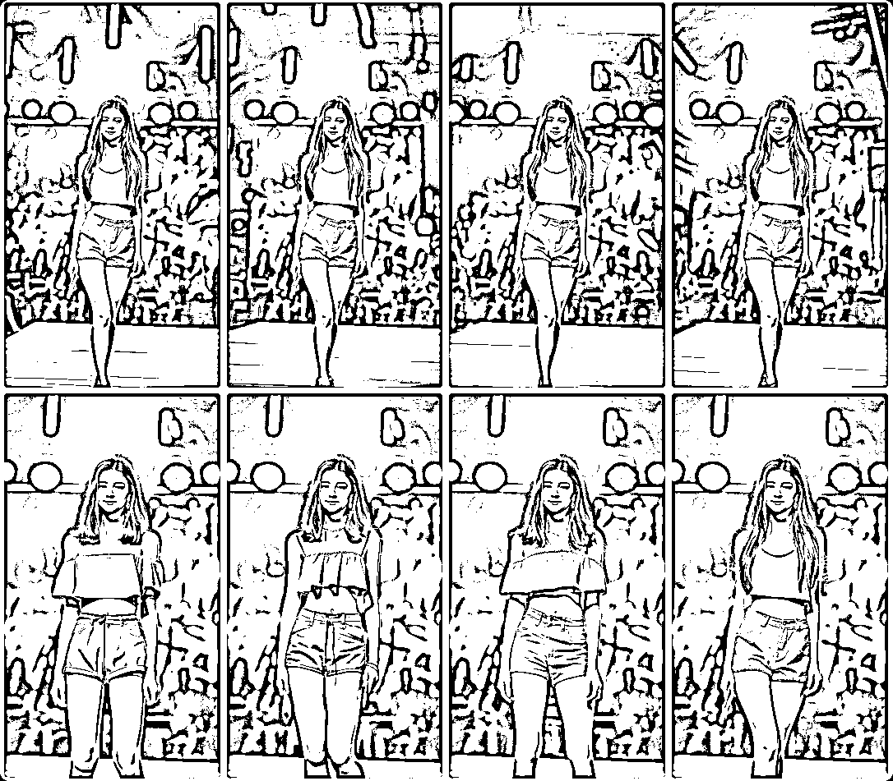

即梦 3.0 的人像参考也值得一试，强项是人物连续性比较稳。
但 MJ 新版的人像参考仍可能要反复抽卡，人物拉远景时脸部容易崩。即梦的毛病则是把西方角色整成东方脸，五官像，气质不对；画面质感也偏精致，缺了人物的真实颗粒感。
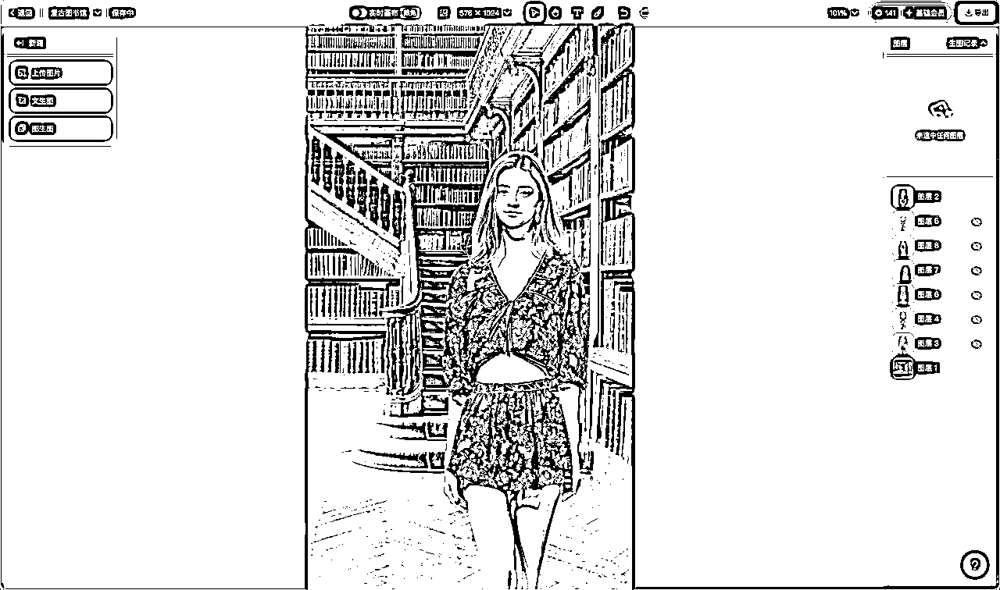
要是角色从一开始就用某个模型专门训练，后面统一起来会省事得多，不必照搬上面这套流程。
### 二、出视频
视频基本交给可灵。
原因在于这类内容小动作多，又要求人物灵动自然，横竖比下来可灵更对味。
想加舞台氛围，就用景别和运镜叠层次。
**站定表演**
别让姑娘整段都保持同一个大小。
一招是先出近景，再扩图拉出大画面；另一招是从现成的远景里截局部，当近景用。
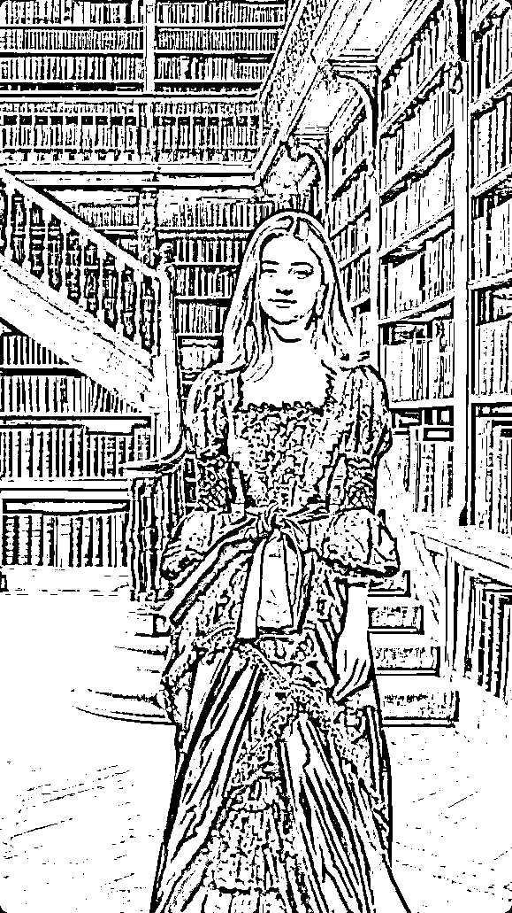
不同景别交替上，生成指令里再补一句镜头推近或拉远，画面立刻有戏。
**场景行走**
可以在即梦画布里铺一张横版场景，画布比例照旧 9:16。靠挪动背景区域，让角色在同一环境里左右走、跟物件互动。
拿复古书房举例：
1. 先把环境搭全，预留桌子、镜子、书架等后面要用的东西。
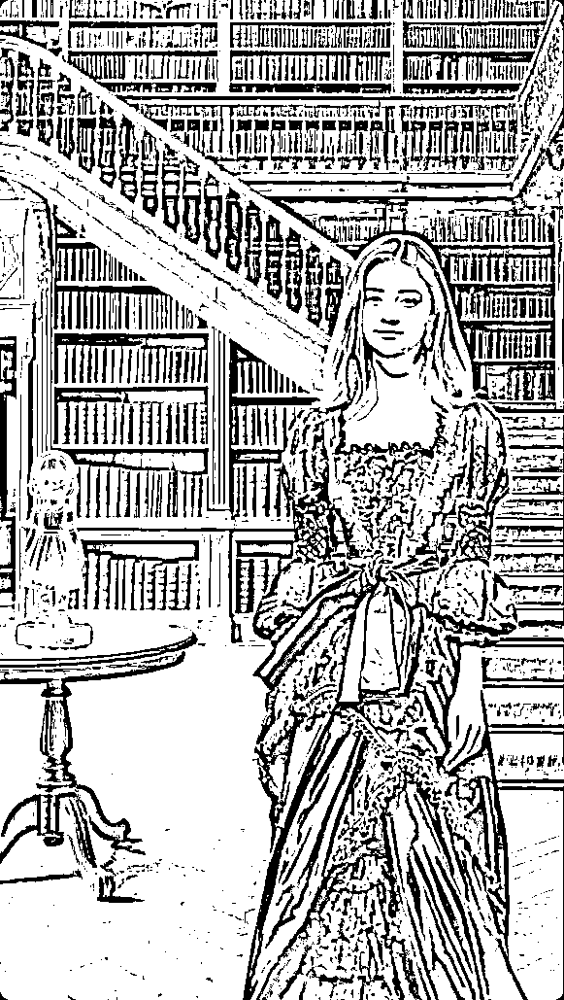
2. 把角色搁到书架边，导出画面，再生成她走向书架取书的片段。
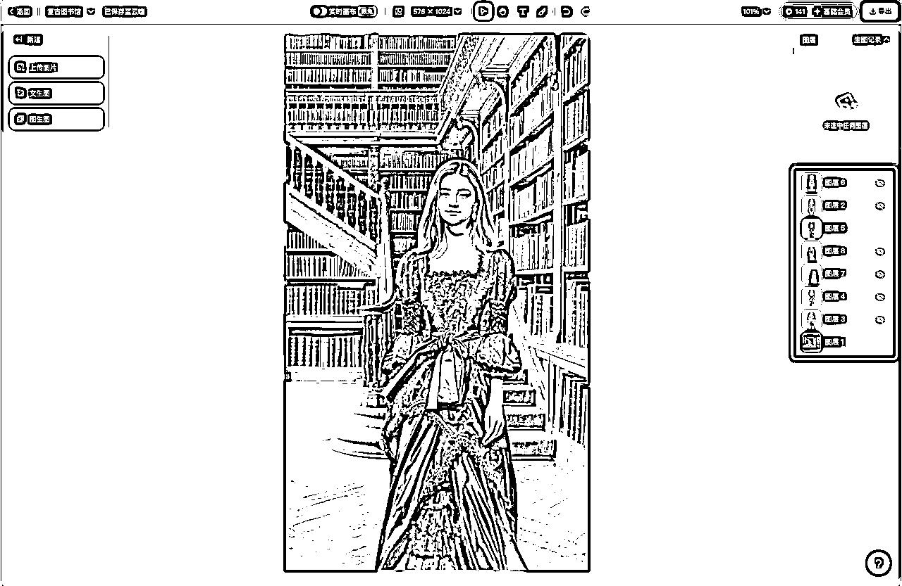
3. 换装后，把角色摆到桌子附近，再让模型按指定方向生成移动。后面的剧情基本照这个逻辑接。
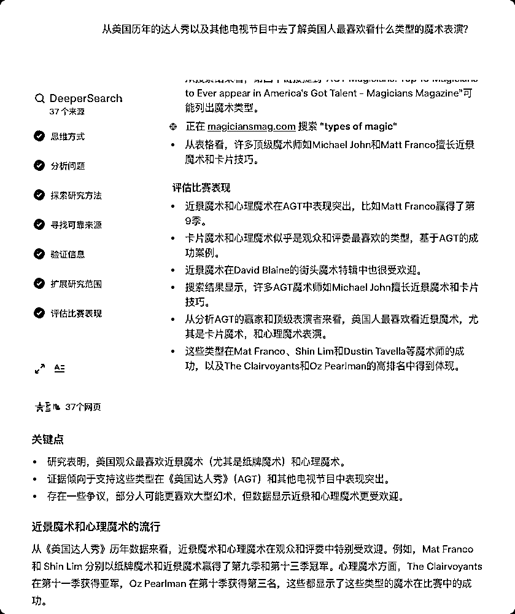
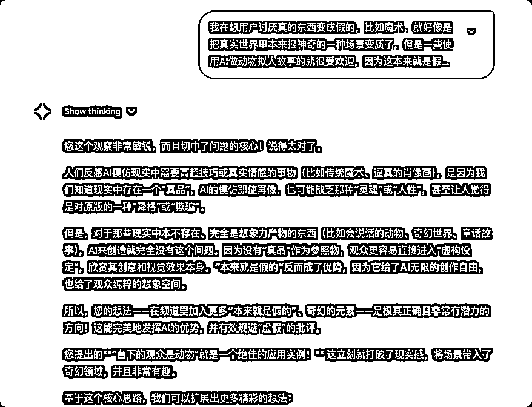
整个过程会攒下一堆独立小零件。接下来调图层顺序、切换显隐、重新拼场景，再导出新画面就行。
只要人物动线设计得合理，很多片段一次抽卡就过。
更划算的是，同一批场景素材还能再剪个长版。上面那条短内容对应的长片，目前已经跑到 1.6 万播放。
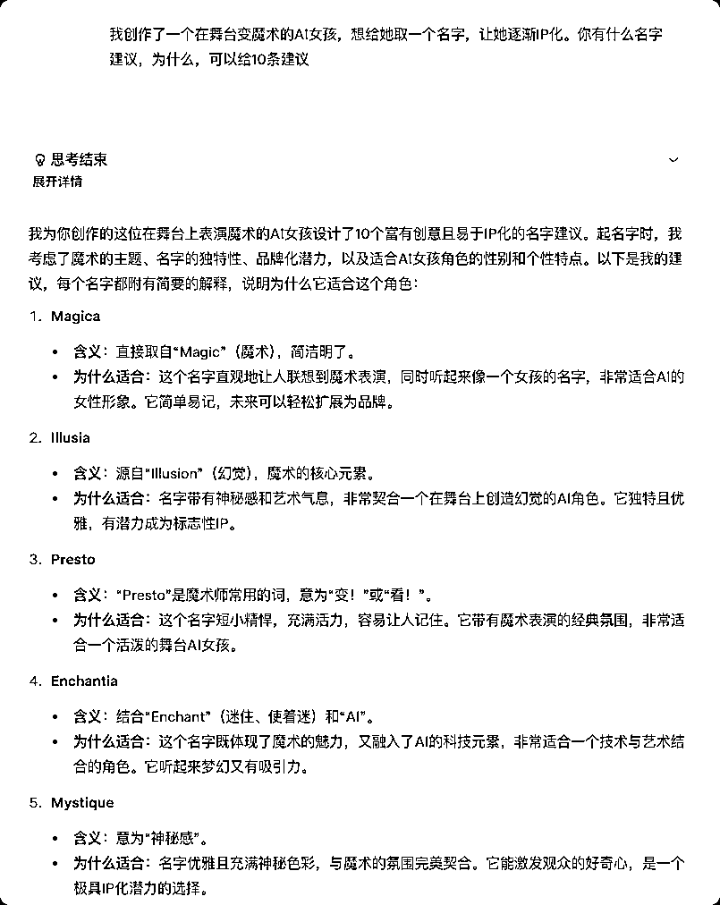
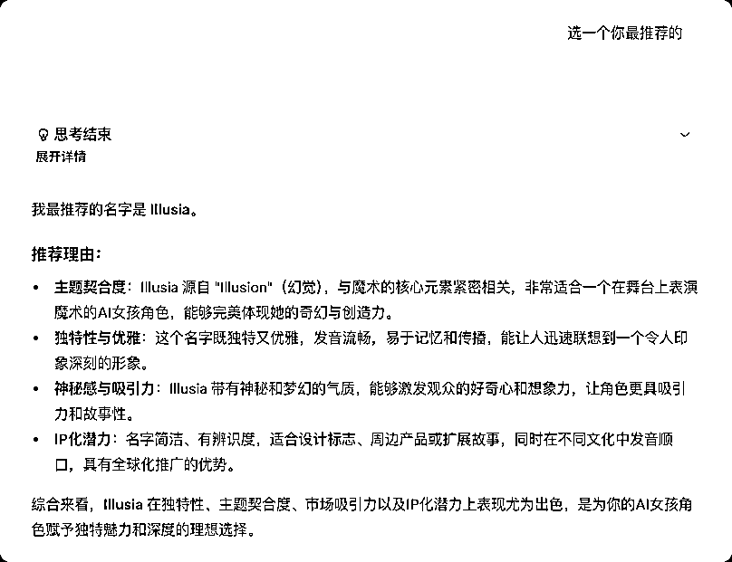
## 虚拟角色，到底要不要装成真人？
这是个绕不开的定位题。
达人秀的评论区、直播间里，对 AI 内容的炮火从没停过。起初她也动过念头：要不索性往真了做，立一个“真魔术师”的人设？
因为早前不少表演搁现实里根本没法完成，甚至有职业魔术师留言说这效果真魔术做不到。她还专门去扒了现实舞台上的魔术门道。
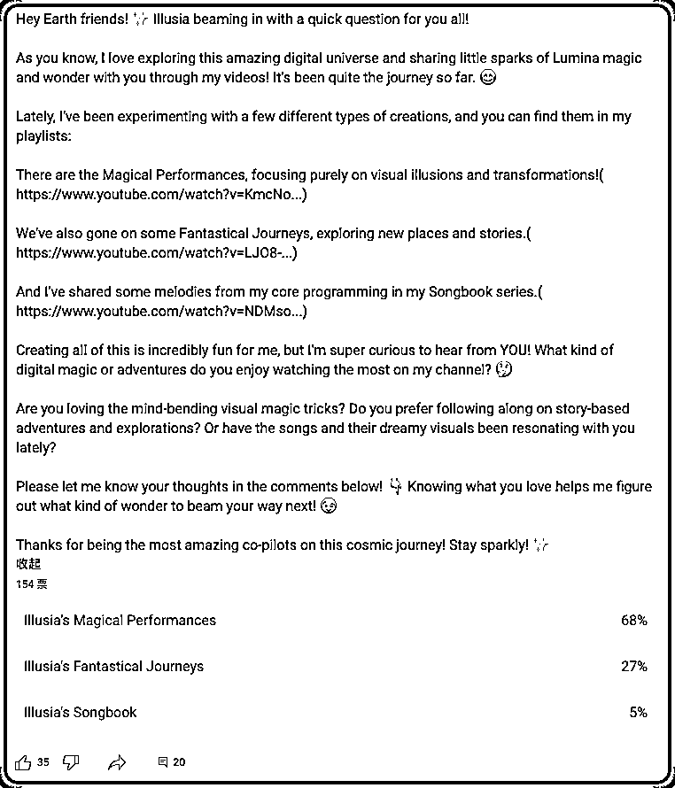
但很快，这条路被她毙了。
理由两条：
1. 想让绝大多数人完全瞧不出破绽，投入巨大，眼下生成能力也很难保证次次逼真。
2. 就算真做到了，往后也得死守“现实魔术师”的设定，所有内容围着真实性转，创作包袱只会越背越沉。
所以最后索性摊牌，认下虚构身份。
这么干确实会劝退一部分反感 AI 的观众，但频道没必要讨好所有人。更值得琢磨的是，很多人膈应的其实不是虚构，而是“把现实里的东西伪装成真的、然后被戳穿”。
动画、拟人动物、幻想故事，本来就不属于现实世界。把这些元素自然揉进去，观众就不必纠结真假，注意力自然落到角色和故事上。
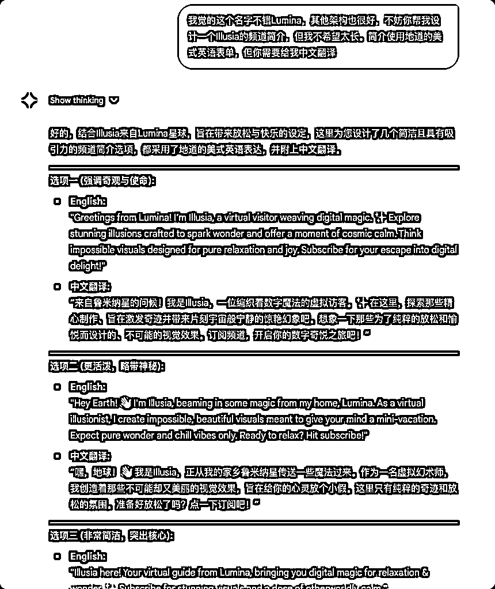
## 经营虚拟角色前，频道得先换身皮
角色定下来，频道也得同步改。
- **频道名**：取个顺口好记、有辨识度的名字，全频道保持统一。
- **简介**：大方说明这是虚拟角色，顺带补上她的世界观和背景。
- **头像**：用主角的固定形象，加深观众对这张脸的记忆。
这些不一定自己硬憋，拉语言模型一起头脑风暴，把人物设定打磨得更完整。
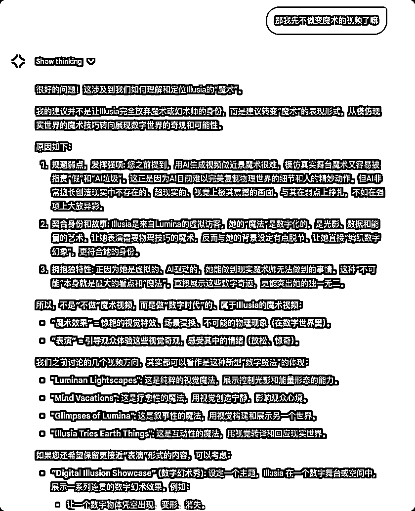

## 先钉死，再铺开：让角色多长几张脸
早期建议先钉死一种内容结构，把基础流量做稳。比如“达人秀框架 + 舞台魔法”就是易懂易上手的起点。
等观众开始认脸了，再慢慢铺开内容线：童话、歌曲、旅行、动物故事等等。
作品攒到一定量，还能归类成合集，让观众发现这角色不止一面。
要是后台数据一时看不出观众口味，直接开个投票也是好办法。真实的互动反馈，有时候比盯着播放曲线更能帮你定方向。
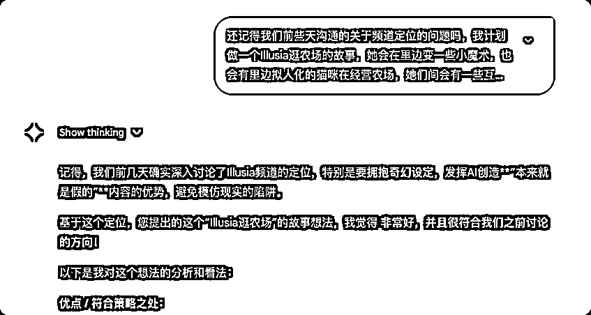
## 给频道配个长期军师
只做单条独立表演，每次顾好当前作品就完事。
可一旦经营固定角色，创作就牵扯到世界观、性格、内容连贯性、标题包装和观众关系。这时候，一个能记住频道底细、懂长期目标的 AI 助手，价值就出来了。
她用的是 Gemini 2.5 Pro。先把手头现状、人物设定、试过的方向、未来目标一股脑整理好，再跟它持续聊。
等 AI 吃透了频道，很多事都能搭把手：
- 新内容点子；
- 封面方案；
- 标题和简介；
- 角色专属歌词；
- 选题合不合人设；
- 观众反馈怎么解读；
- 某个创意值不值得加码。
重点不是让 AI 偶尔代笔一段，而是把它养成长期泡在项目里的创意搭档。
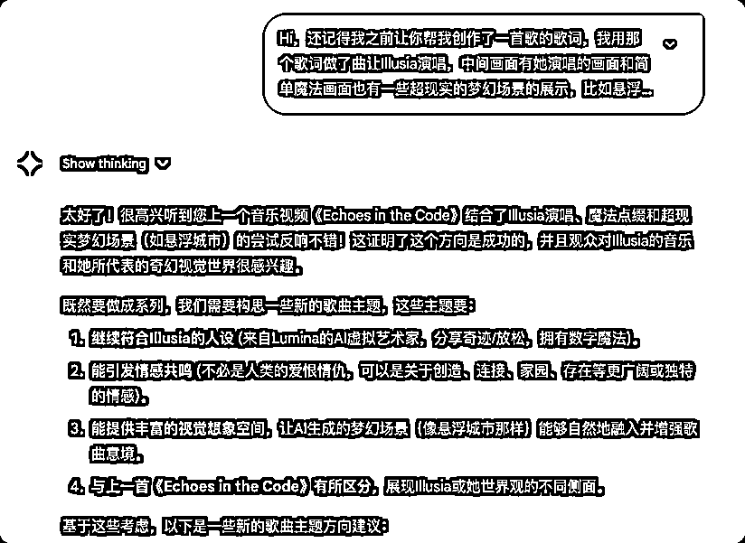
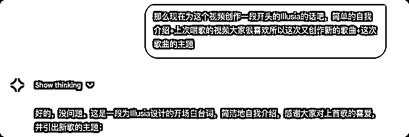

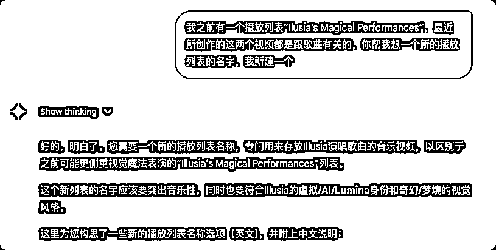
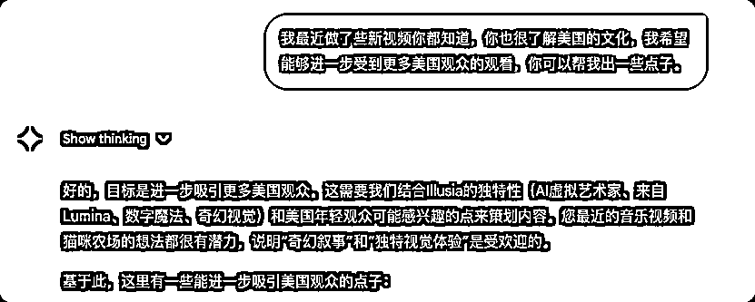
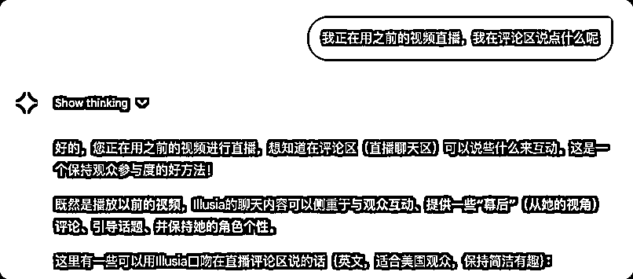
## 观众真会为一个虚拟姑娘买单吗？
这才是最该验证的题。
为了判断角色有没有攒出真正的受众，她盯着留言看、扒搜索词来源、开直播听观众唠、还开了频道会员，测观众愿不愿意再往前迈一步。
### 直播反馈
头一回收到打赏时，那位老哥似乎压根没看出姑娘是 AI 捏的。他在直播间一顿猛夸，觉得该给点支持，说着说着就把钱打过来了。
当然，质疑和“Fake”的弹幕照旧有，但最近几场直播里，带刺的明显少了，反倒有越来越多熟面孔进来打招呼。
还有观众明知道角色是 AI，却直言自己喜欢的就是这个人，不介意她不是活人。后来这位几乎每条新片底下都留了言。

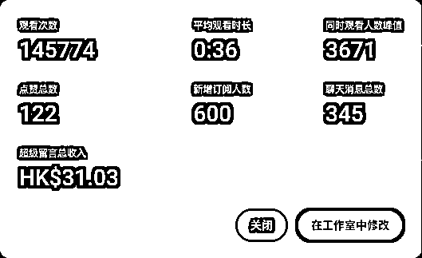
这说明，当角色持续露面、外观稳定、性格清晰之后，观众在意的可能从“她是不是真人”悄悄挪到了“我喜不喜欢她”。
### 频道会员
原记录没有披露具体会员数，但开会员本身就是一场重要测试：它能帮你判断，观众愿不愿意从看、评、打赏，再走到长期支持这一步。
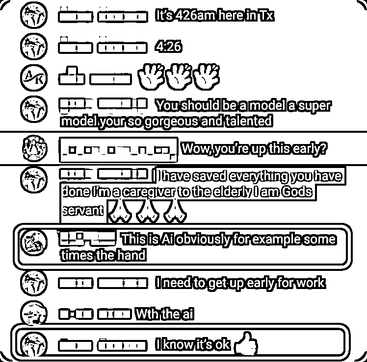
## 这事儿真正值得抄的作业
从几十万播放的短内容，到稳得住的长片收益，再到打赏、直播互动和会员试水，这个项目秀的不只是“AI 捏的角色也能变现”。
它更像一条完整链路：
1. 先用多角色、多形式撒网试错；
2. 从评论和数据里筛出更受欢迎的主角；
3. 给角色统一外观、名字和背景；
4. 慢慢甩掉对达人秀包装的依赖；
5. 用不同题材拓宽角色的世界；
6. 靠直播、投票、会员观察用户有没有处出长期关系。
虚拟角色的价值，不止省下拍摄成本，更在于它能持续长大、反复复用，慢慢长成一块属于自己的内容资产。
2062 美元大概只是起跑线。真正值得盯的是：一个现实中查无此人的姑娘，已经开始有自己的观众、自己的故事，以及一条还能继续铺的商业路。
一个多月前，我抱着试试看的心理，给频道开了会员功能。就设了一档，每月2.99美元，给的还是平时那套内容，没加什么专属福利，也没敢抱期待。结果4月22号居然真有人加入了，当时确实有点小激动。但也就这样了，到现在拢共才4个人。挺意外的是，这四位基本没在评论区冒过泡，也不知道他们图啥，毕竟这会员说实话没啥附加值。
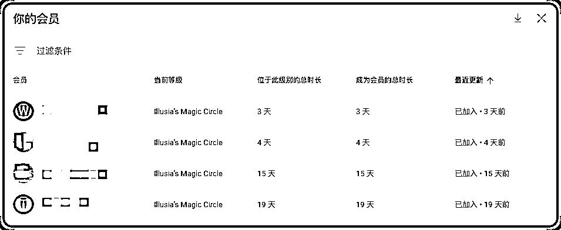
再看看评论区，骂声当然也没消失，这个实在躲不掉。翻了下3月中那条视频的评论——
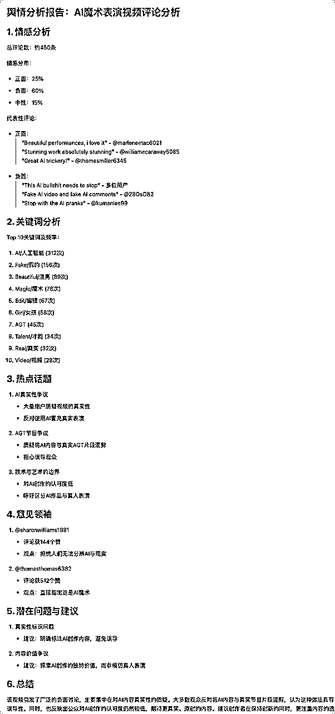
再翻一条4月的。
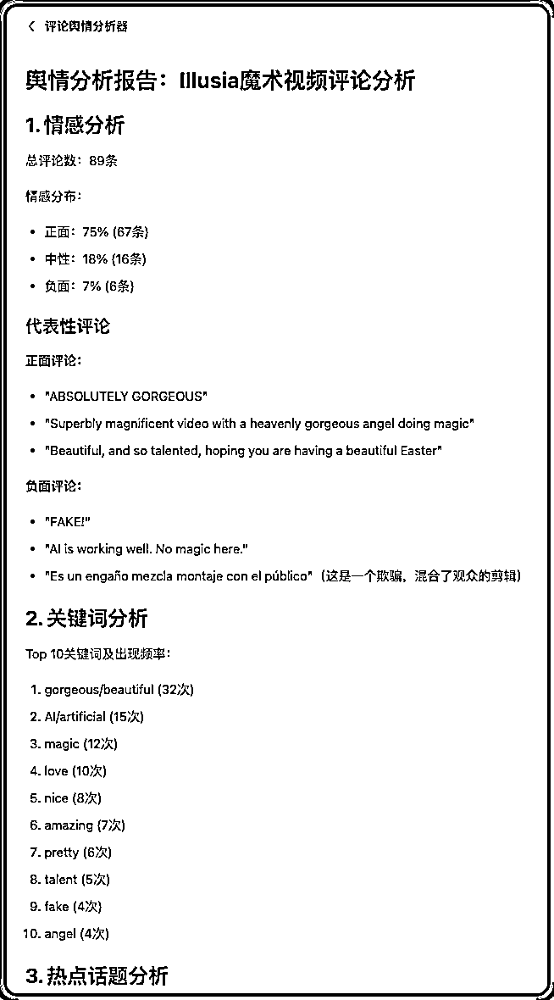
但能感觉到，负面的声音在慢慢变少。想了一下，大概三个原因：一是把达人秀这类强现实关联的内容砍掉了；二是视频默认摆出一副“我就是假的”的态度，反而没什么好杠的；三是评论区里的老面孔越来越多了。
有个特别有意思的细节，现在随便点开一条新视频，把评论区那些头像挨个戳进去看一眼，会发现大部分都是已经在频道里留过言的老粉。显然，他们心里清楚这就是AI。
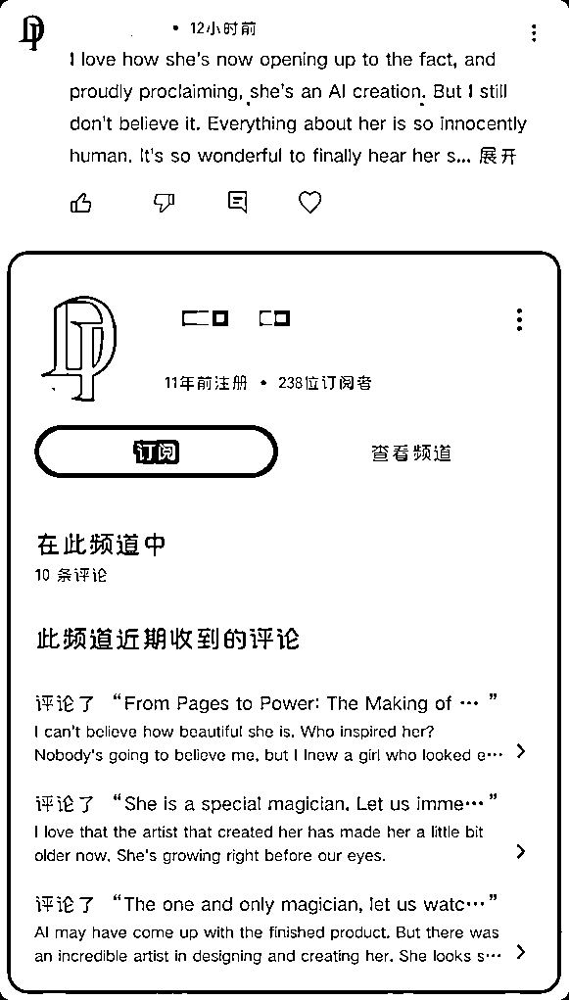
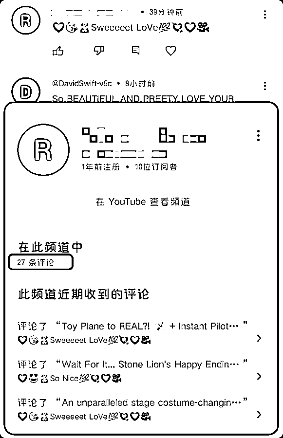
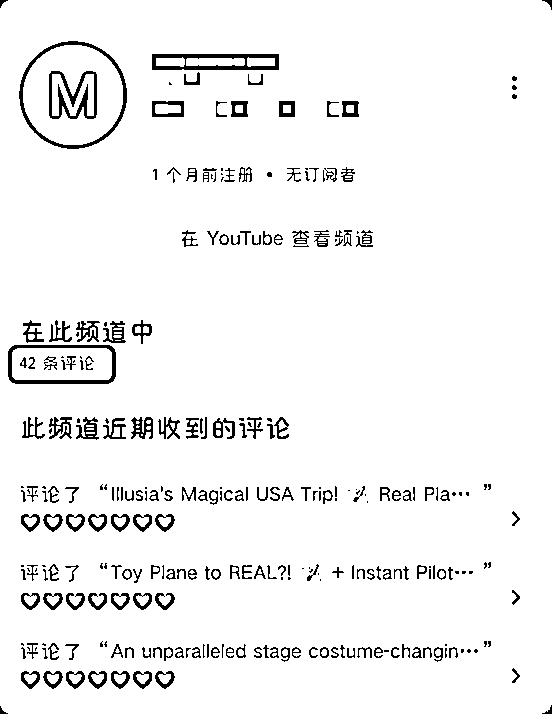
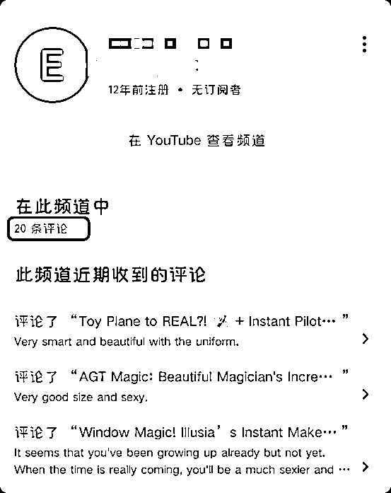
再看一条昨天刚发的长视频评论区，怎么说呢，舒服了哈哈。
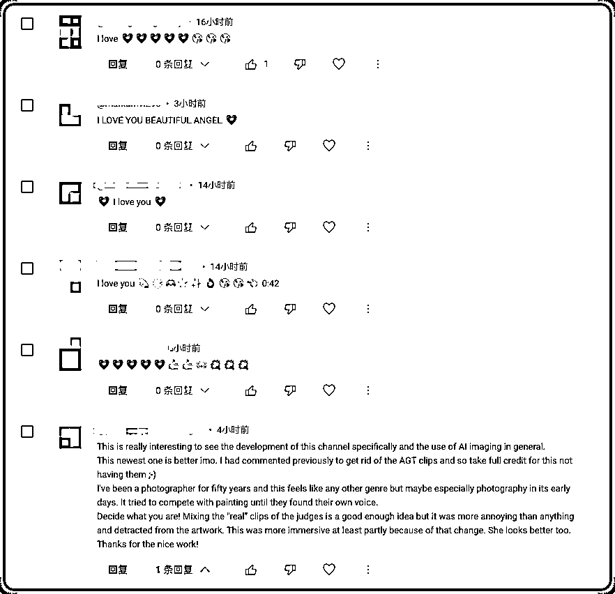
还有些挺友好的讨论，有人表示喜欢，但希望能加些虚拟标志之类的东西；也有观众觉得去掉达人秀片段后反而更有趣。看得出来，一部分人对我砍掉达人秀的操作是真的高兴，甚至觉得这是加分项，也算是给我喂了口正反馈。
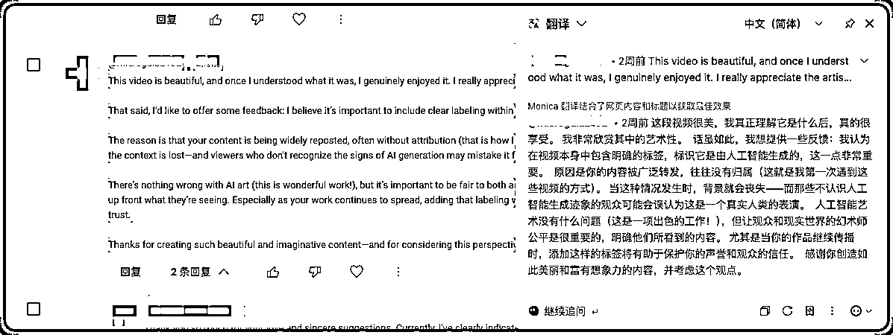
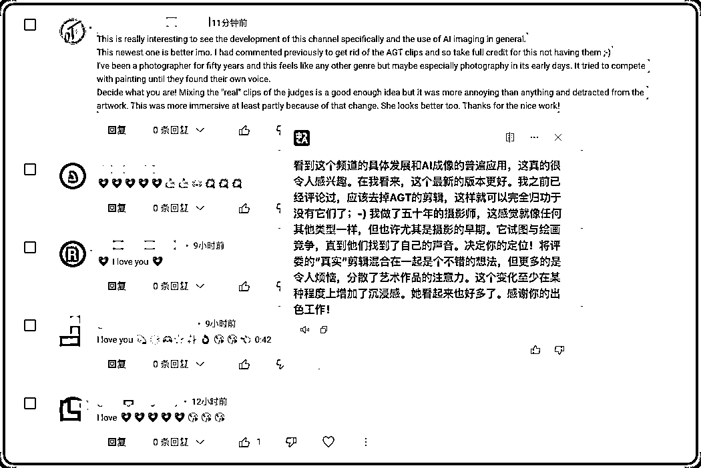
而且，越来越多的观众在评论时开始带上女孩的名字了：
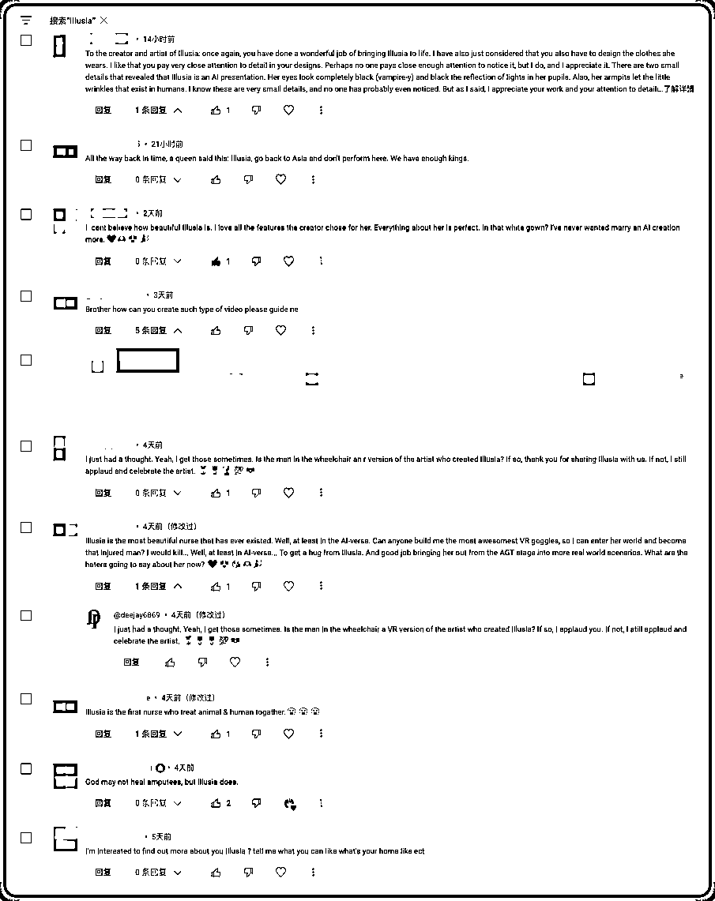
还有一个变化，最近发的视频，搜索词来源排第一的基本都是女孩的名字了。不过点进去一看，也就几十个搜索量，毕竟搜索在总流量里的占比一直都不大。
但有意思的是，这个信号确实是最近才出现的。最开始我用这个名字做标签的时候，系统里还没有这个关键词，现在再去搜，已经能看到现成的标签了。
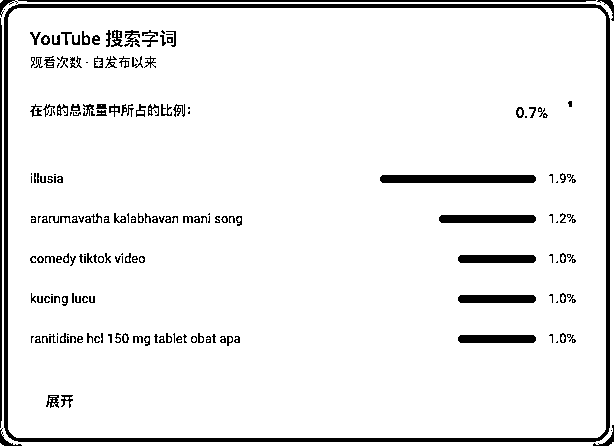
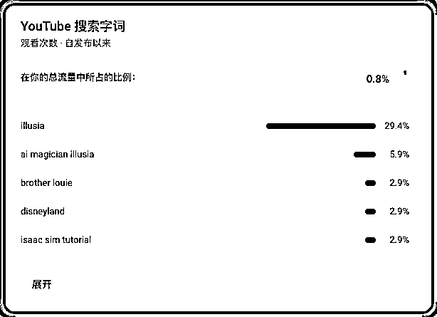
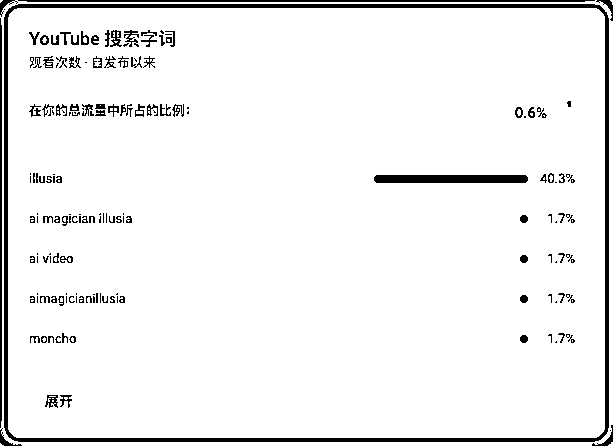
其实这段摸索让我越来越相信，虚拟IP这个方向的天花板是真的高。因为不再只是在重复做同质化视频，而是可以围绕一个AI女孩去构建各种天马行空的事，想想就还挺兴奋的。
而且这类账号未来也不一定非要吃 YPP 的收益，变现路子多得很：
创作自由度很高。虚拟IP想干嘛就干嘛，不受现实条件、拍摄场景甚至物理规则约束。她可以去太空漫步，可以瞬间穿越到地球任何一个角落，可以随时随地展示超能力，这些真人博主根本做不到。更重要是的，它不像固定模板的视频那么无聊，每一次创作都能玩出花来，顺手还能把制作手艺越磨越好。
形象可塑性很强。受众喜欢什么、讨厌什么，都能通过评论和数据及时感知，然后灵活调整人设、性格和内容方向，让IP越来越贴近观众的胃口。
内容生产效率也很高。不用真人出镜，不用租场地、置景、搞服装。而且AI视频技术更新换代这么快，接下来只会越做越精致、越做越有趣。
变现的渠道更是多元。比如品牌合作，之前就做了KFC那种插进魔法场景的尝试；比如频道会员，在没有任何特殊福利的情况下已经能看到有人愿意付费，后面要是再加点实在的专属权益，比如女孩的独享视频，肯定还能吸引更多忠实粉丝；再比如带货，那更是水到渠成的事。
最后说说来路吧。我从3月初开始做这种魔法类内容，Shorts流量一直很稳，就坚持更新。3月下旬开通了YPP，开始琢磨做长视频，但一直纠结要做什么题材，也想过是不是先把这波Shorts流量吃完再说。
后来曹教练点了我一下，说不如直接把Shorts那套内容搬到长视频，试着做个人IP，先整几条看看效果。于是就有了你们看到的这些尝试。这一个月跑下来，感觉这条路真的可以继续深挖，所以也拿出来分享给大家，有兴趣的朋友欢迎一起来交流。
感谢YouTube赚钱深海圈，曹教练和波妮教练两位总教练永远冲在最前面，不停折腾新东西然后毫无保留地分享出来。也要感谢郝教练、小芬教练的1v1咨询，给了我很多针对性的建议。感谢所有深海圈的教练们，都在拿自己的实战经验帮着大家一起把这片海越做越大。最后还要谢谢波妮教练、曹教练和七天老师对这篇文章的指导和把关。行了，继续去干活，冲就完了。