# 一篇重写 | AI搜索到底在改写什么？会不会终结谷歌和百度的时代？
作者：龙哥

春节刚过，2月29日，周鸿祎官宣了360 AI搜索和360 AI浏览器。从去年3月ChatGPT横空出世后，他就成了AI浪潮里最活跃的布道者之一，观点句句扎心。

那时候起，市场就一直在问：ChatGPT会不会成为新的超级入口，把谷歌干掉？

这篇文章就想把几个关键疑问摊开聊清楚，对AI、搜索、互联网创业感兴趣的话，怕是要看完。

一、为什么巨头对搜索如此上心？

二、AI搜索和传统搜索，本质差在哪？

三、360 AI搜索和天工AI搜索，谁更像中国的Perplexity？

四、国内四家AI搜索，谁做得更好？

五、AI搜索现在卡在哪，会不会取代谷歌和百度？

六、关于@大厂转型人强哥

# 一、为什么互联网大厂高度重视“搜索”？

大厂拼命做搜索，背后其实是四个算盘。

1. 商业变现：搜索是核心流量入口，能聚拢海量用户，带来广告收入。

谷歌和百度在各自市场里，都是搜索广告的头号玩家。

2019年年中字节内部一次CEO面谈上，张一鸣直言：“没有搜索场景的延展和优质内容，今日头条的DAU天花板可能只有4000万。”押注搜索、实现更精准分发和营销，已成必选项。

1. 技术卡位：搜索是AI技术最前沿的试验场，能提振竞争力、引领行业风向。

搜索的本质，是把人和信息的匹配效率拉满。“信息跑得有多快，比信息本身更重要。”

张一鸣正是从这个逻辑出发，用今日头条颠覆百度搜索，再从图文推荐进化到短视频推荐，造就了抖音。

每一次匹配效率的跃迁，都在催生新的巨头。

从“人找信息”到“信息找人”，早期的字节核心骨干，几乎都来自百度系。

2014年7月，百度元老、网页搜索部技术副总监杨震原加盟今日头条，搭建了技术底座并打造了爬虫工具bytespider。

同年，今日头条还挖来百度社区主设计师洪定坤任技术总监，以及百度网页搜索部首席架构师陈雨强，共同建立了机器学习体系和广告投放评估体系。

1. 用户留存：搜索体验越好，用户越黏。

小红书就是典型，“遇事不决问小红书”，素人笔记真实可信、互动性强。

比如搜“五一去哪玩”，能刷到大量真实游记、价格、路线和感受，就像朋友在耳边支招。我自己的爆款笔记里，八成流量都来自搜索。

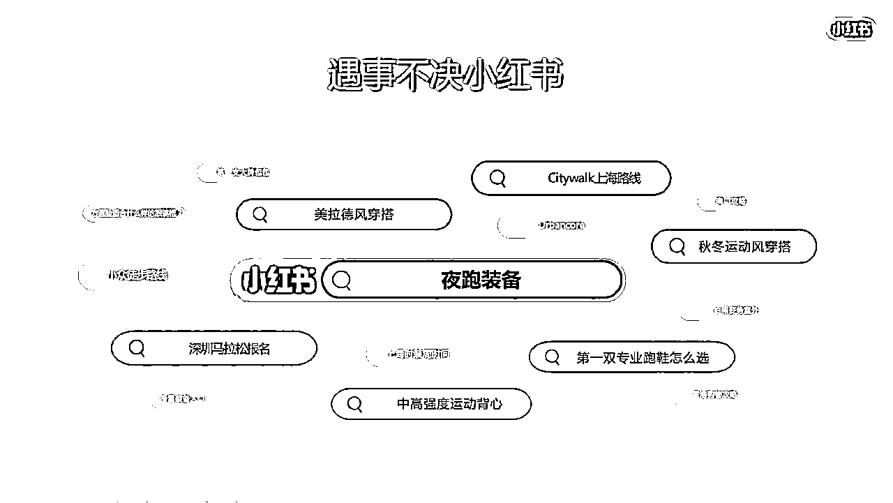

1. 数据沉淀：搜索行为是精准画像的金矿。

搜健身、减肥、食谱、跑步、手表，系统就能据此推送匹配内容。这种打法在微信搜一搜、视频号、小红书、抖音上随处可见。

# 二、AI搜索VS传统搜索，有什么区别？

境外以Perplexity.AI为代表，国内是360 AI搜索、天工AI搜索、豆包AI、文心一言。后两者更接近对话式大模型，搜索只是其中一环。

传统搜索，则是谷歌、百度的关键词检索模式。

## 2.1 两个物种：答案引擎 vs 搜索引擎

AI搜索是先把答案给到你，再附上来源让你核查真实性。

传统搜索是把一堆链接丢给你，自己去找答案，广告铺天盖地，还很容易陷入信息迷宫，最后连哪个页面有用都忘了。

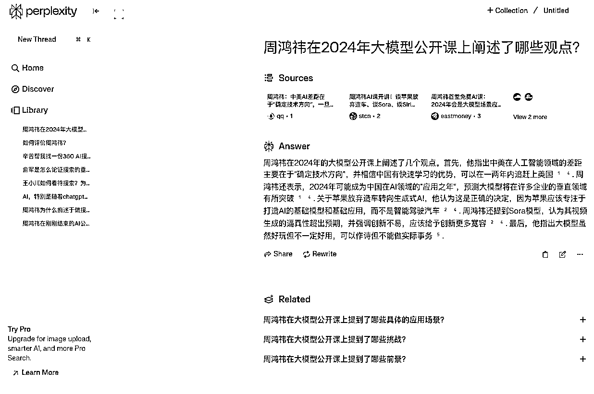

美国AI搜索独角兽Perplexity.ai展示页面

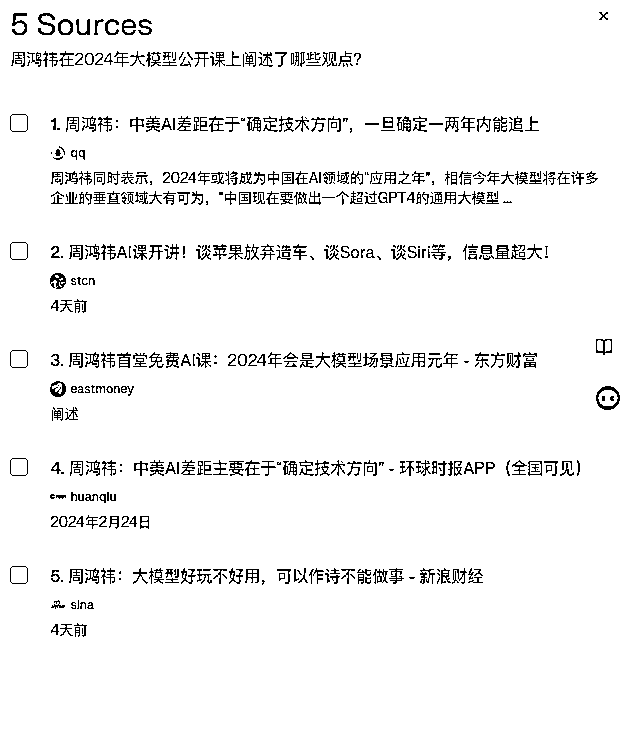

美国AI搜索独角兽Perplexity.ai展示页面

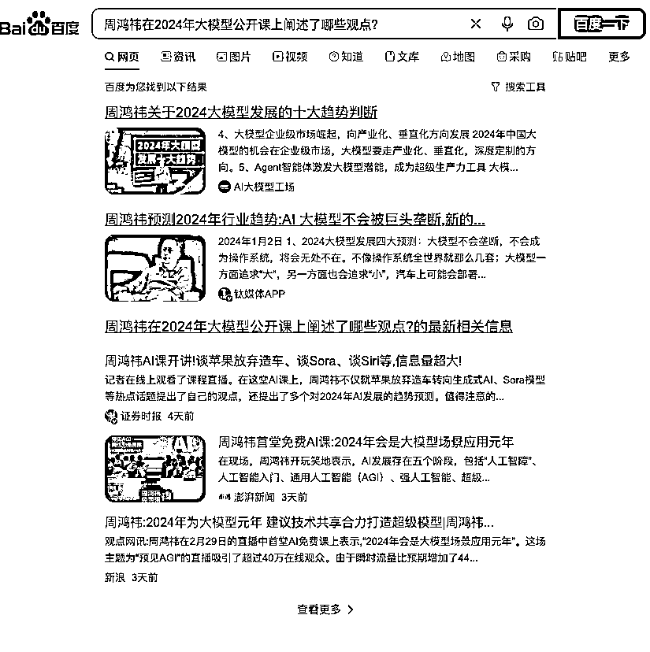

百度页面👆🏻

## 2.2 AI搜索像聊天，传统搜索像翻目录

想追问，AI搜索完全可以继续聊。

输入长句后，AI直接给出结论，底部还会给出可能的延伸提问，直接跟进即可。提问往下走，答案会连贯叠加，形成一串完整对话。

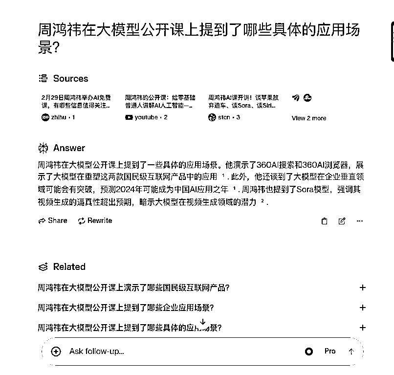

美国AI搜索独角兽Perplexity.ai展示页面

关键是，AI搜索是有记忆的。

满意就结束，不满意就能顺手继续问。它就像一个有记忆的学霸，你可以反复深挖同一个话题。

传统搜索的输入框永远在顶部，点进去的链接之间没有关联。你每次都要推倒重来，就像在跟失忆的人对话。

## 2.3 AI搜索融合了ChatGPT和谷歌百度的优点

ChatGPT刚出来时，很多人以为生成式AI会取代搜索引擎。

但幻觉、无法联网、知识滞后等问题暴露后，大家又回归到模型增强的搜索引擎，比如Perplexity和Bing Chat。

这些“回答引擎”靠RAG技术，把搜索结果喂给大模型，减少误导、提升时效。

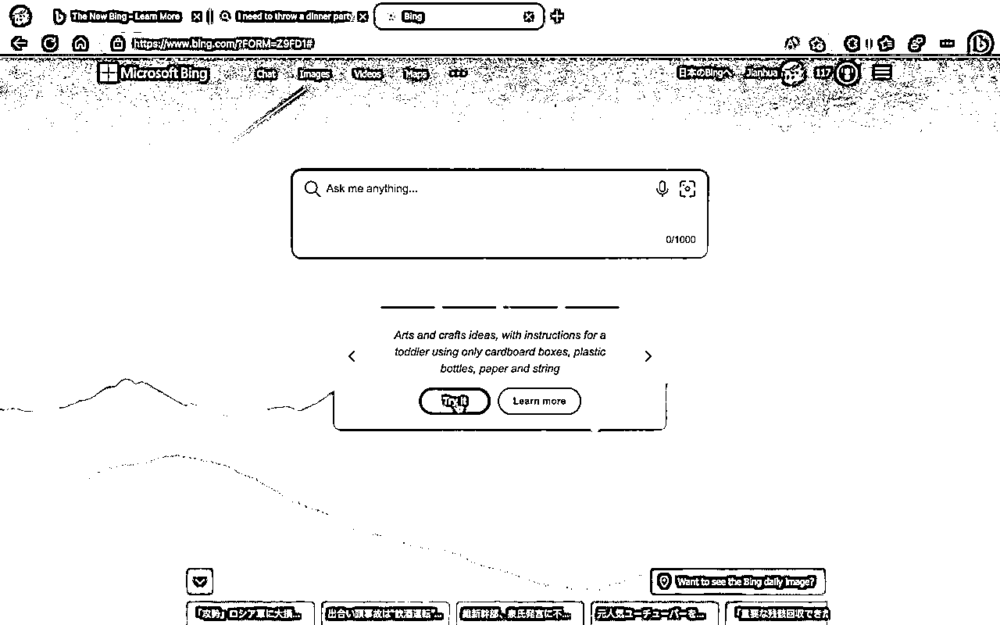

除了Perplexity和Bing Chat改名Copilot外，You.com、Neeva等挑战者也转向AI增强答案模式。

相比传统搜索，它们在理解问题、归纳结果、保留索引、扩展问题四个维度做了优化，降低使用门槛、节省跳转成本、保证可靠度，同时支持深度挖掘。

Perplexity联合创始人兼CEO Aravind Srinivas的说法是：

Perplexity本质上是传统搜索索引和大模型的推理、文本转换能力结合的产物。

用户输入查询后，Perplexity会先重构理解，再分发到多个外部搜索索引中抓取上百个相关链接，然后让大模型阅读这些链接、提取段落，以记者或学术风格给出答案，并为每部分附上引用和链接。

## 2.4 AI搜索能扛住复杂问题

Perplexity不仅能答简单问题，还能处理长尾复杂需求。

例如“文科生怎么入局AIGC？怎么抓住AI红利？切入点有哪些？请结合猎聘、脉脉、BOSS直聘、前程无忧、拉勾的招聘数据分析”，它也能给出结构化回答。

我之前的深度稿，Perplexity就提供了很大帮助。

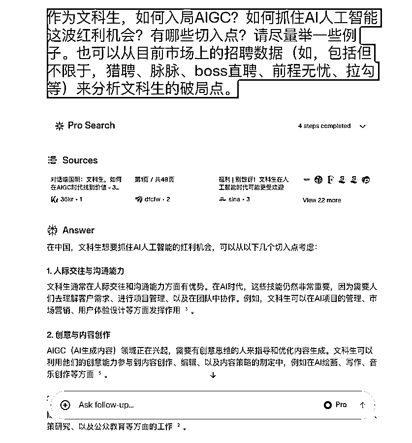

接下来我会以“买车”做实测测试。

脑洞一下：为什么百度和谷歌没直接上AI搜索，而是先推文心一言和Gemini通用大模型？

大概率是现阶段的AI搜索会屏蔽广告，会动摇基本盘。

# 三、360 AI搜索&天工AI搜索，谁会是中国的perplexity.AI ？

在AI搜索赛道，Perplexity是明星标杆。创始人Aravind Srinivas来自OpenAI，2022年8月创立，2023年10月估值5亿美元，团队仅38人。

SimilarWeb数据显示，Perplexity 12月访问量达4500万次。2022年12月上线时仅220万次。

在中国，最像Perplexity的，就是360 AI搜索和天工AI搜索。

搜索这门古老的生意，牵动着整个互联网格局。

2012年，周鸿祎和百度上演“3B大战”。360搜索横空出世后被百度起诉，最终被判不正当竞争、道歉并赔偿45万。

虽然败诉，却撬动了搜索格局，网易、搜狐、新浪等都曾靠搜索稳住门户，雅虎、谷歌来势汹汹却折戟，百度仍旧坚挺。

据Statcounter，2023年12月中国搜索引擎份额：百度66.52%，必应13.32%，360搜索6.43%位列第三，高于搜狗的5.01%。

我长期关注周鸿祎。身为老一代实战派，他在新一轮AI浪潮里的判断很犀利。“不端、不装、有点二”是他的风格，《超越好奇》里也写尽了他对搜索的执念。

与百度交手，让我更清楚搜索的威力。Google早一年进入中国，百度2003年逐渐成型，我当时忽视了搜索，直到意识到俞军的价值才醒悟。我决心追赶。

评估3721和百度时，发现流量渠道我们占优，搜索技术我们落后。我痛失了后来去百度的俞军，他在3721时每天工作十几小时，只想把搜索做出来。我当时分心于渠道盈利，错过了窗口期。

我现在每天都在用谷歌搜索和Perplexity.ai，尤其后者。当发现国内有两支队伍在做类似尝试，我非常兴奋，期待他们结合中国国情做出新一代AI搜索。

星星之火，可以燎原。探索本身就有价值。

你可以感受到两者与Perplexity的相似度。

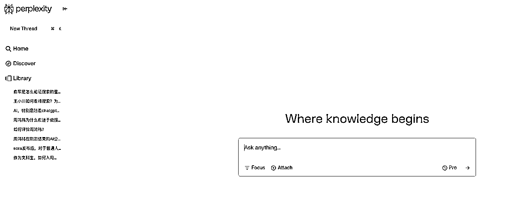

perplexity.ai

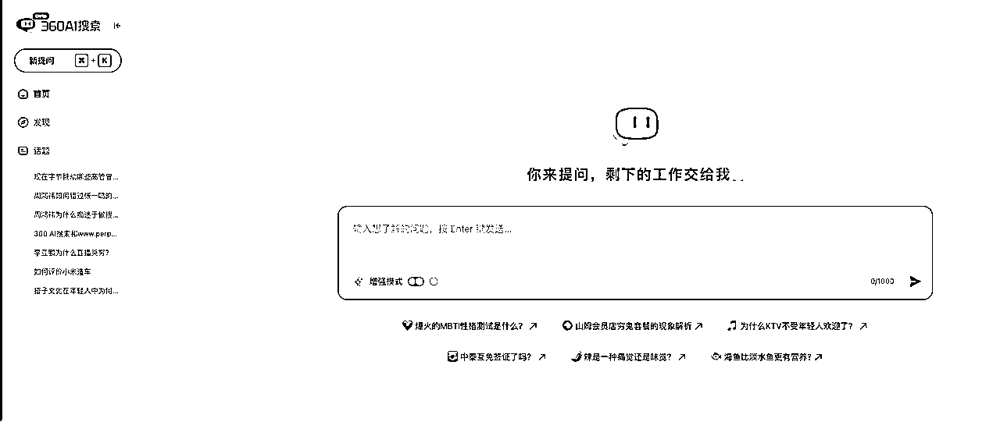

360 AI搜索

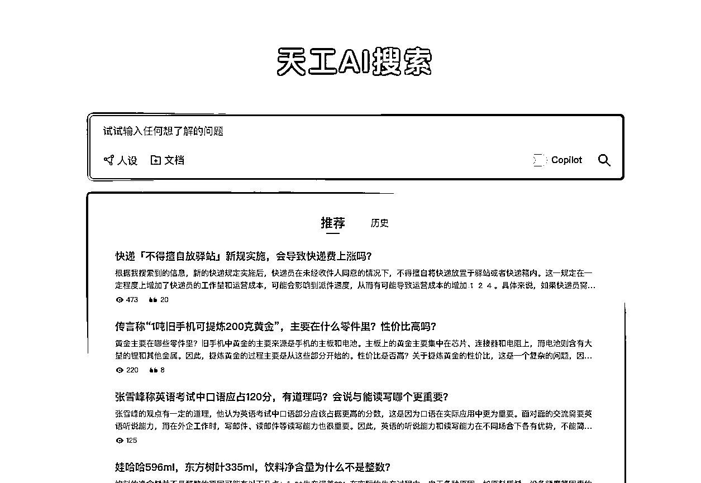

天工AI搜索

# 四、国内4家AI搜索，哪家更胜一筹？

以买车为例测试：“我想买新能源车，预算20万，主打日常通勤+偶尔自驾，单程400公里左右，空间要大，续航别太短，请推荐10款车型并说明优缺点。”

这个需求限制多、非单一，能更好检验准确性和时效性。

对比360 AI搜索、天工AI搜索、豆包AI、文心一言，对比百度搜索。满分10分，主观打分。

## 4.1、答案来源方面：

360 AI搜索7分，有增强模式，能提炼关键词并明确标注来源，全网多源：太平洋汽车网、B站、西瓜视频、知乎、搜狐、凤凰汽车。可直接点开核查。展示不如豆包AI丰富，缺少完整标题和媒体署名。

天工AI搜索4分，有Copilot功能精准关键词，但每天限4次。搜索结果仅8条，多为百度、搜狐、知乎、网易文章，内容偏单薄。来源形式为标题+媒体，偏文章，无视频，还多了一个音频功能。

豆包AI 9分，引用来源很扎实，我常在用。引用多来自头条、抖音、西瓜视频，符合字节生态。展示最丰富：标题+摘要+媒体+配图。

文心一言6分，未提供答案来源，体验打折。无法验证准确性，也无法延伸阅读。

百度搜索3分，仍是传统链接堆砌，还有2021年的旧新闻，时效性差，基本可排除。下面不再对比。

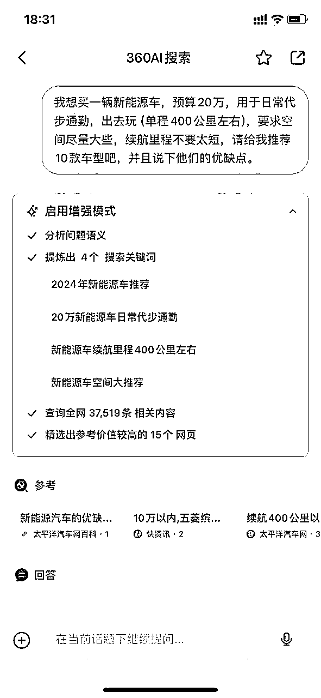

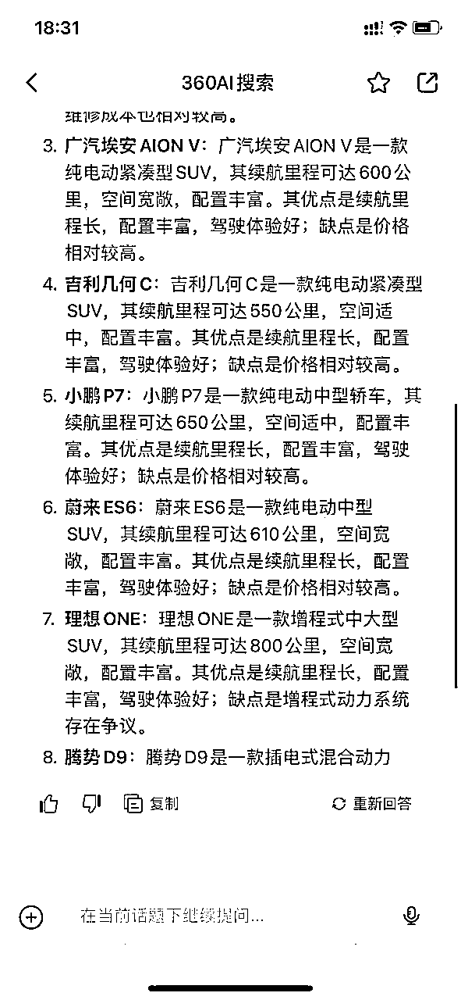

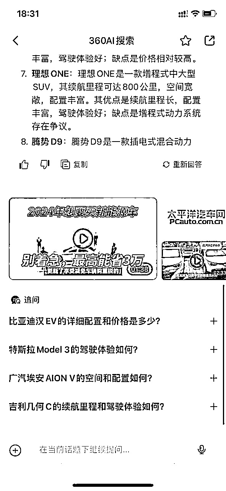

360 AI搜索👆🏻

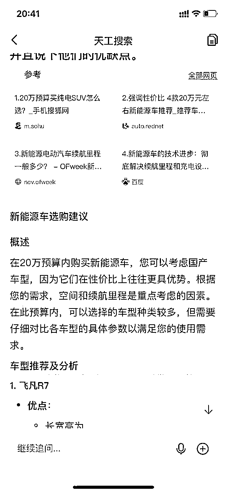

天工AI搜索

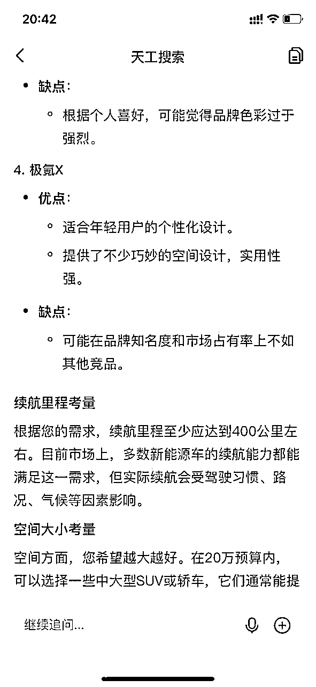

天工AI搜索

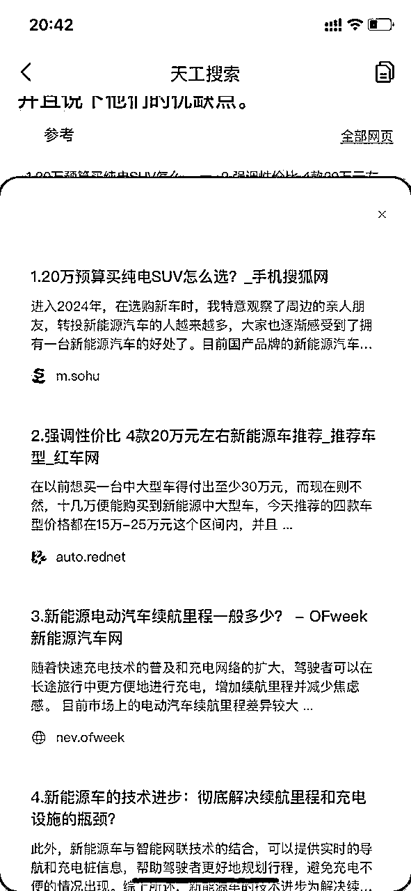

天工AI搜索只能搜索到8条结果，结果非常少

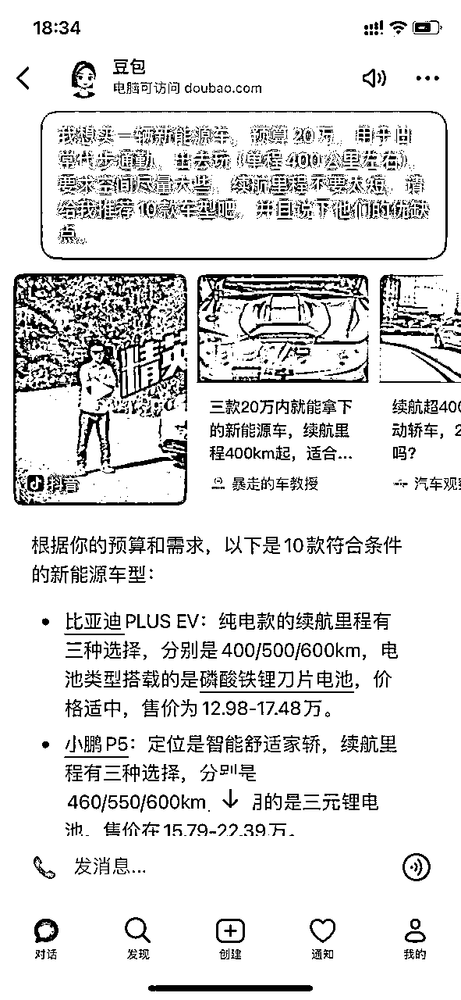

字节跳动的豆包AI👆🏻👆🏻

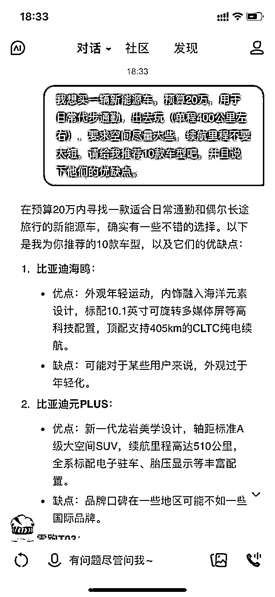

文心一言👆🏻

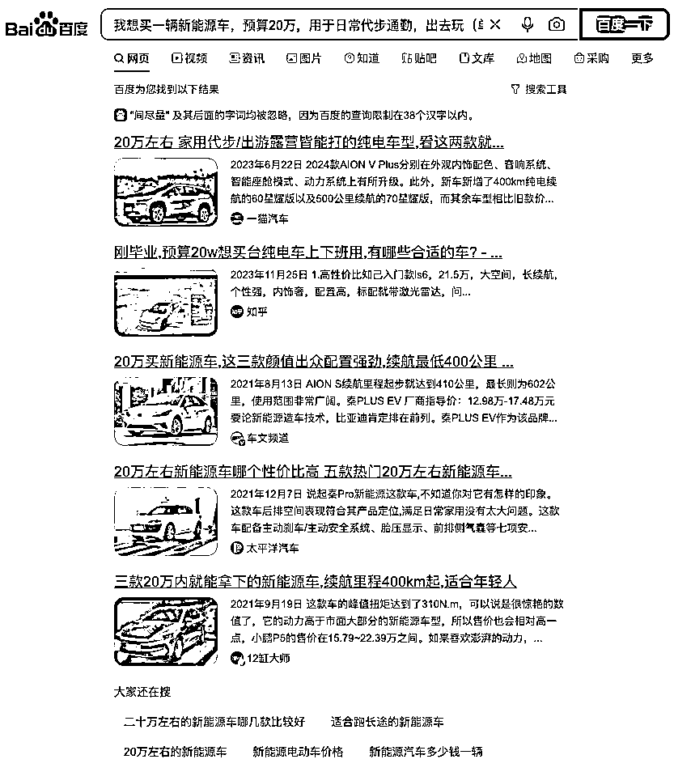

百度搜索，无法给出答案+信息滞后【很多都是2021年的文章，缺乏时效性，不具有参考性】👆🏻

## 4.2、回答质量方面：

360 AI搜索6分。明明要求20万预算，却没标价格，且车型错误。追问后更离谱，完全偏离需求。

天工AI搜索5分。要求10款，只给4款。质疑追问后仍不改，答案雷同。

豆包AI 8分。回答准确，用表格形式清晰罗列车型。

文心一言7分。回答还行，文字堆砌，视觉不如豆包。理想ONE的价格抓取不到。

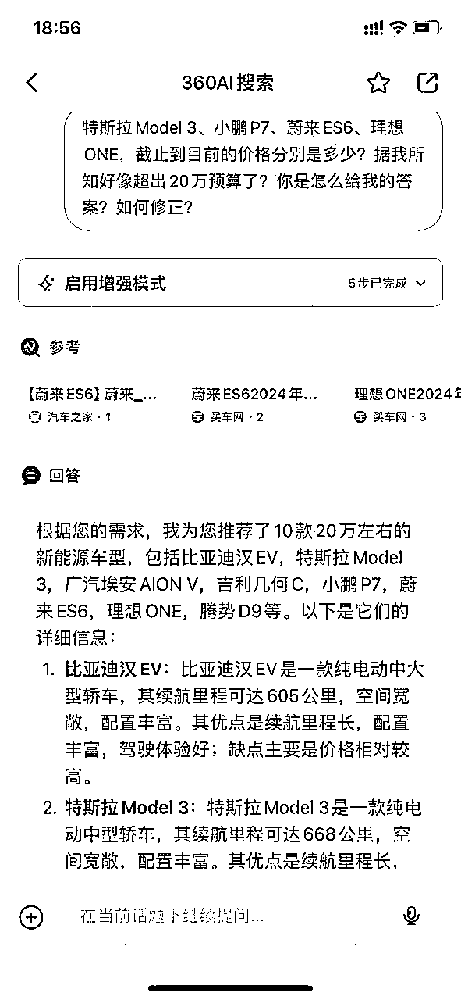

360 AI搜索的追问，回答质量一般👆🏻

天工AI搜索，明确要求给10种车型，它还是给到了4种。

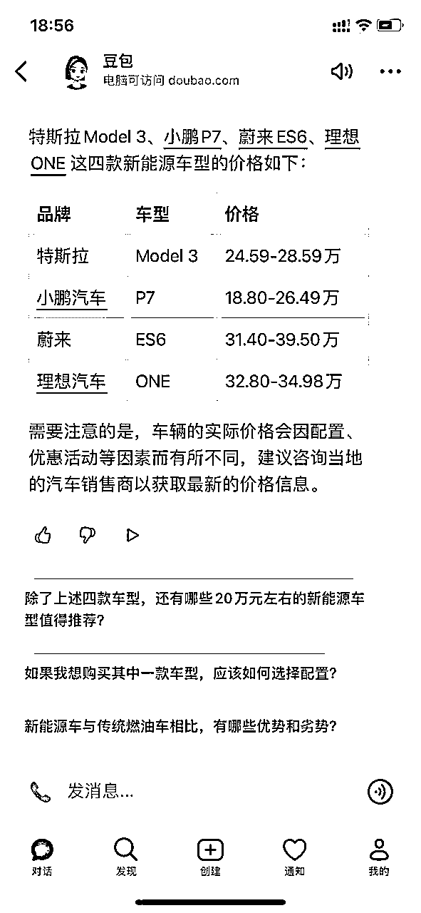

豆包AI的回答基本准确👆🏻

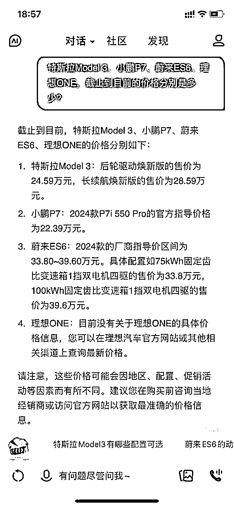

文心一言的回答，而且提问是以左右滑动来设定，这样不太好，会提升用户获取信息成本，因为必须每个滑完以后，才知道哪个是需要继续追问的👆🏻

## 4.3、追问问题质量

360AI搜索和豆包AI同为8分，各有侧重。360侧重单车型深挖，豆包侧重整体需求延展，如“除了上述车型，还有哪些推荐？”

天工AI搜索6分，追问质量一般且有重复。例如已质疑过“为什么只给4款”，该问题又出现在追问列表里。

文心一言6分，追问不稳定，首问有追问且需左右滑动，操作成本高。第二次同问题提问时追问直接消失，体验奇怪。

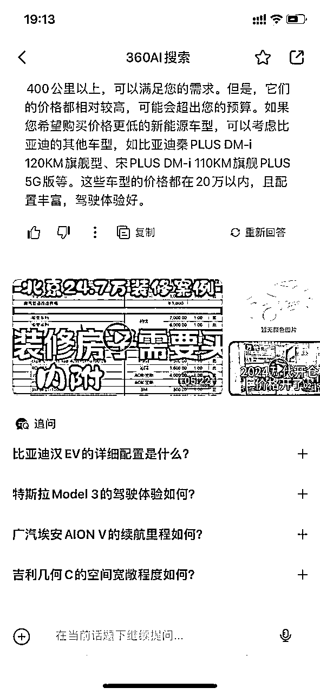

360 AI搜索👆🏻

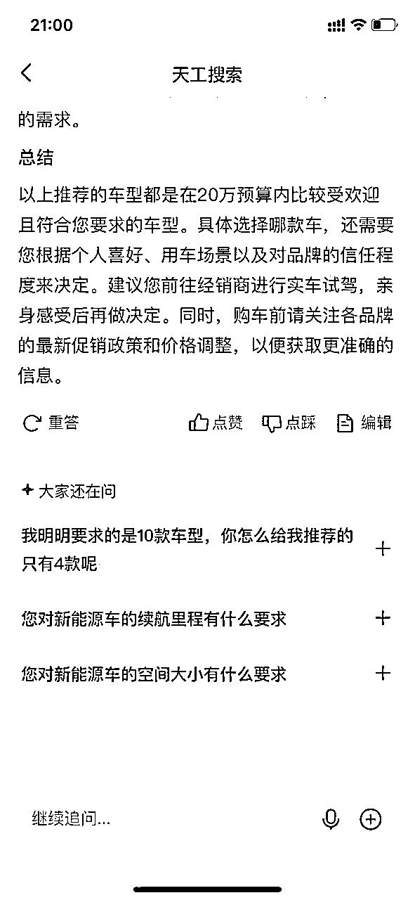

天工AI搜索👆🏻

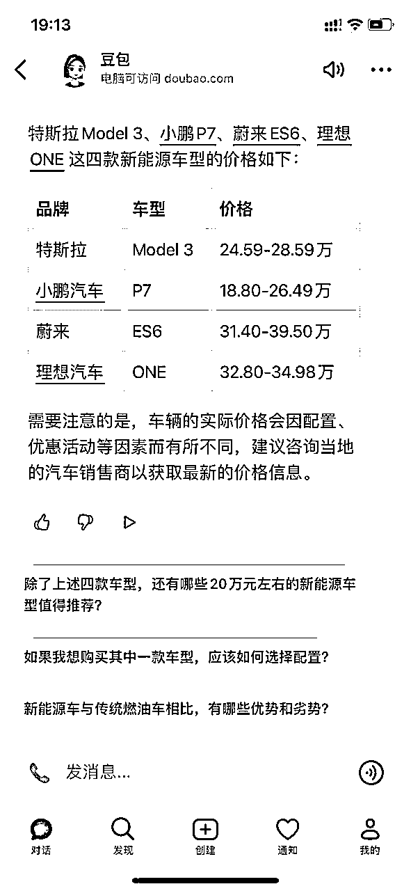

豆包AI👆🏻

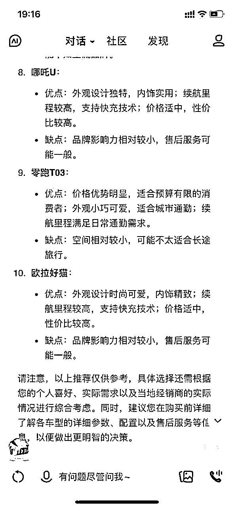

文心一言

## 4.4、API调用表现

拿“未来5天新疆的天气怎么样？”这个提问来做测试。

360 AI搜索拿到8分，成功接入了天气API，返回的信息很新鲜。

天工AI搜索只拿到4分，基本不及格，呈现出来的全是旧闻，时效性几乎为零。而且描述非常笼统空洞，废话太多没有干货。

豆包AI拿到8分，和360一样调用了天气API，给出的也是最新数据。

文心一言拿到6分，信息不够具体，也没有任何来源标注，可信度感偏弱。

百度搜索拿到9分，呈现清晰直观，一眼就能看懂。

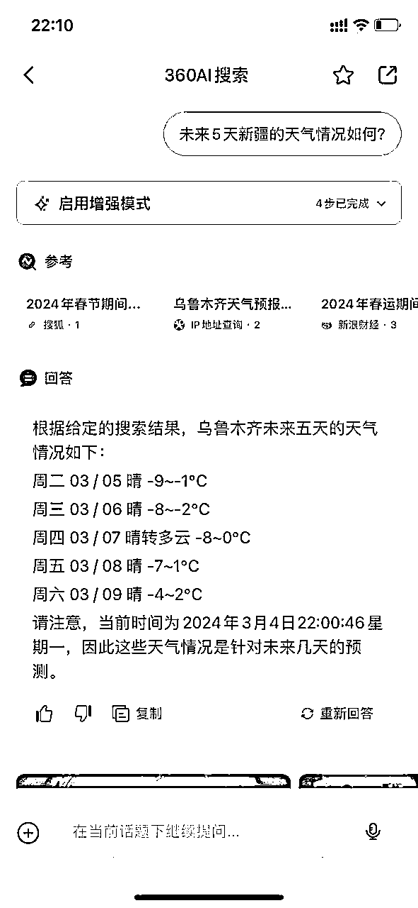

360 AI搜索👆🏻

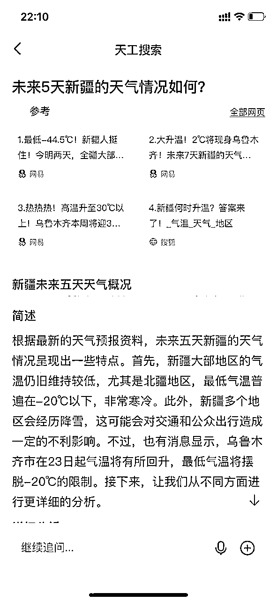

天工AI搜索👆🏻

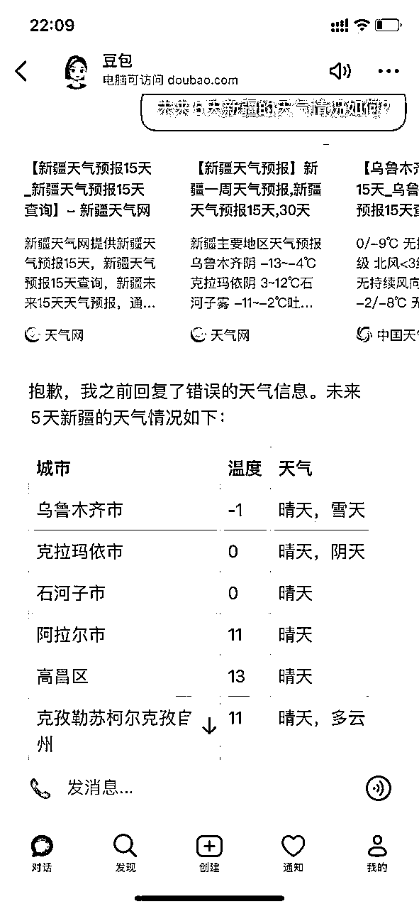

豆包AI👆🏻

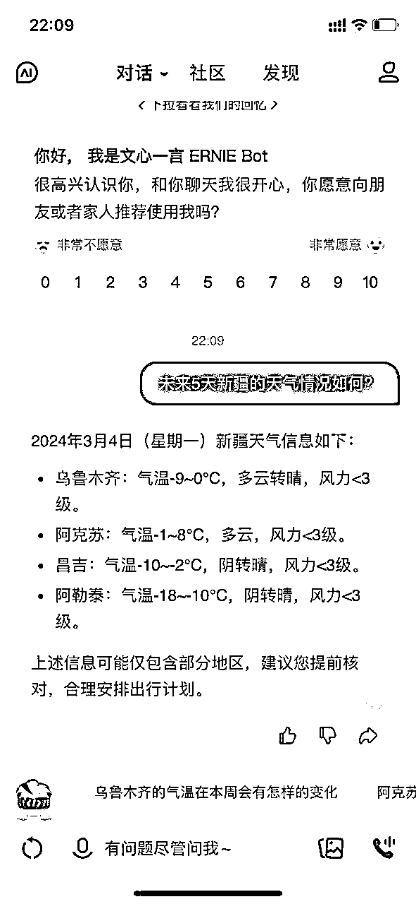

文心一言👆🏻

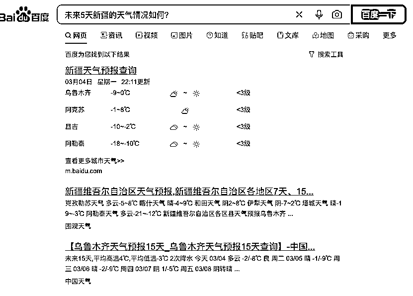

百度搜索👆🏻

# 五、 AI搜索现在面临哪些难题，会不会取代谷歌和百度？

就目前来看，360 AI搜索和天工AI搜索的对标对象是Perplexity。两者遇到的问题本质上是相通的，所以不必分开展开。只是在国内环境下，存在一些特殊差异。

## 5.1准确性与时效性

搜索的根本逻辑就是准且快。

谁能守住这两个点，谁就能留住用户。

现阶段无论是Perplexity，还是360 AI搜索、天工AI搜索，在一些复杂场景下依然会出现不准的情况，甚至答非所问。

原因一方面在于大模型的能力和调优水平。国内的主流模型和GPT-3.5、GPT-4之间还有怎样的差距？

另一方面在于信息抓取能力，也就是优质内容供给能力。

张一鸣和李彦宏都说过，搜索的竞争核心在于能不能找到优质内容，否则就成了无源之水。优质内容对百家来说都是稀缺资源。

当下国内各大厂的搜索信源基本是互相对抗的，像公众号、视频号、小红书笔记等链接，都具备很强的反爬能力。一旦抓不到这些数据，搜索结果的质量自然打折。

其实这是全球性的难题。

Perplexity早期能抓到Twitter的数据，后面就被切断了。

因此长远来看，必须要自建内容生态，类似当年百家号、头条号、企鹅号的思路。

那么Perplexity在准确性上做了哪些事呢？涉及技术细节，不感兴趣的可以跳过。

它主要做了两件事：降低幻觉、实现溯源。

为了解决幻觉问题，Perplexity引入了RAG检索增强生成技术。简单说就是给模型一本活的工具书，让它针对具体问题去检索外部知识来回答，从而减少胡编滥造，提升可信度。

与此同时，Perplexity给生成的每一句话都加上了引用来源，既保证可靠性，也方便用户追根溯源。

此外，Perplexity还在召回和排序环节做了创新，以保证内容的有用性和引用的精准度。

召回是指根据指令从知识库里尽可能多地拉出正确结果，排序是指按相关性把结果排好序。这决定了搜索引擎的精度上限。

基于这些做法，Perplexity目前是综合体验最好的AI搜索引擎之一。

2023年4月，斯坦福团队对YouChat、Perplexity.AI、NeevaAI、BingChat四款生成式搜索引擎做了人工评测。

结果显示，Perplexity生成内容的有用性评分4.56排第二；引文召回率和精确度68.7排第一；在泛搜索引擎体验的综合能力上处于领先。

除了准，Perplexity在速度上也下了功夫。

比如自研推理栈，让生成速度比通用GPT类模型更快；在模型侧对GPT-3.5进行微调，在控制成本的同时提升响应。

Perplexity的成功给AI创业者一个启示：与其死磕模型能力，不如把产品单点价值和体验做到极致。

脑洞一下，未来的AI搜索能否像头条、抖音那样做个性化推送？

从人找信息变成信息找人，而且是优质信息的精准推送。

## 5.2 用户迁移成本

产品价值等于新体验减去旧体验再减去迁移成本。

现在的AI搜索真的能做到十倍好用吗？能否让人发出“哇”的感叹，然后主动传播？

我个人很愿意尝鲜，容忍度也高，所以对AI搜索很乐观。

但我这种人是少数，更多三四线城市的用户，能否被惊艳到？

一旦在某个关键点上用得不顺手，就会立刻流失。

谷歌和百度在消费、地图、游戏娱乐等领域积累了海量数据，这让AI搜索在高频生活和购物场景里毫无优势，很难实现高频带低频的打法，美团的成长就是典型案例。

举个例子，你几乎每天都要吃饭，偶尔懒得出门就会点美团外卖。久而久之你习惯打开美团。

有一天你需要订酒店，虽然不常订，但因为已经习惯用美团点外卖，你自然会想先在美团上试试。

这样美团就用高频服务培养了使用习惯，进而带动低频服务的转化。

而现在AI搜索更多集中在知识问答，这是一个很小众、低频的场景。

普通人一年能买几次车？能去几次旅行？

## 5.2 产品增长飞轮

广告驱动的搜索引擎天然具备数据飞轮：用户浏览和点击行为反映偏好，反哺排序和广告竞价，让系统越用越准。

2014年张一鸣就解释过今日头条的增长飞轮逻辑。

“自我演化的系统在上线后并不能立刻提供很好服务，它必须在用户使用过程中不断理解用户输入，每一次使用既是使用信息服务，也是对系统的教育，让系统越来越有智慧。”

今日头条的核心是信息流网络，单点突破口是推荐算法，把创作、分发、互动整合起来形成闭环迭代。

而当下的问答引擎还没形成这种飞轮：聊天形态不方便用户做显性偏好反馈，用户也没时间专门去修改答案，点赞踩的比例也只有约10%的用户会给出。

问答引擎需要一种更自然的产品形态，让用户在使用的同时无感知地贡献反馈，才能在谷歌和百度面前具备竞争力。

## 5.3 商业增长飞轮

目前Perplexity的变现主要靠会员订阅和API调用，还没形成规模化收入。

但支出并不低。

作为创业公司，Perplexity的重心是打磨产品和召回系统，而不是自建模型+搜索技术栈。现阶段它依赖OAI和Google/Bing的API，成本偏高且定价权不在自己手上，Bing已经把search API价格提高了10倍。

中金测算，Perplexity调用Bing搜索和GPT-4的单次问题成本约0.03美元，全年成本约6000万美元，这还没算自研模型的开销。

作为知识生产力工具，Perplexity以20美元的订阅价商业化，但对于高推理成本的问答引擎来说难以为继，更何况传统搜索引擎有一套成熟的商业化体系，能同时服务用户、商家和创作者。

下一步Perplexity必须在商业化上发力：如何帮助开发者和企业优化搜索体验？如何把广告自然地嵌入AIGC和UGC？

如果没有新的商业模式，Perplexity的现状更像是Gen AI时代的新Quora+Wikipedia。

如果探索出LLM原生商业模式，它才有挑战传统搜索的可能。

因为谷歌和百度除了提供高质量搜索，还有两个关键支柱。

一个是广告主营销，只有建立起满足广告主的商业化体系，才能用广告收入让用户免费使用高质量搜索。

另一个是创作者激励，内容发布者通过在平台发布优质内容获得激励，才能持续生产内容供给AI学习和召回。

尽管AI看似减少了创作需求，但高质量内容仍需人来生产。

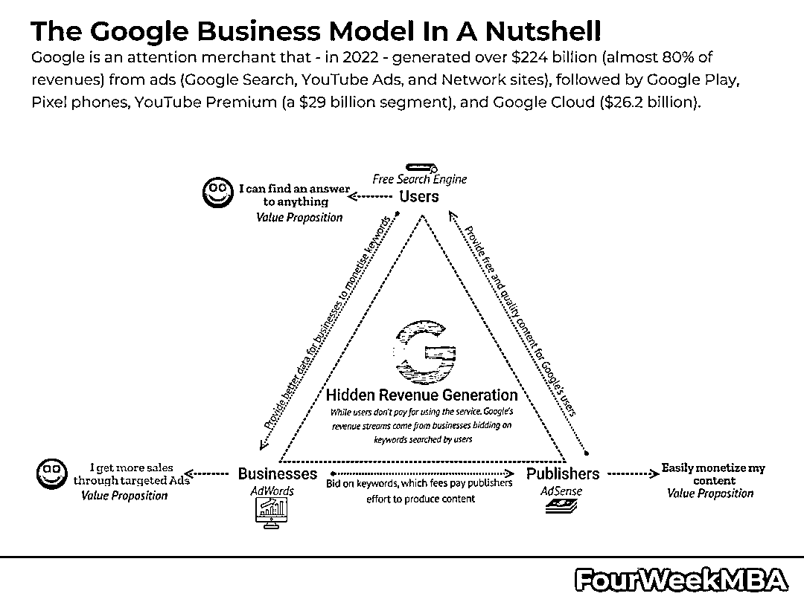

英文版👆🏻

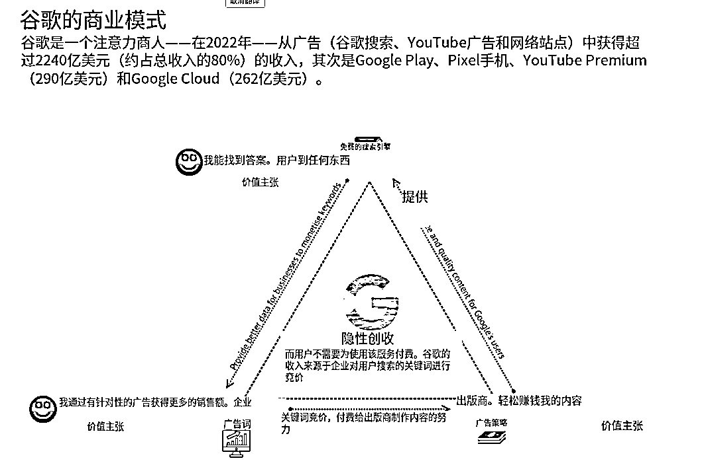

中文版👆🏻

历史经验表明，搜索市场一直是赢家通吃的典型。

尽管百度饱受诟病，但在中国搜索市场仍占据超过70%的份额。

不过新兴技术往往以颠覆旧技术的方式实现替代。旧玩家的路径依赖可能成为升级的最大阻碍。

今日头条就用智能推荐颠覆了传统媒体和新闻客户端。

以搜索为例，AI搜索通过直接给出关键信息的交互方式，和谷歌、百度基于竞价排名的商业模式天然对立。

他们如何在维持现有商业模式和拥抱新技术之间取舍，是一个巨大挑战。

而对Perplexity、360 AI搜索、天工AI搜索来说，这可能是一次改命的机会。

还是毛委员说的好，“牢骚太盛防肠断，风物长宜放眼量”！

# 六、关于@大厂转型人强哥

大厂转型人强哥，公众号可找到我，欢迎交流。现任选择力新职业教育，助力职场人零基础转行，负责内容与增长、产品运营、用户运营。曾就职腾讯、字节。

关注AIGC机会+AI大模型与应用团队，重点研究“文科生如何抓住AI红利”，欢迎优秀团队加V交流，期待合作。

有什么问题可以直接写在评论区👇🏻

觉得写得不错就点个赞哈哈，我不能偷懒，要继续梳理输出更多干货！

此前优质文章：

【重点看】

最后特别感谢公众号“super黄的念想”，让我认识到这么多有趣的产品，大幅提升了我的效率。

特别感谢公众号“深思 SenseAI”、公众号“海外独角兽”、公众号“Founder Park”、公众号“读懂财经”、公众号“混沌学园”、公众号“中国企业家杂志”带来的启发，感谢你们持续产出优质内容，拓宽了我的视野！