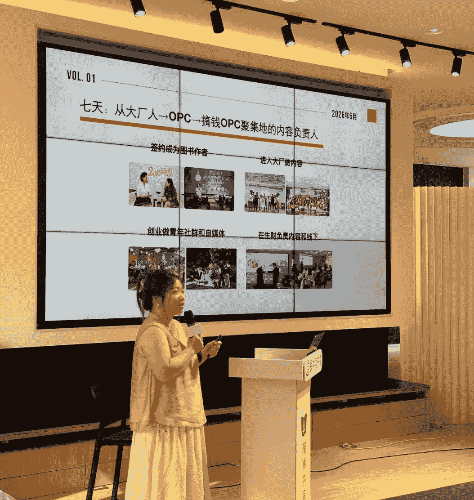
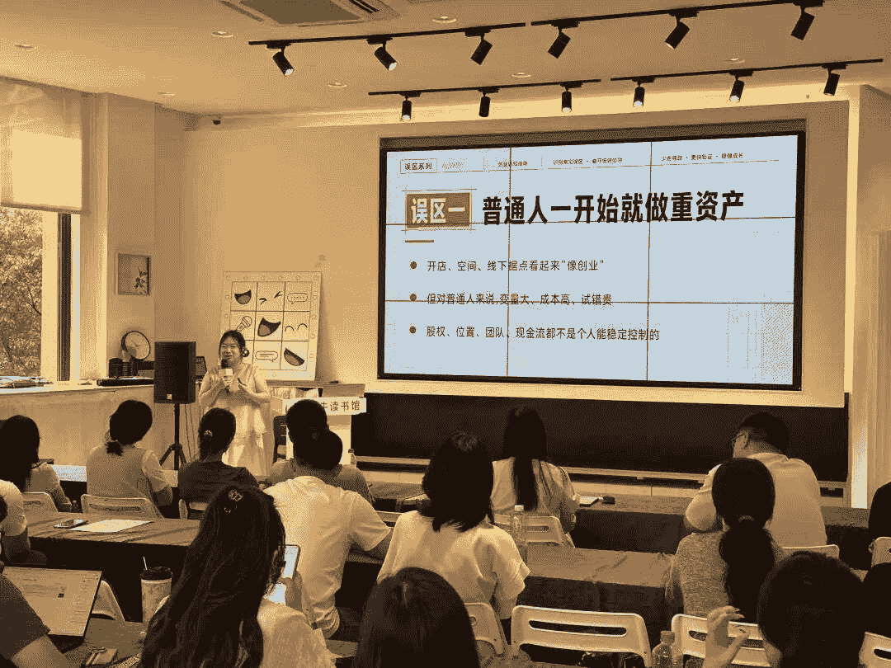
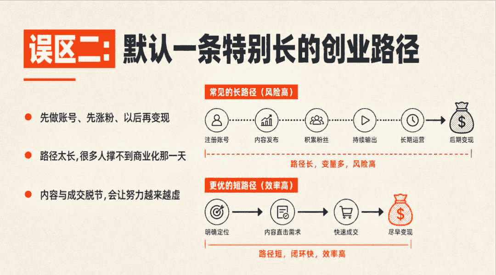
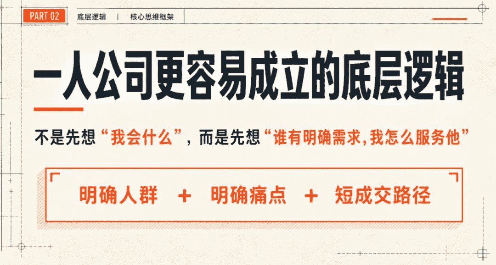
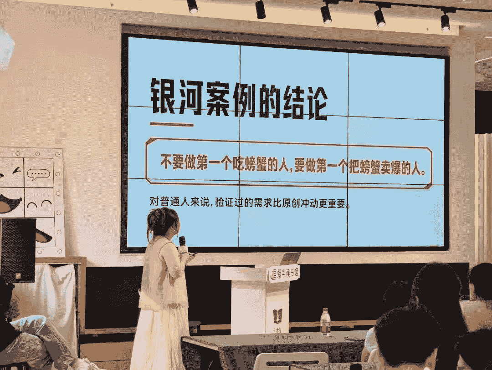

# 不想再上班了，一个普通人如何做出稳定变现的一人公司
作者：龙哥

你有没有过这样的瞬间：周一早上闹钟响起，你盯着天花板，心里冒出一句“我真的不想再上班了”。

其实你想的未必是“再也不干活”，而是不想再被人安排、不想再用时间换钱、不想再把所有可能性押在一份工位上。但真要自己干，又怕没方向、没资源、没本事，最后灰溜溜回去。

今天这篇，就是专门聊这件事的。我想讲清楚一个普通人，到底怎么一步步搭起一个能稳定赚钱、甚至能持续放大的“一个人的公司”。

但在聊“怎么赚钱”之前，我想先问一个更底层的问题：如果只有你一个人，你凭什么做到像一家公司那样运转？

答案不在于你是不是一个人，而在于你能不能持续地、稳定地为一群明确的人提供他们想要的价值。说白了，你不需要什么都做，但你得让特定的人离不开你。

如果你想走这条路，有三个问题比“我该不该辞职”“我该不该创业”重要得多：你到底在服务谁？他们在什么时刻会特别需要你？你给出的解决方案，凭什么比他们已经用的、已经买的那些选择更好？这三个问题想不透，后面的努力都只是在表演忙碌。

先讲一个让人提气的判断：今天一个人做公司，其实比以前容易多了。不是因为人变强了，而是环境变了。

第一，供给到处都是。过去你要卖货，得先囤货、租仓库、请人，整套下来就是重资产。但现在不一样了。现在很多生意不需要你拥有货，你只要能把人和货对上，就能赚到钱。电商选品、直播带券、信息差服务，本质上都在做一件事：找到对的人，把东西讲清楚，完成成交。

第二，AI 把成本打下来了。以前你想干点事，一个人根本忙不过来，要助理、要编辑、要整理资料的、要写文案的。现在一个人加上几个 AI 工具，很多基本的工作就能就地完成。做训练营、做咨询、做内容产品，过去需要一个小团队才跑得起来的东西，现在你一个人就能做出第一版。

第三，需求可以切得非常细。过去总觉得生意要做得越大越好，但现在恰恰相反，很多能赚钱的生意，都是因为切得足够小。你不需要一开始就面对所有人，你只需要找到一小群有明确痛点的人，就足以养活自己。求职辅导、出海服务、职场转型、AI 工作流，这些都是小切口。

所以，一人公司的本质，不是什么事情都自己扛，而是用更轻、更省、更快的方式，先把一个最小的商业闭环跑通。

但我也想先泼点冷水。我带过不少人，也见过很多从大厂跳出来的人踩同一种坑。他们的问题不是不会做，而是被一套错误的认知框住了。

第一个误区，一上来就做重资产。很多人觉得创业就得开个店、搞个空间、弄个线下根据地，这样看着像个正经事业。但这条路对普通人来说，代价太大了。因为能不能赢，主要看两件你很难控制的东西：你有没有足够的股权，以及你能不能拿到真正好的位置。好的位置早就被有钱有资源的玩家锁死了。普通人不是没机会，但这个游戏试错一次太贵了。我一直觉得，普通人做一人公司的第一原则，不是把事情做大，而是把试错成本压到最小。

第二个误区，把路线拖得太长。很多人说，我先做号、先涨粉，等到了五万十万粉丝再想怎么变现。这条路听起来稳妥，实际上很难走完，因为大多数人根本撑不到变现那天。更好的方式是，从第一天就想清楚怎么赚钱。举个例子，你想卖一个包，那第一天就可以发这个包的笔记，它当天就有成交的可能。就算没卖出去，你也能立刻看清是选品不对、还是人群不对、还是文案不够狠。相反，如果你先立志做一个讲高颜值包包的博主、等有了几万粉再去卖包，中间的弯路足以耗尽你所有热情。

第三个误区，从“我想做什么”出发，而不是从“别人最痛什么”出发。我自己就吃过这个亏。我以前特别喜欢组织线下青年活动，大家觉得我很有创意、很会聊，氛围很好。但卖到 199、399 的时候我忽然发现，这不是一门好生意。因为参加的人可能是来社交的，可能是来吹空调的，甚至可能只是想认识异性。这些需求都很真实，但它们不够聚焦，也不够锋利，撑不起一个稳定的业务。后来我越来越明白：一个能证明“我很有趣”的事情，不一定是一个能证明“我对别人很有价值”的生意。

我总结自己的失败，大概是这四件事：路径太长，产品太重，价值不够聚焦，还有最关键的一点——从自我表达出发，而不是从用户掏钱的动机出发。

那到底什么样的一人公司更容易成立？我去看了很多真正跑出来的案例，发现他们做的事情各不相同，但底层逻辑出奇一致：他们不是先想“我能做什么”，而是先找到“谁有明确的需求，我可以用什么方式去服务他”。一人公司能立住，不是因为你全能，而是因为你找到了一个足够具体的人群、一个足够明确的痛点、一条足够短的成交路径。

第一个案例，小红书电商。有个朋友做的不是那种先当博主再做电商的路子，而是先去找到一款已经被市场验证过的产品：苔藓地毯。他观察到两件事：第一，这款产品在小红书已经有过爆款笔记，也被验证过能稳定出单；第二，本来在卖的竞品运营很懒，内容少，也不够勤快。他判断，需求已经存在，原来的卖家又没做透，那我用更强的运营能力把这事放大就行。他有句话我非常喜欢：不要做第一个吃螃蟹的人，要做第一个把螃蟹卖爆的人。这话背后的思路就是，如果你没有足够强的创新能力，就别先去赌一个新需求成不成立，而是先去找一个本来就成立的需求，然后把它做到极致。

第二个案例，AI 工具站。有个叫井然的朋友，做的是用 AI 快速上线各种工具网站，靠谷歌 SEO 拿自然流量，再向用户收订阅费。他也是 0 基础起步，但他不是一个先学 AI 再决定做什么的人，而是反过来：先去找市场上什么需求已经被验证、什么人已经赚到了钱，然后补齐自己的短板。缺技术就补技术，缺流量知识就补 SEO，缺案例就去加有结果的人。他有个表述特别朴素：小成功能带来大成功。他自己最早的正反馈，就是发现一个还没被充分定义的需求，于是快速做个极简版本上线，先跑，再一步步迭代。他有一套很实用的判断标准：先看这个事能不能用现成工具或者 API 快速搭起来，如果一个人能搞定，那才有试错的意义；再看市场是不是已经有真实流量在流动，有就说明需求确实存在；最后才看竞争，如果足够垂直、做的人很少，那就值得马上验证一版。所以这件事在他那里不是“做一个网站”，而是一个低成本、高频次的试错系统。核心不是灵感，而是不断贴近那个已经被验证过的需求。

第三个案例，高客单服务。有个做 IP 获客私教的圈友，她给学员重新定位产品的时候，把一个泛写作训练营改成了“创始人 IP 商业写作”。名字一改，服务对象变了，痛点也就变了。因为创始人需要的不是“学会写作”，而是解决自己表达不出来、内容立不起来、信任承接不住的问题。她有一个观点也值得反复琢磨：卖 80 块还是卖 8000 块，关键不是你做了什么，而是你卖给了谁。所以“做人”的生意，往往不是先有产品，而是先锁定一群人，再从这群人里去挖掘最愿意付费的痛，然后围绕这个痛设计产品。

第四个案例，更极端，也更让人清醒。东山老师的路径是：一年只接少量客户，但每个人的客单价做到三五十万。普通人一听这个数字会觉得“怎么可能”，但他说了一句话我非常认同：超高价的本质，不是贵，而是确定性。你卖的其实不是时间陪伴，不是温柔鼓励，而是一个大概率能成的结果。高价不是问题，前提是你能解决客户真正昂贵的问题。如果你能帮企业多赚一百万、少亏一百万，那十万二十万的费用，只是一小部分的成本。当然，这里也有一个巨大的陷阱：别为了高客单而高客单。如果你的能力和交付撑不起这个价格，你收进来的不是利润，而是未来的口碑负债。真正值钱的，从来不是你的报价，而是别人相信“把这件事交给你，大概率能成”。

把这四个案例放在一起看，你会发现他们能成立，其实共享同一套逻辑：第一，有一群非常清晰的人；第二，那个痛点锋利到让人愿意付款；第三，谁有便宜产品他们知道。他们做的事情不是“发明需求”，而是“验证需求”。

最后，我想聊聊我观察了很久的一个判断。这两年我带过几千人做副业，发现在所有的方法论之上，最重要的其实是你选对适合自己的那条路。

大多数生意都可以被装进两个筐子里：一个叫“做货的生意”，一个叫“做人的生意”。

做货的人，核心是研究需求，研究产品，研究最近什么东西在起量、什么东西能卖得更贵。就像抖音 CPS、B 站好物、美团外卖券，背后是同一种逻辑：商品已经存在，买家已经存在，你只负责把它俩高效地连起来，就能赚到佣金。如果你平时就喜欢逛 1688、喜欢琢磨别人为什么下单、看到一样东西会不自觉分析“这个为什么能卖”，那你大概率适合做货的生意。

另一类人，对产品没那么感冒，对人特别敏感。我认识一个 30 岁就退休的女孩，做的事情就是到处发外卖优惠券，把券分发到各个私域和社群，有人下单她就有收入。这看起来也是做货，但其实她擅长的是洞察人：知道谁会领这个券、什么内容能打动他们、怎么让传播链条跑起来。我自己也是这一类。2023 年我去学人生教练，是因为我发现身边越来越多人在困惑要不要离开职场。我把这些观察写成小红书笔记，分享别人的自由职业状态和真实收入，结果一堆人来私信我，问我该不该辞职、怎么选择。后来我就开始做人生教练服务，从 99 元体验价，一路做到 999 元一次。

做货的生意，是在研究一个需求，然后把产品打磨得越来越好；做人的生意，是在研究一群人，然后围绕他们去设计产品。产品只是载体，真正值钱的是你对这群人的理解——你知道他们为什么纠结、为什么迟迟不做决定、愿意为什么结果买单。这份理解本身，就是最大的护城河。

所以回到最初那个问题：不想上班了，普通人怎么做出一个能稳定变现的一人公司？

答案很简单，也很朴素：先别急着想自己能做什么，而是先去想清楚，你到底要替哪一群人解决什么问题。然后，用最小的投入，最快地去验证有人愿意为这件事付钱。记住，一人公司不是一个目标，它是一个结果——当你能持续为特定的人提供价值，你一个人，就是一家公司。

在现实里能看见这样的样本：一位在校医学生，没去搭大平台，而是把精力全押在帮助同龄人解决求职上。一次训练营收费两三千，报名依旧火爆。火爆的根因并非训练营这个形态多新颖，而是他长期浸润在医学生群体里，对这批人的焦虑、语言和决策点有着近乎本能的体感。

类似的画像还有很多。有人专门服务社恐人群重建社交秩序，有人深耕飞书知识库的咨询交付，有人长期担任企业外部顾问。交付形态看起来各不相同，触达用户的真正钩子却一致：他们都对同一类人群形成深度认知，并持续在该人群的痛点上做复利。

我自己的观察是，很多创业者太早去问“我要做哪个产品”。这个问题往往问得过早。

更关键的先行问题是：你更想长期研究一件产品，还是长期研究一群人？

如果你对趋势、需求曲线、产品形态本身保持持续兴奋，那走产品驱动更匹配；如果你对人本身更着迷，享受反复理解同一类人的行为逻辑并陪跑他们的成长，那么产品会随着人群需求而演进，但服务的人群内核始终稳定。

产品会迭代，真正沉淀下来的是与你保持信任关系的那批用户。

一个简化的对照框架是：最小化组织形态完成价值交换。价值交换的来源大致只有四类——标准化供给、关系信任、专业判断、注意力分发。

谈到商业形态，可以用一个粗糙公式概括：清晰的目标群体 + 清晰的痛点 + 清晰的发生场景 + 可交付的方案 + 可复现的成交闭环。

从实践里能归纳出至少六种常见形态：

1. 电商型 solo：放大已验证的商品，靠选品运营与流量做规模，适合市场嗅觉强的人。

2. 高客单服务型 solo：用专业服务锁定特定人群，通过人群筛选与服务重构获取溢价，适合有行业背书的人。

3. 高价咨询/教练型 solo：出售的不是时长，而是结果确定性，依赖方法论沉淀与结构化表达，适合有深度实操经历的人。

4. AI 产品/出海型 solo：以轻量工具或站点的形式捕捉长尾需求，依赖 SEO 与全球流量，适合擅长快速试错的人。

5. 内容影响力变现型 solo：通过持续输出建立信任，再承接商业转化，适合表达力强且理解用户的人。

6. 平台/分发型 solo：不直接生产交付物，而是占据信息入口，把“价值被看见”的撮合权变成核心资产。通过社群、垂类媒体、KOL 矩阵或导购账号做筛选、整合、分发，完成供给与需求的匹配。

这个形态的人不一定是最强的创作者，但对资源连接、信息差与人群偏好极度敏感，最终靠入口位势获取回报。

底层只有两条分叉：放大一件产品，或经营一群人。前者强调效率与规模，后者强调理解与信任。

可以自问五件事：目标群体能否用一个清晰标签描述？他们在什么场景下痛感最强，且是否高频、刚需、愿意付费？他们现在如何解决，现有方案的短板在哪？我能否给出更省事、更快、更省钱或更确定的一套做法？这套做法能否通过内容、产品或服务持续触达并成交？

五件事说不清，更多时候是模型未成立，而非执行不足。

关于收入天花板，我更倾向算账而非空谈。高。卖 1000 元的单品做到百万，意味着 1000 次成交。若咨询转化 10%，需要 1 万次有效触达；若私域添加率仅 1%，则需要百万级曝光。一旦倒推，流量来源、信任构建、客单提升、交付承载、复购升单、SOP 化与自动化等问题立刻具体化。

年入百万常被看作分水岭，不是因为它很高，而是多数人难以稳定跨过。跨过去的关键是模型、流量、产品、转化、交付五件要素同时在线。

也有人只想做轻生意，不建团队。那也可以，但要同时想清：期望年化收入是多少？这笔收入能否在明年、后年持续获取？平台红利与流量红利都有周期。我的体感是，很多时候不是在超越别人，而是在奔跑才能维持原地。

若目标是年赚 30-40 万，也合理，但仍要追问：这笔钱来自红利还是能力？模式能否穿越周期？平台变化时是否有第二增长曲线？想不清，赚到的多是一次性运气。

关于是否招人，误区在于把“solo”等同于“永不招人”。真实逻辑是：先自己跑通最小闭环，等某些环节稳定、可复制后再拆分出去。把确定性强的环节外放，把不确定性强的判断留在自己手中。内容电商里，选品、测品、趋势判断是高不确定性的核心判断，早期应自己把控；稳定化的拍摄、素材整理、标准化发布则可逐步制度化与外包。

回顾我的经历。做过 CPS、熟人生意、线下青年社群与内容自媒体。每一段都留下提醒。CPS 与熟人买卖高度依赖爆品与稳定货源，主动权有限。线下社群单独作为产品，价值感与复购感不足，更适合作为交付体系的一部分。内容有流量不等于有商业模式，若未抓住高杠杆的变现路径，流量只是热闹。

这些反思指向同一结论：生意成败的关键是是否面向特定人群，在特定痛点下提供特定解决方案。

若今天给从大厂出来的人建议，我会说：先找人再找产品；先跑最小闭环再扩张；优先切高客单、强需求、强结果导向的赛道，如求职、变现、效率、关系、身份跃迁；把内容当作获客与筛选系统，而非自我表达；把 AI 当作协作员工，提升整理、生产、交付与复盘效率；跑通后再制度化与外包，招聘是结果而非起点。

solo 的本质不是一个人扛下全部，也不是看似自由就能成立，更不是会一点 AI、发一点内容就自动运转。它考验的是能否围绕清晰需求，把流量、产品、交付与增长系统化地组织起来。

它可能从一个人启动，但真正的考核是能否像经营一家公司一样经营自己。核心始终是为谁、在何种场景下、提供何种价值。

换个视角看，这更像是一种能力建设：无论时代环境如何，都能持续创造价值并完成价值交换。没有捷径，只有反复下场、试错并将经验内化。

————分割线————

看完这篇 SOP，你觉得你懂了。但 90% 的人一到实操就会卡在第一步。

工具和教程只是最低级的壁垒，真正的壁垒是“立刻动手”和“圈层信息差”。

我们不聊虚的，只做商业闭环的拆解与 AI 效率的压榨。系统内已沉淀 1000+ 跑通的套利实战局。

👉 查阅圈子完整数字资产与上车门槛：