# 不懂代码、英文也不行，我靠 AI 接活 25 天赚了 5100 元：完整实操复盘

260715 副业 SC 精华

提示：文章里的截图比较多，强烈建议打开在线版，阅读体验会好很多：

https://hk57gvlx7u.feishu.cn/docx/Wan6dWnV0ouPjqx1kCScy9JWnde

说实话，我英语水平有限，代码从没写过一行。但过去 25 天，我靠 AI 帮人做网站和小程序，实打实赚到了 5100 元。这篇就把整个过程毫无保留地拆给你看。

## 先交代背景

我叫"年轻人"——这网名是我给自己打的鸡血。快 30 了，但还想保持敢闯、敢试、对所有新东西都好奇的状态。以前在互联网大厂卖云计算服务，现在是自由职业，重心放在 AI 这条线上。今天的内容，就当是我的一份实战报告。

去年 7 月加入赚钱，这一年里折腾过不少方向：垂直小号、虚拟资料、YouTube AI 视频、CPS、微信小程序。除了 CPS 当时实在没空做，其他几个基本都跑通了，只是没做大规模。

虽然没有耀眼的结果，但每一次真刀真枪的实操，都在把技能越磨越厚。

最近我终于在 AI 写程序这件事上见到了回头钱，赶紧把整套过程整理出来，也算是给这一年交份作业。核心想讲清楚一件事：毫无代码基础的人，如何靠 AI 把编程变成一门生意。

这篇没有大佬们那种惊人的收益，但它的价值在于——门槛很低、需求很旺、能力可以复制。从 0 到 1 怎么走、赚钱的 SOP 是什么、有哪些真实案例，我都写在下面。照着做，真的不需要什么天赋。

说句实话，客户最后觉得你牛，不是因为技术多炫，而是因为你用心。再叠加 AI 这个工具，对普通客户来说，你已经是碾压级的存在了。

## 一、20 多天，我到底赚了多少

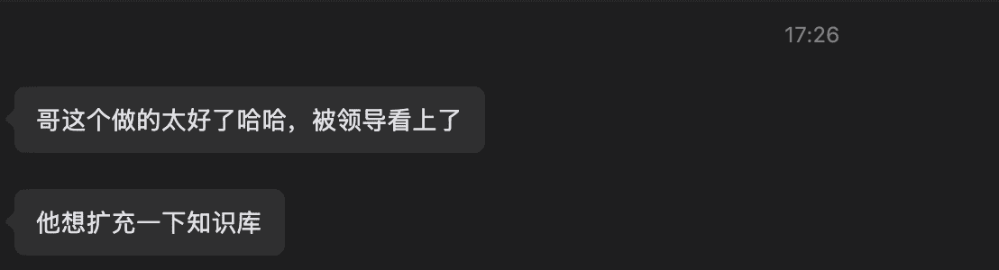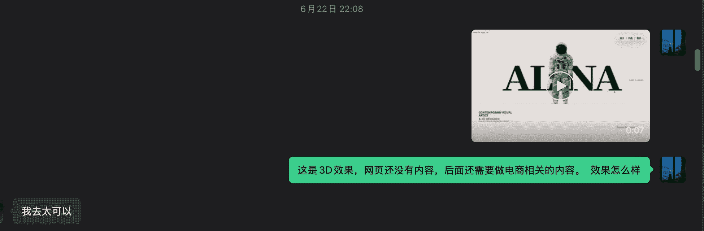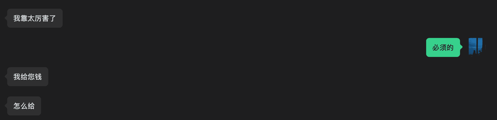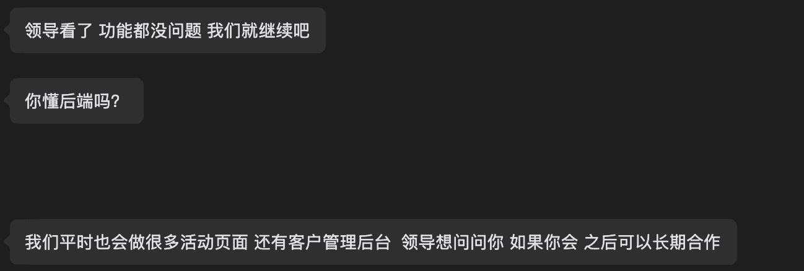

我现在接的活，是用 AI 做小程序、网页、H5、智能体这些。没把自己锁在某个单一方向，因为这几种东西底层逻辑都是通的。

先看数据，截止到这个月：

- 6 月 10 日到 7 月 5 日，通过闲鱼平台接 AI 代做项目，进账大概 **5100** 元，投流费用约 **300** 元。这段时间不是全天都在干活，实际投入折合下来只有半个月。要是时间管够，月收入破万并不夸张，继续放大做成工作室也完全可以。

- 5 月末，小红书接了 **2** 单小程序定制，都是大学生作业，价格分别是 500 元和 300 元。同时导了一波人到自己的微信号里，后面还有转化空间。

- 3 月末参加了小程序航海，做出第一个作品之后，陆续上线了 **4** 个个人小程序，其中 2 个开了广告分成（没特意推广，一天被动收入不到 1 元）。

说实话，这点钱和圈里的大神根本没法比。但鱼丸老师的判断很对——以现在 AI 的能力和这个时间窗口，这件事很值得下场。

### 人人可上手？机会从哪来？

我就是那个"最普通的样本"：英文看不懂，代码不会写。但在今天，这些全都不是阻碍——搞不定的，直接丢给 Codex、Claude 就行。我也没死磕某一个类目，App、小程序、网页都在碰，因为 AI 当下已经足够能打，方法路径比选哪个方向更重要。

这条路是参加航海趟出来的。4 月在小程序航海里第一次动手，做出自己小程序的那一刻，成就感记忆犹新。后来陆续上了 4 个，等于把"从搭建到上线的全套流程 + AI 写码的各种坑"都亲自踩了一遍。虽然没做成教练那种爆款，但踩过的坑全都变成了自己的本钱。

5 月，我在一篇很火的小红书笔记下留言，之后这条评论竟持续为我带来小程序定制的咨询。大多数是问完没下文，但也有 4 单成交，微信里也沉淀了不少人。

从小程序想到网页，其实是一通百通。我依旧看不懂代码，只是把需求说给 AI 听。说白了，AI 就是那个干活的牛马，你负责当提着鞭子的老板。

## 二、机会是怎么来的：三个底层原因

### 第一，信息差把绝大多数人挡在了外面

国内每天都在用 AI 的人，粗粗算也就几百万。大多数人的观念还停在"写代码是程序员的事"。光是"我不会写代码"这六个字，就把 90% 的人拦在了门外。

信息差有多离谱？连 GitHub 部署这种操作我都能接到单——两单，各 30 元，Codex 处理起来就是分分钟的事。信息差在哪里，钱就在哪里。

### 第二，时间窗口正好撞上需求旺季

6 月毕业季，叠加期末、暑假、求职季，毕设、课设、个人主页网站的需求集中冒出来。小红书和闲鱼上，全是找人来做的学生。我遇到的学生需求大致有三类：

- 设计稿：用 Figma、DW、AI、PS 等工具出图

- 网页开发：静态页面、动态交互、个人简历主页

- 小程序开发：商城、校园交易、记账工具等（学生一般不要求认证部署，跑得起来就行）

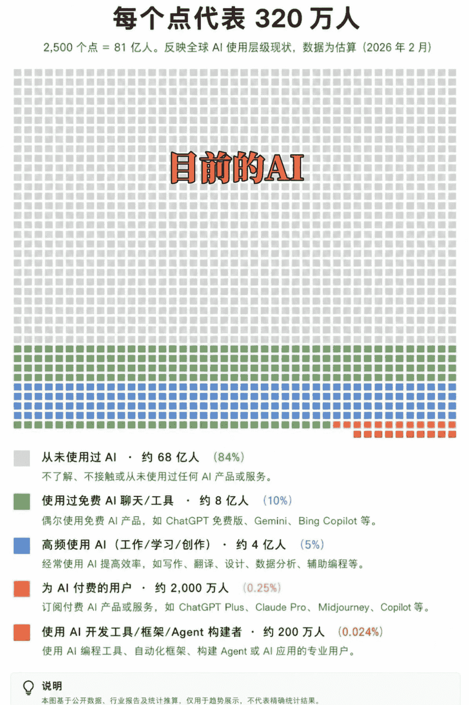

### 第三，学生单只是冰山一角

学生作业虽然是当下的热点，但盘子里装着更多长期需求。而且不一定只能接单，完全可以做自己的产品，赚睡后收入：

- 发布个人小程序，赚广告分成；注册个体户或公司，做付费小程序

- 接商家的定制需求（商家类订单量很大，小红书上不少人想做点单小程序）

- 做网站：个人主页、企业官网、独立站、婚礼邀请函、HTML PPT 等

我在学生项目之外，还服务过这些需求：

- 小学英语老师公开课用的对话式英语智能体

- 青岛人社局人工智能应用大赛的 AI 智能问答客服

- 某证券公司东南亚区域企业官网

- 一位设计师的个人作品集网站

- 金融行业留学生的个人主页

- 一个 API 中转站的 UI 改造

## 三、钱的路径：渠道怎么搭、报价怎么算

整个搞钱链路，我拆成"引流"和"成交交付"两个环节。一句话总结：在流量聚集地展示作品，稳稳接住每位咨询者，剩下的交给 AI 去干。

### 闲鱼：我的主要战场

现在大部分单子来自闲鱼，给大家完整跑一遍流程：

**先挑品。** 去搜"网页设计""网页制作""大学生网页设计"之类的关键词，把同行卖得好的商品页、配图都研究一遍，心里有数后再搭建自己的商品信息。

**再定价。** 现在静态网页普遍在 **10** 元 / 页上下，交互效果好的可以适当报高。但内卷厉害，价格别飘，自己掂量。

**然后上架。** 参考做得好的同行，用 GPT 生成商品配图，文案微调后发布。顺便让 GPT 帮忙优化搜索词，把可能带来流量的词都埋进描述里。

**记得避雷。** "作业""毕业设计"这类的词是违禁词，容易被平台判定为学术不端而下架。

**冷启动有技巧。** 刚上架没销量，可以让亲友各拍一单，凑几单后开"超级擦亮"，叠加新人优惠，曝光才几块钱。或者直接买 **29.9** 元的"4—5 人咨询量"套餐——我用了之后来了七八个咨询，成交一单就回本了。

**对接需求要会引导。** 让客户把具体要求、想要的效果、参考例子都发过来，再统一开价。遇到摇摆不定的客户，把需求整理好交给 GPT 出个效果预览图，告诉他"这是设计稿"，信任感瞬间拉满。

⚠️ 特别提醒：如果客户只要设计稿（Figma、DW、AI、PS），除非你熟悉这些软件，否则只接 Figma。虽然 Codex、Claude 都有 Figma 插件，但额度极其有限——一个免费账户仅 6 次调用，经常网页做完了、想通过 MCP 转进 Figma，额度已经耗光。

我的取巧方案：先用 HTML 把网页写出来，再用 html.to.design 插件导入 Figma，基本能还原七八成。每个账户每月能导 10 页，不够就换号。客户想在 Figma 里加点击、跳转之类的交互，直接截图问 Codex/Claude 就好。

别再去死磕 Figma 里那些繁琐操作，AI 生成完再导进去，省时省力。

### 小红书、抖音：内容引流

- 发什么：有质感的网页成品，"0 基础做小程序""30 块搞定自己的小程序""0 基础 vibecoding""零基础让 AI 替你写程序"之类的话题。

- 怎么发：优先用自己做的网页/小程序当素材，因为整个流程你已经门儿清；如果还没有作品，先用 GPT 生成一张设计图顶着。

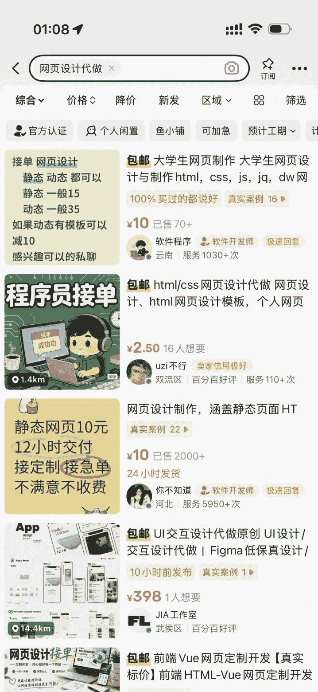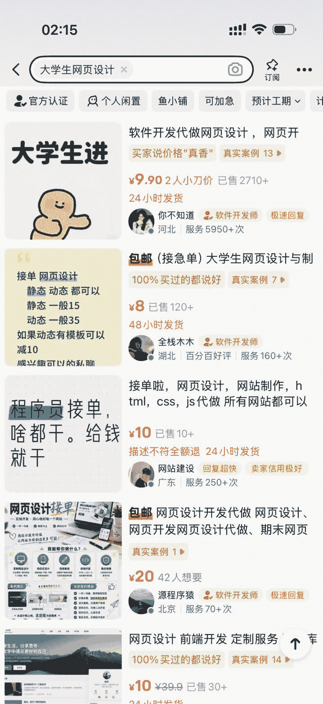

### 公众号、视频号：还没动工的洼地

这两个平台我还没做，但玩法和上面一样，属于值得尽快补上的流量缺口。

## 四、单子怎么筛：哪些接、哪些拒、怎么报价

刚开始做，千万别见单就接。接错单的内耗，比没单更可怕。我的筛选逻辑如下。

### 可以直接接的

- 需求具体、有参考图或链接的：直接甩给 AI 去仿，基本跑不掉。

- 静态网页、带少量交互的网页、HTML 课件/PPT：AI 很快能出，改两轮就能交。

- 体验版小程序（不用上线、不用备案）：轻量快速，钱也好赚。

- 仿制类订单：照着参考做一个类似的，最省心，也是新手最合适的上手方式。

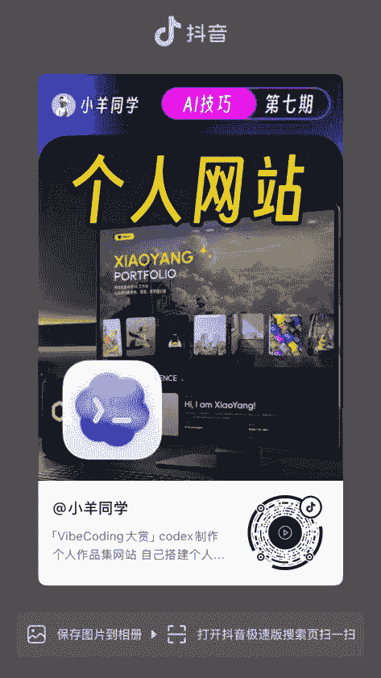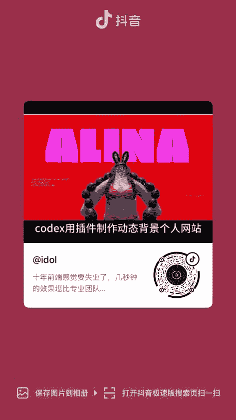

### 要慎重，或干脆不接的

- 说不清自己要什么的客户：你改十八版他也未必满意，典型的无底洞。先聊透再开价，聊不透直接放。

- 急单：作业临交才来找人、开口就要当天交付的，谨慎再谨慎。接普通单也尽量把周期拉长，留足缓冲。要是你空档期多、技术又硬，才考虑接急单。同时留意 Codex 额度余量，以及恢复时间。

- 要上线备案和长期维护的商业单：新手扛不住，售后能磨死人，除非需求讲得明明白白、时间给得足足的。

- 点名要你不熟的软件出稿：比如纯 Figma、PS、Adobe XD。没把握就拒，Figma 可以先按上面的"HTML 转 Figma"思路验一验。

- 涉及贵 API 但客户不愿掏钱的：例如端到端语音大模型，容易亏本，坚持让客户用自己的账户。

- 敏感、违规，或压价压到毫无利润的：直接 pass，省下时间去接更好的单。

我的原则很简单：能保证交活，价格能覆盖时间和精力，就接；任何一个环节心里没底，就先谈清楚，否则就放。

### 开价公式：底价 + 工作量叠加

别拍脑袋报一口价，容易血亏。我的做法是定个底价，再按工作复杂度累加：

- 静态网页：约 10 元 / 页，市场就是这么卷。

- 交互动效：点击、跳转、动画、3D 等，越复杂加码越多。

- 页数与功能模块：按量往上累加。

- 后端、数据库、部署上线：这就不是纯前端的活了，明显加价，同时冷静评估自己能不能搞定。

- 素材制作、反复修改：只要要求你出图出文案、或者给无限次修改，提前把成本算进价格里。

- 加急：要赶工期的单，加急费必须收，别不好意思。

报多少之前，先问清三件事：几个页面、什么功能模块？有没有参考？要不要上线部署？这三条直接决定你的工作量和会不会亏本。客户犹豫时，让 GPT 先生成一张效果预览图给他看，说"这是我做的设计稿"，成交率和你的报价底气都会高很多。

过来人提醒：宁可少接、接稳的。别为了几十块钱，接一个能拖垮你一周的烂单。先把几个"稳赚"的单子做完，攒下评价和案例，这才是你往后接高价单的底气。

## 五、零基础的启动路径

### 第一步，把工具备齐

主推 Codex，次选 Claude。目前最省钱的办法是用苹果商店充值 GPT Plus，大约 **110** 元 / 月。赚钱里教程一大堆，也可以找便宜的成品号。

其他的工具就别花时间研究了，没意义。这两个工具你要是还没用过，一百多块就是回报率最高的一次投入。等你能熟练接活了，Plus 的额度确实不够烧，但你烧出去的 token，能带来 10 到 20 倍的回报。

我自己是 Codex + Claude 双官方订阅，一个月两百多，还买了两个成品号。项目多的时候，直接上 Pro 的 5 倍或 20 倍会员，很划算。

### 第二步，做出第一个作品

AI 写程序真的不需要代码基础，你只要把想法说清楚。

拿 HTML 网页举例子：

- 想仿一个页面：把链接丢给 Codex，或者把截图、录屏扔过去，让它照着做。

- 第一版通常不够完美，把成品截图、圈出问题、写清楚改哪里，让它反复迭代。

作品案例要尽早攒：很多客户特别在意这个，上来就问有没有做过类似的。就算客户不问，你主动甩一张很有高级感的 UI 页面，成交率都会往上走。

- 推荐参考场景站：https://sceneai.art/ ，上面有一堆免费动态网页 prompt，复制给 Codex，几分钟出效果。很多抖音上的爆款视频，底层就是这些 prompt。

- 站内素材一般靠链接嵌进页面，你可以让 Codex 教你怎样换成自己的本地素材。

- ⚠ 给 Codex 挂上 product-design 插件，效果会更好。

### 第三步，用好开源插件和 Skill，拉开差距

Codex 自带的 product-design 插件已经能做出不错的页面。想更进一步，这几个资源建议收藏：

| 资源 | 用途 | 链接 |

| **ui-ux-pro-max-skill** | 各种 UI 风格 | https://github.com/nextlevelbuilder/ui-ux-pro-max-skill |

| **guizang-ppt-skill** | HTML PPT 效果极佳，也能拿来做网页（案例 1 用的就是它） | https://github.com/op7418/guizang-ppt-skill |

| **gsap-skills** | 各种动态交互效果 | https://github.com/greensock/gsap-skills |

| **ECharts 示例库** | 各类交互图表，可直接复制代码 | https://echarts.apache.org/examples/zh/index.html |

| **originkit** | 多种动态交互效果，可直接复制代码 | https://www.originkit.dev/ |

平时多做功课，把好用的插件、Skill 慢慢囤起来，作品会越来越能打。

## 六、真实案例：钱是怎么一笔一笔挣到的

以下是真实发生的接单和实操经历，重点看"需求 → 思路 → 踩坑"的完整链条。

### 🍌案例 1：旅行社网站

- 客户要什么：一个 3 页的旅行社官网，没有其他附加要求。

- 我是怎么做的：guizang-ppt-skill 一把梭，**20** 分钟交付。

### 🍌案例 2：个人品牌商城（3D 交互）

- 客户从哪来：闲鱼。

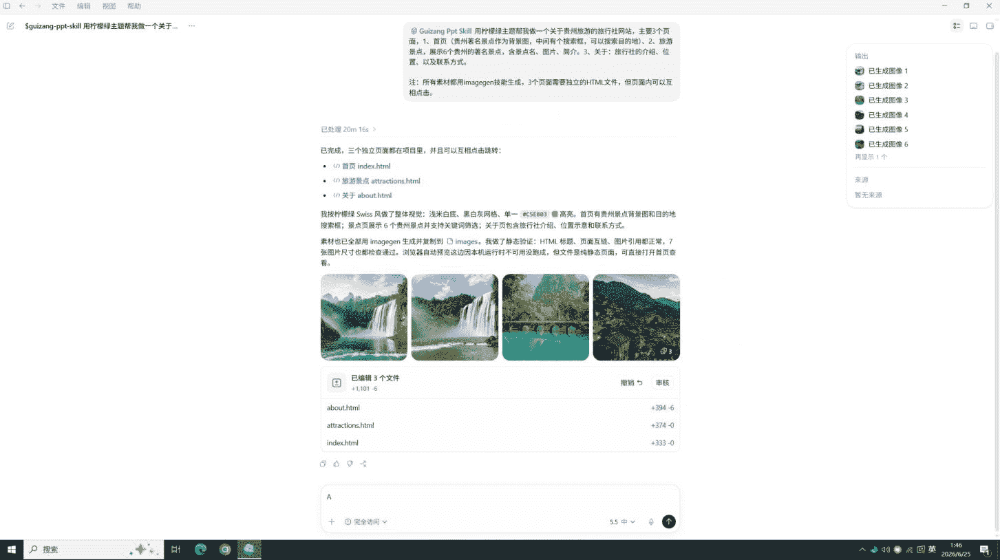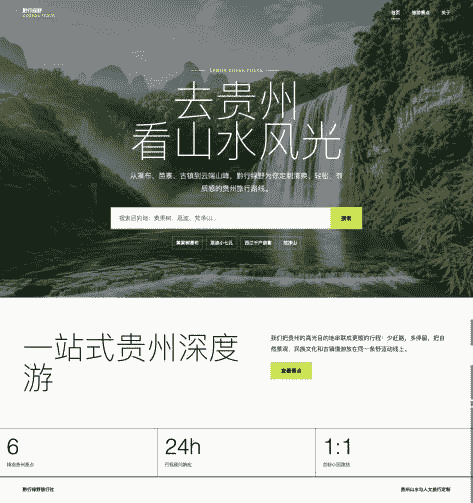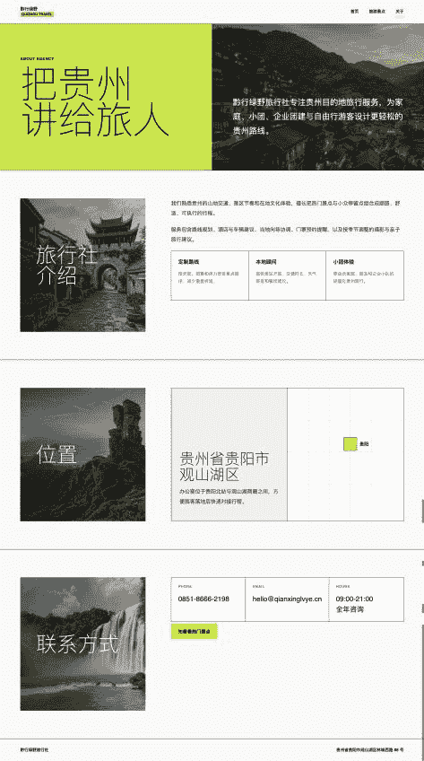

- 客户要什么：模仿一个抖音视频，做出带 3D 交互效果的电商页面。

2. 84 复制打开抖音，看看【idol 的作品】十年前端感觉要失业了，几秒钟的效果堪比专业团队 #...

https://v.douyin.com/1b4G6sVC96k/

P@k.pQ ztr:/ 11/08 :7pm

- 我的过程（一共调整了 3 轮）：

1. 视频评论区有人要 prompt，博主说进粉丝群发，结果群里发的东西跟视频完全不搭。（避坑：别指望别人给你现成的 prompt）

2. 我把抖音视频下载下来直接发给 CodeX 让它照着做，大框架出来了，但 3D 交互完全不行。

3. 在框架基础上，让 CodeX 生成了一个宇航员 3D 角色，图片和店里的页面用 gsap-skill 加上了弹出、翻页动效，最终才算成型。

**🍌案例 3**：博物馆网页（交 Figma 文件）

- 客户从哪来：闲鱼。

- 客户要什么：给了 4 张截图，要求在 Figma 里设计前端页面，最终交付 Figma 文件。

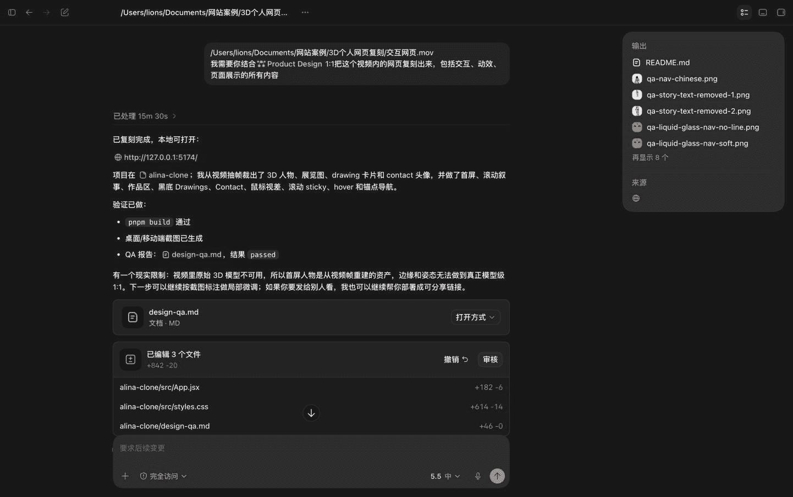

- 我的过程：在 Figma 里手搓太痛苦，所以先让 CodeX 照着需求与参考图做出 HTML 网页，再用 Figma MCP 插件导入。但免费的 Figma 账户只有 6 次调用（一个页面算一次），后面想改都不够额度。

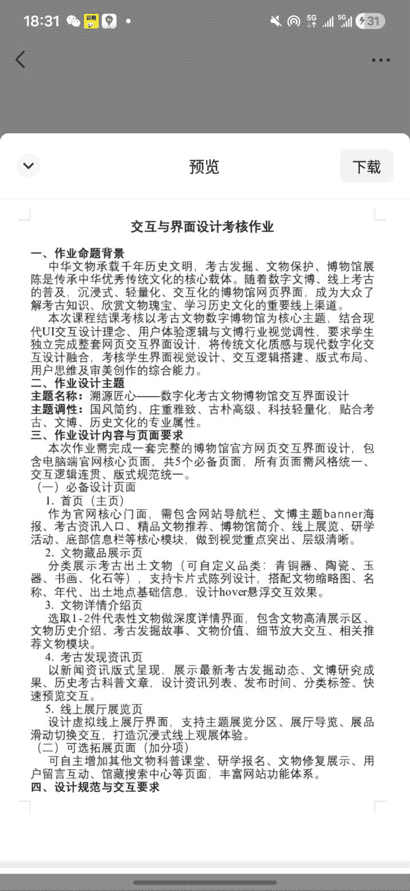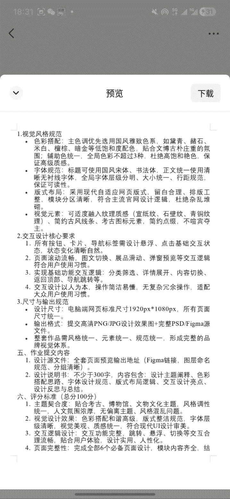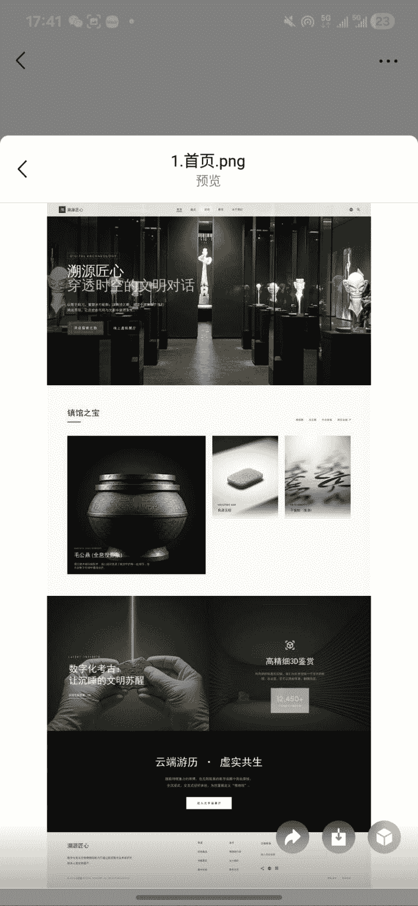

更省事的方法是改用网页转设计稿的工具，直接把线上页面抓取下来导进去，每个账号每月有 10 次免费提取额度，不够就换账号继续用，页面上几乎每个组件都能完整还原出来。

**🍌案例四：图书商城小程序（毕业设计用）**

- 圈子里的客户：小红书找到的

- 需求：搭一个图书商城类的小程序，作为毕业设计，不用上架，能跑体验版就行。

流程：

1. 随便找一个书籍售卖网站，截图后发给 GPT，请它产出一张 UI 设计图。

2. 然后基于设计图让 GPT 写出一份 PRD 文档。

3. 把 PRD 文档交给 CodeX，直接开始写程序。

几个要留意的地方：

1. 体验版只需要注册一个小程序邮箱账号，不用备案也不用认证；发布后扫二维码就能在微信里使用，最多能给 15 个人开放体验权限。

2. 由于项目有图片资源和管理后台，要小心单文件超过 200k、总包超过 2M 就会传不上去。可以报名“小程序成长计划”，领取半年免费云开发环境，图片类资源都存到云存储，后台管理则用静态网页托管做一个网址来登录。

3. 后端联调不需要手动接线，让 CodeX 连上云开发命令行工具，它会自己处理，基本可以不进云后台；有问题就把报错截图发给它。

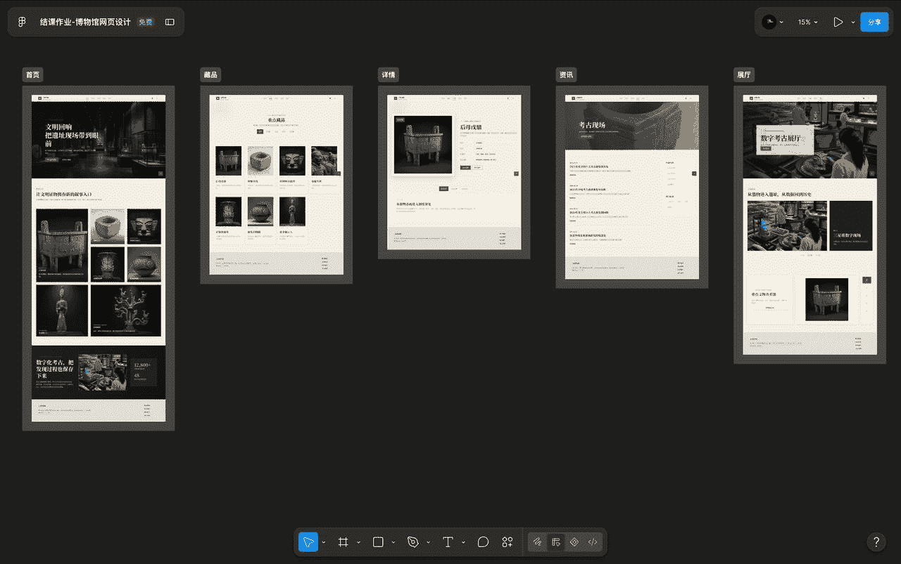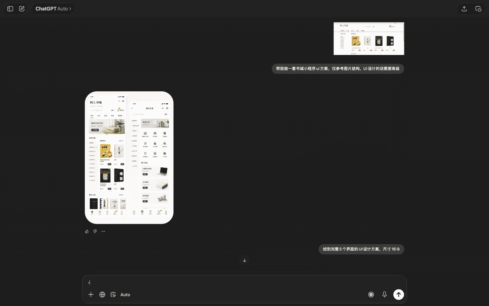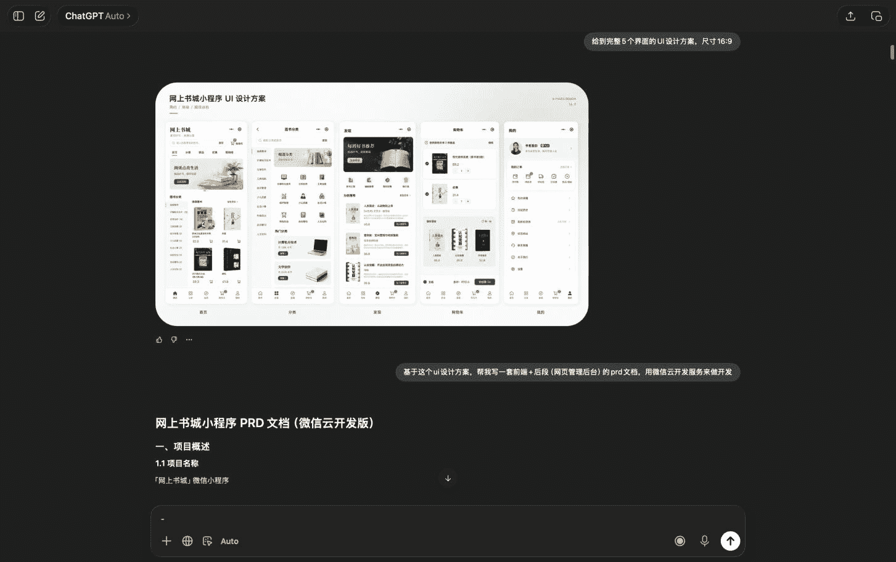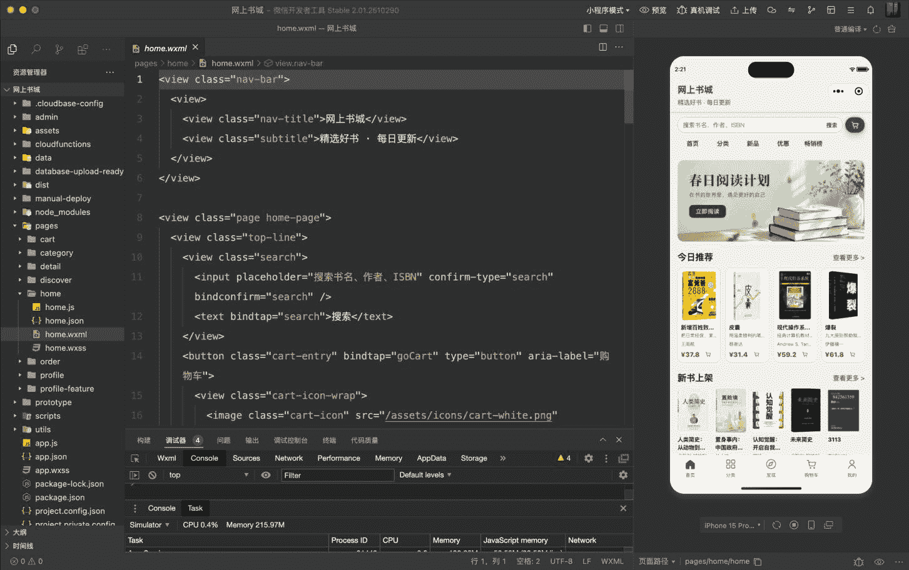

**🍌案例五：英语公开课语音对话助手**

- 客户来源：闲鱼上聊到的

- 需求：对方最开始想把自己那份“小麦不同生长阶段”的 PPT 做成可交互的网页版课件（这个比较简单，直接把 PPT 丢给 CodeX，让它生成网页课件）。交付以后，他又追加了一个需求——基于已有的页面和 PPT 里的小麦卡通形象，再做一个能进行英语对话的人工智能助手。

执行过程：

1. 让 CodeX 根据用户发来的卡通形象，先把前端页面做出来。

2. 去火山引擎申请豆包端到端语音大模型接口，注册后有 100 万 token 赠额。

3. 在本地把接口和网页的对接调通。

4. 完全免费的发布方式是：把代码传到 GitHub 项目库，再用 Cloudflare 连接项目库发布 Pages，得到一个访问链接。

注意点：

1. 豆包端到端语音接口费用不低，免费送的 token 消耗得也很快，因为它集成了语音识别、语音合成、大模型生成这些好几层能力。所以如果替客户做，最好让对方注册自己的账号、用自己的接口；我这个只给客户单次公开课做演示，才用了自己的。

2. 网页发布我常用的两条路子：

- 一是 GitHub Pages，适合只有前端文件（HTML/CSS/JS）的站点。好处是免费、简单、能绑域名；缺点是项目必须公开，代码结构别人能看到，而且不支持后端逻辑，也不能在里面写接口密钥，写了就等于公开。

- 二是 Cloudflare Pages，适合 React、Vue 或者纯前端站点。好处是自带全球 CDN、自动 HTTPS、能接 GitHub 私有项目并自动发布，运行很稳；接口密钥填在 Cloudflare 后台，前端看不见。

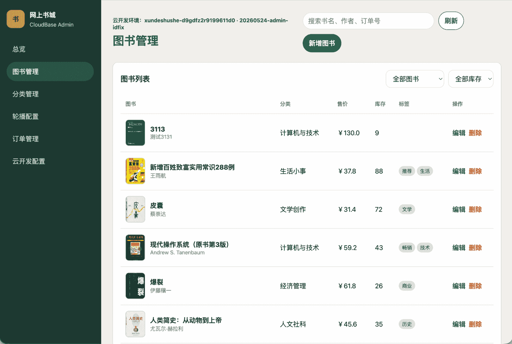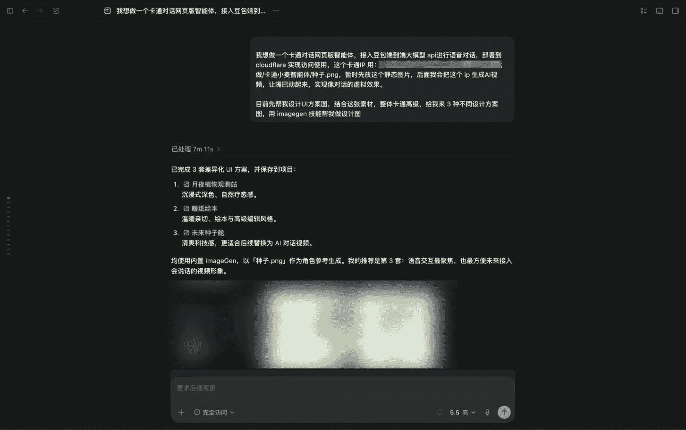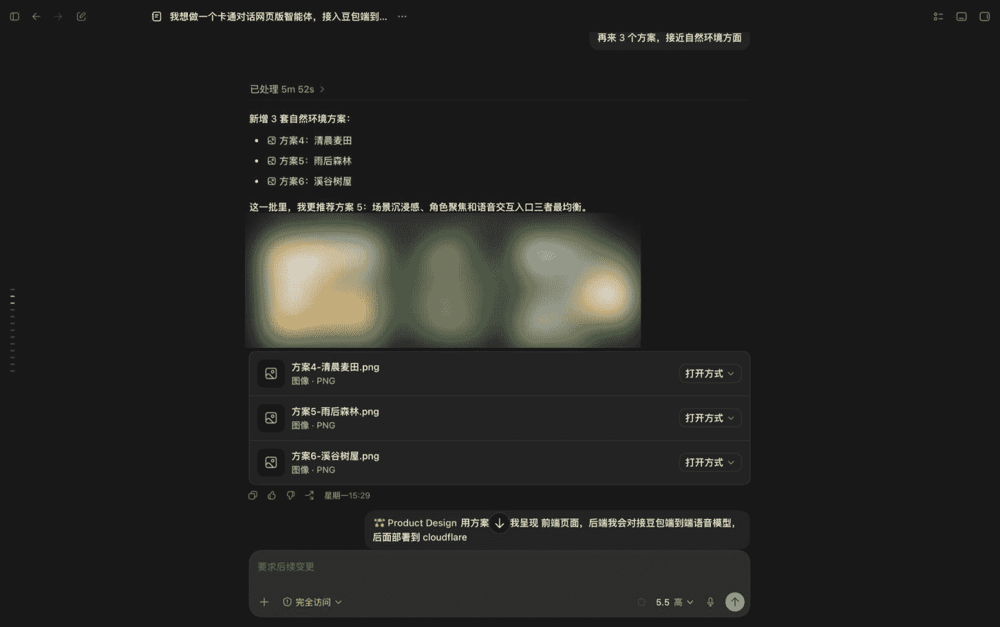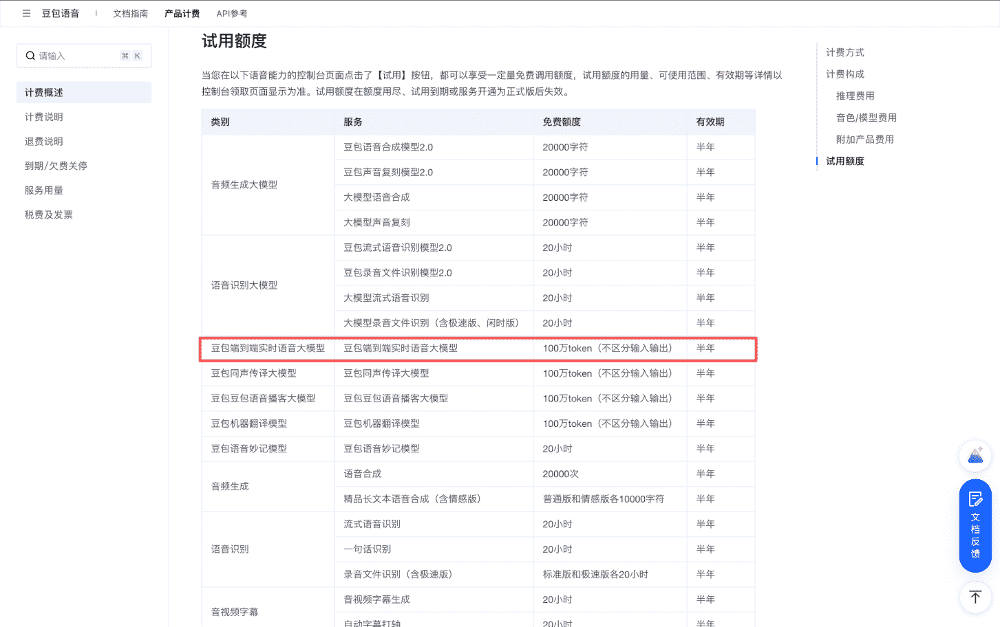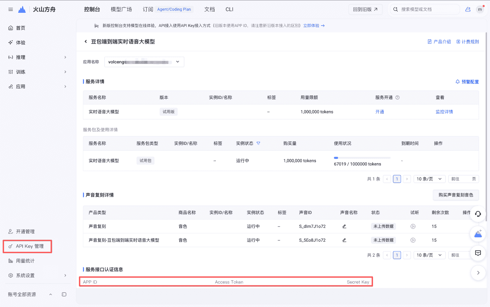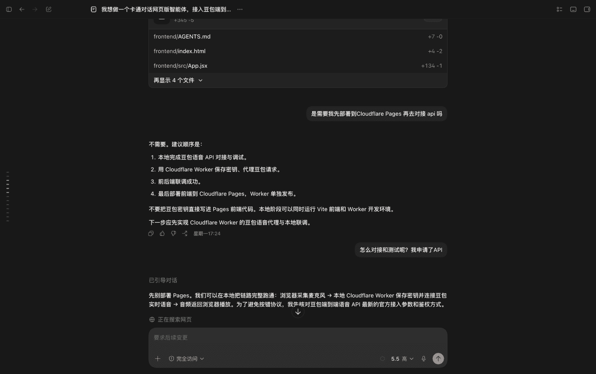

六、背后的核心逻辑 & 小白怎么进场？

**🍌🍌**能赚到钱的原因

本质上拼的是“认知差距 + 行动差距”。写代码的门槛已经被 AI 铲平了，现在金贵的不再是“会编程”，而是：

- 知道这件事能做（多数人还停在“编程是程序员专属”的旧印象里）；

- 愿意下场把全流程走一遍（先做出第一个作品，把发布、部署、交付都体会一遍）；

- 能接住用户的需求，转成 CodeX 一看就懂的指令。

谁能先做到这三点，谁就能在这段窗口期里接到单。

**🍌🍌**没技术底子的人要准备什么

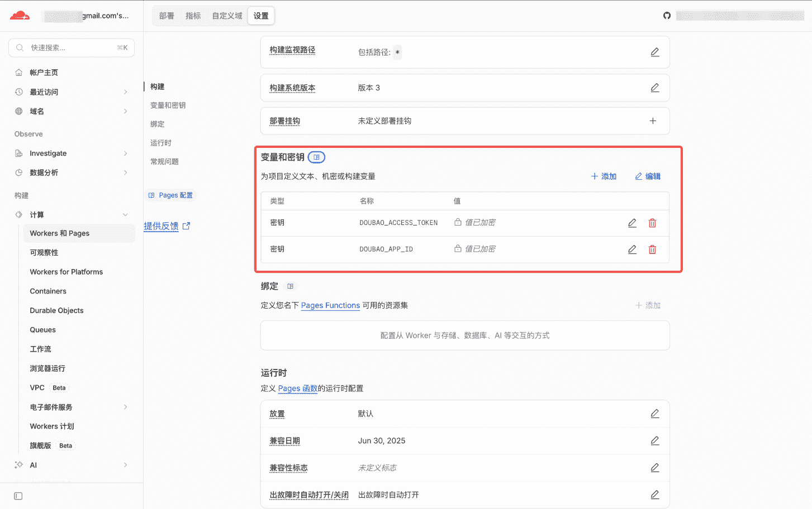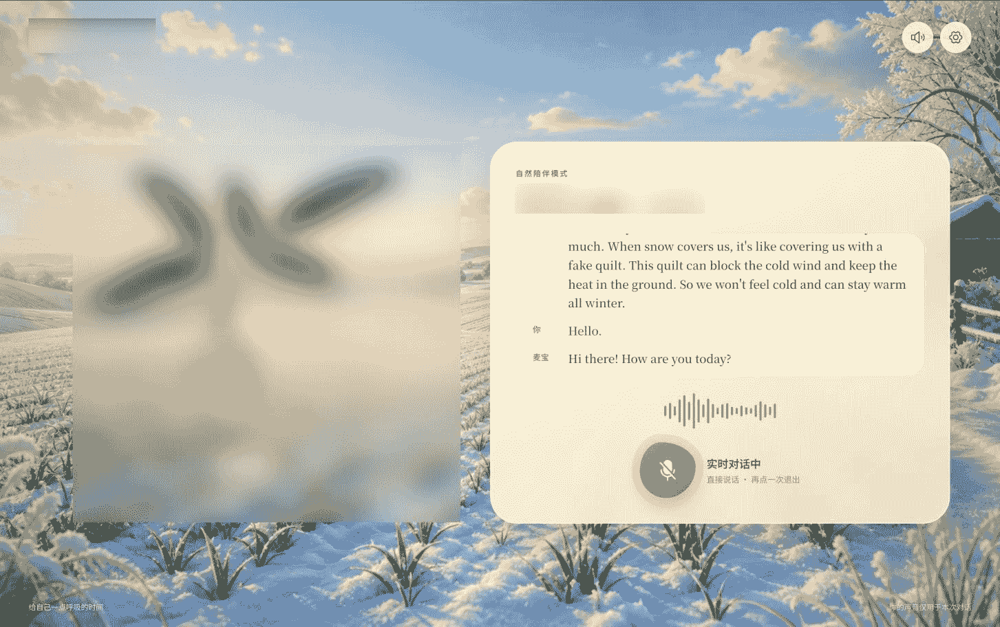

几乎不用懂技术。你只需要：

- 花一百多块订阅 CodeX 和 Claude 中的任意一个，这是回报最大的自我投资；

- 有一点点折腾的劲头：我接的每个项目都没看过一行代码，前后端、数据库、云存储，全都交给 AI 去做，遇到事情就用 AI；

- 能耐心听用户把需求讲清楚，遇到卡壳就截图丢给 AI。

**🍌🍌**现在入场还有戏吗？

- 有，而且正好在信息不透明的红利期。现在是期末季和就业季，毕业设计、课程作业的需求非常大，就算到了 7 月还有不少学生没做完，都是最后时刻才到处找人。而且不止学生，我最近接的单还有公司官网、老师的公开课智能体、事业单位竞赛知识库智能体、个人作品集主页（这块需求量不小）。

- 随着各家模型不断升级，AI 方面的信息差距会逐步缩小，但对 AI 的认知差距还会存在挺长时间，不用担心没机会。而且有赚钱这个知识库撑着，没理由不尝试。

- 现在立刻下场，就是最好的时机。

七、一套能照搬的落地流程

（[从 0-1 的实操路径](https://my.feishu.cn/wiki/SeAew1ABvisOo7kqoxicKRdInmc#share-DvJEddEc7oXgZlx8VqOczyPFn1d) 🍌🍌详细内容可以翻回前面看）把前面说的浓缩成一条可执行的路线：

1. 准备：先搞定🪜，然后充值 CodeX（官方订阅大概 110 元/月，成品号十几到几十块但容易封），赚钱上的教程很多，参加一次线下聚会很快就都会了。

2. 练手：在 CodeX 里添加产品设计类插件，配合 PPT 制作、动画效果、图表生成这些辅助工具和资源。让 CodeX 先仿写 2-3 个网页或做 1 个小程序，把“生成→截图标注→改”这套循环跑通，同时建立自己的案例库。

3. 铺渠道：在闲鱼挂服务（详情页参考同行、商品图用 GPT 生成、优化关键词、躲开违禁词），再用小红书和抖音发笔记引流。

4. 冷启动：亲戚朋友先下一两单，加上超级擦亮，或者直接买 29.9 的咨询量套餐投流，把初期曝光和评价做出来。可以多号操作，一个人能注册 3 个闲鱼号。

5. 接单交货：接住咨询→梳理需求（有疑虑的用户先给效果图）→发案例→报价→交给 CodeX 去做→截图反复调整→最终交付。

6. 放大沉淀：每个项目用到的插件、踩过的坑、发布方式都记下来，然后慢慢从“学生作业”往“商家小程序 / 企业官网 / 智能体”这类更高客单的业务走。

遇到任何问题，就直接用大白话问 CodeX，别把自己框住。

最后

每做一个项目、每一次实操，我的能力都会往上长一截。我做 AI 写程序也才专注半个多月。写这篇不是为了炫耀成果，我也没像其他大佬那样做出多大的成绩，只是想分享给还没下场、还觉得“用 AI 写代码很难”的圈友：这个阶段最怕的不是技术，而是你一直不开始。

可能有些人卡在🪜、下载 CodeX、订阅会员这些小事上。我的建议非常直接：去参加你所在城市的线下聚会。这些问题几分钟就有人帮你处理，还能听到各种大佬的独家分享，链接到一群同频的人。

这个点我感受很深。在人工智能时代，越是和同频的人待在一起越好。不知道你有没有这种体验：身边亲戚朋友用 AI 还停留在“跟豆包随便聊两句”的水平。你跟他们讲 AI 现在有多厉害、未来有多大的冲击，他们最多点头感叹，转头继续不碰这些新东西。

但在赚钱就不一样。我最近线下组局认识了很多圈友，每次组局都有新收获。上月底参加绿子老师「从一人到工作室」的分享，也很有启发。能走通变现的业务，都值得放大，而目前 AI 几乎什么都能做了，你还有什么理由不去试一试？

如果这篇文章能给你一些启发，欢迎交流。也谢谢鱼丸、小 Q、尹阳几位老师的鼓励，让我把这份作业交了出来。

————分割线————

看完这套流程，你可能觉得已经懂了。但 90% 的人真到做的时候，第一步就卡住。

工具和教程只是最外面的门槛，真正的门槛是“立刻动手”和“圈层认知壁垒”。

我们不聊虚的，只拆商业闭环、把 AI 的能力榨干。系统里已经沉淀了 1000+ 跑通了的套利实战局。

⚠ 查看圈子完整数字资产和上车门槛：

