# 两个00后成都年轻人，靠三亚海边拍照，一年半赚了20万

这不是一个“一夜暴富”的故事。东东和西西，一对来自成都的00后搭档，没租门店，没招员工，也没往平台上砸过一分钱广告费；大号只积攒了两百多粉丝，小号关注者也才一百出头。就这样，他们靠一部相机，在三亚旅居创业一年半，前后加起来总收入约20万。从沙滩上10元一张的吆喝，到线上定价660元一小时，他们走通了一条普通人的小生意之路。

如果你有摄影基础，又想边旅居边赚钱，这对年轻搭档的路径会很值得借鉴；但如果你完全没技术、只想靠高价割韭菜，或者受不了海边的高温暴晒，那这个故事对你未必适用。他们最巧的一点是换了获客渠道和定价方式：同一个人，在沙滩上只能卖10元，到了小红书就能按时薪计费。最大的坑也真实存在——收入随淡旺季剧烈震荡，旺季月入两万，淡季可能只有几千，再加上纯靠体力、绑死地域，个性化服务很难复制，所以他们最终选择了离开。

东东和西西，来自成都，都是普通家庭的孩子。西西在四川盆地长大，二十多年没见过海，总念叨：“我好想看海啊。”东东也没见过海，但执行力惊人，直接拍板：“趁着国庆高速免费，我们自驾去海南，在三亚住到元旦再回来。”西西以为他在开玩笑，直到被安排上车，才意识到这一切是真的。

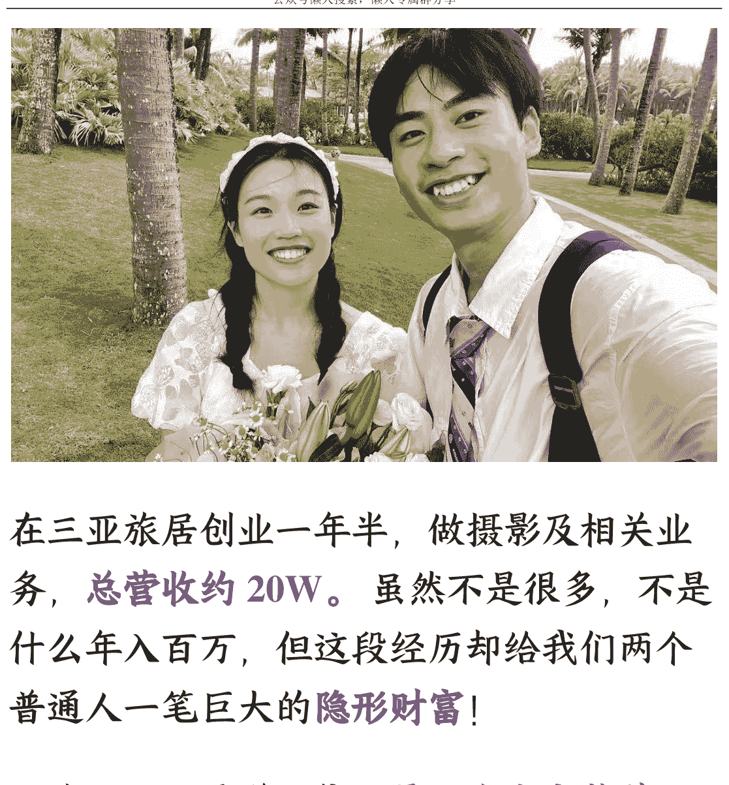

为了省钱，他们把一辆面包车改成能睡觉的“房车”，塞进有限的生活费、行李，还有一只猫，就这么出发了。出发时口号很热血：“青春没有售价，成都自驾三亚。”这趟原本只计划两个多月的旅途，最后变成了一年半的旅居创业。

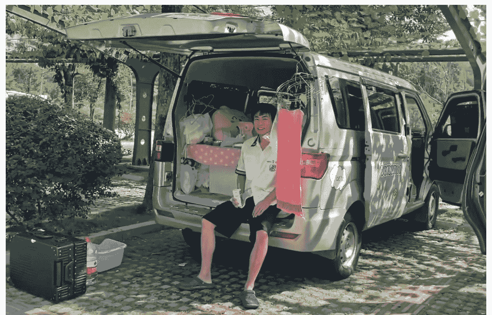

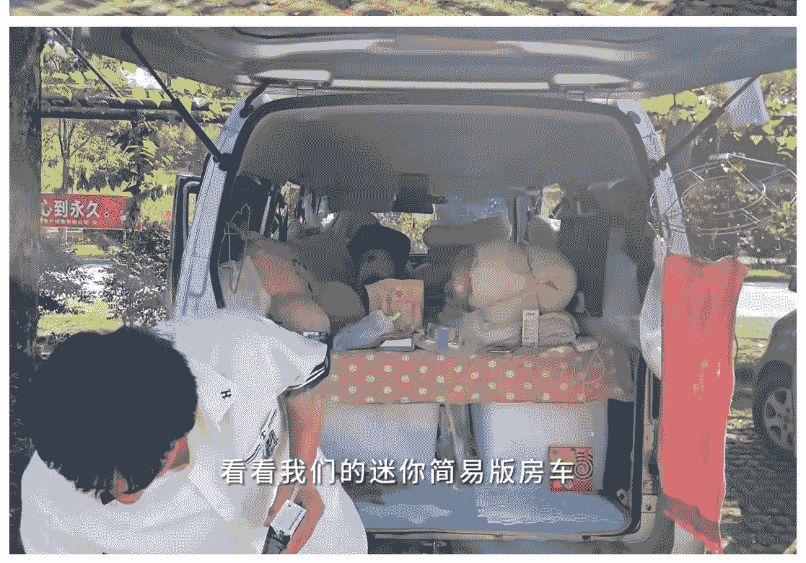

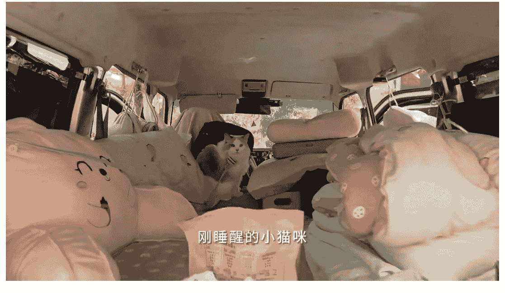

当时两人并没有清晰的创业计划。家里都是普通家庭，给不了启动资金，自己也拿不出更多存款。唯一能指望的，是东东的摄影技术——他靠自学攒下专业设备，研究光影、构图和后期，对出片质量有种执拗的认真，此前也接过婚礼跟拍和人像写真。东东的想法很直接：到了三亚，靠给游客拍照，至少把生活费赚出来。西西则打算做小红书，更新自己热爱的舞蹈和旅居日常，同时试试能不能用内容变现。

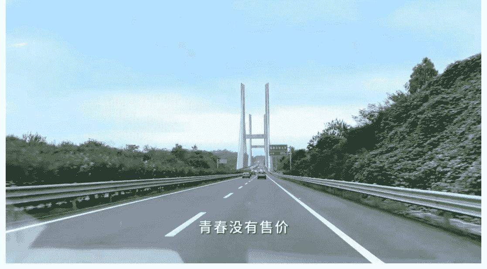

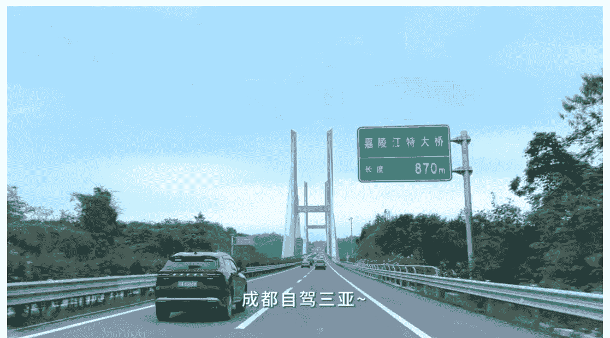

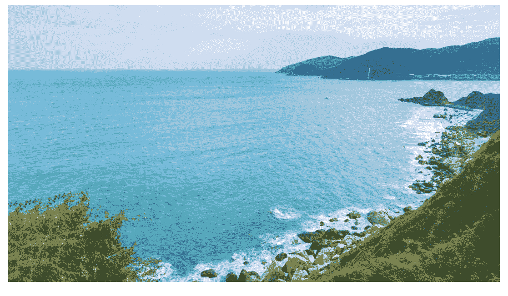

到了三亚，东东选择的最粗暴方法是直接去游客多的沙滩，见人就问：“拍照吗？10元一张。”这件事的实际难度远超想象。他既要扛着相机，又要拉下脸招揽客户，大多数游客摆摆手就走，脸皮薄一点根本坚持不了。更糟的是沙滩市场混乱，没人比风格、比服务、比修图，只比价格高低。你说10元，他就说5元；还有人用高速连拍塞给游客一堆废片，搞得整个沙滩摄影的口碑越来越差。

东东不太一样，他即使一张只卖10块，回家后也会认真调色、精心修图，因为他是真喜欢。但在这个环境里，游客路过时根本没有耐心了解你的水平、审美和后期，他们只比价。很快他们明白：当一个市场只盯着最低价，个人技术、审美和用心就会失去定价权。继续待在这里，优势只会被埋没。必须换个玩法。

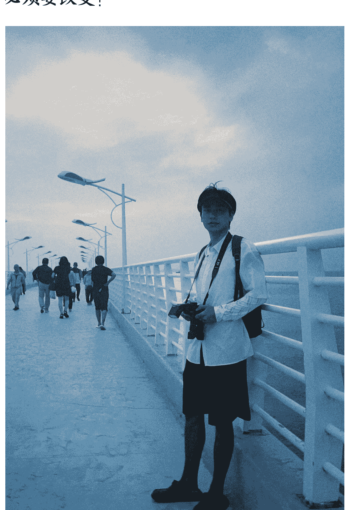

西西暂时放下了自己原本的账号，转而帮东东做小红书和抖音，把作品陆续发到网上。他们的想法很朴素：游客去三亚之前，很可能提前搜索“三亚旅拍”“三亚摄影师”，只要照片能被人看见，就有可能被找上门。

第一个线上客户，是一个来三亚独自旅行的男生。他刷到视频后主动私信，按180元一小时请东东跟拍。这价格并不高，但比起沙滩上卖一张算一张，收入模式已经完全不同了——客户是看过作品才来的，东东不需要再硬着头皮四处推销。而且，这位男生连续约了两次，拍摄过程比之前自在得多。

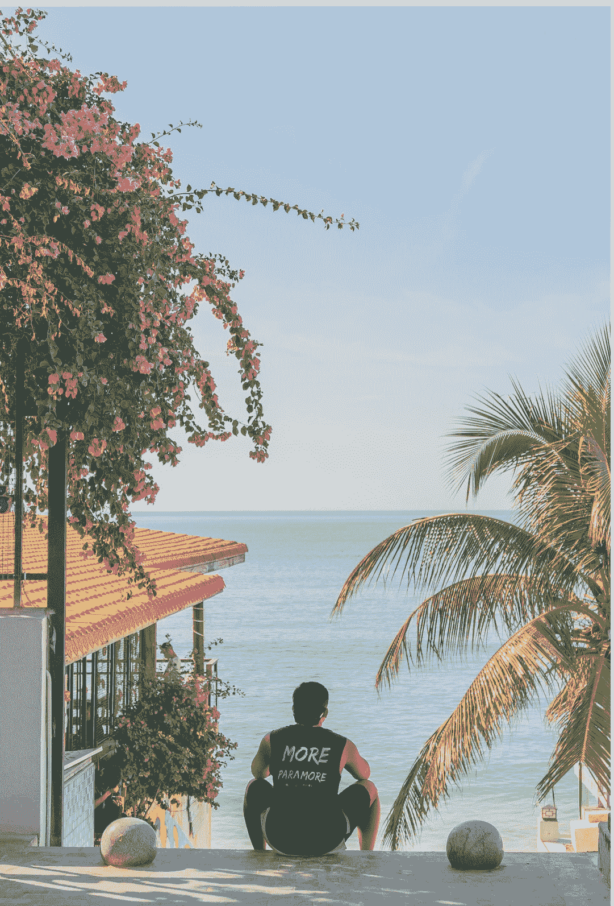

第二个订单带来的惊喜更大。一对来度蜜月的新婚夫妇，报价还是180元一小时。但西西沟通时没有只问“你们想拍几个小时”，而是继续探索：想拍什么感觉？喜欢蓝天白云，还是落日余晖？大概带了几套衣服？需不需要安排化妆？这样聊下来，客户的心态从“随手拍点游客照”变成了“认真记录蜜月之旅”，最终定了三套服装、横跨不同时段，一共6小时。加上化妆和道具费用，结算时是1200元。看到这个数字，两人愣了半天，以为是计算器按错了——一个月前还在沙滩上为一天一两百元努力，如今线上第二个订单就实现了日入破千。

那次经历让他们重新理解了销售：不是想方设法让客户多花钱，而是帮客户把自己模糊的需求理出来，再提出合适的方案。客户最初只知道“想拍照片”，等他们把人数的差异、场景的选择、服装和体验一步步讲透，客户才明白自己真正要的是什么，而他们也恰好能接住。当然，他们也闹过不少笑话。客户问能不能安排化妆师，他们想都没想就说“能”，挂了电话才到处找人；东东怕化妆师放鸽子，提议让化妆师先付一笔小额保证金，结果当场被拉黑。这些有点笨拙的瞬间，恰恰是创业最真实的模样——没有万事俱备，只有边接单边补课。

线上开始稳定接单后，他们意识到另一个问题：账号里的照片风格不对。东东在沙滩上拍的客片大多是夕阳剪影，但他真正擅长的是清新、自然、明亮的人像。如果只发客户看过的样片，就会被过去的需求框住，无法主动吸引未来想要的客户。于是他们开始自己创作样片：阳光、大海、泳装，西西当模特，东东拍和修。第一次样片他们上午八点顶着大太阳拍了三个多小时，人几乎中暑，但成片一出，咨询量立刻上来了。

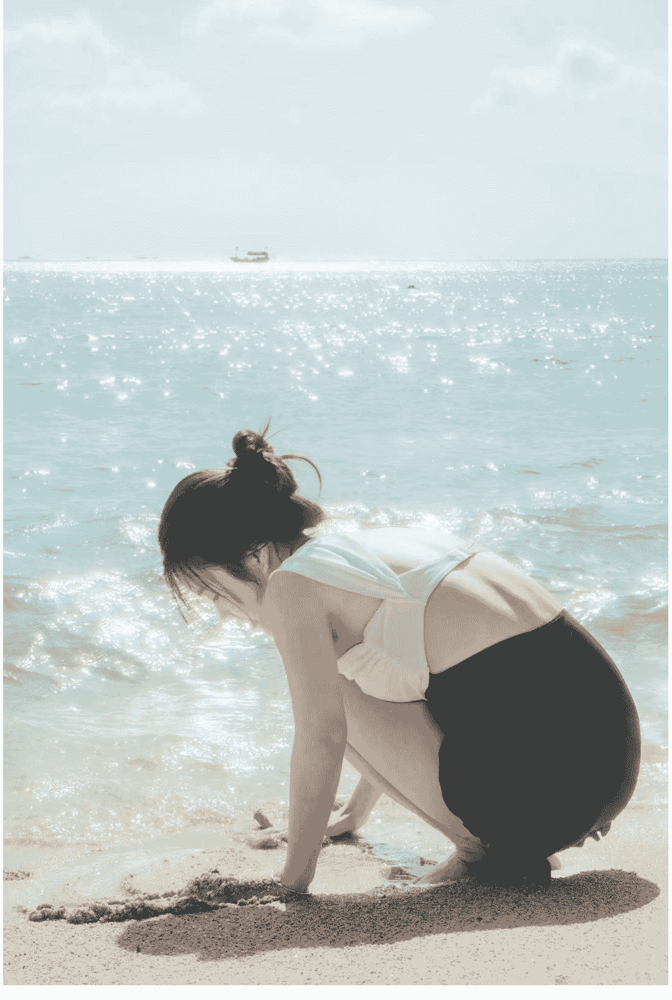

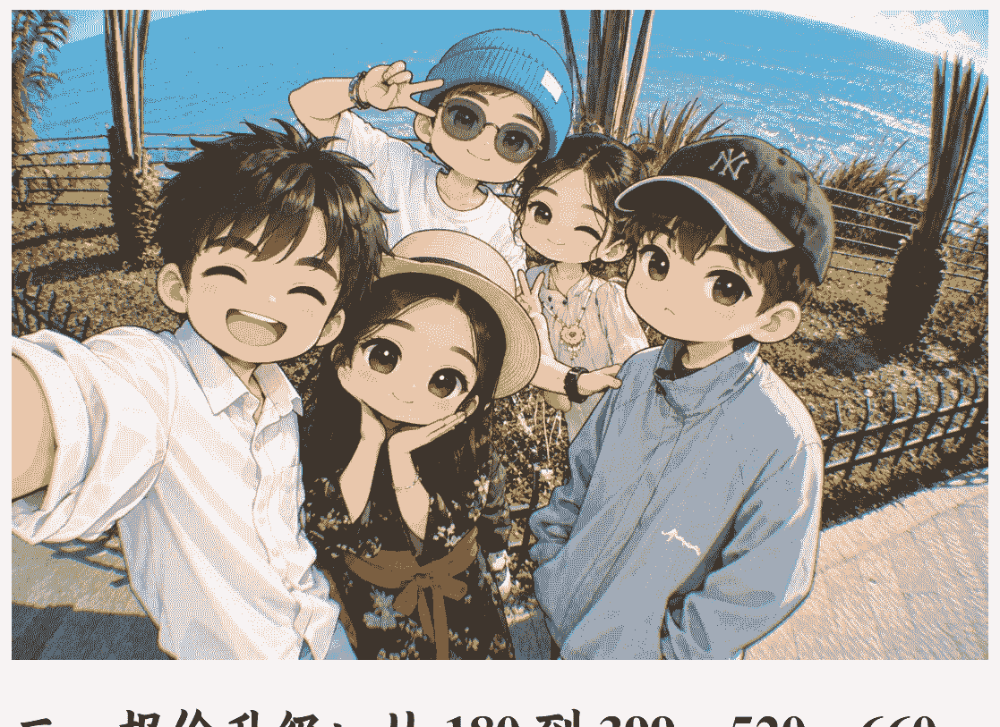

紧接着，他们重新谈定价。原来180元一小时，就算每一单都饱满，也撑不起三亚的吃住成本，更别提设备损耗、学习成本，以及两个人全职投入。他们开始“算账”——这才发现，不同人数带来的服务成本差别很大：单人拍摄主要盯状态和修图；双人拍摄还要兼顾双方互动；亲子拍摄不光人多，还要管理孩子情绪、家庭氛围和现场节奏。所以，他们设计了三档基础价格：单人399元/小时，双人520元/小时，亲子660元/小时。价格几乎翻了两倍，自己都担心卖不出去。可真实反馈是：第一单就被接受了，倒是同行听说后吓了一跳。

价格变了，交付逻辑也要变。他们制定了完整的服务流程：拍前沟通需求，讲清迟到、改期、定金和交付规则；提供服装、化妆、场景建议；根据光线和时间定制拍摄路线；现场引导客户进入状态，把控节奏；拍完认真选片精修，并做满意度回访，直到客户满意。他们卖的早已不是“摄影师的一小时”，而是一整套从咨询到成片的体验。

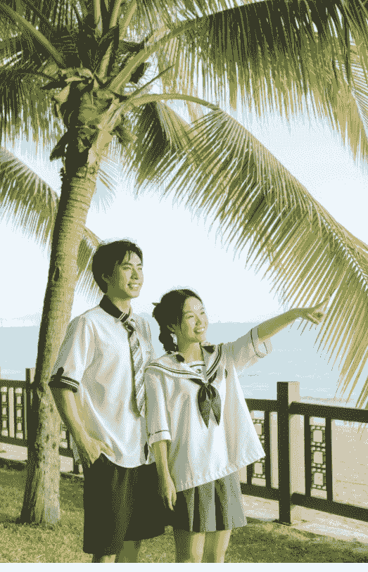

在聚焦方向上，东东和西西最初各有判断。东东更看好亲子旅拍，理由很简单：来三亚的家庭客户消费力更强，而且年轻摄影师少有拍亲子的；西西则押注情侣拍摄，因为两个人本来就是情侣，一个能和男生聊天，一个能陪女生选衣服，相处起来天然有信任感。最终他们先定了情侣方向，但市场却用订单投了反对票。

转折来自一位带2岁孩子的妈妈。她原本看中的是他们拍的泳装样片，虽然不是亲子主题，但她很喜欢那种明亮通透的质感，也坦言“问了好几位摄影师，你们价格不算低，但我就是喜欢你们”。这一单拍了3小时，两套衣服，总价1980元。拍摄时西西成了现场助理，蹲下来逗孩子，被甩开也不气馁，慢慢取得了小朋友的信任。东东则专注构图、光线和整体画面。孩子一放松，全家的状态都对了，成片自然好看。

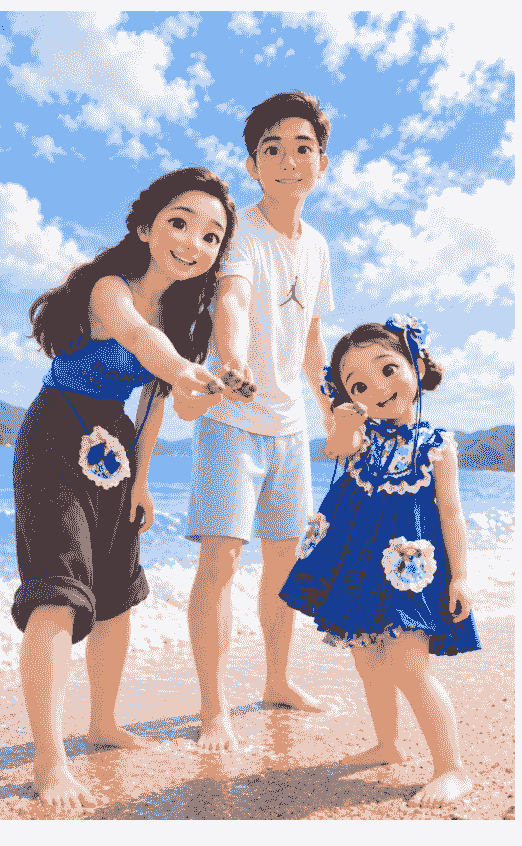

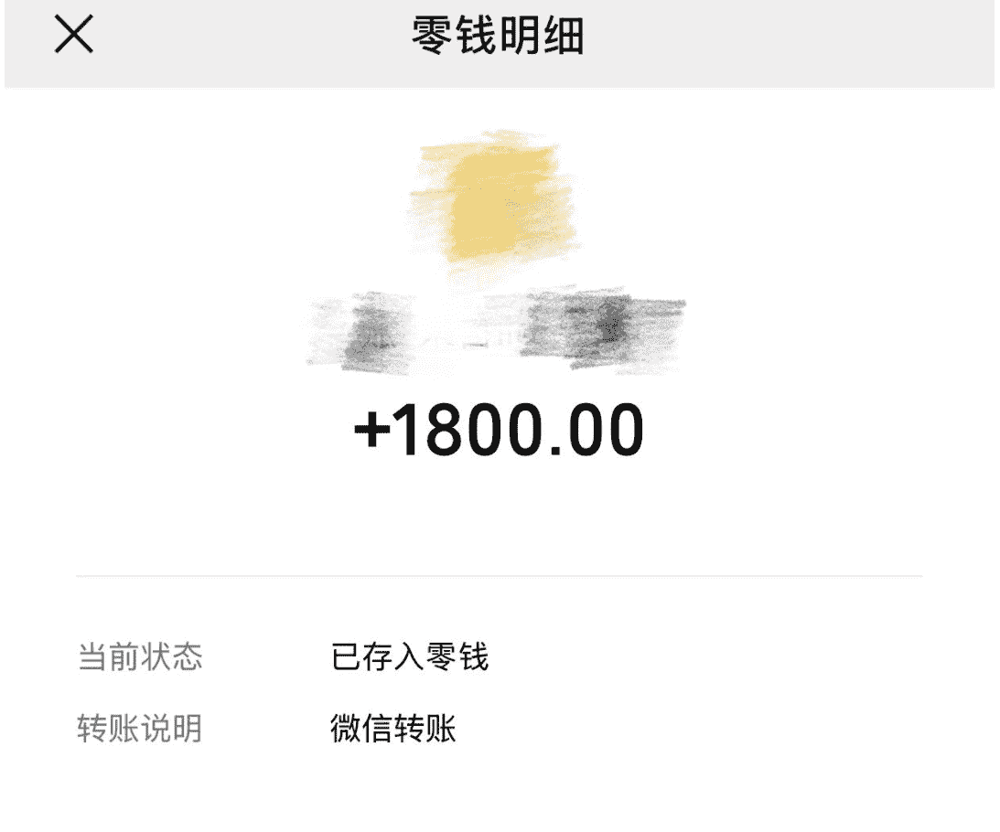

更让意外的是，这位客人不仅满意成片，也很享受整个过程。拍摄结束后，她主动请两人吃饭，分享自己的家庭和创业故事；照片交付后，她又在网上写了长文推荐，发出来的内容成了爆款，引来了一大波定位相近的亲子客户。后来，她甚至邀请东东和西西去她的家乡继续拍摄，给他们预订五星级酒店，带他们游览当地——一单普通的生意，长成了一段珍贵的关系。

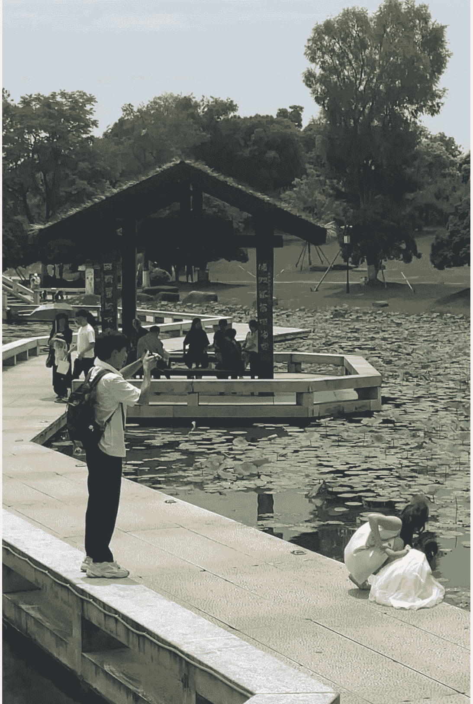

这次经历让两人彻底改变了方向。复盘时他们发现，亲子旅拍比情侣拍摄更能发挥东东的审美优势，也更能用上西西与孩子互动、控场的能力。于是业务结构调整为以亲子为主，单人、情侣和轻婚纱为辅。这个定位不是拍脑袋想出来的，而是先提出假设，再小范围试错，用真金白银的订单和客户反馈一步步验证出来的。方向不一定能在坐想中完成，但一定能在行动中被找出来。

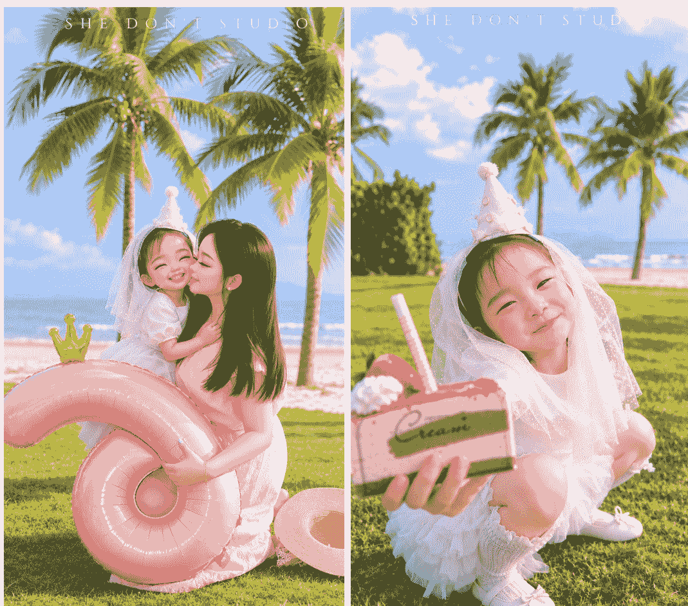

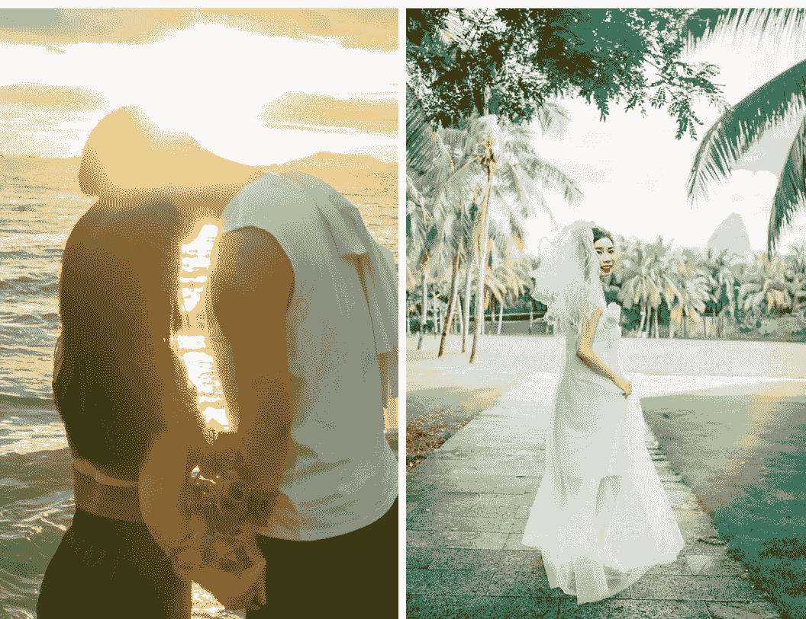

关于线上获客，他们的数据真的很普通：大号发了约50篇内容，涨粉两百多；小号只发了十几篇，粉丝一百多，而且从不投流。放到常规博主逻辑里，这几乎等于没做起来。但他们的订单却一直没断过。原因在于，本地服务的账号逻辑跟娱乐博主不一样。游客带着明确需求去搜索“三亚亲子旅拍”“三亚家庭摄影”“三亚情侣跟拍”，你不需要被关注，也不需要被点赞，只要你的内容能在搜索结果中露出，且风格足够打动他，他就会点进主页、私信询价。客户判断的维度也很直接：风格喜不喜欢、摄影师好不好相处、能不能搞定孩子、整个过程轻不轻松、价格与服务是否匹配、以前客户的反馈如何。所以他们发布的重点永远是客片和真实拍摄过程，用作品本身为下一次成交铺路。

一年半下来，这笔生意一共带来约20万元收入。在如今动不动喊“年入百万”的互联网语境里，这数字不算耀眼，但对两个普通年轻人来说，它是一笔可贵的隐形财富——不只是钱，更是陌生人的信任和鼓励，是对赚钱逻辑、服务意识和自我定位的重新认知。他们第一次深切体会到：会一项技能，和把技能生意化，中间隔着很长的路；而这条路上的每一步，都得自己走。

当然，这行并不适合所有人。户外拍摄依赖体力和天气，夏天暴晒是常态，还要接受收入的巨大起伏：旺季或许能冲到月入两万，淡季却可能几个月只有几千。个性化服务没法规模化复制，地域又紧紧绑住客户来源。这也是他们最终选择离开的原因。但离开不是失败，那些被游客拒绝的时刻、为样片差点中暑的时刻、深夜修片改片的时刻，都长成了他们继续前行的底气。如果你也有一项技能，也想换个城市边生活边赚钱，不妨从最小的动作开始，试着把手艺变成一门小生意，也许你的“三亚”正在等你出发。

做三亚亲子旅拍这三年，最大的体感就是：内容做对了，粉丝不多也能接到精准单；做错了，粉丝再多也只是在发泄情绪。

先说内容在小红书上要干嘛。实拍成片是硬通货，不同家庭、不同时段、不同场景的客人图，可以让潜在客户直接对号入座，脑补自己拍出来会是什么样。

### 1. 主动定义的样片：告诉市场我们要什么单

如果只堆客片，账号就会飘。一组自己操盘的样片能主动定调：我们想要的审美、我们服务的客群、我们擅长的产品是什么。

### 2. 花絮片段：把拍摄的不确定感降下来

很多家长怕孩子不配合、怕自己不会摆拍。发一段引导过程、互动过程的片段，比一堆说辞更能让人安心，提前感受到现场的节奏和氛围。

### 3. 日常与自我介绍：让信任先建立

客户买的不是镜头，是要跟你待好几个小时的人。说清楚我们是谁、为什么待在三亚、平常怎么工作，能把“陌生服务”变成“可以聊聊的人”。

### 4. 客户口碑与推荐：第三方背书最有效

自夸不如客人自发分享。尤其是亲子家庭的反馈，往往会直接影响同类家庭的决策。

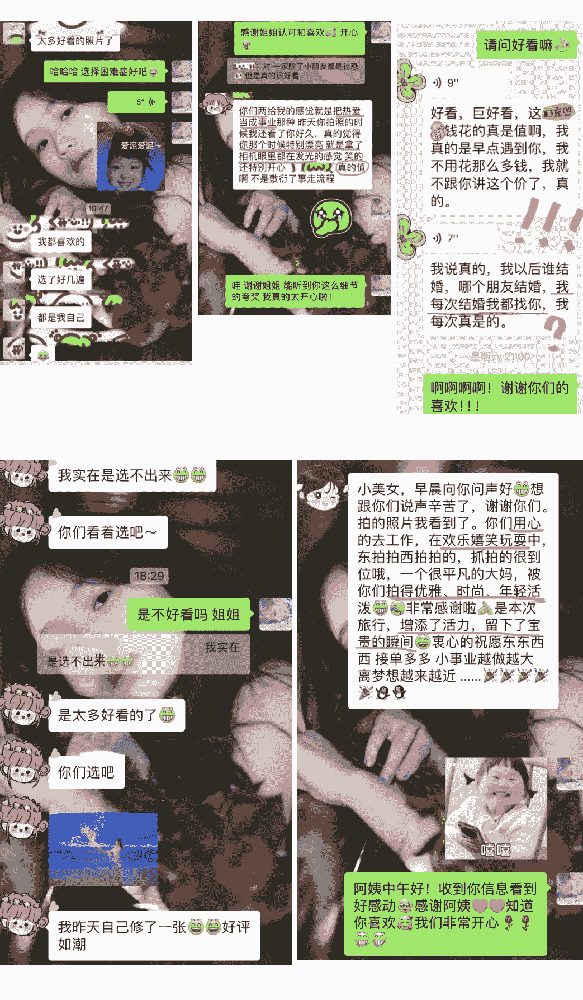

小红书号不一定要很大。只要内容够准，匹配到有需求的人就够了。

我们给账号定了四件事：被搜到、看得到结果、把顾虑降下去、能承接咨询。兴趣被点燃后，再拉到私域细聊，成交率才会上去。

聊单不是我们单方面成交，是双向筛选。我们会先线上了解：是否心态急躁只比价、沟通是否舒服、要求是否过分。筛掉不合适的，才能把状态留给真正认同我们审美、更看重体验的客户。

进到微信后，我们会把需求、档期、计价方式、服务包含范围、是否产生交通费、定金比例、迟到和天气处理等一次说清，把模糊点提前讲透。

但自媒体接单要守规矩！靠平台导流又不想开店，就得遵守规则避免限流。

刚起号被限流很正常，几百浏览基本是信号。心态别崩，把疑似问题点逐一调整，不行就删掉，然后照常发笔记和评论养号，大多能恢复。

敏感词前置检查，用“零克查词”过一遍；多号运营时图文要做差异化处理，不能一模一样；引流私域要多样化尝试：群聊、表情包、小红书号、藏头诗、小号转发笔记等等，我们光表情包就做了几十个不重复的版本。

### 五、一单亲子旅拍是怎么跑下来的？我们的SOP

最早没有固定流程，后来从一次次拍摄里沉淀出来。复盘能力决定了提效速度。

第一步，先判断是否匹配

收到咨询后，我们会先问：

拍摄具体日期；是亲子、妈妈单人还是全家互动；家庭成员几位，孩子多大；住哪个区域；偏爱蓝天、落日、泳装还是度假感；准备几套服装；是否需要化妆、租衣；预计时长和预算范围。

这些问题不是盘问，是为了避免现场需求错位。

第二步，把模糊想法变成可执行方案

客户常常只说“拍一套亲子照”。我们需要帮她细化：

孩子作息适合的时段；离酒店最近的拍摄点；两套服装的时间分配；白天和黄金时刻能否兼顾；想顺带拍妈妈写真怎么排顺序；孩子状态下滑时怎么调整。

销售的本质其实是方案设计。

第三步，报价和边界讲清楚

会明确告知：按小时计费标准；包含多少张精修是否给原片；交通补不补；化妆、服装、门票是否在内；超时怎么算；交付周期和修改次数。

我们按时收费，也会提前说迟到规则。档期一旦锁定就等于拒绝了同一时间的其他客户，规则前置能减少后期矛盾。

第四步，收定金发拍摄须知

确定后收定金锁档，并把天气预案、改期取消规则、迟到是否计入时长、当天增人增衣的计价、成片是否可发布、尾款时间等写清楚。

第五步，拍摄前规划动线和节奏

亲子拍摄要兼顾体力和情绪。我们的惯用顺序：

先从全家轻松散步玩耍开始降陌生感；孩子状态好时先拍互动和全家福；一人陪孩子玩时另一人给妈妈拍单人；随光线切换场景和服装；孩子累了就降低要求，多拍自然互动。

第六步，现场分工明确

东东负责摄影、构图、光线、抓拍、情绪调动、动作指导和节奏把控；西西负责沟通、整理服装、哄娃、提醒节点和临时状况。

亲子现场有人专门照顾家庭状态，摄影师才能更专注画面。

我们越做越确认，亲子摄影的门槛不只是技术。成片下限靠摄影水平，客户满意度往往取决于孩子是否放松、父母是否省心、全家互动是否自然。

第七步，交付、回访和案例沉淀

选片精修交付后处理合理修改，再征求是否可发布成片或评价。好案例既是作品也是新客的入口，客户愿意主动分享时，增长才形成了闭环。

### 五、第四阶段：旺季赚钱，淡季学会做生意

三亚的旺淡季很极端。寒假春节暑假，亲子家庭明显增多，旺季时我们月营收大概在1万多到2万元之间。

除了660元一小时的亲子写真，也接过2500元、8小时的包天跟拍，纯拍摄不含精修。有部分来三亚过冬的客户认可服务，会连续拍好几天，还会介绍亲戚朋友，单客+转介绍有时能做到上万元。

旺季一过咨询骤减，淡季月收入常只有几千。刚开始会焦虑，后来明白旅游城市的生意，关键是淡季能不能把成本控住。

1. 降固定开支

刚到时看到单间两月1.3万，直接劝退。后来捡漏到月租1400左右，水9元/吨、电5元/度、停车另付300。后来又搬到月租约600的自建房，附近可免费停车，去市区海棠湾都方便。成本压下来，淡季就不用接一堆低价单硬撑，可以腾出时间学习和升级产品。

2. 拓展本地需求

淡季游客少，就接三亚本地的亲子、情侣、订婚跟拍和活动拍摄。本地客户口碑链路更长，满意后容易在身边朋友间传播。

3. 同行可竞争也可合作

我们认识了不少同龄摄影师、20多位化妆师、服装租赁工作室。档期满时可把单子分出去，同行忙时也会回流。客户不想为海岛服装专门购买时，可去合作工作室租赁，我们按比例分成。

4. 设计新产品

亲子需求少时增加单人、情侣拍摄。七八月有双子流星雨，东东本身喜欢星空，便尝试银河主题，可白天夜景结合。

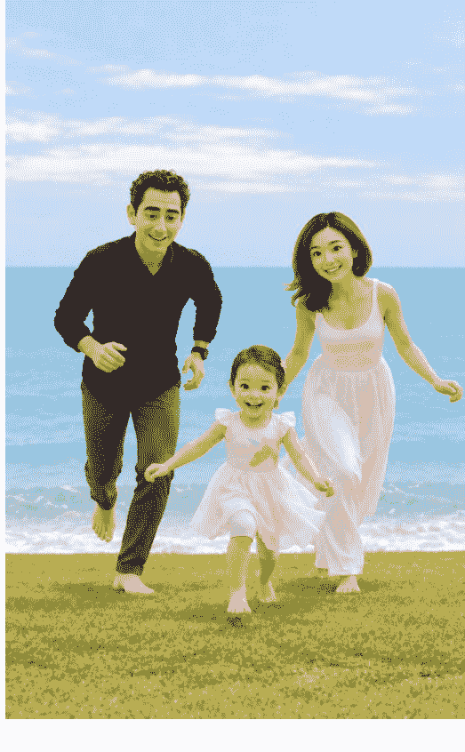

随后我们拓宽边界，试水外籍家庭旅拍。借助三亚外籍游客基数，接了不少新加坡、新西兰、美国混血家庭的订单。即便英语吃紧，靠简单口语加熟练引导，拍摄依然顺利。在大家内卷国内客群时，这条差异化路线成了末期的重要突破。

5. 用淡季时间做样片、学习和交朋友

订单少时就和摄影师朋友探新点、拍样片，也补小红书运营、销售、朋友圈经营和独立摄影师的业务方法。这些不立刻变现，却决定下一个旺季能不能接住更匹配的客户。

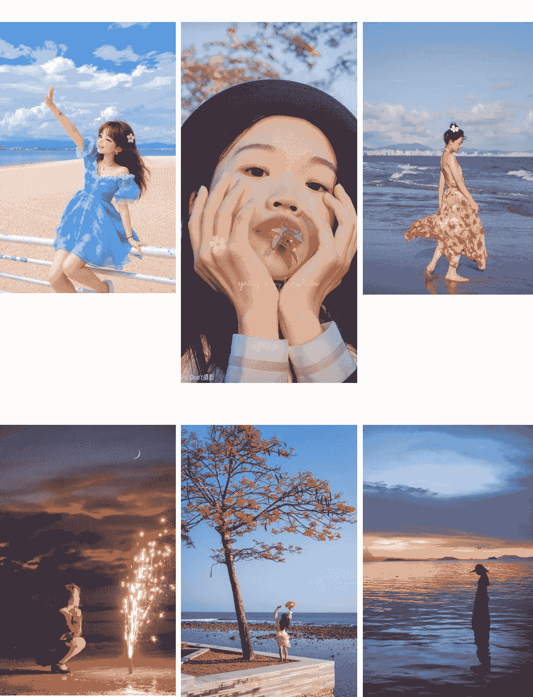

6. 本地体验变成资源合作

搬家后认识了做旅游服务的年轻人：南海观音航拍、桨板蓝洞拍照、游艇海钓海上玩、冲浪浮潜赶海跳海、摄影化妆商演等。我们会先亲自体验，认可后才推荐给客户，对接时合作方会给介绍费。

这让我们体会到资源整合的意义：拍摄收入需要现场交付，资源合作靠连接需求即可获利。但不会随便甩联系方式，只有自己了解并愿意为推荐负责，客户才会信任。

淡旺季的对比很清晰：旺季考验接单与交付，淡季考验成本控制、产品迭代和资源连接。

### 六、朋友圈带来近3万元的英国出版社订单

私域门面就是朋友圈。我们持续发客片、花絮、三亚生活，朋友能看到我们在做什么。一次朋友介绍，英国出版社需要上海的书籍或产品静物拍摄。

第一反应是担心，以前主攻人像，没做过这类商业片，还要邮件沟通。我有点犹豫，东东则说没拍过也不难，先试。

整理作品集、借助翻译工具邮件沟通、让朋友寄样品来三亚朋友工作室试拍打光。试拍通过后飞上海实拍，一周左右拿下约3000多英镑，折合人民币约3万元。

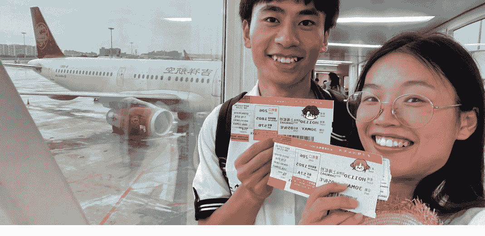

这次给我们两个认知：朋友圈不是广告板，而是持续更新的能力说明书；没做过不等于不能做，先判断边界，用试拍降低风险，比直接拒绝更有价值。

回三亚后仍以旅拍为主，但此后也陆续接到本地活动和商业拍摄。

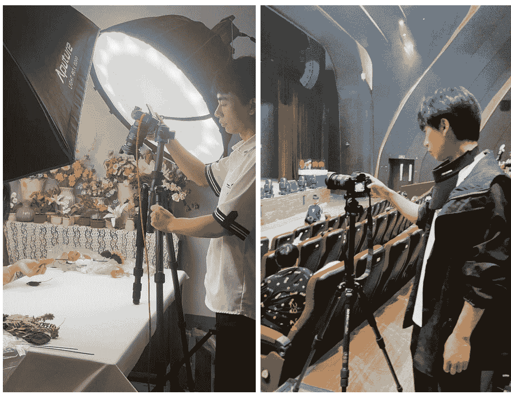

### 七、总结：为什么能跑出结果

不是一张照片爆了，也不是技术碾压。是几个环节串起来了：

1. 换渠道，定价逻辑就变了

沙滩上只能比一张多少钱，小红书上能比作品、审美、服务、评价和体验。同样能力，渠道不同价格完全不同。

2. 定位是验证出来的

东东看好亲子，我看好情侣。最后由订单量、体验和转介绍证明了方向。先假设行动，再用真实付费反馈校准。

3. 内容是预售

客户私信前已在主页做完筛选，看完作品、花絮、日常和口碑才决定是否咨询。本地服务的核心是被精准需求搜到并快速建立信任，而不是粉丝数。

4. 高客单来自完整交付

从10元一张到660元一小时，是因为提供的是完整产品：前期策划、现场互动、节奏控制、精修、规则和售后，叠加审美和服务能力。

5. 搭档的价值是互补

东东负责拍摄设计和后期交付；西西负责被看见、被信任、被购买，以及现场体验。我们覆盖了产品、内容、销售、服务和运营，形成最小创业团队。后来彼此也交叉学习，东东能线上接单，西西也能上手拍摄和打光。

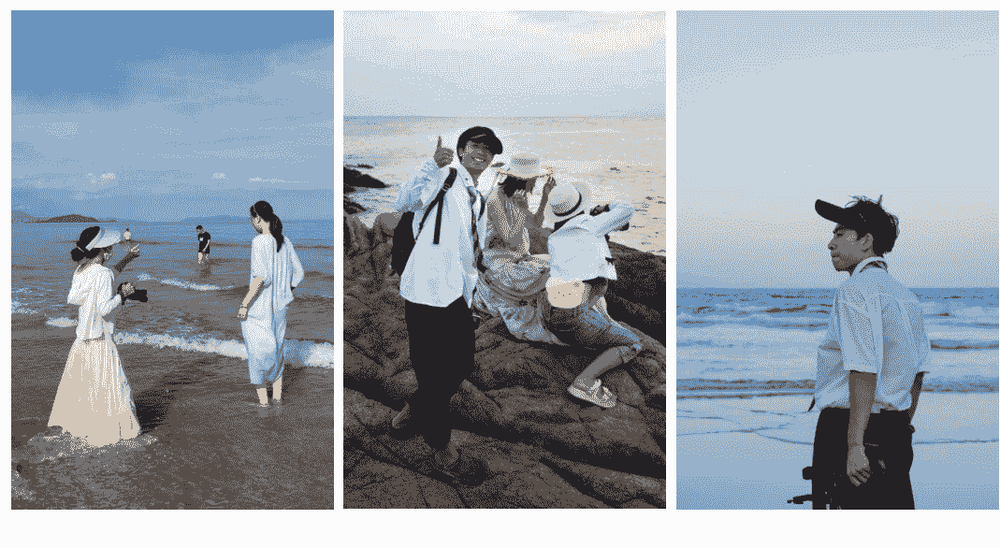

6. 客户满意只是起点，主动推荐才形成飞轮

第一批亲子客户的分享，比任何广告都有效。服务、成片和关系到位时，一单会带来复购、转介绍和新素材。

### 八、本次创业8个搞钱体会

1. 先进入真实市场，再谈完美规划。行动会暴露问题，也给出下一步学习方向。

2. 吃力时多用脑。靠渠道和定价方式改变收入，比单纯加班更有效。

3. 想接什么单，就做出对应案例。样片是定义产品最直接的方式。

4. 销售是需求梳理。六小时订单是帮客户理解不同时长和风格的差异，而不是强行推销。

5. 高价格靠价值支撑。客户愿意付660元/小时，是因为喜欢审美、沟通顺畅、现场愉悦、成片喜欢，整体体验省心。

6. 不要服务所有人。筛选匹配客户能节省大量精力，重视时间、审美和体验的客户更懂价值。

7. 不要单干。摄影师、化妆师、服装、旅游从业者的合作网络本身就是资产。相互学习共赢比闭门造车重要。

8. 创业要会判断天花板。坚持前要问：越做越轻松还是越消耗？能否积累复利？是否离开城市还能做？放大后是否还是想要的生活？

### 九、启动门槛高不高

对比租门店、装修影棚、招员工的传统工作室，独立户外旅拍启动成本可控。但可控不等于人人可复制。

比较适合的人：已有基础摄影修图能力；愿意持续发内容；不排斥沟通销售；有耐心处理现场变化；能接受户外高温体力消耗；想旅居兼顾收入；愿意从几组样片和真实订单开始验证。

不太适合的人：不会摄影却想直接收高价；只想拍完就走不愿服务；不喜欢处理情绪；无法接受淡旺季波动；只想低价冲量；希望业务不受地域体力影响；想快速扩张却不愿管质量。

稳妥的0-1路径：定目标客户→找模特或互勉客户→拍出代表产品的样片→发布观察咨询→用小额付费订单验证交付→根据反馈优化价格内容流程。重点不是追求完美样片，而是不被准备期拖住。现在有AI加持，效率比我们当年高很多。

### 十、从0到1后为什么离开

做到能稳定接单，也开始触及轻婚纱等更高客单。但我们思考了未来，决定离开。

第一，摄影收入依赖高强度体力。三亚常年高温，长时间户外拍摄靠藿香正气丸续命，回来还要修图沟通，体力是硬限制。

第二，业务受地域和淡旺季限制。在三亚积累的景点经验、搜索权重、合作资源，回到成都就难以平移。我们也想去国外看看，海的那边是什么样。业务必须能随地理位置迁移。

第三，个性化体验难以规模复制。旺季订单多时，有些可分给朋友，有些只能拒。招人扩量意味着从定制服务走向流水线，而我们珍惜的正是与客户真实相处、甚至成为朋友的过程。流水线违背初心。

一步一个脚印，我们最终结束了三亚旅拍阶段。

把三亚的旅拍摊子做大，工作重心就不再是按快门。规模上来后，真正占据精力的变成招人、排班、团队管理、客户售后和品质把控。我本身爱的是拍摄瞬间，不想最后沦为对着表格发号施令的调度者。

想要赚更多，常规做法是继续提价。但市场已经高度内卷，我们的报价早已高于大多数自由摄影师。能做到高单量的同行，多数是技术极硬、拿奖无数、服务过明星、个人品牌极强的类型。这种路径既不是我们的资源，也不是想走的方向。转做商业拍摄的例子也见过，并不符合取舍。

> 生意能赚钱，并不等于适合长期经营。弄清楚自己要什么，管理注意力同样关键。

于是作出离开决定。

留下这段经历，是因为它能支撑生活，还能把爱好变现，同时每天生活在海边。选择离开，是因为看清了这种靠体力换时间的模式的天花板与局限，这并非想要的生活形态。金钱重要，生活也重要，每个人都要找到自己的平衡点。

租约到期时，正式结束三亚的拍摄工作，去开启下一段人生与创业，靠近更想要的状态。另有一件人生大事，重返成都完婚，像取经一样一路波折，相互扶持才走到最后。

### 重新出发：重返成都开启第二次尝试

回到成都后，再次感受到自己掌控收入的创业手感，就很难再回去做低价体力活。对第二次创业有了更清晰的诉求：

第一，减少对体力的长期消耗，优先做具备复利特性的事。三亚旅拍本质是长时间外出、以时间和身体换报酬。现在把拍摄调为副业，希望新方向更偏向脑力，且能积累沉淀，项目越做越久，资产、客户、方法论持续产生价值，而非一单归零。

第二，业务不受地域束缚。三亚沉淀的场地、化妆师、文旅资源，换城基本失效。 不想让生意被单一城市锁定，未来即便去海外，也能继续运营，延续走出去的愿望。

第三，赚钱不能以健康和生活为代价。人生苦短，见过有人拼命赚来的钱，最后大半进医院，这笔账不划算。两人均未到三十，熬夜就会难受，所以需要长期通宵的赛道不合适，事业与生活需要并行。

第四，期待获得外币收入，正考察相关赛道。以前接过英国出版方的拍摄单，也服务过不少在三亚度假的外籍家庭，汇率带来的体感很明显，所以把可产生外汇的方向纳入观察清单。

第五，善用赚钱与人工智能红利。今年正好赶上生成式 Agent 浪潮，不想错过。五月加入赚钱大本营，从 AI 超级大航海开始跟进学习，希望借助 AI 提升效率，同时复制赚钱上的优质项目，赚到下一桶金。

目前已学习 AI 第二大脑生产系统和 AI Agent，做出了小程序和小工具，闲鱼方向也跑通，接下来研究 AI 服务、跨境电商等领域，继续深耕。在赚钱中也认识了一些线下志同道合的朋友，这段经历很温暖，希望能共同致富。

现仍处第二次创业起步期，没有标准答案。对比第一次去三亚时的懵懂，比起当时成长很多。已学会怎么验证需求、用内容找到客户、如何设计服务、从反馈里调整打法，也明白一门生意除了收入，还要算成本、复利、身体状态，以及自己真正想过怎样的生活。相信普通人只要持续努力，还是能一步步实现梦想。

结语：未来不在沙滩上，我们都拥有海洋！

回看过去一年半，并非时刻埋头赚钱。空闲时会去泡海、跳海、赶海，品尝本地美食、看风景、体验当地项目，也认识了许多向往大海与自由的朋友。

三亚旅拍没让我们赚到夸张的数字，但收入覆盖了旅居开销，也让我们在年轻时真正挑选了一次自己想要的日子。

更珍贵的是，我俩亲手验证：两个没什么背景的普通年轻人，也能在陌生城市靠热爱一点点搭建起喜欢的工作，并保持自由。

从十元一张，到一百八十元一小时，再到三百九十九、五百二十和六百六十；从自己站在沙滩揽客，到客户通过小红书主动找上门；从只会拍照，到学会定位、销售、服务、口碑、资源整合；从拉客时的局促到与人交往的快乐、结交朋友、收获鼓励和感动。这些收获，比最后约二十万元的总营收更值得带走。

庆幸当时没因钱、经验、准备不够就把“去看海”一再推迟。人生要考虑现实，但有些路必须先迈出去，才知道风景。

正如一路自驾时反复听的那首歌，歌里说要自己走，去见喜欢的一切，别被定义，未来不在沙滩上，我们都拥有海洋。

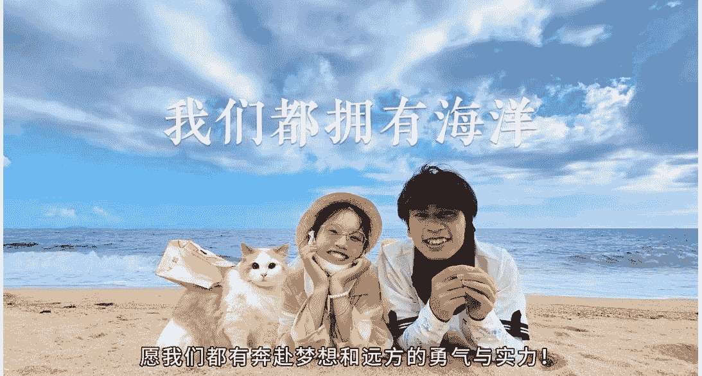

## 尾声

感谢你能看到这里。

特别感谢鱼丸的邀请和小武的督促，让我俩把这段三亚搞钱经历整理出来。

五月刚加入赚钱时，感觉里面全是大佬，动不动百万级收入，我俩只是很普通的小透明，这点经历不值一提。直到受邀请认真梳理，才发现去三亚前后的自己已经成长很快。复盘过去既是对自己的总结，也希望能给同样的人一点信心。

还要特别感谢同龄圈友小丹。当初看到她分享澳洲打工度假的帖子，我俩主动搭上话；上个月还一起露营追八月的英仙座流星雨！能和同样热爱生活、喜欢摄影的朋友相聚，想起来都很浪漫。真诚的分享让我们相遇，谢谢小丹鼓励我俩写下这段经历。

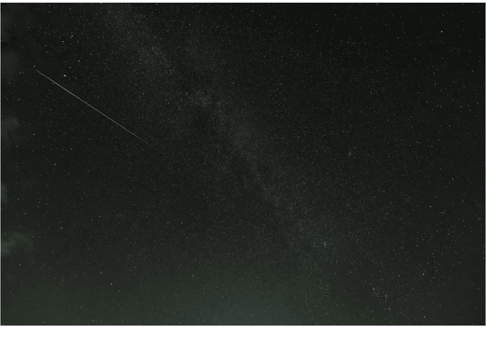

也谢谢圈友尹阳儿小仙女，今年组局分享 AI 学习，我和东东受邀参加线下活动；从尹阳儿、小 Q、斌哥那里学到不少 AI 相关的内容。大家不吝分享、相互照应、彼此合作，让我俩感受到赚钱社群的温度，所以希望我俩虽是小人物，也能把这份温暖传递下去。

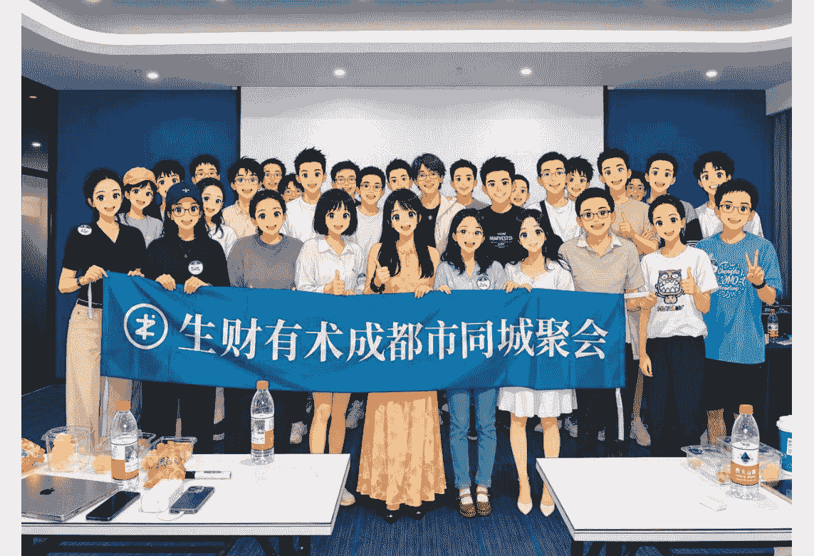

现在已回到成都，围绕内容、AI、出海等方向开启第二次创业。

欢迎有相同目标或正在探索创业方向的圈友共同交流、交友、约玩；东东也承接人像、活动跟拍等拍摄需求，欢迎沟通，都可以找鱼丸对接。

我俩很乐意认识真诚、有共同追求的伙伴，也愿意分享踩过的坑、验证过的方法和正在思考的问题，能帮一点是一点。

希望在 AI 时代都能拿到满意的结果！共同加油，共同赚钱！

分割线

看完这篇 SOP，你可能觉得懂了，但 90% 的人一到实操就会卡在第一步。

工具和教程只是最基础的壁垒，真正的壁垒是“立刻动手”和“圈层信息差”。

我们不聊虚的，只做商业闭环的拆解与 AI 效率的压榨。系统内已沉淀 1000+ 跑通的套利实战局。

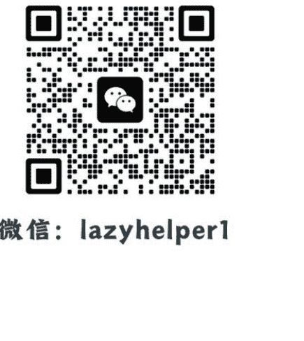