# 中年破局靠副业，六大可复制变现赛道复盘与长期赚钱方法论

## 大龄职场想突围，先认清赚钱的本质

大家好，我是龙哥。

做互联网，本质就是要自由、要效率、要把职场没给到的价值自己拿回来。抱负要长线，要越做越值钱，越做越有现金流，而不是靠体力换钱的日结式生存。

能做到这一点，只有两条路：选赛道，找一类人反复收钱。

现在做电商卖货门槛极高，资本玩家挤满赛道，新人很难突围。更现实的打法是信任经济。像董宇辉那样，有信任的人带什么都好卖。我们做不到十亿体量，做他十分之一，用个人IP就能实现。

IP是当下最公平的红利。选定一个垂类，深耕能力，服务固定人群，赚钱是必然结果。可以多看赚钱里头部案例，几乎都是可对标复制的。

我不知道你能做哪种IP，我能做的就是把我判断可操作的方向摊开。下面这6个赛道只是其中部分示范，给普通人一个切入口和逻辑框架。很多人照做已经变现。

# 【旅游号】

# 一份攻略卖50，卖够1000份就变现

## 一、旅游赛道的底层价值

旅游消费只会涨不会跌。生活水平提升，旅游是刚需，平台永远给扶持，流量倾斜是常态。

创业者记住三句话：没有赚不到钱的赛道，只有做不透的人；没有绝对垄断的IP，只有更细分的IP；用户要的是有审美、有调性、有标签的旅行。

### 1、出发前人人都需要入口

想去玩大概分三种心态：找机构打包、直奔目的地、自己规划。

无论哪种，都逃不开攻略需求，以及行程中的消费体验。做到专业、细分、聚焦，然后用互联网把粉丝聚拢起来，变现路径自然打开。

### 2、攻略永远供不应求

你爱旅游，这个赛道才适合你。热爱的人在家也能把钱赚了。攻略是永恒的刚需。

小红书在抄笔记，抖音把笔记剪成视频，公众号再把流量沉淀到私域。内容在流动，需求在持续。

### 3、互联网的核心是搜和推

过去不会搜就问百度，现在不会就问抖音、小红书、公众号。互联网的本质从搜索转向推荐：把内容推送给潜在需求人群，即便当下不买单，日后也会回来找你。这就是个人IP的复利。

### 4、旅游粉值不值

这是高价值长期粉。可卖攻略、可接大牌广告、可卖票、可对接旅行社、可卖装备。可蹭节日、节气、事件、热点，天然具备爆款属性。

娱乐类点击高但变现低，知识类变现强。旅游兼具娱乐和知识属性，既有高曝光又有高客单，是少见的双优赛道。

### 5、怎么做？做细分

别想着做全域，先做一类人群的刚需。细分让你更专业、更精准、易做矩阵。多个细分再融合覆盖，变现更稳。

## 二、旅游粉的赚钱形态

### 1、以个人为单位的变现

超级个体玩的就是账号价值+定制服务。粉丝量=商业价值，+定制服务=高溢价。

### 2、新人切入方法

从自己最熟的城市、省份开始。华北、华中、华南、西北、东北分区推进。口播、PPT剪辑、图文都行，关键是代入感。

比如新疆博主在家拍视频，告诉外地人怎么选路线玩几天。新疆大，没去过的人需要向导。青岛本地人接单做定制出行，比旅行社更有人情味。

### 3、差异化打法

单城范围小，要跨区域就要借力。别把活全揽，学会分流和资源整合。

**关键词：**围绕长期被搜索的关键词做选题，内容库做厚，被检索概率就高。量大即价值。

**差异化：**哪怕不出镜，声线+画面也能做出辨识度。

**人文感：**用情感打动人，人与景的情绪连接是账号出圈点。

**对标：**选标杆账号大量拆解看数据，吸收网感后再融合自己的表达。数量流或质量流二选一即可。

### 4、点面结合赚钱法

**面赚钱：**靠信息广度。把东北全攻略、全国城市攻略全覆盖，数量先行再做质量升级。面=搜索被动收入。

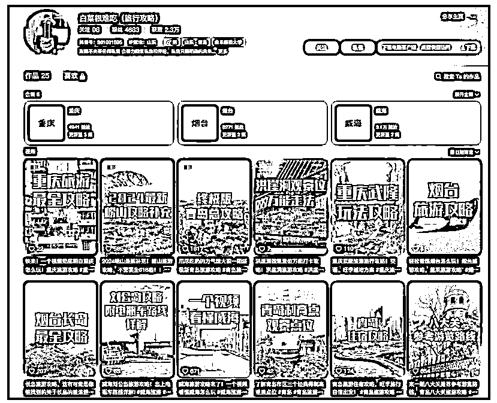

**点赚钱：**靠深度。深耕熟悉的本地，定制攻略、带团、资源对接。点到瓶颈就扩面。

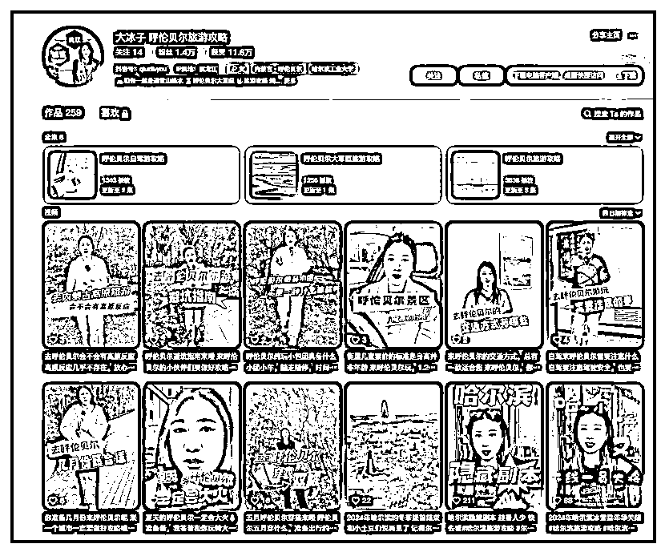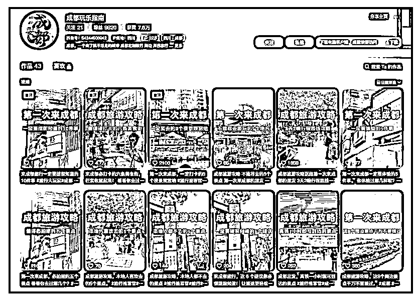

### 5、人设IP提升溢价

有人设的账号商业价值更高。不必当旅行达人，点位运营即可。真人出镜的信任感远高于图片。

出镜型：人文价值高，更新慢成本高。

剪辑型：信息流效率高，题材不限批量化。

结合最好。

### 6、其他收入

中视频计划播放量变现，剪辑即可。国外游变现更高，因为客群更有钱。

## 三、落地七步法

第一步，从你所在的城市开始，逐步辐射省内再到周边。

第二步，收集整理同行内容，制作游玩、小吃、住宿、自驾、亲子、避坑等攻略，保持信息新鲜。

第三步，四种呈现形式：口播、图文、视频配文、视频配音，由简到难堆量。

第四步，内容可重复，换你来讲就是新内容，持续布局关键词。

第五步，注入人文关怀：热情、避坑、建议，让信息变服务。

第六步，变现设计：求攻略就卖攻略，求咨询就卖定制，求带游就接单，广告、门票、团购自然来。

第七步，多账号多平台矩阵化+强人设，这是互联网吸金组合。

私域是关键。旅游行业复购、老客介绍、口碑裂变都很强。发财靠的不是一锤子买卖，是朋友圈的持续信任。

总结：旅游是国民刚需大赛道，个人做一份内容，其商业价值不输一家百人旅游公司。

# 【游戏号】

# 从不玩游戏，我也赚了80万

## 一、游戏赛道的价值认知

我亲历的案例：2019-2020年代理一款沙盒手游后台，推广APP玩家充值我拿60%-80%分成，同时卖二级代理权。4980元一级代理可卖代理，1980元二级代理拿充值返佣。通过创业网站、公众号投放招代理，运营到2020年底赚80万。学员坚持到2024年已赚300万+。

另一个案例：2021年朋友做王者荣耀陪玩工作室，300平店面100多兼职20多全职，每月稳定20万。

看起来不务正业？商人思维就对了。只赚游戏人群的钱，这就是生意。网吧老板不算事业？80后70后空闲时间越来越多，街机、小霸王到现在仍有市场。需求存在，商业逻辑就成立。

电竞网红赛道比才艺赛道更易变现。才艺需要十年沉淀，游戏一两年就能上路。游戏是娱乐赛道，游戏公司是暴利赛道，两者结合爆发力极强。做游戏网红不需要颜值和才艺，口才和内容感就够。

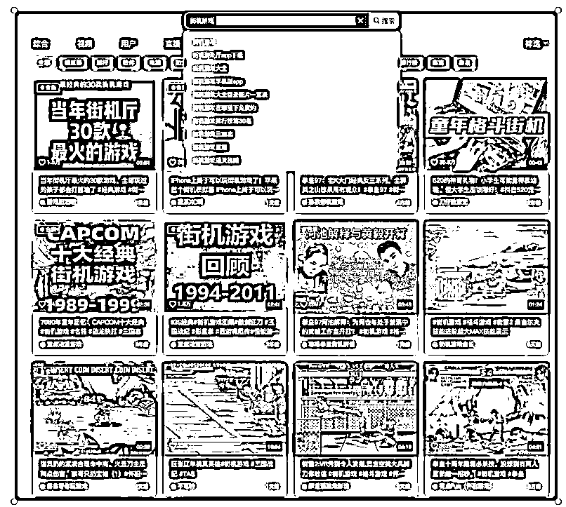

如图所示，游戏账号可赚打赏、下载、资源售卖、官方推广、播放补贴、设备带货。热门游戏如蛋仔派对，67万粉丝接广告都接不过来，自带流量发就有播放。

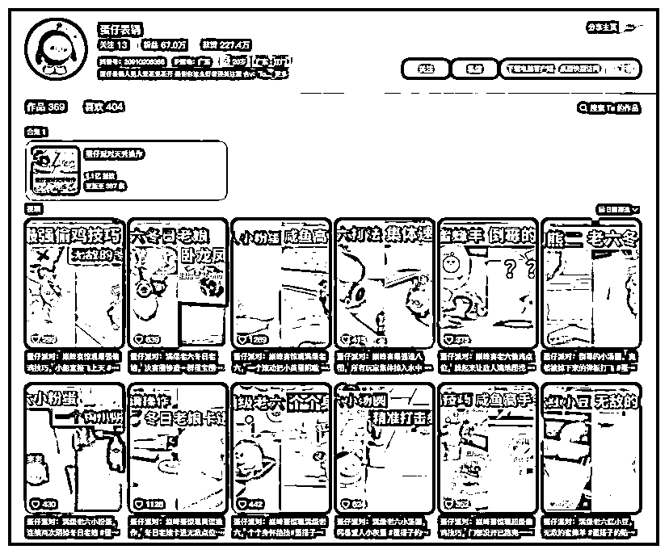

专注攻略有资料变现，娱乐型有打赏陪玩，粉丝积累后就是商业资产。

剪辑更省力。影视解说、书单、音乐的粉丝价值远低于游戏粉。游戏题材丰富，素材获取快，低成本高产出。

## 二、游戏粉变现场景

玩着就能变现，比知识类赛道内耗小。先拿平台播放补贴，再拿粉丝价值，先抖音后私域公众号，双腿走路。

### 1、主流大厂游戏

技术不重要，搞笑或攻略即可。

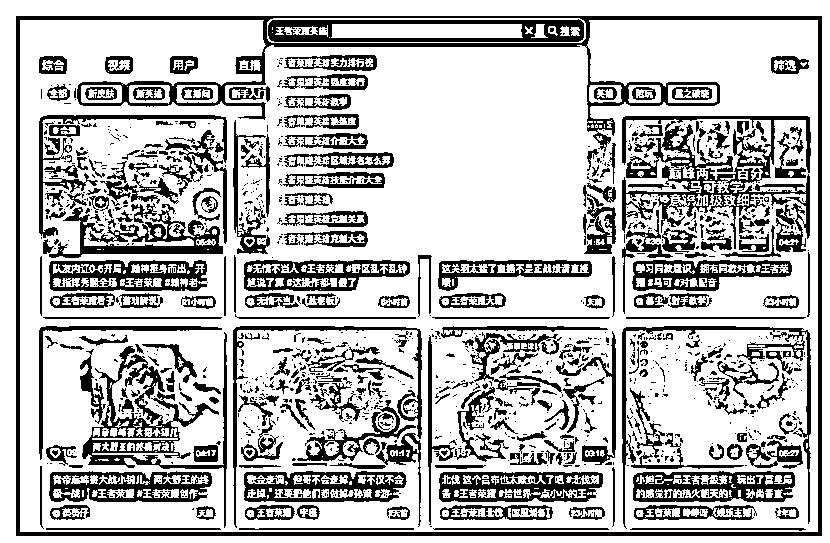

### 2、小游戏矩阵

以信息差为主，介绍玩法引流求链接，链接即现金流。

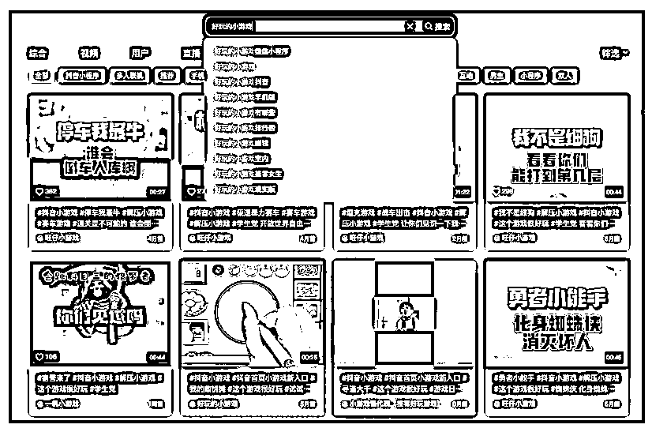

### 3、直播游戏

主流和休闲都能直播。观察头部主播话术、画面、变声器等套路即可复用。直播切片再发账号，一鱼多吃。

### 4、知识付费与资源

剪辑高手视频做矩阵，卖攻略、卖租号、卖资源。货源淘宝、抖商城、咸鱼均可。游戏资料版权风险低。

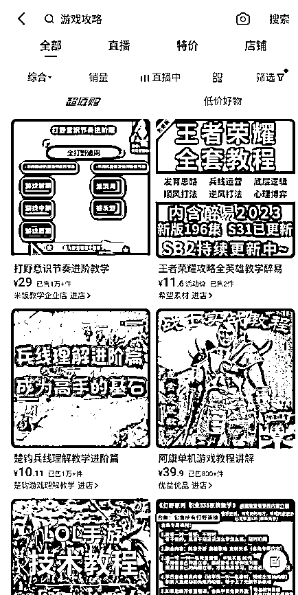

### 5、游戏测评

稀缺付费游戏、激活码类内容有好奇心需求。类似手机测评，给用户购买指引，价值感强。

旅游与游戏，都是长期可复利的副业赛道。把热爱变成系统输出，用内容换信任，用信任换现金流，这才是最稳的长期搞钱策略。

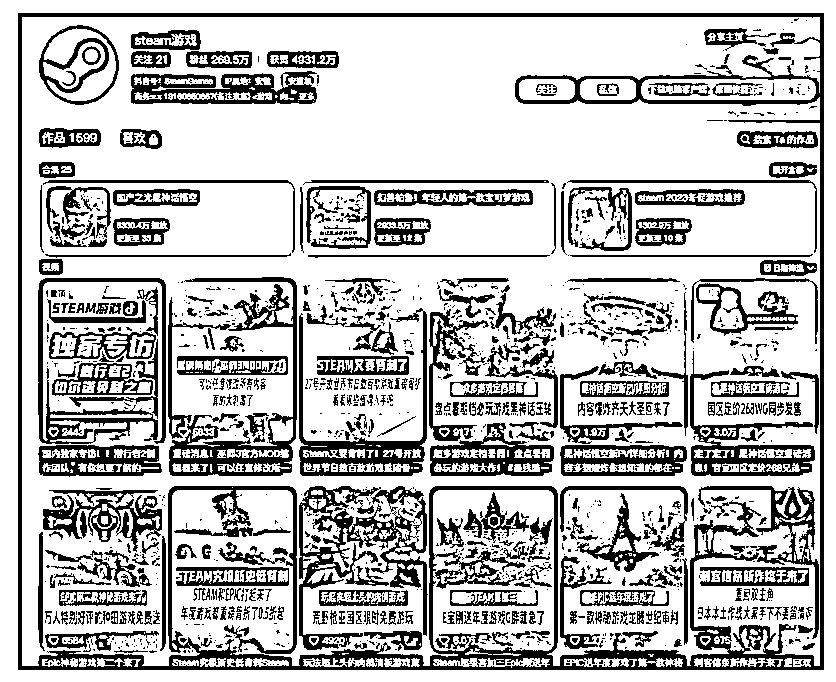

## **6、游戏操盘手**

这块的操作层面，领飞就不展开细说了。它考验的是综合商业运营能力，就像文章开头提到的那两个案例，涉及资金投入和团队配合，没有几年实战沉淀，很难稳定拿到结果。

不过没关系。从小项目起步，慢慢摸清行业逻辑，变现的点自然就多了。每个人心里都有一颗想赚大钱的心。

先赚到流量的钱，再赚模式的钱，这是所有新人绕不开的路径。野心太大反而容易翻车，我见过太多人一上来就想做大，最后颗粒无收。

领飞拆解赚钱路径，匹配你的能力层级，照做就能成，概率很大。

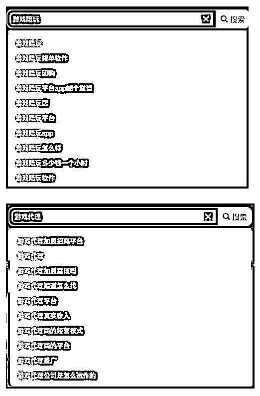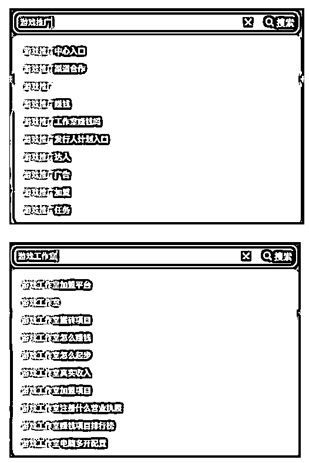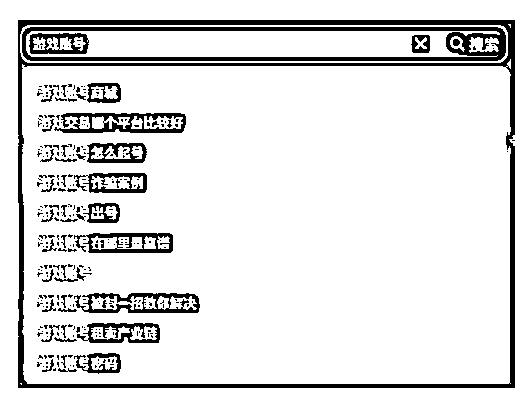

# **三、游戏粉你也能赚到**

游戏粉是目前最舒服的变现赛道之一。心态越松，收益越高。你可以边玩边记录，边玩边分享，内容出来钱就来了；也可以刻意化地玩，总结方法给别人提供价值，钱也一样进来。

**大家务必记住：别碰工作室游戏搬砖、倒卖外挂漏洞的项目。一是会把自己人废掉，二是极大概率触法。**

市面上有人卖游戏搬砖工作室，号称很赚钱。领飞劝你别碰，这类钱留不住人，还会误导别人走歧路，害人害己。

“阳谋变现”是创业的根本。你赚什么钱，别人看得清，还心甘情愿买单，记住这点，就是顶级玩法。

想吃游戏粉这块蛋糕，零基础切入就三条路：

**1、卖人设**

别人爱看你打游戏，你有梗你强，就有打赏。粉丝基数上去后广告也水涨船高。游戏天天打，水平自然天长地久变强。不用学历，不用催逼，玩着玩着就成了。

**2、卖资源**

虚拟变现经久不衰。卖攻略、卖账号、卖体验等等。粉丝越垂直越好。你甚至不用亲自开黑，剪辑视频就行，热门游戏需求永远旺盛。

**3、卖推广**

找靠谱渠道，或直接用大厂官方任务体系。每天试玩小游戏，围观群众一好奇就转化，门槛极低。

三者完全可以叠加。挑一个当下主流来做，比如最近腾讯推的 DNF 手游热度很高，就能边玩边做人设、资源、推广一体化。

任何变现，本质都是一套可复制的执行SOP。玩游戏赚钱很容易标准化。比如下班后玩几把小游戏，手机录屏+边玩边解说，剪一下就发，挂个链接钱就到账。

再比如玩几把王者荣耀，专精几个英雄形成思路闭环，按这个套路出视频，发抖音中视频、视频号，有播放就有收入。

粉丝起来后开直播打游戏，直播结束后把内容二次剪辑分发。

这样下班玩三小时，空了就多玩一点，既娱乐又赚钱，副业体验感极佳。

如果再拉上老婆男朋友一起同框，效果更有看点。

视频创作，演很重要。娱乐主播的精髓就在‘演’上。

**四、总结：**

**游戏号粉赛道，**是娱乐类里门槛最低的，副业里最轻松的。学习成本几乎为零，做就有效果。能赚多少随缘，大小皆有。网红不是人人都能当，顺其自然反而收获更大。

**本身剪辑就是副业赚钱的利器。**剪辑游戏不需要太多认知负担，不需要大量文案创作成本，优势就在于一个“玩”字，比苦思冥想一条文案高到不知道哪里去了。

# **【宠物号】**

# **1000 人为你养这只宠物月入 5 万**

# **一、宠物号（粉）价值**

猫狗鱼鸟四大品类为主。爱宠人群是高度垂直的，且以年轻女性为主，对宠物粮、玩具、清洁用品、小窝、甚至宠物服饰都有持续复购需求，是长期稳定变现的赛道。

一方面内容自带流量，适合矩阵批量做；另一方面专业养宠知识也能带货，IP可长期运营。

这类内容重看率高、跳出率低、互动强，是其他赛道少有的优势。

所以对普通人来说，宠物号非常友好。发内容就有看，能有一点干货就容易涨粉。

相比真人出镜，宠物出镜更吸睛，涨粉更快，拍摄难度也更低。

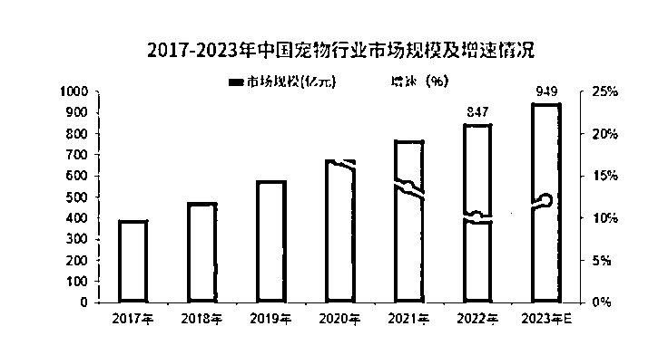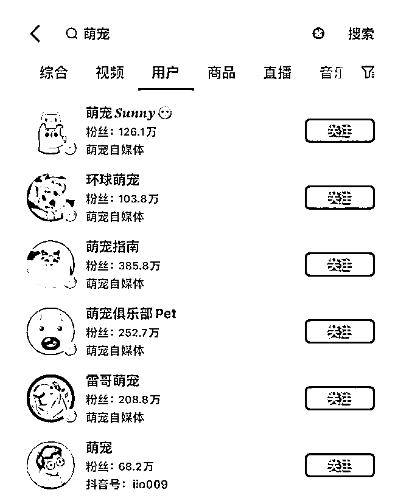

宠物赛道的百万大V数量远超很多赛道，说明上手容易、成功率高。副业角度看，轻松简单易复制，结果也更好拿。

别用浅薄的眼光说赛道拥挤。头部永远不被垄断，你内容有亮点就有关注。每只宠物都是独立的个性体。

**所以什么时候入局都不晚，抖音小红书视频号的用户基数实在太大了。**

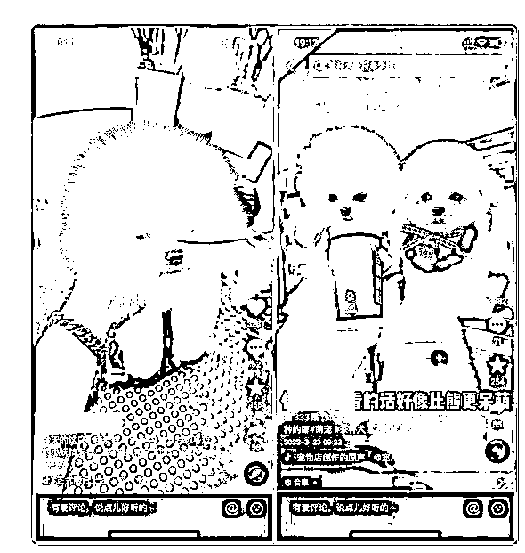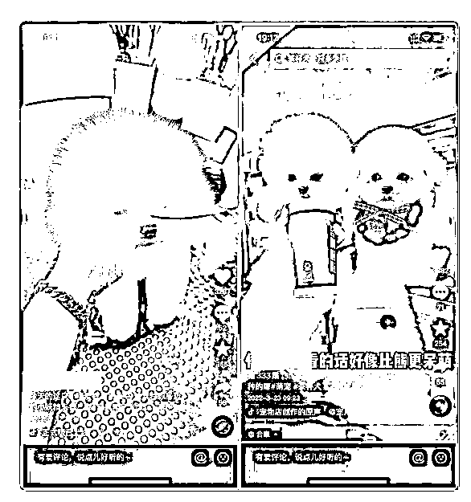

像上图这些萌宠，别说铲屎官，就算是只养过绿萝的人也很难不驻足。宠物号天生具备高关注度，涨粉是顺理成章的事。

**生意本质是人。**流量到手，90%的问题都解决了。除了宠物本身，还能卖宠物快消品：粮食、玩具、清洁用品、日用品等。

如果你私域里有几千个精准宠主，服务做好，基本可以吃一辈子。如果你本身就是爱宠人士，做宠物号再合适不过。

宠物可分猫狗鸟鱼仓鼠等。建议先从大众的猫狗入手，最熟悉也最爱。冷门宠物也能做差异化，只是转化率会稍弱一些。

# **二、宠物号（粉）赋予赚钱**

## **1、私域赚钱**

小区里有个大姐养狗特别好，狗很听话。她不是专业训犬师，只是自学了很多视频教程。每天遛狗时身边围满向她请教的人，掉毛、挑食、拉肚子等问题都问她。

她把微信加起来有几十人，后来发朋友圈推狗粮，大家直接要链接。她找店家拿团购价分给好友，发现这就是商机。之后她带着狗在全市公园小区转悠，半年攒了1000多个微信。

建了个狗圈社群，99元/人，提供养狗咨询，还当团长带货。

## **2、广告赚钱**

先靠播放量赚钱，这块不容忽视，很多博主的主营收入就在这里。后续粉丝价值变现也更多。

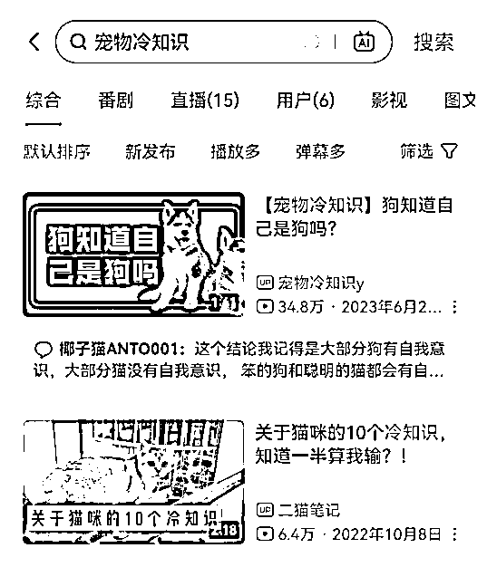

宠物知识号基本靠播放量分成，一万播放约15元。云养猫人群众多，宠物本身可爱，播放和关注都很容易来。

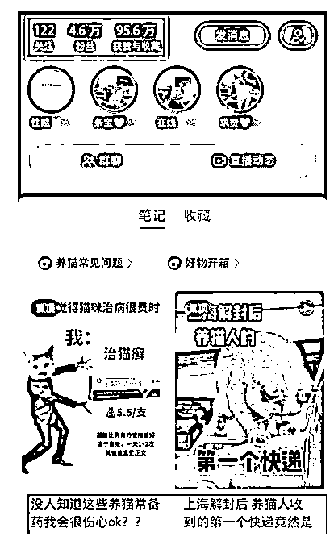

比如小红书上一个账号，4.6万粉，95万赞，数据不算顶级，但一条广告报价6000+。

**宠物号变现大致三条：**

1、橱窗带货或直播带货；

2、接商家推广拿广告费；

3、引流私域卖训宠课程。

新手不建议直接上第三种，先积累信任度在平台尝试带货。达到一定体量后，可在包裹里放小卡片引流私域。前期最好在平台完成500-1000单再做私域更稳。

##   **3、赚钱手法**

**第一步：**确定内容形式。图文简单，但想快速建立信任，视频更有效。

**第二步：**找平台上数据好的对标账号，挑自己能做的类型做深度拆解。头像昵称简介、文案拍摄手法都1:1复刻学习。

**第三步**：拍摄制作，分三类：

（1）自己养宠，直接模仿爆款拍摄；

（2）和本地宠物店合作拿素材；

（3）搬运各平台爆款二次剪辑，或加入宠物群收集素材再创作。

**哪种方式能低成本高效率生产内容就用哪种。**

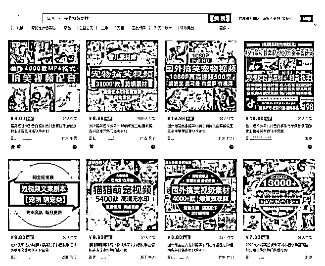

图集号可以搜高清图配文案音乐。短视频可以混剪二创。有自家宠物的最好，没有也可以做。

## **4、卖宠物赚钱**

我写过文章《卖猫副业，宝妈用2只猫拍视频年赚20万》，核心就是繁育裂变+私域运营。

也可以和本地繁育基地合作，用IP人设去售卖宠物，利润很可观。搭建直播间直接卖宠物也是方向。

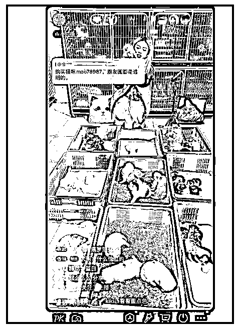

## **5、带货赚钱**

视频发出去挂橱窗就能自动成交。视频爆了可以付费投流放大。曝光多了爆款概率更高。带货门槛低，比如买一件宠物玩具样品，让宠物玩玩具的场景多拍几条，播出后很可能带货爆发。

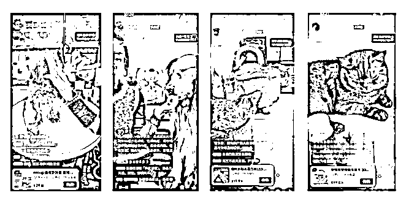

# **三、宠物粉你也能赚到**

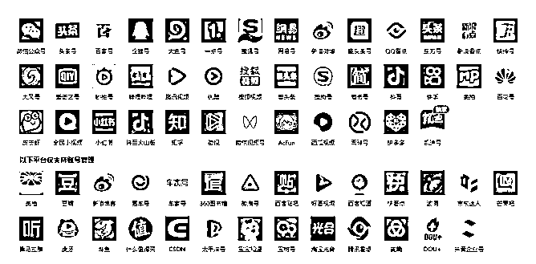

自媒体平台众多，一鱼多吃完全可行。宠物素材易获取，意味着内容产量高，内容多了自然赚钱。

对标成功案例，宠物号比很多赛道更好复制，学习成本低，对文案要求也没那么高。

先赚平台流量补贴，再赚粉丝广告费，之后带货、卖课、私域运营就是长期现金流。

## **1、公域赚钱**

想赚公域，就要高频多平台发。发的越多爆款越多。新人也能快速拿到正反馈，发就有钱赚，后续动力就足了。

尝到甜头后慢慢精进带货能力。等粉丝规模上来，再逐步导私域。

## **2、私域赚钱**

1000个精准私域客户做好服务，就能持续复购，还会帮你裂变。服务是私域核心。关键是粉丝如何导进私域，多看同行引导钩子。

**卖资料是一次性，带货是复购。**

私域靠持续免费价值建立信任，自然成交。玩法很多，游戏机制很重要。一篇文章讲不完，多看同行就能复制。私域带货不像开淘宝拼死拼活，更依赖服务和信任。粉丝是你的，你想怎么运营就怎么运营，把占便宜感、知识感做到位，粉丝就会长期留存并持续下单。一次成交不够，后续运营才是关键。

## **3、收徒赚钱**

你把宠物赛道的优势讲明白，做了并且拿结果了，别人自然也想学。培训交付难度不高，成材率高，口碑也好，培训费赚得很舒服。

不需要重商业IP。私域里买宠物用品的人大多是小姐姐宝妈，她们天然有赚钱需求。

用你自己的案例在私域展示收入，很多人会主动找你学。培训费赚到，后续学员拿你的货再赚一笔。

**相当于抖音团长、微商代理的模式。**100个学员带货，学员再收徒带货，就是放大收益的逻辑。

模式、培训、创业粉的玩法领飞很熟，可以后续交流。现在先看懂宠物赛道的价值，看你是否真心热爱。

# **四、总结**

宠物粉丝赛道非常火热，正因为容易做，人多也很正常。网络就是人人平等的竞技场，你更努力就更强。

热爱宠物才能真的赚到宠物的钱，只为赚钱去做，大概率做不起来，这是该赛道最核心的秘密。

**这个赛道不怕同行，**没有不可复制的秘密。立好宠设和人设即可，喜欢你的人自然会留下。

#   **【教育儿号】**

# **让一个宝妈关注你 10 年，买单 10 年**

# **一、教育儿（号）粉价值**

教育和育儿本可拆分，但本质都是吸家长粉宝妈粉，是一个连续需求链。一个宝妈3岁时会关注你，能一直跟着你到小学毕业，通过矩阵号引导分流。

## **1、【教育儿粉】需求什么？**

健康饮食身体心理、学习提分升学阅读、特长培养、家长成长、亲子互动等。

围绕这些可卖书、卖课、卖资料、卖咨询、卖小玩具等。

**教育儿创业赛道两类人：**专业老师和宝妈家长。

你是老师有资质更方便；你是家长考个家庭教育师入门证也行。

**有无证书都能做**，【副业陪伴圈】以平民可操作为主，只是运营方式不同。

**教育儿粉的价值在于孩子是头等大事，**关注周期长，有用就下单。但也有短板，高客单难做，需要强专业背书。小单高频反而更稳。

**赚一类人的钱一定要做私域。**宝妈粉引流一个到微信价值20元以上。每天引10个赚200，引100个赚2000。

**引流核心是赠送，**持续赠资料、赠课程、赠福利。

线下K12受限，线上学习方法资料反而卖得火，这就是小红书教辅虚拟变现火爆的原因。

教育卖资料，成长卖课程，心理卖服务，亲子卖产品。四类对应不同打法，但只要在私域，就都能卖。

## **2、案例**

五年前我给一个学员策划教育项目，目前年入百万。出于同行保护原因账号不展示，但执行逻辑可以说下。

**【教育儿粉】分阶段：**

孕期、1岁、2-3岁、3-6岁、1-3年级、3-6年级

这是高消费盲目消费阶段，也是家长最焦虑的阶段。初中后消费就下降。

所以1-3岁、3-6岁、6-12岁，每个阶段都有100个典型问题：不好好吃饭、爱闹情绪、脾气大、不写作业、浪费食物、撒泼打滚等。

把每个问题的解决方法整理成电子书或音频课，买课的家长拉群讨论，再对接心理咨询老师做长期咨询变现。

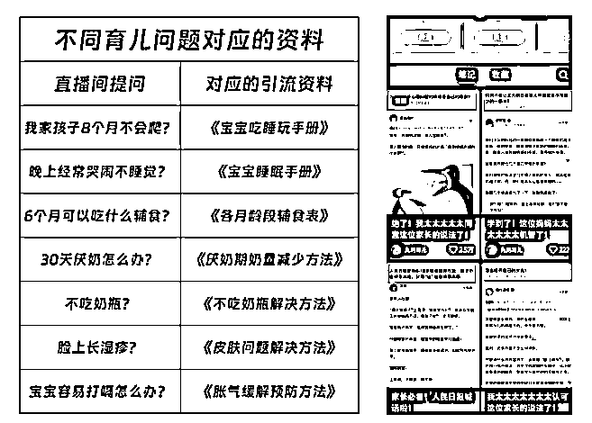

#   **二、教育儿（号）粉赋予赚钱**

教育儿话题极大，变现场景很多。普通人先从以下分类切入，慢慢深入。

市场卖什么我们都可以卖，唯一要记住的是私域。平台和需求变化快，只有从第一天就重视私域引流，才能长期吃这波人。

## **1、卖资料赚钱**

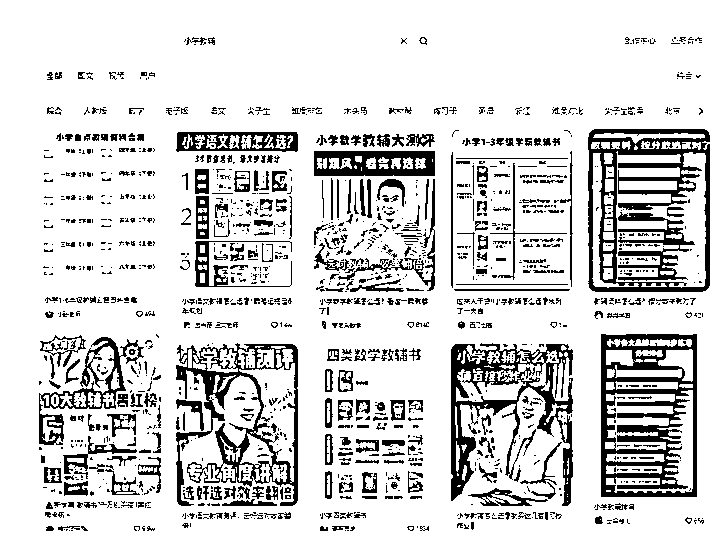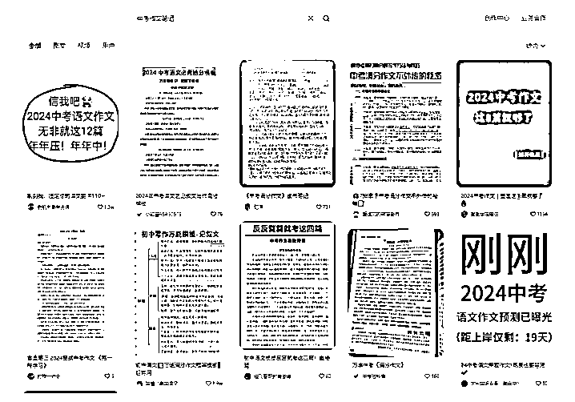

卖资料门槛低，一定注意版权。同行卖什么基本都过筛过版权了，跟卖就行。整理分类做好，免费一部分付费一部分，资料海量根本发不完。

## **2、卖课程赚钱**

有一定技术含量的包装。20万粉前人设可以放开包装，粉丝大了就要收敛。平台挂橱窗卖课审核麻烦，引流私域更自由。

一定要卖小课、低价课。不要一上来就卖高价，风险大。99元的课，多卖几套不伤大雅，用户支付也无压力。

一、先聊卖课。

我一直觉得，卖小课是最容易起步的事。小课的标准，就是帮用户解决一个小问题，问题解决了就值回票价。同一个问题，你可以循环做成一整套课程，反反复复去卖，但定价最好控制在100元以下。我不太建议粉丝一上来就卖高客单价，因为现在的信任积累还不够。等哪一天你有了证书，有了实打实的从业经验，再放开高单价服务也不迟。除了单干，还可以跟高价产品的老师合作，比如一单超过2000元的课，基本能谈到五五分成。

说到底，做流量的本事才是生存之本。小方法赚小钱，大方法赚大钱。黑猫也好，白猫也罢，你得先有流量，才能抓到那只猫，让猫帮你抓老鼠。

接下来聊卖产品这件事。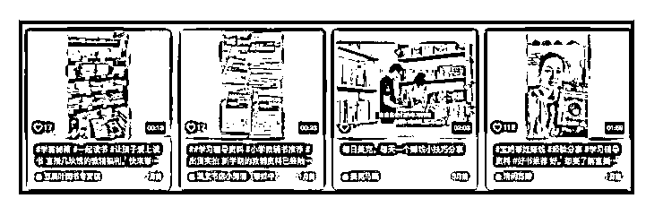

不管是剪视频带货，还是推荐教育类好物，我都建议别在公域平台硬推。公域流量就像流水，存不住也用不牢。把用户接到私域之后，顺手卖反而更有效。比如文章里挂一件产品，朋友圈里推一件产品，群里发起一个团购。视频带货看着挣钱快，实际上内卷特别严重，特别消耗人的耐心。如果你没有几年的电商底子，最好先冷静想一想。同样花100天，做“知识赠送”往私域引流，跟天天剪辑视频做带货相比，前者的结果通常更轻松，也更容易持续。

再说说直播带货。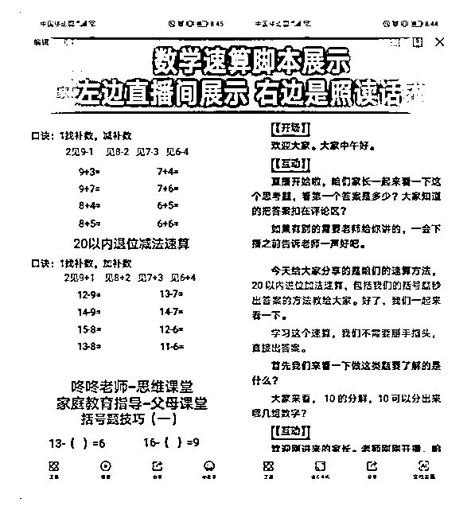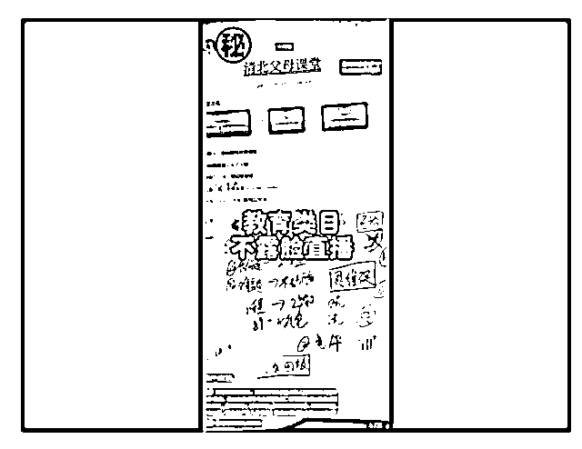

想入场，先大量刷同行的直播间。他们往往一套话术翻来覆去地讲，就盯着一款产品卖。就这样，每天也能往私域稳定引100人左右，后端的商业价值越来越高。如果你口才好，时间又充裕，完全可以试一把。多研究那些直播间，最好把他们的产品买回来，顺着讲一遍，你也能开直播卖货。

还有一个方向，叫“给老师卖铲子”。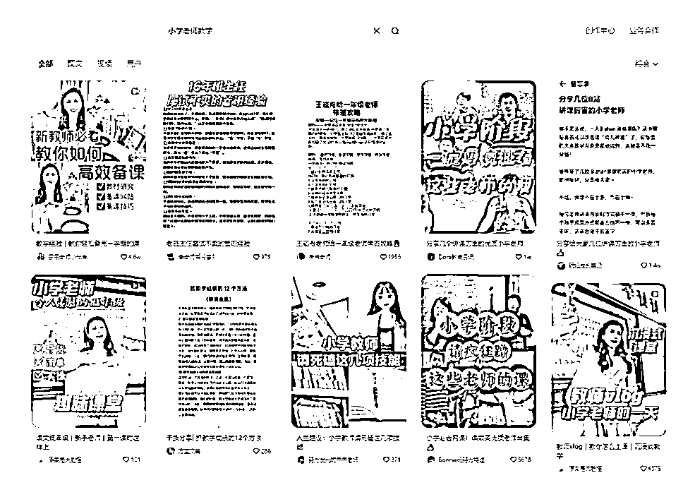

老师也需要教辅材料，也得到网上找资料，拿给学生练习。你要是能提供这些，收入往往也不差。淘金热里最赚钱的，不一定是淘金的人，反而卖铲子的人更稳。

二、再说教育育儿号。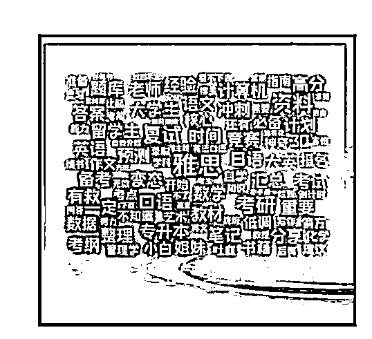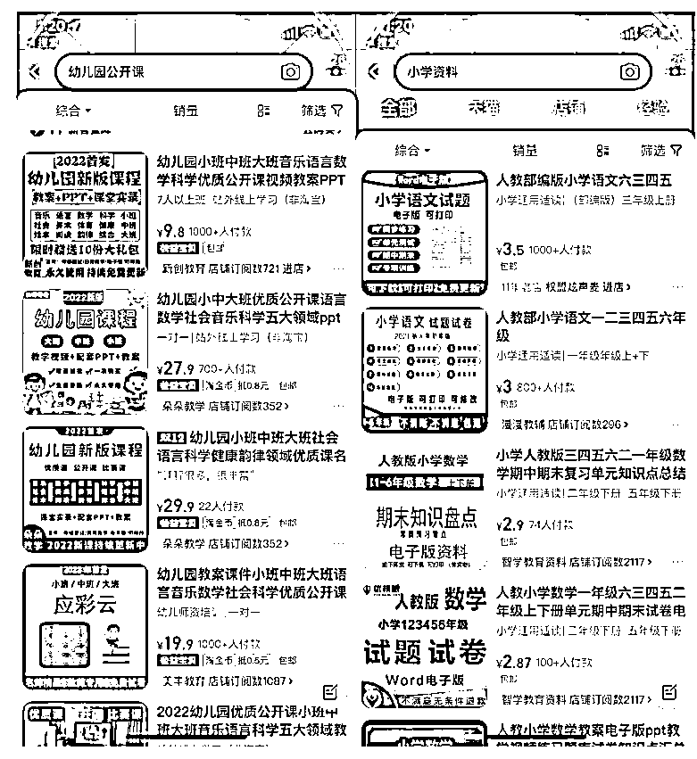

这个赛道盘子实在太大，玩法也多到数不清，一篇文章讲不完。概括地说，专业的人做口播人设IP，靠卖课赚钱；非专业的人，就卖产品、卖资源。但不管你是哪种，都不要什么热就追什么，真正要做的是找一个细分点，把突破口打开。

怎么找细分？按年龄段，可以切3岁绘本阅读；按学科，可以切四年级作文提分；按心理，可以切女孩社交孤僻；按技能，可以切口才演讲训练。很多普通人是这样进来的：并不是真有多热爱，而是自家孩子正好遇到问题，想着一边自己学，一边帮孩子用，还能顺手挣点钱，于是稀里糊涂入了局。这个出发点没错，但很多人败在“太以自己孩子为中心”——什么都想学，学完就想卖，结果什么也没卖出去。就像孩子字写得不好，你去学写字方法，等孩子练好了，你立刻觉得任务完成，又跑去学下一个。这哪里是赚钱，分明是哪里坏了补哪里。

那什么叫细分专注？比如阅读这件事，就是可以长期做下去的细分方向。3岁前读什么，幼儿园阶段读什么，家长自己读什么，小学阶段读什么，怎么让孩子爱上阅读，孩子有问题该读哪类书……这些都是能持续输出的内容。你不用是什么专家，只要肯刻意总结，刻意学习，慢慢就是专家。再比如考试提分：哪些辅导书有效，哪些题库值得刷，每天怎么安排刷题，这门学科从小学一路延伸到中学，能运营很久。

在这个领域，你是不是老师根本不重要。你只要比其他家长多懂一点，你就是专家。家长遇到孩子的事，哪怕只是成长过程中的正常波动，也会觉得是天大的事。所以任何一个“解决方法”，都可以被拿来放大焦虑，让家长心甘情愿买单。你要做的，就是在一个问题上比别的家长多花功夫，多懂一点，立住专家人设，然后直接变现。

运营教育育儿号，内容可以分成两类。

第一类是引流内容，这是最核心的。我们做内容的目的，本来就是把流量导到微信。手法很简单：发一半，留一半，用暗示的口吻让用户知道，完整版加微信才能领。记住，是暗示，不能明示。

第二类是干货内容。这类内容对引流帮助其实不大，用户看完只会顺手点赞、收藏，很少会私信你。但为什么还要发？因为每个人都有一点收藏心理，看到好东西就想要，哪怕存了再也不看。干货内容能快速拉高账号的点赞和收藏，让平台觉得你是优质账号，权重更高，看起来也更有权威。干货还能拿来直播，用户看到你专业，就会信任你，你就可以用干货把人引到私域，或者直接卖“更干”的课程。

再送你一个108运营法。教育、育儿赛道，找一个方向，刻意学一段时间，就能出去卖。卖别人的产品也行，卖自己的也行，本质是围绕一个问题提供解决方案。比如：

- 亲子游戏，整理108个；

- 小学数学满分，整理108招；

- 历年中考满分作文，整理108篇；

- 小孩财商，整理108个练习；

- 中考状元笔记，整理108份；

- 幼儿必读绘本，整理108本；

- 家长陪学方法，整理108条；

- 老人带孩子容易踩的坑，整理108个。

方法就是不断整理、不断分享、不断赠送、不断出售。通过刻意学习、刻意整理、刻意挖掘，你就能获得教育育儿号赋予的赚钱能力。更具体的方法，可以看这篇：[【先拼数量，再保质量】一个素人做IP写小作文，108营销方法论]()

老赛道里永远有新玩法。AI起来之后，又冒出一堆新机会，比如AI绘本故事、AI英语动画、AI国学故事、AI亲子照片。以后我会尽量多拆解这类小项目。小项目的好处是见结果快，哪怕有周期，只要你始终围绕同一类人来做，不管项目怎么换，私域沉淀都在，小项目就能变成长期生意。

三、职场号：抄出108招，也能月入5万。

说说职场号的价值。很多人出去折腾一圈，最后还是回到职场，心里又不太甘心。不甘心，就没办法踏实工作；不踏实，就很难有奉献精神；没奉献，自然升不上去；升不上去，就稀里糊涂过完一辈子。

我以前常和国企的老同事聚会，5个人的小群，每个月约一次饭。现在他们一个个都成了年轻骨干，说实话，我很羡慕，毕竟慢慢有了社会地位。像我这种在互联网上自己做事的人，其实是孤独的。自由是有了，但圈子也没了，一个小老板哪谈得上社会地位。当年我结婚，能叫100个人来捧场，现在大概只能叫来20个。不是你变了，而是环境变了，你不在原来那个圈子里了，也没有了那层同事关系。所以，想创业之前，先问问自己能不能扛得住孤独。

最好的职场归宿是什么？公务员、事业编、国企、500强、地方标杆企业。在北方，大多数人一辈子图的就是一份好工作；南方可能淡一点，但职场终究是大多数人的必经之路。传统的想法还是：考个好大学，不就为了找份好工作吗？所以别总是劝人创业。全国70%以上的人都在职场里，真正算得上好职场的，可能也就20%。不是所有人都该去创业。

职场里的关键词，无非是求职、应聘、攻略、生存、晋升、关系、向上、巴结、压力、焦虑、酒局、打压、狡诈、做局、送礼、瓶颈、裁员、机遇、危机。归一下类，就是生存、晋升、关系、心态四件事。需要这些内容的群体，最有代表性的有三类：职场新人要攻略，职场多年的人要晋升，中年人要应对危机。职场号粉这个赛道，看着热门，其实内容供给相对冷门，做的人没有其他领域多。为什么？因为职场粉能变现的产品太少了，几乎没有实物产品，只能做知识服务、虚拟产品，复购一般，消费频次也不高。但职场粉有个很大的优点：忠诚。只要你的内容一直有用，他们就会一直关注。一个私域职场粉，值10块钱。

运营职场粉丝，可以长期死磕心态调节和晋升攻略。100个问题，就整理100个问答；1000个问题，就整理1000个问答。把这个方法用到极致，答案汇总起来，流量自然就来。职场号粉适合拼命发干货，播放量、点赞、收藏这些数据通常都不错，所以先把眼前的钱赚了，比如播放收益和书单带货。职场问题实在太多，书里有答案，问答里有答案，古人智慧里也有答案，心理学、电视剧都能结合着做内容。素材不缺，干货就不缺。职场粉的变现路径虽然少，但量大产生质变。越简单的事情，越容易赚钱，反而不会像其他赛道那样项目多到让人朝三暮四。职场号跟情感号有点像，但职场粉比情感粉值钱。两者都是文案号，而职场号更垂直。所谓抄，就是把同行的内容逻辑搬过来，账号自然能起盘；把同行的变现路径搬过来，钱包也能跟着鼓起来。找准赛道，没有那么多弯弯绕。因为运营、做号、变现都简单，职场人又不缺，职场话题永远热，所以这赛道能让普通人轻松上手。职场号没有专家，只看你有没有智慧。有智慧，你就是专家，打工皇帝可不会跑来教你职场。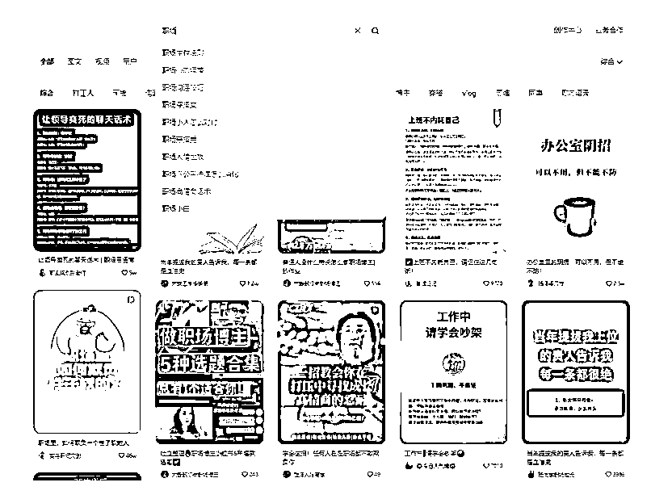

职场号粉赚钱太简单了：卖播放量，卖书单，卖课程，卖软件，卖PPT，卖资料，卖心理辅导，卖广告。这些全都在你拥有粉丝之后，靠个人IP运营就能赚到。切入视角还是那三类人：职场新人、晋升期职场人、中年危机人群。这就像高考报志愿、考研、闯职场一样，一环扣一环。比如针对晋升期的人，就讲做局、酒局、巴结、送礼、关系。

我见过一个账号，一个普通人在家做，一年赚50万一点不夸张，把我上面说的赚钱方法都做了一遍，而且一直没停。这个博主一个人在家，靠真人口播做到了200多万粉丝。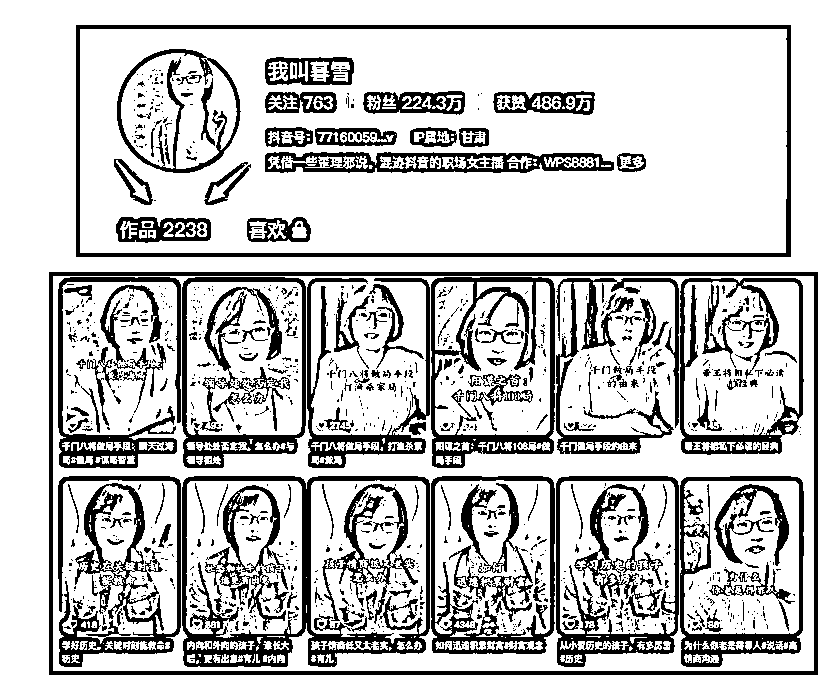起初她讲职场干货，现在反而不怎么讲了，开始讲孩子教育、夫妻和谐。你觉得她脱离职场了吗？并没有。她只是把内容做了延展，已经摸到了职场号的天花板——职场人下班以后，过的就是生活、孩子、夫妻、家庭。职场内容看的人非常多，基本上发出去播放量就不会差，尤其“打小人”、做局挖坑、向上巴结、职场情商、降薪裁员这类话题。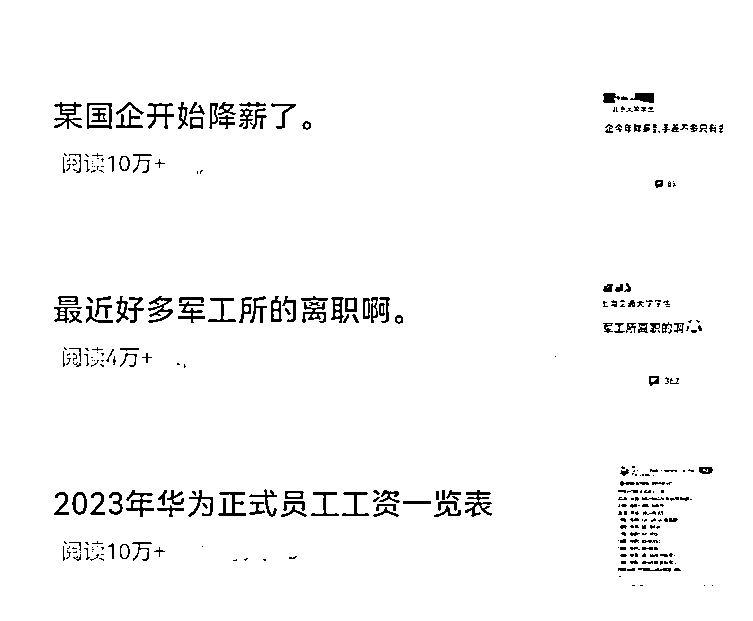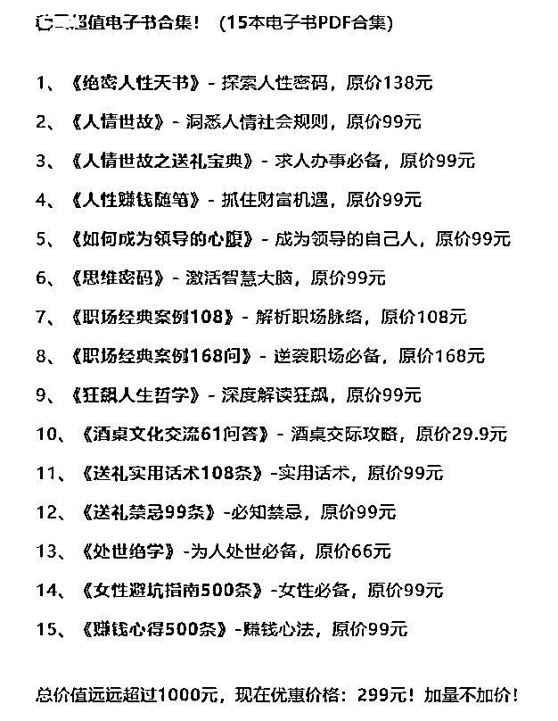

公域平台比如抖音、小红书攒下粉丝以后，再引导到私域公众号，可以直播卖课，也可以文章卖课、视频卖课。卖课加群，加群再卖课。把旧课程做成电子书，免费送，送得越多，别人帮你扩散得也越多，新流量进来再卖新课程。这样循环起来，钱自然就赚了。

具体执行流程，简单得很：抄内容分享→总结问题赠送→用流量卖课→跟人合作推广小程序→整理资料一边卖一边送→粉丝多了接广告→把内容做成电子书送出去→新流量来了继续卖课→新老流量一边卖一边送。说实话，我很喜欢这个赛道。如果你是个爱说教、内心想法多的人，特别适合。不需要什么专业知识，只要刻意整理，再加上自己的一点见解，就能一边分享一边赚钱。想再加点难度，就学一学职场办公技能，比如AI公文、AI PPT、AI演讲稿、AI统计。这么一拓展，又冒出个细分赛道：AI职场办公，也就是AI+职场。

职场粉的广告价值很高，因为太多的办公软件需要推广。现在主流AI厂商也最喜欢职场用户，购买率高得离谱。广告费、推广费、拉新费、团队分销，样样都能赚。这种钱赚得很轻松，不需要扯着嗓子吆喝，被动就有收入，而且能长期赚，只要有人一直充值，你就能一直分。

职场内容说白了也是文案号，而文案号最大的优势就是好复制。买100本职场的书，买100本讲古人智慧的书，关注100个职场博主，关注100个职场公众号。不管内容是什么时候的，哪怕是5年前、10年前的，都能拿来用。内容问题解决了，剩下就是变现。还是我老生常谈的108招：巴结领导108招、送礼108招、做局108招、扩展人脉108招、女性职场玲珑108招、职场防坑108招、预防中年危机108招、工作协调家庭108招、职场时间管理108招、与领导交流情商108招、鬼谷子职场108招、素书职场108招、曾国藩职场108招。去任何平台搜，只要是按108招整理就对了。别人没干的事，你干了，就能拿去卖。这个月整理一个108招，下个月又整理一个108招，一不小心就整理出上百个108招。

威力有多大？量变引发质变。每个招数都是关键词，职场上一遇到问题，一搜就搜到你的内容。更狠的是，你有一堆108招，等于布满了整个搜索结果。别人买了你的电子书，转手发给朋友，朋友顺着找到你，又买了其他电子书。职场知识付费不一定需要视频，电子书、实体书、音频课程都行，因为职场内容不是教你实操，更多是认知和思维。这些文字、音频还能申请版权，做成付费专辑，传到知识平台，躺着赚被动收入。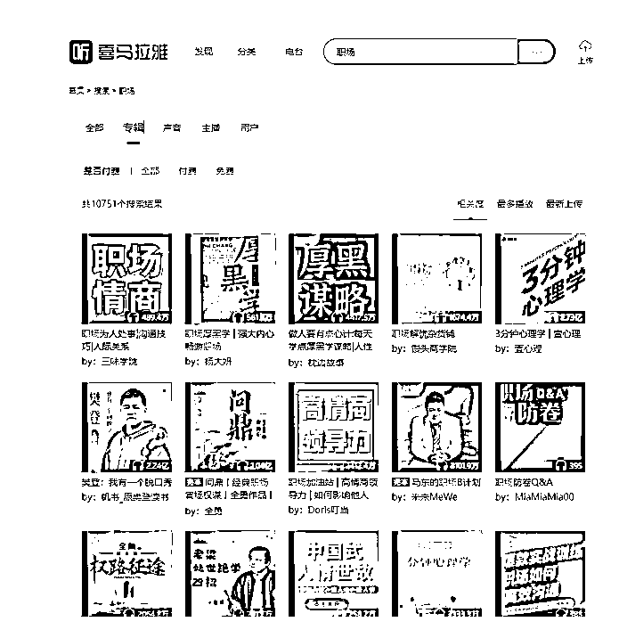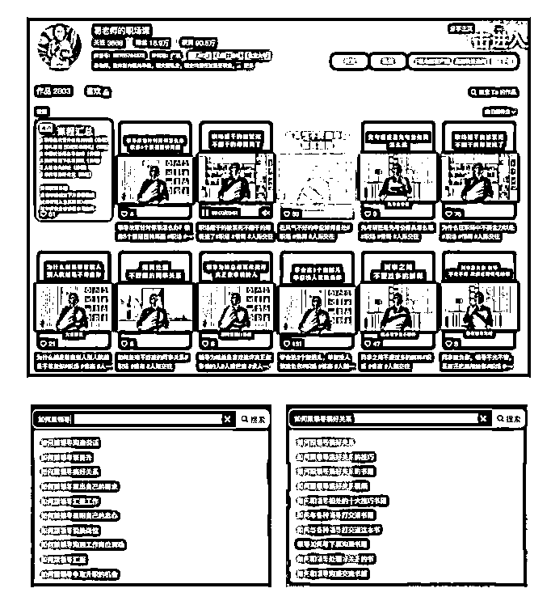

还要学会SEO内容分发，让别人在搜索时更容易看到你。方法不外乎三点：标题带关键词，正文带关键词，话题也带上关键词。每次发内容都按这个模子来，你不成专家谁成专家？再加上“108招”“干货”“绝招”“技巧”“方法”“绝密”“揭秘”这些词包装，不找你买单找谁？再加上一边送、一边裂变、一边分享、一边卖，你不赚钱谁赚钱？

前面我已经分享过【AI搞钱方向】【宠物粉】【旅游粉】【游戏粉】【教育儿粉】【职场粉】这几类“赚一类人钱”的分析。你会发现每个赛道性格都不同，了解以后你才好做选择。很多时候赚不到钱，不是项目不行，而是没有方向。今天觉得这个项目好，明天觉得那个项目好，最后什么都没落地。什么叫方向？方向就是先锁定要赚哪一类人的钱，然后把这类人背后的各种项目都做起来。

四、最后是工具号。

做IP讲究专业度，通常你比别人多懂一些，就能称专家。但要问普通小白也能做的IP，我一定选工具号IP。它的核心是“信息差价值”：你知道某款工具，别人不知道；别人知道了，还有更多人不知道。这样一层层传下去，你就成了内容传播的节点。职场人、创业者、运营者，谁都离不开工具，提升效率是刚需。工具号的特点是：越免费分享，粉丝越多。所以别只盯着它怎么变现，有时候没有产品，反而是最好的产品。

IT公司太多，干IT的人也太多，每天都有各种新工具冒出来，而每个工具都有它的“作用”。这个“作用”就是关键词，就是用户会搜索的内容。工具号内容只需要把“作用”讲清楚。等你养成一个大号，你就成了粉丝眼里的“工具库”。他们想找什么工具，直接来你的账号翻，还会推荐给身边人。这是少有的自带裂变属性的领域。你只要守住几个词：好用、全面、免费、更新、有效、实时，粉丝就不可能不长期关注。

工具号也是资源号。市场上缺资源的人太多了，看看淘宝上卖破解软件的人有多赚钱就知道。资源也可以白送，粉丝在你这里能免费拿到好东西，本身就是一种价值，粘性自然高。

工具号粉价值到底在哪？第一，粘性强，粉丝留得住。第二，内容是关键词，能被搜索找上门。第三，素材不枯竭，IP能长期做。第四，不需要太高专业门槛，拿来就能分享。第五，不用刻意卖货也能赚钱。第六，广告价值最高，商单从不缺。第七，大号还可以养小号，做成矩阵。

工具号怎么变现？先说第一种，口播个人IP。口播最难的是素材，工具号却没有这个难题。找几个对标账号，他们说哪个工具，你也跟着说哪个工具。但有个讲究：只讲工具的作用，不讲工具的地址。这样才能把人引到私域微信和公众号，实现私域IP价值。尤其是现在这些内容创作工具：AI绘画工具、AI图文工具、AI批量工具。关注这些内容的粉丝，大多是互联网创业者，所以你收获的不只是工具粉，还是创业粉。私域建起来以后，还能顺手做小项目变现。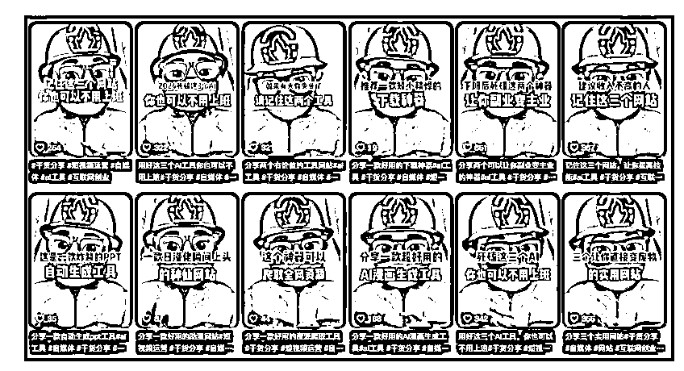

第二种，广告接单。这几乎是工具号IP最大的收入来源。软件厂家那么多，都需要广告投放，工具号粉丝就是他们的精准目标。合作方式有的直接一笔给钱，有的按注册量付费，注册一个给你多少，还有的叫上你一起拉人头、给高权益。而且工具号广告不会显得太硬，因为任何工具都有盈利需求，你只是推荐个好用工具，粉丝往往也不反感。私域和公域两边广告价格还不一样，等于一份流量赚两份钱，所以大家都愿意把粉丝往私域带。

第三种，CPA、CPS推广。许多工具小程序和网站都有推广码，你拿二维码去分发，粉丝注册之后，只要有人充值，你就能分钱。这是工具号很重要的变现渠道。稍微懂点网站的人，还会去淘宝买一套代码，搭个自己的小工具网站，自己推广自己赚。工具能帮人赚钱，用的人自然多，大家都想借工具获利，所以CPA、CPS的玩法越来越流行。这类平台以后会越来越多，平台本身就是项目。你可以专门教粉丝怎么靠这些平台赚钱，赚团队的钱——很多工具号博主现在正在做。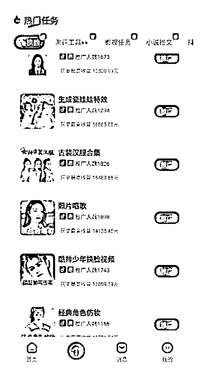

第四种，卖资源。很多工具都有破解版，淘宝上大量在售，尤其以办公场景的大软件为主。这些店铺会长期更新资源，你花点小钱开个会员，资源就到手了。之后你想卖也行，想送也行。但我建议，别去卖，直接送粉丝最好。别人要付费的东西，你免费给到大家，这种好感度会直接变成粉丝粘性。

工具号IP，就是这样一个人人可做的方向。把信息差变成内容，把内容变成信任，把信任沉淀在私域，你就能吃很久的粉丝红利。

运营资源号时间久了，你会发现关注者的包容度其实相当高：即使你在内容里夹带商务推广，他们往往也不会因此取关。毕竟你给出的无偿分享足够硬核、足够密集，这份“白拿”的实惠，足以让人对顺手滑过的宣传单一笑置之。

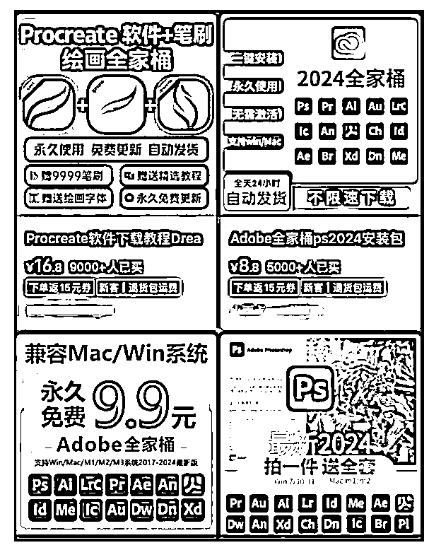

**第五种：把网站做成收入来源**

资源号握在手里的真正筹码，其实是搜索入口。你可以搭一个轻量网站，把历次收集的各类资源全部陈列上去。随着日子一天天过去，页面覆盖的搜索词越来越多，网站在检索系统中的分量也水涨船高，被陌生人刷到的几率自然一路走高。

这是一条需要慢慢耕耘的路，收入方向基本只有两条：一是做付费会员，交钱就能解锁全部下载权限；二是把网页上的推广位出租，按月收品牌方的展示费。

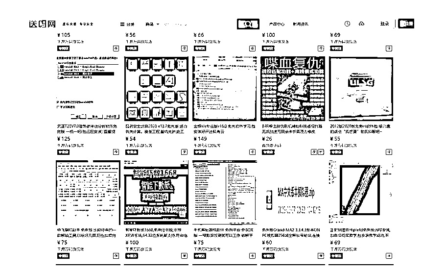

**第六种：几条零散但关键的补充**

资源号最有想象力的商业出口，依然是广告——只不过是一门很难惹人反感的广告生意。前提是你把三件事做扎实：无偿分享的量给够，信息的新鲜度和实用性拉满，素材的归档分得清清楚楚。

这种赚钱方式相当惬意，既能借热点短期收割一波，也能靠稳定更新吃长线红利，还能顺势蹭上流行风口的流量。想入局的人，先去观察几个同类型账号，多看看他们的内容、加一下联系方式，不出多久，他们的盈利路径就会清清楚楚摆在你眼前。

他们能做到的事，你也能。

# **三、资源号，人人都能上场**

这个方向的门槛低到几乎可以忽略，不需要像某些领域那样拥有深厚的专业储备，真正拼的是耐心和执行力。

这个行业永远存在信息落差，本质上赚的就是“别人找不到，你帮忙找齐”的钱。把自己当成一台高效的信息整合器，帮用户省下翻找资料的时间，等他们下次有需要，自然会第一时间想起你。

做个人品牌是一条被反复验证过的长久路径：持续释放自身的专业价值，让用户觉得“跟着这个人有收获”，你的分量就会跟着上涨。

无论做哪一种个人品牌，稳定供给、内容池不断流、选题库足够厚，这三点都是底线。资源号表面看收入单薄，那只是桌面上的账；真正会玩的人都在后台默默经营自己的用户池，一年落袋100万的例子并不稀奇。

## **实操流程：**

### **1、先建素材源头**

去淘宝、拼多多、微信生态、抖音、B站、小红书、知乎、头条号这些阵地，专找那些至少连续更新了两年的资源型账号。给你5000元以内的启动预算，就足够把他们公开过的资料包全部收入囊中，也可以付费打通联系通道。他们只要还在更新，你的素材弹药就不会断供。

### **2、把素材归档成体系**

做线上生意，最怕的不是资源少，而是没人愿意沉下心来分类。多数人恰恰栽在“懒”上。你一旦把收集来的资料按主题切好板块、做成框架，这套成品本身就值钱了：既能吸引人，也能直接卖。

凡是奔着长远目标去的事，都必须有归档逻辑。从各处搜罗而来的内容，要按门类持续充实：不够就补，过期就换，玩法变了就跟着迭代，让资源池始终保持“此刻能用”的状态。

### **3、顺着热度先跑起来**

素材的价值常常跟着流行程度走。眼下AI类应用正热，那就先集中发布这类内容。别人设付费墙，你偏要敞开供应。让账号借势先把数据做起来，之后再穿插其他类型的资源。

### **4、做多平台协同布局**

根据自身精力挑选内容形态：擅长写就做图文，适合出镜就做口播，不爱露脸就录屏演示。不同平台有不同脾气，可以匹配不同版本。因为你手里永远不缺下一个素材，内容的产出速度会快得超乎预期。

### **5、多设引流诱饵**

赠品的力度要舍得往上顶：多送、常送、一直送。前期不急着看收入，只看账号成长和用户沉淀。等订阅数跨过1万这个门槛，赚钱的机会自己会找上门来的。

### **6、让搜索标签嵌进每条内容**

发内容时，要把与“用途指向”相关的检索词埋进去。这样一来，你在任意平台发布，都有可能被搜索流量砸中，源源不断带来新用户。

另外，每条发出去的文案都要留底存档。将来做独立网站时，这些稿件直接复制进去，就能铺满整个页面。

### **7、把订阅号经营成私域中枢**

所有平台的流量，都应该想办法引向你的订阅号。订阅号里的内容同样坚持无偿开放。订阅号有一个天然优势——能被转发：足够认可你的用户，会自发把你推荐给身边人。

你的资源分文不取，你的目录一目了然，你的分类完整清晰，这些就是用户帮你传播的理由。在他们眼里，你的订阅号就像一个随取随用的百宝箱，只要想到找资源，他们的第一反应就是你。

### **8、盈利姿势可以更灵活**

具体怎么赚钱，不需要手把手教。你持续围观足够多的同类账号，收入来源自然会浮出水面。资源号几乎没有暗门，观察得够细就能复现路径。唯一要小心的是吃相：别学那种每一句话都朝用户伸手要钱的套路，否则辛苦聚起来的人气很快就会散。

如今获取一个新订阅者的成本越来越高，正因为如此，既然选了一个能深耕的方向，就要珍惜每一个用户的长线价值。资源号，资源号，它的立身之本恰恰是“先有用，后来财”。

所以，无论你进入哪个细分类目，都请记住这条节奏：前期全力养号、聚人，先把盘子做起来。用户到位之后，怎么转化，那就是你自己的选择了。

# **四、最后的小结**

把市面上那些资源号的玩法摊开看，无非是几种套路的排列组合：有人用图文卖资源包，有人开网店输送软件，有人出镜讲效率工具，有人靠自有流量池做推广——全是小招式，谈不上高深。但作为一个信奉长期价值的创作者，我始终推崇一件事：把免费的招牌擦到最亮。

多翻一翻我分享过的商业认知和赚钱逻辑，你就会明白：再小的生意，本质都是赚同一群人的钱。你也应该锁定一个群体，理解他们、服务他们。等你真的从这群人身上挣到了第一笔钱，往后做任何新方向，都会本能地继续围绕这一群人深挖。

大多数人眼中那些“碰运气”式的发财，其实就是这样一点点攒出来的。

* * *

上面盘点的六个方向，都不是一套照抄即用的标准SOP，我更愿意把它们看作一张创业方向参考图。进入赚钱社群后，你可以在已有分类里找到对应板块，结合这份分析，系统性地把自己代入进去。

**此前我专门写过一篇：**

# [如何用热爱挑选创业赛道；他年入100万，我只想学会赚50万]()

如果“热爱”一直无法帮你做决定，那多半不是方向的问题，而是你还不够了解自己：要么还没找到真正热爱的事，要么没看清自己的爱好能兑换出什么价值。

这正是我持续分享“长久能挣钱的路子、聚焦一类人群”这个主题的原因。

**收尾：**

这篇拆解超过两万字，能一字一句读完的，我敬你是真能沉住气的人。后续还有十几个赛道的分析正在整理，等我全部更新完，再统一放出来。

我的文字，适合还没有迈过100万收入门槛的朋友阅读。下面这份精选内容也值得点开试试——不是牛人成功案例，但胜在实操、能落地。

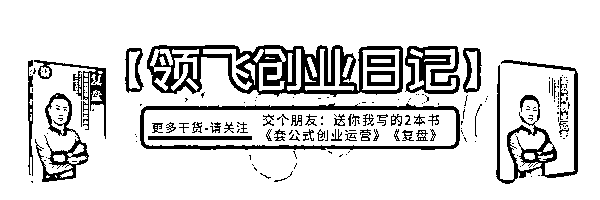

**领飞往期干货合集，进一步了解我**

[1、从0到800万：一个创业知识博主的原始积累]()

[2、中介思维做到极致：总做能带来复利的暴利项目，年入百万]()

[3、卖服务+卖产品：个人轻资产也能撑起百万级商业盘]()

[4、五年用闲钱买房赚50万：小城市房产投资的实战经验]()

[5、素人做IP起步：先拼数量，再保质量，108个营销方法论]()

[6、用热爱定方向：创业项目到底怎么挑]()

[7、中介思维赚钱术：卖人、卖项目、链接高手一起卖]()

* * *

互动区：

暂无留言

* * *