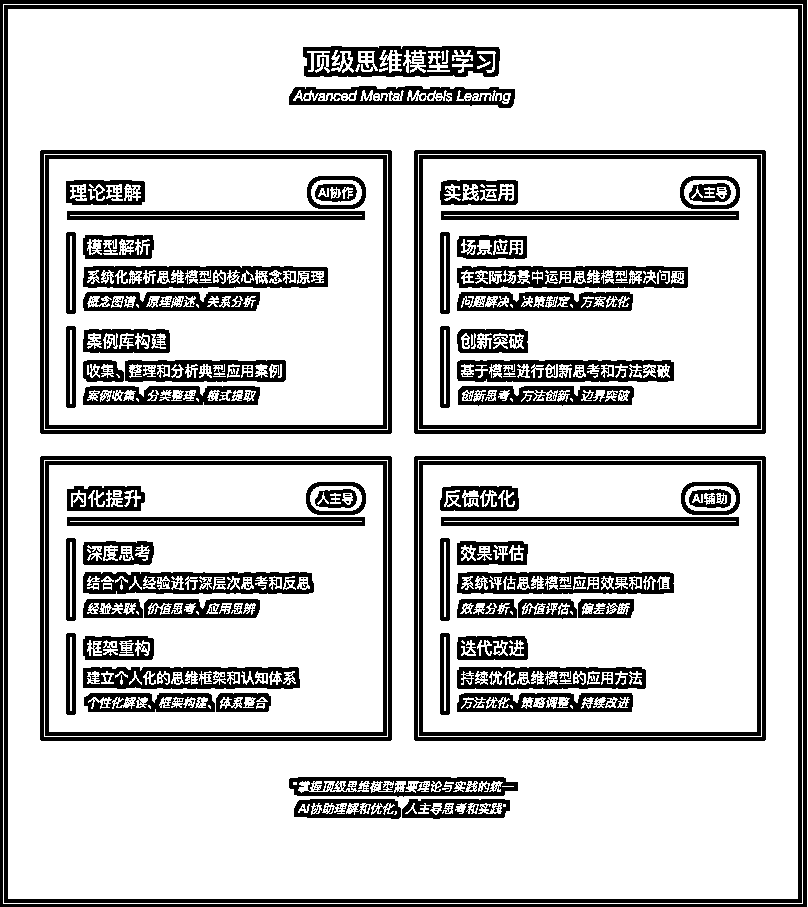
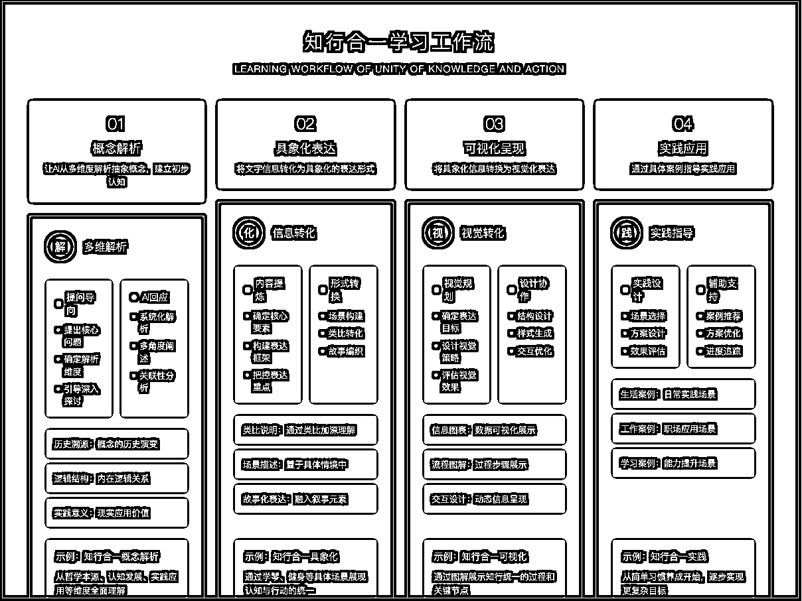
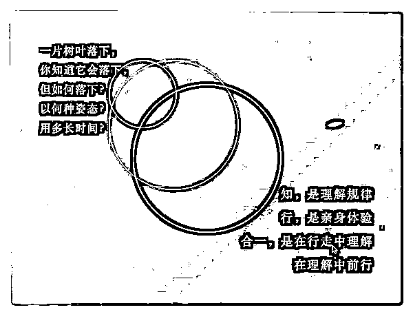
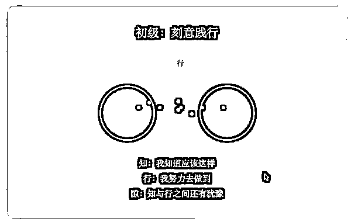
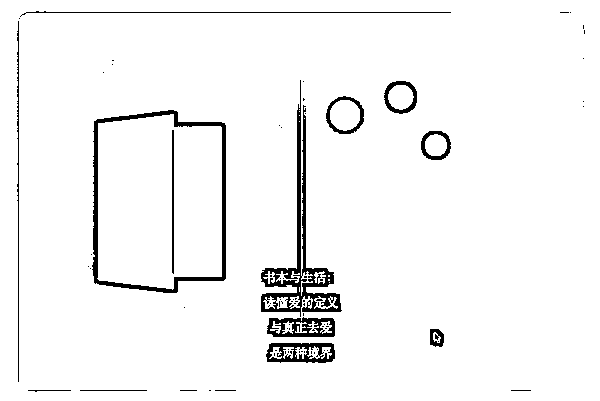
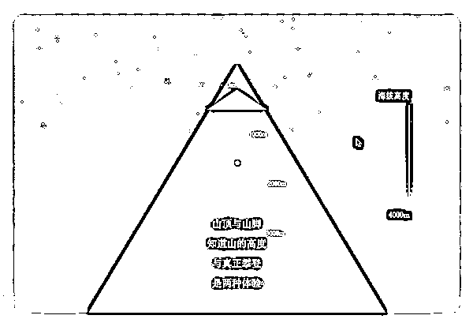
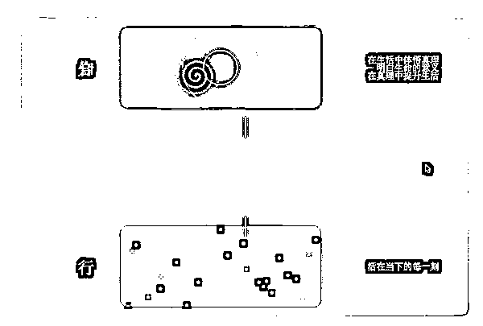
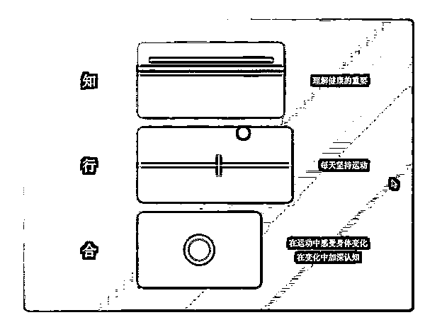
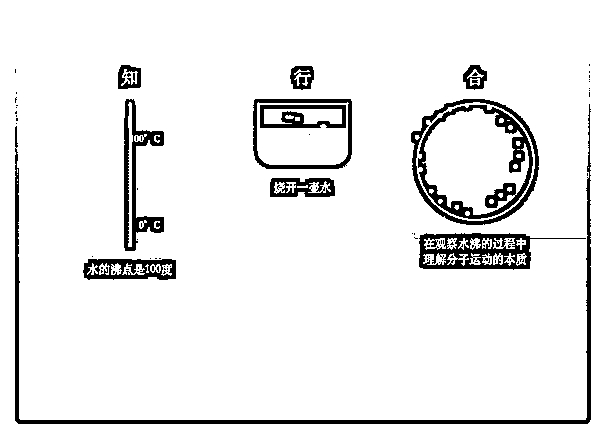
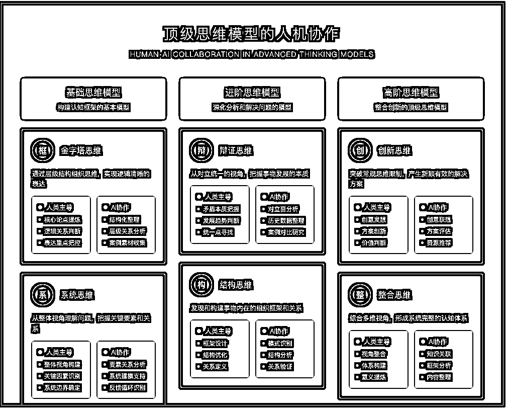

# 主角光环不再是小说专利：用 AI 把王阳明的知行合一拆成可用的工作流
作者：龙哥

嗨，我是龙哥

看剧时，总羡慕那种一键开挂的爽感。

主角翻个身就开悟绝学，

一转眼就绝地翻盘。

现实里哪有这好事？

真正高阶的思维模型明摆着，

偏偏读不懂、吃不透、用不上。

但在 AI 协作的今天，

这种光环可能人人可得。

今天就拿王阳明的知行合一来实操，

演示下人+AI 怎么把顶级思想拆解成自己的东西。

* * *

## 先拆工作流

### 先厘清：学习到底在发生什么？

我一直觉得，学习不是把桶装满，

而是点亮一盏灯。

信息从页面飞过，

在脑中变成灵感，

再在行动里变成智慧。

看见不等于懂得，

懂得不等于吸收，

吸收不等于会用。

好比学做菜：

翻阅菜谱是入门，

搞懂为什么这样配料是理解，

能自己改良口味才是内化。

### 再厘清：学大思想时，人和 AI 谁干嘛？



## 工作流设计：

1，拜托 AI 多角度拆解“知行合一”的内核，把抽象说成具体。

2，把文字信息转成可感知的具象，让从看见到理解的鸿沟变窄。

3，把具象再推进到可视，让理解到内化的阻力变小。

4，给出真实生活演练的锚点，提升内化到应用的成功率。



* * *

## 演示一：概念被解析

提问：用哲学视角讲清知行合一的本质、常见误区、认知阶梯、修炼路径

### 本质：知与行怎么连？

像一条河的左右岸

知在左，行在右，

水流是纽带。

没了流动，两岸只是死物。

像树根和果实

知像地下根系，

行像地上果子，

养分在循环，

缺一个都不成活。

像呼吸的进出

知是吸气，

行是呼气，

节律正常才活得过来，

断了就不生。

### 常见的断裂方式：

知而不行

*   囤积癖式收集

*   信息过载焦虑

*   启动困难

*   完美主义卡死

行而不知

*   盲目冲刺

*   无脑重复

*   只看表面

*   低效消耗

### 知行合一的进阶：

Level 1: 机械衔接

*   知→行

*   线性因果

*   初级联动

Level 2: 闭环反馈

*   知⇄行

*   互相校准

*   动态修正

Level 3: 合而为一

*   知行不二

*   水到渠成

*   不分彼此

### 修炼的四步：

Stage 1: 觉察裂缝

找到断点

*   哪些地方会知而不行

*   哪些地方会行而不知

*   分离的根源在哪

Stage 2: 搭桥

建立联系

*   小步迭代

*   学完即用

*   及时复盘

Stage 3: 打通循环

形成系统

*   知推动行

*   行反哺知

*   正向循环

Stage 4: 天人合一

境界跃迁

*   自然流露

*   不假思索

*   身心合一

* * *

## 演示二：具象化表达

知和行的张力

一片叶子会落，

你知道它会落，

可是怎么落？

什么姿态？

多久落地？

```
知，是理解规律
行，是亲身体验
合一，是在行走中理解
在理解中前行
```

1.  作为状态

```
知：水的沸点是100度
行：烧开一壶水
合：在观察水沸的过程中
理解分子运动的本质
```

1.  作为过程

```
知：理解健康的重要
行：每天坚持运动
合：在运动中感受身体变化
在变化中加深认知
```

1.  作为境界

```
知：明白生命的意义
行：活在当下的每一刻
合：在生活中体悟真理
在真理中提升生活
```

【知行之间的距离】

山巅和山脚

```
知道山的高度
与真正攀登
是两种体验
```

书本和生活

```
读懂爱的定义
与真正去爱
是两种境界
```

理论和实践

```
理解游泳原理
与投入水中
是两种维度
```

【合一的层次】

初级：刻意练习

```
知：我知道应该这样
行：我努力去做到
隙：知与行之间还有犹豫
```

中级：自然融合

```
知：我理解这个道理
行：我习惯性地这样做
融：知行开始自然统一
```

高级：浑然自成

```
知：已化为内在直觉
行：已成为自然流露
一：不觉知与行的区别
```

* * *

## 演示三：可视化呈现（示例）















* * *

## 演示四：落地实践

一个清晨的切片：

六点还没响闹钟，

你已经睁眼。

天色微亮，

《晨跑改变人生》

还躺在枕边。

你清楚晨跑的好处，

代谢、精力、情绪，

都写在心里。

但被窝很暖，

床很软。

内心在对话：

“再躺五分钟...”

“说好了要开始...”

“明天再说...”

“明天不就是今天吗...”

掀开被子，

冷气扑面，

一个激灵。

套上跑鞋，

拉上门，

第一口冷空气钻进肺里。

第一步很沉，

第二步依旧沉。

慢慢地，

呼吸对上了节奏，

腿也不那么抗拒了。

十分钟后，

血流加速，

身体发热，

脑子清亮。

走到小区湖边，

晨光把水面染成粉色，

你才第一次真正看见。

转角遇到每天都来的老爷爷，

他点点头：

“坚持住，小伙子！”

跑完回家洗个热水澡，

喝口温水，

整个人不一样了。

翻开日记写下：

“原来知和行之间，只隔着一次起床的勇气”

傍晚回家，

你没按电梯，

直接走楼梯。

不是为了运动，

只是身体想动。

睡前一看手机，

步数 9847。

补上 153 步，

写下感受：

“知道很容易，做到很难，

一旦做了，身体会记住。

书上说晨跑好，

跑起来才懂什么是好。”

调好明天闹钟，

你已经在期待第一缕光。

这一天，

你不是在分析知行合一，

你是在活出知行合一。

* * *

现在我明白了，

知行合一就是不问所以，

自然而然。

像饿了吃饭，

困了睡觉，

该做就做。

无问无答，

只有当下。

提升认知、践行行动，

就如呼吸在发生。

* * *

欢迎你也试着用这套拆解法去打开其他思维模型：



* * *