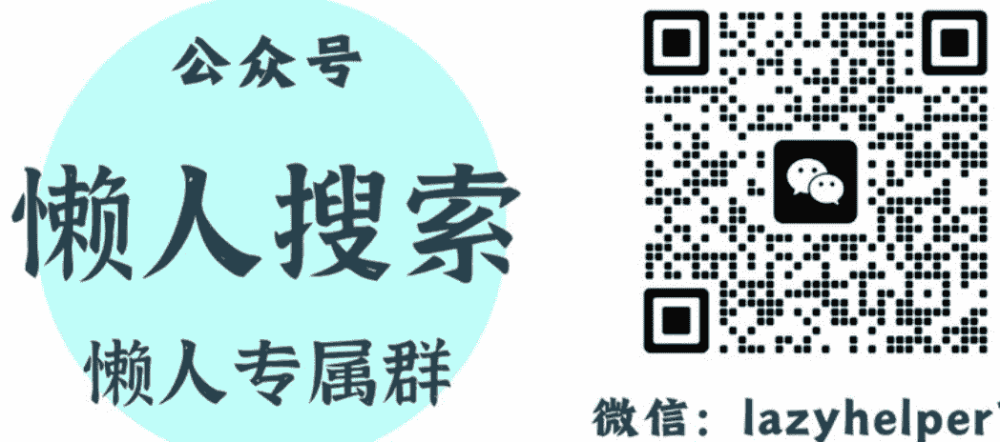
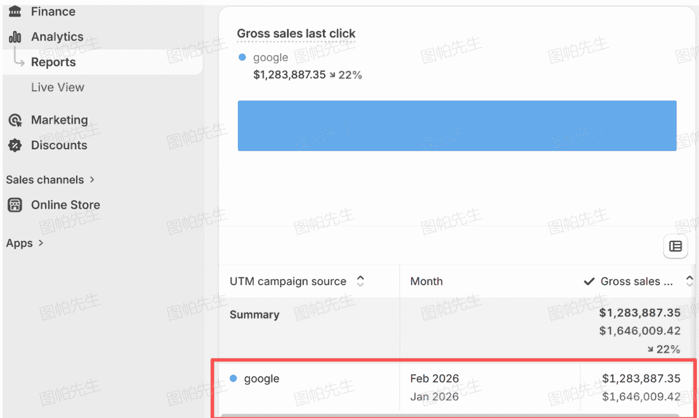
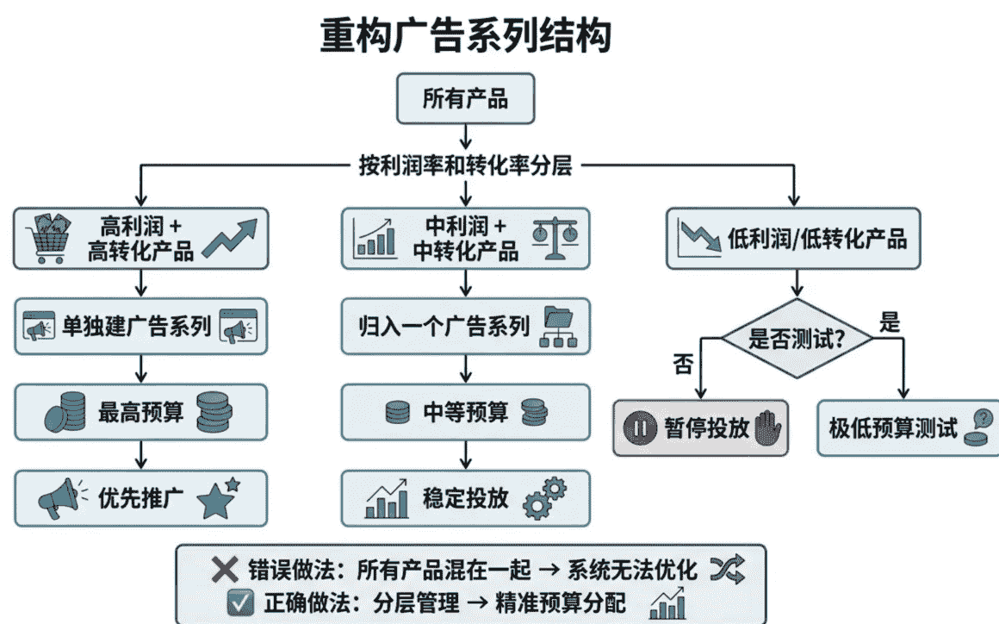
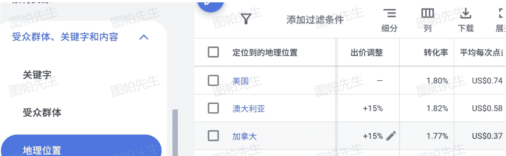
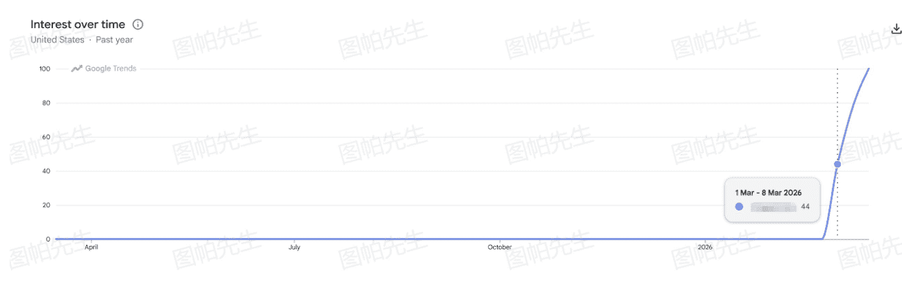
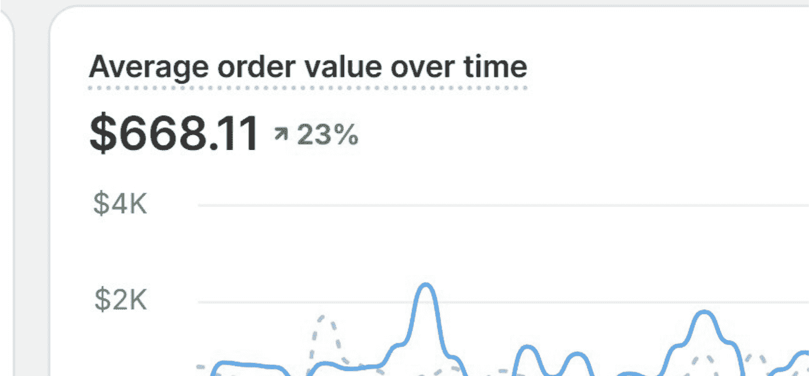
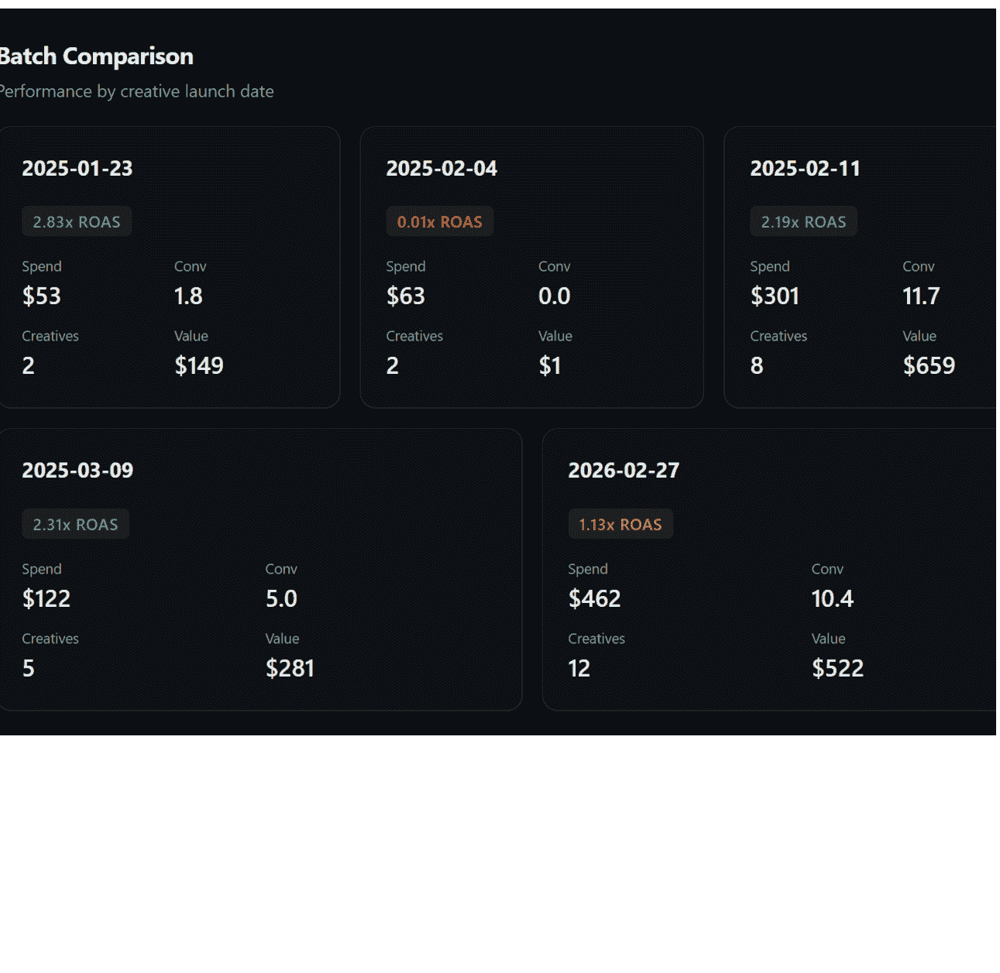
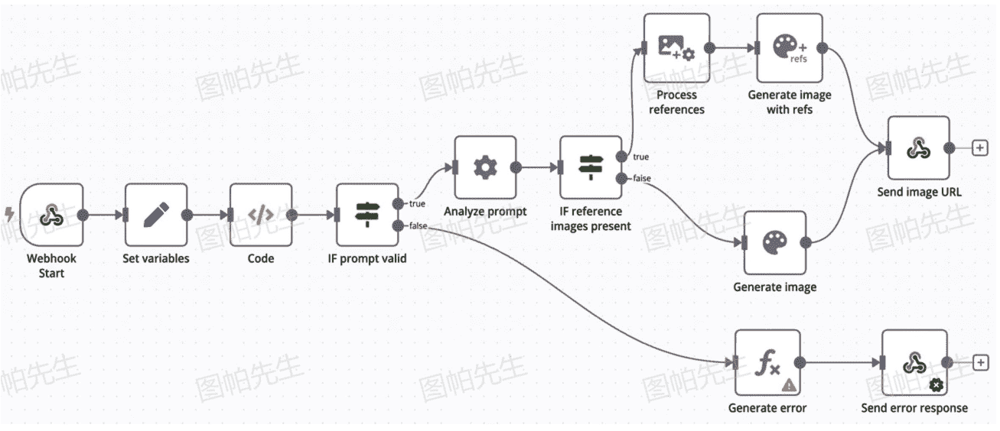
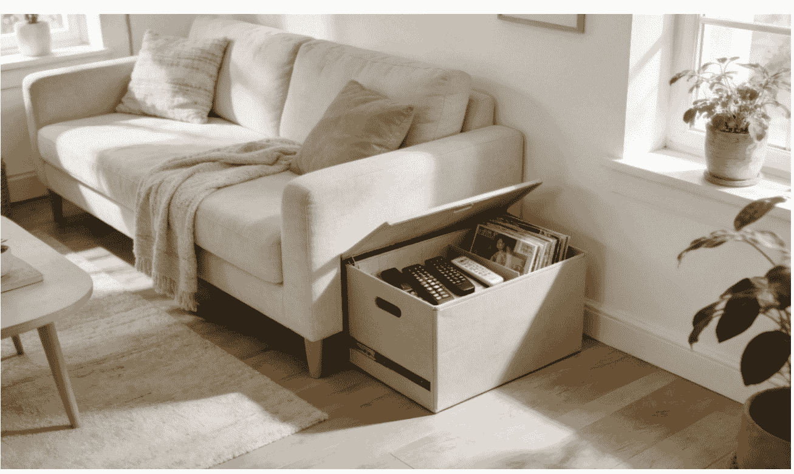

# 从 0 到月入百万美金：我用 AI 重构了一套谷歌广告系统，Shopify 独立站做到 128 万美金
作者：龙哥

260324 副业 SC 精华

各位好，我是龙哥，一直深耕跨境出海领域。今天想和你聊聊，我怎样借力 AI 把谷歌广告重新做了一遍，让一个 Shopify 独立站月销冲到 128 万美金。

先说成绩，不铺垫。

刚刚过去的这个月，店铺后台里能明确归因到谷歌广告的成交额，正好是 128 万美金。

这个数字没掺水——不是总 GMV，没算自然流量、EDM、联盟客那部分。纯粹是广告系统直接带来的、后台能核对的真金白银。至于整体盘子多大，先留个悬念。

> [今年 1 月其实卖得更好，但现在是 3 月，就截最近 30 天的数据吧]

## 不懂 utm 的朋友，花 30 秒看完这段

广告链接和邮件里那些一串串的尾部参数，就是 utm。它的职责是告诉后台：访客从哪来、点了什么、属于哪个渠道。这样每一笔订单都能找到源头。下面这张图，我筛的就是谷歌广告这一栏。

很多人看到这个数字，第一直觉不外乎两种。

一种是羡慕“这品类真香、产品真硬、运气真好”。

另一种是猜“预算得多大、团队得多强，硬砸也砸出来了”。

都不对。

这里边没有玄学，也不是某天 PMax 突然开窍，疯狂派单。

真相说出来特别朴素：我只是把一个大家都会“开广告”、却很少“算清账、分好层、放对量”的独立站增长系统，整个重装了一遍。

有没有运气成分？肯定有。平台规则、市场行情、时间节点，哪一层都有偶然因素。

但要是把长期战绩都归功于运气，那是对操盘手的侮辱。

我见过太多站点卡在几十万上不去，差别不在某条爆款广告，而在有没有一套经得起重复验证的系统。

这让我想起乔布斯那句话：

> You can't connect the dots looking forward; you can only connect them looking backwards.

当下看很多动作只是缝缝补补，回头才看清它们串成了一条上升线。

## 两种投手，两种结局

做投放和开餐馆很像。

头一种老板全凭手感。菜好卖就多备，人多就加桌。赚了说不出所以然，亏了也找不到病灶。

另一种老板用账本说话。每道菜的原料、人力、翻台率、毛利，笔笔有数。推哪道、撤哪道、什么时段上什么套餐，全靠数据拍板。

哪家能长久活下去，答案不用我讲。

谷歌广告同理。当你能把每个词的 CPC、每个广告组的转化率、每个 SKU 的 ROAS 摸得一清二楚，你就不再是赌徒，而是在经营一台看得懂、算得清、控得住的机器。

我给自己立过一条铁律：花出去的钱，必须带追踪、带归因、带下一步的优化动作。

我不是那种只会在后台点按钮、等着平台赏饭的投手。这些年做独立站增长，我盯的是更底层的六件事：

产品值不值得投、利润撑不撑得住、流量干不干净、页面接不接得住、复购能不能回血、预算能不能滚起来。

说白了，谷歌广告在我手里不是获客工具，而是增长引擎的一个核心部件。

这个认知差距，一端是月销 10 万，另一端是月销 128 万。

## 选品：在搜索热度和竞争缝隙里找机会

谷歌广告和 Facebook 广告是两种物种。Facebook 是创造需求——用户本来没想买，你用内容唤醒他。谷歌是拦截需求——用户已经在搜了，你只要出现在他眼前。

所以选品的第一标准不是颜值，不是创意，而是：有没有人在 Google 上搜这个东西。

我的选品，就三步。

第一步，Google Keyword Planner 挖需求。

把大类目词丢进去，重点看两个数：月搜索量和竞争压力。我一般卡在 5 万到 15 万之间——太低了市场撑不起来，太高了巨头霸场。

拿 dog collar 举例，月搜索 90,500，正好落在我的射程内。

第二步，Google Shopping 验商业价值。

用同样的词去 Shopping 搜一遍，看广告位上有几家在投。只有 3-5 家，说明竞争适中、有利可图；满屏大牌旗舰店，直接劝退。

再盯价格带：50-150 美金最健康。低于 30 美金，客单价撑不起获客开销；高于 300 美金，决策周期拉太长，转化率会很难看。

第三步，1688 和速卖通摸供应链。

货源标准就一条：采购成本别超过售价的 20%-25%。这样扣掉广告（通常占 25%-35%）、物流和平台抽成，还能剩下 15%-25% 的净利。

## 谷歌广告进阶实录：从 0 到 128 万，我拆成四个阶段

下面这部分是干货，我按增长节奏把过程切成四个阶段，每个阶段的目标、打法和踩过的坑都不一样。

### 阶段一：冷启动验证（月销 0-5 万）

目标只有一个：验证产品到底能不能打，找出真正出单的词。

别想着赚钱，先想着活下来。

当时的策略非常收敛：只开两种广告——Google Shopping 和品牌搜索。Shopping 是独立站的基本盘，用户搜产品词，你的图、价、标题直接怼到眼前，所见即所得，转化效率最高。

日预算从 30 美金起步。这个阶段的核心任务不是冲量，是攒数据。

前两个星期，我每天在后台泡 2-3 个小时，反复看三类东西：哪些搜索词触发了广告、哪些词点了不买、哪些品点击率最高。

一个关键动作：把搜索词报告当金矿挖。

每周导出一次，做三件事。一，能出单的精准词挑出来，单独建组重点喂养。二，烧钱不转化的词，拉黑进否定列表。三，搜索量大但跟产品八竿子打不着的词，也送进否定列表。

这阶段我忍住没加预算，先去算利润账。

我把报价、毛利、履约、物流、支付通道费、退款率、折扣摊销、首单客单价、加购率全部拉出来，排成一张表。

然后跑两个核心指标：

Break-even CPA——一单最多能花多少获客成本，再往上就亏。

Break-even ROAS——广告要跑到的底线，低于它就不值得放量。

很多人做谷歌只知道喊“我要 ROAS 多少”，却说不清这个数是拍脑袋还是算出来的。

差别很大。

举个例。一个产品卖 95 美金，看着不错，毛利也不薄。但把运费、手续费、仓储、售后、退款、折扣逐项扣完，留给广告的空间可能就剩 20 多美金。

这时候看账户就不能只问“有没有单”，要往下追：

拿单成本压不压得住？

压不住，客单价能不能拉高？

客单价也拉不动，后端复购能不能补？

三条路都不通，这个量一分钱都不该扩。

### 阶段二：优化打磨（月销 10-50 万）

目标：把 ROAS 做漂亮，搭出能持续盈利的账户骨架。

冷启动跑完一个月，手里有数据了。接下来就是结构上的精雕细琢。

打法一：重排广告系列结构。

新手最常见的手法是所有产品塞进一个 Shopping 系列，让系统自己挑。这等于把薯片、洗衣液、计生用品堆在同一排货架，算法根本不知道该推谁。

我的分法是按利润率和转化率切三层：高利润高转化的单独开系列，给足预算；中部的归一组；低利润低转化的要么停投，要么留极小预算慢慢试。

打法二：把 Feed 磨细。

Shopping 广告的成败，九成看 Product Feed。标题、描述、图、价、类目，每一栏都直接影响匹配。

我的标题公式：核心关键词放最前面。别写“xxx Pro 2000”这种型号开头，要写“Pet Training Collar with Remote – Pro 2000 – WiFi Dog Collar”。很多品牌站只写品牌名+型号，用户搜都搜不到你。

图片用白底，主体占画面 80% 以上，别堆文字。Shopping 的展示位就那么小，越干净越好。

打法三：出价策略换挡。

冷启动期我坚持手动 CPC，为了控制每一个词的预算。等到 30 天内转化攒到 50 个以上，再切 Target ROAS。

这里有个血泪教训：转化数据不够时千万别用智能出价。算法没东西可学，只会疯跑，ROAS 上蹿下跳。

我的切换门槛：近 30 天 50+ 转化，且 ROAS 稳定在 2 以上。切的时候目标值设成当前 ROAS 的 80%——比如现在 ROAS 是 4，就设 320%。留两成余量给系统探路。

打法四：别放过长尾词。

长尾词搜索量不大，看着不起眼，但越做越发现，里面全是高意向订单。

尤其那些带场景、问题、对比、规格、用途的词：“best / for / vs / review”这类决策意图明显的词。

这些用户已经走到下单前最后一步了。你把广告文案、详情页和信任状铺好，转化质量往往比大词还猛。

### 阶段三：规模扩张（月销 40-80 万）

目标：ROAS 不大幅缩水的前提下，把预算翻上去。

这阶段最磨人。钱花得更多，ROAS 却可能往下掉。很多人在这一步怂了，不敢加预算，销量就卡在天花板。

马斯克那句话我特别喜欢：“When something is important enough, you do it even if the odds are not in your favor.” 扩量就是这样，明知短期数据会难看，但方向是对的，就必须干。

我的扩量三招：

第一招，预算小步快跑。

别一夜从 500 跳到 5000。算法的适应需要时间。我的节奏是每 3-4 天加一次，每次涨幅不超过 20%。500 起步，三天后 600，再三天 720，稳着滚上去。

第二招，开新的广告版图。

Shopping 跑到一定体量就触顶了。这时候我补了两类：搜索广告和 Performance Max。

搜索主打竞品词和长尾需求词。比如有人搜“Furbo alternative pet camera cheaper than Furbo”，说明他已经了解竞品、在找替代，这种用户购买欲极强。

PMax 是 Google 的全渠道智能投放，会自动把广告铺到搜索、Shopping、YouTube、Gmail 等所有位置。

第三招，开新市场。

早期我只投美国。美国跑稳后，开始测加拿大、英国、澳洲。英语市场用户行为和美国人高度相似，策略几乎能平移，竞争却低得多。

加拿大和澳洲给了我一个惊喜：CPC 只有美国的 60%，转化率却差不多。我立刻把这两个地区的出价调高 15%，同样预算下 ROAS 比美国高出 40%。后来德国、法国也陆续试了，反馈都不错。

### 阶段五：品牌护城河（月销 100 万+）

目标：从买流量升级到建品牌，把竞争门槛垒高。

过了 100 万这条线，我们撞到一个现实：单靠谷歌买量，增长有硬顶。关键词就那么多，对手还在不断加价，CPC 只会越来越贵。

这时候必须做品牌。

我干了几件事：

第一，加大品牌搜索词的投放。用户直接搜你品牌名的时候，CPC 极低，转化极高。我在 YouTube 和社交媒体上做品牌曝光，就是想让更多人记住我的名字。

一个月后，3 月初，品牌搜索趋势开始抬头了。

第二，上 YouTube 广告。YouTube 是谷歌生态里的视频阵地，最适合产品展示和品牌叙事。我录了一批产品使用场景的视频，投 In-stream 广告。直接转化不算高，但品牌搜索量和网站直接访问量都上来了。

第三，做私域和邮件。谷歌广告拉来的每个客户，都得想办法留住。我用 Klaviyo 搭了完整的自动化邮件流：新客欢迎、弃购挽回、老客复购、交叉销售。这套东西每个月贡献 15%-20% 的营收，成本几乎为零。

另外，品牌词搜索广告我也一直在加码。

别小看品牌词，觉得是“反正都会来的人”。

这个想法，实战里会吃大亏。

品牌词的价值不是捡现成，而是三重角色：它是账户最稳的底盘；它能挡住竞品截流；它持续给账户喂高质量转化信号。

品牌词未必是扩量的发动机，但一定是账户的压舱石。

时间是品牌的盟友。品牌立住了，获客成本越来越低，对手想复制你越来越难。这才是真正的护城河。

## 网站优化：流量买进来，页面接住才算数

有一阵子我也迷信广告技术，总把问题归到关键词、出价、结构、预算上。

后来想明白了：这些都只是表层。

用户被广告带进来，真正决定他买不买的，不是谷歌，是你的 Shopify 页面。

页面接不住，前面的广告做得再漂亮，也只是把用户更快送到对手那里。

所以我们狠狠做了一轮页面改造，五件事。

一，首屏别再自嗨，直接回答“凭什么买你”。

很多独立站首屏拍得高级，但用户进来 3 秒还是懵的：你卖什么？给谁用？为什么是你？为什么现在买？说不清楚，就留不住。

我要求所有落地页首屏，必须把这四个问题回答完。

二，少报参数，多给结果。

参数是必要信息，但不是下单理由。用户真正关心的是：你能解决我什么问题？你为什么比别家省心？买完之后，我生活会变成什么样？

我经常跟团队强调一句话：别把页面写成产品说明书，要写成成交说明书。

三，信任状往前放。

独立站没有平台背书，用户脑子里全是问号：靠谱吗？发货快吗？质量稳吗？售后行吗？会不会踩坑？

我们把这些答案全部提前：评价、UGC、发货时效、退换政策、支付方式、FAQ、媒体露出。这一步做完，转化率变化非常明显。

四，移动端速度往死里优化。

这是老生常谈，但多数人没下狠手。买来的流量大量来自手机。页面卡、首屏重、信息层级乱，都在偷偷吃转化。

我们做了大量减法：压图、删冗余插件、去掉花哨动画、最重要的信息提到最上面。

五，客单价同步往上抬。

只看转化率是不完整的。从几十万做到上百万，不可能只靠“多来几单”。每一单还得更值钱。

我们上了套装、捆绑、加价购、满减、购物车推荐。最后 CVR 在涨，AOV 也在涨。

## 踩过的坑，我帮你排一下

### 坑一：死磕低 CPC

很多人把 CPC 当生命线，觉得点一下越便宜越好。真不是。

在 Google Ads 里，便宜的点击并不等于优质流量。

有些用户搜索的词和你的产品只是“沾边”，看到广告后顺手点进来，点击价格可能很低，但购买意愿几乎没有。最终结果是：CPC 看起来漂亮，ROAS 却越来越难看。

所以，别把 CPC 当成最终答案。真正应该重点关注的是 ROAS 和 CPA。只要广告带来的收益能够覆盖成本并持续盈利，点击贵一些并不可怕。很多时候，较高的 CPC 反而说明用户需求更明确、离购买更近。

### 不要频繁折腾广告账户

Google Ads 的智能出价并不是即时见效的工具，它需要时间积累数据、判断流量并完成模型训练。

如果你频繁进行大幅调整，例如预算变化超过 20%、更换出价策略，或者一次性增加、删除大量关键词，系统很可能重新进入学习阶段。通常需要等待 7 到 14 天，数据才有机会重新稳定下来。

我的做法很简单：除非账户出现明显异常，否则不会每天动设置，通常至少观察 7 天后再决定是否优化。

### 竞争环境变化，也会影响你的结果

Google Ads 本质上是一场实时竞价。广告表现并不只由你的账户决定，竞争对手的动作同样会改变结果。

如果你发现某天 CPC 突然升高，广告排名明显下滑，可能不是你的页面或素材出了问题，而是市场里出现了新玩家，或者原有竞争者突然增加了预算。

我一般每月借助 SEMrush、SpyFu 等工具查看竞争对手的投放情况，包括：

- 他们重点购买哪些关键词；

- 广告标题和描述如何组织；

- 大致处于什么出价区间；

- 市场中是否出现了新的竞争品牌。

投放广告不能只盯着自己的数据。了解对手在做什么，才能判断市场变化究竟来自哪里。

## AI 如何进入我的独立站与广告流程

现在谈独立站增长，很难绕开 AI。

不少来自博客、公众号的朋友都会问：做 Shopify 独立站和 Google Ads 时，AI 到底应该怎么用？这里我把自己的实际流程完整拆开。

不过，先要明确一个前提。

面对 AI，很多人容易走向两个极端：

有人觉得只要接入 ChatGPT，广告就能自动赚钱；

也有人认为 AI 只能帮忙改标题，真正投放时没有太大价值。

我的理解是：AI 不是魔法，也不是玩具。

它更像一名响应迅速、执行稳定、不会因为任务琐碎而抱怨的助手。前提是，你必须先把目标、边界和判断标准说清楚。

这和投放广告是同一个道理：不是把账户交给系统就能获胜，而是先定义正确的问题，再让工具帮助你提高执行效率。

### 一、选品与关键词研究

在选品初期，我会让 ChatGPT 围绕核心词扩展长尾关键词。过去整理几十个词可能需要很久，现在可以迅速扩展到数百个，关键词池从 50 个增加到 500 个以上。

| 相关关键词 | 预估月搜索量 | 竞争难度 | 搜索意图 |

| dog collar | 100,000+ | 极高（85+） | 商业/交易 |

| personalized dog collars | 50,000–80,000 | 高（75） | 交易 |

| flea and tick collar for dogs | 40,000–60,000 | 高（80） | 商业调查/交易 |

| leather dog collar | 20,000–40,000 | 中高（65） | 交易 |

| led dog collar / light up | 15,000–30,000 | 中等（45） | 商业调查/交易 |

### 二、投放前先拆解搜索意图

我不会只把搜索词当作一串字符，而是会进一步判断：用户搜索这个词时，究竟处于什么决策阶段。

同一个品类词背后，可能对应完全不同的需求：

- 有人只想找最低价格；

- 有人正在比较材质；

- 有人担心尺寸和适配；

- 有人已经进入“best”“review”“for xxx”这类决策阶段。

表面上它们都属于同一品类流量，实际上距离下单的远近差别很大。因此，我会让 ChatGPT 先做一轮语义分层，帮助我标记：

- 强购买意图词；

- 信息研究类词；

- 对比评估类词；

- 适合独立制作广告的词；

- 更适合放到 FAQ、分类页或博客中的词。

#### 优先争取的商业关键词

这类词的需求表达更明确，通常更接近转化：

- personalized dog collar

- custom dog collar

- embroidered dog collar

- engraved buckle dog collar

- name plate dog collar

- waterproof dog collar

- biothane dog collar

- reflective dog collar

- leather dog collar

这样一来，广告数据就不再只是用来消耗预算。它还能反向帮助站点运营和内容团队理解用户真正想要什么。

### 三、AI 可以协助产出广告文案，但不能代替判断

ChatGPT 能够生成 RSA 标题、描述、促销语、附加信息和站点链接文案，但我不会直接复制它的输出。

因为没有明确限制时，AI 很容易写出语法正确、逻辑完整，却缺少购买推动力的内容。

我的流程是先提供完整背景：

- 产品优势；

- 用户痛点；

- 竞品差异；

- 品牌语气；

- 禁用词和合规要求；

- 目标国家与人群。

然后让它按照不同方向批量生成版本，例如：

- 直接促进转化；

- 强化信任与背书；

- 放大用户痛点；

- 节日或促销场景；

- 更适合高客单价用户的表达。

最后由我重新筛选、改写和组合。

所以，AI 的作用不是替我完成最后一版文案，而是帮我快速完成第一轮扩展，让我不必从空白页面开始。真正重要的判断依然包括：哪种说法更贴近用户、是否适合当地市场、是否可能带来更高质量的点击。

#### Prompt 示例

> 你是一位 Google Ads 资深英文文案专家。请根据以下产品信息，生成 20 个英文广告标题和 8 个英文广告描述。

> 产品信息：[产品名称、核心卖点、目标用户、价格区间]

> 要求：

> 1. 每个标题不超过 30 个字符（含空格）；

> 2. 标题包含行动号召，并突出差异化卖点；

> 3. 每条描述不超过 90 个字符；

> 4. 内容需要增强购买欲望，并加入促销信息或信任元素；

> 5. 为每条标题和描述标注主要卖点角度。

### 四、让 AI 帮你整理复杂数据

投放过程中，最耗费精力的往往不是点击几个设置，而是每天面对大量零散信息：

- 搜索词报告；

- 广告系列数据；

- SKU 销售数据；

- 页面热图；

- 加购与结账行为；

- 客服对话；

- 用户评价；

- 退款原因；

- GA4 页面路径；

- 不同国家、设备和时段的转化差异。

这些内容单独看并不复杂，但数量一多，就很容易陷入信息过载。很多时候，投手其实已经感觉到账户存在问题，却很难迅速把问题归纳出来并转成行动方案。

这时，我会把结构化数据和现象描述交给 ChatGPT，让它先做初步整理。

例如：

> 以下是过去 14 天的搜索词报告，请按照以下维度分类：

> 1）高意图且已经带来转化的词；

> 2）点击较多但浪费明显的词；

> 3）适合新建广告组的长尾词；

> 4）应加入否定关键词的低质量词；

> 5）可以反向指导落地页优化的用户表达。

它不一定每次都能给出完全正确的判断，但通常可以把杂乱的信息先整理出结构，再由我进行复核。

AI 的价值，很多时候不是替你做最终决策，而是把“混乱的一堆数据”变成“可以逐项处理的问题”。

## 五、把卖家表达转换成用户语言

这对 Shopify 独立站尤其重要。

很多页面并不是信息不足，而是始终站在卖家的角度说话：

- 罗列大量参数；

- 堆砌材质说明；

- 展示各种功能；

- 使用很多商家自认为专业的词汇。

但用户真正想知道的是：

它能为我解决什么问题？

使用后会有什么变化？

为什么我应该相信这个品牌？

为什么现在值得购买？

我会把产品参数、用户评价、客服问答以及竞品页面一起交给 ChatGPT，然后让它协助完成几项工作：

1. 将“工厂或供应商语言”改写成消费者容易理解的表达；

2. 按用户关心程度重新排列卖点；

3. 从真实问题中整理出 FAQ；

4. 输出首屏卖点、对比模块、评价引导和结账前信任说明等页面初稿。

页面转化率低，并不一定代表产品没有竞争力。有时只是你没有把产品价值讲清楚。

最常见的错误，就是把供应商提供的参数直接翻译后放到页面上。就像销售一见客户便开始介绍材质、重量和尺寸，客户听完只会觉得信息很多，却不知道这件产品究竟和自己有什么关系。

我通常会使用 PAS 框架，也就是 Problem、Agitate、Solution，让 AI 按照“问题—放大问题—给出解决方案”的逻辑完成产品描述。

#### Prompt 示例

> 你是一位 Shopify 独立站英文文案专家。请使用 PAS 框架，为以下产品撰写英文产品描述：[产品名称与基本信息]。

> 要求：

> 1. Problem 部分准确击中目标用户的核心痛点；

> 2. Agitate 部分适度放大问题及其影响，制造行动动力；

> 3. Solution 部分清楚说明产品如何解决问题；

> 4. 语气像朋友推荐实用好物，不要写成生硬广告；

> 5. 总长度控制在 300 个英文单词以内。

借助这套方法，我在两天内完成了店铺 50 多个 SKU 的产品描述重写。调整后，产品页面转化率从 1.2% 提升到了 3.8%。

## 六、用自动化工具批量制作产品素材

产品图片会直接影响用户对品牌的第一印象。请专业摄影师拍摄一套完整素材，成本往往不低，因此我会用自动化工具辅助制作。

这是我使用 n8n 搭建的自动工作流：

这样既减少了设计和拍摄成本，也缩短了素材生产周期。

生活方式图片方面，我会使用 Midjourney。例如销售家居收纳盒时，可以生成这样的场景：北欧风格的温馨客厅，沙发旁摆放着收纳盒，里面整齐收纳遥控器和杂志。

经过持续调试提示词、风格和模型后，生成效果已经相当接近真实拍摄：

目前我的素材组合大致是：

- 图片：Midjourney + Canva；

- 视频：Runway ML + CapCut；

- 文案：ChatGPT。

那么，AI 有没有直接替我把 Google Ads 做到月销 128 万美元？

## 我的答案是：没有。

它并没有替我直接赚到这 128 万美元。

但它明显提高了我在分析、整理、提炼、协作和迭代上的速度。

而对于独立站增长来说，速度本身就是竞争优势。

你越早发现问题，越快完成文案初稿，越快理解用户表达，也就越有机会让同样的流量产生更高的产出。

归根结底，ChatGPT 不是替你上阵的人。它更像一名不会疲惫的参谋、助理和初级分析师。

最终做决定的人仍然是你，但有了它，你可以少把时间浪费在重复劳动上，把精力集中到真正有价值的判断中。

## 给 Shopify 独立站投 Google Ads 的几条提醒

**第一，广告不是万能药。**

如果产品竞争力不足、利润空间太薄、页面体验糟糕，广告只会让你更快暴露问题。

**第二，不要只看 ROAS。**

ROAS 很关键，但还需要同步观察新客比例、退款率、客单价、毛利和复购率。

**第三，最昂贵的不是一次点击，而是错误流量。**

错误用户不仅会消耗点击成本，还可能污染账户信号、浪费预算，并拖慢算法学习。

**第四，真正可持续的增长，不是偶尔跑出一次好数据。**

关键在于把偶然成功拆解成一套可以重复执行、持续优化的系统。

这件事看起来更慢，却往往是最快的路线。因为当别人还在等待某条广告突然爆发时，你已经开始搭建一台能够持续产生订单的增长机器。

## 最后

很多人问，月销 128 万美元到底难不难。

答案是：难。

但它难的地方，并不是不会点击某个按钮，也不是不会创建某种广告格式，更不是因为 Google Ads 神秘莫测。

真正困难的是：

你能不能在账目还没算清楚前克制住盲目加码；

你能不能接受并非所有流量都值得购买；

你能不能从“会投广告”，进一步升级到“会搭建增长系统”。

Peace out!

看完 SOP，很多人会觉得自己已经理解了全部流程，可一到实际操作，往往第一步就停住了。

工具和教程只是基础门槛，真正拉开差距的是马上执行，以及圈层中的信息差。

这里不讨论空泛理论，只拆解商业闭环，并持续挖掘 AI 在实际业务中的效率空间。系统内部已经沉淀了 1000+ 个验证过的套利实战案例。

### 👉 查看圈子完整数字资产与加入门槛：

认可这套价值、准备亲自执行的朋友，可以扫码添加我的微信（）。

