# 从900万到100万：YouTube Shorts复盘与一条猎奇副线
作者：龙哥

# 开篇

先说一组我自己都觉得离谱的数据：第一个月冲了900万播放，后面却花了一个多月才凑够剩下的100万。没错，我就是Gray教练和波妮教练口中那个“900万 vs 100万”的圈友，嘿嘿。这段经历走得歪歪扭扭，我放到后半段慢慢讲，既是给自己留下一份总结，也希望能给圈里的伙伴们当个参照。

大家好，我是龙哥，平时喜欢泡在YouTube这一行专心做内容。去年10月加入赚钱，不巧错过了那一期航海，后来龙哥哥的YouTube Shorts超级标一出来，跟我正在琢磨的方向完全对上，于是12月紧赶慢赶补上了第一次航海。

眼下私教陪跑刚好收尾，把这一整程的成长期做个梳理，算是篇杂谈吧。重点打算聊三件事：

1. 从零起步、跌跌撞撞拿到YPP的过程，有哪些坑可以帮后来人少踩；

2. 一些圈里还没怎么被讲透的制作小技巧，能帮你把效率往上拉；

3. 一个还很少有人系统提过的猎奇玩法，看着很抽象，但流量真能打。

# 为什么锁定了YouTube Shorts

## 种了挺久的梦

2019年夏天，头脑一热注册了一家小公司，经营范围里明明白白写着“自媒体”。这件事我一直想干，只是缺个像样的由头。超级标一出来，等于是把那个开关拨开了。

## 兴趣撞上大趋势

AI这条路线，谁都知道是大方向，我自己平时又一直在摸各种工具。兴趣和趋势叠在一处，选择出海做AI内容几乎是顺水推舟的事。

## 倍率太勾人

这三遍我是一定要说的，因为它真的关键，但也得自己跑一遍才知道真假。说穿了，底层逻辑跟我早些年玩Web3撸毛有点类似：只要在一个号上投入了点gas和时间，假如回报能放到10倍甚至100倍，谁看了不说一句香。这里绝对没有让你冲去搞Web3的意思，今年那玩意接盘风险极大。退一步讲，光摆在台上的7.3倍汇率差，就已经足够叫人心痒了。

# 正文

时间经不起算，YPP一个个都达标了，反而觉得时间越来越不够使。拿朋友的一句话来说：“学不完，根本学不完！”是不是听着很耳熟？

好，话不多说，这次的内容我分成三块来聊。

珠玉在前，不少圈友已经把全流程讲得很透，我就不重复造轮子了，只挑一些操作层面的细节和思考展开说，希望能带出点新东西。

第一个号现状：

# 第一部分：第一个账号从0到1，我到底经历了什么

## 1.翻帖自学，边看边做

既然决定学，就心无旁骛地学。凡是写着“可做可不做”的，我基本都亲手试了一遍，顺便把工具链摸熟，也算没白费力气。

龙哥哥发完超级标之后的那一两周，我几乎把赚钱上所有讲YouTube的帖都过了一遍，真心感谢各位前辈倾囊相授。本着赚钱一贯“下场把手弄脏”的风格，我扫了一圈AI内容赛道，发现方向多到挑花眼，但结合自己的工作经历和兴趣点，还是先选了猫咪故事来做。第一条视频就这么开工了，前前后后花了8小时。

猫咪故事这块，我拿来当靶子的全是千万播放级别的爆款，想着就算做不出同等量级，蹭个百万也是好的。整体框架紧贴爆款，但在猫咪品种、皮毛颜色、光线、体型这类细节上刻意做了区分。

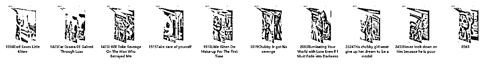

整个制作路径跟马老师分享的基本一致：

https://scys.com/articleDetail/xq_topic/4848521448112458

顺这条路子，我接着做了几条猫咪故事，流量渐渐有了起色，正反馈来得也挺舒服。猫咪故事算是我做起来最畅快的赛道，只是时间隔得有些久，等哪天再捡回来，我打算认真整理一份更细的心得。

但手上也没闲着。看到宝宝走秀、猫咪跳舞当时热度很高，我又批量做了几条跟风发布，连美式俚语故事也忍不住试了试，那会儿基本把AI能走的道全趟了一遍。

PS：达人秀这种形式，发了两条就突然起量，流量来得快，制作又比猫咪故事省时间，于是我把猫咪故事先搁到一边，专心跑达人秀。

OS：那几条没来得及合成发布的故事，想想还挺心疼，等以后有机会再让它们见见光。

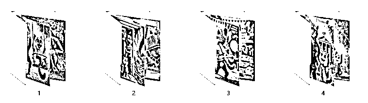

多轮测试下来，猫咪跳舞和宝宝走秀的流量续航都不如猫咪故事，而且制作成本半点没降下来。

那就闷头继续做呗。这时候达人秀正式变成主赛道，我跟着圈友的教程一步步照着做。早前看到的大多以写实舞台表演为主，我在此基础上自己叠加了一层更华丽的超写实风格。

效果没让人失望。大约更新到第二条达人秀时，整个账号差不多跑了10天，突然来了一条爆款。这条300万播放的视频像开了个好头，后面接二连三冒出50万+、100万+的内容，账号整体的流量曲线也跟着一路向上。

唠叨一句：教练们说过，视频一旦爆了，自己马上就要去复刻一个再发一遍。我要是早明白这个理，这个号可能20天就冲到目标了。可惜世上没有后悔药。

跑到第20天左右，账号播放量已经叠加到900万。航海正式开始后，我猛地发现印度观众的占比竟然超过了20%。

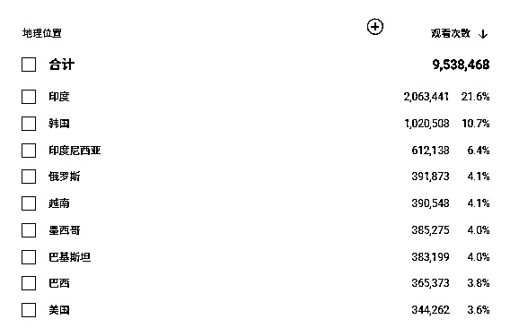

### 2.掉进坑里，再把自己拽出来

航海那阵子边学边悟，终于意识到印度地区的单价有多低。我立马做了个决定：把内容方向硬拧到美式文化上。结果这就是那个大坑。当时我对“泛流量”的理解还没到位，方向一换，流量当场就显出疲态，对早期那3万订阅用户也基本没什么吸引力。

后来复盘才算想明白：大众化内容不是不能吸引欧美观众，而是根本不需要刻意去做垂直。一套娱乐内容本身就有极强的泛众属性，哪怕把它狠狠收窄，播放量和收益的增量也极其有限，远不如一开始就扎进发达地区的高单价赛道来得划算。

真正该做的，是从根上挑一个带点垂直属性的二创方向。马老师的故事号为什么能吃掉那么多欧美流量？说白了：配音是英文，故事背景也长在欧美文化树根上。你比如讲一出毕业舞会上的抓马剧情，亚洲观众看下去的概率有多大？印度能有多少毕业舞会？泰国观众会对着这种故事入戏吗？答案明摆着。因此在冲YPP期间，我放下了“必须垂直”的执念，把内容调回老路，播放量这才顺顺当当达标了。

教训一句话：号没达标之前，少瞎折腾。达标之后的一两个月，我倒是各种方向都敢试，全当拿这个号当先锋去探路、找手感。

这个号后来也随着达人秀的风向一路演化，从催泪的人生故事，到偏惊悚的猎奇向，再到又飒又快的精致美女短片，一步步变成了现在的样子。

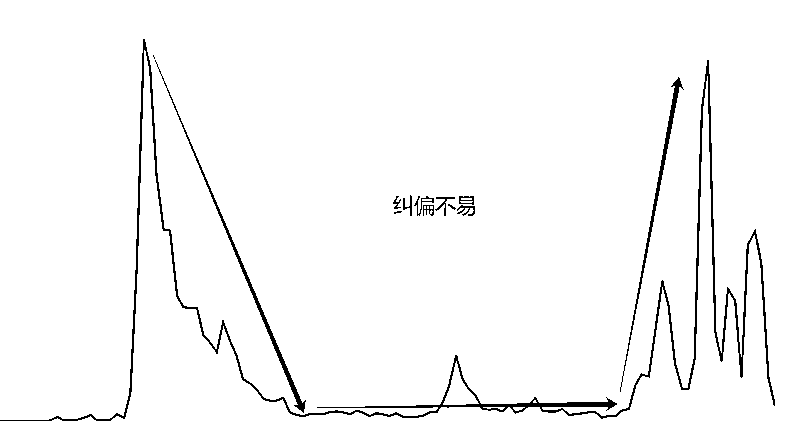

## 3.做出小爆款的窍门

可以先找个靠谱的对标，把内核抽出来复刻，再往里面填自己的微创新。我就是靠这个逻辑，让这个号隔段时间就冒出一条小爆款。

对标：目前几个跑到百万级的小爆款，回头翻全是能找到原型的。那句话怎么说来着——爆过的东西，还会再爆。

内核：要把爆款真正好吃的地方反复舔干净：是靠画面层级的变化取胜？还是靠足够惊艳的视觉刺激？又或是音乐与镜头越来越紧的推进感？再不然是评委表情呈现出某种又真又抽象的喜感？只要能捏住你认为最关键的两个点，八九不离十能把效果复现个七八成。举个小例子，我有个视频抄的并不是蟹钳小女孩这个核心设定，最后照样拿到了16万+的播放，我到现在也没完全想明白它为什么能跑起来。当时会选它来做对标，纯粹是看中AI评委那种特别抽象的表情反应，即便是数据远不如原视频，也够我用了。

微创新：再说这个月小爆的那条，原片大概不少人刷到过。它做了什么：一个胖女孩慢慢瘦下来，健健康康活到老。我这边怎么改的：换成了亚洲女孩，穿了瑜伽服，诸如此类。看着像是乱炖，其实每一笔都是微创新，想要更多灵感方向，可以拿Gary教练帖子里说的“人类七原罪”去做发散。

### 4.航海手册，我的“圣经”

航海手册这东西，最重要的是你真去看，而且要反复看，强烈建议当成每天的固定功课。我航海那25天，差不多把手册翻成了枕边读物。为什么？因为它在我脑子里搭出了一套认知骨架，像拼图一样，今天填一片，明天填一片，慢慢就有了完整的地图。

手册里堆满了实战案例和避坑指南，那是真拿钱和汗水从一线换回来的。比如我这种运营小白，对数据本来很不敏感，但手册里讲数据分析的那部分，硬是让我分清了自然流和限流的区别，知道该怎么看观众地区占比。还有PIN码攻略，简直是喂到嘴边的服务。跟着攻略一步步来，我很顺地拿到了PIN码，直到那一刻才觉得变现链路是真的通了。

别偷懒，多读几轮。老话讲“书读百遍，其义自见”，航海手册也是一样，看得越多，路走得越顺。

### 5.开通YPP后，收PIN码的几个提醒

最近不少小伙伴开通后都在处理PIN码这事，我拿自己这个号踩出来的经过跟大伙儿同步一遍。

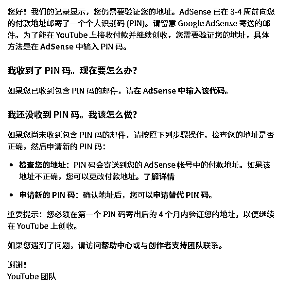

春节过后，我一算日子发现邮件寄出来都小一个月了，手册上也写着这事得抓紧。我先打给区邮局总店，接线员讲得含含糊糊，越听越迷糊。第二天，家门口的邮局又说“我们不负责投递”，得找另一家专管进口邮件的。电话打过去才知道，寄出和投递根本是不同科室的活，明明两边办公室只隔着20米，就是谁也不接谁的话。

电话问不出结果，忽然想到手册里的提醒，还是自己跑一趟最稳。到了地方才发现，单位下午3点就下班，门口铁将军把门，保安让明天再来。我不死心，第二天索性开车过去堵人，正巧撞见一位工作人员走出来。他带我去翻了几封还没投出去的信，里头全没我的。他也觉出这邮件对我来说可能很要紧，便把我的信息记了下来。10分钟后，我拿到投递员的电话，对方说信件都放在小区物业，其实早就在那儿躺着了。

我掉头回家，找物业把那封信给刨了出来，中间又有一点小波折，总算落到手里。整个过程说穿了就一句话：这事真是稍不留神就没了，务必上心。各地流程多少有点差别，但下面几条共性是通用的：

a. 心理上要重视：不能坐等通知，得主动出击；

b. 行动上要自主：等电话大概率没结果，当面沟通才见效；

c. 投递员电话最要紧：拿到之后好好维持关系，往后说不定还要麻烦人家；

d. 多看手册：Gray教练提过可以送点水果，我这边靠几根烟也把关系拉近了。工作人员其实都挺热心，就是被既有流程给框住了；

e. 邮局找不到，就去物业看看。

这就是我在YouTube收PIN码国际平邮的一手体验。

# 第二部分：杂谈，几个能让效率翻倍的小细节

这部分分享的小技巧，都是建立在达人秀赛道基础上的零散心得。至于更系统的学习，圈里已经有非常多优秀的帖子和伙伴，比如@李香君、@gary曹教练，他们讲得比我完整，我就不献丑了。

## 1.对标时的人脸处理

达人秀里“亚洲美女”这个分支，脸好不好看算是门面。曹教练提过一个现象：用即梦垫图时，如果完全依赖智能参考，出图容易整张脸都长一个样，这是模型底子里的毛病。不过有个巧办法，垫图时只保留角色特征，把主体参考强度拉低，这样不光动作能改，背景、容貌甚至穿着都可以靠着提示词顺手换掉。你看，下面这组对比图，五官没有复制感，颜值也在线。

顺带说一句：手头如果有特别满意的脸模，也可以直接选‘人物长相’让模型跟过去，MJ那边同理。

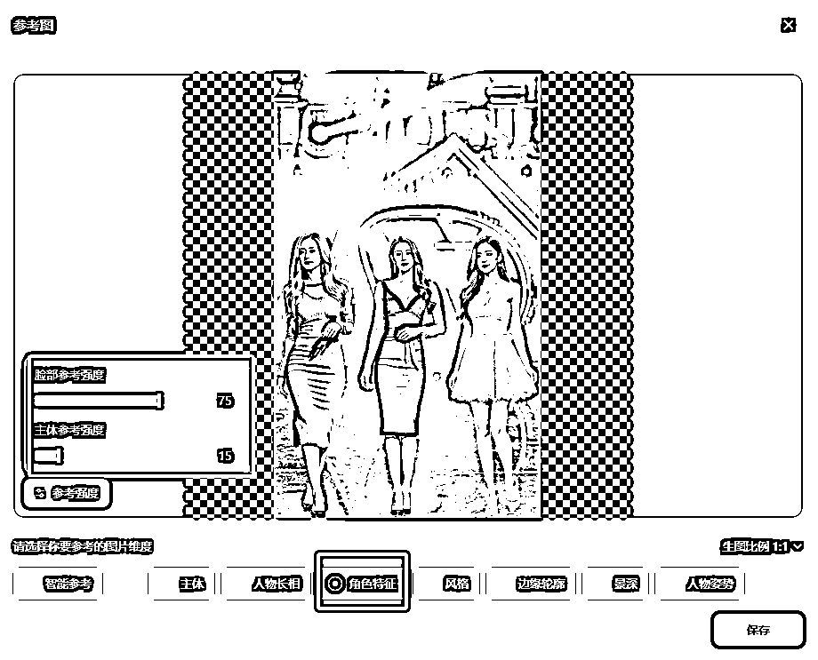

对标截图：

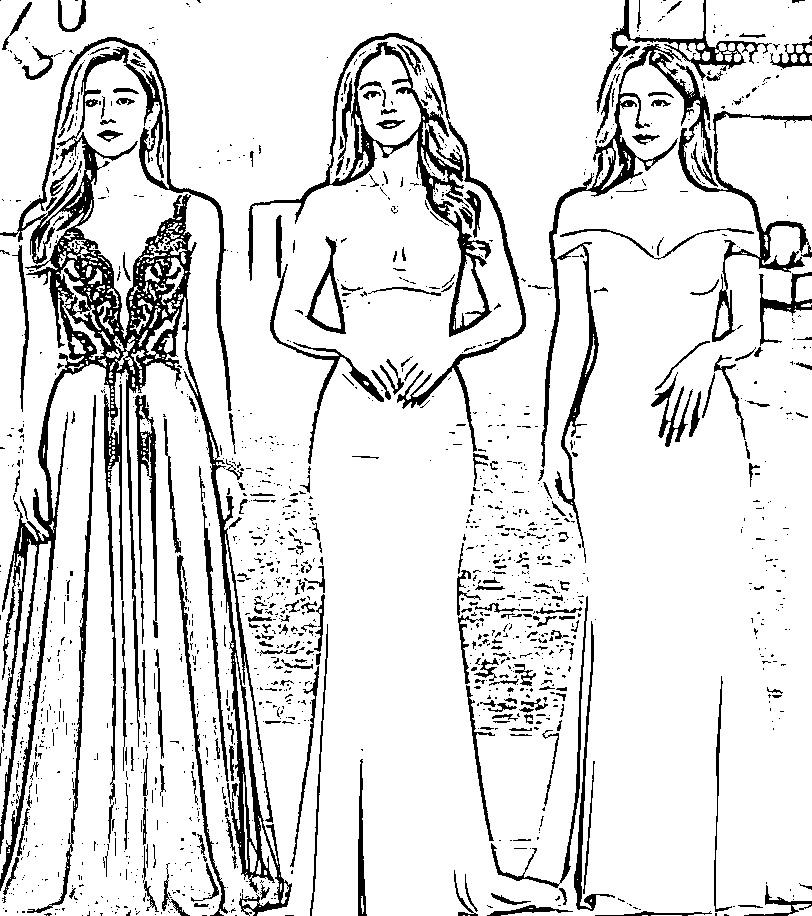

即梦出图：

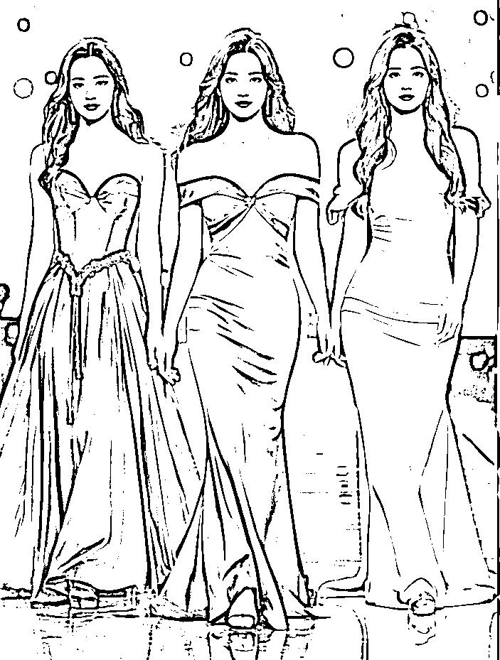

当然，要是想把个人风格做得更稳定，可以试试我现在这套做法：用comfyUI配不同的lora去微调，能玩的方案非常多。太硬核的我就不放出来了，大家感受个温柔版吧。

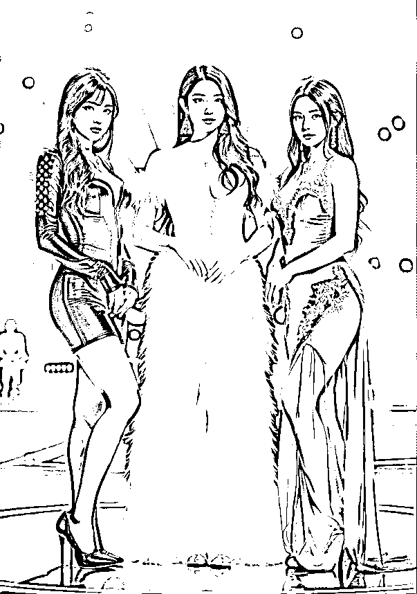

有一点提醒：我是不想跟对标长得一模一样，所以每次反推完图片，都会套模板去调整着装、发型、发色、背景和灯光，同时垫图又能把品质牢牢拽在参考那条线上。你要是想更贴近对标，参数和提示词都能做精准控制。

## 2.PS去水印，以及数位板真的很好用

时常有朋友问图片去水印用啥软件好。分享一个不够专业却很顶用的土办法：基本上各版本PS都自带“内容识别填充”。

实操非常简单：

### a.背景锁定

把图片拖进PS，背景图层保持锁定状态就好，不用做任何额外操作，默认就是锁着的。

### b.选区圈定

用套索工具，或者任意能画选区的工具，把水印所在区域圈出来。

### c.直接填充

圈好后点DEL键，此时会弹出一个填充的二级窗口，直接确定，收工。

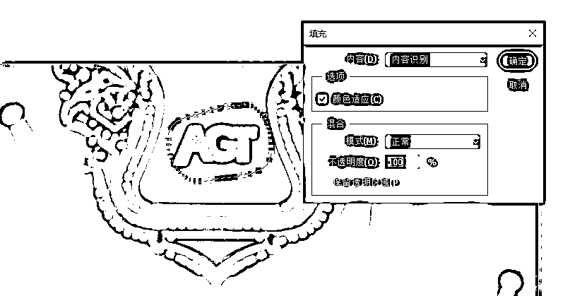

一次没弄干净也不慌，ctrl+D先取消选区，重新圈一遍，再删一次就行。它背后的逻辑说白了就是仿制图章，拿图片旁边区域的像素来盖住水印。更省事的路线，也可以用即梦画布自带的消除功能。

建议：不管是PS精修还是即梦画布抠细节，经常需要反复涂改。配一块数位板，效率是直线上升的，尤其是角色和物品的阴影处理，最能见分晓。不少对标作品恰恰会省略这种增加可信度的细节，而这正是你作品能甩开一截的地方。

## 3.搭一个自己的表情库

账号早期，订阅者评论除了夸“美”，不外乎就是“AI、fake”这类声音，还有一批人专门吐槽：“评委那个夸张的嘴巴是焊死了吗，永远合不上？”起初我也觉得挺有意思，至少说明有话题。但转念一想，如果我反过来把评委和观众的表情做丰富，那不就是自己的辨识度吗？这些表情恰恰是带节奏的核心零件。于是我真去剪出一个塞了几百个表情的库，想用的时候随手一调，按自己想要的节奏把情绪一层层推出去。

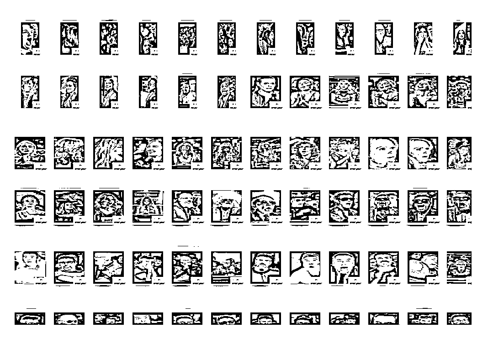

如果你不希望直接借对标视频的评委脸来用，更想用自己的风格递进情绪，这个表情库会特别管用。它既能让你从对标里挣脱出来，又让视频内容更有记忆点。表情一变，观众能感受到的情绪价值是完全不同的。

## 4.拼细节，才有差异化

做内容这几年，我最愿意花时间琢磨的就是细节。早期尤其执着一个问题：动物和人的融合到底能不能做到又自然、又合理、又丝滑？比如动物毛发长在皮肤上的说服力，服装和皮毛接缝处的过渡是不是经得起细看。为了这一步，我在提示词上反复推敲，给大家看一小段我常用的风格化表达：

在一座金碧辉煌的大厅里，盛装女性与一匹纯白的独角兽，准备通过一连串精心安排的舞步完成融合。开局，她先以一个轻巧旋转引走所有视线，裙摆与兽鬃随动作缠绕，画面出现强烈的一体感。中段，她的步伐与独角兽完全同步，双臂在舞动中平滑地化为兽的前肢，每一处关节、每一束肌肉都遵循自然的运动逻辑。终章，人与兽在舞蹈最炽烈的位置彻底合一，幻化成新的生命体，每个动作流畅而带劲，让整个融合过程既符合动态美学，也经得起生物结构上的推敲。

英文版本差不多长这样：

Inside a majestic hall, a lady in elegant formal wear and a pure-white unicorn join in a carefully arranged dance to melt into one being. At first, she turns with a gentle spin that steals every gaze, her skirt and the animal’s mane tangling into a vivid whole. Then, her steps lock perfectly with the unicorn’s rhythm, and her arms slowly shift into its forelegs, every joint and muscle moving as nature would dictate. At the climax, her shape and the unicorn’s body merge completely, giving life to a brand-new creature whose motions are graceful yet forceful, making every second of the fusion both visually and biomechanically convincing.

通用提示词模板可以压缩成：

“在*[宫殿]*中央，一位身穿华服的女人与一匹*[目标动物]*共同进入一场编排好的舞。第一段，她用一个自然旋转起势，裙摆和*[目标动物]*的*[动物特征]*在动作中彼此纠缠，形成柔顺的视觉流。第二段，她的舞步与*[目标动物]*的节奏精准咬合，双臂顺畅化作*[动物肢体]*，转变的每个细节都贴合身体构造与动态规律。第三段，二者在舞蹈的最高点融为一体，蝶变成一个全新的存在，动作流畅又有张力，整个过程强调合理的生物连贯性，让人挑不出毛病。”

工具层面的经验：复杂的提示词没必要一个字一个字憋，可以直接丢给多模态大模型，GPT或者kimi都能扛。Runway这种视频模型目前还做不到特别精细的多步骤融合，但最终出片往往比参考更柔、更细，时不时还让人眼前一亮。另外，强烈建议把Seed记下来，遇到手感好的种子，一定要备份。好种子能省掉一大把反复抽卡的时间。最近总觉得种子好像会过期，就不往外贴了，真要试的朋友可以私信我。

小结一下：从早期死磕融合细节，到如今追求惊悚、猎奇，或快节奏、高密度的镜头叙事，我还在不停迭代。但达人秀那道底味从来没有变过，就是喂饱观众的好奇心以及最直接的感官需要。形式可以百变，多试总没错。

## 5.手搓批量，做量也做质

现阶段我比较偏好“简单直接”的多美女卡点切换，一条内容通常塞进3到6个不同画面。虽然加速处理会让细节损失一些，但“美女+快节奏+高密度”打出来的冲击力是真的顶，特别能在前几秒抓住人，而且这类达人秀天然覆盖了人类对于视觉奇观和感官刺激的需求。

制作流程上没什么秘笈，核心就是堆时间、沉住气。我惯常在3天里一次性扎出30条上下。大致路径如下：

1. 先找30个对标视频

2. 用HH猫把视频抓下来

3. 拿马老师的拆图工具把帧拆好

4. MJ或即梦用来生图和精修

5. Runway/可灵/智谱来跑图生视频

6. 剪映负责最后剪辑

想再提效的话，可以把几个环节叠着跑：

生图和修图：跑B主题的图时，顺手用即梦画布和PS修A主题已出好的图。

图生视频：把变化类镜头丢给Runway，把跳舞片段丢给可灵或智谱并行处理。

剪辑：剪映国际版和国内版各开一个，双轨渲染。

熟练之后，生图、生视频、剪辑就可以交错着走，整个链条滚动起来，几乎没有空窗期。

如果你想做全原创或者按对标批量复刻，直接上@李香君 香君兄那套智能体加comfyUI的组合，同样非常好用，链接如下：

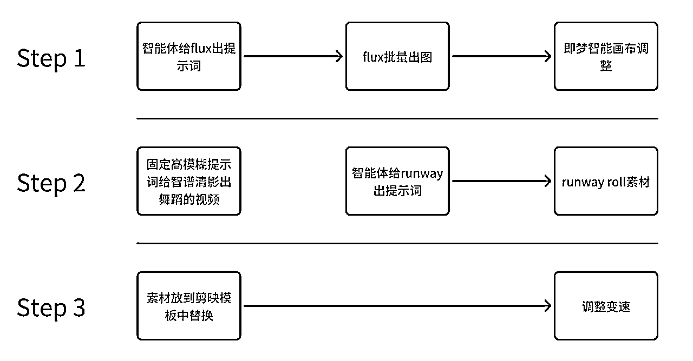

聊到创作效率，其实不管你是纯手工搭流程，还是用智能体代劳，只要熟练度上去了，产出速度都不会差。如果目标只是对标爆款，那额外加一步反推提示词就够了。

拿我自己的习惯来拆解一下吧。我是从真实内容需求出发，把流程调成了更适合自己的版本。一条信息量饱满的视频，往往需要多张过程图来生成多个片段；除了第一张图，后面的图基本都是在同一个背景基础上，做元素的增加、删减或者替换。

## A. 素材准备

这一步我一般会准备这些：

1.  舞台上站着三位女生

2.  一口平底锅

3.  一条金鱼

4.  一条机械赛博鱼

5.  一位穿红礼服的女生（另外，煎鱼视频的尾帧我也会截图存下来，作为下一段的起始帧素材）

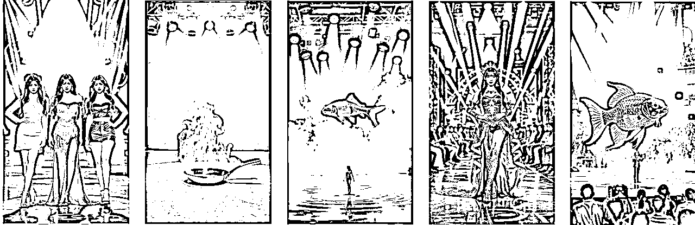

这里有个提示词的小门道：在写平底锅、金鱼、机械赛博鱼这些提示词时，不要带入任何人物描述，只保留场景、灯光，以及目标物品/生物本身的特征。如果用智能体模板，同样遵守这个原则。

PS：关于透视关系——凡是站在地面上的物品或生物，它们的透视角度必须和三女生的场景视角统一。（只要舞台相关的提示词保持一致，基本不会差太多，万一有偏差，单独微调就行）

关于光源——保持同一套舞台灯光提示词，是为了让光位和色调始终统一，画面才不跳戏。

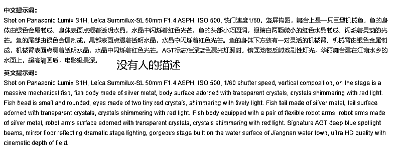

## B. 图片分层处理

我会把图片拆成这几个独立部分：

1.  背景层

2.  三个角色层

3.  需要变换的物品/生物层

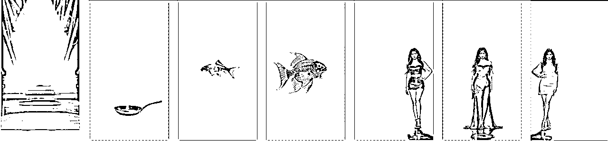

你可能会问：局部重绘不就能搞定吗，何必这么麻烦？

说实话，局部重绘能解决一部分问题，但我更喜欢把每个人物、动物、道具和背景都拆开单独处理。好处很明显：

1.  模块化——所有元素都变成可自由组合的变量，制作时思路更清晰，操作也更直观。

2.  自由度——变化的空间被大大打开，可以根据画面审美随意调整前后层次关系。

3.  空间利用率——元素分开了，画面能塞进更多细节，整体更丰富。

## C. 生成关键帧

我会用智能画布+PS做修图、拼图，必要时手动加阴影（阴影能让物体更“落地”，抠图或手绘都可以，选顺手的方式来）。想再玩出点花样，也可以加一段女生跳到机械鱼身上游动的镜头，把最后一帧截出来衔接上就非常丝滑。

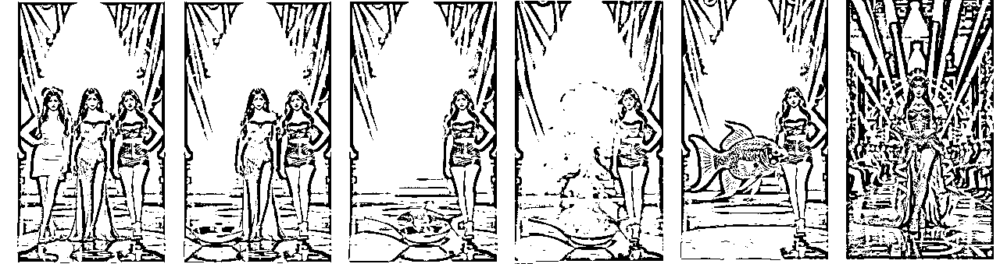

## D. 图生视频

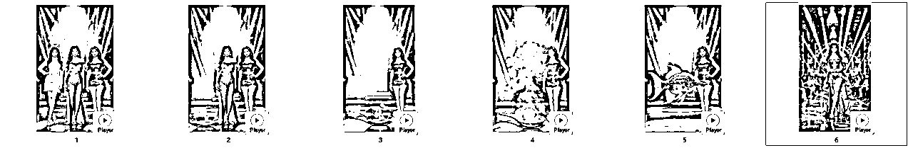

## E. 剪辑、渲染、导出

上面这一套跑下来，就能看到批量出片的效果了。

小结一下：

无论你是从对标走向原创，还是在流程里死磕细节，最关键的永远是熟练度和效率之间的平衡。工具和技巧都是死的，灵活用、持续优化，才能真正做到高产。祝各位每天都能出100条。

# 第三部分：少有人走的猎奇赛道

（PS：内容可能引起不适，仅做技术学习参考，不构成推荐）

## 1. 纯属巧合

据我所知，在陪跑圈里只有我和香君兄试过——猩猩与人类孕妇这类猎奇题材。相信不少朋友也刷到过类似的视频。

为什么选这个方向？没什么高大上的理由：第一个账号快达标时感觉产能有点溢出，想多练练手感。加上那阵子运气不好，两个故事号都零播放，正发愁呢，新号又恰好刷到五六个同赛道账号，而且居然都能开通？赛道小众、想象力空间大，于是果断开搞，心里想的是：没准能出奇制胜。

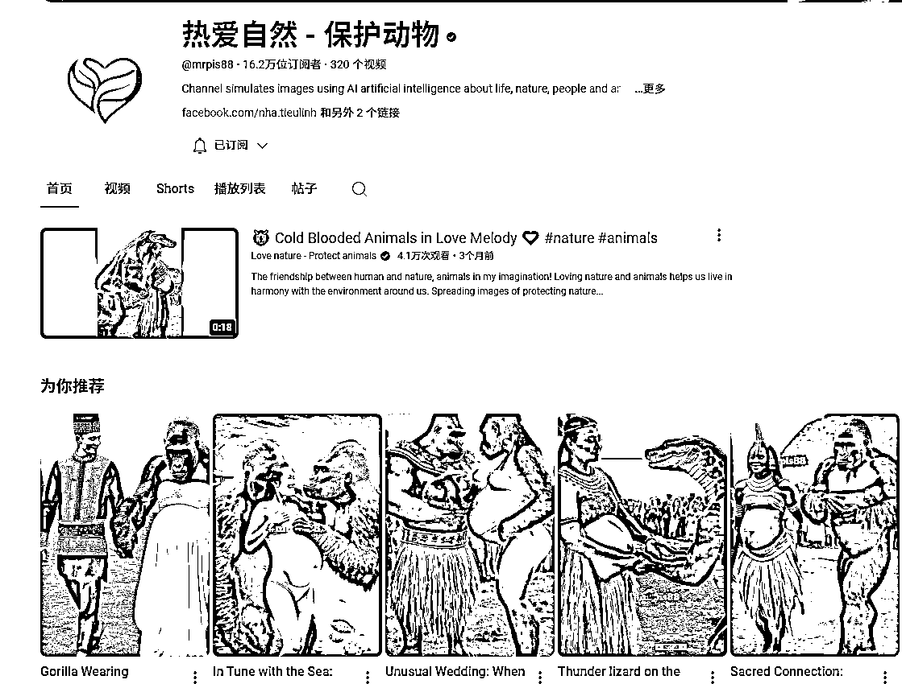

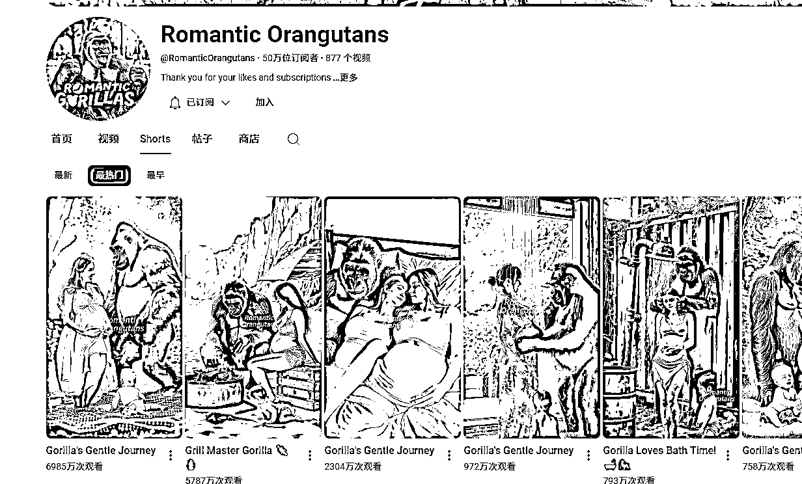

## 2. 批量制作

这条赛道流程很轻，就不详细演示了，简单提两句。主要分两种玩法：

### 方案A：直接文生视频

a. 画面质感一般，但容易出意外惊喜

b. 用文案模型反推提示词，然后丢进海螺批量排队生成，筛选后剪辑

c. 举例：“热爱自然”账号里那种非洲部落孕妇+猩猩的视频，就是文生视频直接生成的

### 方案B：图生视频

a. 单张图质量稳定，视频效果偶尔有惊喜

b. 文案模型反推提示词后，先用MJ出图，再扔给Runway这类工具生成视频，挑完再剪

c. 比如“Romantic Orangutans”账号里质量较高的美女孕妇+猩猩视频，大概率就是这套流程（也是我选择的方向）

## 3. 流量观察

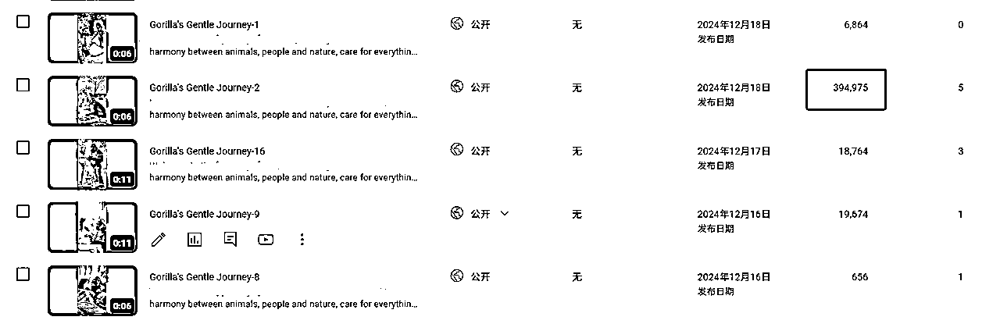

才发第四条就有爆的苗头。因为制作门槛低，刚开始的想法就是：能不能靠数量硬堆？于是一口气做了150条，后来转去试其他赛道时，又陆续发了90多条。

以我有限的体感来说，这个赛道的整体特征是：

### A. 流量池本身就小

别看刷到的对标号不少，其实整个盘子不大，能开通收益还挺难的。

### B. 流量波动剧烈

播放从几十到几万再到几十万都有，大起大落是常态。

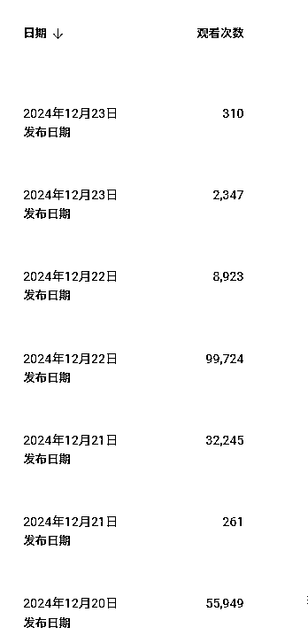

### C. 其实并不好做

做这类内容很考验分寸感，微妙得很。就像gary教练说他自己get不到。那能不能做呢？我认为可以，但别死磕单一赛道——猎奇的方向多了去了，这种带点恶趣味的真不建议优先选。尤其刚起号时，别机械式地堆量，要一边发一边观察数据、研究节奏。

## 4. 换道而行

这个赛道不确定因素太多，我自己兴趣也不够，决定不浪费已有的账号基础——边养号边换赛道，整体走得还算顺。油管包容度很高，如果你们对其他猎奇方向有兴趣，完全可以去试。换赛道只是我的个人选择，不是标准答案。

（再次PS：内容可能引发不适，仅供学习，不做推荐）

# 感谢：

### 感恩“弱关系”——简单、真诚、高效又充满热忱！

不管你是看过我的帖子、给过我帮助、和我链接过，还是一起做出海项目，甚至有些朋友我根本不知道你是谁，这份谢意都一定要送到。在加入赚钱、深耕YouTube这一路上，我要真心感谢以下各位伙伴（如果有遗漏，真的太多了，多多包涵）：

@龙哥盟 @龙哥@老马内容出海@竹子@土豆君@高一博@李香君@彭诗尧@邵先森(Jiahao)@私藏人间@富百@极客信条@cc@nana@小芬@六只猫@折扇@三亿@逸帆风顺@coco@哩厘锂力@龙@叉叉敌@忧愁小松鼠@茜茜@曹超峰@一页书@汤姆CC@李澹归@暖暖@敖健龙@zhwcoding@浮笙@李默@李璇玮@Kennan恺南@书情@kiki@程序员赤小豆@风吹散@时光@Jiahao@乌鸦@RandOmWa1k@来来@林育佳@鱼丸 等等

# 总结：

1.  AI进化太快了：直接可视化交互就能拿到结果，未来想象力巨大。我坚信“所有东西都值得用AI重做一遍”，内容创作当然也在其中。

1.  基本功不能丢：技术再怎么迭代，底层理论永远不过时。要尊重客观规律，尤其是高价值长视频——想做到《哪吒》那水平，时间空间幅度、硬强调、接触帧这些基础缺一不可。

1.  综合能力要跟上：到现在我也还在打基础阶段。技术理解、创意判断、数据分析、跨文化感知、团队协作……这些能力都远没到天花板，只有不断下场亲测，才能真正摸到创作的温度。

今天刚看了gary教练的“自白”，不知道为什么，比读技术贴还带感，够真实，能共鸣。

https://scys.com/articleDetail/xq_topic/1525845588555142

本来准备好要分享，但收尾时发现还是有点放不开，自己也不知道写了些啥。

这篇就当个开始吧，不管用什么形式，我打算借着这次机会，持续和自己对话。

这种“传染”真的很棒——越分享越幸运！

祝各位朋友好运，YouTube上玩出自己的新天地！

提醒自己：革命尚未成功，我辈仍需努力！