# 从发现需求到上线网站：海外工具站的完整玩法，这一篇给你讲透
作者：龙哥

> 原文参考：哥飞分享，2023年9月

大家好，我是龙哥。平时喜欢研究流量、投放、运营和产品，也爱折腾各种小工具。今天这篇长文，想把关于海外工具站的门道一次性讲清楚，内容分成四大板块：前景怎么看、需求怎么找、实例怎么跑、网站怎么做。

## 一、海外工具站到底有多香？

只要把一个工具站做到排名靠前，后面的回报周期可以拉得很长，十年八年甚至二十年都有得赚。只要互联网还在，搜索引擎还在，广告体系还在，你的收入就不会断。而且网站活得越久，累计下来的外部链接就越多，排名也会越来越难被撼动。

但前提是——别做垃圾站。能持续赚钱的核心，是你做的东西真的对别人有用，用户才会愿意帮你分享、帮你传播。

老话说得好，种树最好的时间是十年前，其次是现在。做网站是一件需要长期沉淀的事，千万别想着“以后再开始”，现在就是最好的启动点。网站做好之后，哪怕不再频繁更新，只要还有人用，权重就会一天天涨上去。

特别是今年，AI 热度居高不下，只要你的工具和 AI 沾边，用户天然就愿意帮你打 call。所以说，眼下就是入局的最好时机。

可以做的方向很多：有的需求是短期热点，有的能长线经营；有的纯粹 for fun，有的则是工作和生活的刚需。对于大多数刚入门的朋友，我的建议是先从短期项目或娱乐向需求练手，边做边学：怎么找需求、怎么做 SEO、怎么引流量、怎么推广、怎么变现。等这一套跑通了，再去布局那些长期、刚需的工具。盯住竞品，找机会在体验、颜值、速度等某个点上超越它。

## 二、怎么挖出好需求？

借助 Semrush、Similarweb、ahrefs、Google Trends 这些工具去做分析，判断一个需求值不值得做。这些工具其实免费版就够用，如果你非要体验高级功能，官方买太肉疼的话，可以上淘宝找找低价共享账号，懂的都懂。

### 2.1 先看 Similarweb

它可以查网站流量、来源渠道、地域分布，还能看到相似网站列表。网址和插件大家自取，养成一个好习惯：没事就用搜索引擎搜各种工具词，把排在前面 10 名的网站挨个查一遍流量。

举个例子，在谷歌搜“pdf”，排名第一的是 Adobe 官网，第二是 ilovepdf.com。我们打开 Similarweb 一看，好家伙，月访问量 8.8M 就是 880 万，138.8M 就是一亿三千多万。跳出率不到 20%，说明用户进来后基本都能找到自己想要的工具，网站确实有用。跳出率太高的话，说明用户进来就关，原因可能是打开太慢，或者东西太水满足不了人家。另外，每次访问的页数和停留时长也都能说明这个工具是否对味。

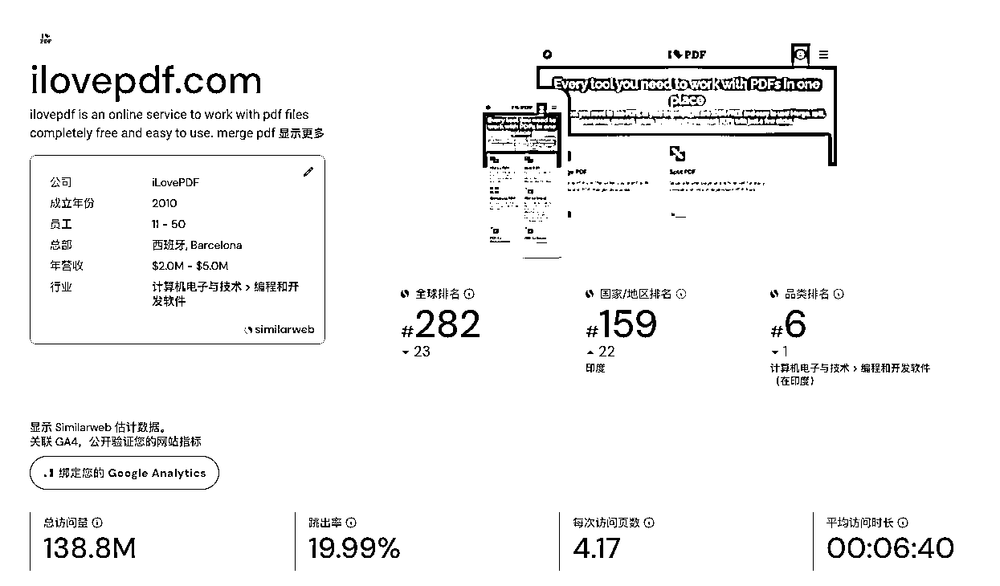

流量地域分布也很散，全球各个国家都有，有些国家空白也值得大家研究研究。再往下翻，还能看到一堆相似网站和它们各自的流量数据，点击就能继续深挖。

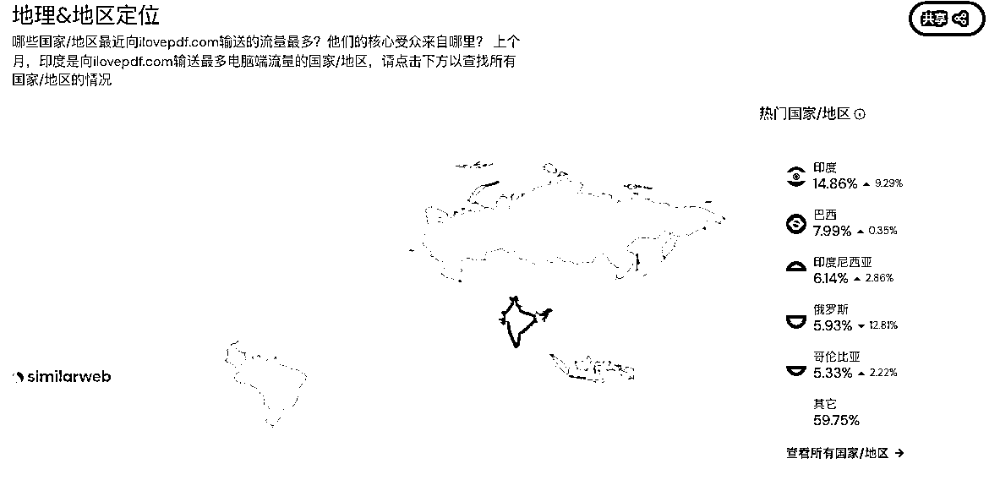

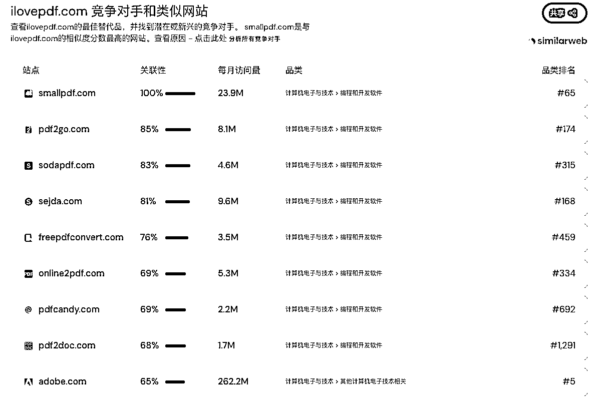

相当于你在谷歌找到一个网站，就能顺藤摸瓜带出一串网站，特别高效。

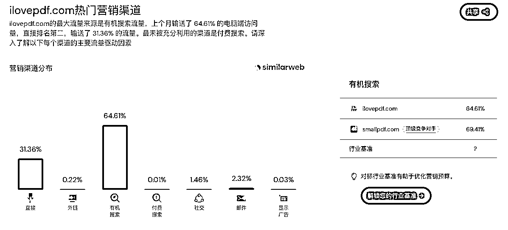

从流量来源看，64.6%来自搜索引擎，说明 SEO 做得很扎实；同时还有 31.3%是直接访问，说明回头客不少——用户要么记住了网址，要么加了书签。这也再次证明，这个站体验够好，能真正满足需求。

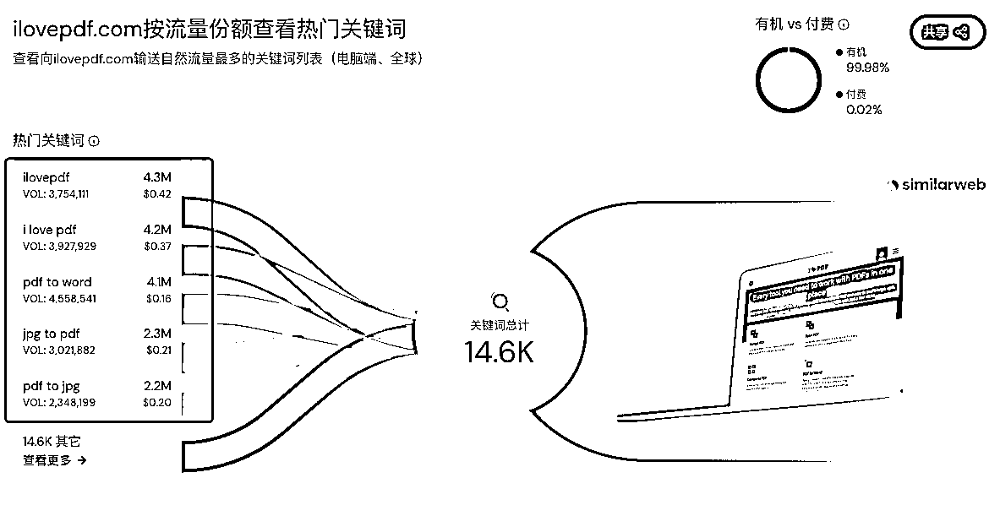

再看关键词，品牌词就有 850 万搜索量，品牌认知度妥妥的。

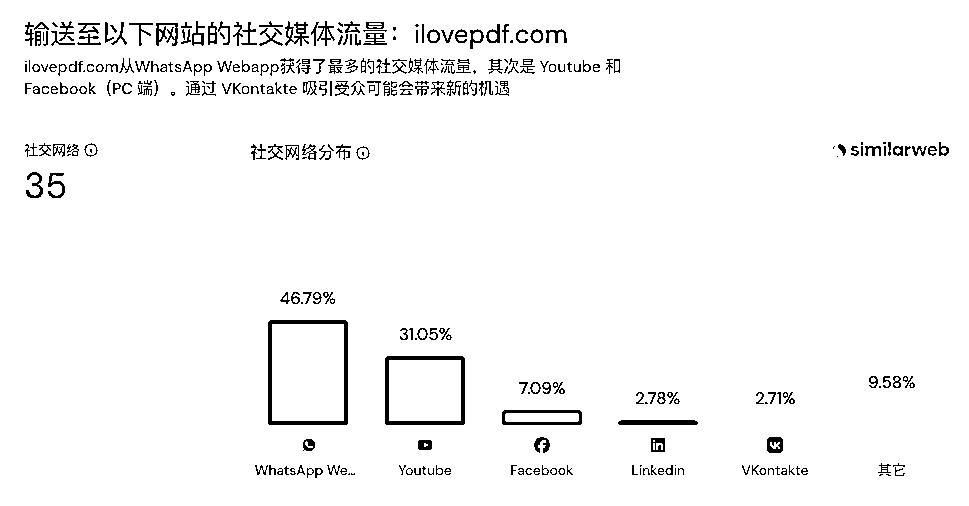

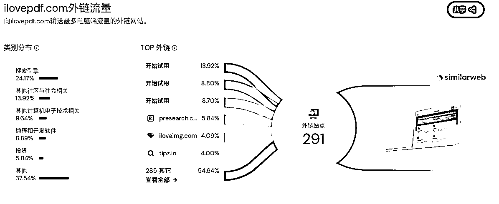

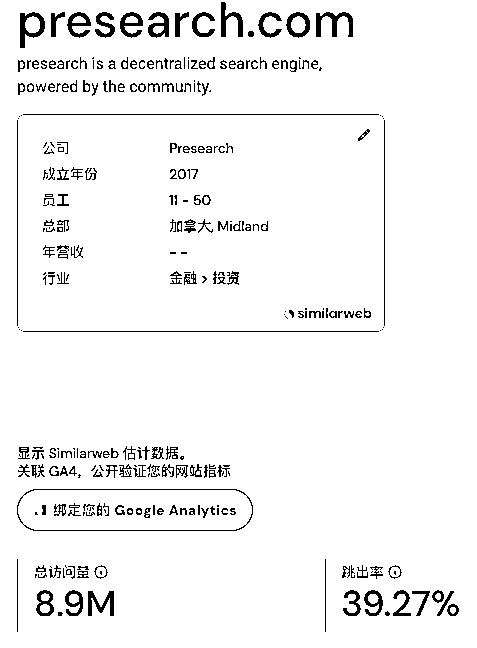

顺着类似网站还能发现一些有意思的新面孔，比如 presearch.com，每月也有 890 万访问量。是一个去中心化搜索引擎，我也是第一次知道。对于这种新网站，完全可以照着 ilovepdf 的分析思路，再拆解一遍，说不定就有新发现。

常说上网就是冲浪，浪冲得好不好，全看你会不会用这些工具。工具用得好，眼界宽不少。以上这些功能，很多不登录也能看，小白也能直接上手。

### 2.2 再看 Semrush

它能看网站搜索流量、关键词分布、每个词带来的流量多少、优化难度评估、外链和出站域名等，功能非常丰富。用法也不难，把域名输进去，点搜索看结果就行。

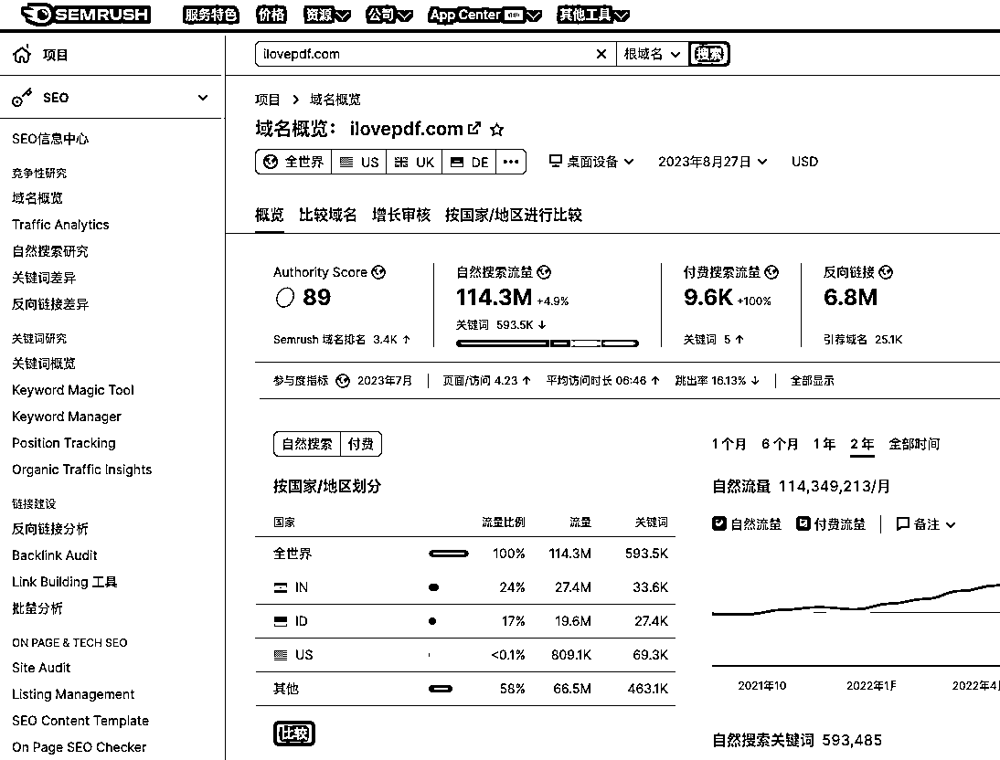

结果页里能看到自然搜索流量、付费搜索流量、反链数量，还能看不同国家的流量分布。比如点击那个 114.3M，就能看到每个国家对应哪些搜索词带来了多少流量。

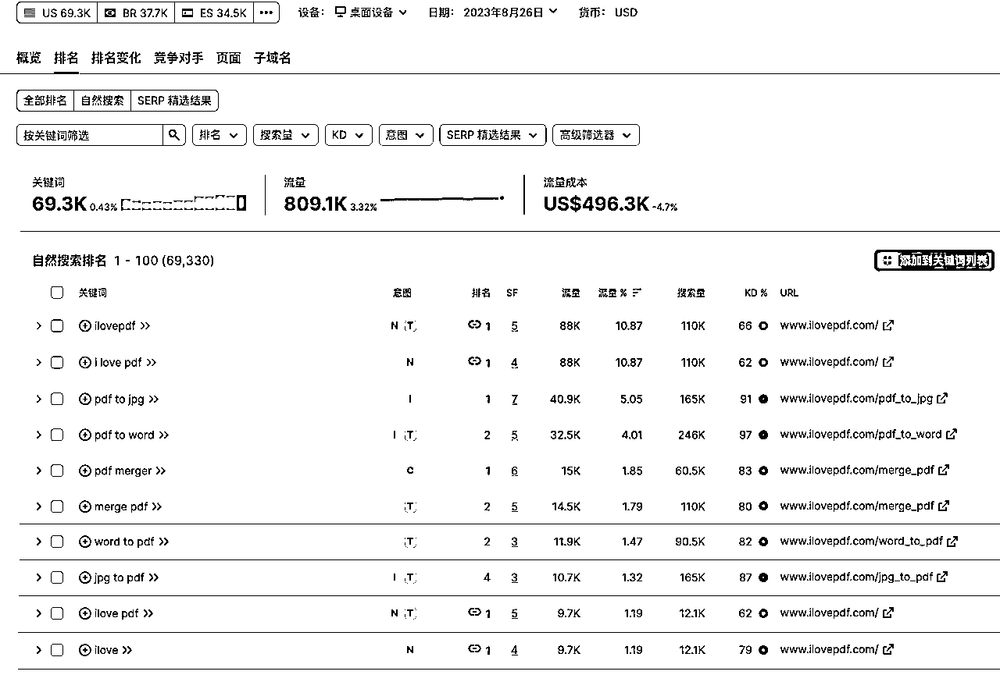

重点看 KD 这一列，代表这个词在对应国家的竞争难易度，数字越大越难打。免费版不能按 KD 筛选，但如果是 VIP 账号，就可以筛出 KD 60 以下的词，按搜索量降序排，很容易发现一些搜索量不错但难度不高的机会词。

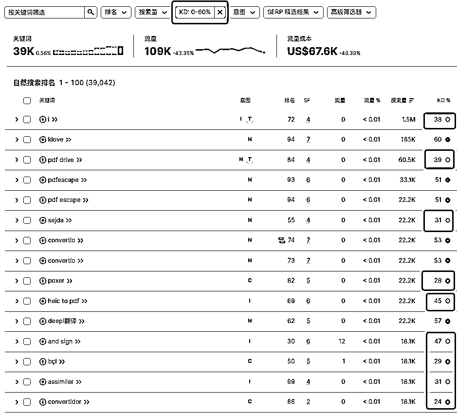

点进每个词，还能看到搜索量、竞争度、目前排在前面的结果详情。像 seword 这种明显是别人品牌词的，直接忽略就好，没必要花时间。

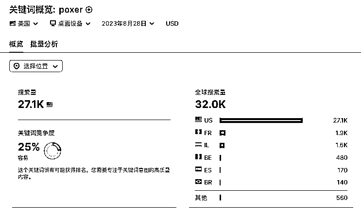

哥飞就无意中发现了一个词“poxer”，竞争难度非常低，但奇怪的是搜索结果全是内页。如果我们注册一个专门域名，全站集中火力去做这个词，上谷歌首页并不难。

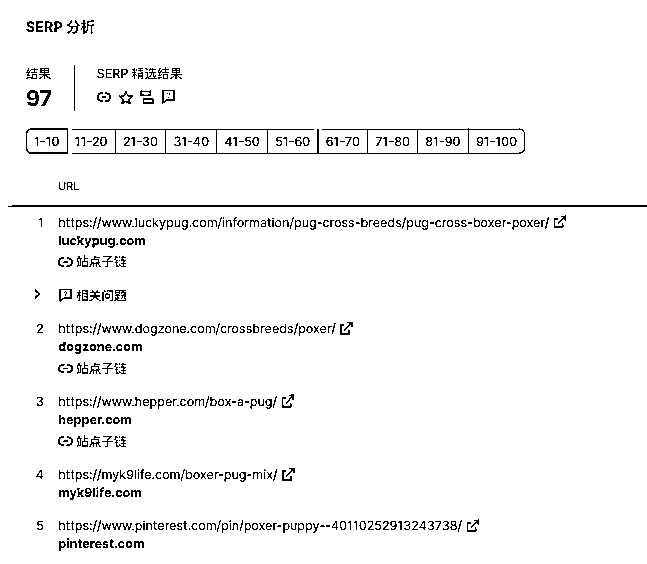

注意一下，“monkey pox”是猴痘，“pox”是痘，所以“poxer”这个词背后用户的真实意图可能和患痘的人有关。到底大家想找啥，还需要继续深挖。

Semrush 能玩的还有很多，这次就先讲域名和关键词这两个功能，剩下留给大家自己去探索。

### 2.3 还有 Google Trends

它主要用来看趋势走向，以及对比多个关键词的热度大小。

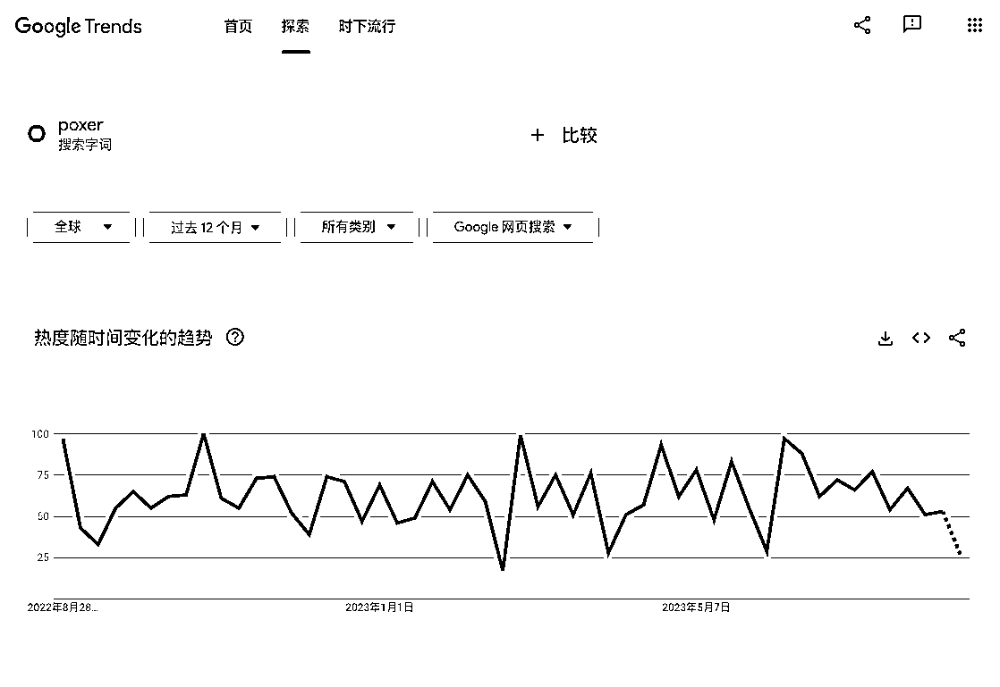

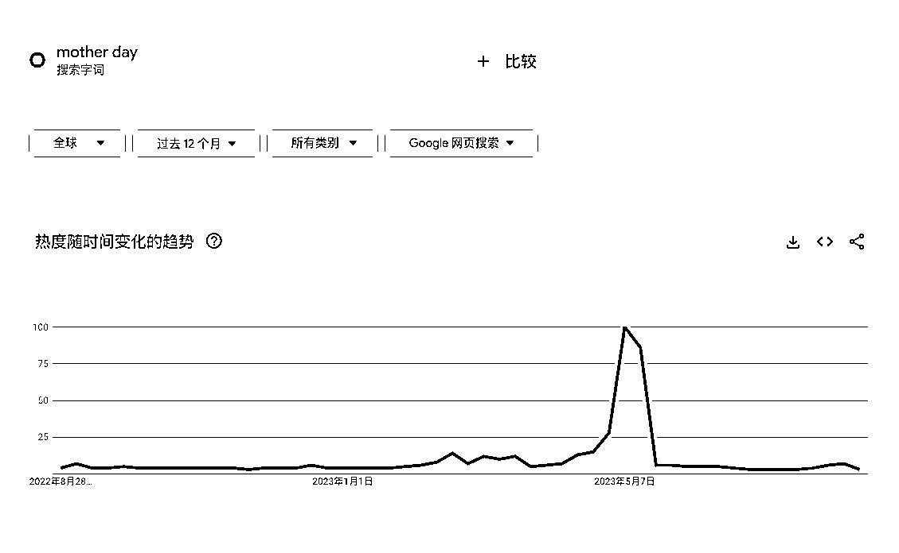

比如对比两个词就能发现，有些词有明显的周期性，像母亲节，一年就那几天热度暴涨，其余时间基本沉寂。而“poxer”这个词全年波动很小，一直很稳。

### 2.4 最后是 ahrefs

ahrefs 同样很强大，今天只讲一个不用登录就能用的小功能：判断关键词优化难度。输入词、选国家、点 check，完事。

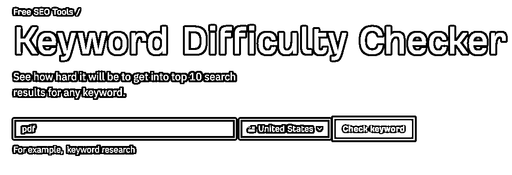

结果页里重点关注两个数字：难度和外链数。比如这里竞争难度 95，要 1391 个外链网站才可能进谷歌美国前 10。一般如果能外链数少于 100，就值得去试。

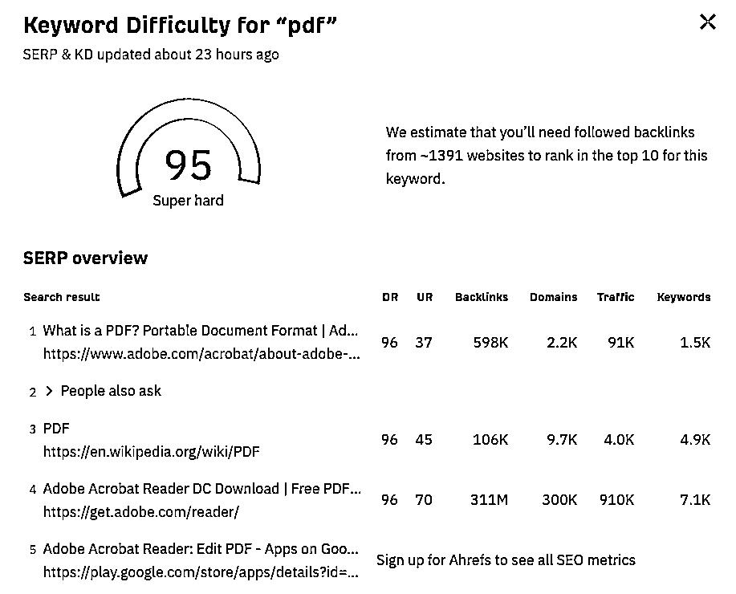

顺便说一句，刚才看 ilovepdf 在美国几乎没流量，再看这个搜索结果列表，ilovepdf 也真的没上榜，排在前面的是 freepdfconvert.com，大家可以当作业，自己去扒一下这个站。

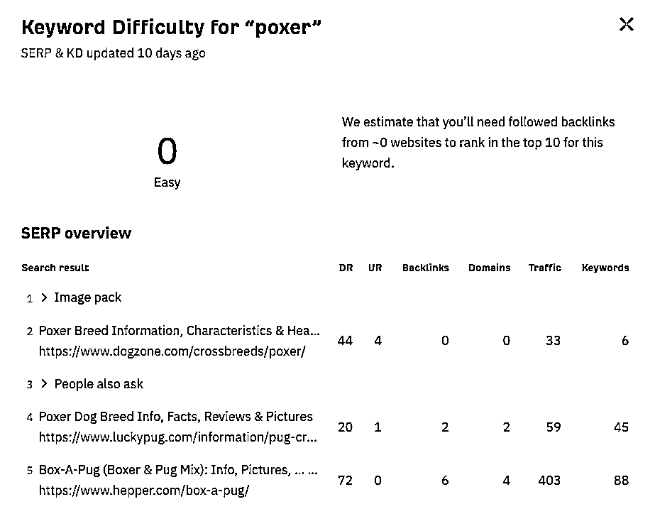

拿“poxer”来验证，结果显示难度 0，基本是没人关注的冷门新词，所以优化起来会非常轻松。

好了，常用的挖掘工具就介绍到这里。总结一下：在搜索引擎找相关工具词，看到网站后去 Similarweb 查流量和渠道，接着用 Semrush 拆解网站和关键词锁定低竞争词，最后用 ahrefs 再验证一遍。其实不限于工具站，任何你知道的有点流量的网站都可以拿来分析，看看它流量从哪里来，有没有哪个词是你能插一脚的。

## 三、来一次实战演练

开始之前，先给大家看一个老外 Reddit 上的帖子。他花 2000 美元建了个站，半年多以后，每月稳定收入 1000 美元左右。

[`www.reddit.com/r/juststart/comments/mcaodn/how_i_built_a_site_for_less_than_2000_which_now/`](https://www.reddit.com/r/juststart/comments/mcaodn/how_i_built_a_site_for_less_than_2000_which_now)

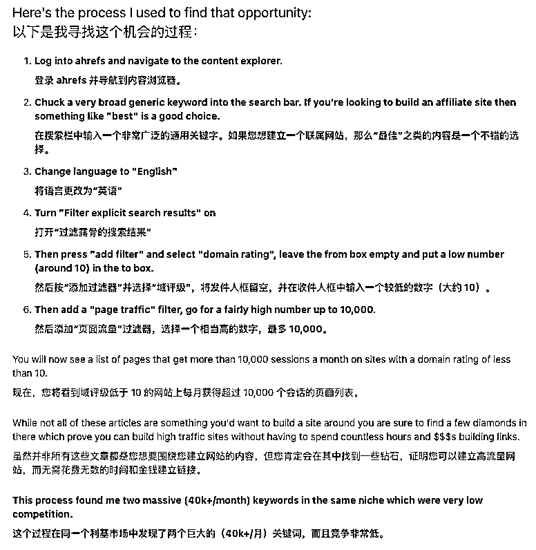

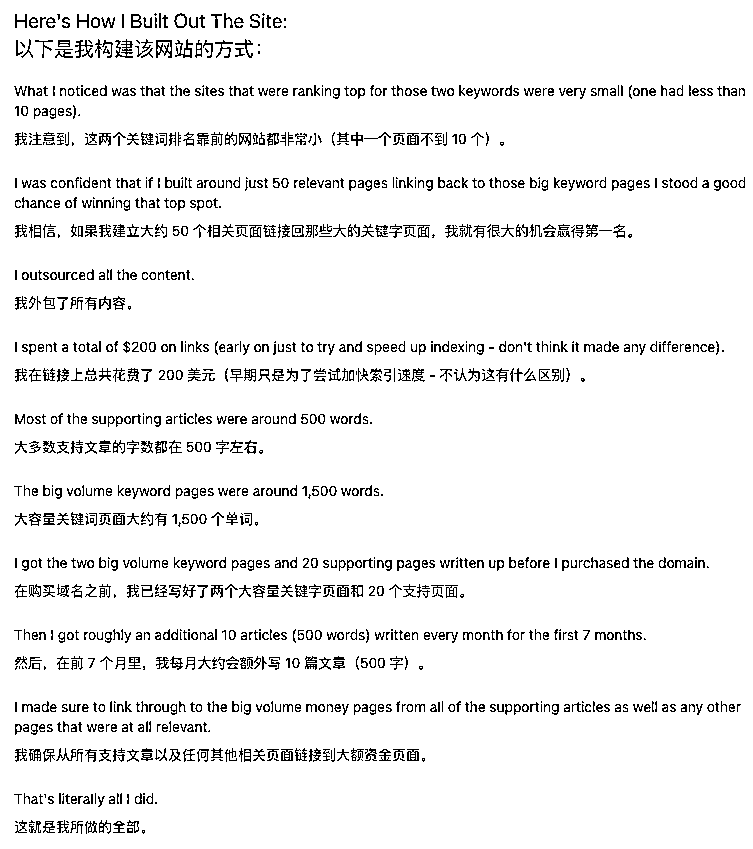

这个方法同样可以在 Semrush 里实操。打开 Keyword Magic Tool，随便输入一些词，我选了猫猫狗狗这类常见词，KD 设置在 0～29% 低竞争度，过滤掉一些不该有的内容，然后一个个看下去。结果让我发现了一个宝藏词：“cat coloring pages”，竞争度只有 27，而且前 6 个搜索结果全是内页，这意味着，我们注册一个新域名来专攻这个词，很容易冲到谷歌首页。

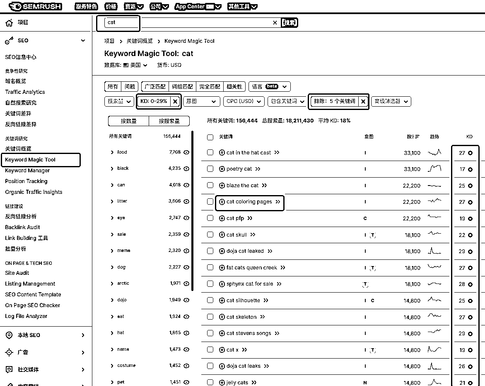

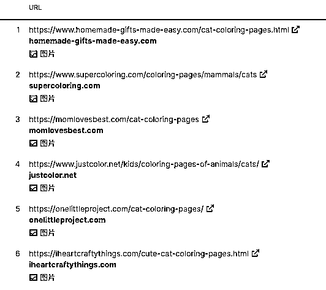

解释一下规则：同一个关键词下，域名权重 > 子域名 > 子目录 > 内页。所以当某个词竞争度低、谷歌前排都是内页时，我们用一个专门域名去做，胜算非常大。

再到 ahrefs 的免费工具里再验证一下，难度 9，只需要 10 个外链就能排进首页，确实值得干。

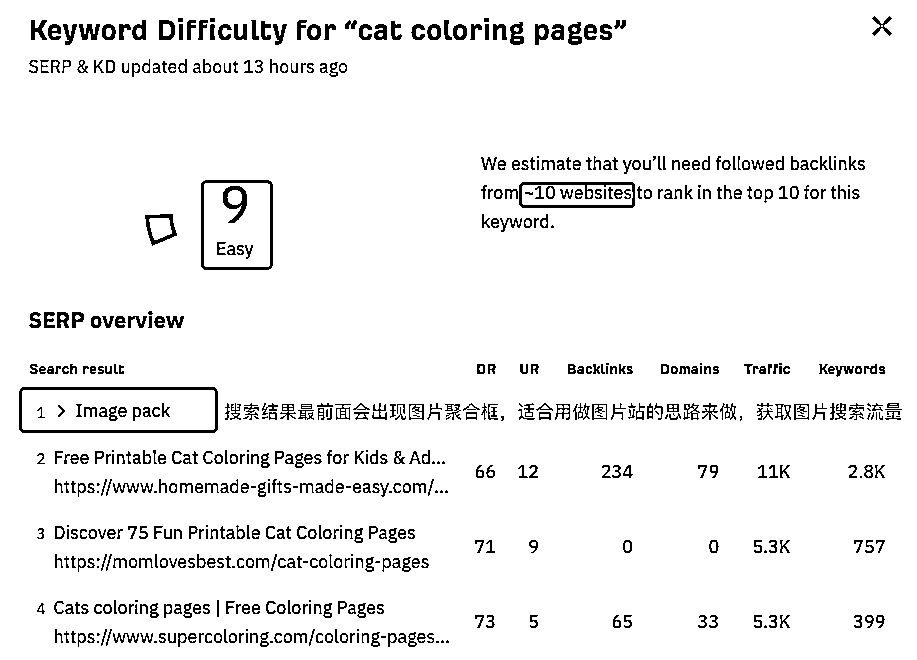

既然 cat 可以，那么 dog 呢？flower 呢？大家可以举一反三，发散思维去寻找更多类似的词。继续用 coloring pages 搜索，能发现很多相关词，不过有些竞争度会偏高。

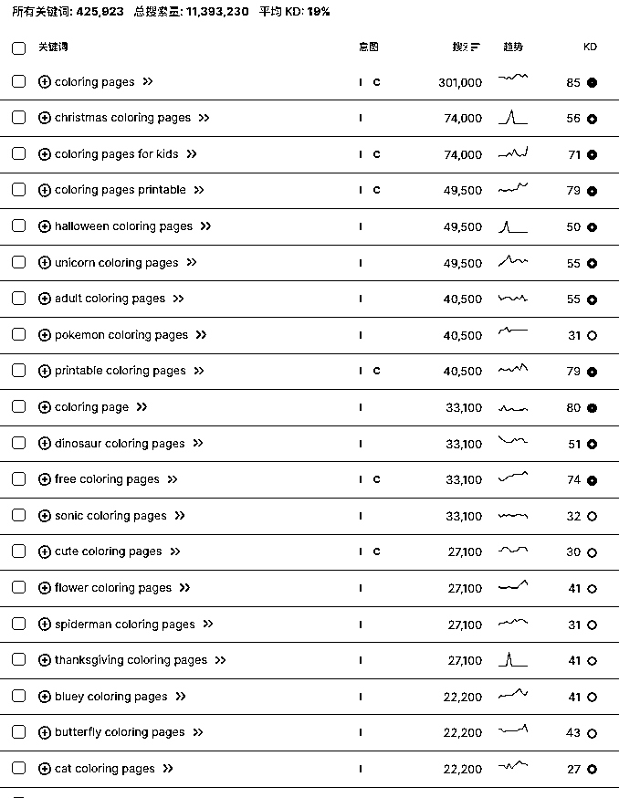

如果我们要建一个站来覆盖这些搜索需求，该怎么做？

首先注册一个合适的域名。之前讲过，域名带 AI 能大大助推推广，所以 ai-coloring-pages.com 这个域名就很完美，完全匹配关键词，又自带 AI 属性。

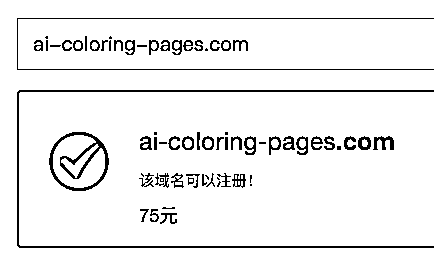

而且现在这个域名还空着，看谁手速快。

接着分析真实需求：用户大多是想找到喜欢的黑白线稿，然后下载打印，用来涂色。所以我们的网站要放大量已经生成好的线框图，分门别类方便查找。最好能直接集成 AI 画图能力：用户只需要输入狗、猫这类简单词语，后台就能自动生成合适的 prompt，帮你画出来并展示在网站上。

所有生成的图片都公开共享，这样网站就能自己源源不断地产生新内容，完全不需要手动维护和更新。

除了挂广告，还能收费吗？可以。既然用户核心需求是下载图片，那就在下载环节设计门槛：不注册只能下几张，注册了能多下一些，订阅以后就能批量下载，还能把多张图一键合并成 PDF。

前面提到最好用图片站的形式来做，所以图片要大，反正用户要拿去打印，那就统一做成标准 A4 大小，下载下来直接就能打。每张图片的 alt 属性写上贴切的描述，让图片搜索也能找到你，从而导入更多流量。

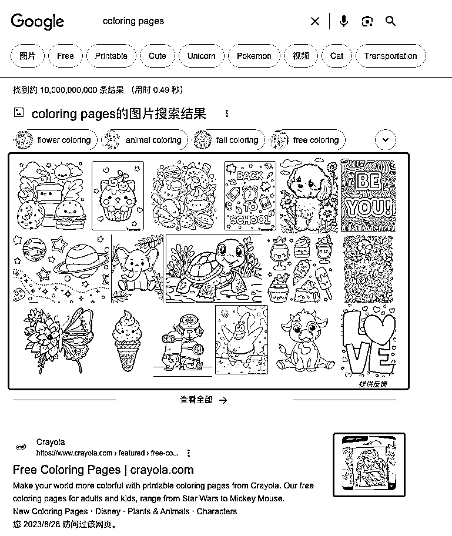

我们的目标，就是让自家图片出现在红色大框的位置。做法就是页面放高清大图，同时每张图片搭配精准的 alt 说明，让爬虫能读懂图片内容，从而收录并最终展示在这个位置。搜索结果右侧那个小图区域，只要你的网页里有图片，通常也能露脸。

好，实战部分到此结束。

## 四、网站到底怎么做？

最好是自己会开发，或者直接部署别人做好的项目。如果完全没有编程基础，24 天的航程里临时学是有点赶，但也不是不能学。

给新手推荐几个自学资源。线上教程很多，看多了反而容易迷茫，所以最基础的，看菜鸟教程就够了。下面这几个不一定要全学完再开工，先看一遍概览，弄明白 HTML、CSS、JS 大概是什么——HTML 决定结构，CSS 管样式，JS 负责交互——然后在做的过程里按需查漏补缺就行。

HTML 教程 [www.runoob.com/html/html-tutorial.html](https://www.runoob.com/html/html-tutorial.html)

CSS 教程 [www.runoob.com/css/css-tutorial.html](https://www.runoob.com/css/css-tutorial.html)

JS 教程 [www.runoob.com/js/js-tutorial.html](https://www.runoob.com/js/js-tutorial.html)

视频课程 [www.bilibili.com/video/BV1Wr4y1R7Bd/](https://www.bilibili.com/video/BV1Wr4y1R7Bd)

还可以让 ChatGPT 当你的陪练，尽快学会做一个简单网页。

如果你已经具备开发能力，那就别再纠结，也不要陷入“技术栈越高级越好”的陷阱。我们做的是带 AI 能力的工具，交互不会特别复杂。熟悉 Vue 就用 Vue，不想用就直接原生 JS，最多加个 jQuery。

如果你一点开发都不会，又确实不想学，那就找人组队合作，团队力量永远大于单打独斗。

最后，不管你技术如何，都可以拿别人开源好的代码来改改直接用。GitHub 上有大量完整的开源项目，拿来就能跑。Vercel 模板中心也有很多支持一键部署的现成模板，非常省事。

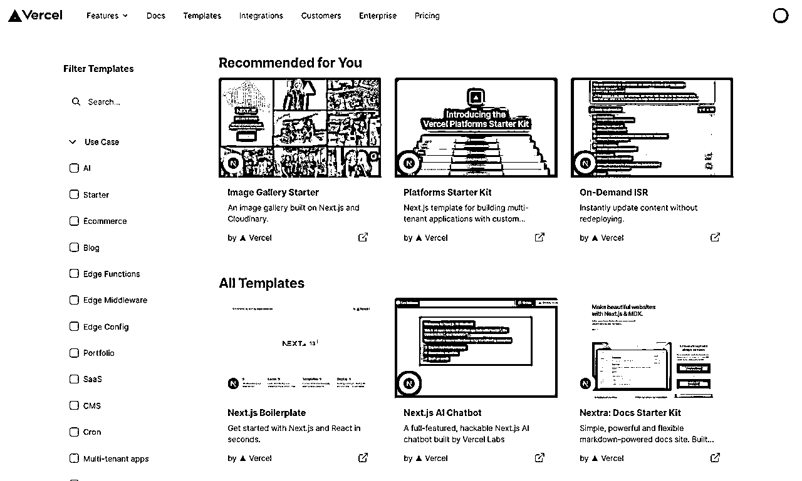

哥飞之前在即刻分享过一个案例：有位朋友三月份就把域名注册好了，但一直闲置着没用。后来他看到哥飞推荐的 Vercel 模板中心，就在里面挑了一个现成模板，改个名字直接上线了。之后把项目提交到 ProductHunt，被不少 AI 导航类网站收录，结果拿下了两千多条外链。谷歌那边也开始有了搜索流量，甚至国外很多营销号都主动跑来帮忙推荐。说穿了，这年头只要你的产品和 AI 沾边，用户就会心甘情愿地帮你免费传播。

另外，codecanyon 上也有大量现成源码，功能完整，价格很亲民，通常几十美元就能搞定。比如你打开 codecanyon.net/search/ai 这个页面，就能看到不少 AI 相关的现成方案。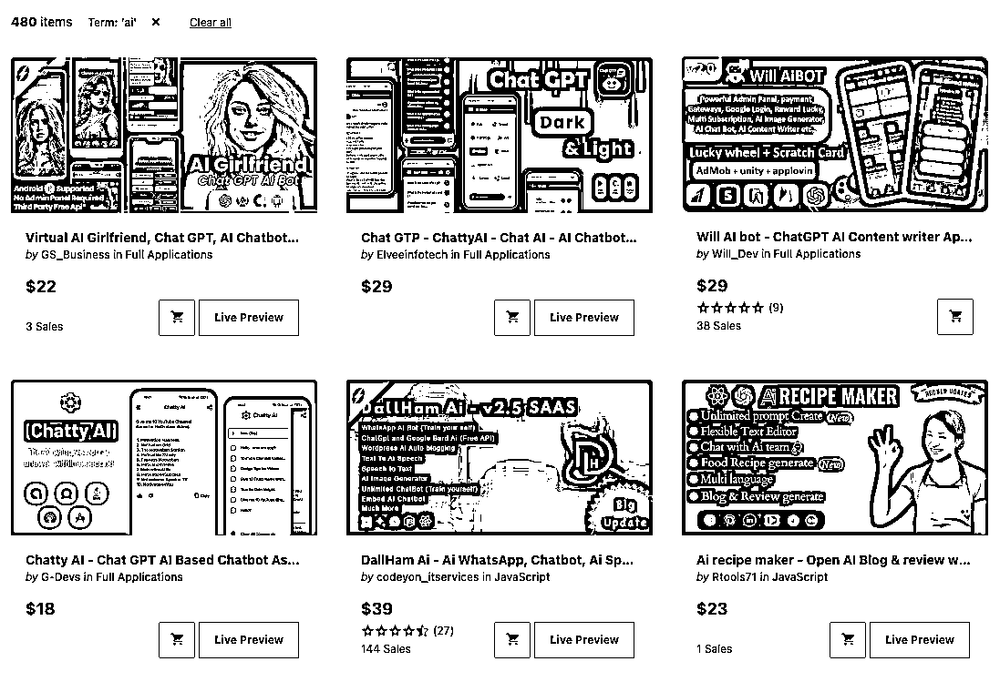

我另一个朋友手里正好有一个完美的单字母域名，一直想做短链接网站，可他自己不会开发，域名就这么白白放着。直到他听说我聊起 codecanyon，上去找了一个现成系统，只花了 225 美元，现在已经成功部署上线了，连 Stripe 收款都在后台简单配置一下就能正常使用。我把整个网站完整体验了一遍，讲真，这种功能要是找人定制开发，花几万块都不意外。可在 codecanyon 上，225 美元就全搞定了。

今晚的分享就先聊到这儿，希望能给大家带来点启发。