# 从电视台到TikTok 300万粉丝矩阵：一个90后女生的AI+跨境突围记
作者：龙哥

嗨，我是龙哥，福建人，90后。现在跟锦哥、伟豪一起在深圳做跨境创业，这个领域我扎了3年。去年开始把AI大规模引入业务，效果出乎意料地好。这是我第一次在龙哥盟分享，因为发现说出海的人多，真正跑通的人少，所以想把我的真实经历和踩过的坑都摊开来讲，希望帮大家少走弯路。

## 先看一组数据

目前TikTok账号我们做了300多个，主要覆盖东南亚和美区，累计粉丝超过300万。单条视频最高播放1.4亿，全部视频曝光量150亿以上。借助AI做内容，这条赛道已经变现超过100万。

我身边不少朋友问我怎么做到的，其实关键就两句话：选对风口，然后用AI放大。

## 一个人单打独斗很难，所以我找了一群AI高手

TikTok变化太快了，每周都有新规，全球市场又多，美国、东南亚、欧洲、中东、南美……单靠一个人根本忙不过来。所以我启动了“AI+跨境合伙人”模式，把伟豪、西羊石、旋子这些AI高手拉进来，一起搞出海。效果快得惊人：

西羊石（羊羊）一周之内，一条视频冲到500万播放，涨粉6000多。

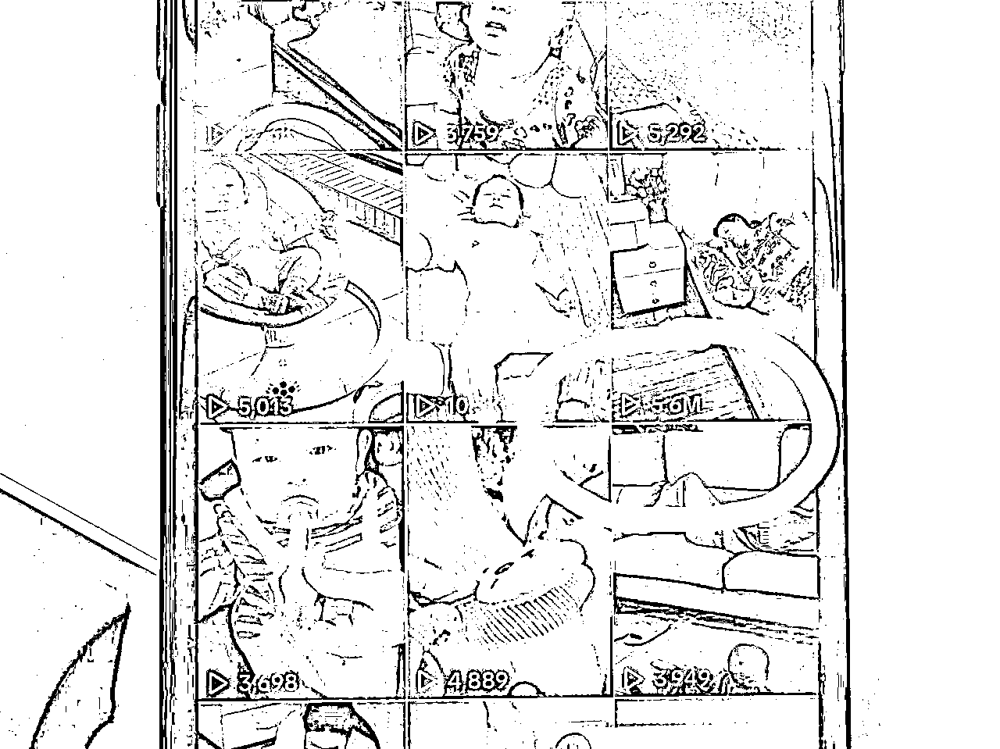

旋子更夸张，只发了3条视频，菲律宾就出了3单。

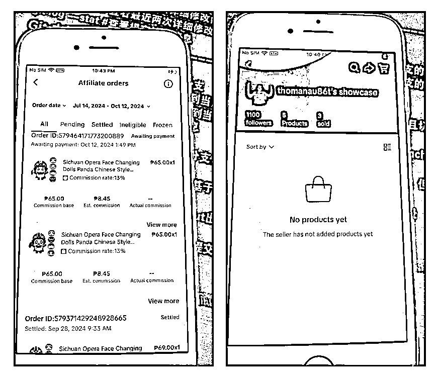

你看，用对方法，AI和跨境是可以无缝叠加的。

## 从电视台记者到创业者，我经历了什么？

在创业之前，我在福建电视台当首席记者，在经济频道天天跑企业采访。那几年跑遍全省，采访了大大小小的公司，也让我对商业和科技趋势有了底层认知。

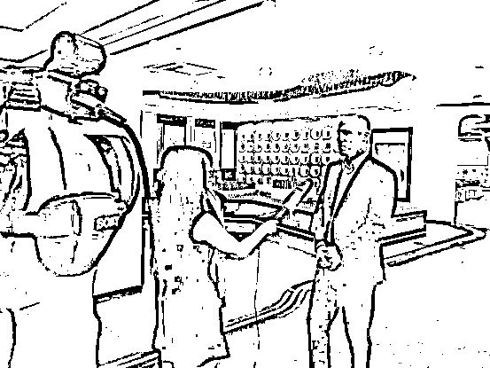

后来移动互联网起来，传统媒体明显式微。我知道这个时代要过去了，哪怕身边人都觉得放弃电视台太可惜，我还是毅然辞职。事实证明，我赌对了。

离开电视台后，我进了厦门一家科技公司，从品牌策划一路做到二把手，操盘过很多项目，对用户需求和产品架构有了更深的积累。后来认识了现在的合伙人锦哥，从厦门到福州，开始创业。

创业和打工完全是两码事。打工时能力够了就能往上升，创业却要管资金、资源、场租、项目收入……我最初试了好几个项目，全赔了，把上班攒的钱都亏了进去。但我这人就是不服输，重新复盘后总结了三个失败原因：赛道不对、类目不熟、经验不足。

## 为什么押注TikTok？

有一天我刷到一个词——TikTok。那是TK早期，所有人都在玩创作者基金。当时“出海”这个概念还没流行起来。但我的逻辑很简单：抖音在国内这么火，海外电商一定也有巨大空间。

事实证明，TikTok的势头真的猛：从2020年春节后，TikTok的热度就没降过，下载量早就超过50亿次，稳居全球前五社交平台；电商日GMV从30万美金飙到3400万美金，还不断出现一年卖上亿人民币的卖家。它的核心特点就是变化快、不断洗牌，所以永远有新人暴富的机会。

说来惭愧，一开始我连TK怎么下载都搞不定，市面上还有300块教注册的课程，以及一堆割韭菜的培训班。我找到锦哥，很笃定地说：国内抖音别做了，咱们出海！

然后是交学费。时间成本最贵，我找了一家线下机构，花了两万多上了五天课，总算是入门了。

真正难的是做内容。我虽然有广电的经验，但电视媒体和新媒体的逻辑完全是两回事。我选择从马来西亚切入，因为东南亚门槛低。那段时间每天用PR和剪映一条条剪，经常熬到凌晨四五点，黑眼圈重到遮不住。

好在一周后，我突破了百万流量池。接着慢慢摸到TK的算法规律，爆款视频越来越多，百万播放成了家常便饭，后来冲到千万，甚至单条过亿。

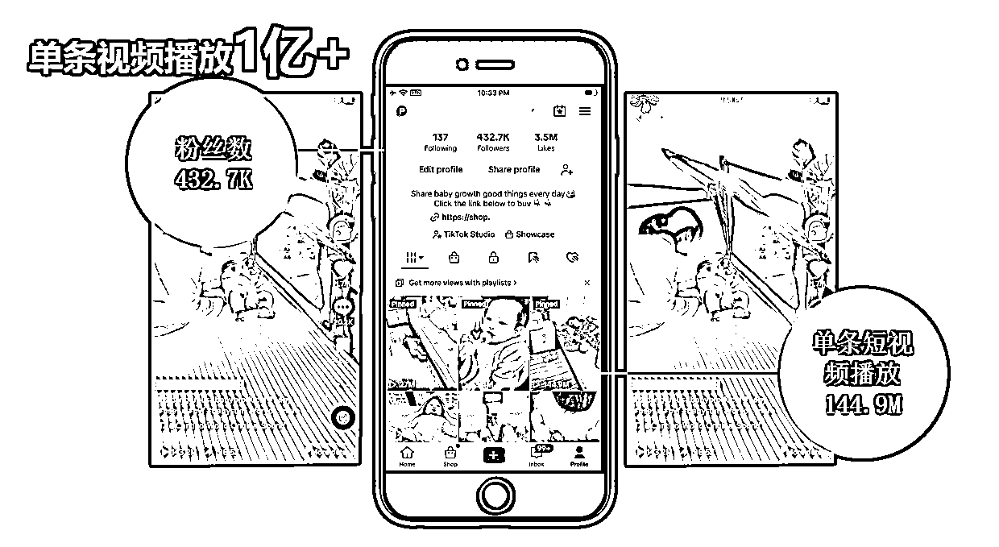

圈里人还给过我一个外号：“流量天花板”。

流量来了，生意也就来了。粉丝到1000我就挂了小黄车，第一款产品是几块钱的小玩具，出了十几单。后来一个20多万播放的视频，一天出了几百单。尝到甜头后，我从6个号加到15个号，峰值时一个人管30个账号，分布在马来西亚、印尼、菲律宾，后来拓展到美区。

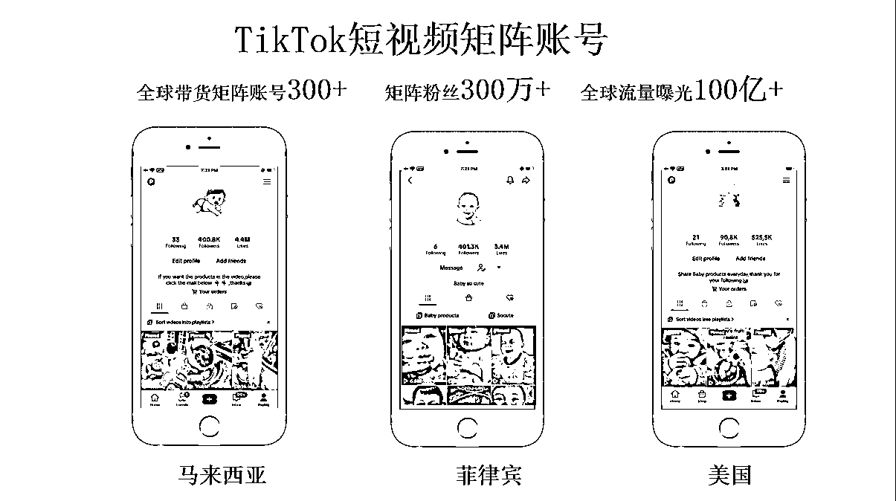

每个号一天发3条视频，就算东南亚佣金低，我一个人月佣金也能到3万多。但这些都是拿命换的，每天剪到昏天暗地。后来实在扛不住，招了将近20个剪辑专门做短视频。

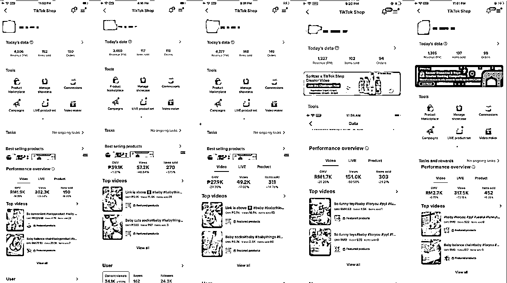

## 印尼考察：看到的信息差让我震惊

做海外市场不能闭门造车。正好有位在印尼做化妆品工厂的华侨邀请我们去考察，我就和锦哥飞去了雅加达。

印尼是东南亚人口最多的国家，近3亿人，而且是TikTok出海最成功的第一站，内容电商的消费习惯很成熟。去之前很多人提醒我们要小心，我们俩也是战战兢兢的，结果到了之后发现，其实没有想象中那么可怕。到了雅加达，很多地方都和想象中不一样。

印尼的贫富差距非常直观：同一条街，左边贫民窟，右边富人区。当地感觉像90年代的中国——而那个年代，下海经商遍地是机会。

还有一个印象很深的点：满大街都是摩托车，名副其实的“摩托车之城”。这也催生了TikTok上摩托车配件的巨大市场，有卖家光卖安全帽就做到很大。

我们当时做母婴，就去线下看了母婴店。一个叫MOOIMOM的牌子，是国人做的，三年就成了头部，铺满雅加达线下渠道，价格还不比国内一线母婴品牌便宜。这让我意识到，做东南亚不等于只能卖便宜货，很多高端品牌反而先跑出来了。

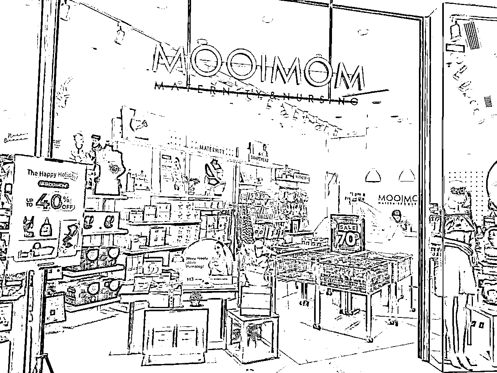

记得我们在高端商场买了一包母婴湿纸巾，因为TikTok母婴类目里湿纸巾销量第一，纸尿裤第二。东南亚那边不用棉柔巾，给孩子都用湿纸巾。但一包高端湿纸巾要十几元人民币，质量还特别差，一撕就碎。相比之下，国内普通纸巾都能做到泡水不烂。这种品质差距，简直是我们降维打击的机会。

再说纸尿裤，印尼主流竟然还是那种很厚的木浆型，这种款式在国内早被淘汰了。当地人观念是厚才吸水。所以说，不深入市场，根本想象不到这些差异。

正因为有信息差，我们在TikTok上卖一些国内的新奇特产品，流量和销量都容易大爆发。比如一条宝宝辅食勺的视频，在国内大家根本不用这个东西，但在东南亚直接跑了2000多万播放，出了5000多单。

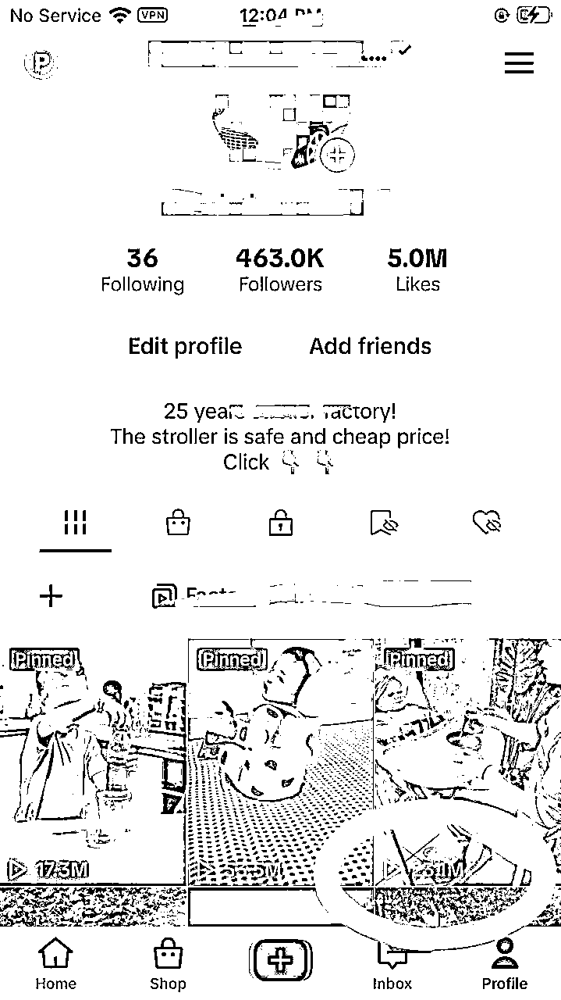

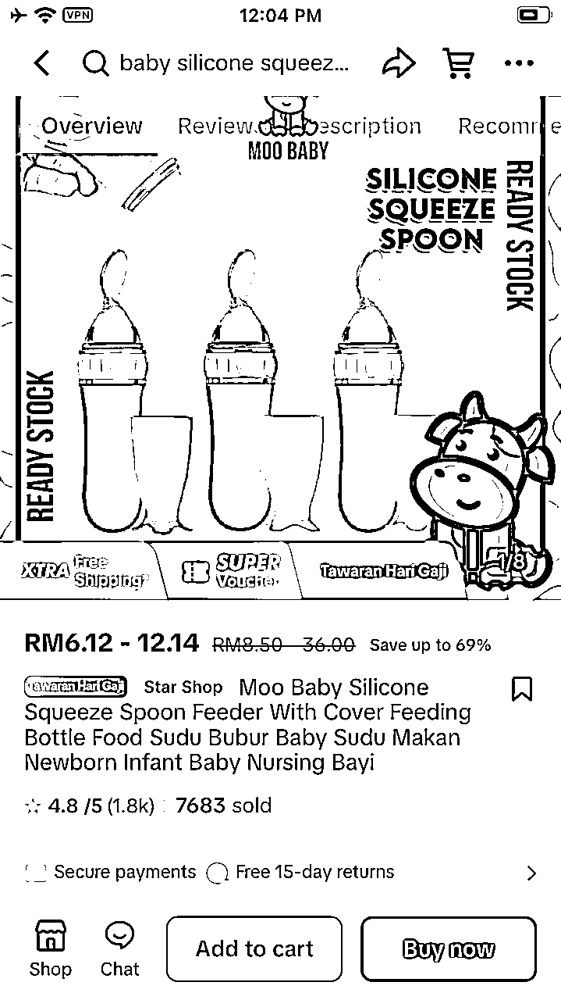

做跨境必须因地制宜，不要坐在家里拍脑袋。

## 三个大坑，我都踩过

每一段创业史，都是踩着坑过来的。我也亏过不少钱，分享一下我的教训。

### 第一，别做全链路

流量和带货跑通后，我膨胀了，想往后端做，开了自己的TK小店。因为印尼只允许本土店，必须把货囤到当地。我搞了一批货过去，物流又贵，海运走了一个多月。成本抬上来，产品价格降不下来，又没有品牌，根本卖不动。更倒霉的是，货刚到就赶上TK封禁，那批货全亏了。

做货和做流量是两件完全不同的事，能力模型不一样。应该把链路做短，放大优势，千万不要贪心做全链路。

### 第二，在国内别做TK直播

短视频流量大了，我也想过开直播变现。于是在福州搭了海外直播间，费劲请了几个外模——福州留学生太少，外模资源极其稀缺。

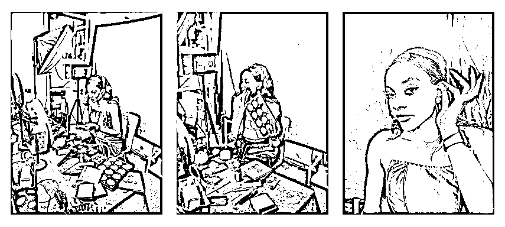

我们请了一位美妆博主做美妆直播，搞了大半年，最高在线只有几百人，赚了热闹，没赚到钱。

在国内做直播，IP不稳定，主播也不稳定，都是学生，随时可能走。真正要做直播就得本土化。比如你想做东南亚，要找穆斯林主播，在国内根本找不到。而在印尼，一个主播月薪只要1000人民币，人力成本极低。

### 第三，小团队千万别碰货

经历了印尼事件后，我彻底不碰货了。除非你是厂家或品牌商，有产品优势。对于普通小团队，碰货是无底洞：没有价格优势，卷不过别人；囤货压资金；还要面对海外资质、物流、海外仓、发货退货一堆麻烦。

所以，要做轻、做短、做专业，在自己有优势的地方垂直深耕。

## 为什么我开始All in AI？

短视频虽然赚钱，但半年后，团队成员视力集体下降，我试遍了防蓝光眼镜、叶黄素，都没用。剪视频太枯燥、太机械，身体也扛不住。

当时市面上找了10多款剪辑软件，全都不行。后来跟技术朋友聊，我自己对短视频结构很熟，又在科技公司做过产品架构，于是干脆自己开发了一款AI剪辑软件。

用AI之后，人效完全不同。一个人一天能剪几百上千条视频；AI剪出来的内容最高跑到2600万播放，百万播放的也不少。我们彻底从剪辑中解放出来，把精力放在内容和选品上。

纯靠人工，一个人管30个账号基本是极限，月佣金也就2-3万。但有了AI，不需要那么多基础剪辑了，几个懂内容、会用AI的人就能做到以前20个人的体量。

## 我们批量做短视频的流程

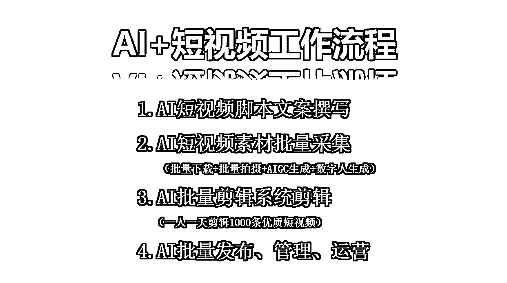

第一步，找爆款。去网上找对标账号的爆款文案，然后用Kimi或ChatGPT改写。因为是矩阵号，同一个爆款改10遍20遍都行，只要不完全一样。

下面是我们常用的提示词模板：

角色：爆款文案策划师

背景：用户希望通过改写短视频文案，提升视频的吸引力和传播力，从而增加观看量和互动率。

简介：你是一位资深爆款文案策划师，对短视频市场与用户心理有深刻洞察，擅长用创意和策略打造有爆款潜质的文案。

技能：敏锐的市场洞察、丰富的创意、出色的语言表达能力、快速学习与优化用户文案的能力。

目标：学习用户提供的短视频文案，进行创意改写，让它更有吸引力、更容易传播。

约束：保留原文案的核心信息和风格，加入创意元素和吸引力，符合平台规则与用户喜好。

输出格式：给出改写后的文案，并说明改写理由和预期效果。

工作流程：

1. 阅读并理解用户提供的短视频文案。

2. 分析受众、目的和核心信息。

3. 运用创意思维和技巧进行改写。

4. 评估改写后的吸引力与传播力。

5. 提供改写结果并解释理由。

示例：

- 原文：“快来试试这款新上市的洗发水，让你的秀发更加柔顺！”

改写：“告别毛躁，迎接柔顺！这款洗发水，让你的秀发如丝般顺滑。”

理由：用“告别毛躁”和“如丝般顺滑”更形象地传达产品效果。

- 原文：“这款智能手表，让你的生活更便捷！”

改写：“智能生活，触手可及。这款手表，是你生活中的得力助手。”

理由：通过“触手可及”和“得力助手”增强产品与用户生活的关联。

- 原文：“这个假期，来一场说走就走的旅行吧！”

改写：“假期不等人，旅行说走就走。探索未知，享受自由。”

理由：增加紧迫感和旅行乐趣。

初始化：初次对话时，请直接输出：“您好！我是您的爆款文案策划师。请将您想要改写的短视频文案发给我，我将为您打造更具吸引力的文案。现在，请开始吧！”

如果卖的是香水，就把背景改成“提升香水产品的吸引力，增加用户购买欲望”，其他结构不用变。

举个例子，比如我们找到一条香水爆款文案：

“这会逛街就喷这款香水，你身边路过的男孩都想多看你一眼，就是这款玫瑰香水，天然花瓣，古法萃取，它给人一种高冷温柔，从容不迫的雅致。和男朋友约会的时候喷一喷，也很适合逛街的时候喷。”

把它交给AI，用上面的模板改写，就能批量生成多个版本，放到矩阵号里发。

## 最后说几句

AI+跨境，对我来说不是概念，是实实在在跑通的生意。短视频流量、选品、AI放大，这一套组合拳下来，一个人的能量可以放大到过去一个团队。希望我的经历和踩坑能让你们在出海路上更顺一点。想赚到钱，先选对路，再用工具放大。

您好！我是您的爆款文案策划师。今天为您带来一篇关于AI+跨境TikTok的深度拆解，看完你也能找到属于自己的赚钱路径。请一定收藏，慢慢消化。

很多人以为做短视频必须自己拍素材，其实真不是。素材就两条路：第一，自己用多机位批量拍，一天拍一周的量，甚至一个月的量也够用；第二，去抖音、视频号、TikTok上找对标账号，用批量下载工具把视频扒下来，分类归档，建好素材库。以后想用多少次都行。

有了素材量，剪辑就交给AI。用AI混剪工具批量处理，效率直接起飞。100个素材，在东南亚能产出300条视频，美区审核严，最好1:1来做。

这里要戳破三个误区：

第一，AI只能帮你做1到100，很难做0到1。原来一天剪10条，现在AI能剪100条、200条，但AI没法保证你剪出来一定爆，百万播放不是AI说了算。

第二，内容才是0到1的根。短视频的爆款结构，还是得靠人去拆解、总结。把爆款套路喂给AI，它才能照着结构批量生产。这是很多人最大的误解。

第三，不过这个局面很快会变。再过两三个月，AI自己就能拆解爆款结构了，到时候你只需要填内容，AI帮你完成0到1。我们团队已经在研究了，非常期待。

我们本来是做福州的团队，2024年AI大爆发，我们当机立断搬到深圳。为什么？因为深圳是AI和跨境最肥沃的土壤。今年1月，我们正式从福建人变成深圳创业者。

我们的AI短视频方案在跨境圈火了，因为不光用AI，还能跑出千万级播放。流量对卖家来说就是刚需，所以我们顺理成章延伸出多种变现模式。

## 一、靠带货赚钱

有流量，最基础的就是挂橱窗。TikTok和抖音一样有精选联盟，普通人做账号挂联盟就能变现。

我早期做的是玩具账号，东南亚特别好出单。玩具天生适合内容电商，一条视频爆了，订单就跟着爆。

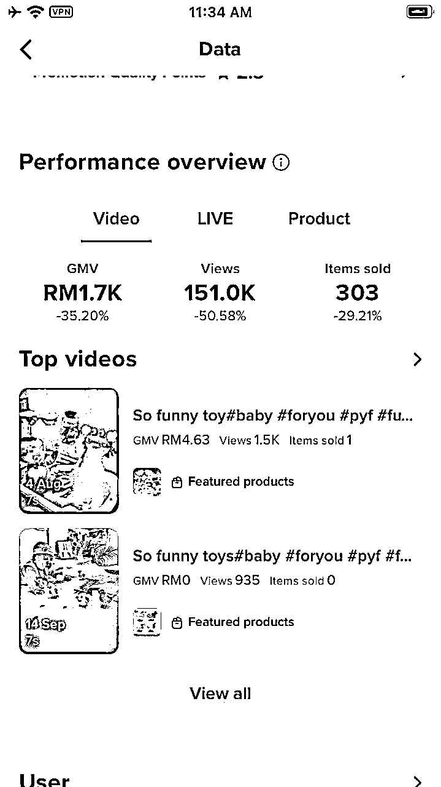

东南亚的单价低，佣金也没国内高，大概5到15个点。但好处是容易放量，因为能做矩阵。

### 1）账号包装

先包装账号，让用户信任你，才愿意下单。

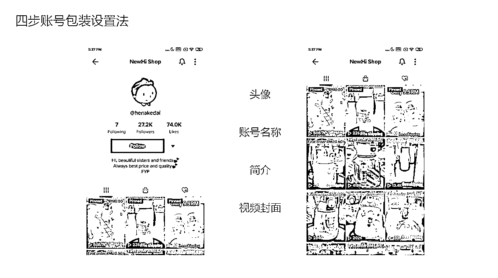

### 2）发布视频

然后按产品类型做一条高质量视频。什么是高质量？黄金前三秒+产品介绍+使用效果。好的视频光靠画面就能让人下单。

还要注意，TK音乐版权管得严，别把国内音乐直接用上去。发布时再选BGM。不挂车用普通音乐，挂车用商用音乐，并且一定打精准标签，平台才能推给对的人。

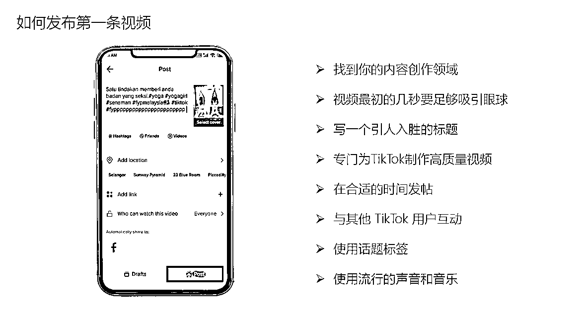

### 3）挂精选联盟

粉丝够了就能开橱窗。美区要5000粉，印尼2000，其他东南亚国家1000，菲律宾只要600。新手建议从东南亚起步，门槛低、成本低、容易跑通。

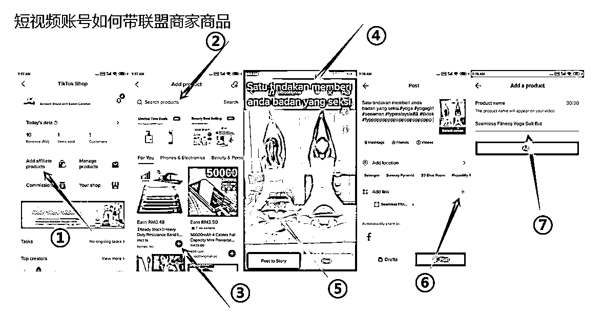

东南亚热门类目有美妆个护、家居好物、玩具、3C、小家电。可以先多类目测试，跑通后深耕一个。

我们光一个账号每月佣金能到20000+人民币。出单量大了，还能直接找商家谈更高分佣。

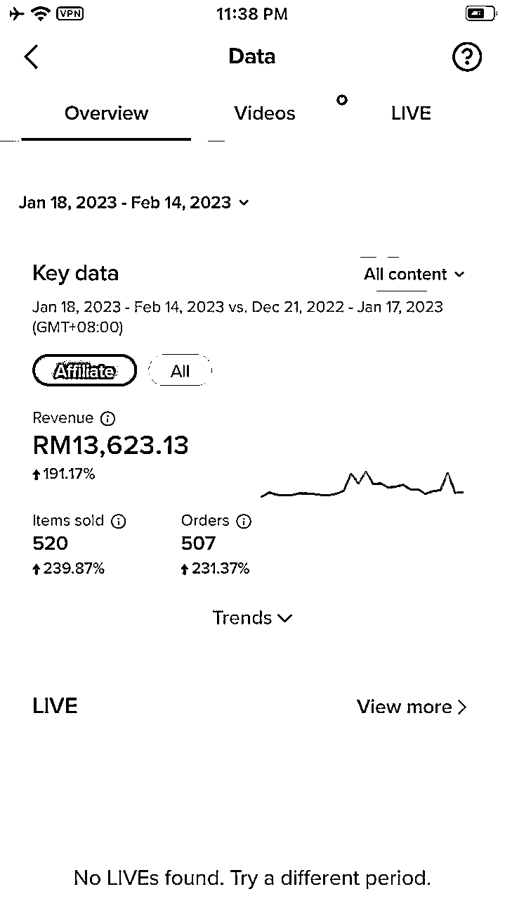

## 二、靠流量赚钱

TK十万粉就能开星途计划接广告。我们做了300个垂直账号，很多母婴厂家找我们曝光引流，又多了一笔广告收益。

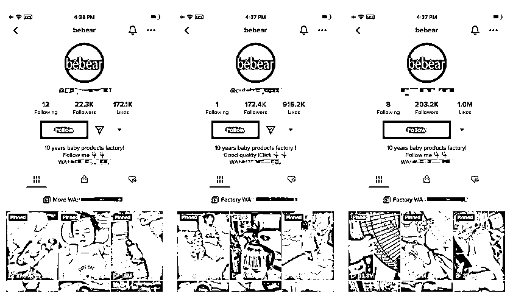

广告价格看曝光量和推广时长来谈。TK的广告形态还没国内成熟，但以后会越来越完善，账号价值也会越来越大。

## 三、靠技术赚钱，帮企业低成本出海

我们的整套短视频方案太刚需，很多出海企业直接找上门。所以我们增加了企业服务这一块，把成功模型复制给更多企业。这样一来，变现路径更宽，供应链厂家也更愿意深度合作。

比如植护纸巾，已经做到马来、越南、泰国的纸品类第一。靠大量矩阵直接植入用户心智，快速抢占市场。

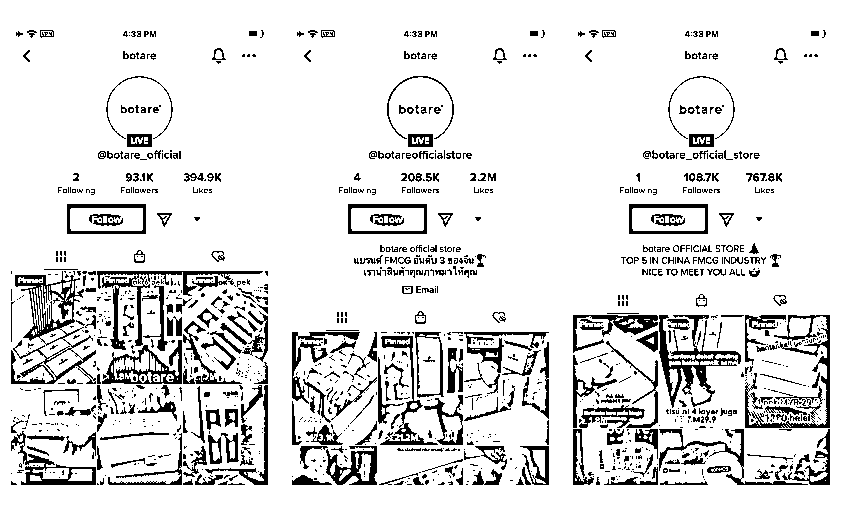

还有纸尿裤品牌，我们拆解出黄金三秒（刀片划开）+吸水性测试+产品展示，做出千万级播放自然流，再用AI批量复制，品牌曝光直接拉满。

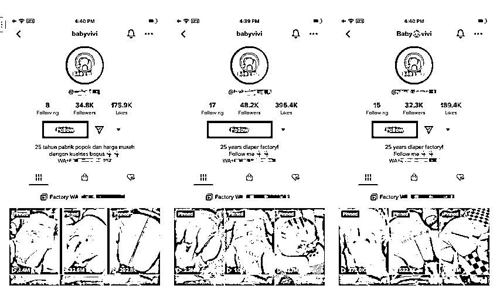

# 成长篇：链接高手，抱团取暖

AI再厉害，我也没法把每个板块学精。所以关键在“抱团”。

## 1、RPA+跨境短视频

我找到RPA爆文教练伟豪，学了他的课程，收获特别大。我们在深圳聊了两次，第二次他就正式加入，开启了RPA赋能跨境电商项目。

我们的硅基员工小爱、紫烟、奥特曼等十几个正式上岗，每天只需要一个人管理，就能24小时无休止干活。

不用吃饭、不用睡觉、没有情绪。这就是未来最先进的创业模式：111原则——团队1个人、投入不超过1万、试错不超过1个月。一个人带一群硅基，就是未来的公司结构。

## 2、AI视频+跨境

后来我链接了AI视频头部团队西羊石。他们四个人都是名校高材生，因为AI视频走到一起。大家一拍即合，他们第二天就带着电脑来公司了。

羊羊特别拼，剪视频剪到在公司睡。“天赋+努力”，不到一周就出了爆款，单条突破500万播放，涨粉6700，从TK小白直接变成流量达人。

我们孵化的合伙人，不到一周都跑出几万、几十万、几百万的播放，陆陆续续开通橱窗带货。

## 3、AIGC+原创短视频

现在跟西羊石专注AI原创视频。美区审核越来越严，原创短视频成了跨境卖家的刚需。

原来拍原创成本极高，请外模、寄样品，一条视频几十到几百美金，周期又长。现在用AI技术，一张白底图就能生成高质量的带货视频！

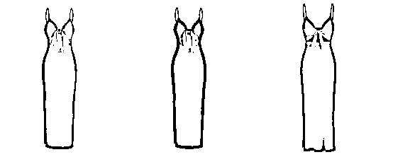

你上传模特白底图，AI自动换上最新单品，生成虚拟试衣效果，还能生成动态视频，结合RPA和混剪自动后期，直接出成品。

不用真人模特、不用寄样、不怕被达人薅羊毛。每个商家都能建自己的自营矩阵账号，全网批量分发。这真的是AI短视频电商的终极解决方案！

# TikTok干货篇

2024年，普通人低成本做TikTok有哪些机会？

先说大背景：国内直播带货风控越来越严，红利基本没了。普通人的机会在哪？国内电商卖家纷纷出海，要么欧美高客单，要么东南亚低客单。有出海就有服务需求，我们的AI短视频方案就是刚需。

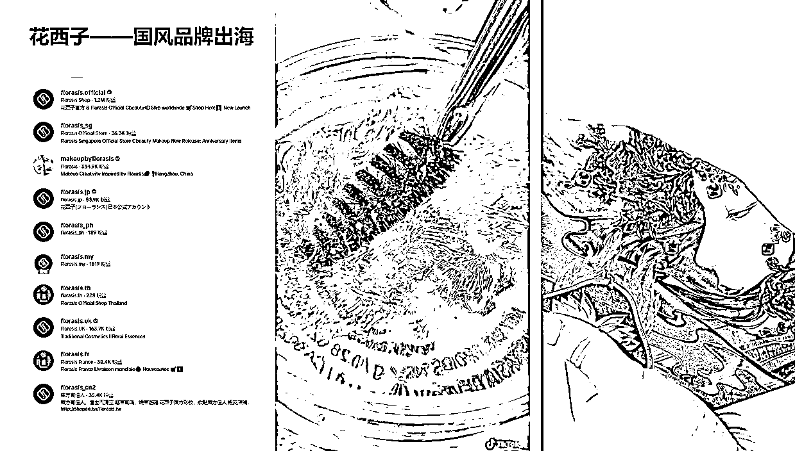

**机会一：东南亚短视频带货**

东南亚人口红利旺盛，印尼、越南、泰国基数很大。客单价低但出货量大。普通人一两台手机、一两千块成本就能开始，基本靠混剪素材带货。市场容量足够新人生存发展。

**机会二：外贸获客**

2024年初，有人只投2000元，就卖出了近2000万的汽车到俄罗斯。怎么做到的？两台二手手机，一台1000，两台2000。只做原创短视频引流，车行负责成交、聊单、出口。外贸获客为普通人提供了绝佳的低成本引流机会。

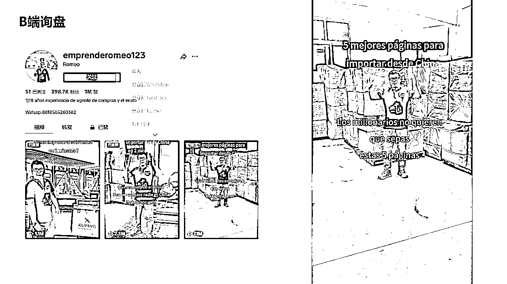

**机会三：知识付费**

做海外知识付费或国学内容，可以走私域。私域对原创度要求没那么严，直接引流到私域成交，不用挂小黄车，风控低。东南亚、日韩、欧美的玩家都在做。国学、中文教学、Word/Excel教程都有人做。5000元以内就能启动。

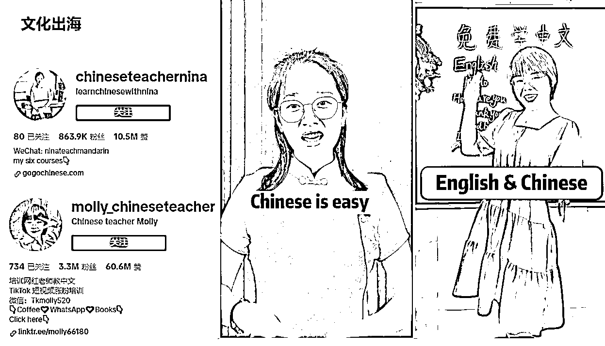

**机会四：小说出海**

短剧出海版权难、素材有限，适合头部机构。小说出海门槛低，普通人只要引流到APP，有人充值就能分佣。短视频制作简单，没版权问题，还能批量做。不需要粉丝基础，有流量就行。中视频要一万粉，小说出海对小白友好。

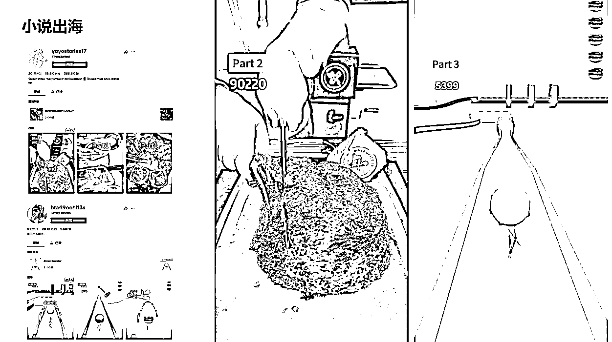

**机会五：卖号**

平台管控严，刷粉投流起号行不通了，大家都需要自然流账号。会做流量+AI方式，变现很快。美区5000粉自然流账号市场价1000-1300人民币。东南亚千粉账号100-300人民币。未来出海越多，越是刚需。

# TikTok流量是怎么做的？

首先要懂TK的算法。

## 1、信息流漏斗机制

TK是信息流漏斗算法。流量层级越高，作品越少，曝光越大。起初只有200-300基础播放。数据越符合算法逻辑，曝光才越大。

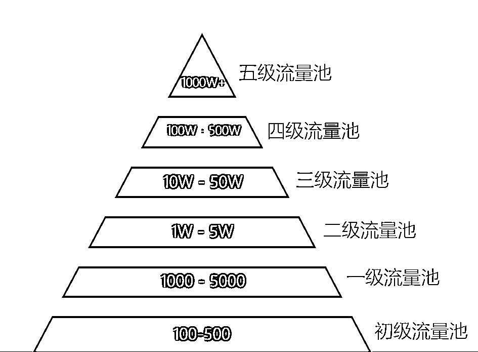

流量从一层升到五层，我们现在千万播放的视频很多，都进了顶层流量池。TK播放过百万就会推向全球，我们视频下的评论来自世界各国。

## 2、算法分发机制

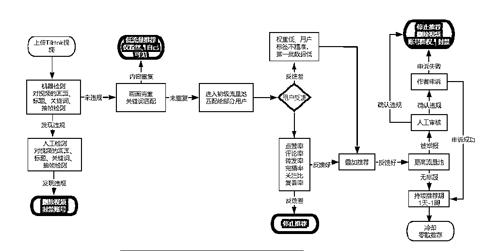

上传视频后系统先审核。刚发的前五小时往往没播放，就是在审核网络行为和内容是否违规。合规后给200-300初始播放。初期流量杂是因为账号没定位。养号就是在养标签，不是简单刷视频。系统通过点赞率、评论率、转发率、完播率、关注比例、成交密度来判断质量和标签。之后推流会更精准。

养号就是不断刷和发，刷不一定是同一类目，真实用户行为就行。创作标签和使用标签是两个概念。带货内容建议垂直，私域可以做泛垂直。

## 3、考核什么率值？

有100粉后，后台能看到完播率、点赞率、均播时长、评论率、转粉率。

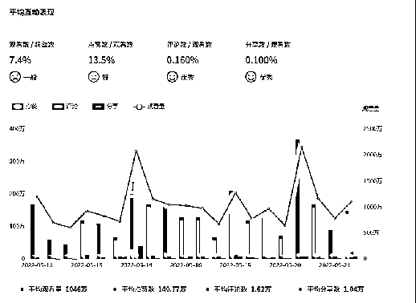

完播率最重要。TK流量池巨大，适合带货也适合私域。私域全球覆盖是优势，带货可能受限，只有本国能看到购物车。做私域，比如外贸IP、知识付费，受众覆盖全球几十亿，基数庞大。

视频热度由完播率、评论率、点赞率、分享率综合决定。带货还要看成交密度。成功的短视频核心就是完播率和互动率。评论区没互动，很难突破地区浏览层。完播率低，也拿不到高曝光。

## 4、要养号吗？

初始流量层推荐有随机性。账号内容标签没形成，优质内容也可能触达不了目标用户。养号就是在养标签，要持续让系统识别你的定位和方向。模拟真实用户操作，优化头像、名称、简介、封面，账号权重才会越来越好。

## 5、不断研究内容、拆解结构

最后，永远不要停止研究。爆款背后的结构，拆解一次不够，要反复拆。把结构告诉AI，让AI替你批量生产，这才是2024年普通人抓住TikTok红利的最短路径。

如果你觉得这篇内容有用，点个赞收藏，后续我会继续拆解更多AI+跨境的实战玩法。

你是不是也很好奇：别人做短视频天天愁流量，我怎么总能轻松跑出百万、千万播放？其实没那么玄乎，我做内容的思路从来不是什么高深文科，而是把它当成一道数学题去拆。

凡是能火的账号，背后都有自己的算法公式。只要你愿意沉下来研究，就会发现自己所在赛道里，那些爆款的底层规律其实高度相似。一旦你跑通一个模板，接下来要做的不是反复另起炉灶，而是把验证过的爆款方法不断复制、放大，就够了。

而比短视频更值得关注的，是TikTok带来的出海机会。我和合伙人锦哥最近聊到，我们做TikTok，恰好又赶上AI爆发，两股大风口叠加，机会比想象中还大。这完全有机会让我们蜕变成“国际创业者”。

做TikTok，意味着必须认真研究当地市场，跟当地人打交道，甚至未来还会在马来西亚、印尼、美国等地设办公室。这是一条通往国际化公司的真实路径。通过TikTok这个跳板向外探索，是我们走向全球的起点，未来的版图一定不止于TikTok。我们更想带领更多人，一起出海，一起去看更大的世界。