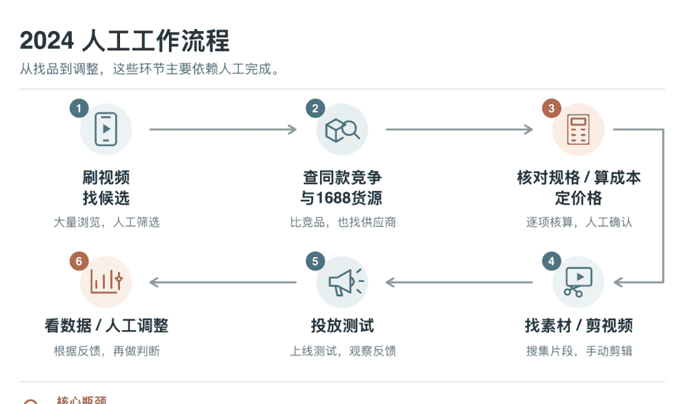
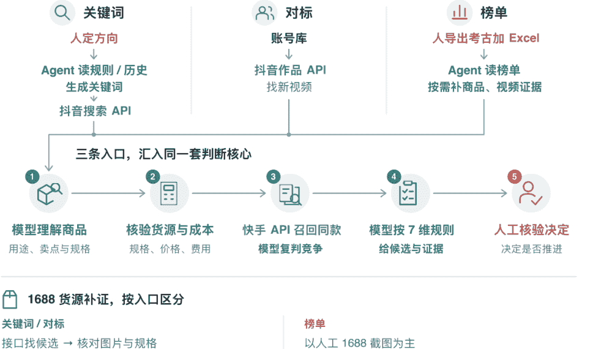
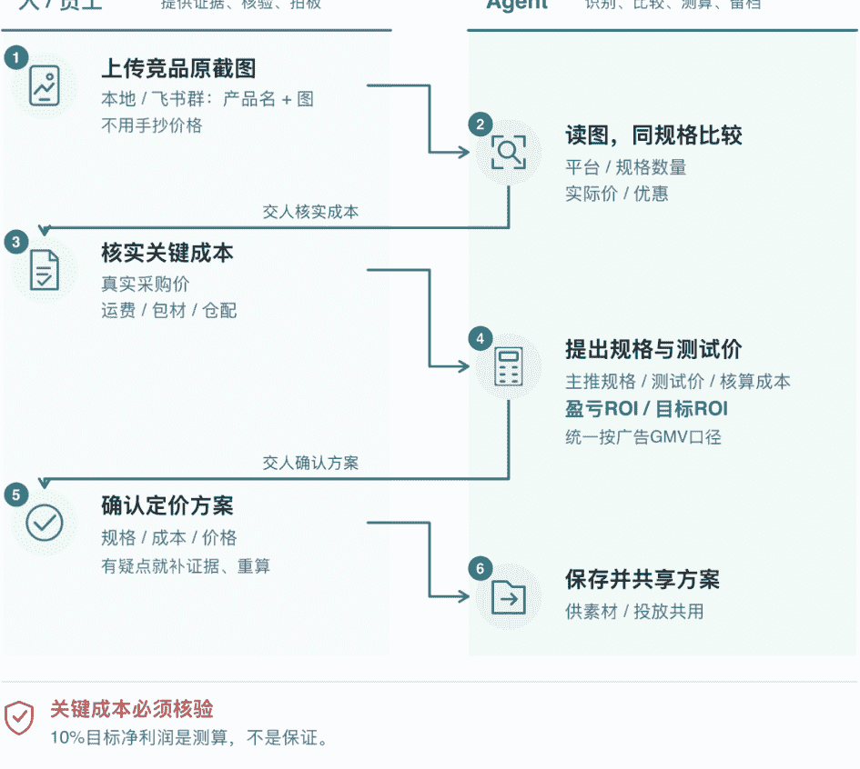
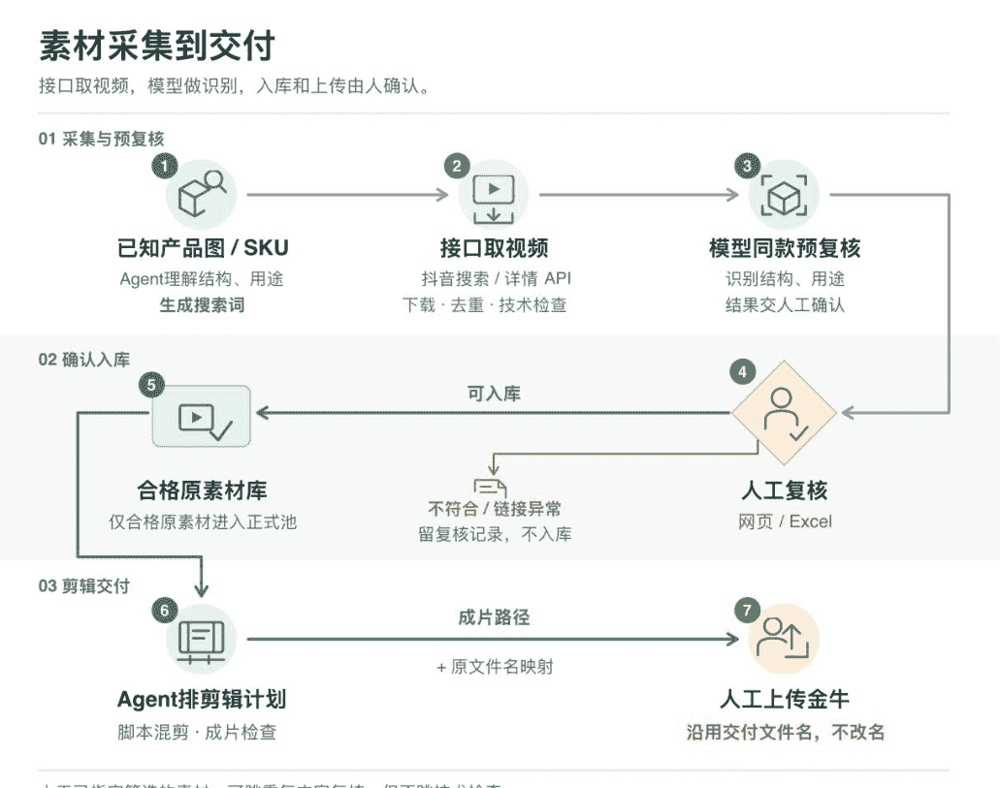
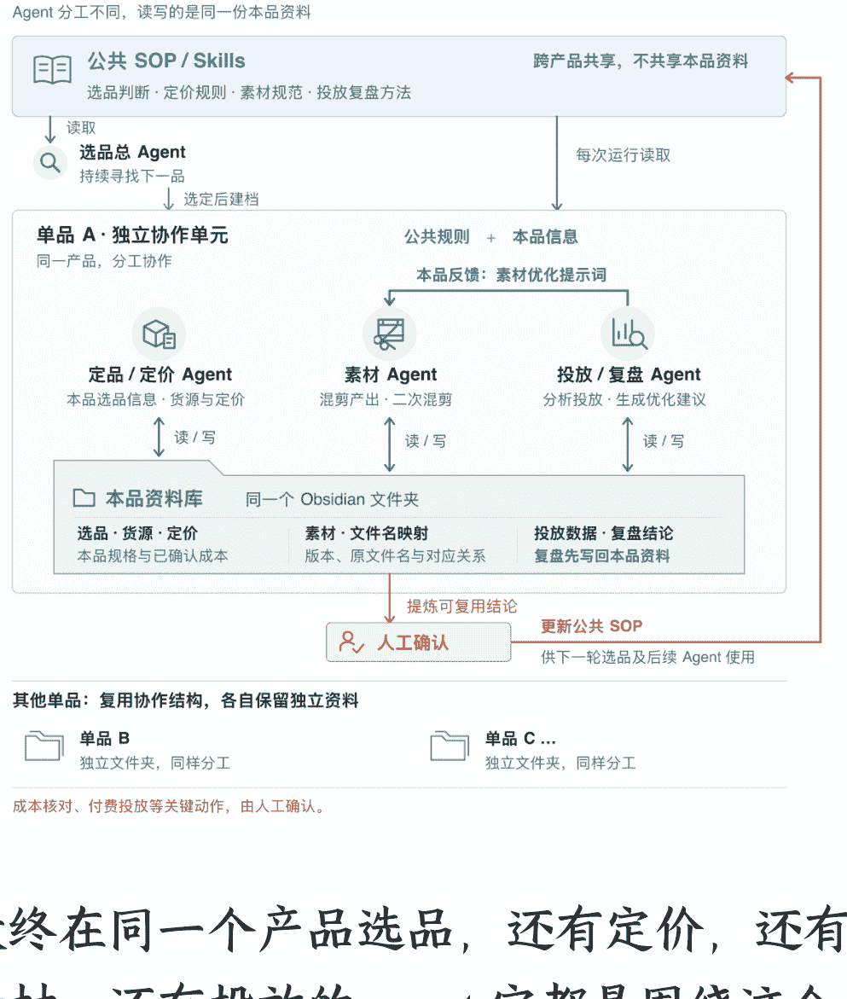
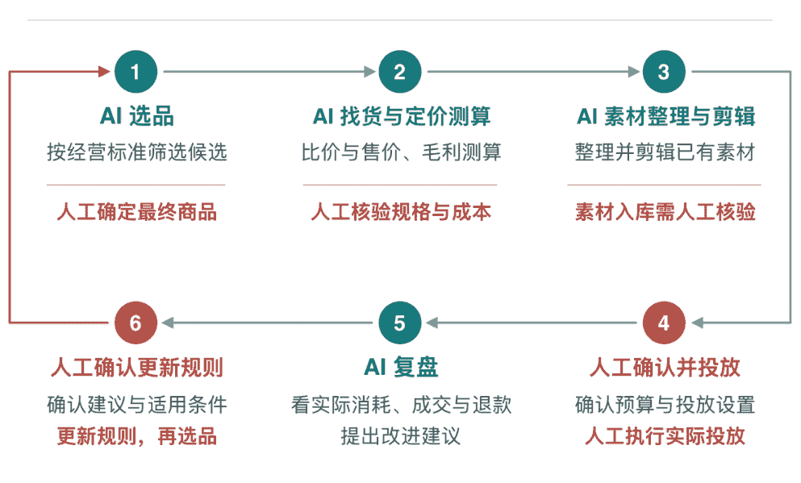
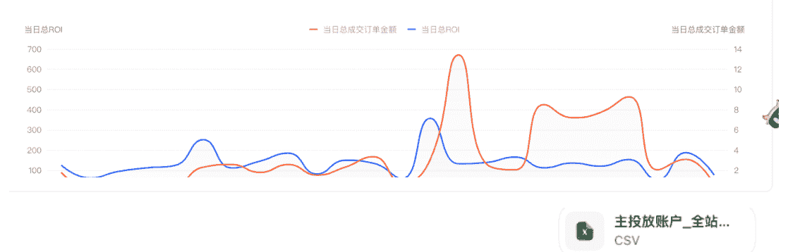
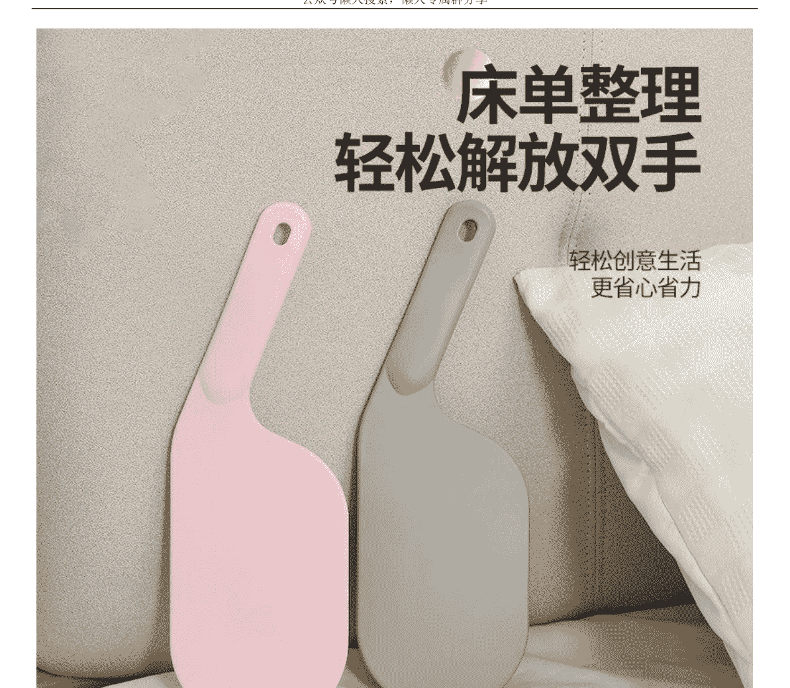
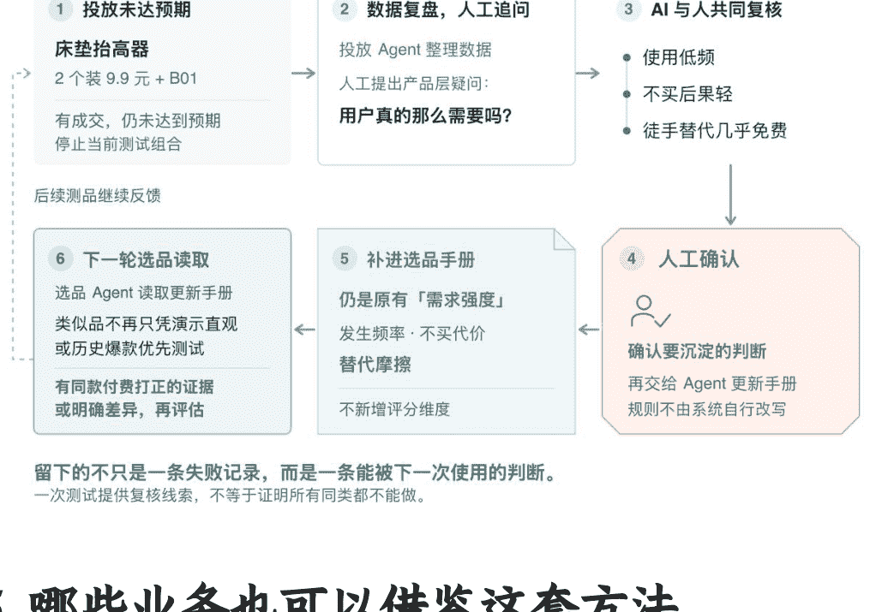

# 从纯人工到AI驱动：我如何重构了一支电商团队

前几天在社群分享里看到一篇关于AI改造电商业务的实战复盘，觉得特别有参考价值。作者迪伟原本是互联网产品经理，这几年一直深耕电商，今年借着Agent和各类AI工具的爆发，把自家快手单品付费业务彻底重做了一遍。他把这个过程总结成了一套方法论，今天我也用自己的话转述一下，希望能给同样在做电商、想提效的圈友一点启发。

先说说这个业务原本的样子。没上AI之前，整个流程就是典型的“人肉驱动”：先靠人工大量刷视频找品，确认货源、规格、成本，再拍素材、上投放。选品环节尤其费人，一天刷几百条视频可能都筛不出一个能打的品，而且判断标准全在个人脑子里，换个人就得重新教一遍。到了2024年下半年，品越来越难选，好不容易测出来的款利润还薄，人效问题直接被逼到了台面上。

所以今年他决定做一个彻底的改造——不是简单让AI帮着剪剪视频、看看数据，而是把整套业务流程打散，重新定义成“AI决策、AI执行、AI+人工迭代”的闭环系统。他做的第一件事，就是拆工作流。把主流程拆成选品、定价、素材制作、投放复盘四大模块，每个模块必须说清楚三件事：拿到什么输入，按什么规则判断，最终交付什么。所有需要人工确认的卡点，也提前写死在流程里。

**选品模块是重头戏。** 以前选品有三条路：一是每天海量刷视频搜关键词，二是盯对标账号看更新，三是去考古加扒榜单。现在他把这三条路全交给了Agent。关键词那条路，Agent会自己生成搜索方向，比如围绕“电动车收纳”拆出“前梁收纳”“手机水杯放置”等细分场景，然后调用抖音视频搜索API，批量拉取视频链接、标题、作者、发布时间，再下载下来分析。对标账号路由Agent定时抓取账号新作品，提取商品线索，跟历史候选取重。考古加那条路，人工只需要定期导出Excel，Agent负责读取、合并、提炼。三条路汇合后，Agent会去1688找同款货源，确认成本和运费，最后按一套沉淀下来的七项打分规则给出判断——需求强度、快手受众适配、画面可视化、来源验证信号、快手同款竞争、价格可行性、售后风险可控性。每个候选品最终都带证据回填到飞书表格里，人工只需要看Agent整理好的结论，再去核验关键信息就可以了。

**定价模块**相对轻一些。前提是产品已经确认要做，而且1688货源成本已经初步验证过。这时候Agent负责读图、对规格、比价格。人工把淘宝、拼多多、快手、抖音和1688的规格售价截图丢给它，它识别平台、款式、件数、优惠信息，再结合同行价位、自身成本和投放ROI预期，输出主推规格和定价建议。人工确认后，Agent再把结果同步到飞书和单品资料里，交给下一个流程。

**素材制作**也被拆成了连续可执行的动作。Agent先读取产品图、1688截图和确认后的SKU，提取外形、安装方式、用途和常见叫法，再把这个转成搜索词。比如三轮车前置收纳盒，“三轮车收纳盒”“前梁储物盒”“三轮车前置置物架”这些词都是它自己生成的。同时还会记下后置车筐、挂兜这类容易混入的款式，用来做排除。后面还有采集、预复核、整理物料、按规则剪辑和检查成片等环节，每一步都有清晰的交付物。

整个系统跑起来之后，变化是很明显的。以前人工一天能精筛几十条素材就顶天了，现在AI一天能分析上千条素材，效率至少是人工的五倍以上。但作者也特别提醒了几个坑：一是梳理业务逻辑、沉淀规则这件事本身非常费时间，不是一蹴而就的；二是涉及金额的投放环节，目前仍然需要人工操作，别指望全自动撒手；三是这套方法更适合手里已经有成型电商或标准化业务的人，如果你连闭环都没跑通，想靠AI一步到位基本是不现实的。

总结下来，AI Native的核心不是把某个环节换成人形外挂，而是把老师傅脑子里的经验、判断、决策逻辑全部梳理成规则，交给Agent去批量执行，人在关键节点做核验。这个过程很苦，但跑通之后，整个系统就能不断自我迭代，越用越顺。


如果你也在做类似的业务，这个思路值得拿过去试试。先从拆流程开始，把每一步的输入、规则、输出写清楚，再一步步交给AI。









在快手做单品投放，过去最耗时的是筛选、剪辑和反复试错。如今这套流程已经能交给智能体去跑，人只负责几个真正的判断关口。这篇文章拆解这套系统是如何运作的，并用一款实际跑过的商品，展示一条完整链路。

从内容说起。系统会先从抖音抓取大量视频，方式是调用搜索API，用多组检索词去翻，把视频编号、页面地址、作者账号、发布时间以及能拿到的互动数据全部拉回来，然后下载候选视频。

接下来用视觉模型做第一轮判断。我们会接Gemini那类能理解画面的模型，让它一边看视频，一边对照货源的图片，确认产品卖点是否清晰、使用场景是否符合预期。但模型说“行”不算数，一条内容能不能收进库里，还要人再核一遍，复核通过才允许进入后续的重组环节。

入库之后就开始自动剪辑。系统会给当前推的商品建一份正式的内容台账，把以前总结的剪辑经验做成可调用的标准流程。智能体拿到视频库和这套规则后自动生成成片，每条成片都有独立的编号，方便后面追溯。成片出来以后我们还要做终审，确认没问题的才会传到磁力金牛后台，再开始配置投放方案。

投放跑一段时间后，就到了复盘环节。我们之前积累的数据分析口径会和智能体对齐，比如关注投产比、开头3秒留存、点击表现、下单转化等指标。这套复盘方法也做成了标准模块，智能体拿着它去拆解后台报表，给出下一步建议——或许是调整计划，或许是拿现有内容做衍生。需要二次剪辑的话，它会直接生成一份剪辑指令交给负责剪辑的智能体。

如果某个品的数据很差，它会顺着选品、内容、投放整条链去排查，看问题是否出在选品逻辑上。每个品跑完，无论结果好坏，都要做一次深度回顾。假如发现选品方法需要修正，它会整理出下一轮的改进方向，把新结论写进公共流程里。整个流程走通后，多个智能体之间的分工和协作状态都能被完整记录。

同一个品下面，选品、定价、内容和投放这几个智能体会围绕它自己的独立资料库来协作。如果某个品在复盘时发现了值得通用的经验，比如选品规则有调整空间，这条经验会被提升到公共SOP里。每个智能体跑任务时，既会参考公共SOP的通用要求，也会结合这个品的具体信息。在Obsidian里的目录大致是这样的：

> 快手单品付费项目

> 00公共沉淀

> - 01选品方法论

> - 02素材模块

> - 03投放模块

> - 04案例复盘

> - 05技术模块

> - 06决策机制

> 00输入

> 01单品项目

> - 000单品模板

> - 2026015_正式打品_空调挡风帘

> - 2026016_平台受众适配复评

> - 2026016_正式打品快手窗口复核

> - 2026016_C线能力验证_拉车购物袋

> - 2026017_冰箱侧门收纳盒开测前复核

> - 2026017_画面可视化复评

> - 2026018_旋转六爪多功能挂钩开测前复核

> - 2026024_三品快手竞争状态策略复核

> - 2026024_二品快手竞争状态策略复核_6品

> - 2026024_优先级素材验证快手窗口复核_4品

> - 2026025_磁吸窗帘遮光扣定价复核

> - 20260702_正式打品_电动车车筐内胆包

> - 20260702_正式打品_风扇清洁刷

> - 20260706_正式打品_伸缩分层隔板挂篮

> - 20260707_正式打品_床单床垫整理抬高器

> - 20260708_正式打品_洗衣机水龙头自动止水阀

> - 20260713_正式打品_电动车防晒把套

> - 20260717_正式打品_台面锅盖架带沥水盘

> - 20260729_正式打品_厨房台面斜坡沥水架

> - 20260729_正式打品_裤夹衣架

> - 20260729_正式打品_双面发泡刮底密封条

> - 20260730_正式打品_双面蕾丝竹纤维洗碗布

> - 20260730_正式打品_水龙头过滤防溅水器起泡器

> - 20260813_正式打品_煤气灶防滑支架

> - 20260813_正式打品_免拆后视镜电动车手机...

> - 20260813_正式打品_磁力磁铁挂钩

> - 20260813_正式打品_一次性马桶刷

这套改造带来的变化很直观。生意本质还是那几个环节：找品、做内容、测试、复盘。但大量的中段事务已经被AI消化，人的精力集中在关键的审核和决策上。

选品智能体会持续跟踪任务，自动搜集线索、整理证据，我们只需要看它最终筛出来的候选品；内容智能体按照既定标准去采集和制作，我们只评估结果合不合格；投放结束后，智能体把数据整理成明确的操作建议，我们决定动不动、怎么动。

下面是系统整体运行的流程图，上面也标了哪些地方仍然需要人来确认。

整个运营闭环中，系统给出判断和执行支持，人来把关商品、预算和规则。

我自己感受最深的是三点。

第一，找品这件事不再占满整天。以前要花大量时间刷视频、翻数据才有几个候选，现在系统能直接跑第一轮筛选，一天可以分析上千条内容，效率大概是人力的五倍以上。

第二，搜集视频和剪片子基本不用人动手了。过去这一块特别费时，现在智能体按我们定的标准去找原片、做重组，人只要在最后把关。

第三，团队的知识沉淀比以前扎实得多。每个环节都有文字化的流程和手册，每测一个品又会增加新的经验和规律。以前做得好或不好，判断和教训常常只留在我个人脑子里，现在系统会复核自己的判断依据，确认有价值的修正就写回公共规则，带到下一轮选品里去，操作经验也就能持续累积下来。

拿一款“电动三轮车前置收纳盒”来走一遍全流程。

选品阶段的起点是抖音上一个对标账号更新了一条内容。智能体先调用Gemini看完整视频，识别出这是什么商品、核心卖点是什么、在什么场景下使用。看懂货之后，再拿选品手册里的标准去做初筛。手册里的维度有需求强度、快手受众适配度、画面可视化、来源验证信号、快手同款竞争状态、价格可行性、售后风险可控性，以及AI对找货结果的置信度。需求强度需要同时看使用频率、不买的代价和替代方案的难度，如果用户低频使用、不买也没多大损失、且随便找个现成东西就能替代，那这项最高只能给2分，就算画面再直白、内容再火也补不上。“快手受众适配”也不能只看着覆盖人数，还要追问有效购买人群是否够大、触发场景是否日常。

随后智能体调用1688的搜索接口找货，锁定候选供货商后提取规格和报价，评估有没有利润空间，判断值不值得进入测试。最终到底测不测，仍然由人来拍板。当时它给出的分析摘要如下：

- AI结构化状态：已结构化

- 需求强度：中

- 快手受众适配：中

- 画面可视化：强

- 来源验证信号：强

- 快手同款竞争状态：低拥挤

- 快手跑量空间预测：中

- 快手入场阶段初判：早期验证

- 价格可行性：强

- 售后风险可控性：中

- AI找货置信度：高可信同款

代表素材是一条三轮车收纳盒视频：04秒展示黑色前置收纳盒的外观；09秒演示把它卡在三轮机前挡板上的无损安装；12到16秒往盒里放进饮料、充电宝、手机和钥匙，展示容量。

智能体的综合判断是：这属于垂直品类的爆发机会，不使用它可以用口袋、车筐或挂袋替代，因此需求强度和人群匹配都只给中等；不过三轮车骑行者几乎每次出门都会用到，快手上的目标人群也高度吻合。最近90天出现了3条严格同款或近似款式，最高播放量约18万，说明这个方向有热度但还不拥挤。成本低、画面直观，只要素材和详情页能说清适配车架尺寸，就值得优先验证。当时标准履约成本6.20元，建议测试价15.90元，主推第4代纯黑色，副推灰、橘、蓝、绿四个颜色。最终是否开测，由我们人工确认。

我们审核后决定推进这个品。接着补充了淘宝、抖音、拼多多、快手各平台的价格和规格，让智能体结合这些横向数据给出最终定价。它建议：执行规格为第4代纯黑色单个装，售价12.90元；按9月4日更新的5.00元综合履约成本来测算；投前参考线按当时的平台扣点和退款假设，打平所需的回报倍率约为2.16，预留10%净利则要跑到约2.75。

定价完成后，内容智能体去调抖音的接口，找到同款视频批量下载，先由人工核验再入库。入库后，智能体按剪辑手册自动做重组。手册里对首轮批次有明确的控制要求：首批的目标是用可控成本验证方向，不是把家底一次全砸进去。内容池小，可以全部进入第一批；内容池大，就按开头优先级、播放数据、人工复核质量和素材差异度，先挑20到30条进首批。首批跑出有效内容后，再围绕有效的开头或组合延伸第二、三批。同一批内不能出现同一条原片在一条成片里重复使用，不能出现完全相同的来源组合，也不能所有成片都拿同一条内容做结尾。播放好、复核确定性高的素材允许多次使用，但来源记录不能丢。

第二批之后的重组必须以投放复盘的结论为导向，不再让剪辑智能体自由发挥。复盘时需要三类输入：有效素材、表现一般的素材、以及明确排除的素材。当时首批已经完成：从30条不重复的内容里按播放选出前20条，做成了20条成片，每条成片用指定的开头加两条平衡的随机尾部拼出来。前20个开头全部覆盖，每条素材作为尾部被使用2次；规格和全量音频解码全部通过；时长跨度约45秒到417秒，最大文件接近130MB。这一轮没有按价格、件数、优惠或赠品过滤内容，也没有增加价格信息；因目标账号还没分配，成片暂未上传和投放。交付物包括20条成片目录、首轮执行说明、人工上传清单、成片来源记录、拼接点抽帧总览。

到投放环节，因为涉及到实际花费和回报，这一步我们还是自己操作：人工上传成片、搭建计划。计划跑了一段时间后，把后台数据导出给智能体去做复盘迭代。每条内容在生成时都有独立编号，能给智能体反向匹配到具体视频，做精细分析。比如一条名为“0831_加厚行李箱收纳盒电_17:55”的成片，数据是花费1529.75元，曝光129,388次，点击3,191次，当日成交金额3,999元，成交单量309单，当日净回报率2.61，净成交金额3,882.9元，净回报率2.54。

主投放账户的CSV明细就是这个。我们把它和剪辑SOP路径一起交给智能体，让它分析数据后生成下一轮的剪辑任务词。大约1小时11分钟后，它给出了完整建议：累计消耗6,568.05元，综合回报率2.81，扣除退款后为2.57；近7日综合回报率升到3.22，净回报率3.02，不过距离预留10%利润所需的3.30还差一点。结构上，KS-001配合DY-015是持续放量的组合，近7日消耗1,392.95元，净回报率3.03；DY-015配合DY-016则成为效率组，近7日净回报率3.60；DY-018配合DY-017虽然能带来点击和消耗，成交效率跟不上，所以不再作为主力组合。首批总消耗只有8.15元，样本量太小，不能根据偶然几单就判断内容好坏。最终，它规划了6条新的成片，只用KS-001、DY-015、DY-016三组，专门验证“精简开头”和“简短结尾”这两个有效结构的交叉效果。任务词里已经写清了裁剪范围、商品一致性、音频要求、输出目录、记录字段和验收标准，直接发给剪辑智能体就能执行。

再看一个失败案例，看看经验是怎么沉淀下来的。

在收纳盒之前，我们测过一款床垫抬高器，最终回报率很低。

把投放报表交给投放智能体，让它判断是否还要继续投。它结合投产、点击等指标给出的建议是停止。随后我们一起拆解：这个品到底错在哪一环？是选品就有问题，还是执行没做到位？来回讨论之后，结论集中在选品层面——需要把“用户替换成本”也作为一个考量维度补进去。然后让智能体把这个新维度写进选品流程。这个产品是7月8日创建的计划，当时按去年的ROI设为1.6，冷启动ROI设为1.28。计划建完后连续几天没有消耗，7月9日重建仍然没有起量，一直到7月13日才真正开始跑。

这就是目前这套AI辅助快手单品付费的运作方式。整条链路从选品、内容、重组、投放到复析，智能体负责干活和提建议，人守住关键决策。每测一个品，无论成功还是失败，都会变成新的规则和经验，让下一轮的判断更准确。

这次测试的投放目标很明确，常规投放的 ROI 指标定在 1.6，冷启动阶段的底线是 1。手上的报表已经是这款商品最新的运行结果，按文格的评估路径走一遍，结论很清晰：当下这组测试可以收手，建议立刻停止这套投放。

要砍掉的只是 “两件装 9.9 元 + BO1 素材” 这个组合，并不等于判定该品类完全没有市场空间。

先看数据面相。

累计投入 483.24 元，整体回报只有 1.01，扣除成本后的净回报 0.93。最近三个完整自然日又花掉 363.77 元，窗口期的回报依然卡在 0.93，距离 1.6 的目标没有丝毫抬头迹象。点击率 1.43%，点击后成交率 11.02%，说明素材确实能拉来兴趣，商品本身也有转化能力。但一个致命点藏在后端：单笔成交成本约 9.83 元，已经逼近 9.9 元的售价，还没算上货品、运费、平台手续费等。粗略按净成交风险、广告支出和最低履约费用估算，这一轮至少亏掉 131.16 元，真实亏损只会更高。

素材层也没出现突破口。主推转化的 006、020 两条素材，净 ROI 分别只有 0.86 和 1.28，没有任何一条能冲进 1.6 的赢家区间。

为什么前期甚至放量困难？逻辑很直接。系统在 1.6 的目标 ROI 下匹配不到合适的流量池，冷启动到 1.0 才开始放量，最终流量承载的其实是这个品本身的用户属性。对用户来说，买不买差别不大——不买一样能徒手把床单塞进床垫里，用手就能完成。需求强度不够强，平台自然不敢给量。

这也点出了这次复盘最有价值的点：评估需求强度，不能只看产品能解决什么问题，更要看用户是否真的需要用它来解决，原来能不能轻松自理。

拿床单整理拾器来拆：替代方式随手可得，徒手塞床、抬床垫就能做；替代成本几乎为零，只是多花点力气；替代效果也基本够用，工具更省力，但徒手也能把事做完；不买的后果很轻，最多换床单时麻烦一点，不会带来持续损失；使用频次也低，基本只在换洗床单时才想起，并非高频刚需。

所以它更像一种“有用但不一定值得买”的品类。画面感强、新奇感足，能带来点击，却很难把兴趣转化为足以覆盖获客成本的购买意愿。

更精细的判断可以总结为：

```
真正 需求 强度
= 问题 发生 频率
× 不 解决 的 后果
× 现有 替代 方案 的 差距
× 产品 相对 替代 方案 的 改善 幅度
```

目前这三项的得分都很低。所以哪怕改善体感明显、视觉呈现很直观，整体需求依然偏弱。

当然，这并不等于“只要有替代就不能做”。如果替代方案虽然免费但极度费劲、效果差或存在风险，需求强度会完全不同。比如洗水槽可以用普通湿布擦，但长期清洁力不足，落差明显，需求感就强得多。

带着这个疑问，我把案例拉进文格流程，和智慧团一起做复盘。Claude、DeepSeek、豆包共同参与后的核心判断基本成立：产品并非零需求，11.02% 的点击成交率证明低价下有人愿意买单，但它属于典型的强画面、弱必要性、低客单、付费价值不足的类型。

主要短板集中在：使用频次低；不购买没有明显负面结果；徒手替代成本几乎为零；家庭场景虽广，真正产生即时购买冲动的人群很窄；画面能吸点击，却难以支撑更高客单；9.9 元的售价根本覆盖不了约 9.83 元的获客成本。

复盘后我们把经验固化进体系。没有新增独立维度，而是把相关判断统一收敛到“需求强度”之下，新增一个评估项叫“替代摩擦”。当前文档明确要求同时看“发生频率”“不买代价”“替代摩擦”三项。若低频、不买后果轻、现有物品即可零成本替代，需求强度最高只能给到 2 分。即使人群画像清晰、可视化强、历史存量高，也无法弥补底层需求的弱势。没有自费意愿的证据或结构性差异，品项最高只能定位为“小预算备选”，否则直接“暂存观察”。

相关口径已更新至 @01AI Native选品执行SOP.md (line 410)、02选品评分与判断口径.md (line 215)，完整的需求判定说明见 @ 评分与判断口径 (line 230)。

这单测试最终以失败收场，但它完成了从投放到选品的闭环反馈，让系统真正跑通了 AI 驱动、AI 迭代的大循环。

### 让一次失败，改变下一次判断

床垫抬高器：投放失败如何回到选品



> 留下的不只是一条失败记录，而是一条能被下一次使用的判断。

> 一次测试提供复杂线索，不等于证明所有同类都不能做。

### 5. 哪些业务也可以借鉴这套方法

这次案例最值得迁移的，是拆解和改造业务的方式。适合先上手的，通常具备这几个特征：输入资料明确、判断标准可量化、交付物可检查、事后能拿到真实反馈。过去高度依赖人工检索、对比、整理的环节，最适合先抽出来做自动化。

比如其他平台的电商与采购，先把找品、询价、比价、报价标准化。把需求和供应商资料丢给 AI，先梳理规格、价格、交期和差异，人只需做确认再下单。

内容生产类业务，可以把选题、资料收集、初稿制作、复盘串起来。先明确受众偏好，让 AI 辅助找素材、写初稿、准备排版，人负责审核与发布，发布数据再回流优化选题和表达。

客户线索与服务交付也同理。把需求、沟通记录交给 AI 整理成待确认问题和方案初稿，人确认报价、承诺和交付标准，真实客户反馈再用来迭代核对表和交付规范。

对我而言，AI Native 团队带来的变化不只是效率提升，更是把过去停留在脑中的经验，逐步变成可执行、可交接、可自迭代的工作方式。

也欢迎正在做类似尝试的朋友交流。

看完这篇 SOP，你可能觉得懂了。但 90% 的人实操第一步就会卡住。

工具和教程是最不值钱的壁垒，真正决定结果的是“立刻动手”和“圈层信息差”。

我们不空谈，只拆商业闭环和 AI 效率压榨。系统内已沉淀 1000+ 跑通的套利实战局。

- 查阅圈子完整数字资产与上车门槛:

