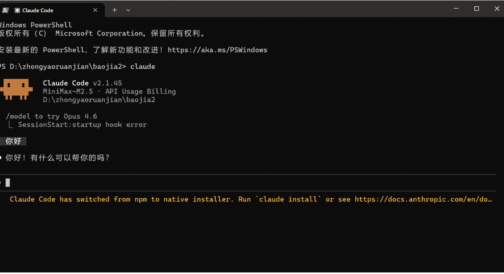
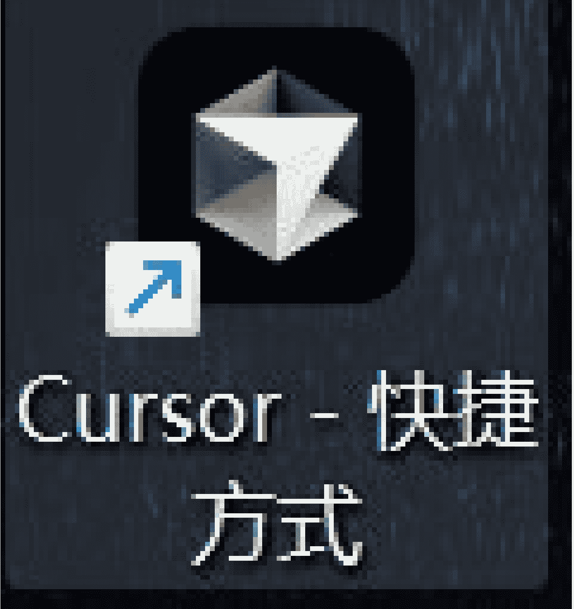
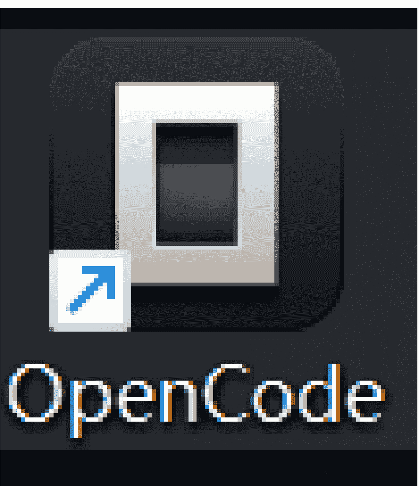
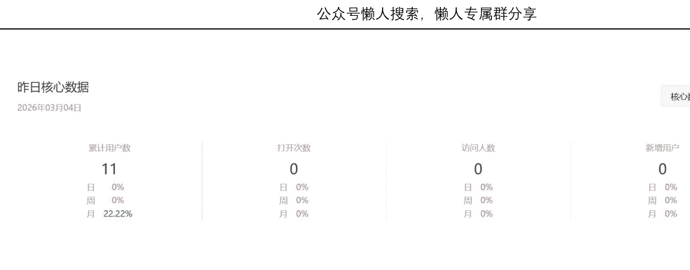
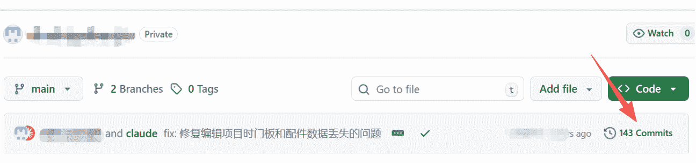
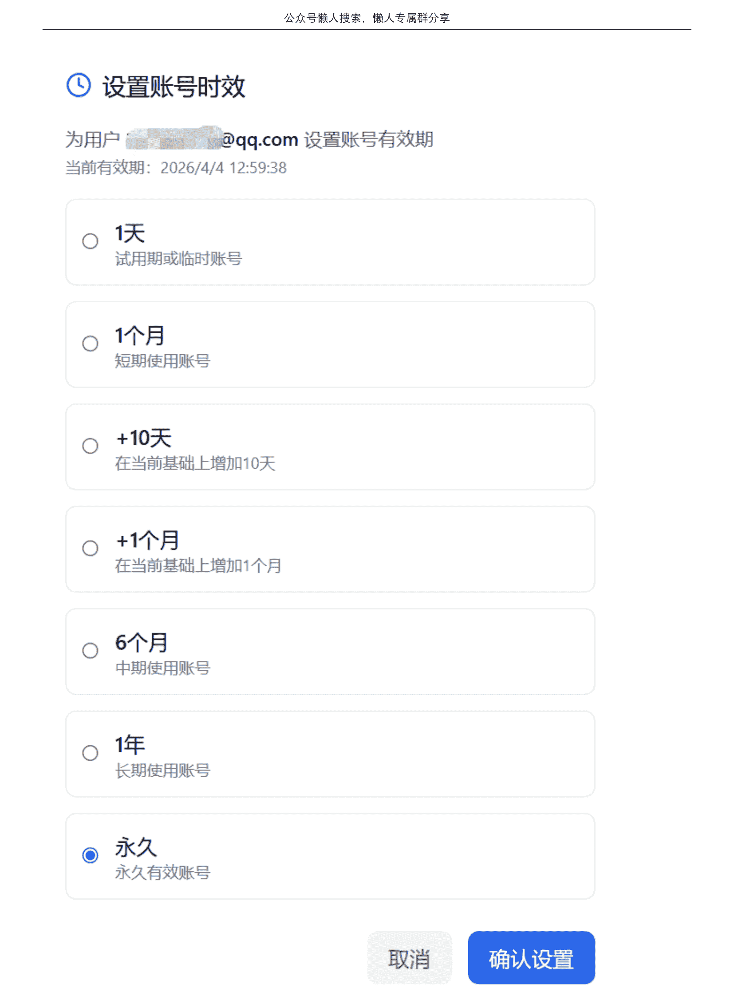
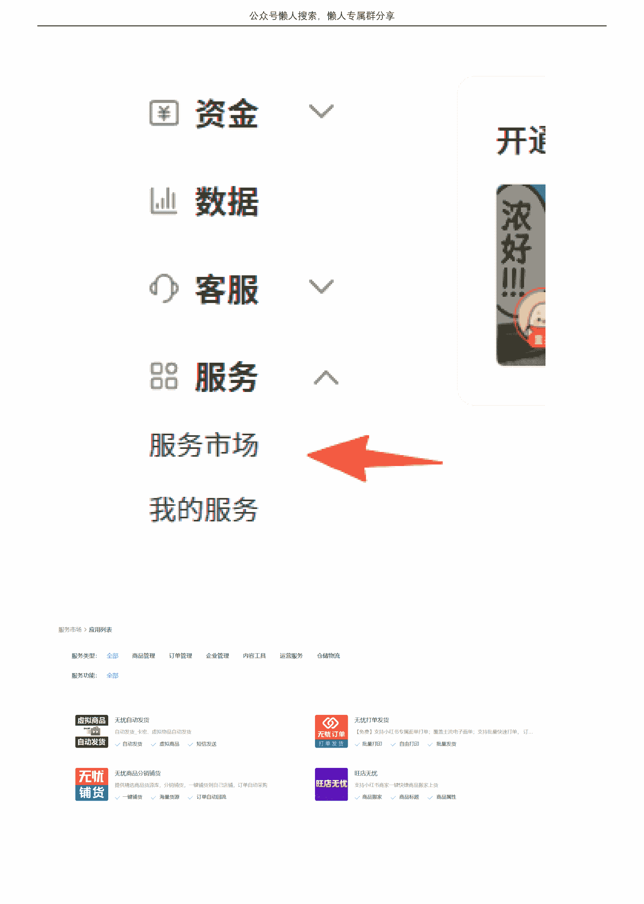

# 从身边的小痛点出发，普通人如何用“AI写代码+小红书”把产品变成现金流？我的完整复盘
作者：龙哥


大家好，我是龙哥。

先交代一下背景：

- 本职是在职打工人，做全屋定制设计督导，差不多就是给设计师当教练；

- 写代码属于半路出家，但已经靠AI做出了一个和自己职业深度绑定的SaaS——全屋定制报价系统。


这个产品上线也就一个来月，付费用户已经40多个。对我这种编程新手来说，算是很大的鼓励了。


收入不止来自小红书，线下也带出来一些额外单子，比如私域里的转化。


废话不多说，今天直接分享我目前在跑的打法：用AI做工具，再靠小红书虚拟商品变现。整件事的核心只有两件事——产品和流量，而且这条路对普通人来说，比想象中更容易踩通。

文章会按这个顺序聊：

1. 底层能力：AI写代码到底值不值得学

2. 产品起步：从练手到锁住一个真实需求

3. 关键转折：在小红书虚拟赛道把产品盘活

4. 流量运营：让AI把小红书运营也自动化

5. 常见问题：可复制性、留存、避坑

感兴趣就继续往下看。

## 1. 底层能力：AI写代码值得学吗

### 为什么我把它当成“基础技能”

我后面所有动作，几乎都建立在“会一点AI开发”这个前提上。之前龙哥说过一段话我很认同：AI写代码应该成为这代人的基础能力之一。这玩意儿门槛真的不高，但带来的收益却非常可观。

### 我在用的工具：便宜是底线，免费更好

目前我的开发组合是Claude Code配MiniMax 2.5的套餐，一个月49元，对我这种非重度用户来说已经很够用了。

如果你一分钱都不想花，也有方案：OpenCode自带好几个开箱即用的免费模型，比如GLM5和MiniMax 2.5，都是国内第一梯队的编程模型。海外模型当然更强，但得“🪜”，这里就不展开教了。



### 自学路线：新手可以直接抄

我的AI开发能力不是系统学来的，基本是靠自己在网上找免费教程、一点点试出来的。只要肯花时间沉下心，上手真的很快。

如果你不太习惯命令行操作，可以按我的路径走：Trae → Cursor → OpenCode桌面版 → Claude Code CLI。难度从易到难，模型的“聪明程度”也随着这条线递增。






当你发现某个工具开始顶不住的时候，就可以考虑往下一个进阶了。我的判断标准很朴素：同一个问题，它修了好几次还是修不好，那就说明到头了，趁早换。

目前我用得最久的是Claude Code加国产SOTA编程模型的组合（主要我实在懒得折腾“魔法”，虽然这也不是什么好习惯哈哈）。

Claude Code安装指引：https://scys.com/course/detail/109?chapterId=4517

### 最关键的一点：动手永远比挑工具重要

工具再强，你不去用就是零。现在就去实现你脑子里那个最小的想法，哪怕只是一个贪吃蛇，也先把流程跑通再说。

## 2. 产品起步：从练手到锁定真实需求

### 为什么做报价工具？因为我自己就是需求方

我本身在全屋定制行业，经常要帮设计师、导购算报价，早就想要一个能提效的工具。在此之前，我用AI做了一个“今天吃什么”的家庭菜单小工具练手，虽然没有用户，但让我攒下了基础经验。

（这里放当时的界面截图：）

这个产品的使用逻辑很简单：先设置口味偏好，AI每天给你推荐菜单，再自动生成采买清单，最后照着步骤做就行。



### 核心产品：定制柜报价SaaS，起步时纯自用

这个SaaS系统是我的第二个产品，前后磨了一个多月。最初只有我自己在用，完全没想过怎么变现。后来参加赚钱的大航海（热词快站、YouTube），虽然没跑出成绩，但让我彻底意识到：流量比做产品更关键。也是从那时候起，我开始尝试“产品+流量”的思路，只是当时还没赚到钱。



现在回头看，我做对的最重要的一件事，就是从自己和身边人的需求出发做开发。目标用户从一开始就是清晰的，后面的推广和卖货都轻松了很多。

## 3. 关键转折：在小红书虚拟赛道里把产品盘活

### 心力被耗光后，转投小红书虚拟赛道

后来我又参加了赚钱的两次大航海，越来越觉得流量才是命脉，于是选了热词快站和YouTube这两个偏流量的项目。

但两期下来都没拿到正反馈，那股劲慢慢就泄了。我想这也是很多普通人的共同困境——赚钱圈里有个词叫“心力”，没有正向反馈，真的很难坚持。

可我闲不住，既然这两条路走不通，就换一个。当时看到小红书虚拟赛道在圈里很火，就决定下场试试。

### 选品破局：把天天在用的工具顺手商品化

刚进来时，我每天刷帖子研究选品，始终没摸到门道。那段时间大家常说小红书虚拟已经进入“原创时代”，但我文笔一般，哪怕有AI帮忙，也很难像大佬一样输出几万字的知识库。

直到有一天我忽然反应过来：我自己天天在用的报价系统，不就是现成的产品吗？我使用频率极高，身边也有不少人需要，只是我脸皮薄，从来没有主动推荐过。想通这一点后，我立刻着手把它改造为可出售的商品。

具体做法是：把热词快站里学到的知识用起来，系统部署到Vercel，后端用Supabase管数据，绑定域名，再把账号改成限时使用——本质上就是订阅制。（这些技能都来自赚钱的航海课程。）

简单科普一下两个工具：

- Vercel：专注前端/全栈应用一键部署的云平台，Next.js母公司出品，零配置、全球CDN、Serverless函数都有，简单说就是“能免费挂网站的网站”。

- Supabase：开源的后端即服务（BaaS），基于PostgreSQL，数据库、认证、存储、API一应俱全，经常被叫做“开源版Firebase”，也就是“能免费托管后端的网站”。

随后我拆了多个SKU：一个月9.9元，永久版199元，价格带从低到高全覆盖；同时也上架了一些别人卖得好的搬运类资料包，一起测试。

实测结果很有意思：资料包虽然也能出单，但一旦被别家低价搬运，流量立刻直线下滑；而报价系统反而一直稳定出单。更重要的是，它在小红书虚拟赛道属于独家产品，天然防搬运，别人想抄也得付出极高的成本。



## 4. 流量运营：让AI把小红书运营也接管

### 类目调整时虚惊一场

我的虚拟商品最开始挂在“其他电子资源”这个类目下。中间恰好赶上平台调整虚拟类目，当时是真的吓到了。

因为我对小红书机制不熟，完全猜不到它会怎么改。万一虚拟类目不能上架，我可能只能转做私域，可我那时连私域运营的经验都没有，心里特别没底。

好在结果没那么糟：可以换到其他类目，也可以找服务商开通电子类目。事实证明，路不会真被堵死，别多想，先干再说。

### 类目到底怎么选？

- 免费可选的类目：艺术品及周边 > 艺术定制 > 绘画类定制，或者其他支持无物流发货的类目都行。发货可以接无忧发货、阿奇索这类虚拟商品自动发货平台。

- 花钱可以开通的类目：成人教育、儿童教育，以及原来的电子资源类目。闲鱼上有很多商家做这个业务，几十块钱就能开一个店，性价比挺高。开通后同样走自动发货平台。

自动发货平台在店铺的“服务市场”里有很多，我目前在用无忧发货，主要是它能免费试用一年；阿奇索也很有名，同样值得试试。



### 上架技巧：能交给AI的全部交给AI

#### 封面

最早我的封面就是从系统界面截一张图，但后来发现用户根本看不懂，更不会有下单欲望。于是我换成了小红书主流的“截图+卖点文字”版式，信息一目了然，转化率高了很多。做图可以用美图秀秀，也可以直接用Nano Banana 2生成，我更喜欢后者，因为快（说白了就是懒）。

（封面配图示例：  ）

#### 标题

标题不用太花哨，把商品关键词覆盖到就行。不太会写的话，可以照下面写商品详情的思路来，让AI帮你出。

#### 商品详情

商品详情是最费时间的部分，要图文并茂还要说清楚卖点。不过我有更省力的方法：在商品素材文件夹里打开Claude Code，告诉它“这是我准备上架小红书的虚拟商品，帮我做一份图文并茂的商品详情”，然后它就会自动干活——截图放进文件夹，文案写好放在旁边，我只需要复制粘贴。

标题同理，稍微调一下提示词就行。Claude Code会读你的代码或文件内容，生成几个标题让你选；如果你拿不定主意，直接说“帮我选一个”，它也能搞定。


### 笔记创作：手搓流程做成自动化系统

我必须承认自己挺懒的，让我每天老老实实手写笔记，可能坚持不了太久，何况还有本职工作要做。

所以我想了个办法：把自己手搓笔记的流程，固化成一个“插件+系统”组合。主要分两步：

第一步：用插件从平台批量抓取高赞笔记，存到飞书表格里备用。


第二步：笔记改写。我写了一个小红书改写智能体，把飞书表格里的高赞笔记丢进去，它就会按照我设定好的工作流自动仿写。大致过程是：先放对标笔记的文案、标题、封面和我要卖的商品 → 系统会模仿原文结构，结合商品信息和我内置的个人IP内容重写正文 → 再从多个标题里选出最符合SEO关键词的爆款标题 → 根据标题和文案生成封面图（调用生图模型加Canva自动配字） → 再生成配图 → 完整输出，而且支持多线程，一次能产出好几篇。


其实任何人都可以把自己手搓的工作流封装成系统，或者用N8N、扣子这类拖拽式工具搭建同样的流程。重点是：一定要把个人IP融进笔记里，内容才有血有肉。

我也试过Claude Code配合Skill来写笔记，GitHub上有很多现成的小红书Skill，效果可以，但偶尔会跑偏。所以我最近更倾向把工作流沉淀成自己的系统，稳定很多。方法没有唯一答案，擅长什么就用什么，关键是把你的人工流程固化下来，慢慢自动化。

这里推荐一下宝玉老师开源的“baoyu-skills”，各种场景都有，很实用。

## baoyu-skills

English | 中文

宝玉分享的Claude Code技能集，提升日常工作效率。

## 前置要求

## 小白推荐

如果是纯新手，还不熟悉Claude Code或Skill也不用慌，先学会手搓就行。对标笔记是大字报，你就用美图秀秀做一张大字报；对标笔记是实拍，你就打开电脑文件用手机拍；对标文章太长，就找短笔记来仿写。小红书优质笔记只要80字以上，写80字总不累吧？不管工具怎么迭代，手搓永远是底层能力——所有工作流、系统、智能体，追根溯源都来自一套最朴素的手工流程，只是后来被封装起来了。

## 5. 常见问题

### Q1：为什么我认为这是个适合普通人的好项目？

因为它足够简单，也足够友好。核心模式就“产品+流量”，销售环节小红书店铺直接替我们做了，不用额外谈客户；开发环节AI替我们做了，不需要专业代码能力；成本也极低，几十块甚至免费工具就能起步，开店保证金可以赚到钱后再交；平台对普通人的流量分配也算公平。最关键的是，愿意下单的用户本身就是付费用户，完全不用操心免费转付费的转化率，整体很靠谱。

### Q2：新手如何复刻这套玩法？

完全可以直接照搬。下次你再洞察到一个具体需求，用这套系统再跑一遍就行。想复制我的模式，总结下来三点：一是有一个你熟悉的行业或本职工作，能从里面发现真实的小痛点；二是愿意学一点AI开发基础，会用它写工具、改代码、做测试；三是能坚持至少做一个产品出来，接受前几个可能方向不对、没有收入，沉住气慢慢试。真正的门槛从来不是技术，而是你能不能找到一个足够垂直的小需求，并且做出对症的工具。

### Q3：用户留存怎么做好？

我的做法是在系统里留下自己的微信号，用户有任何问题都能直接反馈。收到反馈后，我就持续去迭代和维护系统。工具肯定是越用越好用，用户一旦觉得顺手、问题得到解决，自然愿意留下来继续订阅。

系统公告

**小红书好评送好礼！**

小红书带图10字好评，额外送10天使用时间，通过页面最下方的微信二维码添加客服，领取额外赠送的时间

**一次设置长期用 | 自定义模板代建公告**

自定义模板是本系统里相对复杂的功能，不过它只需要设置一次，就能长期重复使用。

如果您不想自己花时间制作公司专属的自定义模板，可以通过页面下方的客服二维码添加客服微信，我们提供49元/次代建服务（需人工耗时制作，成本较高）。

您只需把日常在用的模板发给客服，我们会按照您实际使用的表格格式，帮您完成自定义模板的搭建。


### Q4：新手最容易踩哪些坑？怎么绕开？

最容易踩两个坑：一个是“不敢开始”，总是在比较工具，迟迟不落地。破解方法就是先动手，哪怕做一个很简单的练手作品，动手永远比选工具重要。另一个是“过度脑补”，总想把系统完善到完美再上架。其实完全可以先上架边卖边优化，一个品跑不动就赶紧换下一个，别在没反馈的事情上硬耗。遇到平台类目调整也不用慌，办法总比困难多，先干了再说。

### Q5：市面上不是有很多现成的小红书系统吗？为什么要自己写？

市面上的系统用户太多，里面的工作流完全是黑盒，很可能一大堆人共用同一套提示词，这对账号来说是有风险的。自己手搓的好处是：提示词、流程全是自己独有的，不会跟任何人撞车；同时还能随着认知提升不断迭代系统，人和产品一起变强，是互相成就的关系。

### Q6：产品起步应该怎么做？从什么方向入手？

建议从你熟悉的行业，或者你自己的需求入手，先练手，再锁定核心需求。我当初先用AI做了个家庭菜单小工具练手，积累基础后，结合全屋定制设计督导的职业，做出定制柜报价SaaS。从纯自用开始，再谈变现，目标人群天然明确，后面的推广也顺理成章。

## 最后：一些可复用的心得

整套流程走下来，最值得记住的就三句话：需求从身边找，开发交给AI，流量借平台拿。不要等一切完美了再出发，先把第一个版本丢出去，用真实反馈不断打磨。如果你也卡在不敢开始的阶段，那就记住最朴素的道理：想都是问题，做才有答案。


### 1、把工作流程“沉淀成标准件”

我越来越确信，再小众的工作里，也藏着能被流程化的部分。我的做法很简单：凡是能标准化、能重复用的环节，就把它变成文档、表格、系统、SaaS 或者 skills，总之，别让它只停留在脑子里。

举个栗子，我用的报价系统，就是把日常谈单的 SOP 搬到了线上；我发小红书笔记时，也是把整套发文流程固化成了自己的专属工具。

这么做的好处至少有两个：

- 第一，降低执行偏差。靠记忆和手感做事，动作很容易跑偏；一旦固化下来，即使自己忙不过来，别人也能直接接手，将来招员工还能复用。

- 第二，这个固化下来的东西，往往就是你最痛的那个点。你有这个痛点，别人大概率也有——那它是不是就是一个现成的产品？打磨打磨，说不定就能卖给别人，帮到更多人。

### 2、小红书流量的一点心得

刚开始还是建议“手动跑通”。先手搓出感觉，再考虑引入自动化。而且哪怕自动化了，也建议保留至少一个号手搓操作。这样才能持续迭代你的 SOP，也才能真正看懂哪些笔记能持续带来流量。

### 3、用 AI 填平你的知识盲区

遇到不懂的事，直接问 AI 就好了。你可能有盲区，但 AI 几乎没有。不过对 AI 的回答，必须保留一份天然的怀疑。我习惯的做法是：同时开两个 AI 互相验证，如果两边说法一致，基本就能放心用了。另外最近从小排老师那学了一招——装一个 AI 浏览器，它的 AI 是内嵌的，能沉浸式陪你弄懂新知识，完全不会打断学习或工作的心流。试过几次，确实香。

### 4、产品从哪来？你自己的痛点就是答案

最好的产品线索，就藏在你和你身边人的麻烦里。痛点在哪，需求就在哪，产品就在哪。

说真的，看完这篇 SOP，你可能觉得“懂了”。但 90% 的人一到动手环节，第一关就卡住了。

工具和教程从来不是真正的门槛，门槛是“立马开干”，以及你处在什么信息圈层里。

在这里不聊虚的，只拆商业闭环，只聊怎么把 AI 的效率榨干。系统里已经沉淀了 1000+ 真正跑通的套利实战局。

🎯 想查看圈子的完整数字资产和上车门槛：

```
```

