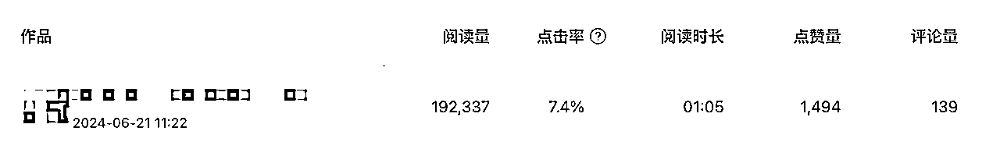
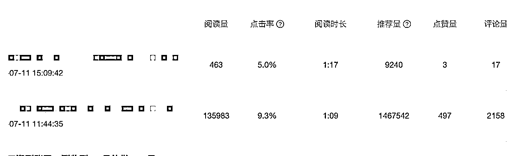
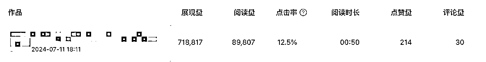
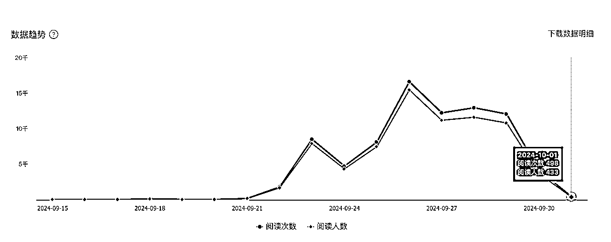
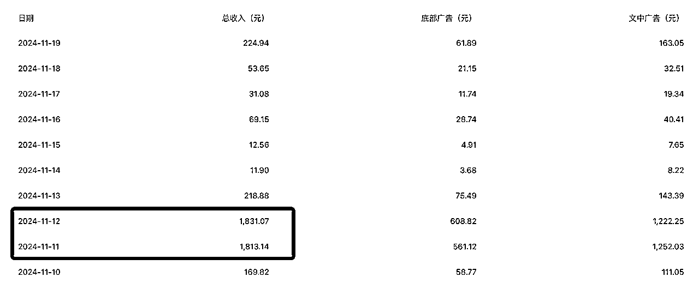

# 从迟迟不见成效，到累计进账一万元：我的公众号实践记录

大家好，我是 龙哥。2022年4月，我加入赚钱社群。那时我对副业没什么行动力，常常看了不少分享，却迟迟没有真正开始。直到同年6月参加公众号写作航海，我才第一次认真尝试内容创作，并一直做到了现在。

最初，我靠几篇文章在其他平台意外获得高阅读；后来数据回落，陷入迷茫，也一度怀疑自己。经过一段时间调整，我重新梳理方向，最终在这项尝试中累计获得约一万元收入。

这笔钱在许多伙伴的成绩面前并不起眼，但它是我第一次在本职工作以外获得收入，对我而言意义很大。因此，我想记录这一路的起落，以及自己如何走过低谷。具体操作方法，航海手册中已经讲得很细，下面更想谈谈个人经历和体会。

## 起步阶段：意外出现的高阅读

参加6月的航海后，我开始尝试公众号文章。当时手里只有一个账号，主要写热点评论。我会借助 AI 整理初稿，再自行修改发布，也将文章投放到百家号、头条号等渠道。

公众号的表现一直普通，单篇通常只有几百阅读。没想到，其他平台反而接连出现几千乃至数万阅读的文章，个别作品还冲上十多万。一个刚入门的作者，用新注册的账号发布 AI 辅助创作的内容，能得到这样的反馈，确实超出我的预想。

虽然那些渠道带来的收入比公众号少，但亮眼的数据让我信心膨胀，也开始设想只要持续更新、不断复制高阅读文章，未来甚至能靠它全职谋生。

## 遇到瓶颈：从乐观转向焦灼

热度并没有持续太久。新账号的扶持阶段过去后，公众号数据迟迟没有改善。我花更多时间写稿，新增了账号，还反复调整指令，希望 AI 写出的内容更合适。可最高的一篇也只有两万多阅读，曾经的十万级表现没有再来。

社群里有人提到流量和收益都不错，我开始着急地跟进热门领域。热点评论、生肖、法律、故事、汽车、情感、养老、美食，我都试过；有一阵甚至同时维护四个方向。

有经验的人或许能通过多领域测试捕捉机会，但对当时的我来说，准备远远不够：素材储备薄弱，对不同领域也缺少认识，还要照看多个账号。日常工作变成从低粉账号里找文章，再交给 AI 改写，留给独立判断的时间很少。内容做得越多，人却越疲惫，心里也愈发不安。

## 调整方向：先把一件事做扎实

那段日子，我经常觉得受挫。看到其他人分享可观的日收入，更难免拿自己的表现作比较。不过，我没有因此否定这条路。航海群、猫哥教练群和一来教练群里，不断有人反馈自己的进展，这让我觉得方向仍有机会，问题更可能在我的做法上。

为了缓和情绪，我开始跑步。运动让我暂时离开反复纠结的状态，也帮我重新冷静下来。随后，我给自己设了一个明确门槛：先把累计收入做到一万元，再决定要不要继续。若达成以后仍不想做，就停下来。

我向一来教练和猫哥请教后，发现内容本身并非主要短板，更需要改进的是主题判断和标题设计。于是我决定缩小范围，先把一至两个方向做透，不再因为其他领域暂时走红就立刻跟进。等摸清规律、建立稳定的创作节奏，再考虑拓展。

## 找到机会：一万元目标达成

我最终把重心放在养老金和养生美食。选择它们，一方面是收益单价相对不错；另一方面，当时“十大美食”这类排行内容容易获得推荐。养老金领域虽然启动不容易，但进入推荐池后，回报可能相当可观。

确定方向后，我重新挑选参考账号，把他们发布的内容逐篇研究，观察主题、标题和篇章组织，再据此调整自己的选题和生成指令。

9月参加航海时，我凭借“十大美食”排行文章进入推荐池。可惜当时经验不足，没及时把内容转向养生美食，仍然持续发布同类排行稿。随后同类型账号增加，加上国庆回家时几天没有更新，账号很快失去了推荐。

养老金方向却带来了意料之外的收获。由于启动难度较高，我起初并没把太多期待放在它上面，主要精力还是投入美食内容。后来美食账号也有进入推荐池的，但阅读数据大多在几千到几万之间，没有出现特别突出的爆发。

一次听一来教练直播时，我听到他提及美食排行内容同质化明显，也有账号转向军事话题后表现不错。恰好我有个朋友替我注册的美食账号已经掉出推荐池，本来想请他协助注销、重新启用，但一直没能安排上。我便将它改写养老金内容。军事和法律方向涉及的风险较高，而且我此前没有相关积累，所以没有另开领域。

结果，发出三篇文章后，账号就进入推荐池；两天内收入接近四千元。连同此前的零散进账，我终于完成了一万元的阶段目标。

## 过程中的几点体会

### 1. 对方向保有信心

如果一开始就认定事情做不成，很难长期投入。感谢赚钱航海里的教练和伙伴愿意分享经验，也耐心回应初学者的问题。看到其他人持续取得进展，让我不至于在短期没结果时就轻易离场。

实操手册已经包含了很多具体方法，关键还是把它们落到行动中。收入可能迟迟不见起色，但账号一旦进入推荐，阶段目标也可能很快实现。

### 2. 给情绪留出调整空间

看到自己没有阅读数据，而别人已经有不错的月收入甚至日收入，产生落差很正常。新手都会遇到类似阶段，重要的是找到适合自己的调节方式。

我总结了三种做法：把远期目标拆成可完成的阶段任务，例如先达到一万元，或持续更新三个月；有疑问时向社群求助，不要独自反复摸索；给压力安排出口，我选择跑步，让自己从焦虑中暂时抽离，再回来处理问题。

### 3. 把功夫用在读者会看到的地方

过去我把大量时间用来修稿和调整提示词，自己觉得文章完善了，读者却可能连标题都没兴趣点开。标题缺少吸引力，内容就很难获得后续推荐。

做流量内容时，先想清楚希望读者采取什么行动，再据此安排创作重点。研究表现好的标题，是一个直接而有效的起点；在理解其结构后，也可以借鉴成熟表达。

### 4. 关注账号里的特殊表现

这不仅适用于研究其他账号，也适用于观察自己的数据。某类题材或某种标题突然表现突出，就值得继续追踪。可以围绕其中的核心词拓展内容，也可以重新整理过去有过成绩的主题，让有效方向得到更多测试机会。

### 5. 收窄范围，逐步建立熟练度

AI 工具降低了内容制作门槛，却也让人容易觉得任何领域都能马上进入。今天看教育题材热就写教育，明天法律内容受关注又换方向，结果是精力摊薄，积累不足。

先选定少数领域持续练习，把遇到的问题逐项解决。等形成稳定判断和创作方法，再迁移到其他方向会更顺畅。

### 6. 具备基础后再拓展账号

如果已经熟悉流程，希望提升整体收入，可以尝试经营更多账号。多个账号能够降低单一账号波动带来的影响，也能让收入结构更稳定。

也可以与他人协作，由自己准备内容、合作方负责发布，从而拓宽账号和 IP 的限制。兔子鱼教练常说：“永远相信别人的运气比自己好。”

## 写在最后

在不少伙伴看来，半年赚到一万元算不上亮眼成绩。但对过去行动迟缓、容易想得多做得少的我而言，这是第一次在工作之外获得实实在在的收入。比起数字本身，我更看重自己经历低谷后仍能坚持，并慢慢找到适合自己的步调。

人生未必需要每次都冲向最高处，按照自己的节奏持续前进，同样重要。

感谢赚钱航海让我接触到这个方向，也有机会和做出成果的人共同实践；感谢兔子鱼教练一路带领，否则我可能在航海结束后就停下了；感谢猫哥教练和一来教练提供具体建议，帮我减少了不少摸索时间；也感谢 @澄歌 的鼓励与支持。希望我们都能找到适合自己的成长方向。