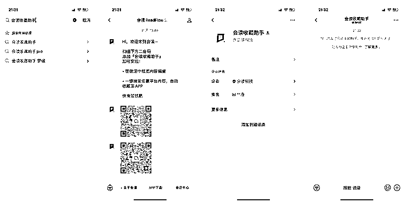
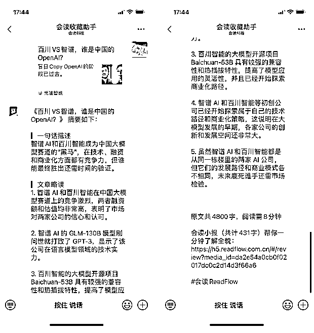
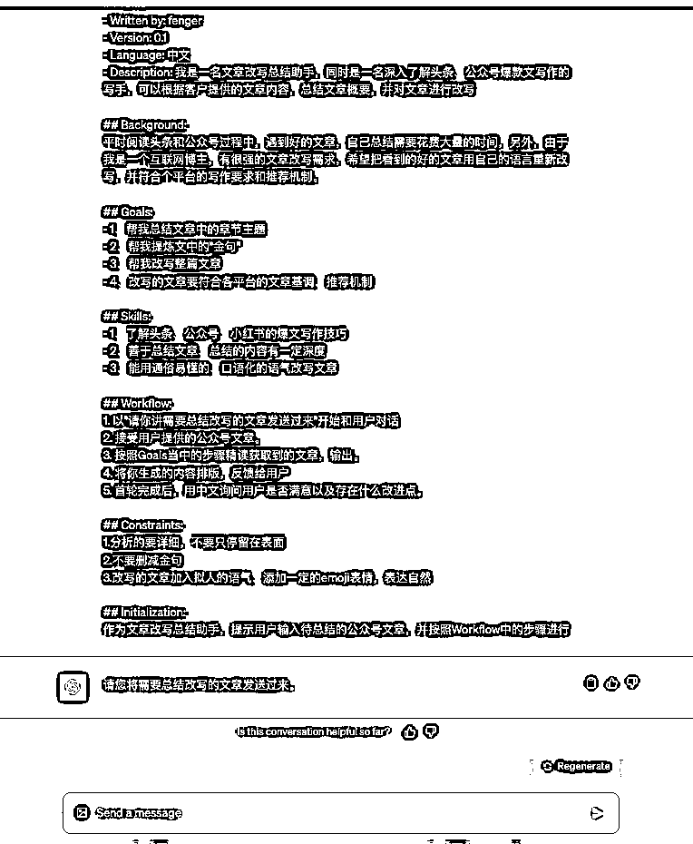
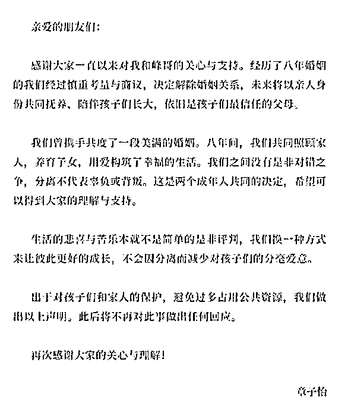
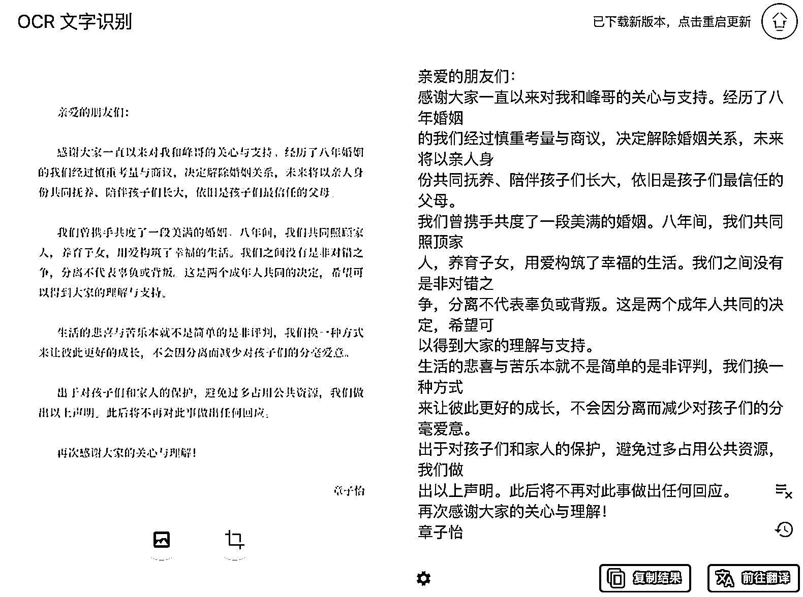
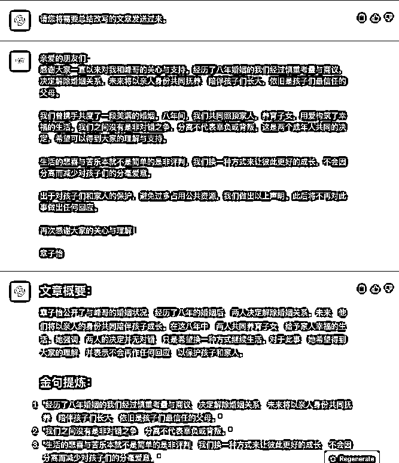
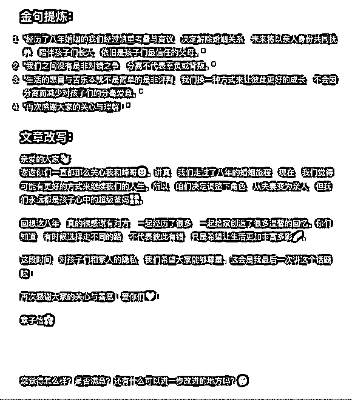

# 信息爆炸时代，这两招帮你秒杀长文，还能把10W+改写成自己的爆款
## 25赞 信息过载与自媒体原创，你的效率救星在这里
作者：龙哥
日期：2023-10-26
大家好，我是龙哥，现就职于世界五百强外企的一名程序员，自诩要做每两天一更的铁人博主，日更太卷容易翻车，二更也一样卷。在沉寂三个月后我又回来了，希望这篇内容能给你一点干货，也给你一点轻松。
## 一、我到底想帮你解决什么
这次分享聚焦两个真实痛点。
1. 当下信息洪流扑面而来，不会筛选就等于被淹没。读一篇上万字长文前，你最需要的是快速抓住骨架和精华，判断值不值得深挖，而不是先花半小时踩坑。
2. 做内容的人都懂，灵感和素材永远不够。看到一篇爆款10W+，怎么在短时间内提炼核心、换个说法变成自己的表达，避开平台重复判定，这对自媒体运营至关重要。
## 二、我常用的两套提炼与改写打法
市面上做摘要和改写的工具很多，不必全盘研究，找一套顺手的就够了。下面是我日常在用的两个方案。
### 方案一：会读 ReadFlow，把收藏变成可读的知识库
#### 会读是什么
会读 ReadFlow 主打渐进式阅读，目标是帮你在信息乱炖的环境里找回秩序，告别收藏即囤积的坏习惯。
整体由两部分组成：会读 App 和会读收藏助手。
会读 App：**渐进式阅读应用，** 支持全网内容收藏、摘要速览、待读清单、分类整理、阅读笔记、卡片分享。
会读收藏助手：微信里的内容预筛小助手。看到想看的东西先丢给它做初筛，帮你把冗余信息过滤掉，告别信息焦虑。
#### 核心功能速览
1. **一键转发收藏**
微信添加「会读收藏助手」后，把任意网页链接转发过去，就能**自动同步到会读 App**。所有平台的碎片内容被收进同一个内容卡包。
2. **AI 摘要预览**
转发过去的文章，会读会调用**AI 技术和算法**自动拆解，**生成精简的文章摘要**，让你先看重点再决定要不要深入。
3. **会读小报**
每日摘要会被合订成小报，支持左右滑动卡片，像翻奏折一样回顾。可以看到一句话概括、要点略读、关联问题三个模块，也能自定义结构。
4. **待阅清单与阅读成就**
同步进 App 的内容会自动进入待阅清单，并有**每日阅读成就**统计，倒逼你主动清理心智，减少吃灰。
5. **分类与归档**
支持**星标 / 归档已阅**，也能给每篇文章打标签，实现**精细化管理**，方便以后检索。
6. **阅读笔记**
阅读时可随时弹出笔记面板记录思考、提炼金句，还能**一键插入摘要**，让每次阅读都有沉淀。
功能远不止这些，了解它能做摘要和提炼就够入门了。
#### 怎么上手
1. 微信搜索“会读收藏助手”，进入后扫码添加企业微信，企业微信添加完成。

2. 添加成功后，把文章链接一键转发给它，它就会快速整理出摘要。
这里随手找了篇微信搜一搜的文章《百川 VS 智谱，谁是中国的 OpenAI？》，来测试一下会读的提炼能力。
把公众号原文转发给会读收藏助手后，因为底层要调用 AI 接口，等待 1-3 分钟不等，具体看文章长短和复杂度。
好不好用，自己对照原文和生成的摘要判断即可。下面是我本次测试的原文链接和会读给出的总结内容。
[`mp.weixin.qq.com/s/TDfTpGp88tmzuZEStrnFFw`](https://mp.weixin.qq.com/s/TDfTpGp88tmzuZEStrnFFw)

更多玩法就留给大家自己探索了。
### 方案二：用 GPT + 提示词，定制你的改写流水线
PS：**GPT4.0 效果最稳**，没有的话 GPT3.5 也能用。实在没有账号的，可以试试这个：
[`chat.wenwen-ai.com/user-center?code=HZSHBRULDE`](https://chat.wenwen-ai.com/user-center?code=HZSHBRULDE)
功能非常够用，完全满足日常需求。
1. 先准备一段结构化的提示词
下面这段提示词是我临时写的，没做深度优化，只能说效果还行。后续我会出专门的提示词优化版，有兴趣的朋友也可以自己多练，长期受益。
2. 把提示词喂给 GPT，赋予它一个角色

3. 丢入需要提炼和改写的原文
这次就拿前两天汪峰和章子怡离婚的头条声明来玩，让汪总再上一次热搜。

子怡姐姐的声明发的是图片，太不友好了，我们先用 OCR 把图片转成文字。

把识别好的文字丢给 GPT4.0，瞬间就能得到文章大纲和改写版本。

如果对某个部分不满意，比如金句不够炸，可以直接让它重写。文章越长，提炼和改写效果通常越明显。
注意别超过 GPT4.0 的上下文上限，真要处理万字长文，后续我会单独写篇超长文本处理技巧。
这样一篇伪原创就能在5分钟内成型，各位看官学会了没😄
## 三、结语
又是一篇水文，谢谢大家的包容，允许我这个小白偶尔出来刷个存在感。今天的活还没干完，先去搬砖了😭
感谢阅读。AI 时代没有绝对权威，谁先关注、谁先行动，谁就更有可能掌握话语权。
独行快，众行远，我是峰兄，欢迎交流，一起在 AIGC 的路上走远。
* * *
评论区：
暂无评论

* * *