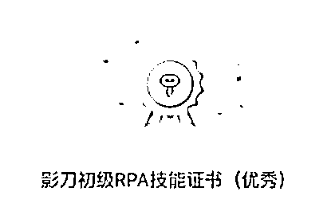

# 公众号做起来了？先搞清楚方向对不对，别把劲儿白费了
作者：龙哥

## 公众号爆文的正确打开方式，到底在努力什么？

作者： 龙哥

日期：2024-03-13

1.  **先说现状：**

白天大厂上班，晚上搞副业。做过京东带货、论文辅导，累计下来十万+。最近半年一头扎进公众号爆文，单人单号累计收益已破3w+。

跟同行的大神比不算多，可胜在性价比拉满。10分钟就能人工拼出一篇可发文，折算到时薪能到1000块左右，费力少见效快。

1.  **我总结的打法：**

项目到最后都能归纳成一套可复制的逻辑，我在公众号这条路上摸索出的经验是：

**公众号变现=热门或细分赛道 x 单号的标题与内容 x 号的数量 x 自动化程度 x 附加变现**

目前我还在广告+流量主的阶段，但想从1到N做大，矩阵化、自动化和增收项是绕不开的。

1.  **先聊方向，别谈技巧：**

这篇文章我会不断补充，今天最想聊的是方向感。我说句掏心窝子的，大多数人在看到一些奇葩却爆火的内容时，都会冒出“这也能火”的疑惑。

新手更容易陷入“好学生陷阱”，想写好一篇花两三个小时精雕细琢，结果0阅读，整个人炸了。

这条路走偏了。

**要盯着用户想看什么，而不是你想给用户灌什么。**

你觉得无聊的，可能就是别人饭后解压的首选。

别摆架子，别嫌弃内容low。有些人高大上的写不出来，低门槛的又看不上，最后卡在中间，既打磨不出来，也没人看，纯属自我感动。

读者可能只是下班路上刷个乐子，你非要去教育他，最后难受的是自己。

先搞清楚用户关注点，再用自己的经验+网上素材，用最通俗的大白话讲出来。

**精力要花在刀刃上，别瞎费劲。**

**什么不重要？**

排版、标点、那些所谓的细节，都是锦上添花，根本不是核心矛盾。

**除非是沉淀型的深度长文或真知灼见，否则写一篇超过半小时就不合格：**

- 第一，你起不了量。

- 第二，你扛不住随机性。一篇花3小时写，阅读量2，自闭。不如一天写20篇，每篇10分钟，就算有几篇阅读2，心态也稳得多。

**真正该盯的矛盾点是：**

**赛道风向、单篇的标题吸力与内容结构、单篇耗时、整体效率**

盯风向、盯标题、盯结构、盯怎么让人有代入感。所有本质都是去感知读者到底爱什么，什么标题、什么结构点赞阅读最高。

抓住核心后就去铺量、做矩阵，用一切能自动化的手段把时间和成本压下来，放大每个号的收益。

1.  **关于10分钟一篇的真相：**

有人不信，10分钟人工一篇是在吹牛，就像当年大家说火箭能上天是扯淡一样。

**对一个稍有了解的领域，结合素材评论区的内容，用口述转文字的方式，1200字5分钟就能搞定。**

能过原创就行，别纠结从零到一。直接洗稿很容易不过审，但反过来，把现有素材拼完整，再加入自己的观点，既安全又高效。

我以前做过论文辅导，信息整合能力练出来了，公众号爆文在熟悉领域里就是降维打击。

加上排版，10分钟很正常。

自己做排版熟练的话，提前建好模板，用格式刷一刷正文就行。我目前还是人工排，换成RPA自动处理会更快吧，你自己试试就知道了。

1.  **关于赛道选择：**

定调子就看赛道。

航海手册里的热门赛道是公开的，大家都知道火，也有人纠结现在还能不能做。

我们这种小玩家进场，不会让市场瞬间饱和，也不会让eCPM暴跌。

哪怕赛道人多变难做，也不是小虾米不敢碰的理由。

我的体感是：

①热门赛道受众大，单价可能被聊低，但分一杯羹绰绰有余。

②细分赛道也能爆，比如专门写某个明星的风向标号，阅读量几千上万很常见。紧盯风向，机会来了就冲。

所以必须多号多赛道。

新手建议**热门+细分组合**，比如**热门赛道+自己熟的赛道+小众蓝海**，搞一个三号小矩阵。既能吃到热点，也能留空间写擅长的东西。组合方式灵活，看兴趣和精力来决定。做这事要做好细水长流的准备，慢慢把技术、信息、运营、矩阵能力做成壁垒。

1.  **关于单号的标题与内容**

做了这么久，航海一直都在看。选定赛道后，单号能不能起来，关键在标题和内容，而标题的重要性要高于内容。

**标题怎么写：**

①航海手册里讲得很细，务必吃透。

②手册没覆盖的领域，去次幂数据里找低粉爆文模块，一个个拆解人家的标题套路，别偷懒让AI分析，自己看才有感觉。

拆完就知道什么标题能打动人，后续：

①可以写prompt让AI批量生产；

②实在不行，直接用素材里的吐槽或原帖开头当标题。比如：

*“我有一儿一女，我把两套拆迁房全给了儿子，后来看到房本上的名字时，我傻眼了”*

这标题可能是作者自创，也可能是原帖原话，用了或微调，靠反差感就够了。

**内容怎么安排：**

**1、变现方式决定内容形态：**

公众号变现无非几种：

真知灼见长文，需要长期积累接广告；

付费连载故事类，需要粉丝基础；

**大多数人走的是爆文路线，靠走量做流量生意，快速吸睛快速变现。**

这条路线就别写文绉绉的了。用大白话聊天式写作就行。

- 数据证明读者爱白话，不爱书面语；

- 爱转折，不爱平铺直叙。其它平台的评论区自带正反观点，正好当转折点；

- 爱一两句一段，不爱大段落，看着就累。

**2、排版做到整洁即可。**

关键句加粗标红，一到两句一段，模板设好就够。排版超过5分钟就不合格，除非你是IP运营做图文时尚类的。

**3、字数不够怎么补。**

1200字=两个广告位=更多收入。写不满就用：

**“文章推荐”“文末声明”**

比如：*声明：此岗位情况仅为某地区真实情况（严禁搬运抄袭，一经发现，侵权必究），该单位的情况可能存在差异，故不保证此岗位介绍为唯一标准。如与你所在城市的单位情况不符，请理性看待！同时欢迎大家投稿，让单位介绍更加全面准确。*

文末推荐链接也能算进字数。900字正文+填充，就能实打实凑够1200。

**4、想做大就必须自动化或做成头部。**

想赚几十万百万，要么做自动化铺量做矩阵，要么沉下心几年做头部大号。小红书150万粉一条广告20万，公众号同理。没耐心就走技术流铺量，有耐心就打磨IP。

纸上得来终觉浅，我也是走了弯路才明白。做项目前要有心理准备，从0到1闭环后，你会发现一天几十块根本满足不了野心。

1.  **关于号的数量怎么扩**

赚钱的圈友太聪明了，号的玩法我也学了不少。

**扩号的几个阶段：**

1. 5个以内起步：用自己或家人的身份证注册，绑定自己操作。简单个人户。难度：⭐️

2. 30个账号发展期：个人号用完后上个体户。建议海南个体户，网申秒发，一个个体户可做两个号，第二个一般要收费但能规避。亲朋好友注册几个个体户，理论能到30号左右。难度：⭐️⭐️⭐️

3. 需要外援期：自己和亲友的资源用完，就要收陌生人号代运营了。这考验多号管理能力+产能。（1）有渠道收号+分成模式；（2）有集成管理系统；（3）有稳定文章供给。能解决这三点，已超过99%的人。难度：⭐️⭐️⭐️⭐️⭐️⭐️

4. 提供内容分成模式：收号难度大时，可以换个思路，我提供文章你负责排版发布，收益分成。解决信任和人力问题，甚至有人一天机器写几百篇。难度：⭐️⭐️⭐️⭐️⭐️⭐️

5. 更高阶还有跨平台分发等，后续再说。

1.  **关于自动化**

很多圈友已经用RPA做账号对标、素材抓取、自动写作、自动发布，管理上百号。

我依然认为自动化是放大矩阵的唯一解，包含：

**自动化=素材管理+自动写作+自动发布+账号集中管理**

流程：素材获取与筛选 → 文章写作 → 文章发布 → 账号集中管理

素材用RPA抓取分析，贯穿全流程。写作靠AI接口。账号管理可用现成软件，大佬可自研。

想做大必须懂技术。没技术只能被动挨打。我花半个月学RPA，现在是中级水平，初级证已到手。

附录：

次幂数据：[`www.cimidata.com/?refcode=7x6pva`](https://www.cimidata.com/?refcode=7x6pva)

***#未完待续***

* * *

评论区：

Rio : 继续啊然后呢

佩龙 Peron : 10 分钟有点扯了，我要不是干过还真信了

故是 : 除非不要质量，但这想要挣了就更难

佩龙 Peron : 除非纯 AI 文，但他又说是人工产出

火龙果 : 还没有点进去看，但 10 分钟人工文章产出，有点夸张了吧

旭宏 : 很真诚的分享，里面有些坑我也踩过，受益很大。码字辛苦了！[玫瑰]期待继续分享[抱拳]

* * *