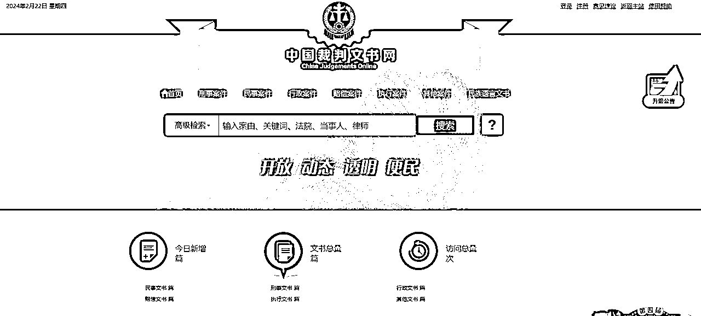
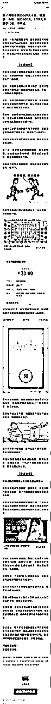
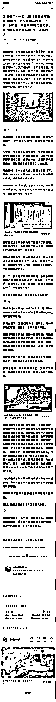
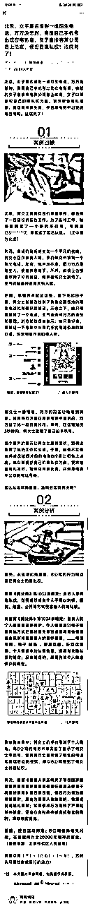
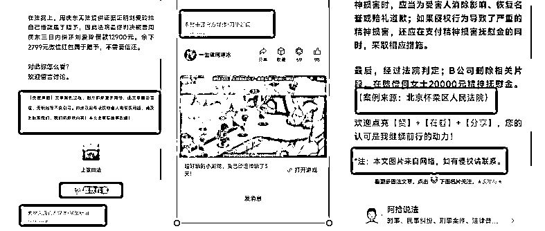
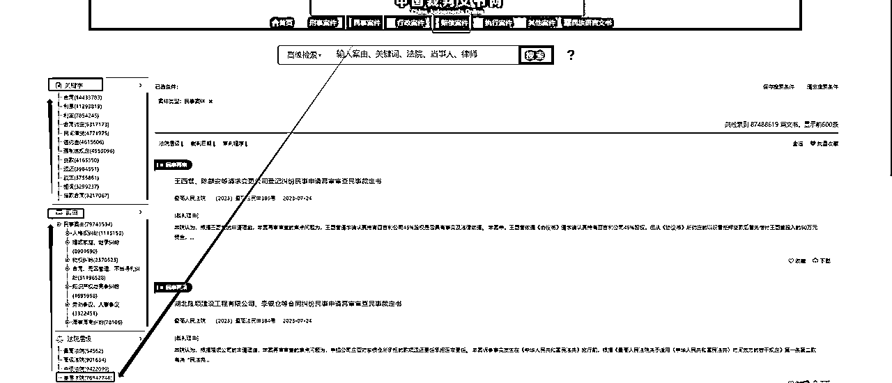

# 公众号律例文，可能是最后一个让你轻松赚钱的分类？

最近不少做公众号的朋友都在感叹：情感赛道卷不动了，名人名言早被玩烂了，眼下还能靠什么内容轻松赚钱？

今天我想聊一个很多人还没注意到的机会——律例故事号。

先自报家门，我叫张波，一直想本本分分做公众号。之所以突然把这个赛道公开写出来，是因为我预感到：律例文章这座金矿，如果再不分享，可能很快就会被封死，或者不再有红利。索性把这套玩法全盘托出。

很多人错过了情感文和励志语录的黄金期，总觉得公众号变现太难。其实不是项目不行，而是方法不对。用对方法你会发现，律例号比情感号励志号更省力、更省时间。如果看完这篇你还说赚不到钱，那真建议换个方向。

说句玩笑话，这篇文章在我看来至少值六位数，真要算上带动的经济贡献，可能上千万（当然带点吹牛的成分，哈哈）。

### 一、先找对标账号

上边给大家展示的参考账号，是我筛过的，数据都还行。你如果自己找，建议挑那些近期才注册的新号，更好模仿，也容易起量。

### 二、再拆爆款文章

我挑了一批典型爆文，后面会拿它们逐条拆解。你也可以根据自己的方向，去搜集更多同类爆款。

### 三、素材怎么找？不需要素材库

不用搭复杂的素材库，你只需要会用“中国裁判文书网”（https://wenshu.court.gov.cn/），注册个账号就能查。

### 四、关键知识点：同案同判

做律例文，严格说只需要吃透一个法律名词：同案同判。

什么意思呢？就是说，在司法实践中，如果多个案件的事实、证据、法律关系大体相似，那么不管当事人的身份是啥、在哪个法院审、法官是谁，最终判决结果都应当保持基本一致。

这套原则的背后是“法律面前人人平等”的宪法精神，它要求法院以事实为依据、以法律为准绳，统一法律适用尺度，守住裁判的公正合理。同案同判既是现代法治的底线要求，也是老百姓感受司法公平的重要窗口。

很多人想批量写律例文，但不懂这个词，所以无从下手。聪明做法是：先找一篇爆款文章，然后去裁判文书网上搜类似案件，把地域、金额、细节换一换，再把这些相近的案情扔给 AI，就能产出一篇看起来像原创的高质量文章。

就算你参考了别人的文章，对方也拿你没辙——比如他写的是上海案，你就换成北京案；他写的是物业纠纷，你就换个地区同类纠纷。案件事实不同，表达自然就不同。

### 五、正文怎么写？

**标题公式**：去看看爆款标题的套路，有点像当年情感文的“七要素”。情绪冲突+悬念结果，蹭大众最关心的点。

随便感受几条：

- 北京，女子莫名接到一堆陌生电话，万万没想到，竟是自己手机号出现在电影里，女子直接将其公司告上法庭，侵犯我隐私权！法院判了！

- 冤不冤？新疆，男子11万元的新车在小区被盗，将物业告上法庭，物业：你都没交物业费，凭什么找我们赔！法院判了！

- 太荒谬了！一幼儿园违建被城管局罚款84万，幼儿园服从处罚。不料，5年后，城管局撤销之前处罚，按违建价值处罚1600万！法院判了！

是不是很有画面感？照着这个思路，提炼你自己的标题公式。

**文章结构**：引言 + 案情回顾 + 案例分析 + 普法/启示

引言：找个相似案例切入，但细节要改动，比如金额、地点不要完全照抄。

案情回顾：把裁判文书上干巴巴的叙述，扩写成有画面感的故事，参考情感文的叙述技巧。

案例分析：写清楚判决书引用的法律依据，再结合当事人的立场做分析。

普法/启示：总结判决结果，再带几句正向价值的话，比如“法律保护每个守规矩的人”。

### 六、AI怎么用？

不需要很复杂的高级提示词。你只要从文书网上找到相关案情，整段丢给 AI，让它按你的爆款模板仿写就行。

唯一要留意的是别把涉案金额、地区这些关键信息写错，否则容易闹笑话。

### 七、裁判文书网检索技巧

想快速找到适合改写的案件，按以下几点筛：

1. 案件类型选“民事”或“赔偿”

2. 法院层级选“基层法院”

补充个小常识：日常民事纠纷一般都由县/区基层法院一审；重大涉外或辖区内有重大影响的案子，才会由中院管。如果当事人对基层法院判决不服，可以上诉到中院，中院二审就是终审，不能再上诉。

3. 案由：自己按领域填

4. 关键词：按你要找的案情填

比如看到一篇“停车场受伤索赔”爆文，你就把这些关键词填进去，再锁定基层法院，很快能搜出一批同类判例。

### 八、能批量操作吗？

可以。用批量工具抓取爆款文章标题，再把标题里的核心词拆出来，去裁判文书网批量搜同类案件，然后挨个喂给 AI，实现流水线产出。细节不多讲，懂得都懂。

### 最后说几句实话

1. 律例文这条赛道还能不能打？我判断撑个两三个月问题不大，再久不好说。

2. 如果你这次又错过，往后恐怕很难再遇到这么省力的分类了。

3. 说起来挺矛盾：我打心眼里不喜欢洗稿，可这篇却教了洗稿方法。只能说，这是现实所迫。

机会不等人，想做就趁早。别等到赛道挤满了，才说“早知道”。

