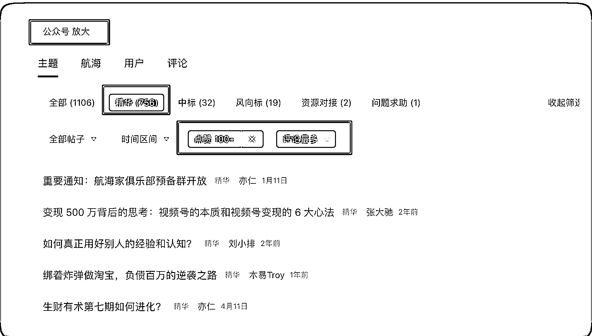
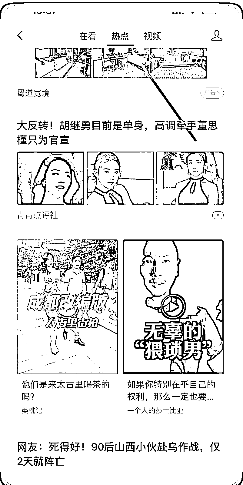
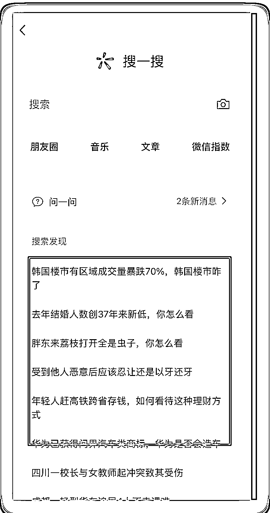
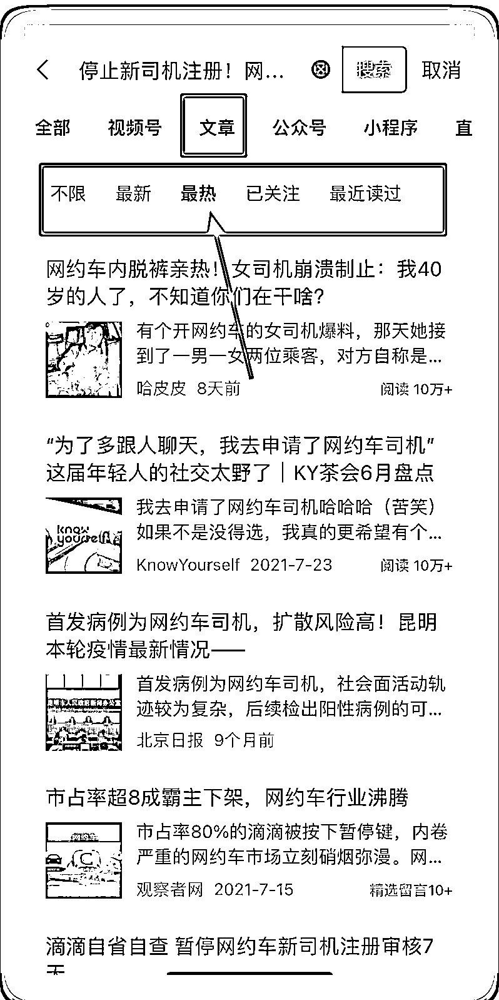
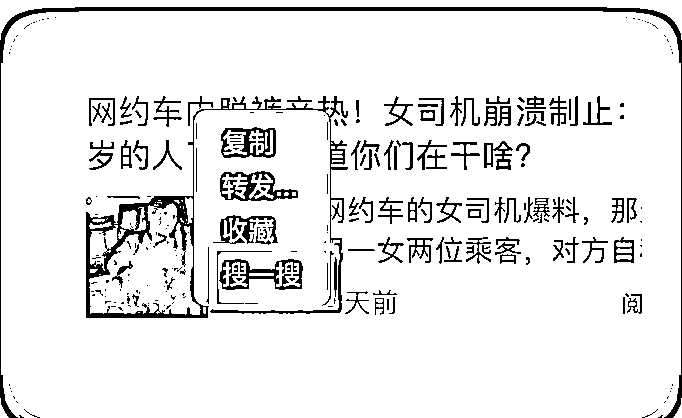
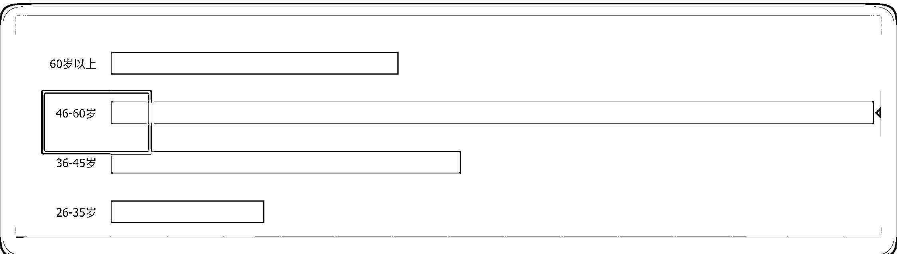

# 公众号爆款文章，你需要知道哪些技巧
在公众号写作这条赛道上，想打造出爆款内容，到底有哪些门道？前段时间，我参加了一个以爆款文章为主题的写作挑战营，经过一段时间的密集输出与复盘，攒下了一些心得。恰好借这个机会，给同期一起死磕文章的小伙伴们鼓鼓劲，希望大家都能成功上岸，收获满满。
**首先，工具只是手段，核心在人。**
很多人一上来就问：你用的是什么写作工具？Claude、ChatGPT3.5 还是 4.0？坦白讲，选哪个都行，这些不过是辅助工具而已。真正决定文章质量的，还是我们的写作思路——也就是知行合一。至于公众号注册、账号搭建这些基础动作，建议直接在赚钱的搜索索引里找答案。连这一步都没去做的，可能你对搞钱的欲望还没那么迫切。当然，来赚钱也不一定以赚钱为目标，还有其他玩法可以探索。
搜索索引 2.0 确实好用，记住两个核心点：**关键字 + 过滤条件**。过滤条件看个人习惯，我更倾向看精华帖且点赞数破百的内容，特别是评论区，别错过。赚钱早期的文章底下，评论区经常藏着高价值的见解，也许某一句话就能打开你的思路。

**其次，素材从哪来？**
如果你不知道该写什么，可以参考上一期航海的公众号爆款写作手册。不是船员也能扫码看：https://search01.shengcaiyoushu.com/docx/NHgUdKMcLoPz0VxSz8LcspWqnsg#doxcnklJQZZRe0xMSCBHvUZhm0f
**情感类方向**
情感文章涵盖的范围很广：婚姻、爱情、仇恨、喜悦，都算。关键在于，能让读者情绪在瞬间被点燃的内容，最容易引爆流量。这种情绪反馈来得极快、极强。比如之前某地食堂出现老鼠头和鸭脖事件，那种愤怒感就是天然的爆款燃料。
**长尾型话题**
婚姻、爱情这类话题的词尾特别长——什么意思？就是文章发出去后，阅读量不会在短期内飙升，可能要等上一个月甚至半年才会爆发。我观察过热搜下的热门评论，里面的文章很多是 2021 或 2022 年写的，直到最近才火起来。这是我个人的推测，毕竟我也没写过这类爆款。除了情感，养老类的银发项目也值得关注，可以多参考前几天公众号的精华文章。
**看一看精选**
如果实在没有灵感，可以刷一下看一看精选。它会根据你的阅读偏好持续推送相关内容，你只要多看几篇类似文章，系统就会源源不断地推荐热门话题过来。

有个很明显的特点：当一件事特别火爆时，看一看精选里几乎满屏都是。之前“成都街头走一走的董小姐”就是这样，十篇推荐里九篇都在写她，热度可想而知。这种时候你就大胆跟着写，新作者写这种选题，阅读量至少能比平时翻个几倍。
**热门搜索**
打开搜一搜，就能看到当前微信用户共同感兴趣的热点话题。

找到合适的热门事件点进去，切到「文章」标签，就能看到大量相关文章。我一般挑这些热点来写。
**手动搜索**
无论你是从看一看、热门榜还是朋友推荐得到的热点，都可以用搜一搜进一步深挖。在「最热」排序下，就能看到哪些文章阅读量高。

这些就是现成的成功样本，直接参考就行。还有个实用小技巧：在微信里复制一段文字，右键点搜一搜，非常方便。

**接下来避坑指南，请牢记：**
1. **政治敏感话题要回避。** 再热也别碰。AI 生成的文本，万一有问题，审核的时候谁知道会出什么乱子。
2. **热点事件，保持中立。** 不去站队，客观呈现事实即可。
3. **不消费悲剧。** 比如之前那个跳楼妈妈的悲剧事件，有人为了流量编造虚假情节，这种事坚决不做。
**怎么动手写？**
选好素材后，直接用 ChatGPT 生成初稿。AI 写出来的内容，加上你的润色和主体框架设计，再融入人工修改，一篇文章的完成度就能到 60%。如果赶时间、想批量发稿，直接走这个流程最省力，投入最小、回报率最高。但如果想把文章打磨到 80%-90% 的水平，那就得花真功夫。我还没总结出具体的公式，大致是要么提供新认知，要么引发共鸣。如果你有敏锐的洞察力，能写出让人拍案叫绝的“卧槽感”，那就是绝佳的好点子了。
这跟高考应试作文不一样。高考作文多数人写完除了自己和阅卷老师，没多少人会再看。所以不擅长高考作文的人，未必写不好公众号文章。
**最后，数据分析才是迭代的关键。**
后台的数据反馈里，最重要的就是用户画像。我们可以通过画像去脑补读者真实的阅读场景，也可以在菜市场、工地门口或亲戚朋友中观察这类人群，甚至可以直接递根烟、请喝瓶水，开口问他们“喜欢看什么文章”，当作感谢。
我自己那篇阅读量破 10w+ 的文章，分析了后台数据后，得出这些结论：

1. **主力读者年龄在 40-60 岁之间。** 这个年龄段在中国人口基数里非常庞大。我猜年轻人多半去刷短视频了。
2. **针对这批读者可以做精细化运营。** 比如调整文字风格、配图偏好、内容倾向等。
3. **90% 的阅读量来自看一看精选。** 也就是官方推荐的流量池。想爆文，就得盯紧这里的热门内容。
4. **推送策略：一篇群发 + 两篇发布。** 这样能获得更多曝光，相当于一个公众号顶三个。
5. **配图很重要。** 图片要跟文章内容匹配。注意别用视觉中国的图，容易被投诉侵权。可以先搜索相关文章，看看哪些配图有过侵权风险。
我的经验分享到这里就结束了。最后，希望各位能互相交流、取长补短、一起进步。
* * *
评论区：
暂无评论

* * *