# 六次换赛道后才摸到 YouTube 高级合伙人门槛的复盘
作者：龙哥

# 一、开篇背景

大家好，我是龙哥，主攻赚钱变现的实践者。去年十一月入圈，赶上十二月的 YouTube 航海计划后就全面投入了。两个多月的时间里，能力与认知都发生了明显跃迁。因为探索面比较广，达人秀、AI 猫猫短剧、动物预警、国风模特走秀、Reddit 故事号、解说号我都实操过。如今主要深耕故事内容和解说两条线。在 @方波妮 教练和 @Gary 曹教练的带教下，两个频道都达成了高级 YPP 的准入条件，算是跨过了 YouTube 项目的第一道坎，仍在持续推进中。

落地过程中踩坑不少，卡点频繁，焦虑感也常有。秉持越分享越走运的想法，我把自己落地的思路和经验梳理出来，供同行参考。

# 二、项目实践心路

选择这个方向深耕，主要受龙哥老师对 Shorts 的判断影响，再加上生成式工具让制作门槛大幅下降。对新手而言学习成本明显降低，同时平台对短视频的流量扶持也很明显，便决定全仓投入。

## 1、航海期拿到初级 YPP

航海期间，航海手册和圈内精华帖帮我规避了大部分新手误区。第一个账号起步很顺，参照头部账号做拆解，用生成式工具做 AI 猫猫短剧，单条制作时长可控。大致 15-20 天就会迎来一次推流潮，第 11 条作品从几千播放冲到百万，一周后发布的作品再到三百万，粉丝破万后初级 YPP 到手。详细流程我之前写过，这里不再展开，有兴趣可看：

感悟1：起步阶段，航海手册+赚钱精华帖能解决约九成的疑问。剩下的再去 YouTube、豆包、GPT、B站、公众号查，查完仍无解就直接#举手。跟着有结果的人走，能省下大量内耗。

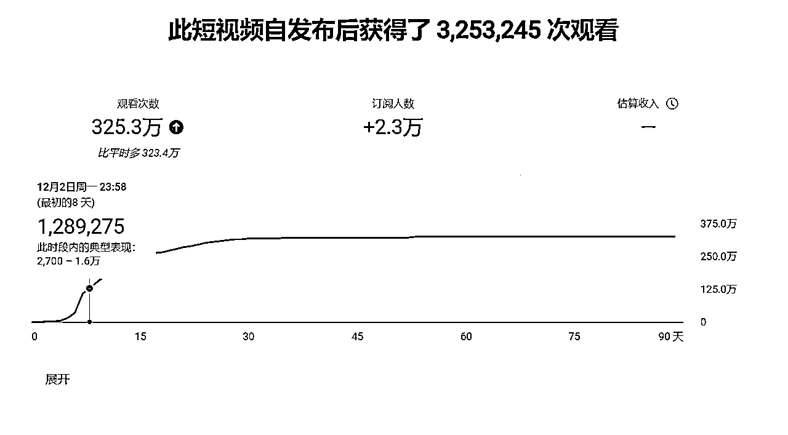

## 2、私教陪跑冲到高级 YPP

AI 猫猫系列虽然转化不错，但制作负担重。一次从文生图到图生视频再到剪辑，至少 3-4 小时，还在用共享账号，排队和抽卡不顺时效率更低。于是放弃纯 AI 路线，转投老马教练分享的故事号打法，更新快、万播常见，数据也印证了这一点，下图为该号表现，心态也更稳。

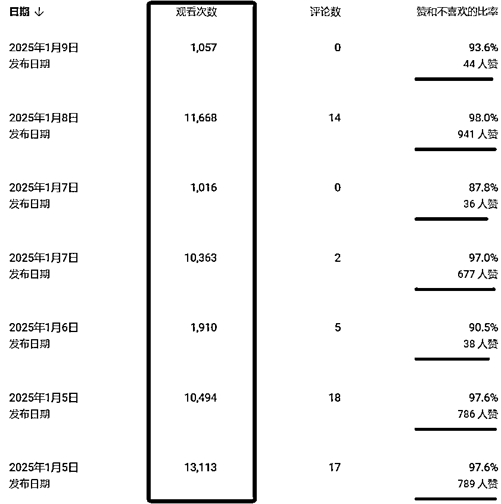

随后被达人秀的流量吸引，又杀回 AI 赛道，一顿操作猛如虎，数据才 1 万 5 左右，再次撞上时间与效率瓶颈。AI 操作不够顺滑，出图不稳定。复盘后觉得，用故事号触达欧美受众的长期价值更大，又回到故事赛道。

紧接着动物预警赛道出现，制作成本又降，我又进去探路，还是卡在万播出不爆。

后来加入赚钱 YouTube 私教陪跑，约到波妮教练一对一复盘。教练建议我回 AI 猫猫赛道冲一把，因为该号的订阅基本盘就是 AI 猫猫积累的，回归后流量回升。叠加私教分享的新玩法，最终达标高级 YPP 条件。

感悟2：赛道切换要克制。我的数据证明转赛道可行，但需要过渡期。频繁跳槽容易导致订阅下滑、用户画像紊乱，爆款更难出现。

关于 AI 学习的焦虑

刚学 AI 时总觉得时间不够，焦虑感很强。之前的误区是觉得要把每个工具都吃透才算入门，创作必须全程上 AI 才算入圈。其实 AI 是手段，核心是先拓宽认知再按需精进。我通过 B站、公众号、推特混进 AI 圈，先去《通往 AGI 之路》知识库建立认知框架，再针对性学工具，投入产出比更高。

## 3、高级 YPP 申诉成功复盘

等开通高级 YPP 时，反而收到资格即将终止的通知。

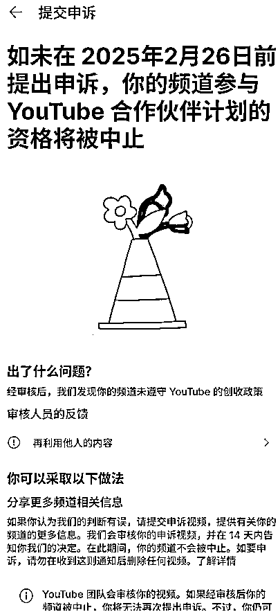

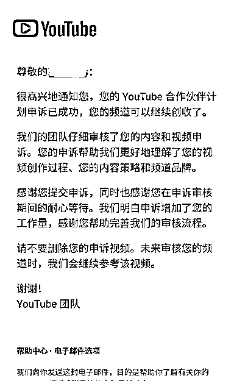

按 @方波妮 教练的精华贴： 指引，我一步步准备申诉材料。飞书录屏出问题时，我用 OBS 录制，加一个视频采集和一个显示器采集即可。申诉后约 5 小时收到成功邮件。下面是我当时的申诉稿，供参考，核心是呈现制作历史、历史工作文件夹、操作流程、AI 作图的后台记录。

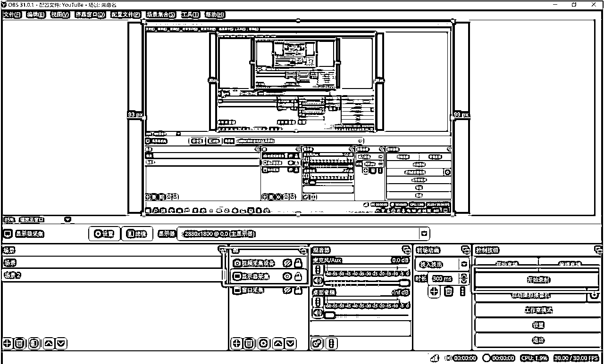

## 申诉稿参考：

尊敬的YouTube内容审核管理员你们好，我是一名中国的YouTube频道所有者。我的频道名称是：XXXX。我的频道主要内容方向是使用各类Ai工具创作一些有趣、有教育意义的短视频内容。（展示频道内容、频道链接（是自己频道主页“更多”里面的链接），缓慢滑动页面）但是内容审核员反馈我的视频内容没有明显的原创特征，可能是改自其他来源中的内容，未增加有意义的原创评论、实质性修改或教育或娱乐价值。这个理由与我秉持的原创及利他的创作理念相悖。这让我感觉到很沮丧。所以我制作了这期视频来澄清。（展示违规通知的内容）

我的频道一共有70个视频，以短视频为主，短视频主要分为了两个大的部分：一个部分是制作关于猫咪故事的有教育意义的短视频，一个部分是制作炫酷变身融合的娱乐性视频。我会将这两个主要部分的内容制作过程进行详细讲解。（展示频道内容，缓慢滑动）

第一部分是猫咪故事短视频，这里展示了我所有短视频的创作的工作文件夹，每一个文件夹都包含了视频脚本、视频分镜图以及分镜视频。（简单展示文件夹及个别文件夹内详细内容）这个视频是我播放量最高的短视频，文件夹展示了故事脚本，所有的分镜图片以及分镜视频。（展示最高播放量的文件夹详细内容），制作视频脚本我会用到ChatGPT，这里是使用ChatGpt辅助写分镜脚本的页面（展示chatgpt对话页面），视频分镜图我会用到DallE，（演示将脚本提示词发给DallE，展示一两个出图过程），按照这样的步骤得到所有的视频分镜图。视频分镜我会用到runway、即梦、可灵等Ai工具（可以展示一些网站首页截图）。我这里使用即梦进行分镜视频的制作（展示一个图生视频的过程），将所有的图片使用即梦做出分镜视频，这样就会得到所有的分镜视频（可以展示即梦后台做视频记录，还有所有分镜视频的文件夹）。最后放入CapCut中进行剪辑（展示Capcut），调整视频片段的长度，增加相应的文字，增加背景填充，导入音频，最后在YouTube平台进行发布。（这里在剪辑软件里面就简单展示一下操作，不需要很细致）

第二部分是炫酷的变身秀娱乐视频，这里展示了我所有短视频的创作的工作文件夹，每一个文件夹都包含了视频分镜图以及分镜视频。（简单展示文件夹及个别详细内容）我会使用Chatgpt辅助我生成图片的提示词，这是GPT生成提示词的界面（展示chatgpt对话页面），然后文档也展示了所有分镜图的提示词（因为所有的提示词我都保留在飞书文档，所有展示了飞书文档），接着我会使用Comfyui进行图片的生成（展示Comfyui工作流，我用的是liblib.Al，展示Comfyui作一张图的过程），这是我使用Comfyui做图的后台记录（liblib.Al作图后台有记录，展示comfyui作图后台记录），里面展示了我作图的历史记录，然后我就可以得到所有的分镜图片。然后我会使用即梦Ai的关键帧功能制作变身融合的效果（展示即梦做视频过程，演示一个），最后得到所有的分镜视频（文件夹展示），同样使用capcut进行视频的剪辑，加入一些特效、转场，导入音频，然后导出视频，在平台发送。（同第一个部分）

频道的其他视频也是通过以上方式创作（这里要说明整个频道都是这样制作的，不针对某一个视频，展示频道所有视频），在这里展示了我所有短视频的创作的工作文件夹，每一个文件夹都包含了视频脚本、视频分镜图以及分镜视频。这是capcut剪辑的草稿箱（capcut的草稿箱）。

我深知抄袭的可耻的，会损害所有优秀创作者的利益、扰乱社会秩序，所以我一直坚持内容的原创性，这个澄清视频也是我的原创，就像我的其他视频一样，我希望我的每一个视频都能为他人提供价值，我希望YouTube审查小组能够重新审查我的视频内容。你们和观众的认可是我制作视频最大的动力，谢谢。

感悟3：做视频一定要沉淀自己的文件夹和知识库，提示词、文稿、脚本都归档好。申诉时能快速自证，很关键。

# 三、Reddit 故事号与解说号拆解

## 1、获取爆款文案

可一次性免费提取三个视频文案：https://member.downsub.com/multi-downloader

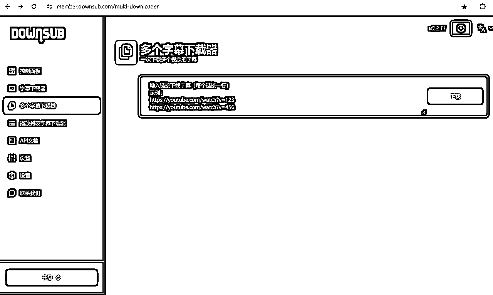

## 2、AI 复刻爆款文案：飞书多维表格 + DeepSeek

我试过 GPT，也用过飞书多维表格+DeepSeek 实现批量复刻+关键词提取，灵感来自 @小查 的帖子

downsub 下载的 TXT 排版混乱、无标点，AI 理解会受影响，所以我先用飞书多维表格+DeepSeek 做清洗，再改写。提示词仅作参考，可根据 DeepSeek 的思考过程优化。

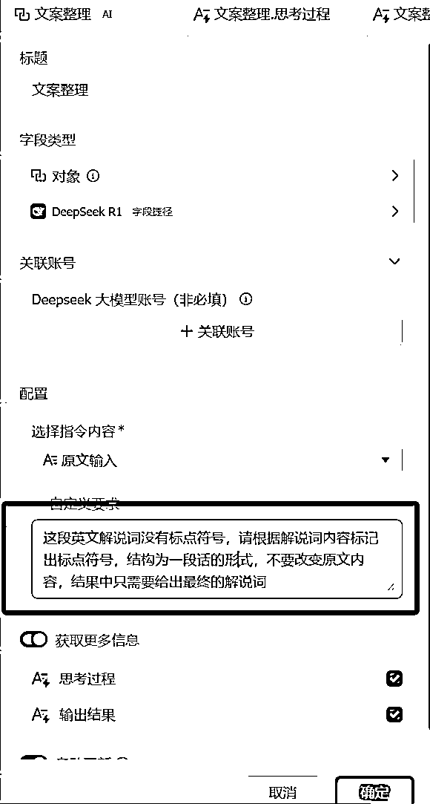

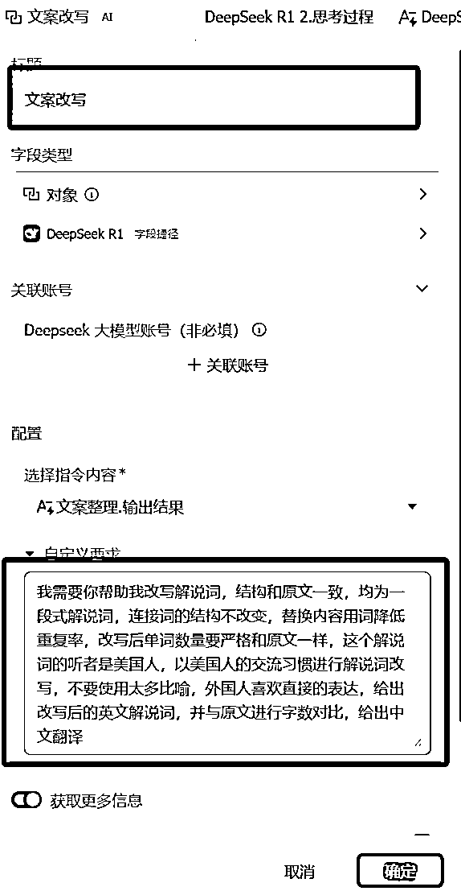

因为我要做解说号，所以多加了一列做关键词提取，方便去其他平台搜素材。提示词不满意就点刷新重来。

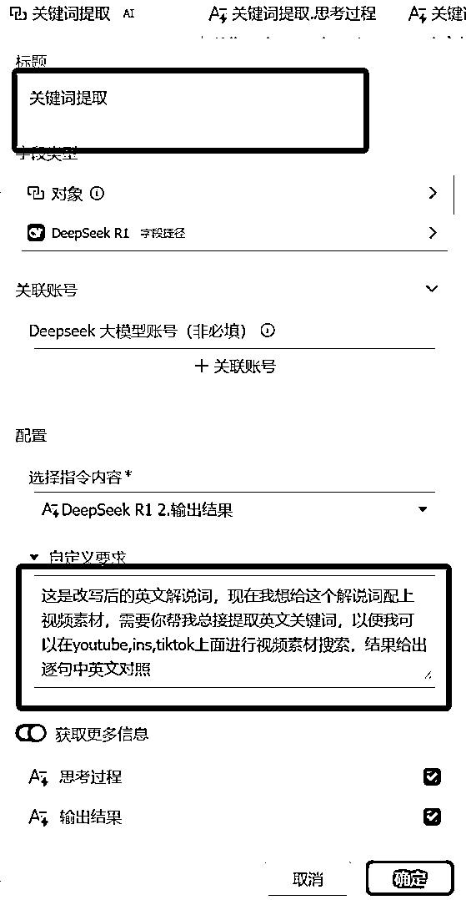

## 3、更真实的配音

配音工具很多，故事号对声音要求更高，我主用 elevenlabs。AI 配音常遇到两个问题。

第一个是没感情、AI 味重。elevenlabs 里可这样调：

* 降低稳定性提升情感；

* 需要加重语气词用大写表达；

* 在合适位置加感叹号、问号、停顿。

后两点可以直接交给 GPT/DeepSeek 在改写时一起完成。参考改写提示词：

帮我改写故事，分别给出英文版和中文版，改写规则如下:

1、保留原文稿标题

2、核心词汇、关键词汇、情绪用词使用大写字母表述，叙述时语气加重的单词使用大写进行表述

3、改写后文稿的字词与原文稿字词重复率不高于20%

4、改写后文稿的字数<原文稿字数x1.1，改写后文稿的英语单词尽可能控制在300-350个

5、保留:人称关系、核心事件

6、语言:简练句式清晰主干，符合美国人的语句表达习惯

7、在原文稿的基础上完善故事逻辑、补充细节、心理动态描写等

第二个问题是提高分贝后有电流噪音。群友在卡兹克给了方案：生成后用 Au 降噪。推荐公众号：化工加，可免费下载软件并有安装教程。

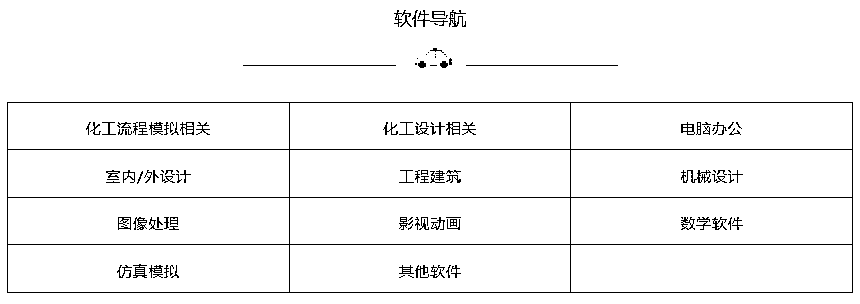

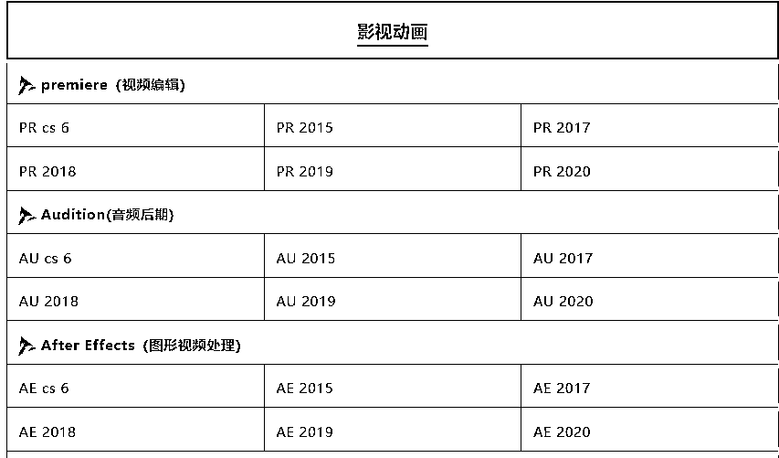

Au 里我只用了三个功能：提音量、加速、降噪。

流程：

* 音频拖入 Au 界面。

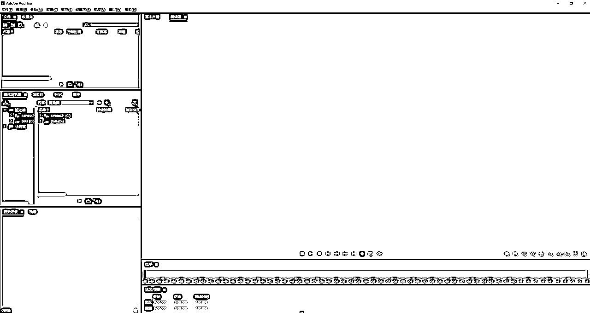

* 拉大振幅提升音量。

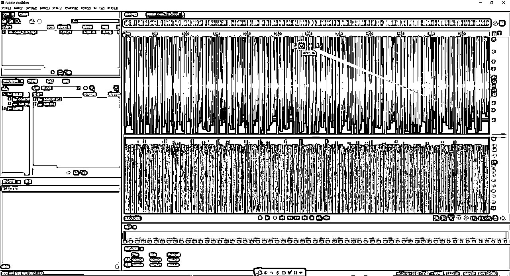

* 效果-时间与变调-伸缩与变调处理，调整时长，58%为参考值，剪映可全识别字幕，设好后默认为默认设置。

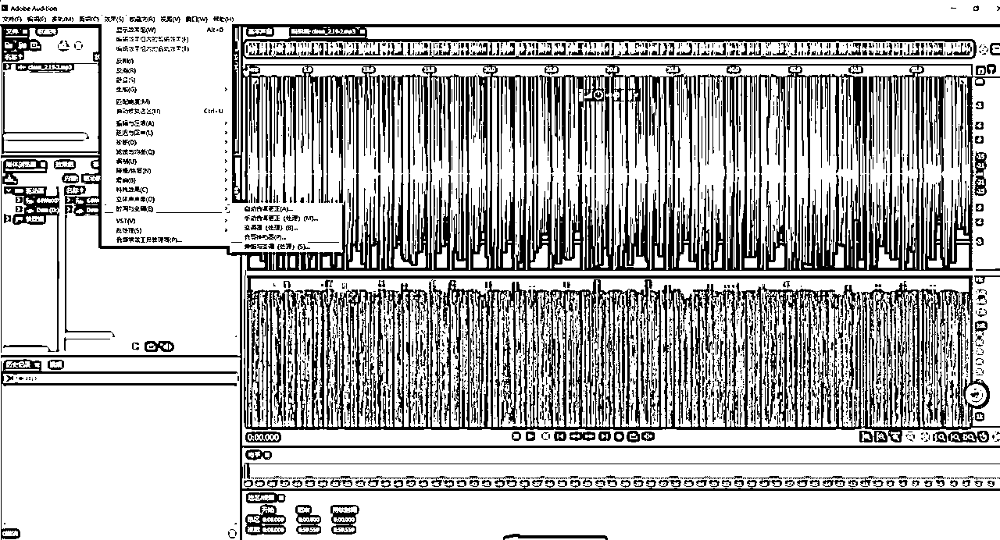

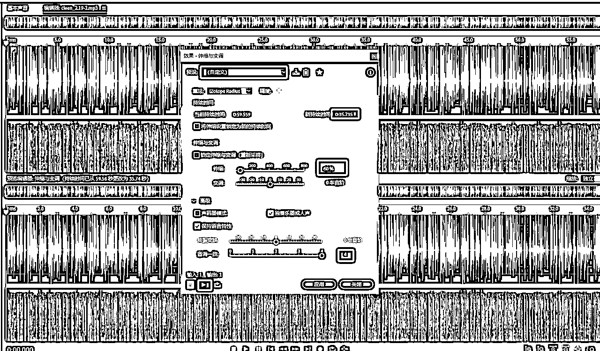

* 降噪：按图路径进入自动降噪，调幅度、噪声量，试听后应用，设为默认后处理单个音频约 30 秒。

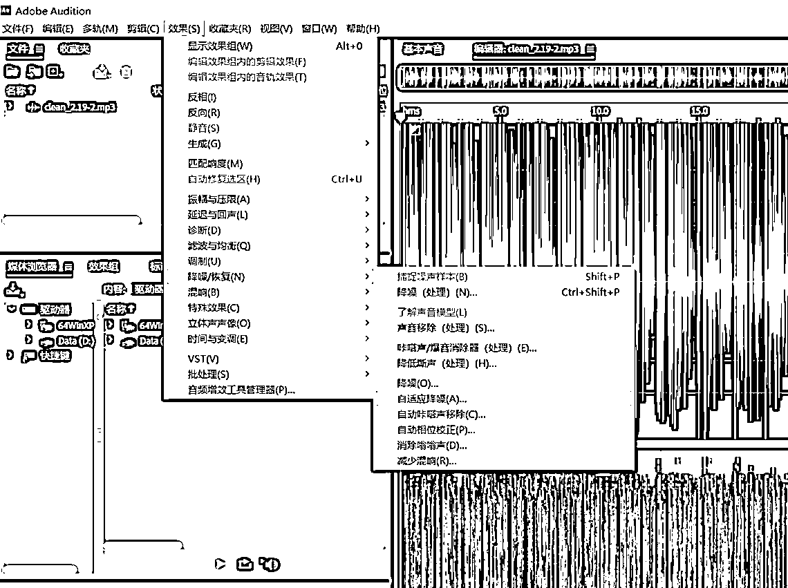

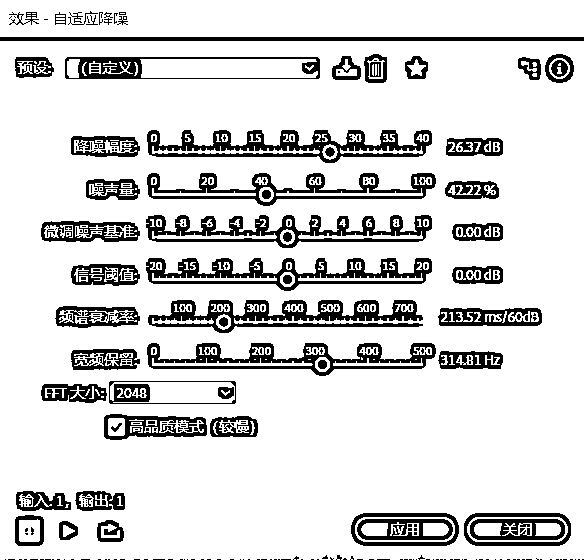

## 4、解说号素材获取

素材找法老马教练和圈友都分享过，我走逆向：Google 搜图+关键词搜。

* Google 搜图：用老马分享的关键帧提取工具先抽图，再在 Google 搜图。

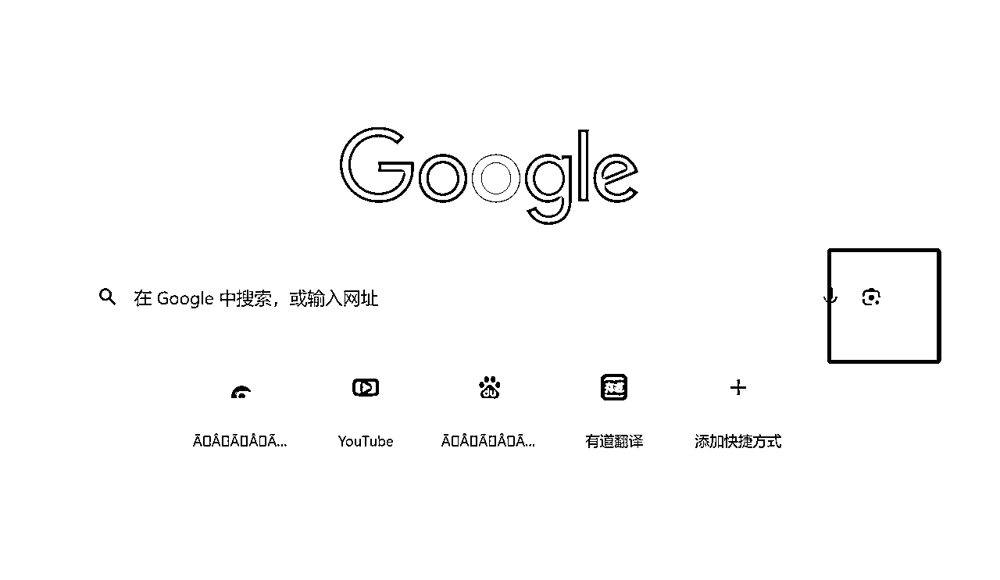

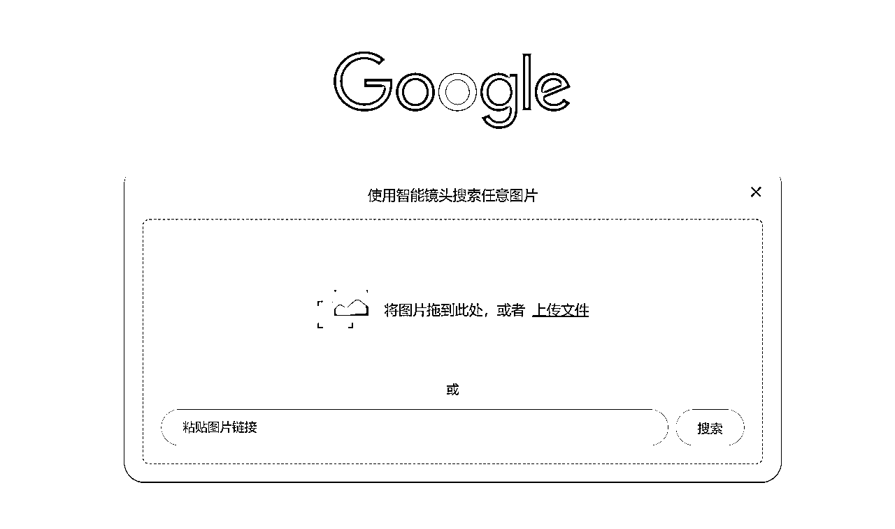

* 关键词搜索：直接用飞书+DeepSeek 提取的关键词去 TikTok 搜，基本能找到原片或相关视频，经常能挖到宝藏账号。

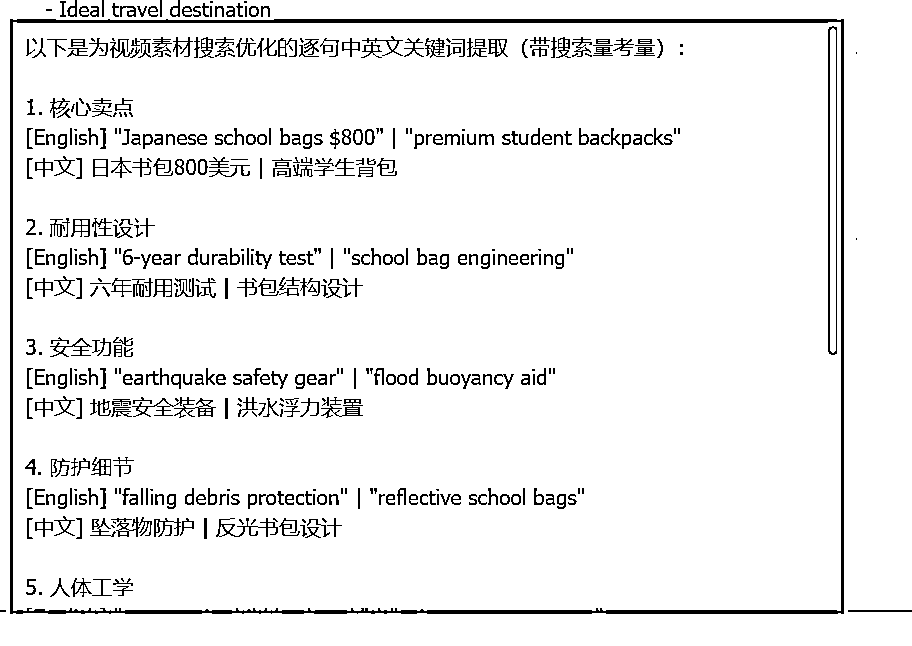

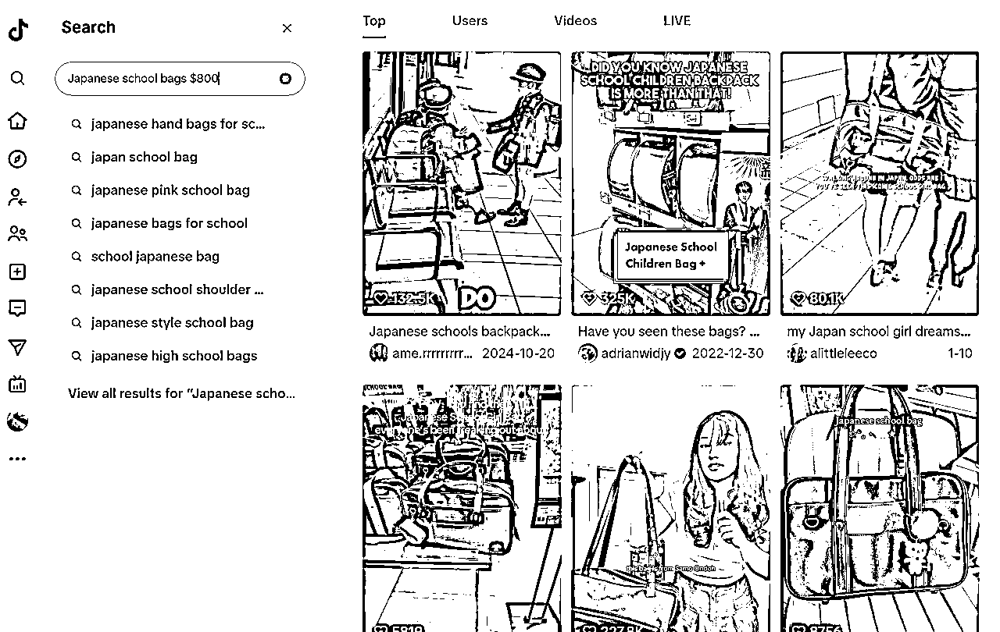

## 5、视频下载工具

* 专下 TikTok：https://musicaldown.com/en

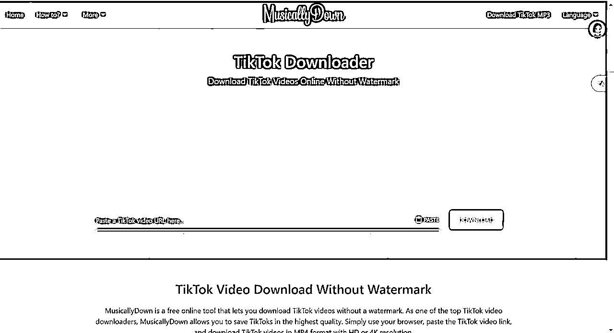

* 跨站下载工具：https://snapany.com/zh，可复制链接粘贴后自动解析，一次最多 10 个，适合解说号单素材下载。

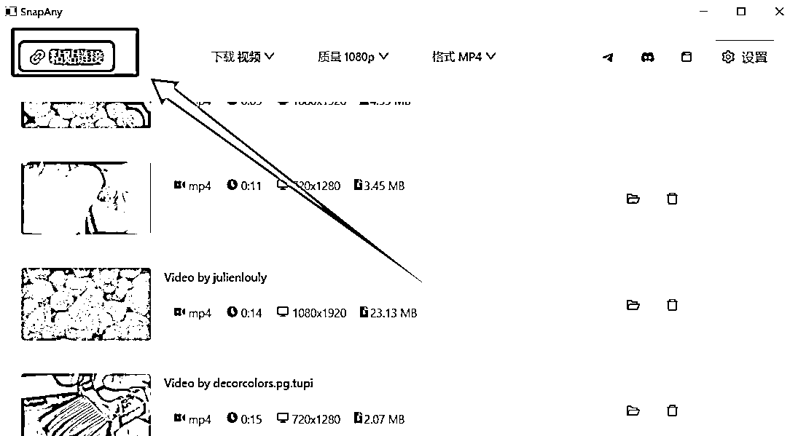

感悟4：故事号、解说号爆发速度不如 AI 达人秀，但更持久、可深耕。核心是理解海外文化语境，数据反馈才是判断文案好坏的唯一标准，多留意评论区互动，从评论里提炼优化点。

# 四、收尾与致谢

YouTube 值得长期做。感谢赚钱这个平台，感谢所有分享 YouTube 笔记的作者，感谢私教陪跑让我两个多月拿到高级 YPP。

感谢七天老师 @七天@龙哥盟、方波妮教练 @方波妮、Gary 教练 @Gary 的指导！

能和圈友一起奔同一个目标很幸运，2025 继续猛干！