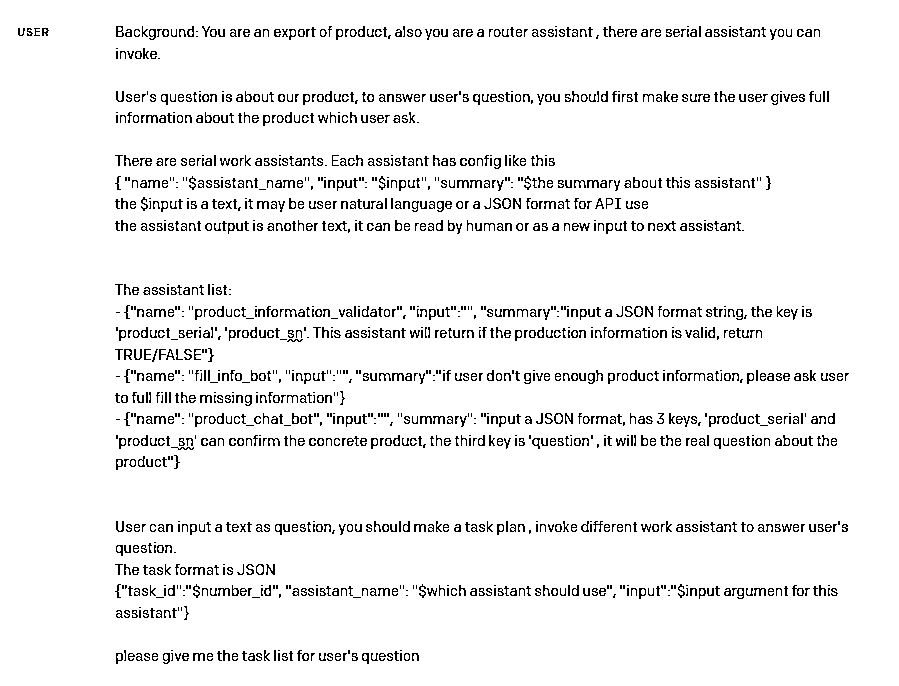
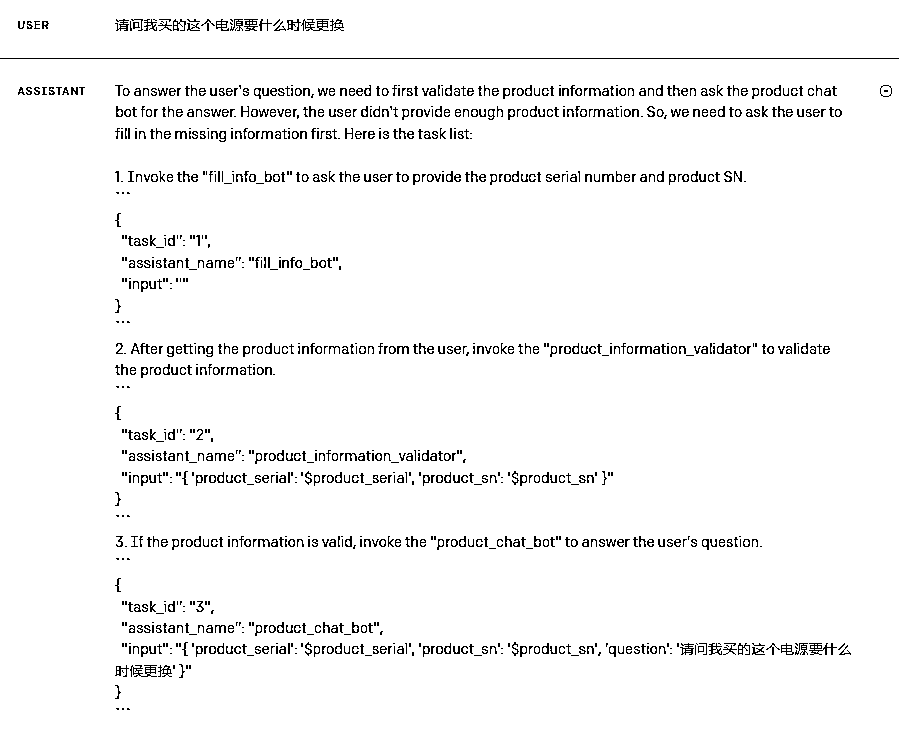

# 关于 AI Agent 的帖子收获
这几天群里有人转发了一篇关于 AI Agent 的深度好文，我认真读完后，内心有不少触动。文章提到 AI Agents 正迎来大爆发，软件 2.0 的雏形已经若隐若现，这也让人更加期待 OpenAI 接下来的动作。
读完以后，我发现其中不少判断，恰好验证了我们在 ChatPAN.ai 上的一些早期假设。今天这篇文章可能会有点技术向，大家各取所需就好。
简单来说，Agent 可以理解成一个替你干活的助手，大体分为两类：一类是“调度型”，一类是“执行型”。调度型负责拆解任务、推动流程，核心能力其实就三条：任务规划（Planning）、记忆（Memory）、工具使用（Tool Use）。这里面最麻烦的不是记忆，而是怎么做好规划、怎么挑对工具。短期记忆靠 token 数硬撑，长期记忆就得靠向量数据库。像 Auto-GPT 这类项目，正是在这些方向上做的尝试。
有意思的是，这套逻辑和 ChatPAN.ai 当初的设计撞了个满怀。如果你翻过 ChatPAN 的接口 swagger 就会注意到，一个 room 里其实可以挂多个助手，虽然界面上只露出一个。留这个口子，就是为了给任务调度做准备。
我个人的做法是这样：
1. 先安排一个主助手，也就是 Router Assistant，用户一进来它就立刻接手。它会结合用户说的话，以及这个房间原本设定的用途（存在调度助手的背景信息里），来制定任务规划。
2. 把房间里所有助手的描述都汇总给调度助手，方便它按需调用。
3. 每一步任务跑完后，结果会回传给调度助手做校验，再决定是继续推进下一步，还是推倒重来换个规划。
4. 至于记忆部分？这不正好是 ChatPAN 的强项嘛。
按照这个思路，我做了几个简单的接口实验。我给工作助手（work assistant）的定义大概是这样的：一串串行工作助手，每个助手都带有类似 { "name": "input", "summary": "助手简介" } 的配置；输入可以是自然语言，也可以是给 API 用的 JSON；输出同样可以是给人读的文本，也可以作为下一位助手的输入。
这个描述其实也是我对 ChatPAN 助手（包括助手内部 Bot）的底层理解——这种结构天然能串起来干活。只要把上面的 "name" 换成 "assistant_uuid"，就能直接对应上 ChatPAN 已有的助手体系。
实验效果见图 2。我这次测试用的场景，是一个正在对接的复杂客服需求。当然，用提示词硬写也不是不行，但真要论优雅和扩展性，显然是多助手协同更胜一筹。
到目前为止，这些都还只是比较初步的尝试，后面仍有大把细节要打磨。发出来算是抛砖引玉，希望能和更多同好交流碰撞。

评论区：
希声 : 666
