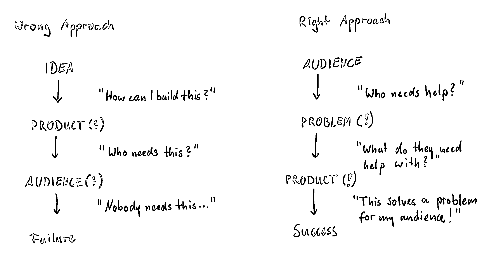
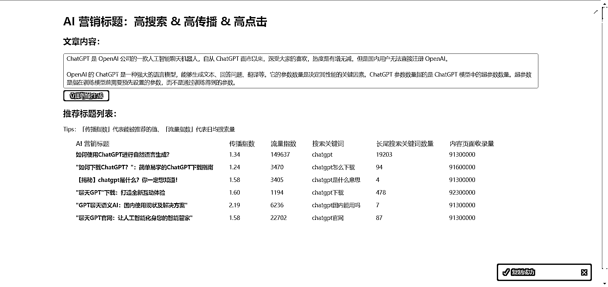
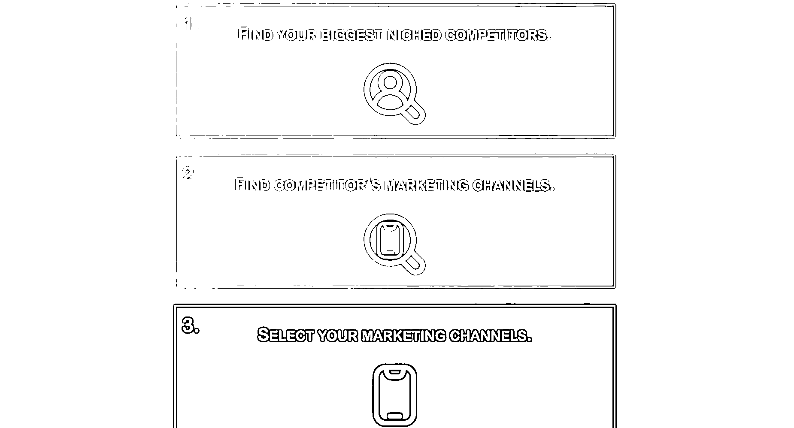
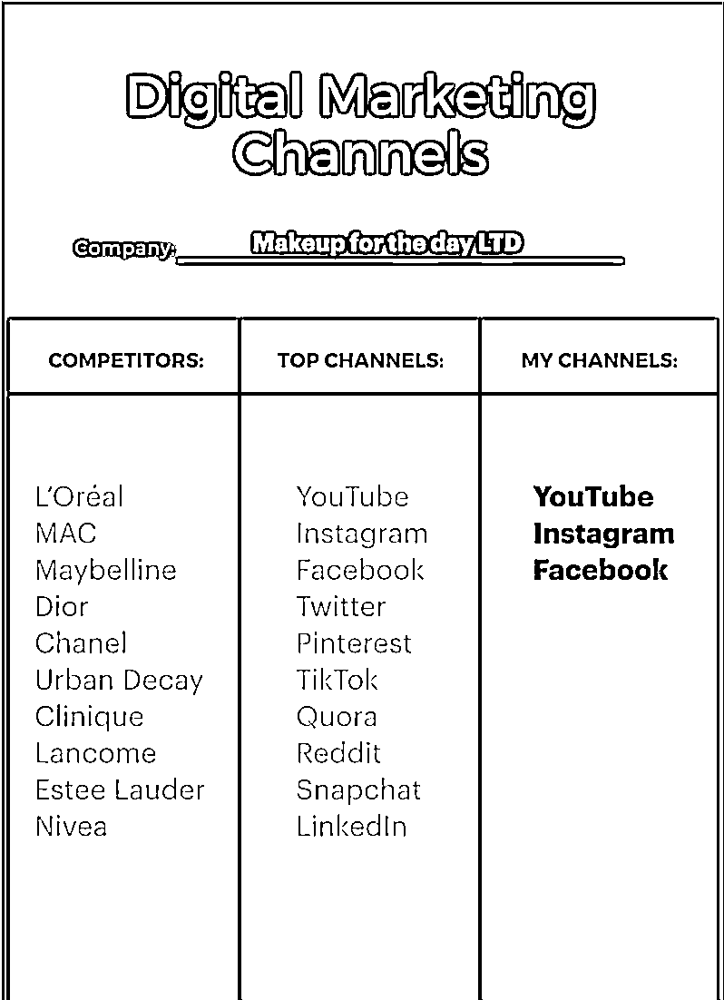
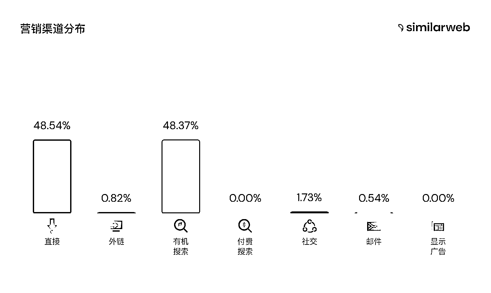
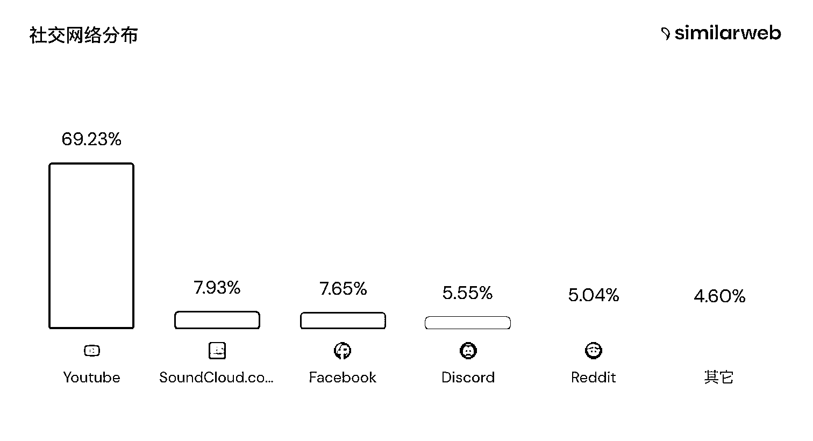

# 别再乱做工具了！做 niche 海外软件，这 6 步才是正解
作者：龙哥

上周刚从北京的一个 hackathon 回来，两天时间从零脑暴 Idea 到做出 Demo 再上台路演，节奏紧到窒息但也特别过瘾。回头复盘后我越来越觉得，几乎每个程序员都该去冲一次 hackathon，逼自己把想法落地。

在这次经历里，我也重新梳理了做小而美的海外软件工具的思路。借用壹树树哥在线下分享的那张图，结论先放前面，我认为一套可行的路径可以浓缩为 6 个环环相扣的动作：

1.  挖出用户真实的痛点

2.  扒到问题的根因

3.  用软件怎么解？MVP 怎么搭？

4.  这类用户到底长什么样

5.  他们在哪儿？对应哪些营销渠道

6.  冷启动怎么打得起

## 第一步：先找到问题，别急着造轮子

痛点只是表象。把它当成信号来捕捉，而不是答案。

在 hackathon 现场，我把自己当成第一批种子用户。我长期做内容和 content marketing 增长，日常就会遇到一个卡点：

找到问题只是开场。工具存在的意义就是解决问题，但解法未必非得是软件，可能是服务、可能是流程。别神话软件。

## 第二步：问到底，为什么会这样？

用 5 Whys 反复追问，把表层症状挖到根上，那才是真正的“本”。

我当时聚焦的内容营销困境，追下来根因其实是：好内容当然重要，但比内容本身更关键的是标题、描述这类包装是否符合各平台的推荐机制和搜索引擎的流量规则。

## 第三步：用 MVP 思维算一笔账，再动手

这里考验的是 MVP 意识和成本核算能力：技术要花多久、人力够不够、时间窗口能不能兜住。

hackathon 只有 48 小时，我选择先攻最致命的一环——标题。目标很清晰：让标题更容易被推荐、被搜索、被点击。

我定下的方案是「AI 营销标题：高流量 + 高推荐 → 高转化」：

● 先用 AI 提取内容的主题，再结合 SEO 数据平台抓取高流量的相关标题关键词

● 再用 AI 重写一版兼顾传播力和点击率的标题

后续可以扩展的方向有：AI 生成营销描述和标签、AI 生成高点击封面图、做成浏览器插件提升使用体验。下面的截图就是我们两天做出来的 Demo 效果：

## 第四步：把用户画像画清楚，否则做营销就是瞎投

这次 hackathon 时间紧，Demo 一结束就散了，这一步没来得及实操，但我认为这是成败的分水岭。

只有画像清晰了，后续的获客、传播、冷启动才有方向。核心就一句话：用户在哪，我的产品就在哪。

如果连用户是谁都说不清，怎么可能知道他们在哪？一个完整的画像至少要覆盖：

1.  公司层面：公司规模、所属行业、地域分布、岗位角色、核心职责、采购决策流程

2.  个人层面：年龄段、学历、收入水平、专业背景、从业年限、兴趣爱好、技能栈

3.  互联网行为：常逛的网站、常用的社交媒体、日常依赖的其他工具

## 第五步：找渠道，先抄作业再选赛道

有了画像，再去找竞品。竞品分析不是为了模仿，是为了反推用户在哪被触达。

### 1. 先锁定同类竞品

竞品就是功能、价格、定位都跟你重合度最高的对手。找法很直接：用核心关键词搜索，或者用 ahrefs、SimilarWeb 这类工具扒一遍相似站点，把头部几家列出来。

### 2. 拆解竞品的流量来源

统计每个头部竞品的流量渠道占比并排序。SimilarWeb 就能直接看到各渠道分布，如下图。

### 3. 结合自身能力选渠道

冷启动期，别贪多。看 Top 渠道和自己团队的能力匹配度，选 1-2 个最容易啃下来的入口。等产品和团队稳定了，再逐步吃下头部几个高价值渠道。

营销的底层逻辑始终没变：

1.  把对的产品，精准地摆到对的人面前

2.  谁是对的人？

3.  他们平时待在哪儿？

4.  目标客户的本质，就是对你的产品或服务有真实需求的那群人。

## 再总结一遍，6 步走通才算闭环

1.  发现用户的问题或痛点

2.  明确问题的根本原因

3.  解决方案：如何用软件解决？

4.  确定这类用户画像特征

5.  确定用户对应的营销渠道

6.  确定如何营销冷启动？

工具做得再好，不解决真实问题、找不到人用，就是自嗨。按这套顺序走一遍，至少不会在错误的方向上浪费时间。