# 别再问 ChatGPT 问题了！这才是它在 TikTok 上帮你赚钱的正确打开方式
作者：龙哥

最近，ChatGPT 的热度简直要把互联网掀翻了。你要是还没被它刷过屏，都不好意思说自己上网冲浪。

但有意思的是，我身边很多人都在焦虑：“AI 会不会抢我饭碗？”而赚钱圈里的老哥们，脑子里只有一件事：这玩意怎么帮我搞钱？格局一下就拉开了。

刚在杭州参加完线下见面会，我就赶紧回来写文章了。别的领域我不敢乱讲，今天就专门聊聊：在 TikTok 这条赛道上，ChatGPT 到底怎么用才能变成你的“印钞机”？

## 先想清楚：你把它当老师，还是当员工？

ChatGPT 是个啥？说白了，就是 OpenAI 搞出来的一个聊天机器人、语言模型。但关键不在它是什么，而在你以什么姿势用它。

我问过很多人：你平时咋用 ChatGPT？答案基本分两种：

1.  有问题，去问它——像学生问老师，等一个标准答案。

2.  有任务，派给它——像老板使唤员工，让它直接干活。

第一种，你心里没底，想求个答案；第二种，你心里有数，只想有人替你执行。这俩逻辑完全不同。

不信？我们来实测一下。

你问它：“TikTok 视频怎么上热门？”

它会给你一堆官方套话——什么内容优质、把握趋势、互动积极……听着都对，但跟没说一样。

你再问它：“TikTok 怎么赚钱？”

它能列出几种常规变现路子，但你可能发现，它压根没提 TikTok Shop 小黄车带货。为啥？因为它的知识库截止到 2021 年，小黄车大规模普及是 2022 年的事了。

更有意思的是，你要是问点它不知道的，比如“你如何看待历史上的路路通社群事件”，它就开始一本正经地胡说八道了。哪怕 GPT-3.5、GPT-4 已经改进了不少，但这种“编故事”的毛病依然存在。

所以，你发现了没？当你以“提问者”身份面对 ChatGPT 时，它的回答有三个明显毛病：一、套路化严重，动不动就是“总分总”，跟应试作文一个味儿；二、知识储备有限，超出训练数据范围就瞎编；三、答案往往正确但没用，你听完还是不知道该怎么下手。

## 换个姿势：不是“问”，是“命令”

那怎么办？如果你换个身份，从“学生”变成“甲方”，直接下指令呢？

比如你让它“按我的要求写 5 个视频标题”，它马上给你交活儿。虽然一开始有点机翻味儿，但你让它换个风格，它瞬间能给你来一堆。

这背后的道理就一句话：**ChatGPT 不是神，它是你的外包助理。** 别把它当“算命先生”去问“TikTok 还有没有前途”“现在入场是不是好时机”——它说“是”，你就盲目冲？它说“否”，你就不干了？这不叫用工具，这叫求签。

真正聪明的用法是：你自己先想清楚要做什么项目、路径是什么、卡点在哪，然后把具体环节扔给它去处理。简单说，**你要做它的指挥官，而不是它的信徒。**

## 举个实操案例：影视解说怎么从 2 小时缩到 3 分钟

拿 TikTok 上非常常见的影视解说项目来拆解。

先看变现逻辑：主流方式是创作者基金，按播放量给奖励。基本上 10 万播放能有 5 美金左右，视频爆了，一天几百美金甚至几百欧都有可能，而且还有长尾流量。群里大佬天天晒收益，看得人眼红。

再看项目难点：一个字——**慢**。做一条影视解说，你得写解说词，翻译成英文，再配音，再做字幕，最后剪辑。光听着就头大。

以前大家怎么操作？很多人会“偷懒”：找现成的中文解说视频，扒下来改个英文配音。流程大概是：

1.  用剪映提取原视频字幕；

2.  拿翻译网站把文案翻成英文；

3.  用翻译后的文案去配音；

4.  把新字幕、新配音塞回视频里。

结果呢？折腾半天，发现配音和画面对不上！因为中英文语速、句长不一样。最后只能一句一句地调，调到你怀疑人生。新手搞一条视频，没俩小时下不来，出来的成品还贼拉胯——语速跟不上画面，只能狂飙快进，观感极差，评论区一片吐槽。

但你要是用 ChatGPT 呢？同样的活儿，3 分钟搞定。

第一步：还是把字幕提取出来。

第二步：直接把文案扔给 ChatGPT，让它完整翻译。注意，它翻译出来的内容，长度基本和原文接近——这点很关键，省了你后期调整对白的力气。

第三步：你可以直接配音，更爽的是用 AI 数字人工具，比如这个 [https://studio.d-id.com/editor](https://studio.d-id.com/editor)，输入文案，自动生成动态数字人讲解视频。

第四步：把字幕和数字人视频一起拖进剪辑软件，完事儿。

简单吧？别人吭哧吭哧做一条的时间，你都能做二十条了。而且成品质量高，语速柔和，画面字幕基本吻合，几乎不用手动修。

## 这还只是开胃菜，真正的玩法多到你头皮发麻

影视解说只是冰山一角。更夸张的是，你甚至可以“训练”ChatGPT，把整个流程跑成自动化——只要你持续投喂同一风格的文案，它就能模仿出你想要的味道，原创解说词信手拈来。

再往深了想：

- 国内教人玩 ChatGPT 的文章满天飞，你完全可以拿这些内容做成视频，配音后发到 TikTok 上，既能赚流量，还能把老外引到私域变现。

- 人人都头疼的“原创内容”，AI 分分钟给你生成独一无二的东西，直接文字转视频，条条不重样。

- 带货视频千篇一律？弄个数字人给你讲解产品，观众保证眼前一亮。

- 定制化服务也是个金矿——用 AI 作图，在 TikTok 或其他平台接单头像、Logo 定制。已经有人这么干了，开个店坐等收钱，成本几乎为零，直接碾压传统高成本设计。

- 更有人靠这个卖起了书……只能说，遍地都是钱，只要你肯弯腰捡。

## 最后说句掏心窝的话

ChatGPT 这波技术浪潮，真正牛逼的地方在于：它把新手和老手之间的经验差距，硬生生给抹平了。

以前新手做影视剪辑要几小时，现在几分钟搞定，而且效果还更好。这种“逆袭窗口期”不是天天有的，错过了，下次真不知道要等多久。

但别忘了，工具终究是工具。**你得掌握和它对话的姿势，学会下指令，让它干活，而不是围着它求答案。** 你才是那个做决定的人，它只是你的手和脚。

如果你也在折腾 TikTok 和 AI 工具，欢迎来评论区聊聊你的想法，咱们一起挖金矿。

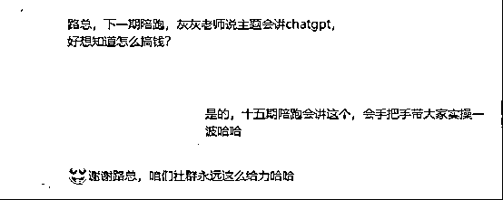

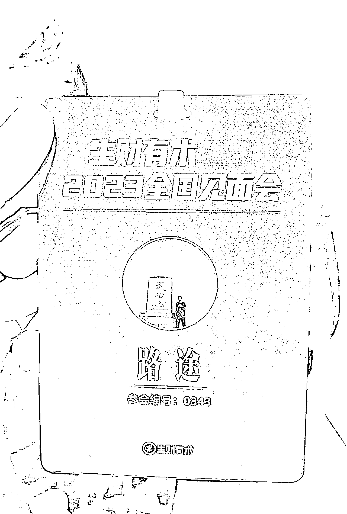

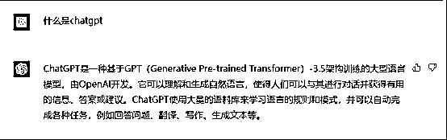

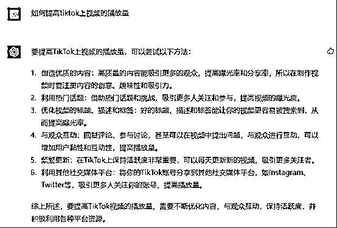

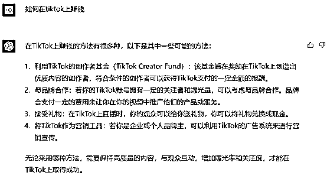

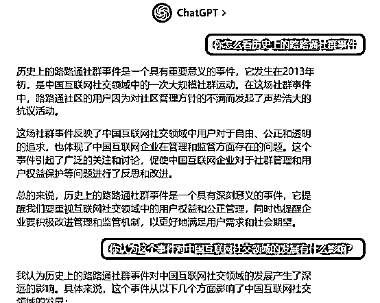

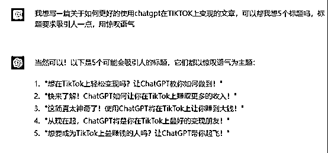

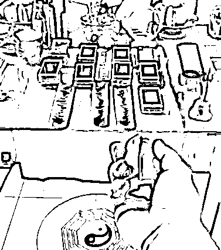

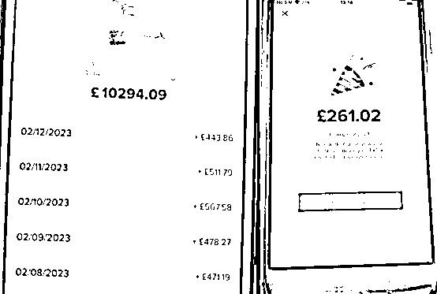

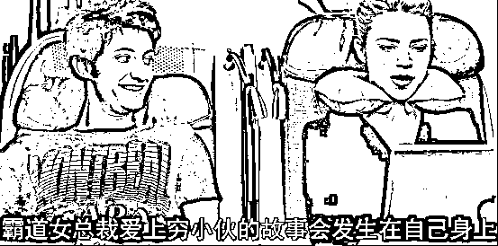

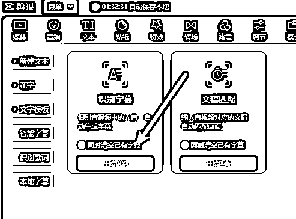

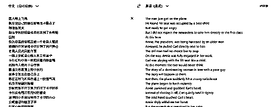

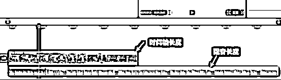

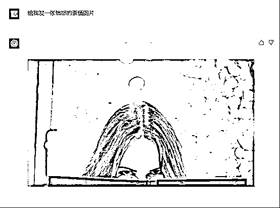

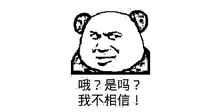

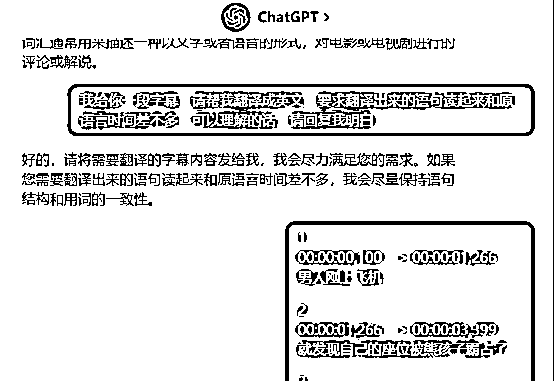

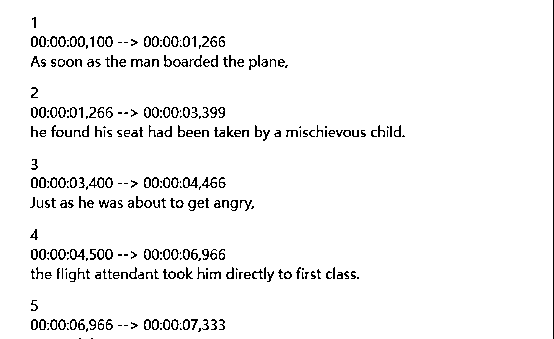

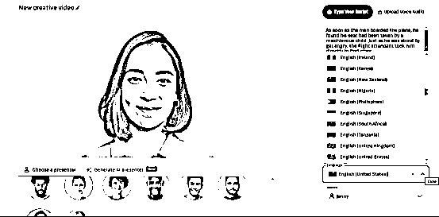

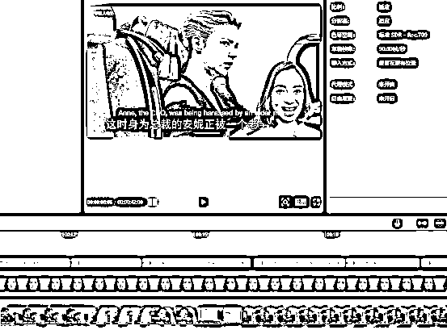

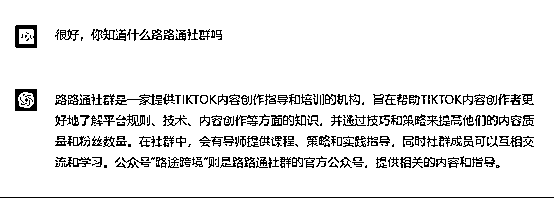

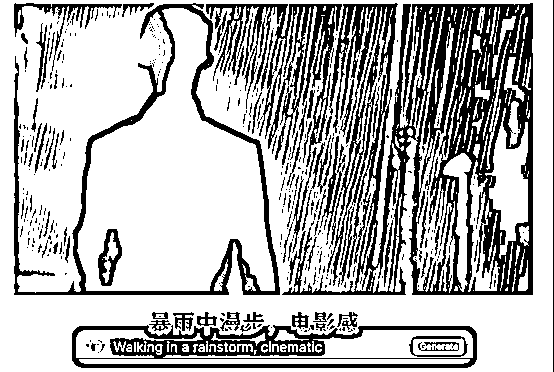

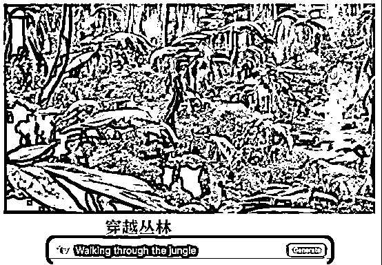

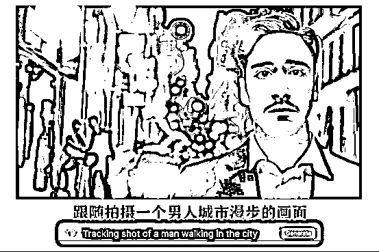

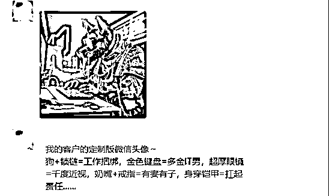

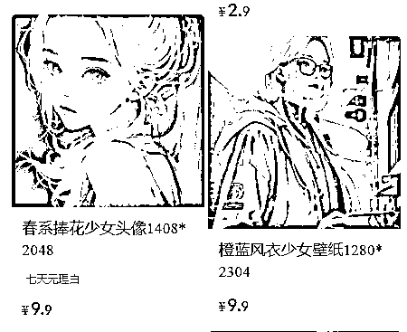

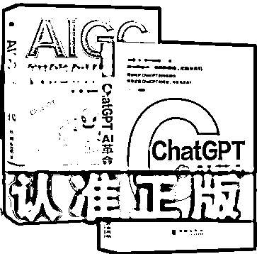

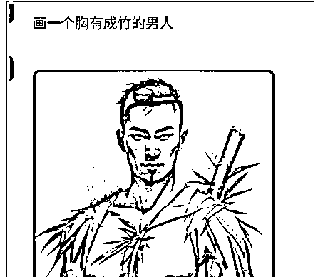