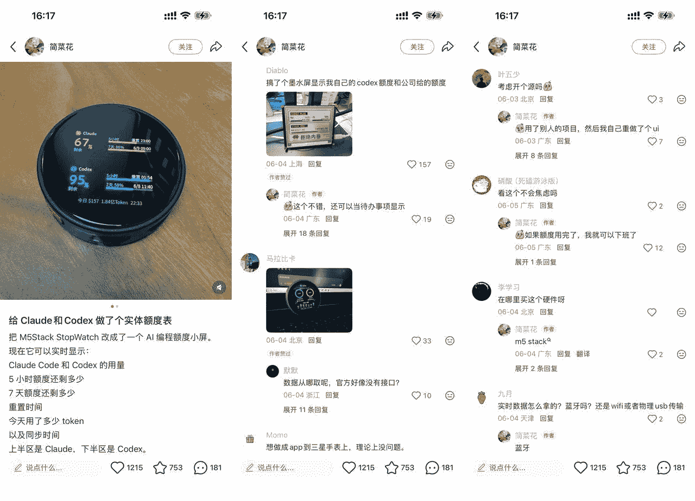
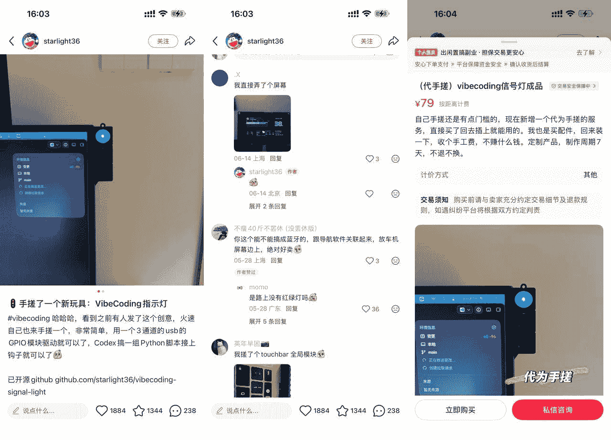
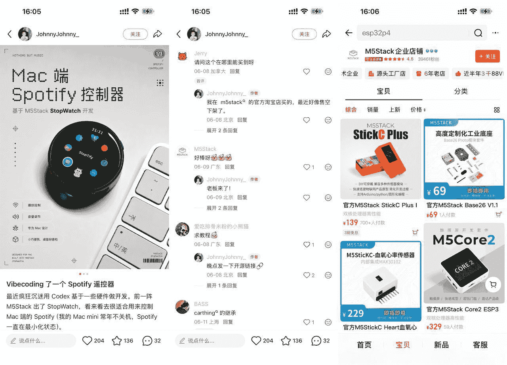

# 别只盯着虚拟产品，AI 硬件也正在冒出新机会
260703 副业SC 精华
过去两年，大家聊 AI 项目时，注意力大多集中在虚拟产品上。
从小工具、网页应用、提示词，到工作流、知识库，再到近期大火的 Skill 和 Agent，几乎都是线上交付。它们开发成本低、传播速度快，也更容易快速迭代。
但最近，我注意到一些非常轻量的 AI 硬件，反而展现出了不一样的可能性。
比如：
- 摆在电脑旁边，用灯光提示状态的小设备；
- 专门控制 Spotify 的桌面遥控器；
- 显示 Claude、Codex 使用额度的小屏幕；
- 用来操控智能家居的旋钮；
- 按一下，就能记录灵感和待办事项的 AI 小设备。
它们都不是什么复杂的产品，却频频获得关注。
有人在评论区询问购买渠道，有人追问能不能直接买成品，还有人已经在闲鱼上提供手工制作版本。
这让我想起一个大家可能都用过的产品：飞书录音豆。
手机和电脑当然也能录音，软件也可以完成转写、总结和整理。但飞书录音豆依然找到了自己的位置。
为什么？
因为真正需要记录时，它少了很多中间步骤。

如果用手机录音，通常要先拿出手机、解锁、找到 App，再点击录音。短短几步，就可能让刚刚冒出来的想法彻底消失。
而录音豆把这一过程压缩成了一个动作：按下按钮，先把内容留下，后续再交给 AI 处理。
所以今天想和大家聊聊：AI 时代，那些看似不起眼的小产品，为什么也可能成为机会。
## 案例一：Claude、Codex 额度显示器，AI 程序员的“电量提醒”
第一个案例，非常适合经常使用 AI 编程工具的人。
有人把 M5Stack StopWatch 改造成了一台 AI 编程额度显示器，用来展示：
- Claude Code 和 Codex 的当前使用情况；
- 5 小时额度还剩多少；
- 7 天额度还剩多少；
- 距离下一次重置还有多久；
- 当天消耗了多少 token；
- 数据最后同步的时间。
这条内容下面，出现了不少真实需求。
有人询问成品在哪里购买；有人好奇数据究竟从何而来，毕竟官方似乎并没有直接提供接口；还有人建议加入待办事项显示功能。
也有人开玩笑说：额度一用完，自己就可以下班了。
表面上看，这只是一个显示信息的小屏幕，但它对应的是一个越来越普遍的使用场景。
现在，Claude 有额度，Codex 有额度，API 有额度，账号也有各种限制。与此同时，任务在持续运行，终端日志不断刷新，项目还在推进。
信息越来越多，反而更容易被忽略。

对于重度 AI 用户来说，额度本身就是生产资料。
还剩多少、什么时候恢复、今天用了多少，这些数据本来就需要反复确认。把它们放到桌面上，抬头就能看到，已经足够解决问题。
这个案例最值得学习的地方，不是硬件本身，而是它抓住了一个非常具体的高频场景。
只要用户每天都会关注某件事，这件事就可能被做成一个产品。
## 案例二：VibeCoding 状态灯，让 AI 的工作进度变得可见
第二个案例，是一款面向 AI 程序员的桌面提示灯。
作者看到类似创意后，自己很快做出了一个版本。硬件部分并不复杂，使用三通道 USB GPIO 模块驱动，再让 Codex 编写 Python 脚本，将软件运行状态映射成不同颜色。

红色、黄色、绿色，摆在电脑旁边，就像一个迷你版交通信号灯。
评论区同样出现了不少延伸需求：
- 有人表示自己直接接了一块屏幕；
- 有人建议做成可以贴在显示器边缘的版本；
- 还有人继续拓展，尝试做成 Touch Bar 或桌面状态提示器。
更有意思的是，作者已经开始在小红书销售代手工制作的成品。
目前，VibeCoding 信号灯成品售价 79 元，制作周期大约 7 天。
AI 编程时，很多关键状态都藏在终端窗口里：
任务完成了吗？
有没有报错？
什么时候需要人工介入？
通常都要重新切回窗口才能确认。
而一盏放在桌面上的小灯，可以把这些状态直接“翻译”成视觉信号。即使你暂时没有盯着屏幕，也能大概知道 AI 正在做什么。
## 案例三：Spotify 桌面控制器，把播放操作独立出来
第三个案例，是一款 Mac 端的 Spotify 控制器。
作者利用 M5Stack StopWatch 制作了一个小型桌面遥控设备，用来控制 Mac 上的 Spotify，包括：
- 播放与暂停；
- 音量调节；
- 音乐控制。

这条内容的数据并不算特别夸张，但评论区里已经出现了明确的购买意愿，有人直接询问在哪里可以买到。
我顺便看了一下 M5Stack 的官方产品，会发现它的模块化生态已经相当成熟。
StickC Plus、Base、Core、各种传感器、显示屏和外壳，都可以直接购买。
这意味着，现在做一些轻型硬件，不一定要从画电路板、打样、焊接和开模开始。很多时候，先利用已有模块组合出一个能运行的原型，就已经足够验证想法。
Spotify 控制器解决的事情很简单：播放音乐、调节音量。
这些功能，Mac 当然也能完成。
但小产品的价值往往就在这里——它不需要满足所有人，只要让一小部分用户觉得“这个东西放在桌上还真方便”，就有机会形成需求。
类似的案例还有不少。
比如，一款智能家居旋钮在 Reddit 上意外获得了大量关注。几天之内，它拿到了 21.8 万浏览、1587 个 upvotes、94 条评论，还获得了社区 Award。
它解决的同样不是宏大的问题：用户不必每次打开 App、寻找入口，只需转动旋钮，就可以完成控制。
还有一种早期 AI 语音硬件，目前正在招募内测用户。
它的使用方式也很直接：按一下，对着设备说出灵感、待办或日程，再让 AI 帮你整理内容、查询信息，或者继续处理刚才说到的事情。

把这些产品放在一起，就能看出它们共同解决的是什么：
- Claude、Codex 的额度，过去需要打开页面查询，现在看一眼桌面屏幕即可；
- AI 编程的运行状态，过去要切回终端确认，现在通过灯光就能感知；
- Spotify 的播放和音量，过去需要切换软件，现在伸手就能完成；
- 智能家居控制，过去要进入 App 找功能，现在转动旋钮即可；
- 想留下一个念头，过去要拿手机、解锁、打开应用，现在按一下就能记录。
这些功能都不复杂，甚至可以说非常小。
但这正是它们值得关注的地方。
过去我们总以为 AI 机会主要在线上：做网页、做工具、做 Agent、做工作流。
然而，AI 使用得越深入，新的交互入口就越多。
一个按钮、一盏灯、一块小屏幕、一个旋钮，都可能成为解决特定问题的入口。
那么，为什么现在值得关注这类 AI 小硬件？
## 第一，硬件组件已经足够成熟
M5Stack、ESP32、小型显示屏、按钮、旋钮、传感器和 USB 模块，都可以买到现成产品。
很多项目不必从零设计硬件，而是先把现有模块组合起来，迅速做出一个可运行的版本。
## 第二，软件连接的门槛降低了
过去，要让硬件连接电脑、网页、API 或 AI 工具，往往需要自己完成大量开发工作。
现在，Claude、Codex、Cursor 等工具可以协助编写脚本、调试接口、获取状态、打通设备与软件之间的连接。
原本复杂的部分，被大幅简化了。
## 第三，需求验证的速度更快
小红书、Reddit、X、闲鱼等平台，都可以帮助一个简单原型快速获得反馈。
用户会直接告诉你：
- 他想买成品；
- 他想学习制作方法；
- 他希望进行定制；
- 他希望拿到开源代码；
- 他愿意购买硬件包；
- 他是否真的愿意付费。
一条评论，可能就是产品方向。
这类项目最合适的起点，不是先投入大量资金，而是先做出一个能工作的原型。
然后观察用户的真实反应：
有人问“怎么买”，就可以尝试代手工制作；
有人问“怎么做”，就可以提供教程或材料包；
有人问“能不能适配我的场景”，就可以做定制服务；
有人希望开源，就可以开源软件，同时销售硬件套件；
如果越来越多人反复提出同一个需求，再考虑小批量生产。
## 如果想尝试，可以从一个具体动作开始
这个动作最好同时满足三个条件：
**1.** 使用频率高，用户经常会遇到；
**2.** 问题足够小，一句话就能讲清楚；
**3.** 当前流程有些麻烦，每次都需要额外操作。
例如：
- AI 编程进度无法直观看到；
- Claude 或 Codex 额度需要反复查询；
- 播放音乐时总要切换窗口；
- 记录想法必须先拿出手机打开应用。
找到这样的动作后，先做出最小版本，再把过程公开发布。
可以发到小红书、Reddit、X 等平台，让用户看到：
- 它具体怎么使用；
- 它解决了什么问题；
- 为什么比原来的方式更方便。
内容不需要过度包装。
只要用户看完后产生“我也想要一个”的想法，就说明已经有了继续验证的价值。
你会发现，这个过程和做 AI 软件产品非常相似：
先找到一个小需求，快速做出最小版本，再根据用户反馈决定是否继续投入。
不同之处在于，硬件产品多了一种存在感。
网页工具可能订阅之后就被用户遗忘，但一个摆在桌面上的小设备，会每天被看到、被使用。
这就是 AI 硬件特别有意思的地方。
好啦，以上就是这周的分享。
希望这些案例能给你带来一些新的启发，也祝大家周末愉快！
————分割线————
看完一篇 SOP，很多人会觉得自己已经掌握了方法。
但真正开始执行时，绝大多数人还是会在第一步停下来。
工具和教程，只能算是最基础的门槛。真正拉开差距的，是马上行动，以及持续获得圈层里的有效信息。
这里不讨论空泛概念，只拆解商业闭环，持续挖掘 AI 工具带来的效率与变现机会。目前，系统内已经沉淀了 1000+ 个跑通的套利实战案例。
👉 查阅圈子完整数字资产与上车门槛：
如果你认同这套价值，并已经准备好亲自下场，欢迎扫码添加我的微信（）。
