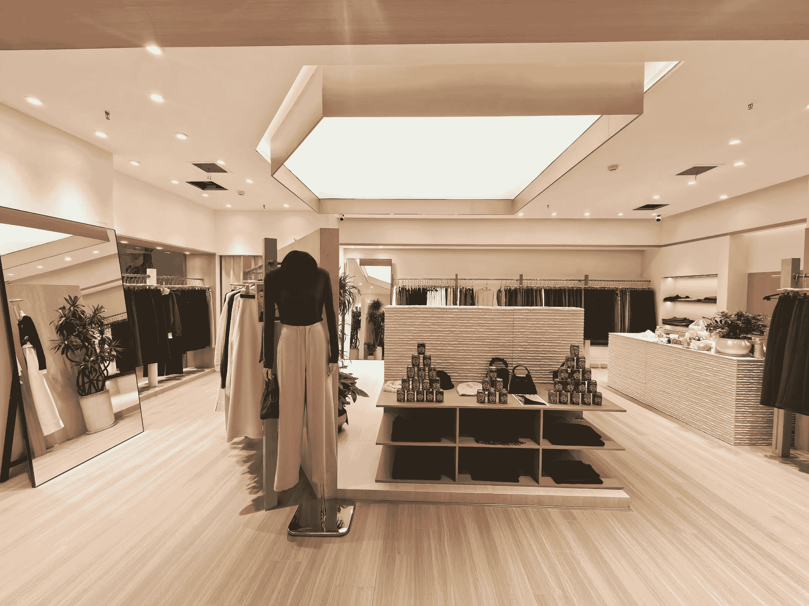
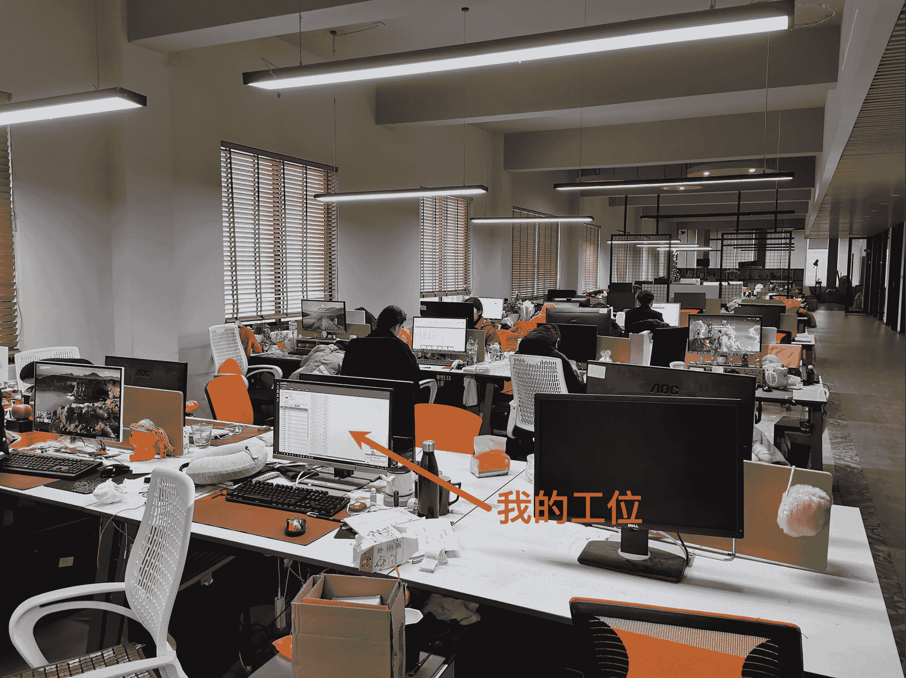
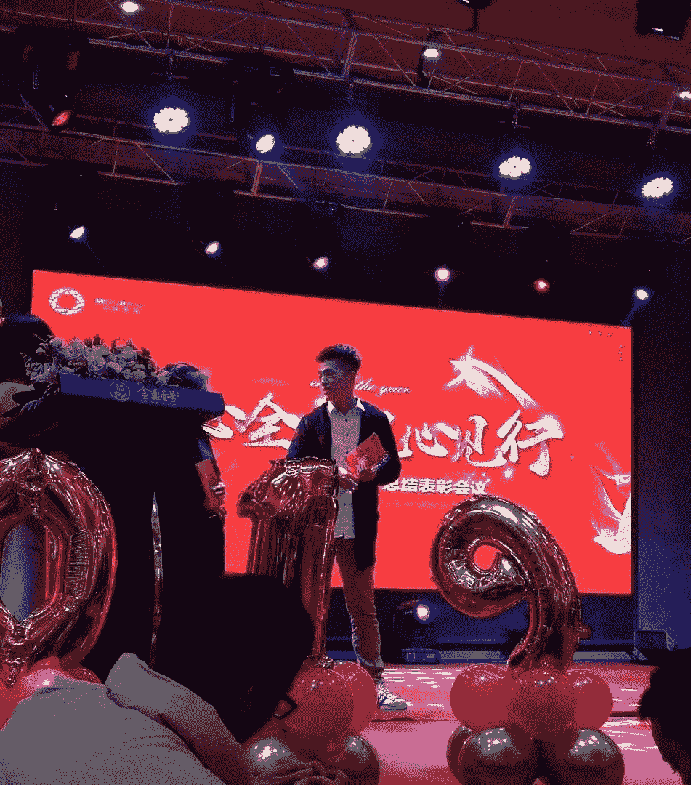
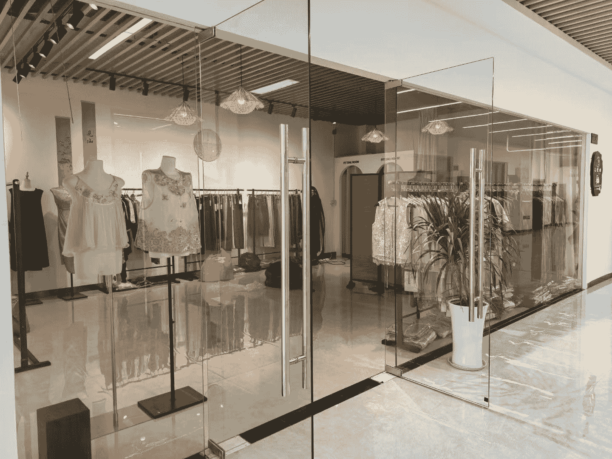

# 十年连创者再涉足企业 AI 商业：经营者视角下的模式、产品矩阵与 ToB 底层逻辑拆解
各位好，我是龙哥。创业十年，跨行跨赛道多轮实战，项目成活率长期保持在 90% 以上。
目前主业仍是女裤批发，手握两处实体批发档口及一座 2400㎡ 的生产基地。同时也在系统性研究并落地企业级 AI 服务业务。

前不久，我在龙哥盟杭州联合办公空间进行了一场两小时多的线下分享，主题为「老板视角下的企业 AI 服务设计逻辑」。本文即为现场内容的整理复盘，并补充了当时未及展开的部分，献给赚钱圈的伙伴。
我不谈技术细节，想聊的是十年做生意的实战坑点、沉淀出的底层判断与思维习惯。核心聚焦「老板思维」与「商业模型」，以多行业经营者的身份聊企业 AI 服务该怎么设计，为还在做 OPC 或处在创业初期的朋友提供一些参考。

## 一、市场上常见的三个卡点
分享伊始，我向到场者提问：「目前在做企业 AI 服务，且客单价在一万以内的，请举手。」
举手者不少。通过接触，我发现独立创业者普遍卡在三处：
- 其一，客单偏低。绝大多数交付定价集中在数百到数千区间，想达成五万营收，需要完成数十到上百笔订单。单月百单的工作量是什么体感？一旦交付偏重，要么忙不过来，要么个人时间被完全吞没。

- 其二，履约过重。大量创作者处于纯 OPC 形态，既定策略、写代码、搞销售、做售后皆一人承担。新客跟进与老客维护撞期，就只能顾此失彼。售后维护和商务对接时间冲突，基本处于手忙脚乱状态。
- 其三，方向不明。有人想进入却不知切入点，有人做了半年以上仍说不清：「我的方案到底解决了企业的哪种真实痛点？」「垂直行业里可落地的真实业务场景是什么？」
坦白讲，这三点我都踩过。这并不是 AI 本身的问题，而是「生意结构」与「对企业本质的理解」问题。结构性难题需要老板思维来解决，不是堆工具就能解决。
因此我把分享分为四块：老板思维 → 商业模型 → 广义 ToB → 产品组合。产品我刻意放最后，因为在我认知里产品只是商业模型里最易替代的一环。线下时长受限，这次文字版对框架做了微调。考虑到赚钱已有不少关于企业 AI 服务的讨论，我更侧重老板思维与商业模型的思考。
## 二、老板思维：你是在做项目，还是在做生意？
### 2.1 三种层级，先对号入座
先给一组对照，自行对照：
| 思维层级 | 典型状态 |
| 员工思维 | 只负责自己那颗螺丝，不关心整体运转。 |
| 早期创业者思维 | 习惯透支自己，所有事亲力亲为，把忙碌等同于进展。 |
| 老板思维 | 擅长整合内外资源，流程 SOP 皆为可调用资源。以终为始做规划，对投入产出极度敏感。 |
三者的核心分野在「以终为始」。老板会先想明明年生意该长成什么样，再倒推当下该做什么；早期创业者多是边做边找路，做着做着发现偏航甚至卡死。
### 2.2 我的转折：从全能单兵到整合者
我自小就只想当老板，从未打算去打工。2014 年上大学便开始创业，2015 年做无货源店群与 SEO 快排，2016 年做第一批直播主播，2017 年大三成立第一家公司做网页与软件定制，我本科是工商管理与法学双学位。几乎每次都能拿到不错的结果，但我也是强兴趣驱动的人，重视体验与过程，享受开荒阶段。一旦对手中事务失去兴趣，要么交出去，要么果断止损，感受优先。
2018 年毕业后进入童装公司做运营，名义上领工资，本质是内部创业。公司给了很大权限。
那段时间我做了很多人不会做的事：
- 主动申请轮岗，客服、运营、拣货、售后、美工、拍摄，每个岗位轮 2-3 周。目的就是把服装电商全链路跑通，建立经营者视角。
- 待遇一般单休，我几乎不休假，除了偶尔想睡懒觉，其余时间都泡在公司琢磨事，不计加班费，自己觉得值。
- 最终做到二级类目 TOP3，运营上有点飘。
2021 年出来继续创业做天猫、跨境虾皮、直播，连续受挫。这次挫败让我更清晰：生意成败绝非个人能力说了算，还涉及资源、团队、产品、资金、兜底机制等诸多变量。
我当时犯了很多运营出身的错，一点点结果就自负。
为何过去总单打独斗？说白了就一句话，我总认为这件事只有我能做好。不是缺团队意识，也不是不愿招人，是放不下心态。招了人也忍不住自己上手，总觉得他人做不出我那样的质量。
21 年受挫后我才真正敢放手。后来的项目我强迫自己结果导向、优化流程，让合伙人及员工自主运转，我只做决策与验收。从「我做所有事」到「我搭系统，让他人跑我对结果负责」。
心态的转变比技能提升更难。老板思维迭代的关键，不是有没有，而是愿不愿意把亲自下场当成阶段性手段。老板前期更该冲在前线，但要清楚什么阶段干什么事，什么时候冲锋，什么时候交棒。若永远冲在交付一线，和螺丝钉打工有何区别？

### 2.3 自检的三道题
会上留了三个问题，整理如下：
1. 你的项目离开你整整一个月，能否正常运转？比如我自己，四月份基本一个月不在档口与工厂，业务照常跑。能做到这一点，才算有点老板的样子。
2. 上周你花时间最多的事情是决策类还是执行类？如果你一周都在干具体活，你本质是在为自己打工、为员工打工、为客户打工，时薪可能不如员工。
3. 半年到一年后，你的项目会是什么形态？有人做了一年，手里事务几乎没变，一直埋头执行，没有自我迭代、没有扩大团队、没有优化商业模型，最后连活怎么交出去都不知道，可能一开始就没法交出去。
这三题没有标准答案，关键是是否愿意诚实自问，清楚自己到底想要什么。
### 2.4 省钱是过程，扩张才是终点
做 AI 工具的朋友喜欢以「降本增效」做卖点。这里有个常被忽略的视角。
降本只是手段，不是目的。几乎没有老板的终极诉求是省点钱，大部分老板要的是增长、扩张。AI 确实能立竿见影看到成本下降，这是实打实的钱，但光靠省钱发不了财、做不大。降本是中间环节，扩张才是目的与结果。
视角不同，定价就不同：
OPC 视角的卖点是「帮你降本」「提效」「减人力」；老板视角的卖点是「帮你做大」「拓客」「扩张」。
OPC 想做得刚好即止，老板想做大做强。这是两种世界观。
卖降本方案，老板可能只愿意付几千；卖扩张方案，他可能愿意付几十万。技术成本相同，定位不同，价格能差数十倍。
## 三、商业模型：把成熟做法搬到未成熟市场再做一遍
### 3.1 跳出项目思维，看模型思维
我接触下来，大多数创业者是「项目思维」——看到什么热就跟什么，飞书多维表格、Agent 部署、小红书资料包……只盯产品本身，不看模式、不看需求、不看市场。
产品只是商业模型的一个环节。一个完整的商业模型至少包括九项——
| 要素 | 说明 |
| 客户与定位 | 服务谁 |
| 产品 | 交付什么 |
| 定价 | 如何收费 |
| 渠道 | 如何获客 |
| 履约 | 如何交付 |
| 分工 | 谁来执行 |
| 核心资源 | 关键资产 |
| 成本结构 | 主要成本 |
| 合作伙伴 | 上下游与同行 |
同一模型下，任意一项变动，结果完全不同。很多人经历无数项目仍不会挖掘客户需求、找痛点、定制产品，因为只改「产品」这一格。
### 3.2 选模型的核心公式
找到一个成熟且优质的商业模型，在一个不够成熟的市场里重新做一遍。
上一次出现类似颠覆是互联网。第一代互联网巨头几乎都走这条路：美国黄页到中国黄页，eBay 到淘宝，ICQ 到 QQ，抖音到 TikTok，拼多多到 TEMU。
软银孙正义的时光机理论：利用国家或行业间发展阶段的非平衡性，把成熟市场验证过的模型在新兴市场降维打击。
我们不发明模型，只做搬运工，学习、迁移、改造、落地。我创业多年一直遵循这套，真的是屡试不爽。
### 3.3 真实案例拆解
以我 2023 年的真丝女装供应链案例为例：
| 真丝女装供应链案例 | 拆解 |
| 市场观察 | 2023 年进湖州做真丝女装供应链。当时市场处于早期，本地散户被集中到园区做批发，供货体系刚建立，款式同质化严重，缺乏开发能力。 |
| 成熟模型 | 杭州、深圳的原创国风真丝供应链已非常成熟，款式设计时尚高级。 |
| 迁移动作 | 把杭州深圳的成熟原创国风供应链模型迁移到湖州，做高客单批发，结合自身加工厂与上下游资源切入。 |
| 结果 | 客户质量高，款式风格受认可，本地具备代表性。 |
当时湖州做这套的几乎只有我们一家。事并不复杂，关键是同时看到「成熟模型 + 不成熟市场 + 我有迁移资源」这三点，需要跨行业视野与大量积累。

左两张是我第一家店，当时约 20 平。右图是第二家店，近 50 平。
### 3.4 模型自检三问

1. 你对标的模型是否足够成熟、优质？
2. 你想去的目标市场是否确实还不成熟？
3. 你有没有把这个模型落地改造的资源？
第三点最关键。很多人有想法没资源，资源不够就去积累、整合、找合适的合伙人，不要硬上，要有自知之明。
### 3.5 用长板攻对手的短板
我以前练长跑，常用跟跑战术：跟在前几名后面省体力、不顶风，关键时刻再超。如果确定对手都不如我，直接起跑冲第一，拉开差距形成心理压制。
读书也一样。我不跟文化前几比文化，跟他们比体育；跟体育好的比成绩；跟全能的比兴趣爱好。不正面硬碰，用自己的长板打别人的短板。
生意同理。我现在做女裤批发，凭专业肯定打不过做几十年的老老板。但我把商业模型设计、线上获客、多渠道运营、AI 技术等我擅长的叠加进去，就是降维打击。我不需要在女裤上比专业，只需叠加别人没有的优势。
企业 AI 服务也一样，先想清楚你的长板在哪：行业资源？产品设计能力？圈层人脉？找到后，再去找一个对方在长板上偏弱的赛道重新设计产品与模式，比正面内卷划算。
## 四、你真的理解 ToB 吗？
### 4.1 常见方向的暗坑
关于 ToB，我观察到大量创业者存在认知偏差。先看几个常见坑：
| 常见方向 | 核心暗坑 |
| 飞书多维表格类提效项目 | 重交付、低客单、低复购，本质一次性生意。 |
| AI Agent 安装调试 | 客单价难做高，一次性。大厂下场后门槛只会更低。 |
| 面向员工的 AI 技能培训 | 员工自费提升效率反人性，预算有限。公司报销本质也是 To C，面向个人，未触及组织。 |
不是否定这些方向，每个方向都有生态位。我只是为后面对比做铺垫。
### 4.2 真正的 ToB 是 To Business，不是 To Boss
重点来了。
| 类型 | 判断标准 |
| To Boss | 卖给老板个人，老板体验决定一切，本质面向个人消费。 |
| To Business | 为整个组织提供能力，让组织更协作、可复制、可沉淀。 |
企业 = 老板 + 员工 + 流程 + 资产 + ……
是复杂有机体。真正的企业 AI 服务要面向组织，提升组织能力，而不是取悦老板个人或帮员工偷懒。这个判断决定你能走多远、走多久。
### 4.3 成功迁移的案例：企业 AI 内训陪跑
对很多规上企业，自建内容团队、营销团队是必然的，比如做创始人 IP，普遍会自建团队。成熟模型是「老板 + 助理」陪跑，客单价数万到十几万：
- 老板端提升认知：为什么做、需要什么样的人、薪资如何定、工作怎么排、结果如何检验。
- 助理端提升技能：落地、剪辑、编导、SOP 建立。
既满足企业培训需求，又满足老板认知需求，还能回去落地，是高利润且可积累的生意。
迁移到 AI 领域就是企业 AI 内训陪跑：
| 交付项 | 内容 |
| 客单价 | 6-10 万/单 |
| 周期 | 7-14 天 |
做企业级 AI 服务，别照搬网上的套路，先把底层打法想清楚。
对老板端，我们做的是认知层面的赋能。帮助他们搞明白 AI 到底能干什么、不能干什么，这东西适合落在哪类场景，团队里要招怎样的人，薪酬怎么定，考核怎么设计，哪些事情可以交出去。不是堆概念，而是让决策有边界。
对一线助理，我们做的是技能层面的落地。教他们具体用什么工具、怎么把工具嵌进日常工作、如何把经验沉淀成可复用的 SOP。让使用从尝鲜变成习惯。
做完培训还不够，必须有后续的陪跑跟进。没有持续的跟踪，能力就会流失在企业里。所以我们是一套闭环：认知先行，技能跟上，效果沉淀。
这样交付的成本相对可控，客单价却能做起来，而且会产生复利。还能主动筛选客户，优先服务那些本来就有基础、能执行好的企业，用这些成功案例不断放大口碑。
这套做法不是给老板听个刺激的课，也不是让员工偷懒的工具。它是真正把 AI 能力植入到组织血脉里的过程。
当然很多人看到案例会觉得“这我都知道”。知道和真的理解是两回事。你能不能吃透背后的底层逻辑、设计的思路、真正的核心诉求，能不能回答 why，这就决定了你能不能把这套方法灵活迁移到你未来很长的创业路上。
五、别再做单品创业了，做矩阵
5.1 摆脱单品依赖
如果你想从个人创业者升级到真正的生意掌控者，就必须建立产品组合。单一产品太脆弱，抗风险能力几乎为零。
需求一变、平台规则一调、对手一出新品，你立刻被动。
真正稳的打法是搭建一个三件套矩阵：引流品、利润品、明星品。
5.2 引流品的打法：以服装财务 AI 助理为例
我自己的行业里，服装档口有个很小的痛点却特别烦人——对账。ERP 记一笔，银行记一笔，每天流水必须靠财务人工核对。一个财务月成本 8000 到 12000，干的都是重复枯燥的活。
这件事用 AI 处理其实非常顺滑，无非是导出两张表、清洗、核对、记录、汇报，可以做成高度自动化的助理。
我给这个产品的心理价位是 0 到 99 元左右。
会亏吗？基本不亏。开发门槛低，就是一点点 token 成本，几乎免维护。图的也不是这百把块钱，而是用极低门槛让大量老板愿意先试一试，让他们亲眼看到 AI 在真实业务里的价值，建立第一层信任。
很多创业者会本能地拿人工成本去定价，这就错了。既说明对行业不够熟，也说明产品矩阵思维没建立。
服装行业常用的软件订阅也就几百到几千，老板对软件的价格预期就在这个区间。超出就劝退。何况财务是敏感地带，涉及真金白银，老板天然谨慎。
所以 0-99 元作为引流品最合适。价格低到决策几乎为零。试用后我们就能触达老板，后续再做高客单转化。
引流品的本质就是：超出预期的体验 + 出乎意料的低价。它不负责赚钱，负责把人拉进来。
5.3 矩阵三层的分工
引流品：不求盈利，只求触达和信任建立。
利润品：高客单的培训、陪跑、AI 内训等服务，这是现金流的核心。
明星品：比如企业级的 AI 管理咨询，定价几十万到上百万。卖不卖得出去不是重点，重点是它摆出来就能彰显你的专业高度和想象空间。
如果你现在就在做企业 AI 服务，马上画一张产品海报，把最高端的那个品定价拉高，发朋友圈。成不成交都无所谓，先让市场看见你的天花板。
六、好产品的三条硬标准：高毛利、高复购、低维护
这是我一直坚持的运营铁律，跟 AI 没关系，放哪都成立。
高毛利：利润要够厚，才能覆盖试错、优化、服务和日常消耗。别碰重研发、回本慢的项目。个人创业者的弹药有限，不跟大厂打消耗战。
高复购：复购意味着客户终身价值在增长。一次性生意天花板很低。
低维护：售后、扯皮、反复修改最耗人。重维护的产品会拖垮整盘生意。
三条缺一条，稳定性就没了。
七、真实需求拆解
现场有老师点播，我额外整理了几个我实地聊到过的行业痛点，供大家参考方向。
1. 保险，以港险为例
港险销售偏向超级个体，独立性强。需求是：各家公司产品频繁更新，需要监控官网、快速阅读理解、做个性化对比、挑选主推产品；同时要结合不同客户情况定制方案。重复动作包括条款解析、数据对比、PPT 与方案制作。核心是数据监控采集、清洗分析、销售策略个性化、客户方案个性化。客单预期几千到几万，且常有团队团购需求。
2. 创始人 IP
规上企业，尤其多部门、多渠道的公司，需要企业级内容营销。传统团队要编导拍摄剪辑助理，人力成本高。他们的诉求是矩阵化运营，覆盖老板、高管、渠道商。重复工作有采访、选题收集、企业事件整理、文案撰写、内容个性化、数据监控。他们要的是完整的企业协作流程、权限管控、多账号协同。客单几万到几十万，可延伸到培训、落地、工具开发。
3. AI 硬件落地
比如销售 AI 工牌，尺寸像普通工牌，带小屏和录音，可对接大模型。能做对话记录分析、客户心理判断、实时策略推送、知识库联动。还有 AI 接待台、AI 前台等垂直硬件。需求真实且付费意愿明确，可以往里发散。
这些都是老板在真实场景里提的需求，不是杜撰。可以用前面的方法论再拆一遍，找到自己的切入点。最后想清楚自己想要什么、擅长什么。

八、五个自检问题
1. 你熟悉哪些行业和资源？企业 AI 服务最容易启动的方式，就是从你已深耕的行业切入。别只混 AI 圈，走出去接触真实企业的老板，再用选模式的核心公式和三个审查问题去判断机会。
2. 你要服务的到底是企业的哪个要素？To B 服务的是组织能力，组织能力的核心是流程、协作、可复制、可沉淀。你的产品在提升哪一块？
3. 你规划过产品矩阵吗？按引流-利润-明星三层去设计。现在就可先发一张“xx 万 AI 管理咨询”的海报试水。身份是自己塑造出来的。
4. 你的客单价有升级路径吗？典型路径：工具 → 订阅 → 平台 → 咨询。没有升级路径，生意上限很低。
5. 你的生意离开你还能跑吗？回到老板思维的自检标准。能跑的是生意，不能跑的是项目。
九、最后几句
有人问我：没有资源没有人脉，普通人怎么进入企业 AI 服务？
我的回答是：别先给自己贴普通人的标签。能意识到赛道、能持续学习实践 AI 应用，你已经超过 99% 的人了。
三步走：先选一个你真正感兴趣的行业；再走出去大量接触该行业的真实老板；然后在接触中积累认知、痛点和需求。
做企业 AI 服务本质上还是挖掘需求、满足需求，只是场景更垂直。
想挣 100 万，本质是算术题：1 万客单 × 100 单 = 100 万。难点不在数字，而在你能不能把客单做到 1 万，能不能积累好客户池，能不能保证转化与交付。
分享会总结了三句话：
第一，思维决定起点。老板思维是底层驱动力，要以终为始规划。
第二，模式大于产品。产品是模式里的一环。
第三，搞清 To B 的定位。是 To Boss 还是 To Business，这决定天花板。
我只是个站在传统服装生意里，又有 AI 思维的人。站在行业与技术的交界点。这篇文章里的判断都来自我十年做生意的实战经验，不一定全对，但都交过学费。
如果能给你一点启发，这篇分享就值了。